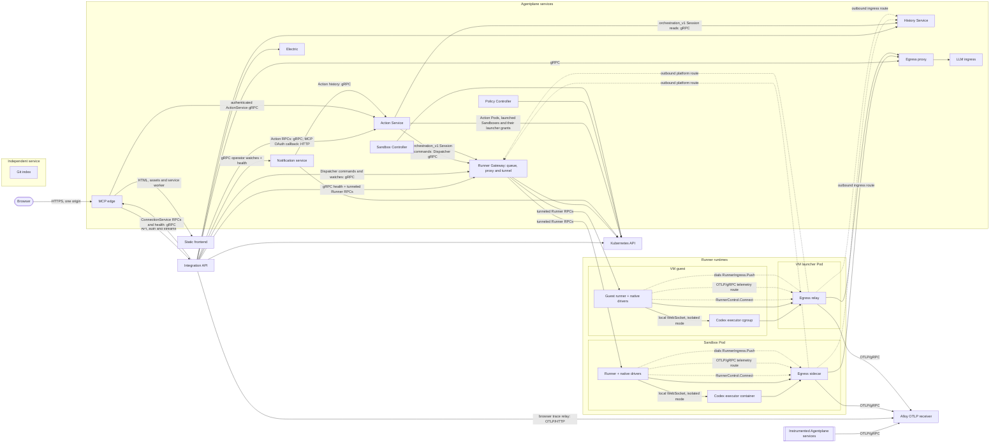

# Agentplane

Agentplane runs coding agents in Kubernetes sandboxes and mediates what they do outside them:
network egress with credentials substituted at the proxy, operator-approved or policy-approved
Actions, and notifications. Its services are separately deployable; the Action Service supplies
the approval gateway for any MCP-capable LLM product, exposed externally through the standalone MCP edge.

**Design principles:** [`docs/principles.md`](docs/principles.md). Check new designs against it.

## Services

- [Action Service](action_service/README.md): ActionRequests, Decisions, auto-approval policies,
  upstream MCP execution and the gRPC/HTTP APIs used by the MCP edge.
- [MCP edge](mcp_edge/README.md): external Connection/OAuth authority and `/mcp`; forwards authenticated Actions calls over gRPC.
- [Runner Gateway](runner_gateway/README.md): one process serving the runner control stream,
  authorized live Runner proxy and [Session Dispatcher](runner_gateway/dispatcher/README.md) durable queue.
  New serving Pods run the queue migration before starting ([deployment](runner_gateway/README.md#deployment)).
- [History Service](history_service/README.md): retained Session history, read by the
  integration app and the Notification service.
- [Runner](runner/README.md) and [native drivers](native/README.md): run Claude Code or Codex in a
  sandbox and journal what they do.
- [Egress proxy](egress/README.md): authenticates sandbox workloads and substitutes credentials.
- [Policy Controller](policy_controller/README.md): expires `PolicyBinding`s and keeps the
  RoleBindings they grant.
- [Sandbox Controller](sandbox_controller/README.md): reconciles `Sandbox` into its ServiceAccount,
  `PolicyBinding`, state PVC and Pods or a KubeVirt VM.
- [LLM ingress](llm_ingress/README.md): authenticated hop in front of LiteLLM.
- [Notification service](notification_service/README.md): subscriptions and session inboxes.
- [Indexing](indexing/README.md): Git semantic search.
- [Integration app](app/README.md): the human-facing frontend over the services above, and a
  client of them. Its static browser shell has a separate [frontend image](app/frontend/serving/README.md).

## Go service images

The Go Action Service, MCP edge, relay, LLM ingress, Runner Gateway, queue migrator, Policy Controller, Sandbox
Controller, egress proxy, egress sidecar and egress history migrator build with `pure = "on"` on the pinned
`gcr.io/distroless/static-debian13:nonroot` base (CA certificates and timezone data, no shell), with
explicit UID/GID `1000:1000` and working directory `/`. LLM ingress also keeps the repository's
explicit CA bundle layer. The Go runner uses its Nix sandbox image; Python services use their own
runtime images.

## System overview

Service boundaries and traffic, independent of environment or replica layout. API arrows point
caller to callee; labels such as `response` show data on that edge; dashed arrows are
runner-initiated platform routes. Per-path diagrams (session delivery, runner control tunnel,
history and browser sync, notifications, actions and egress) and direct API definition links:
[system overview](docs/system_overview.md).

A VM guest runs the runner; its relay is in the separate KubeVirt launcher Pod. The Git index is
standalone, with no dependency on the backend services or the app: it polls a configured Git remote,
embeds files through an embedding endpoint and owns its own PostgreSQL database
([indexing README](indexing/README.md)).

- **Sessions and Threads.** A Session is a runner's raw Event stream; a Thread is its conversation
  view, folded by the History Service. Runners push Events to the History Service, the only way into
  retained history.
- **Runner traffic is outbound.** Runner Pods admit no connections. Everything a runner sends goes
  through its Pod's egress sidecar: to the egress proxy, which authenticates the Pod and substitutes
  credentials, or over the sidecar's platform routes with the Pod's own token to the Runner Gateway
  and History Service ingress. A VM Sandbox's guest uses an identical relay that Kyverno adds to its
  KubeVirt launcher Pod. Commands and lifecycle requests reach runners over the `RunnerControl`
  stream they dial to the Runner Gateway, routed per Sandbox by its `<sandbox>-control` Service and
  `<sandbox>-runner` Lease ([runner control stream](docs/runner_control.md)).
- **Telemetry uses Alloy as its collector.** SDK-instrumented services export OTLP/gRPC to Alloy.
  Browser spans post to the same-origin App relay, which forwards OTLP/HTTP to Alloy. Runner spans use
  the sidecar's local telemetry route; VM guest spans use the launcher relay's guest gateway route.
- **Databases.** Each service owns a database on one shared CNPG cluster: `app`, `sandbox_service`
  (Session history, owned by the History Service), `actions`, `egress`, `notifications` and
  `session_dispatcher` (also the Gateway's queue; the Gateway has no registry database).
- **Sandbox lifecycle and runner control.** The app writes requested Sandbox state and operator
  grants to Kubernetes; the Sandbox Controller reconciles them, owns `Sandbox.status`, and holds
  deletion until the runner has sealed its Sessions through the Gateway. Notifications and the
  Runner Gateway read Sandbox inventory directly. The Runner Gateway implements Dispatcher Session
  openings and durable command admission/delivery alongside the control stream; the app reads live
  runner inventory and diagnostics through the Runner Proxy, which checks the live Sandbox name, UID
  and owner. The Runner starts and resumes its own harnesses.

Status, open work and design gates: [`plans/`](plans/README.md).

## Implemented contracts

- [Action Service spec](action_service/SPEC.md) and [README](action_service/README.md): catalog,
  Decisions, events, bounded waits, cancellation, generic MCP, configured Identities, Connection
  grants, OAuth/consent.
- [Agent CLI](docs/agent_cli.md): the `agentplane` command ([`cli/`](cli/)) over the Action,
  Notification and Egress rules APIs; output, errors, exit codes, submitting and waiting.
- [App README](app/README.md): consent and Action-review presentation.
- [Sandbox Actions](action_service/sandbox/README.md): exec targets for agents hosted outside the
  cluster (sandboxes running as the calling ServiceAccount; Kubernetes reach from inside one).
- [Thread, runner, and harness layering](docs/thread_layering.md): command/Event architecture,
  Thread identity continuity, native recovery, optional app-first acceptance.
- [Thread view synchronization](docs/thread_view_sync.md): conversation model, sync-engine
  integration, on-demand Raw, history/catch-up, frontend state (distinct from the raw-replay API).
- [Executor liveness](docs/executor_liveness.md), [operator federation](docs/operator_federation.md),
  [workload authentication](docs/workload_authentication.md), [launch presets](docs/launch_presets.md),
  [action policies](docs/action_policies.md); the rest under [`docs/`](docs/).
