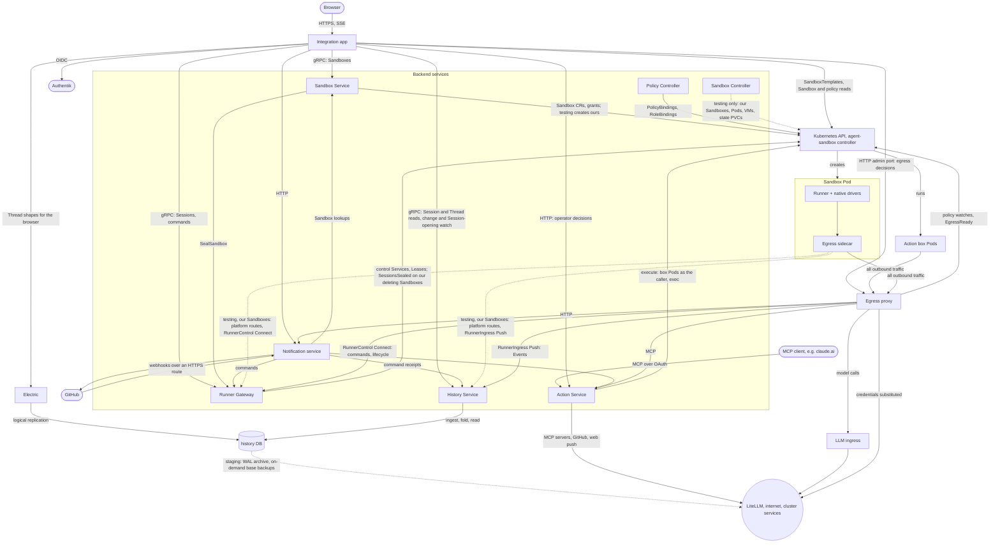

# Agentplane

Agentplane runs coding agents in Kubernetes sandboxes and mediates what they do outside them:
network egress with credentials substituted at the proxy, operator-approved or policy-approved
Actions, and notifications. Its services are separately deployable; the Action Service alone is
an MCP approval gateway for any MCP-capable LLM product.

**Design principles:** [`docs/principles.md`](docs/principles.md). Check new designs against it.

## Services

- [Action Service](action_service/README.md): ActionRequests, Decisions, auto-approval policies,
  and an MCP endpoint over OAuth.
- [Sandbox Service](sandbox_service/README.md): Sandbox lifecycle, grants, egress and teardown.
- [Runner Gateway](runner_gateway/README.md): the runner control stream, Sessions, and command
  admission and delivery.
- [History Service](history_service/README.md): retained Session history, read by the
  integration app and the Notification service.
- [Runner](runner/README.md) and [native drivers](native/README.md): run Claude Code or Codex in a
  sandbox and journal what they do.
- [Egress proxy](egress/README.md): authenticates sandbox workloads and substitutes credentials.
- [Policy Controller](policy_controller/README.md): expires `PolicyBinding`s and keeps the
  RoleBindings they grant. Runs on staging and `agentplane-testing`; only Flux writes `PolicyBinding`s yet.
- [Sandbox Controller](sandbox_controller/README.md): reconciles our own `Sandbox` into its state
  PVC and Pods or a KubeVirt VM. Runs on `agentplane-testing` only.
- [LLM ingress](llm_ingress/README.md): authenticated hop in front of LiteLLM.
- [Notification service](notification_service/README.md): subscriptions and session inboxes.
- [Indexing](indexing/README.md): Git semantic search.
- [Integration app](app/README.md): the human-facing frontend over the services above, and a
  client of them.

## System overview

What staging runs ([`cluster/cdk8s/agentplane/`](../cluster/cdk8s/agentplane/chart.py)).

- **Sessions and Threads.** A Session is a runner's raw Event stream; a Thread is its
  conversation view, folded by the History Service. Every runner pushes its Events to the History
  Service, the only way into retained history.
- **Runner traffic is outbound.** Everything a runner sends goes through its Pod's egress
  sidecar to the egress proxy, which authenticates the Pod and substitutes credentials, and runner
  Pods admit no connections. Commands and lifecycle requests reach runners over the `RunnerControl`
  stream they dial to the Runner Gateway, routed per Sandbox by its `<sandbox>-control` Service and
  `<sandbox>-runner` Lease ([runner control stream](docs/runner_control.md)).
- **Databases.** Each service owns a database on one shared CNPG cluster: `app`,
  `sandbox_commands` (the Runner Gateway's Session registry),
  `sandbox_service` (Session history, written by the History Service), `actions`,
  `egress` and `notifications`; the Sandbox Service has none. Only the history database is drawn.
- **Sandbox Service and Runner Gateway.** The Sandbox Service owns Sandbox lifecycle, grants
  and teardown; the Runner Gateway owns everything that talks to a runner: Sessions,
  commands and the runner control stream. They run as separate Deployments with their own accounts,
  and the Sandbox Service seals a Sandbox through the gateway before deleting it.

Status, open work and design gates: [`plans/`](plans/README.md). Implemented contracts:
[`docs/`](docs/).
