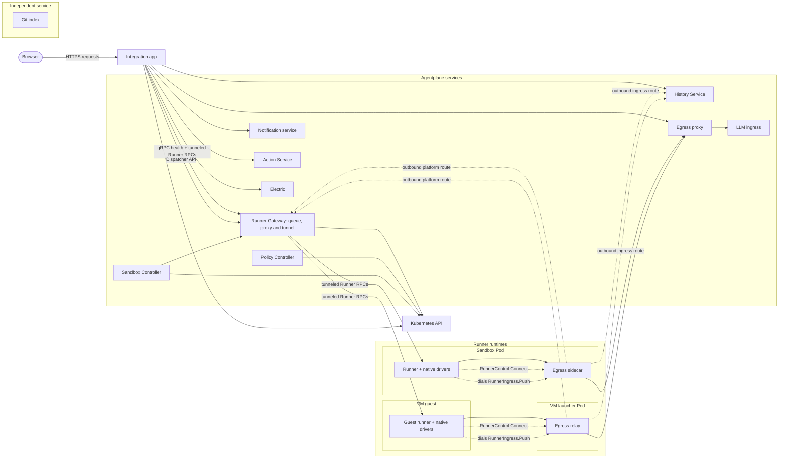
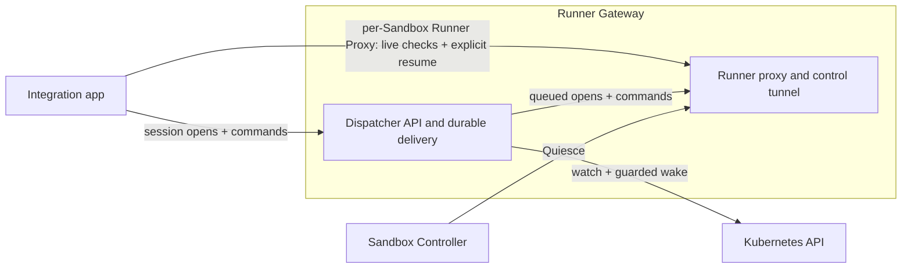
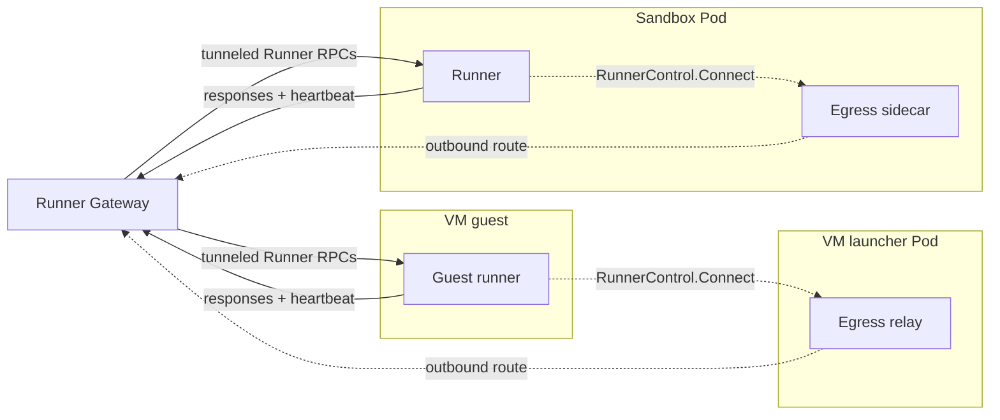
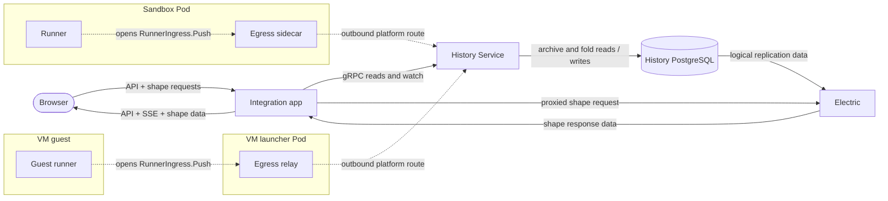
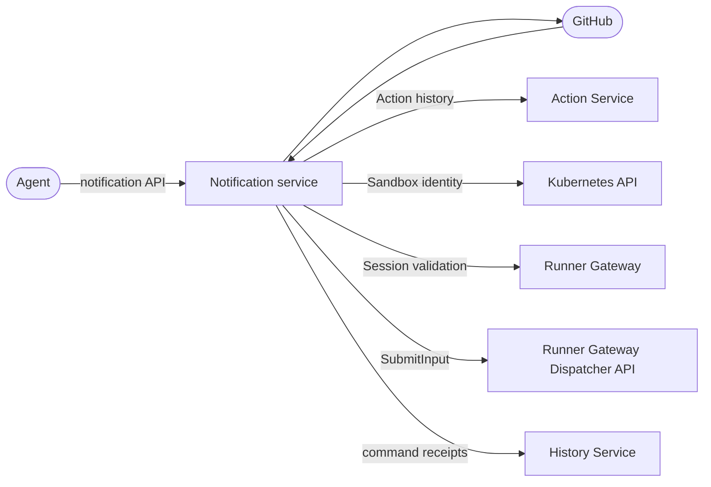
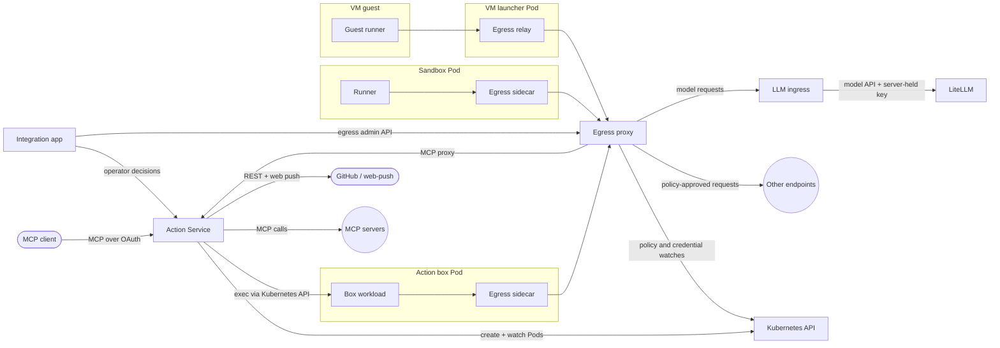

# Agentplane

Agentplane runs coding agents in Kubernetes sandboxes and mediates what they do outside them:
network egress with credentials substituted at the proxy, operator-approved or policy-approved
Actions, and notifications. Its services are separately deployable; the Action Service alone is
an MCP approval gateway for any MCP-capable LLM product.

**Design principles:** [`docs/principles.md`](docs/principles.md). Check new designs against it.

## Services

- [Action Service](action_service/README.md): ActionRequests, Decisions, auto-approval policies,
  and an MCP endpoint over OAuth.
- [Runner Gateway](runner_gateway/README.md): one process serving the runner control stream,
  authorized live Runner proxy and [Session Dispatcher](session_dispatcher/README.md) durable queue.
  Serving waits for a root-owned queue migration ([deployment](runner_gateway/README.md#deployment)).
- [History Service](history_service/README.md): retained Session history, read by the
  integration app and the Notification service.
- [Runner](runner/README.md) and [native drivers](native/README.md): run Claude Code or Codex in a
  sandbox and journal what they do.
- [Egress proxy](egress/README.md): authenticates sandbox workloads and substitutes credentials.
- [Policy Controller](policy_controller/README.md): expires `PolicyBinding`s and keeps the
  RoleBindings they grant. Runs on staging and `agentplane-testing`; only Flux writes `PolicyBinding`s yet.
- [Sandbox Controller](sandbox_controller/README.md): reconciles `Sandbox` into its ServiceAccount,
  `PolicyBinding`, state PVC and Pods or a KubeVirt VM (VMs on staging and `agentplane-testing`).
- [LLM ingress](llm_ingress/README.md): authenticated hop in front of LiteLLM.
- [Notification service](notification_service/README.md): subscriptions and session inboxes.
- [Indexing](indexing/README.md): Git semantic search.
- [Integration app](app/README.md): the human-facing frontend over the services above, and a
  client of them.

## Go service images

The Go relay, LLM ingress, Runner Gateway, queue migrator, Policy Controller and Sandbox
Controller use the pinned `gcr.io/distroless/static-debian13:nonroot` base. Their binaries are
built with `pure = "on"`; images retain explicit UID/GID `1000:1000` and working directory `/`.
The base supplies CA certificates and timezone data. LLM ingress retains the repository's
explicit CA bundle layer. These images have no shell; runners and Python services use their
own runtime images.

## System overview

These diagrams show service boundaries and traffic, independent of any one environment or replica
layout. The overview keeps the complete service map compact; the focused diagrams below show the
API callers and data paths. API arrows point from caller to callee; labels such as `response` and
`replication` show data moving along that edge. Dashed arrows are runner-initiated platform routes.
The Git index is independent of the backend service graph and has no dependency on the integration app.

### Overview

The map shows every service and runtime placement. A VM guest runs the runner; its relay is in the
separate KubeVirt launcher Pod. Detailed API dependencies appear below. The `Git index` is a
standalone service; it polls a configured Git remote, embeds files through an embedding endpoint
and owns a separate PostgreSQL database. See the [indexing README](indexing/README.md).

### Session delivery

### Runner control tunnel

The runner opens the long-lived `RunnerControl.Connect` stream through its Pod's egress sidecar or
the VM launcher's relay. The Gateway sends `Runner` RPC calls back through that existing stream,
and responses return there; neither Pod accepts an inbound Gateway connection.

### History and browser sync

The app initiates each Electric HTTP request and streams the shape response through to the browser.
The separate `History PostgreSQL → Electric → app → browser` arrows show replicated and returned data.

### Notifications

The Notification service does not call the integration app. GitHub sends it signed webhooks; it
makes GitHub App REST calls, reads receipt evidence from History before retrying a delivery, and
submits every runner notice through the Session Dispatcher.

### Actions and egress

The egress proxy substitutes a configured credential only for the destination covered by its
policy. LiteLLM is a separate hop behind LLM ingress; only that service holds the LiteLLM virtual key.

### Service definitions

The service nodes above link to their definitions in renderers that support Mermaid node links.
These direct links are also available in Markdown views that do not:

- gRPC: [RunnerControl](proto/runner_control.proto), [tunneled Runner RPCs](proto/runner.proto), [RunnerIngress](proto/runner_ingress.proto), [Session Dispatcher](proto/session_dispatcher.proto), and [History Service](proto/history_service.proto). The Runner Gateway also serves standard gRPC health and proxies the Runner service over each outbound control stream.
- HTTP and streaming APIs: [Integration app](app/api.py), [Electric proxy](app/electric.py), [Action Service](action_service/api.py), [Notification Service](notification_service/api.py), [LLM ingress](llm_ingress/server.go), and [Git index](indexing/app.py).
- Controllers and egress: [Sandbox Controller](sandbox_controller/controller.go), [Policy Controller](policy_controller/controller.go), [central egress proxy](egress/addon.py), [Go sidecar](egress/sidecar/main.go), and [sidecar route configuration](egress/platform_routes.py).

The integration app writes Sandbox desired state and operator grants through the Kubernetes API;
the Sandbox Controller reconciles those requests and owns `Sandbox.status`. Notifications and the
Runner Gateway read Sandbox inventory directly. The Sandbox Service Deployment, API and server
source are retired; the History Service retains its database and authored history.

- **Sessions and Threads.** A Session is a runner's raw Event stream; a Thread is its
  conversation view, folded by the History Service. Every runner pushes its Events to the History
  Service, the only way into retained history.
- **Runner traffic is outbound.** Everything a runner sends goes through its Pod's egress
  sidecar: to the egress proxy, which authenticates the Pod and substitutes credentials, or, for the
  Runner Gateway and the History Service ingress, over the sidecar's platform routes with the Pod's
  own token. Runner Pods admit no connections; a VM Sandbox's guest sends the same traffic to an
  identical relay that Kyverno adds to its KubeVirt launcher Pod. Commands and lifecycle requests reach runners over
  the `RunnerControl` stream they dial to the Runner Gateway, routed per Sandbox by its `<sandbox>-control` Service and
  `<sandbox>-runner` Lease ([runner control stream](docs/runner_control.md)).
- **Databases.** Each service owns a database on one shared CNPG cluster: `app`,
  `sandbox_service` (Session history,
  written by the History Service), `actions`, `egress`, `notifications` and `session_dispatcher`.
  The History Service retains the existing `sandbox_service` database; no database or authored
  history is removed with the Sandbox Service Deployment. The history and Dispatcher databases are drawn.
- **Sandbox lifecycle and runner control.** The app writes requested Sandbox state and operator
  grants to Kubernetes; the Sandbox Controller reconciles resources and owns status. The Runner Gateway
  implements Dispatcher Session openings and durable command admission/delivery alongside its runner
  control stream and authorized live runner access. The app reads
  current runner inventory and explicitly resumes a retained harness through the Sandbox control
  Service, with the Runner Proxy checking the live Sandbox name, UID and owner. Its queue uses the existing Dispatcher database; the Gateway has no separate registry database. The controller holds deletion until the runner has sealed its Sessions through the Gateway.

Status, open work and design gates: [`plans/`](plans/README.md).

## Implemented contracts

Use the [Action Service specification](action_service/SPEC.md) and [README](action_service/README.md) for
catalog, Decisions, events, bounded waits, cancellation, generic MCP, configured Identities, Connection grants,
and OAuth/consent. The [app README](app/README.md) owns the consent and Action-review presentation contracts.
[Executor liveness](docs/executor_liveness.md), [operator federation](docs/operator_federation.md),
[workload authentication](docs/workload_authentication.md), [launch presets](docs/launch_presets.md) and
[action policies](docs/action_policies.md) own the other implemented contracts.
[Sandbox Actions](action_service/sandbox/README.md) owns the exec-target contract for agents hosted outside the
cluster: sandboxes that run as the calling ServiceAccount, and Kubernetes reach from inside one.
[Thread, runner, and harness layering](docs/thread_layering.md) owns the command/Event architecture, Thread
identity continuity, native recovery and optional app-first acceptance. [Thread view
synchronization](docs/thread_view_sync.md) owns the conversation model and sync-engine integration, on-demand Raw,
history/catch-up and frontend state; it is distinct from the implemented raw-replay API. The rest are under
[`docs/`](docs/).
