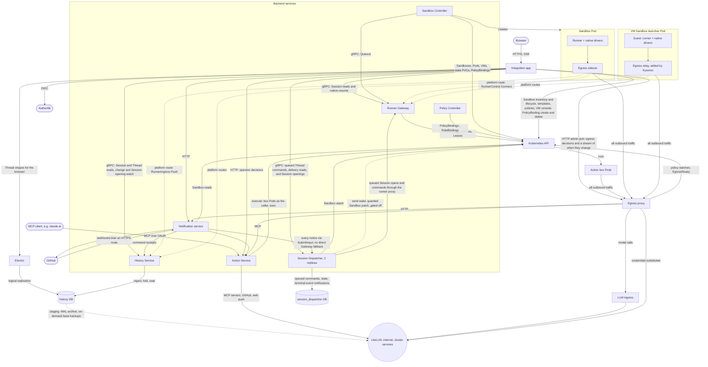

# Agentplane

Agentplane runs coding agents in Kubernetes sandboxes and mediates what they do outside them:
network egress with credentials substituted at the proxy, operator-approved or policy-approved
Actions, and notifications. Its services are separately deployable; the Action Service alone is
an MCP approval gateway for any MCP-capable LLM product.

**Design principles:** [`docs/principles.md`](docs/principles.md). Check new designs against it.

## Services

- [Action Service](action_service/README.md): ActionRequests, Decisions, auto-approval policies,
  and an MCP endpoint over OAuth.
- [Runner Gateway](runner_gateway/README.md): the runner control stream, Sessions, and command
  admission and delivery.
- [Session Dispatcher](session_dispatcher/README.md): the durable command queue and delivery state
  between senders and Sandbox runners.
- [History Service](history_service/README.md): retained Session history, read by the
  integration app and the Notification service.
- [Runner](runner/README.md) and [native drivers](native/README.md): run Claude Code or Codex in a
  sandbox and journal what they do.
- [Egress proxy](egress/README.md): authenticates sandbox workloads and substitutes credentials.
- [Policy Controller](policy_controller/README.md): expires `PolicyBinding`s and keeps the
  RoleBindings they grant. Runs on staging and `agentplane-testing`; only Flux writes `PolicyBinding`s yet.
- [Sandbox Controller](sandbox_controller/README.md): reconciles `Sandbox` into its ServiceAccount,
  `PolicyBinding`, state PVC and Pods or a KubeVirt VM (VMs on staging and `agentplane-testing`).
- [LLM ingress](llm_ingress/README.md): authenticated hop in front of LiteLLM.
- [Notification service](notification_service/README.md): subscriptions and session inboxes.
- [Indexing](indexing/README.md): Git semantic search.
- [Integration app](app/README.md): the human-facing frontend over the services above, and a
  client of them.

## System overview

What staging runs ([`cluster/cdk8s/agentplane/`](../cluster/cdk8s/agentplane/chart.py)).

The integration app writes Sandbox desired state and operator grants through the Kubernetes API;
the Sandbox Controller reconciles those requests and owns `Sandbox.status`. Notifications and the
Runner Gateway read Sandbox inventory directly. The Sandbox Service Deployment, API and server
source are retired; the History Service retains its database and authored history.

- **Sessions and Threads.** A Session is a runner's raw Event stream; a Thread is its
  conversation view, folded by the History Service. Every runner pushes its Events to the History
  Service, the only way into retained history.
- **Runner traffic is outbound.** Everything a runner sends goes through its Pod's egress
  sidecar: to the egress proxy, which authenticates the Pod and substitutes credentials, or, for the
  Runner Gateway and the History Service ingress, over the sidecar's platform routes with the Pod's
  own token. Runner Pods admit no connections; a VM Sandbox's guest sends the same traffic to an
  identical relay that Kyverno adds to its KubeVirt launcher Pod. Commands and lifecycle requests reach runners over
  the `RunnerControl` stream they dial to the Runner Gateway, routed per Sandbox by its `<sandbox>-control` Service and
  `<sandbox>-runner` Lease ([runner control stream](docs/runner_control.md)).
- **Databases.** Each service owns a database on one shared CNPG cluster: `app`,
  `sandbox_commands` (the Runner Gateway's Session registry), `sandbox_service` (Session history,
  written by the History Service), `actions`, `egress`, `notifications` and `session_dispatcher`.
  The History Service retains the existing `sandbox_service` database; no database or authored
  history is removed with the Sandbox Service Deployment. The history and Dispatcher databases are drawn.
- **Sandbox lifecycle and runner control.** The app writes requested Sandbox state and operator
  grants to Kubernetes; the Sandbox Controller reconciles resources and owns status. The Runner
  Gateway owns Sessions, commands and the runner control stream. The controller holds deletion
  until the runner has sealed its Sessions through the Gateway.

Status, open work and design gates: [`plans/`](plans/README.md). Implemented contracts:
[`docs/`](docs/).
