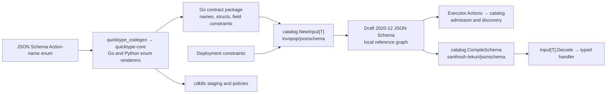

# Agentplane Action Service

This package is the standalone canonical coordinator for ActionRequests. It owns its PostgreSQL
schema and `/v1/action-requests` lifecycle; the Agentplane integration app, Haku Console, BFFs, and
external harnesses remain clients rather than state owners.

Agent entry point: [`/llms.txt`](docs/agents/llms.txt), with linked lifecycle, recovery and
Kubernetes/grant workflows. The generated HTTP/JSON API reference is `/openapi.json`; update the guides
when those contracts change.

**For an agent, this is where a call to the outside world goes**, mediated rather than direct: an
`ActionGroup` mounts one MCP server, mirrors its `tools/list` into the catalog, and this service
initiates `tools/call` itself, so the harness never holds an MCP client of its own. The standalone
MCP edge exposes approved Actions to external MCP clients and forwards each call here. A call is
either auto-approved by a reviewed policy or held for the operator to decide. That is the same
role Haku Console's MCP endpoint serves for its agents — one function with two implementations,
Console's being the one to retire, not two systems that happen to resemble each other.

## External Connections

External MCP Connections are owned by [`mcp_edge/connections`](../mcp_edge/connections/); the
generated [`ConnectionService`](../mcp_edge/connection_service.proto) defines its operator API.
Consent can select only a ServiceAccount in the current labeled Action callers view. The MCP edge
resolves a Connection grant to its currently bound ServiceAccount before admitting a bearer.
ActionRequests use that ServiceAccount as the caller and do not record Connection or grant
provenance. Rebinding changes which ServiceAccount future uses of existing tokens act as; unbinding
revokes the Connection's grants. Requests already submitted continue through the Action lifecycle.
The operator can list or watch Connections, rename, rebind, and unbind them; the
integration app presents the operator UI ([consent UI](../app/README.md)). See the
[ConnectionService implementation](../mcp_edge/connections/service.go) and
[authorization server](../mcp_edge/authserver/authserver.go).

The executable contract is deliberately small:

- one invariant request envelope, carrying a required caller-authored `title` (at most 60
  characters) and optional `description` (at most 250 characters) projected verbatim to the
  deciding operator;
- caller-own and operator-all reads that return the same request view to every reader;
- a human operator Decision route, with expected-version and idempotency protection and one
  `decision_note` (optional, at most 2000 characters), shared unchanged with caller and operator;
  optional synchronous non-human `DecisionProvider`s run first and carry bounded
  `reason_code`/`reason_description` outcome evidence, with `decision_note=None`;
- automatic dispatch after allow, exactly one `Execution`, and no retry after dispatch may begin;
- owner-only cancellation before the atomic dispatch claim, with no expected-version requirement;
- restart recovery: pending dispatches resume immediately; dispatching/running work is left alone
  until its own bounded lease expires, then becomes `execution_unknown` and may later be reconciled
  by an authenticated late completion — see
  [`../docs/executor_liveness.md`](../docs/executor_liveness.md);
- MCP adapters to reviewed upstream servers, with test-only injected executors in unit tests; and
- a durable, restart-surviving Action event sequence as the result-delivery surface: a caller polls
  `GET /v1/action-requests/{id}/events?after_sequence=<n>` from `decision_pending` to a terminal
  state, and every submit/Decision/dispatch/terminal/`execution_unknown` transition appends exactly
  one ordered event.

Notes are not a secret channel: do not put credentials in them. Human decisions leave provider reason fields null.

## Consent transactions

The Go authorization server creates an enrollment with each OAuth authorization and sends the
browser to the integration app with an opaque handle; PostgreSQL stores its hash.
`ConnectionService` pins the enrollment to the operator who first previews it. Preview returns the
client presentation, redirect URI, expiry, and decision version, not the upstream URL or PKCE
challenge.

A decision is one-shot and version-checked. Allow selects a currently labeled ServiceAccount and a
new Connection name or an explicitly confirmed reconnect target at its reviewed version; deny
grants no authority. Consent alone does not create a grant. At successful OAuth code exchange, the
authorization server rechecks the enrollment, selected caller, and reconnect version, then creates
an active grant; reconnect also revokes the Connection's previous grants. Grant changes and token
issuance share the code-exchange transaction. See the
[enrollment store](../mcp_edge/connections/enrollments.go),
[authorization store](../mcp_edge/connections/authorizations.go),
[consent API](../mcp_edge/connection_service.proto), and
[OAuth code exchange](../mcp_edge/authserver/tokens.go).

## Decision providers

All configured synchronous providers run to completion; any deny dominates, otherwise any allow
wins, otherwise the request remains on the human-review path. Timeouts and exceptions contribute
`no_opinion` with bounded reason codes. Provider explanations are bounded audit evidence, not
unrestricted reasoning. Providers run before the request is persisted and a decisive vote commits
with the insert, so no human decision or cancellation can race it and no reader sees the request
as pending (<../docs/action_policies.md> § Evaluate once). Mandatory authorization bounds for future configurable policies are distinct
from these optional votes.

## Cancellation

`POST /v1/action-requests/{id}/cancel` takes no body or expected version and returns
`CancellationResult`: an `outcome` and the current caller-safe `request` receipt. Only the
authenticated owning principal may cancel; operator-all read/decision authority grants no override.
Workload ownership is the Sandbox principal, not a Thread or caller-supplied provenance. Unknown and
non-owned requests both return 404.

| Request state                                 | Outcome             | Effect                                                         |
| --------------------------------------------- | ------------------- | -------------------------------------------------------------- |
| `decision_pending`                            | `cancelled`         | Cancel without creating a Decision or Execution.               |
| `allowed`, Execution `pending_dispatch`       | `cancelled`         | Preserve the Decision; mark the unstarted Execution cancelled. |
| `dispatching`, `running`, `execution_unknown` | `too_late`          | Leave unchanged; execution may already have started.           |
| `cancelled`                                   | `already_cancelled` | Idempotent success, no new event.                              |
| `denied`, `succeeded`, `failed`               | `already_finished`  | Return the unchanged receipt.                                  |

The request row lock serializes cancellation with Decision commits and the dispatch claim. A
successful cancellation guarantees no executor will run for that request, including after restart,
a queued dispatch task, or a late approval. Claiming is the cutoff even before
the executor is invoked. Cancellation does not signal executors or kill processes; disconnecting
or cancelling an HTTP/MCP wait does not cancel the underlying ActionRequest.

A successful cancellation appends one canonical `cancelled` event with the authenticated `actor`
and timestamp; every other event leaves `actor` null. An unclaimed Execution retains null
`started_at`, result and error, with `completed_at` set to the cancellation time. The cancelled
request stays readable by its submission idempotency key; an intentional new attempt needs a new
key.

## Delivery: durable events and bounded waits

The durable Action event sequence (`action_event`, exposed at `.../events`) is the
result-delivery surface. `after_sequence` is the last sequence number the caller already holds;
polling with it is a cheap, idempotent no-op once no new events exist, so a caller can safely poll
from submission to a terminal state without missing or duplicating a transition.

The [Notification service](../notification_service/README.md) consumes this sequence directly,
through the same `.../events` reads.

`ActionService.GetActionRequest` reads a receipt once; `WatchActionRequest` sends its current
receipt and follows committed changes until the requested Decision or terminal state, or the client
deadline. MCP tools expose bounded waits through the Go MCP frontend. The Go watch subscribes to
store notifications before reading, so a commit racing setup is observed; a reconnected listener
wakes the watch to reread durable state. See [receipt reads and waits](SPEC.md#receipt-reads-and-waits).

The dispatch coordinator re-reads every pending dispatch at startup and whenever the API's broker
wakes it: inserting an Execution in `pending_dispatch` notifies a payload-free channel in the same
transaction, a group regaining health wakes it on its own replica, and losing or re-registering
the listener wakes it too, so a commit made while the listener was down is still found. A failed
re-read retries with exponential backoff; there is no periodic re-read.

`//agentplane/action_service/worker:integration_test` runs with Go's race detector. Its concurrent-worker
case holds five dispatch rows until two workers are waiting, then verifies each request runs once.

### Trusted read-only services

`reader_accounts` (empty by default) allows named workload ServiceAccounts to read all Actions
through the existing request list/detail/events REST endpoints. Ordinary callers remain owner-scoped.
Service readers receive the same request view as its owner, and check its `caller` for ownership. This
identity is accepted only by those read handlers, not submission, cancellation, operator APIs, or MCP
authentication. Notifications uses this permission and verifies source ownership before exposing
Action events to a subscriber. No delegated-owner field or alternate service endpoint exists.

## External MCP frontend

The standalone [MCP edge](../mcp_edge/README.md) serves `/mcp` and OAuth protocol routes. It
authenticates external bearers, resolves each Connection to its currently bound, labeled
ServiceAccount, and calls this service with that workload identity. The Action Service does not
serve `/mcp`, ConnectionService, or the external OAuth protocol. See the edge's
[MCP handler](../mcp_edge/mcpserver/server.go) and [bearer verifier](../mcp_edge/authserver/tokens.go).
The `basic` `PolicySet` controls Sandbox egress; it does not grant MCP edge authority.

### External OAuth

The MCP edge's optional `oauth` settings enable its Go authorization server: discovery, dynamic client
registration (DCR), CIMD, authorization, token (code and refresh), revocation, and callback
endpoints. It pins an upstream OIDC issuer, client, and operator subject; only a verified sign-in of
that operator completes authorization. The consent page chooses a new Connection or a confirmed
reconnect and a currently labeled ServiceAccount. A consent decision is one-shot and
version-checked; code exchange rechecks the choice, activates the grant, and issues local tokens in
one database transaction. Replaying an exchanged code revokes that grant.

Local access and refresh tokens are opaque; PostgreSQL stores their SHA-256 digests. The upstream
provider refresh token must be recoverable for renewal, so it is stored as plaintext in
`oauth_authorization.upstream_refresh_token`; the current design accepts plaintext database
storage. Each `/mcp` request resolves the grant to its Connection's current bound account. Grant
identity and provenance are not copied onto ActionRequests. Local token revocation revokes the
grant; upstream account revocation is separate.

Configure `base_url`, `integration_app_url`, `upstream_issuer`, `upstream_client_id`,
`upstream_client_secret_file`, `upstream_subject`, and `approving_operator` in the optional `oauth`
settings. See the edge's [Go OAuth configuration](../mcp_edge/config.go), the
[authorization server](../mcp_edge/authserver/authserver.go), and the
[ConnectionService contract](../mcp_edge/connection_service.proto).

| Tool                         | Use                                                                                                                                                                               |
| ---------------------------- | --------------------------------------------------------------------------------------------------------------------------------------------------------------------------------- |
| `list_actions`               | Compact `{group, name, available}` entries; optional group filter, `limit` (default 30, max 100), keyset `after`/`next_after`.                                                    |
| `get_action_policy`          | The effective policy of a `target`: `"self"` (default) or a named Sandbox or ServiceAccount; its bindings, the sets that resolved, and the auto-approval list (`policy_view.py`). |
| `get_action`                 | One definition by group/name. `include_fields` on either catalog read accepts only `input_schema` and `description`; omitted/empty excludes both.                                 |
| `request_action`             | The request envelope under `request`, validated as on HTTP; a used key is refused. Answers like `get_action_result`, or `respond_with: receipt`.                                  |
| `get_action_request`         | One own-caller receipt by exactly one of `request_id` or `idempotency_key`; the key lookup recovers a submission whose response was lost.                                         |
| `get_action_result`          | The outcome as the tool that ran answered, named and waited on like `get_action_request`; see below.                                                                              |
| `cancel_action_request`      | Own-caller pre-claim cancellation by request ID, without a version; returns canonical outcome and receipt.                                                                        |
| `list_action_request_events` | One own-caller event page; `after_sequence`, `limit`, optional `next_after_sequence`.                                                                                             |

Every tool that returns a wide model takes `include_fields` as a **pure allowlist over every
top-level field of that model** (top-level only, never a dotted path into a nested one), defaulting
to a curated compact list rather than `None`, so the default is visible directly in the tool's own
schema instead of living only in prose: the catalog reads (`get_action`/`list_actions`) default to
neither `input_schema` nor `description`; `get_action_policy` defaults to `subject`/`synced`/
`bindings`, widened by naming `auto_approve_if`; and
`get_action_request`/`cancel_action_request`, and `request_action` under `respond_with: receipt`,
default to `id`/`state`/`version`/
`created_at`/`updated_at` on the receipt -- `state` alone already distinguishes
pending/allowed/denied/dispatching/running/succeeded/failed/cancelled without naming `execution` --
widened by naming `input` (the submitted `idempotency_key`/`action`/`arguments`/`title`/
`description`, echoed back as one unit), `caller`, `decision`, or `execution`.
Naming only the wide fields you want **replaces** the default rather
than adding to it, so keeping the compact fields alongside a widened one means naming both.
`cancel_action_request`'s nested `request` is gated the same way, under its own `include_fields`.
An unrecognized name in any `include_fields` fails the call rather than being ignored, and so does
a `request_action` `include_fields` without `respond_with: receipt`.

`cancel_action_request(request_id)` explicitly withdraws an own-caller request before dispatch
claim, without a version parameter. It returns the canonical outcome (`cancelled`,
`already_cancelled`, `already_finished`, or `too_late`) and receipt; it never interrupts an
executor. The cancelled receipt stays readable by request ID or submission key. It is independent
of cancelling or disconnecting a wait.

`get_action_result` presents an outcome as an MCP tool result (see the
[implementation](../mcp_edge/mcpserver/results.go)): an MCP group's stored `CallToolResult` is
relayed with all content blocks, and a Sandbox group's
stored JSON object is returned as structured content with the same JSON in one text block. A request
still waiting on its decision or execution says so as an ordinary result; a denied, cancelled, failed
or unknown one is an error result carrying the decision's note or reason, or the executor's error.
`request_action` answers the same way once its wait ends unless asked for its receipt, so an Action a
policy approves comes back as its tool's own answer from the one call. A receipt's `execution` has
its state, error and timing but no result.

MCP submission, receipt and result tools take one shared `wait` object (`wait_seconds`, 0 through the
MCP edge's `max_wait_seconds` setting, default 0; the setting defaults to 30 seconds;
`wait_until`, `decision` or `terminal` default terminal) rather than two flat parameters each.
Set the edge's `max_wait_seconds` in its settings file or with
`AGENTPLANE_MCP_EDGE_MAX_WAIT_SECONDS`. Direct tool calls initially wait for the edge's
`direct_wait_seconds` (30 seconds by default), capped by `max_wait_seconds`; configure it in the
edge settings file or with `AGENTPLANE_MCP_EDGE_DIRECT_WAIT_SECONDS`.
Waits use commit notifications rather than periodic queries. A deadline returns a receipt, not a
cancellation. On an ambiguous response, reuse the original request/key; transport or notification
failure must not prompt a new Action. Workload authorization is revalidated after a bounded wait,
before returning data. The generic MCP tool schemas never expand the dynamic Action catalog, and no
Action output-schema metadata is added.

`GET /v1/action-requests/{id}` reads one current receipt; it has no wait query parameters.
`GET /v1/action-requests/{id}:watch` is the generated server stream, beginning with the current
receipt and continuing on committed changes until the `until` condition holds or the client deadline
ends. The MCP wait options above remain available to MCP callers. `GET /v1/action-requests` takes
`limit` (1 through 128; without it every match is returned) and `after_id`, the last request the
caller already has: the page starts after it in newest-first order, whatever `state` or
`idempotency_key` filter applies, and an `after_id` the caller does not own is HTTP 404.

Workflow: list identifiers, fetch one input schema if needed, submit once, then wait/read the
request ID or resume events. Discovery/read failures cannot submit anything; a wrong caller sees
the same not-found response as an absent request. Discovery projects no executor configuration,
group descriptions, or hidden schemas through nested payloads.

### Direct tools

A group's `direct_tools` names Actions an external Connection also gets as MCP tools of their own
([implementation](../mcp_edge/mcpserver/direct.go)), named `<group>__<action>` with the Action's
schema, description, title and annotations (mirrored from an MCP backend's `tools/list`, declared by
the Sandbox roster). `/mcp` lists only those currently offered Actions that the caller's policy
marks auto-approvable. A group offering them must not have `__` in its key, and a Sandbox group's
names must be in its roster at startup.

A call is submitted as decided-only with a server-minted idempotency key and the title
`Direct tool call`. If no policy approves it, nothing is persisted; the MCP error gives the policy
reasons and points at `request_action`. A decided call waits up to the MCP edge's
`direct_wait_seconds` setting, capped by `max_wait_seconds`, and answers through the same MCP result
formatter (see the [implementation](../mcp_edge/mcpserver/results.go)) as `get_action_result`, so an
unfinished one names its request to keep waiting on. A configured name the caller's
policy does not cover still resolves, so it is refused with a reason rather than unknown. Listing
is per request with no `tools/list_changed`: a client holding an older list only meets refusals,
and `request_action` reaches any Action whatever the list says.

**Direct-tool retry limitation:** every direct-tool call uses a fresh server-minted
`direct-<uuid>` idempotency key. If its first response is lost after submission, the caller
has neither the request ID nor that key; calling the same tool again can submit and execute
another Action, even with identical arguments. An unfinished result names its request for later
reads; a completed direct-tool response relays the backend result.
For side-effectful calls requiring recovery from a lost first reply, use `request_action`
with a caller-chosen idempotency key and recover by that key instead.
Do not infer that repeating arguments is a safe deduplication rule: two identical calls may be
intentional.

## Action catalog

`catalog.Catalog` is the Agent-facing discovery seam: an `ActionGroup` (e.g. `github`) is the
executor/backend ownership unit, and each child `Action` (e.g. `get_file`) is namespaced under it as
the pair `(github, get_file)`. `GET /v1/action-groups` lists every configured group with its Actions'
descriptions and input schemas; `GET /v1/action-groups/{group}/actions/{action}` looks up one Action
directly and 404s clearly on an unknown group or action. Both are workload-authenticated reads with
no owner-scoping, since the catalog is the same for every caller.

Group bindings are reviewed runtime configuration, not a dynamic registry: `action_groups` is read
from the Action Service settings file and applied at startup ([configuration](config.go)). Both
environments deploy the service with `Recreate`.
`catalog.MCPBinding.config` is never exposed by discovery; only the human-authored executor description is.

The catalog is also the admission and routing authority: `ActionService` resolves the submitted
structured `action: {group, name}`, rejects unknown or unavailable groups/Actions and unbound groups before persistence,
and validates arguments against the advertised JSON Schema before persistence or provider
evaluation. Invalid arguments fail `INVALID_ARGUMENT` without reserving the idempotency key. An accepted
key is reserved for its caller: `POST /v1/action-requests` refuses a repeat with HTTP 409, and
`GET /v1/action-requests?idempotency_key=<key>` (operator: `/v1/operator/action-requests`)
returns the request it named, combinable with `state`.
Dispatch uses the executor bound to that group. `store.Store` owns persistence and lifecycle,
not a second admission registry. Built-in executors supply their typed contracts' definitions at
startup; the catalog owns admission and routing thereafter.
Dispatch resolves the identity again, so a removed action is terminally refused rather than rerouted or
retried. Each service replica may own its own current MCP session; the database-backed
single-Execution claim and lease token, not the MCP connection, fence dispatch and keep a lost
attempt from being replayed.

`main.go` builds a supervised `mcpexec.Executor` for each `catalog.MCPBinding`, a
`sandbox.Executor` for each `catalog.PodBinding` and an `orchestrationv1.Executor` for each
`catalog.OrchestrationBinding`. The MCP executor discovers upstream tools through
its Go SDK session; Sandbox Actions come from the configured template roster and are offered after
startup validation ([sandbox Actions](sandbox/README.md)). The orchestration Actions launch Session
Sandboxes and drive their Sessions through the Session Dispatcher, a stopgap that acts with this
service's own authority on each request's Decision ([orchestration Actions](orchestration_v1/README.md)).
Echo is only an explicitly injected test executor, never a production default.

An empty catalog starts with no offered actions. An explicitly configured missing/non-file YAML
path aborts startup rather than silently selecting that empty catalog. Missing bindings and unsupported kinds fail
settings validation without echoing input values. All bindings are validated before any server is
launched. All MCP groups start unavailable with independent supervisors; HTTP startup does not
await a backend. Connection/initialization and discovery are bounded to 15 seconds; retries use
exponential jitter (up to 30 seconds), reset after 30 seconds of stable availability. Mounted
credentials and OAuth linkage recover without restarting the service. Invalid catalogs clear
offered Actions and retry on the connected session; transport failures replace the client and
retire that generation without cancelling concurrent calls. Connected sessions refresh periodically
and on tools-list/linkage notifications. Group diagnostics expose replica-local lifecycle, safe
reason, last successful discovery, consecutive failures, and next retry time.

Authorized pending dispatches stay unclaimed while their group is unavailable; the group's return
to health wakes the dispatch coordinator to retry eligibility. Canonical grant checks precede the availability gate under
the claim's row locks, so revocation still fails unstarted work. Removed groups/Actions and
incompatible schemas remain terminal. New requests to known unavailable groups return an explicit
unavailable error (HTTP 503), not unknown-action. Replica-local health is never stored in Postgres.

### Authoring built-in inputs

Keep Action names, wire input structs, constraints and metadata in the group's lightweight
`contract` package. Construct `catalog.Input[T]` with `catalog.NewInput[T]`: reflection uses `T`,
and `Decode` returns that same type after schema validation. Use `json`/`jsonschema` field tags for
presence, nullability and constraints, and plain `int` fields for integers. A deployment
constraint belongs in the contract builder's schema configuration, applied to a fresh schema.
Do not maintain a parallel argument-schema document, decoder destination map, or Python model for these inputs.

The shared Sandbox Action vocabulary lives in [action.schema.json](sandbox/contract/action.schema.json).
The pinned `quicktype-core` generates both language enums: Go uses `just-types-and-package` with
`package=contract`; Python uses `just-types`. Python callers read the standard `Enum` members'
`.value` strings. Deployment-owned group keys stay in cdk8s configuration.



Sandbox builds admission and execution profiles for exec from the same type. Admission uses current
binding maxima; execution uses stable hard ceilings and clips requests to current maxima in the
inventory. Preserve that distinction when changing the builder: a previously admitted request must
survive a settings change. Other input constraints agree across advertisement and typed decoding.

### Execution schema-check diagnostics

A failed execution-time `tools/list` keeps `kind=mcp_unavailable` and adds the exception type,
elapsed schema-check time and connection age (since client initialization) to the retained execution
error and a warning log. A directly raised HTTP status exception also supplies its status code.
SDK-wrapped exceptions remain opaque; use the HTTP client's existing status log for correlation
rather than traversing arbitrary exception graphs. No exception text, headers, URLs, response bodies
or raw MCP session IDs are copied into these diagnostics.

This is observability, not a retry or network-policy change. For an operator-authorized reproduction,
compare read-only `tools/list` immediately after connection, after an idle interval on that connection,
and on a fresh connection after failure. Correlate with backend/proxy evidence; do not automatically
retry `tools/call` or report recovery merely because catalog refresh succeeds. Deployment and live
reproduction require separate authorization; unit/HTTP-peer tests do not establish the live cause.

Operators follow linkage on the generated HTTP/JSON facade at
`GET /v1/operator/mcp-servers:watch`: newline-delimited ProtoJSON frames contain bounded snapshot
chunks, `snapshot_complete`, later `upsert` frames, or `reconnect_required`. They manage it with
`POST /v1/operator/mcp-servers/{server_id}/linkage/start` and `POST .../linkage/disconnect`; the
provider returns to the unauthenticated `GET /v1/mcp-linkage/callback?state&code`, which accepts only
an unconsumed, unexpired flow matching `state`. Operators also read `GET /v1/action-groups` directly
(it accepts either bearer scheme): the same group diagnostics above (lifecycle, reason, last
discovery, failures, retry time), for every mcp-kind group regardless of auth mechanism, so a
static-bearer group's connectivity is visible to operators too, not only OAuth-linked ones. Startup
unwinds already-opened adapters, including a partially started adapter. Drain fences claims and
reconnects but retains published connections through execution completion persistence. Shutdown
joins supervisors and bounded connection cleanup after draining service tasks, then closes Kubernetes
and database resources.

Each linked MCP server is configured with either a fixed `client_id` or `use_shared_cimd`. The
Action Service has one `mcp_client_metadata` setting for its public CIMD identity, served without
authentication at `/oauth/client-metadata.json` on its origin; that exact path is added to its
public HTTPRoute. The document uses its own URL as `client_id`, lists the callbacks of every
configured MCP linkage using it, and declares public token authentication. Link start uses the
shared CIMD only when authorization-server discovery advertises
`client_id_metadata_document_supported`; it fails closed otherwise.

Requests, execution payloads and durable rows use `action: {"group": "everything", "name": "echo"}`.
The fields remain separate throughout discovery, validation and dispatch; no concatenated identity
is accepted.

## Action policy sets and bindings

`PolicySet` and `PolicyBinding` (CRDs in `agentplane/crds/`) supply Action policies. The Go
[`informer`](informer/informer.go) watches the policy namespace's sets and bindings and labeled
caller ServiceAccounts, and writes `ActionsReady` on bindings. The Go
[`policies.Provider`](policies/provider.go) evaluates valid `action_auto_approve` rules at admission;
a matching allow records `PolicyEvidence`, including the matched rule and any resolved GitHub
repository. A set has no deny form: no match leaves the request for a human. The Go
[`api.SubmitActionRequest`](api/submit.go) validates arguments and decides before persistence.

The integration app reads PolicySet inventory from Kubernetes with the Python `policies/resources`
parser, which exposes each set's generation and whether its Action rules were refused. Its action-policy
view uses the Go Action Service response: Python defines the Pydantic wire shapes the app uses to render
the resolved policy kinds. Policy resolution and admission remain in the Go informer and provider; the
Python reader does not resolve bindings or make approval decisions. Staging's network policy admits
`api.github.com:443` for the Go provider's public-repository lookup.

The end-to-end proof is `//agentplane/system_tests:test_mcp`, which creates the set and binding
for the Sandbox it launches through the Kubernetes API (see [the system tests README](../system_tests/README.md))
against the upstream `mcp-everything` image described in
[the fixture guide](testing/README.md). The Go service's startup, MCP execution recovery and OAuth
edge composition are covered by `//agentplane/action_service:integration_test`.

## Authentication boundaries

`caller_service_account_namespaces` lists the Kubernetes namespaces whose labeled ServiceAccounts
may authenticate callers. `policy_namespace` names where PolicySets and PolicyBindings are read and
`ActionsReady` is written. These settings are independent: a binding in a policy
namespace can name a ServiceAccount in another caller namespace. Neither setting approves Actions or
selects an MCP destination.

Sandbox calls use ordinary `Authorization: Bearer <workload token>` at this service. The runner does
not hold that token: it presents the public
`agentplane-credential-agentplane-workload` placeholder to the existing pod-local/central egress
path, whose generic `authenticatedWorkloadToken` source substitutes the already-authenticated
`agentplane-egress` bearer for the exact first-party destination rule.

At the destination, the [workload resolver](../workload_auth/go/auth/) performs the TokenReview. Actions
uses its explicit ServiceAccount-only resolution: the configured audience, allowed namespace and
ServiceAccount UID are required; a Pod binding is optional, and partial or duplicate Pod claims are
rejected. This admits account tokens for the planned MCP edge while ordinary Sandbox tokens retain
their API-server-validated Pod binding. The caller is the account the bearer proved. Identity headers
are never authorization. Thread and Agent fields remain untrusted until an authoritative binding exists;
authentication performs no Thread or Agent lookup.

Operator/BFF calls use the separate `/v1/operator/...` surface, gated by the configured OIDC
verifier. Without `operator_oidc`, operator requests are refused.

The Deployment uses the same `//agentplane/action_service:service_image` for its server and
migration init container, which explicitly executes `/usr/local/bin/actions-migrate`. Each deployed
environment gives the service its own `actions` database and login role on the namespace's shared
CNPG cluster `postgres` (`cluster/k8s/agentplane-staging/agentplane-staging.k8s.yaml`),
separate from the integration app's database.

### Schema initialization

Goose version 7 creates the final typed schema on an empty database. A database that completed
version 6 is adopted in place: the migration validates its history and schema, then records version
7 without replaying DDL or rewriting Action rows. Existing Goose versions 1–6 and Alembic history
remain intact. Databases behind version 6, or with a partial or unmarked schema, must first be
repaired with the previous migration-capable image. Do not renumber this baseline; subsequent schema
changes use later Goose versions.

Action identities use `action_group`/`action_name` columns, event actors use binary `Principal`
messages, and decision policy evidence uses binary `PolicyEvidence` messages. Arguments, results and
errors retain JSONB. The `Recreate` Deployment stops old writers before the image-coupled migration
init container runs; Goose's session lock serializes concurrent starts. A database with historical
versions 1–6 retains its rollback path to a typed-storage-compatible version 6 image. A fresh
version 7 database requires a rollback image that understands the version 7 baseline, or a
coordinated database restore. See the
[version 6 cutover evidence](debug/2026_10_28_native_storage_cutover.md) and
[version 7 baseline verification](debug/2026_10_28_final_schema_baseline.md).

## MCP executor transports

The Go `mcpexec.Executor` keeps one MCP session for each configured group. Its
`catalog.MCPBinding.config` accepts a stdio launch (`command`, optional `args`, `env`, `cwd`, and
`transport: stdio`) or a streamable-HTTP endpoint ([configuration](mcpexec/config.go)):

```yaml
transport: streamable-http
url: http://127.0.0.1:8000/mcp
auth: none # or `oauth` with `server_id`, or `static_bearer` with `bearer_file`
```

HTTP uses the Go MCP SDK's Streamable HTTP client transport and session, including JSON/SSE
responses and session shutdown. Both transports use the same catalog refresh, live schema
validation, result recording, and ambiguous-call failure path; a failed `tools/call` transport
exchange is not retried. The Execution's `result` is the tool's `CallToolResult` in MCP wire shape
(`content` blocks of every type, `structuredContent`, `isError`, `_meta`), tool errors included.
HTTP config rejects userinfo and URL queries/fragments, stdio launch fields, and `Authorization`
in configured headers. `auth: none` sends no credentials. `auth: oauth` names a
configured `mcp_servers` linkage through `server_id`; the Go SDK's OAuth handler reads that
linkage's current access token for each request, and the group stays unavailable until the linkage
authority reports a current link ([§ Action catalog](#action-catalog)). `auth: static_bearer`
reads `bearer_file`, a mounted secret, once when the transport is built and sends it as the bearer
on every request; an unreadable or empty file makes the group unavailable. The production
composition uses this same transport selection. Invalid discovered schemas or duplicate supported tool names
make the entire group unavailable, clearing stale Actions. Invalid live schemas are refused before
`tools/call`. Production startup and shutdown report only the group and failure category, not raw
transport exceptions or endpoint values.

### OIDC operator adapter

`operator_oidc` selects pinned RS256 JWT verification for the Action audience. Authentik's target
provider policy governs who can obtain that audience; the service does not maintain a second subject
allowlist. The destination records the actual token issuer and subject, not a shared BFF identity. Both deployed
environments set `AGENTPLANE_ACTIONS_OPERATOR_OIDC` from the `operator-oidc` key of their
`agentplane-action-federation` ConfigMap (built from the `action_federation`/`operator_oidc`
dicts in `cluster/cdk8s/generate_manifests.py`); staging
targets the Authentik `agentplane-staging-actions` provider. See
[`../docs/operator_federation.md`](../docs/operator_federation.md) for settings and test evidence.

## Action live updates and approval Web Push

The operator SSE endpoint `/v1/operator/action-requests/stream` subscribes before reading a
snapshot, then wakes on PostgreSQL Action commit notifications. Each replica has its own LISTEN
connection; none depends on the process which accepted the write. Notification loss terminates
streams explicitly. Reconnection obtains an authoritative snapshot rather than treating NOTIFY
as a durable log. Operator bearer authorization is rechecked on updates and keepalives.

The operator-only `/v1/operator/mcp-servers:watch` follows committed linkage/token-state changes on
every replica, and sends an `upsert` when a linked token expires without a write. The watch starts
with bounded `snapshot` chunks and `snapshot_complete`, then sends `upsert` frames as rows change.
The service rechecks authorization before every frame and ends at bearer expiry or with
`reconnect_required`. `/v1/operator/action-groups:watch` follows the local MCP supervisor's
catalog/health transitions; health is replica-local, not an invented cluster aggregate. The app
follows these facade watches independently and joins their latest snapshots by group key/server ID
rather than coupling their change rates.

The optional `web_push` configuration enables browser subscription storage and background delivery:

- `private_key_pem`: stable VAPID private key, supplied through deployment secret management;
- `subject`: VAPID contact URI;
- `public_base_url`: integration-app origin used for Action links;
- `allowed_push_hosts`: exact reviewed HTTPS browser push-service hostnames.

Staging enables it (`cluster/cdk8s/agentplane/staging.py`): the VAPID key comes
from the SOPS Secret `agentplane-staging-web-push-vapid` through
`AGENTPLANE_ACTIONS_WEB_PUSH__PRIVATE_KEY_PEM`, `public_base_url` is the staging app origin, and
the allowed hosts are FCM and Mozilla's push service. Testing configures no `web_push`; its
registration route answers 503. Browser subscriptions are registered through operator-authenticated
`POST /v1/operator/push/subscriptions`, listed by `GET`, and removed by `DELETE ...?endpoint=`
(404 when the caller holds no such subscription); the integration app forwards its browser
management requests through federation, so Authentik controls access at registration and on later
operator API requests. Stored subscriptions are notification-only and do not confer decision
authority. Background delivery has no operator bearer with which to recheck Authentik policy, so
revoking an account does not retroactively delete an existing subscription; remove it on the next
authenticated management request or through the subscription store. The sender rejects other endpoint
hosts, credentials in URLs, non-HTTPS ports, and redirects; deployed network policy must also
constrain push-service access. VAPID rotation requires browser resubscription.

Delivery uses committed Action state, PostgreSQL NOTIFY wakeups, and per-browser delivery records.
A short subscription-row lock serializes network sends from different replicas without holding an
Action row lock. Successful send acknowledgement advances the delivery record; transient failure
leaves it retryable. Startup/reconnect and a 30-second background recovery sweep find missed work.
The open Actions page does not poll. Browser deletion cascades its delivery records. A crash after
send but before commit may resend; stable notification tags/topics collapse repeats. This is not
exactly-once delivery and a push-service acknowledgement is not proof of device display.

Only pending requests need an actionable notification. Requests resolved before reconciliation
need no new alert. Chrome revokes notification permission from origins it judges spammy (many
notifications, little engagement; seen on Android), so a browser gets at most one push per
reconciliation, covering every change since its last one, under one push `Topic` so a push service
holding messages for an offline device keeps only the newest. The service worker answers each push
by listing the Actions waiting now and showing one notification under one tag: the Action itself
with Approve/Deny when one waits, a count and first titles when several do, nothing when none do
(shown and closed at once, since Chrome requires a visible notification per push). Push payloads
contain Action identity/version, not arguments, credentials, or results. Notification buttons use
the integration app's ordinary operator session and canonical Decision contract.

## Shutdown budgets

SIGTERM/SIGINT mark readiness unavailable, stop admission, and drain dispatch and background
supervisors. The Go HTTP server allows five seconds for open calls to finish before closing its
connections; execution shutdown is owned by the worker. Both deployments allow 60 seconds for
termination. Go probes use gRPC health: the default readiness service and `livez` for liveness.
See [service shutdown](main.go) and [execution ownership](SPEC.md#execution-ownership-and-shutdown).

Execution renewals run every third of the granted lease duration, with each renewal RPC bounded by
the same interval, so a call outlasts its lease window rather than being swept from under it. The
entire MCP execution exchange has a 10-minute deadline; a sandbox command is bounded by the
`timeout_seconds` it was submitted with. Cancellation joins the local exchange and renewal tasks;
it cannot establish that a remote effect was cancelled.
