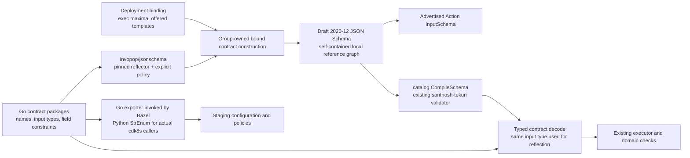

# One source for built-in Action input contracts

## Decision and scope

Make the Go input contracts used by the built-in executors authoritative. Generate their JSON
Schemas from those same types and field constraints, then use each contract to advertise, validate,
and decode its Action. Start with `sandbox`, then migrate `orchestration_v1`. This plan does not
change Action arguments, authorization, dispatch, stored requests, or externally supplied MCP schemas.

An implementation must pass the semantic spike below before replacing either group's schemas.
This is a plan; no generator or runtime behavior described as proposed below has landed.

## Current sources and consumers

| Surface              | Definitions now                                                                                                                                | Consumers and gaps                                                                                                                                                                                                              |
| -------------------- | ---------------------------------------------------------------------------------------------------------------------------------------------- | ------------------------------------------------------------------------------------------------------------------------------------------------------------------------------------------------------------------------------- |
| Sandbox inputs       | [`models.py`](../sandbox/models.py), [`input_schemas.json`](../sandbox/input_schemas.json), structs in [`executor.go`](../sandbox/executor.go) | Go advertises embedded JSON and separately decodes Go structs. Python [`actions.py`](../sandbox/actions.py) also builds definitions, but its function is only called by its tests; cdk8s imports its group/name constants.      |
| Orchestration inputs | [`input_schemas.json`](../orchestration_v1/input_schemas.json), structs across `launch.go`, `sessions.go`, `reads.go`, and `turns.go`          | Eleven schema roots; four distinct command schemas decode through the superset `commandArgs`.                                                                                                                                   |
| Sandbox roster       | Go constants and `argumentModels` in [`actions.go`](../sandbox/actions.go); Python `SandboxAction` enum                                        | cdk8s staging and auto-approval policies consume the Python names. They must follow the runtime roster without importing a service.                                                                                             |
| Runtime constraints  | Sandbox binding maxima, JSON schema validation, execution-time checks                                                                          | [`Actions(binding)`](../sandbox/actions.go) constrains advertised exec maxima; [`NewExecutor`](../sandbox/executor.go) separately compiles the embedded base schemas. Both should consume the same bound contract construction. |

`go:embed` and `embedsrcs` point directly at the two checked-in JSON files; there is no Bazel
producer or regeneration recipe for them. Existing Sandbox golden vectors cover roster and argument
behavior, but do not establish a generation relationship to the types. No current mismatch is
assumed.

## Proposed ownership and pipeline

Create lightweight Go `sandbox/contract` and `orchestration_v1/contract` packages. Each owns the
Action names, one input type per distinct wire shape, field constraints/descriptions, and the
association between an Action and its typed input. These packages must not import executor,
Kubernetes-client, database, worker, or integration-app implementations.



Use the already pinned `github.com/invopop/jsonschema v0.14.0` for reflection, and retain
`catalog.CompileSchema` for validation. Put common reflector setup and typed validation/decoding in
`catalog`; keep each group's wire definitions and bound constraints with that group. The
[reflector](https://github.com/invopop/jsonschema/blob/v0.14.0/reflect.go) supports type hooks,
explicit required-field policy, closed objects, and local definitions. These capabilities still
need the spike; their defaults are not the Action contract.

The contract API must associate schema generation and decoding through the same generic type
parameter. It must not accept an independently selected `any` destination. A descriptor for one
input type supplies its schema and a typed decode operation; existing handlers consume that type.
The executor's bound descriptors also supply the advertised schemas, so admission and dispatch use
identical field constraints. Do not retain a second action-to-model-name map. Choose the smallest
registration API that enforces this association; a new generic tool framework is outside scope.

Use a fresh schema per bound construction; changing one deployment's exec caps must not mutate a
shared schema or another binding. Derive the ceilings from the existing binding once, with the same
inclusive/exclusive bounds enforced by admission and dispatch. Authorization and checks against
live Kubernetes objects remain executor logic.

Schemas are runtime values generated from the compiled Go contracts. Delete the embedded JSON
files and their BUILD inputs when their group migrates. Add file exports only for real independent
consumers; such exports call the same builder, never a second schema implementation. No new
OpenAPI wrapper or protobuf representation is needed for these direct JSON Actions.

For cdk8s, generate the required group/name constants and `StrEnum` into a lightweight Python
library through a Bazel Go exporter. Update the two current staging/policy consumers atomically.
The exporter imports the contract package alone. Remove Python Sandbox schema construction and
models after checking all remaining callers; retain deployment binding models and shared catalog
configuration types that synthesis still uses. No Python service or generator runs inside synthesis.

## Semantic spike: blocking gate

Add a bounded spike under `agentplane/action_service/x/input_contracts/` with ordinary Bazel Go
libraries/tests and a Python consumer of the generated names. Exercise real reflection,
`catalog.CompileSchema`, typed decoding, and JSON advertisement. Do not implement a replacement
schema validator, an ad hoc JSON parser, or a schema-patching allowlist to make the spike pass.

| Case                     | Required evidence                                                                                                                                                                                                                                  |
| ------------------------ | -------------------------------------------------------------------------------------------------------------------------------------------------------------------------------------------------------------------------------------------------- |
| Closed nested objects    | Unknown properties are rejected at every currently closed level, including `SandboxRef` and Session spec.                                                                                                                                          |
| Required versus nullable | Omitted `cwd` and explicit null both work; required fields do not disappear merely because a Go pointer or zero value can represent them. Check optional `setup_script` and launch fields independently.                                           |
| Integer semantics        | `60`, `60.0`, and integral exponent notation decode equivalently; fractions, booleans, and out-of-range values are rejected. Cover `timeout_seconds`, `max_output_bytes`, turn count, and nullable idle-suspend seconds.                           |
| Bounds                   | Preserve positive timeout, zero output allowance, name length/pattern, read count 1–100, wait limit 30, and each binding's configured maxima. Validate on either side of each boundary.                                                            |
| Separate commands        | Submit-input requires text; interrupt requires turn ID; model/effort changes require their own fields. A superset DTO must not weaken the four schemas or accept unrelated fields.                                                                 |
| Enums and defaults       | Preserve Harness/effort/launcher-grant values, omitted launch settings, empty lists, and omitted Session settings. Reuse existing owner constants/descriptors for finite vocabularies. Schema `default` must not imply that decoding populates it. |
| Local definitions        | Nested/reused types resolve using the generated document alone; no file/network lookup or copied inline definitions. Metadata changes must not break refs.                                                                                         |
| Typed agreement          | Every accepted fixture reaches its handler as the reflected input type. Exercise the numeric decoder as well as validation; a schema-only pass is insufficient.                                                                                    |
| Independent bindings     | Advertisements and executor decoding agree for two different cap configurations, and constructing one does not change the other.                                                                                                                   |
| Python names             | A Bazel-built Python consumer imports the generated enum, uses its members, and enumerates the runtime roster without a second maintained list.                                                                                                    |

A particular hazard is the current `float64` representation of schema integers, documented in
`sandbox/executor.go`, `orchestration_v1/launch.go`, and `turns.go`. Plain reflection would publish
`number`; changing to plain Go `int` would reject valid JSON spellings such as `60.0`. Spike a
named integer wire type with the reflector's type hook and a checked decoder using existing numeric
parsing primitives. Keep one implementation of its integer semantics. Reject a proposal that needs
per-field post-generation `type` patches or loses numeric precision before checking integrality.

Compare accepted/rejected payloads against the existing schemas and golden vectors. Document any
intentional correction as a separate behavior change; do not update old expectations simply to
accept generator defaults. If reflection cannot represent a required contract cleanly, stop this
approach and revise the decision toward schema-first generated types. Do not ship a partly reflected,
partly hand-maintained schema catalog.

## Independently reviewable implementation steps

1. **Prove the mechanisms.** Add the spike, the pinned reflector dependency at its actual consumer,
   and meaningful boundary fixtures. No production schema changes. Review the emitted schemas and
   semantic comparisons before starting either migration.
2. **Migrate Sandbox atomically.** Introduce its lightweight contracts and typed decode binding;
   use bound contracts for advertisement and execution; generate cdk8s names; remove the old JSON,
   duplicate Python definitions, and model-name roster. Update every import and BUILD dependency.
   Retain independent golden behavior vectors; delete tests whose Python implementation disappears.
3. **Migrate orchestration atomically.** Give its four command Actions distinct wire input types,
   adapting into shared execution logic only after decoding. Preserve launch/presence/enum semantics;
   remove its JSON file and model-name map. The step can land independently of Sandbox once the
   shared mechanism's contract is established.
4. **Graduate the useful proof.** Move retained boundary coverage beside its owning contracts and
   catalog, remove spike-only scaffolding, and update the service SPEC/owner docs for the implemented
   contract. Delete this plan when complete.

No transition requires two schema authorities. Each production migration changes its producer,
consumer, BUILD graph, and obsolete-source removal in one PR. Keep external MCP reflection and
policy-authored JSON schemas on their existing paths.

## Validation and completion

Run new contract/spike targets explicitly, including Python libraries for their mypy/ruff aspects.
Existing checks to retain are:

```bash
bbr test //agentplane/action_service/catalog:catalog_test \
  //agentplane/action_service/sandbox:sandbox_test \
  //agentplane/action_service/orchestration_v1:orchestration_v1_test \
  //agentplane/action_service/api:unit_test
bbr test //agentplane/system_tests:test_mcp //agentplane/system_tests:test_launch_presets
bbr test //cluster/cdk8s:test_flux
```

Run the catalog/affected group tests for each migration, the cdk8s check when its Python import
changes, and the system paths before merging a staging-affecting migration. Confirm the typed
handler input and advertised schema come from the same contract, no `input_schemas.json` embed or
hand-maintained Python Action roster remains, and no advertised/decoded contract changed silently.
Rollback is reverting that group's migration PR; no database or Kubernetes state migration is part
of this refactor. Verify staging still advertises and executes the affected Actions after image
rollout; a source/test pass alone does not establish that deployment result.
