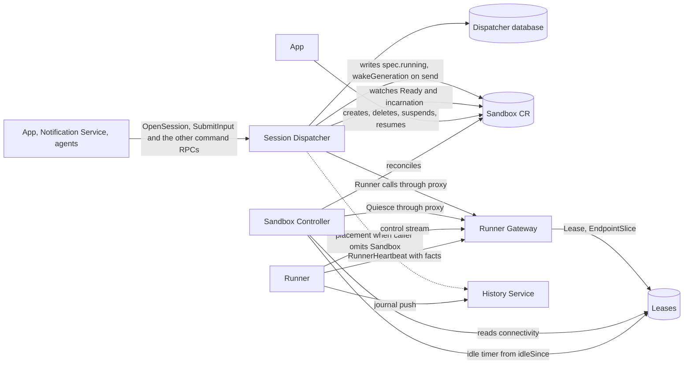
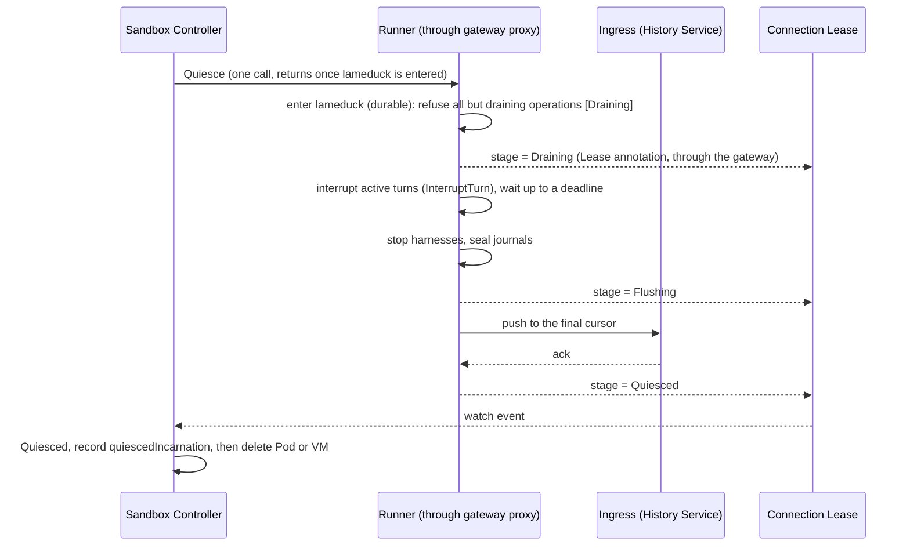
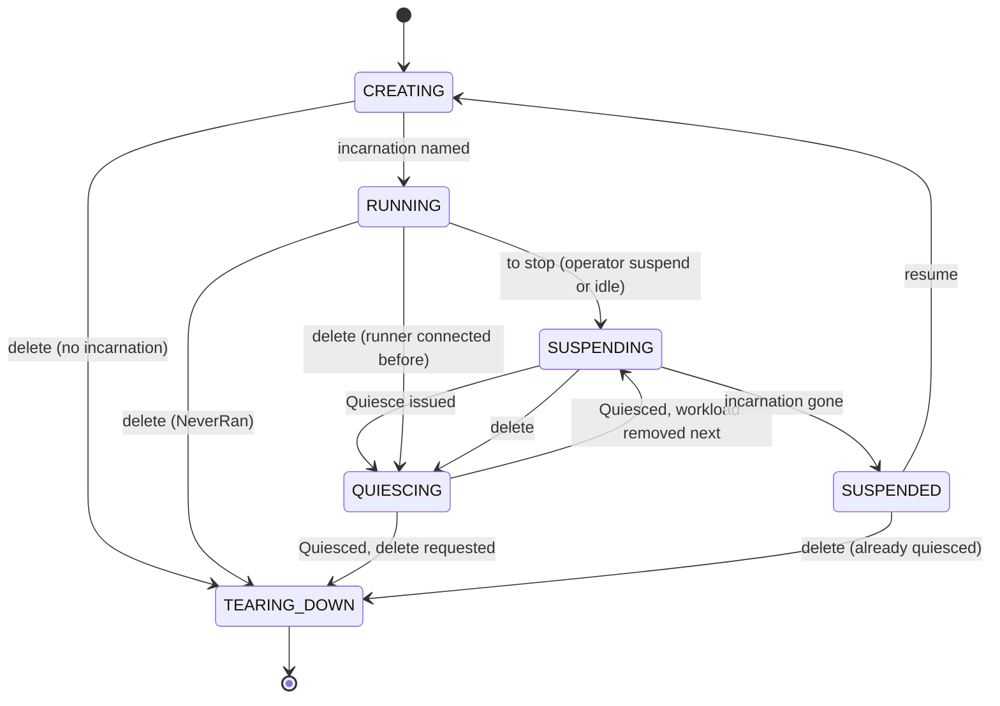
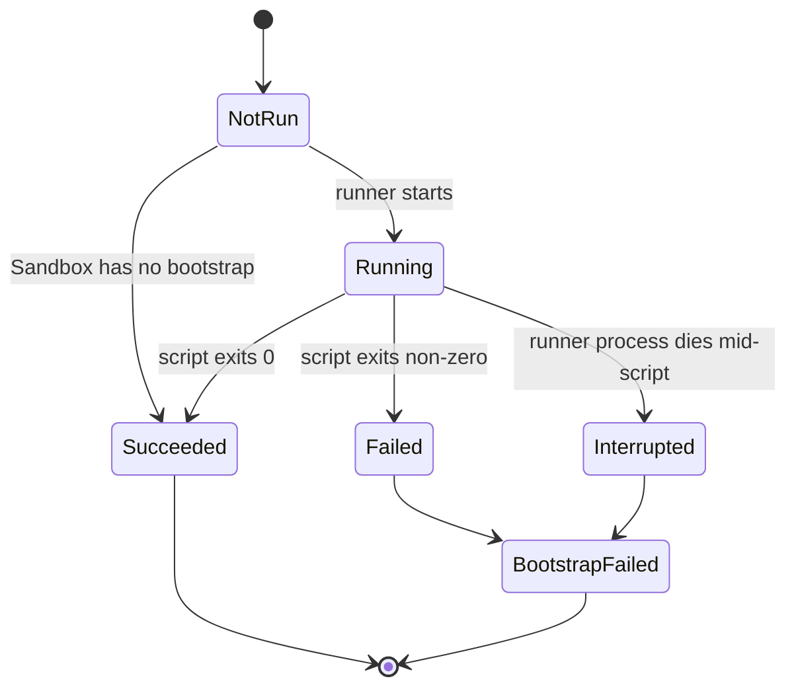
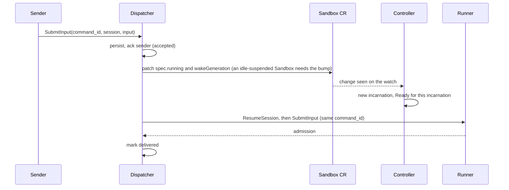

# Sandbox and Session control: who owns what

Status: **decided; see [Decisions](#decisions) for when each was settled. Idle suspension waits on the sealed-journal reopen (D3) being built.**

Scope: the responsibilities split across the services and custom resources that run a Sandbox (Pod
or VM) and deliver work to the Sessions in it. This covers the control Service, readiness and
runner health, quiesce, suspension, the Session message queue, and where each fact lives. It does
not redesign storage, the History Service, or policy.

## What has to happen

1. **Run a Sandbox.** Reconcile the `Sandbox` CR into a state volume and, while running, one Pod
   or VM. Kind (`pod` or `vm`) comes from the template.
2. **Reach its runner.** Callers address `<sandbox>-control`; the replica holding the runner's
   dial-out connection answers.
3. **Say what state it is in.** Created, starting, booting, connected, ready, quiescing,
   suspended, tearing down, and why it is stuck when it is.
4. **Quiesce** (today's "seal"; one operation, names in D3). Before a Pod or VM goes away (suspend or delete), stop admitting work,
   interrupt running turns, flush every Session's journal to the ingress, and only then stop it.
5. **Deliver work to a Session whatever state its Sandbox is in.** A message to a suspended
   Sandbox's Session resumes the Sandbox and arrives once the runner is up, even if the sender is
   gone.
6. **Suspend idle Sandboxes.** Never delete on idleness.
7. **Create a Session** that does not exist yet, from a client-minted ID.
8. **Keep per-Session data out of Kubernetes**. Kubernetes holds Sandbox-level
   facts, including transitional conditions such as quiesced or not; Session-level records live
   in a service database.

## Current state

- **Sandbox Controller** (Go, `sandbox_controller/`): state PVC, Pod or VM, ServiceAccount, `PolicyBinding`, launch
  ConfigMap, finalizer, and the `{sandbox}-control` Service. It drives quiesce: it calls `Runner.Quiesce` through the
  gateway's runner proxy and records `status.quiescedIncarnation` on any quiesce and sets `Quiesced` on a deleting Sandbox only (`finalize`), beside the older sealed names. It
  reads the connection Lease's facts. `Ready` is `WorkloadReady` AND `RunnerConnected`. `QuiesceResponse.stage` has
  one reader, the controller.
- **Runner Gateway** (`runner_gateway/`): the `RunnerControl.Connect` listener and the proxy of the runner's `Runner`
  service. It creates, per Sandbox, a Lease (holder, epoch, liveness) and an EndpointSlice pointing at the holding
  replica (`connection_records.py`), owned by the Sandbox, and writes the runner's published quiesce stage and bootstrap result onto the Lease. It no longer creates the `<sandbox>-control` Service
  (its `services` RBAC rule stays until the controller's image is pinned). It still wraps `Runner` with Session registry, readiness checks
  (`destinations.py`) and a database, and its API promises that session and command RPCs never provision, resume or
  wake a Sandbox.
- **Sandbox Service** (`sandbox_service/`): writes a Sandbox's desired state for the app and serves reads and the VM
  console; the Notification Service uses it only to read one Sandbox. It is to be removed (D4).
- **Runner**: harnesses, journal, command admission, `Quiesce` (a durable lameduck keyed to the incarnation UID,
  dropped on a `Welcome` carrying another). It publishes its quiesce stage and bootstrap result on its heartbeat. It starts the Sandbox's `bootstrap` at runner start, and `OpenSession`
  still waits for it. The per-command RPCs refuse work in lameduck with `ABORTED`.
- **History Service**: ingress (journals pushed by runners, acked by cursor), raw log, fold, reads; records which
  Sandbox wrote each Session. Folds `last_model_activity_at`.

Message sending has no queue: the app calls `SubmitCommand`, which forwards to a running harness or fails. Nothing
resumes a Sandbox on a message.

## Where the lines could fall

The "session controller" bundles three jobs: workload and runner-aware lifecycle (wake, quiesce, suspend, delete),
idle policy, and delivery (a durable queue of messages and Session creations). Lifecycle and idle policy need the Sandbox CR,
the runner's connection facts and leader election, with no database; delivery needs a database, the sender's identity and
the gateway. So lifecycle and idle policy stay in the Sandbox Controller, where idle is declarative
(`spec.idleSuspendAfter`) and decided by the leader-elected reconciler that already drives quiesce, and a new service
holds only the queue. Rejected:

- One new service for all three: it would write desired state and run timers beside a controller that keeps only Pods,
  splitting lifecycle policy across two reconcilers of one CR.
- The queue in the gateway or in the History Service: the gateway would gain a database and the power to wake Sandboxes,
  the History Service routing and waking; both break an agreed invariant.

The controller may later split into a generic workload layer and a runner-aware layer; that moves files, not responsibilities.

## Proposed split

| Component          | Owns                                                                                                                                                          | Does not own                                                                                                                           |
| ------------------ | ------------------------------------------------------------------------------------------------------------------------------------------------------------- | -------------------------------------------------------------------------------------------------------------------------------------- |
| Sandbox CR         | Desired state (`spec.running`, template), current facts (`status`: incarnation, `quiescedIncarnation`, conditions)                                            | Anything per Session                                                                                                                   |
| Sandbox Controller | Pod or VM, state volume, identity, the `<sandbox>-control` Service, quiesce sequencing, idle suspension, deletion, folding every layer's fact into conditions | Runner connection, Session records, queues                                                                                             |
| Runner Gateway     | The runner connection and its authentication, the Lease and EndpointSlice, the proxy of `Runner`, per-method authorization                                    | Any Kubernetes object besides those two, Sessions, queues                                                                              |
| Runner             | Harnesses, journal, admission, quiesce mechanics, idle state                                                                                                  | Policy about when to suspend                                                                                                           |
| History Service    | Event log, fold, Session directory including the writing Sandbox                                                                                              | Routing, waking, suspending                                                                                                            |
| Session Dispatcher | The durable queue of messages and Session creations, wake-on-send, send-side authorization (who may wake), delivery states                                    | Creating or deleting Sandboxes (it reads them and patches only `spec.running` and `spec.wakeGeneration` to wake), idle policy, history |
| App                | Sandbox create, delete, suspend and resume and PolicyBinding (egress-grant) writes, through the Kubernetes API, with their checks; the VM console             | Conditions, quiesce, idle policy, delivery                                                                                             |

"Session Dispatcher" names the queue service; it is not a controller. Idle is a Sandbox-level fact (every Session in
the Sandbox idle), which is why its policy sits on the Sandbox. There is no Sandbox Service: requesters write `spec` through one
shared helper and the controller writes `status` (D4).

## Decisions

### D1. Who owns the per-Sandbox control Service

A Sandbox's connection has three objects: the Service, the Lease and the EndpointSlice. The
Service is static (name, port); the slice and Lease are the dynamic connection fact.

**Decided: the controller creates the Service; the gateway writes the Lease and slice.** The Service is part of the
Sandbox's identity, like its ServiceAccount, and exists from creation, so before a runner connects the caller sees no
endpoints rather than a DNS failure; only the connection is the gateway's to assert, and its RBAC shrinks. The controller
and gateway agree on name and port through one shared constant. Rejected: no per-Sandbox Service, with any gateway
replica forwarding to the holder: it adds a replica-to-replica hop and trust and reverses the operator's 2026-10-12 choice
of a dialed-hostname Sandbox name. Revisit it if the per-connection writes ever become a load problem.

### D2. How readiness and runner health reach the Sandbox's conditions

Facts have different truth sources, so each gets its own condition and `Ready` is their AND:

| Condition         | Source of truth                                                               | Meaning                                                                                                                                 |
| ----------------- | ----------------------------------------------------------------------------- | --------------------------------------------------------------------------------------------------------------------------------------- |
| `Running`         | controller (Pod or VMI)                                                       | an incarnation exists and runs                                                                                                          |
| `WorkloadReady`   | controller (Pod Ready)                                                        | the incarnation's Pod is Ready                                                                                                          |
| `RunnerConnected` | gateway (connection Lease)                                                    | a runner of this incarnation holds a live connection                                                                                    |
| `Bootstrapped`    | runner (bootstrap result, republished at each connect)                        | the Sandbox's bootstrap ran to success; Sandbox-lifetime; False with reason `BootstrapFailed` if it failed or was interrupted           |
| `Ready`           | controller                                                                    | all of the above for the current incarnation; reason `BootstrapFailed` if bootstrap failed, `SuspendPending` while a suspend waits (D3) |
| `Quiesced`        | controller, from the runner's quiesce stage published on the connection Lease | False with reason `Draining`, then `Flushing`; True once every final cursor is acknowledged                                             |

The Sandbox's bootstrap runs once, at runner start and before any Session opens, and
`Ready` includes `Bootstrapped`. Its outcome lives on the state volume, so each incarnation's runner republishes
it when it connects; `Bootstrapped` is the one condition that is a Sandbox-lifetime fact rather than an
incarnation's. A failed or interrupted bootstrap never runs again (the runner raises `BootstrapFailedError`), so
`Ready` reads False with the terminal reason `BootstrapFailed`: the controller does not retry it and the
Sandbox is replaced, not repaired. The per-Session step is called "setup" and is not part of `Ready`.

Two rules make this safe. Conditions other than `Bootstrapped` are keyed to the incarnation UID, so a connection or boot
fact from incarnation N is never read as incarnation N+1's. And a condition is written by exactly
one actor: the controller writes them all; every other layer publishes a fact the controller reads.

**Decided: the Lease.** The gateway already writes it, Sandbox-owned, with the pod UID and boot ID. `RunnerConnected` is
its liveness (a gateway restart leaves a stale-but-honest record: `renewTime` plus duration; the controller requeues on
expiry), and runner-reported facts (`Bootstrapped`, `idleSince`, the quiesce stage of D3) ride its annotations. Rejected:
gRPC health from the gateway (the controller would hold a watch per Sandbox against a replica-sharded service, and a
gateway outage would read as every runner down; if that node is built its output should still land as a fact the
controller folds), and the gateway writing the Sandbox's status (two writers on one status, against "layers that act on
CRs do not edit them"). A gateway rollout drops every connection at once; the controller must
treat the reconnect window as connectivity lost, not as a Sandbox failure, and must not replace or
restart anything because of it (no automatic spec replacement).

**etcd write cost of runner facts.** The gateway already renews every connected Sandbox's Lease: its loop wakes every `heartbeat_s` (10 s) and
renews once `touch_s` (15 s) has passed, so the effective cadence is 20 s and each connected Sandbox costs
about three etcd writes a minute before this design adds anything. `idleSince` therefore adds no writes: the gateway holds the latest value in memory and
puts it on the Lease in the next scheduled renewal, so the annotation change rides a write that happens
anyway. `idleSince` changes whenever the runner goes idle, which can be frequent while an agent works, which
is why it is not written on its own; the controller needs it only to minutes of precision, so up to one renewal
interval of lag is harmless. Cost on the reading side: the controller's Lease watch already sees a renewal event every 20 s per
connected Sandbox and must filter on annotation or holder changes rather than reconcile on each. Revisit only if the renewal write rate itself becomes a problem, and then lengthen `touch_s`
before adding a second channel.

**How the runner's facts reach the gateway: on its heartbeat, event driven.**
The runner's facts (quiesce stage, `idleSince`, bootstrap result, the running-setups fact of D3) ride the
runner's heartbeat as `optional RunnerFacts facts`. `Heartbeat {}` is shared with the gateway's own heartbeat
(`ServiceFrame.heartbeat`), so the field goes on a runner-only `RunnerHeartbeat`, which `RunnerFrame.heartbeat`
takes under the same field number: wire-compatible both ways, and a gateway that predates the field ignores it
(reader before writer). The runner sends one immediately when a fact changes and with its first after each
connect, so nothing polls and a reconnect republishes.

- `facts`, when present, is the runner's whole current state. A heartbeat without `facts` repeats nothing; inside
  `facts`, `idleSince` absent means busy, so there is no separate `busy` fact.
- The gateway holds each connection's latest facts and every Lease write, renewals included, carries them. A
  runner that sends only on change never resends, so a failed immediate write (a stage change, the bootstrap
  result) is retried from the gateway's copy, not by the runner. The copy is per connection, so a new
  connection starts empty. `accept()` rebuilds the Lease with only the pod UID and boot ID annotations, and the
  facts come back with the runner's first heartbeat on the new connection (a different incarnation starts with
  none, D3 Outside the runner).
- Stage transitions and the bootstrap result are written to the Lease at once. Only `idleSince` is coalesced into
  the regular renewal.

### D3. Quiescing is one operation; names say which stage a Sandbox is in

**Quiescing is one operation on the whole runner, not on its Sessions**. It
puts the runner in a durable lameduck state, in which it accepts only the operations that drain it,
and drains it. The state survives a runner restart within the incarnation and ends with the incarnation
(below). What stays per
Session is only the bookkeeping the drain finishes: each journal's final cursor and whether the
ingress has acknowledged it.

| Once quiescing has begun, the runner                                                 |
| ------------------------------------------------------------------------------------ |
| refuses `OpenSession`, `ResumeSession` and any command that starts or continues work |
| accepts interrupts and `StopRunnerSession` (both drain), and repeated `Quiesce`      |
| answers a redelivered `command_id` it already admitted, rather than refusing it      |
| answers reads (`ListSessions`), which today wait for an in-progress `Seal`           |
| interrupts active turns, stops harnesses, finalizes journals, pushes through cursors |

**Lameduck belongs to an incarnation.** A runner restart inside an incarnation (a crashed runner container, a guest
reboot in the same VMI) keeps the runner quiesced; a new incarnation on the same state volume starts unquiesced. The
runner records the state under `--state-dir`, which is the state volume and therefore outlives the incarnation, so the
marker names the incarnation it was entered in:

- **Incarnation identity.** The runner does not choose it. The gateway already authenticates the
  connecting Pod and refuses one that is not the Sandbox's current incarnation
  (`runner_gateway/runner_control.py`); its `Welcome` carries that incarnation's UID (the Pod, or a
  VM's virt-launcher Pod, as `status.incarnation` names it). `runner_boot_id` cannot serve: it
  changes on every runner process start, restarts included.
- **Keying.** Entering lameduck writes the marker with the incarnation UID the runner last saw in a
  `Welcome`. The runner serves nothing before it connects, since every call arrives over the control
  stream, so on each `Welcome` it compares: same UID, the marker stands and the runner stays
  quiesced across the restart; different UID, the marker belongs to an earlier incarnation and is
  removed before any call is accepted, and the runner starts unquiesced.
- **Journals.** Each Session's journal sealed at its final cursor in the earlier incarnation. The
  new incarnation continues it after that cursor with an entry recording that it resumed;
  [Reopening a sealed journal](#reopening-a-sealed-journal) decides how.
- **Outside the runner.** Runner facts on the Lease are valid only while its `pod-uid` names the incarnation:
  the gateway's `accept()` (`connection_records.py`) rebuilds the Lease with only `pod-uid` and `runner-boot-id` on every
  accepted connection, and the controller's `readRunnerFacts` (`runner_facts.go`) accepts facts only while `pod-uid`
  equals the incarnation, so a stale `Quiesced` is never read for the new one. The controller's `quiescedIncarnation` is compared with
  the current `status.incarnation`; after a resume they differ, which is what makes the new
  incarnation unquiesced there as well.

**Names.** Today one word, "sealed", covers three different facts: the runner refuses new work, its
journals are final, and the ingress has acknowledged them. A `Sealed` condition that is True while
the runner is only refusing new work is wrong. The names:

| Retired name               | Name                                                                    | Meaning                                                                   |
| -------------------------- | ----------------------------------------------------------------------- | ------------------------------------------------------------------------- |
| RPC `Runner.Seal`          | `Runner.Quiesce`                                                        | The one operation; idempotent, so a repeat is safe                        |
| (no name)                  | reason `Draining`                                                       | Refusing new work; interrupting turns, stopping harnesses                 |
| (no name)                  | reason `Flushing`                                                       | Harnesses stopped, journals final; waiting for the ingress to acknowledge |
| `Sealed`, `SessionsSealed` | condition `Quiesced`, True only when every final cursor is acknowledged | Safe to remove the Pod or VM                                              |
| `status.sealedIncarnation` | `status.quiescedIncarnation`                                            | UID of the last incarnation that reached `Quiesced`                       |
| Sandbox phases `Sealing`   | `Quiescing`                                                             | Draining or Flushing                                                      |
| `Ready` while refusing     | `Ready` False, reason `Draining`                                        | Callers and the Dispatcher read "not accepting work" from `Ready`         |

`Quiesced` is False with reason `Draining`, then `Flushing`, until it is True; `NeverRan` and
`NotQuiesced` cover a Sandbox whose runner never connected and one stopped without quiescing. While incarnation N+1
runs, `Quiesced` is False with reason `NotQuiesced`: `quiescedIncarnation` still names N, which is not the current
incarnation, so the condition reads nothing from it. The
journal keeps the word "sealed": a journal is sealed at its final cursor, which is one step of
`Flushing` and per Session, so it never names a Sandbox condition. Per-Session cursors never appear
in Kubernetes. The remaining sections use the new names.

Quiesce refuses at entry and interrupts before it stops anything, inside the one operation.

**`Quiesce` is not `Seal`.** `Seal` blocks until the journals are sealed and returns each Session's final
cursor and `flushed`. `Quiesce` returns at lameduck entry and its response drops the cursors: progress goes on the
Lease and per-Session data stays out of Kubernetes. The runner already serves `Quiesce` as a straight alias of
`Seal`, so the controller already calls it and reads an empty `Unflushed` as "flushed" before it deletes the Pod.
The hazard is therefore not the rename but changing what `Quiesce` returns under the same name: a non-blocking
runner met by a reader of the old shape yields `Unflushed == []`, and the Pod is deleted before the ingress
acknowledges anything. One reader has that shape, the controller.

Rollout, reader before writer:

1. `QuiesceResponse` gains a `stage` field, and the controller reads both shapes (landed).
2. The gateway's deletion seal is retired, so the controller is the only reader (landed).
3. Only then does the runner's `Quiesce` stop blocking. The runner is the writer: the runner image and the VM
   guest's runner wheel (`nix/artifact-pins.json`, pinned separately) move only after the controller is pinned.

The legacy shape carries a removal node.

**Setup and bootstrap meet quiesce**. A Sandbox is not suspendable until its Sandbox-level
bootstrap has succeeded or failed, and a suspend also waits for every Session's setup to complete; deletion waits
for neither. Quiesce would otherwise cancel a running setup (`SetupInterrupted`) and `Runner.resume` refuses a
Session whose setup is `FAILED` or `INTERRUPTED` (`SetupFailedError`), and an interrupted bootstrap is terminal,
so a suspend during either would permanently lose the Session or the Sandbox. Running setup and bootstrap also
count as busy for idle suspension. Delete interrupts them, since the Sandbox is going away.

How the wait works. `RunnerFacts` carries a Sandbox-level fact for the setups running.
While an operator suspend waits for it and for the bootstrap, the controller holds `Ready` False with reason
`SuspendPending`. The Dispatcher already waits on `Ready`, so it stops delivering, new `OpenSession` included, and
the wait is bounded by the setups already running; the runner needs no mode of its own. That bound holds only if the
Dispatcher is the only caller of the runner's `OpenSession` (D4). A
setup that never ends makes the suspend wait forever and leaves delete working, which is intended. An automatic
suspend needs none of it: a running setup is busy, so the conditional `Quiesce` refuses.

### Reopening a sealed journal

**Decided (operator, 2026-10-14): choice 1.** A resumed Sandbox cannot run any Session today, and idle suspension, or any suspend not
followed by a delete, waits on this.

**What "sealed" is after a quiesce.** One fact in several places, only the last keyed to an incarnation:

- The runner journal's `Seal` row (`runner/journal.py`): `open` refuses entries after it, `_append` raises
  `JournalSealedError`, and `Session._sealing` starts true from it, so `ensure_running` refuses (`runner/session.py`).
- The runner's per-Session acknowledgement file records `sealed`; `IngressPusher.track` skips a Session whose
  acknowledgement is sealed, and a push ends on a sealed first acknowledgement (`runner/ingress.py`).
- The History Service stores the seal in the Session's feed state. `record_feed_state` keeps it sticky ("conflicting
  seals"), and `Push` returns right after a sealed first acknowledgement, so it takes no entry from a sealed Session
  (`history_service/ingress.py`, `storage/store.py`). `append` itself does not check it.
- The lameduck marker is the exception: it carries the incarnation UID and is dropped on a different one.

**What a resume needs.** The new incarnation mounts the same state volume, so the journal, its `Seal` row at cursor
`N`, the sealed acknowledgement and the History Service's seal at `N` are all still there. Its runner must accept work
(lameduck is already dropped), append `N+1` onward, and push to an ingress that accepts them. `Attached` carries no
incarnation, so the ingress cannot tell a continuation from a runner that wrongly kept writing past its seal.

**Choices.**

1. **A seal belongs to an incarnation.** The runner's seal, its acknowledgement file and the feed-state seal each
   record the incarnation UID that sealed. A runner under a different UID treats the seal as ended, reopens the journal
   and appends an entry recording the resume. `Attached` gains the incarnation UID (the field `SESSION_INCARNATIONS`
   needs anyway); the ingress accepts a push whose UID differs from the seal's, when `last_cursor` equals the seal's
   cursor, and replaces the seal. Keeps a durable end-of-incarnation fact and the guarantee that nothing is written past
   it. Costs a wire field, three runner places and two History Service places, and the History Service must accept the
   continuation before any runner sends it (image before config). Existing seals have no UID and count as an earlier
   incarnation's, so Sandboxes suspended today resume.
2. **The journal is never sealed; finality is the lameduck marker.** Quiesce stops the harnesses and reports
   flushed once the ingress acknowledged the last cursor; the lameduck marker, already keyed to the incarnation, makes
   the Session refuse writes. Removes the `Seal` row, the `Sealed` frame and the feed-state seal. Loses the hard
   guarantee: the journal could append after the flush check and the Pod could go with unacknowledged entries, so
   every writer must honor the marker. The History Service learns an incarnation ended only from the next UID. Seals
   already on disk still need option 1's reopen path once.
3. **A new journal file per incarnation.** Rejected: cursors restart, so History Service cursors and every reader's
   position would need an incarnation component.

**Why 1.** It matches `SESSION_INCARNATIONS` ("its seal ends that incarnation, not the Session"), keeps
the invariant that makes `Quiesced` safe, and option 2 would need option 1's path for existing seals anyway.

**Transitions the sequence must cover.**

- _Resume during `Quiescing`._ A Sandbox that is quiescing does not accept a resume command (operator,
  2026-10-13): the wake helper refuses `spec.running = true` with a retryable code until the Sandbox is
  `Suspended`, and the Dispatcher retries then. While it is quiescing `Ready` is False with reason `Draining`.
  The Dispatcher keys each attempt to the incarnation UID and does not treat incarnation N's `Draining` refusal
  as a failure of N+1. The invariant lives in the controller, not the helper: once an incarnation is in lameduck
  (the Lease stage for the current incarnation UID, or the controller has issued `Quiesce`), the controller drives
  it to `Quiesced`, removes it, and only then reads `spec.running` for N+1, whatever the spec says meanwhile. The
  helper's refusal is an early, advisory error, since a check-then-write across two processes cannot be atomic
  with the runner entering lameduck.
- _Delete before the runner was ever up._ Delete during `Creating`, `Starting`, `Booting` or `Resuming` skips
  quiesce only if the incarnation never ran (`NeverRan`). A runner that connected and then lost its connection
  (gateway outage) looks the same on the current Lease, so `NeverRan` reads the `pod-uid` annotation the gateway
  writes on the Sandbox-owned Lease at each accepted connection: the Pod UID of the runner that last connected, or
  empty if none ever did. No separate "set once" fact is needed.
- _Two incarnations on one volume._ A `Welcome` with a different UID drops the earlier lameduck marker, which is
  safe only if incarnation N is gone before N+1's runner writes. That holds by structure: the Pod is named after the
  Sandbox, so N+1 cannot exist while N does, and a halted VM's VMI blocks the next start. It is an invariant; giving
  incarnations unique names would need the wait added back.
- _Gateway flap mid-quiesce._ A rollout flaps `RunnerConnected` while a drain is under way. The controller
  re-issues `Quiesce` and never resets the drain; this is idempotent only because the runner's lameduck holds.
- _Background work._ Background processes and durable SSH sessions count as busy for idle, but a suspend, delete
  or node loss kills them. Quiesce stops them with the harnesses, with no grace beyond the interrupt deadline.
  The deadline is a Sandbox spec field the controller reads; its default is chosen by the node that builds it.

**Commands that meet lameduck.** Three states differ. A command admitted but not yet dispatched stays pending in
the journal (#10341); the next incarnation does not dispatch it, since the conversation has moved on, and the
Dispatcher fails it with the reason `ended_by_teardown`. A command dispatched and in flight ends its turn as
`ended_by_teardown`. A refused send is retried after resume. A `StopRunnerSession` that
completes as a no-op (nothing running, or Sandbox suspended) ends in the delivery state `NO_OP` (D4). An
`InterruptTurn` is never stored: its outcome (`NO_OP`, or delivered) is its RPC response, in the same state
names, with no durable record.

**Order per Session**. Inputs and model changes to one Session deliver in FIFO order.
`InterruptTurn` is delivered at once when the Sandbox is `Ready`, else it ends `NO_OP`; it is never queued or stored
and bypasses the FIFO, so stopping a runaway turn depends on neither the Dispatcher's database nor anything ahead of it
(the command names its turn, and a runner does not carry an interrupt forward to a later one). `StopRunnerSession`
stays durable and goes ahead of the line: it cancels the Session's earlier undelivered inputs, which end
`CANCELLED_IN_DISPATCHER` with the reason `stopped`, because delivering them would restart the harness the user
just stopped.

Sequence for suspend and delete:

Interruption is part of `Quiesce` rather than a second RPC: the runner already owns turn state. An
automatic suspend is conditional: `Quiesce` carries `if_idle_since`, the runner's own
`idleSince` token as the controller last observed it. The runner compares it under the lock that enters lameduck
and refuses when it differs or the runner is busy; the controller then resets its idle timer. Busy includes a delivery under way, marked at RPC entry before the first `await`: a `SubmitInput` between RPC entry and the journal write is already in the runner's set of admissions in flight, and the compare goes directly before lameduck entry with no `await` between. The two orderings are then exhaustive: a delivery precedes the compare and finds the runner busy, or follows lameduck entry and is refused. The token is checked
only on entry: a repeat `Quiesce` that finds the runner already in lameduck for this incarnation succeeds
whatever its token, because the controller re-issues `Quiesce` after a lost response. The token is opaque to the
controller, and the runner compares it at the precision the Lease carries: the gateway writes `idle-since` through a datetime (`Timestamp.ToDatetime(...).isoformat()`), so at most microseconds, and a runner that published finer values would never match its own echoed token. The controller measures elapsed time from its first observation of each distinct token, so clock skew and a
restarted runner cannot suspend early; after a controller restart it starts the timer on its first observation, and
suspending up to one `idleSuspendAfter` later is acceptable. Operator suspend and delete are unconditional and carry
no token. A message that arrives after the controller decided but before
lameduck therefore makes the runner busy, and the suspend is refused instead of draining a Sandbox with new work.

An unconditional quiesce needs a deadline after which a turn that ignores the interrupt is stopped anyway, and a
defined history entry showing a turn ended by teardown.

**The controller is told, not polling.** Until a runner publishes its stage the controller repeats
`Quiesce` every two seconds; it already reads the stage when it is on the Lease. The design is that `Quiesce` is called once and returns when the runner
has entered lameduck. From then on the runner publishes its stage (`Draining`, `Flushing`,
`Quiesced`) as a connection-Lease annotation, written on each transition by the gateway replica
holding its connection (D2's transport), and the controller reacts to the Lease watch event. The
runner, not the controller, knows when the ingress acknowledges the last cursor, so the signal
originates where the fact is, and the History Service is never a dependency of the controller.

Two things keep this level-triggered rather than reliant on one event: the runner republishes its
stage whenever it reconnects (a gateway rollout or a dropped stream loses nothing), and the
controller re-issues the idempotent `Quiesce` when it finds a Sandbox that should be quiescing
whose Lease shows no stage. A controller restart between its `Quiesce` call and the stage reaching the Lease
depends on the cause. For an operator suspend or delete the controller re-evaluates and re-issues `Quiesce`, which
is safe because a repeat into a runner already in lameduck succeeds. For an idle suspend a restarted controller
starts its idle timer fresh and has no token to send, so it issues nothing: the runner is already in lameduck, the
stage reaches the Lease (written at once, retried from the gateway's copy), and the controller adopts the quiesce
from there. The gap is the gateway's immediate Lease write. A runner that never progresses is caught by a deadline the controller
requeues for, not by periodic checks, and ends as a stuck `Quiescing` Sandbox whose finalizer an
operator removes by hand. Rejected: a server-streaming `Quiesce` held open by the controller (it
is lost on every gateway rollout and ties up a connection per quiescing Sandbox for no fact the
Lease does not already carry), and the History Service notifying the controller (a new
dependency the other path does not need).

**Refusal codes**. The runner's gRPC code says what the Dispatcher does; the gateway proxy
passes runner codes through. The first row is already true on `devel`, where the runner returns `ABORTED` for the lameduck refusal; only the conditional-`Quiesce` row is new.

| Case                                                             | Code                  | Dispatcher                                                      |
| ---------------------------------------------------------------- | --------------------- | --------------------------------------------------------------- |
| Runner in lameduck refuses work                                  | `ABORTED`             | back to `QUEUED_IN_DISPATCHER`, retry after resume              |
| Conditional `Quiesce` refused (`if_idle_since` differs, or busy) | `ABORTED`             | none: the controller resets its idle timer                      |
| Journal sealed, setup failed, harness stopped, `BootstrapFailed` | `FAILED_PRECONDITION` | terminal: `FAILED` with the reason                              |
| Redelivered `command_id` already admitted                        | success               | `RUNNER_ADMITTED`, or later, from the runner's answer           |
| Runner `OpenSession` of an existing Session (`ALREADY_EXISTS`)   | `ALREADY_EXISTS`      | `ListSessions` says whether it is on this runner; if so, opened |

**Ambiguous delivery resolves on redelivery.** The runner's journal lives on the state volume and answers a
redelivered `command_id` with its existing admission, even after the harness stopped or the journal was sealed. A
call whose reply was lost across an incarnation boundary is therefore resolved by redelivering to the next
incarnation. `UNKNOWN` remains only for a Sandbox that was deleted. For `OpenSession` this holds
within one runner build only (D4).

### D4. The queue service: required or optional, one door or two, separate or merged

The queue service does one job: **delivery.** Accept a message durably, wake the
Sandbox, deliver once the runner is Ready, survive the sender leaving. It needs a database, the
Sandbox's name, the gateway and the Kubernetes API. Idle policy is the controller's (below).

**Required or optional.** Decided (operator, 2026-10-14): _required for senders, not for the platform._ Everything
that sends work to a Session (app composer, Notification Service, agent messaging) goes through the
Dispatcher's command RPCs, so there is one set of delivery semantics: accepted, then delivered, or failed
with a reason. A second direct path for the same senders means "sometimes queued, sometimes an
immediate error", which the suspended composer story cannot present. The runner proxy at the
gateway stays the only runner surface. Only the Dispatcher starts or continues work (`OpenSession`, `ResumeSession`,
`SubmitInput`, `ChangeModel`, `ChangeReasoningEffort`); the controller alone calls `Quiesce`; `InterruptTurn`,
`StopRunnerSession` and reads stay open to system callers and diagnostics. Tests and diagnostics that start work go through
the Dispatcher. Per-method authorization at the
gateway is where "only these callers may call `SubmitInput`" and the other start-or-continue-work methods is
enforced; it is a policy edit, not a new path.

What remains of the runner surface for direct use once the Dispatcher exists:

| `Runner` method                                       | After the Dispatcher                                                                  |
| ----------------------------------------------------- | ------------------------------------------------------------------------------------- |
| `SubmitInput`, `ChangeModel`, `ChangeReasoningEffort` | Dispatcher only                                                                       |
| `InterruptTurn`, `StopRunnerSession`                  | Dispatcher (senders); direct for system callers; never wake a Sandbox                 |
| `OpenSession`                                         | Dispatcher only                                                                       |
| `ResumeSession`                                       | Dispatcher only, as an internal step of each command RPC (the harness half of waking) |
| `Quiesce`                                             | Sandbox Controller only                                                               |
| `ListSessions`                                        | direct; reads need no wake                                                            |

A deployment with no Dispatcher is a valid reduced configuration, because the runner, gateway and controller do
not depend on the Dispatcher. Idle policy is the controller's, so such a Sandbox still suspends when idle, and only
an explicit resume wakes it: there is no wake-on-send. That optionality costs nothing in code: absent callers.

**The Dispatcher's RPC surface.** Callers state intent; waking, resuming and delivering are internal steps:

- `OpenSession(session_id, sandbox, spec, setup_script?)`: stores the Session's creation durably and
  returns `QUEUED`. The client mints the Session ID, as everywhere (invariant: one ID, client-minted),
  which makes it idempotent: a retry with the same payload returns the same record, and another Sandbox,
  spec or setup script for a known ID is refused. The Dispatcher waits for the Sandbox to be `Ready`
  (resuming it where the sender may wake it) and calls the runner's `OpenSession`, which is itself
  idempotent within one runner build (the runner composes the stored instructions from its own platform text, so a
  redelivery to an incarnation of another image can answer `ALREADY_EXISTS` for a Session that matches; the
  Dispatcher treats that as opened after a `ListSessions` check that the Session is on the runner). The Dispatcher's `OpenSession` is a different RPC from the runner's of the same name
  (the name is kept): it queues, the runner's executes.
- One RPC per command, mirroring the runner's: `SubmitInput`, `ChangeModel`, `ChangeReasoningEffort`,
  `InterruptTurn` and `StopRunnerSession`, each taking `(command_id, session_id, <that command's fields>)`.
  Each stores the command durably and returns `QUEUED`; none waits for delivery. `command_id` is the
  idempotency key across all of them: a retry of the same operation and payload returns the same record, and
  the same ID under another operation or payload fails `ALREADY_EXISTS`, as the runner's own admission
  does. The Dispatcher resolves the Session's Sandbox from its own record or the History Service's Session
  directory, resumes the Sandbox if suspended (where the sender may wake it), waits for `Ready`, resumes a
  stopped harness, and calls the runner's RPC of the same name. `ChangeModel` and `ChangeReasoningEffort` are
  start-or-continue-work commands like `SubmitInput`: a setting change to a Session on a suspended Sandbox wakes the
  Sandbox where the sender may wake it and starts the harness. Rejected: applying the change
  to the retained spec with no wake, which needs a new runner path (the runner records a model or effort change only
  after the harness confirms it) and a hold in the Dispatcher for suspended Sandboxes. An unknown Session fails `NOT_FOUND`; a
  command queued behind its Session's `OpenSession` waits for it. A notification is a `SubmitInput` from a
  different caller, authorized by caller identity, so it has no RPC of its own. `InterruptTurn` and `StopRunnerSession` never wake a suspended Sandbox: with nothing running there is nothing to interrupt or stop, so they complete as no-ops. `InterruptTurn` is the exception to "stores the command durably": it is delivered at once or reports `NO_OP` in its response.
- `GetDispatch`, `WatchDispatches` (stream, by Session or Sandbox), `ListDispatches`, `CancelDispatch`
  (not once delivery is ambiguous). A Session's open is a dispatch like a command, with the same states.

**Delivery states** (operator, 2026-10-14: each name says where the command is). One vocabulary for every
dispatch, a command or a Session creation, recorded by the Dispatcher:

| State                     | Meaning                                                                                                                                       | Survives an incarnation ending                         |
| ------------------------- | --------------------------------------------------------------------------------------------------------------------------------------------- | ------------------------------------------------------ |
| `QUEUED_IN_DISPATCHER`    | Stored durably, not yet sent. A reason says what it waits for: Sandbox suspended, resuming, not `Ready`, or `wakeOnSend` off                  | yes (Dispatcher database)                              |
| `DELIVERING_TO_RUNNER`    | A call to the runner is in flight                                                                                                             | no: back to `QUEUED_IN_DISPATCHER` if the call is lost |
| `RUNNER_ADMITTED`         | The runner journaled it (today's `CommandAdmitted`). Terminal for commands with no model-context step                                         | yes (runner journal on the state volume)               |
| `HARNESS_CONFIRMED`       | It reached the model's context (today's `harness_user_message_confirmed`). Only `SubmitInput` gets here                                       | yes (History Service)                                  |
| `NO_OP`                   | Nothing to do, e.g. `InterruptTurn` or `StopRunnerSession` on a suspended Sandbox or with nothing running; a reason says where it was decided | yes                                                    |
| `FAILED`                  | Terminal, with a reason that names where it failed, e.g. `ended_by_teardown` for an admitted-but-undispatched command                         | yes                                                    |
| `CANCELLED_IN_DISPATCHER` | Cancelled before delivery began, by its sender or by a later `StopRunnerSession`; a reason says which                                         | yes                                                    |
| `UNKNOWN`                 | Only for a deleted Sandbox, whose journal can no longer answer a redelivery                                                                   | yes                                                    |

Transitions: `QUEUED_IN_DISPATCHER → DELIVERING_TO_RUNNER → RUNNER_ADMITTED → HARNESS_CONFIRMED`. A refusal because
the runner is quiescing returns `DELIVERING_TO_RUNNER` to `QUEUED_IN_DISPATCHER`, a retry rather than a failure.
`QUEUED_IN_DISPATCHER → NO_OP` for a stop that finds nothing to do; an interrupt that finds nothing to do reports `NO_OP` in its response. Redelivery of a `command_id`
after a lost reply resolves from the runner's journal, which is why `UNKNOWN` is rare.

**Where a new Session's spec comes from.** `OpenSession` carries it, from the caller (the app resolves its
presets into a concrete `SessionSpec` first; the Dispatcher knows no preset). The Dispatcher stores it on the Session's
`OpenSession` dispatch row and does not interpret it. Decided (operator, 2026-10-14): the app stores nothing per
Sandbox; it resolves the full `SessionSpec` at launch from the preset label and the config catalog. Per-Sandbox
overrides, if they are ever needed, would go in an app database table keyed by Sandbox UID.

**The Dispatcher watches the Sandbox CR.** It learns a Sandbox's state through the shared
`util.kubernetes_watch.ListWatch` on `sandboxes`, as the app (`app/live.py`) already does, reading the `Ready` condition with its reason and
`status.incarnation`. Its ServiceAccount gets one `get/list/watch` rule on `sandboxes`, and its one write is the wake (`spec.running`, `wakeGeneration`) through the helper.

**The Dispatcher never creates Sandboxes.** The Sandbox named in `OpenSession` must exist; a missing one
fails the dispatch. Creating, deleting and templating Sandboxes stays with the app. The Dispatcher
only wakes a suspended one. It needs a Sandbox _name_, never an address; the gateway resolves the
name from the dialed host.

**Who writes desired state.** Decided (operator, 2026-10-14): there is no Sandbox Service. The app creates, deletes,
suspends and resumes Sandboxes through the Kubernetes API itself, as it already writes PolicyBindings for egress grants.
The Dispatcher wakes a suspended Sandbox by patching `spec.running` and `spec.wakeGeneration` with the same helper.
Requesters (the app; the Dispatcher for a send) write `spec`; the controller writes `status`, and the runner and the
gateway publish facts on the Lease that the controller folds. "Layers that act on CRs do not edit them" holds for the
controller, gateway and runner. What it costs:

- The Service's checks (name format and length, script size, harness, template exists, default policy sets) and its
  idempotent create move to the app. The controller keeps rejecting what it cannot run, and static limits can live in the
  CRD schema.
- The app's Role gains `create/patch/delete` on `sandboxes`, `list` on `sandboxtemplates` and `get` on the KubeVirt console subresource; the Dispatcher's gains
  `patch` on `sandboxes` beside `get/list/watch`. RBAC cannot narrow a patch to two fields, so each can write any field
  of any Sandbox, which no Service call allowed.
- One helper serves both: the UID- and resourceVersion-guarded `spec.running` patch, the `wakeGeneration` bump, and the
  advisory refusal while the Sandbox is quiescing (a retryable error to its caller; the controller enforces).
- The phase derivation is shared code, not an RPC. The app refuses to delete a running Sandbox and allows an idle-suspended
  one. The Notification Service reads its one Sandbox through the shared `SandboxReader`. The VM serial console moves into
  the app.

**Placement.** Callers pass the Sandbox when they know it (the app resolves Thread to Session to
Sandbox through the History Service already). The Dispatcher falls back to the History Service's
Session directory when they do not. A Session that is only queued for creation is known to the
Dispatcher alone until its runner pushes, so the `OpenSession` dispatch row is authoritative until the History
Service's directory has the Session.

**The queue is bounded.** Decided (operator, 2026-10-14): the Dispatcher holds at most about 1,000
`QUEUED_IN_DISPATCHER` commands per Session and refuses to enqueue past that, with `RESOURCE_EXHAUSTED` and a detail
naming the Session and the cap. The
cap counts queued commands only: delivered and terminal rows do not count, `InterruptTurn` is never stored, and
`StopRunnerSession` is exempt so a full queue can still be cleared.

**No TTL; a deleted Sandbox ends its queue.** Decided (operator, 2026-10-14): a queued command waits until it is
delivered, however long that takes. The one exception is a Sandbox that is gone from Kubernetes entirely: the
Dispatcher's watch on the Sandbox CR delivers the deletion, and it ends the Sandbox's `QUEUED_IN_DISPATCHER` commands
as `FAILED` with the reason `sandbox_deleted` (they never reached a runner, and `FAILED` names where the failure was
decided; `CANCELLED_IN_DISPATCHER` is for a sender or a later `StopRunnerSession`). A command in
`DELIVERING_TO_RUNNER`, or in `RUNNER_ADMITTED` and not yet `HARNESS_CONFIRMED` (which can never arrive once the state
volume is gone), has an unknown outcome and becomes `UNKNOWN`: deletion ends every non-terminal row of the Sandbox. The cleanup
runs off the watch event, not a timer, and the Dispatcher's relist at start ends the queue of a Sandbox deleted while it
was down. A sender watching the dispatch sees the terminal state and the reason. A new command to a missing Sandbox fails
the same way at once, as `OpenSession` does above. Each dispatch row is keyed to the Sandbox's name and UID, because a
name is free again after delete: otherwise a Sandbox deleted and recreated under one name while the Dispatcher was down
would look, on relist, like the same Sandbox, and the old queue would be delivered into the new one.

**Dispatch rows are kept while their Sandbox exists.** Decided (operator, 2026-10-14): for now no row is deleted while
its Sandbox exists, since it is comparatively little data, and a different policy may come later. A row serves the
sender (status reads and `command_id` idempotency on a retried RPC) and the `OpenSession` window above, so a retried
`OpenSession` or command always finds its record for as long as the Sandbox lasts. Candidates for a later policy:
delete terminal rows after a window, or once the History Service has them. Design default, not the operator's ruling:
on the Sandbox's deletion event the Dispatcher ends its non-terminal rows (published on `WatchDispatches`), then deletes
all of its rows, so a watcher sees the reason and a later `GetDispatch` is `NOT_FOUND`.

**History Service dependency.** Delivery does not need it: admission is the runner's receipt, and
placement is passed or looked up. Placement lookup and the reading of final-cursor acks (already required
for any suspend or delete) are the only touches. For idle policy the controller should not derive
activity from history at all (below), so idle policy and the Dispatcher run with the History Service down, except
that, as today, nothing can finish quiescing while the ingress is down. An outage therefore stops a quiesce from
finishing, not messaging: a Sandbox keeps accepting messages until its quiesce enters lameduck. There is no
ingress-health gate before an automatic suspend (accepted as a trade): an automatic
quiesce started during a History Service outage can sit in lameduck, refusing new work, until the outage ends.

**Idle signal.** Two different things get called "last active":

- _Busyness_: is any turn, command, background process or attached terminal active in this runner
  right now? The runner knows authoritatively and the controller must have it without the History
  Service.
- _Last model activity_: a folded timestamp the UI and notification quiet-window read. The History
  Service owns it.

Decided (operator, 2026-10-14): suspension uses the first: the runner publishes `idleSince`, absent while it is busy
(carried like other runner facts in D2), and the Sandbox Controller runs the timer against
`spec.idleSuspendAfter`, then suspends through the D3 sequence. The timer is restartable because
the facts live in the runner and Lease, not in controller memory. The Dispatcher keeps no pending mark
and the controller reads nothing from it; a message racing a suspend is handled by the conditional `Quiesce` (D3).

**Per Session and per Sandbox.** The UI shows the idle time of a _Session_; suspension needs the aggregate over _all Sessions_ in the Sandbox. The runner computes both from the same per-Session facts: a Sandbox is busy while any Session is busy (or a background process or attached terminal runs), and its `idleSince` is when the last of them went idle. Only the Sandbox aggregate goes on the Lease. Per-Session idle times stay out of Kubernetes (the boundary in requirement 8): their number is unbounded, they change with every turn, and no controller decision needs them. The activity stream is the History Service's: it already folds the runner's events into `SessionSummary` (`last_turn_status`, `last_model_activity_at`) and serves `watch_session_summaries`, so a per-Session `idleSince`, derived from the turn start and end events it ingests, is one more folded field on that summary and the stream carries it to listeners (the UI, the notification service). It is display-only: suspension never reads it. A background process or attached terminal belongs to no Session, so it counts only in the Sandbox aggregate. While a Sandbox is suspended nothing new is ingested, so each Session reads idle since its last turn ended.

**Separate service or merge with the gateway.** Decided (operator, 2026-10-14): **separate**. "Both required" is not an
argument to merge: required-ness says nothing about failure domain, state or replica shape. The gateway stays stateless
and database-free, keeps working through a Dispatcher or History outage, and keeps its "never wakes a Sandbox" promise;
the Dispatcher has one active owner per Sandbox without constraining gateway replicas. The cost is one more hop and a
second Deployment with its own database. Multiple Dispatcher replicas shard Sandboxes by a per-Sandbox Lease, as the
gateway fences connection epochs. Rejected: in the gateway (it would gain a database and the power to resume Sandboxes,
and couple queue ownership to connection-holder replicas, which are sharded for a different reason); in the Sandbox
Controller (a leader-elected reconciler with no database would gain a queue; idle policy, which needs none, does belong
there); a CR per queued message (per-Session data in Kubernetes, against the stated boundary, at etcd's write rate).

**Who may wake.** The Dispatcher knows the sender's identity, so it enforces which kinds of sender may
resume a Sandbox (user message and notification yes; agent message no unless decided). Its ServiceAccount holds `patch` on `sandboxes` and the Dispatcher writes only `spec.running` and
`spec.wakeGeneration`; RBAC cannot narrow it to those fields (above); the app writes the rest of desired state. A Sandbox with `spec.wakeOnSend: false` is not woken by a send:
the Dispatcher queues the message and the Sandbox stays suspended. The setting doubles as the feature gate for
wake-on-send, so the Dispatcher can land with waking off.

### D5. Where each fact lives

| Fact                                                                                                              | Home                                           |
| ----------------------------------------------------------------------------------------------------------------- | ---------------------------------------------- |
| Desired running, template, incarnations, conditions, `quiescedIncarnation`, the rendered spec of each incarnation | Sandbox CR (Kubernetes)                        |
| Runner connected, boot state, `idleSince`, quiesce stage                                                          | Lease annotations (Kubernetes, Sandbox-level)  |
| Session events, directory, writing Sandbox, summaries                                                             | History Service database                       |
| Queued messages, their delivery state, queued Session creations                                                   | Dispatcher database                            |
| Session journal and cursors                                                                                       | Runner volume, mirrored by the ingress         |
| Per-Session final cursors and flush state                                                                         | the runner journal and the ingress, never a CR |

Conditions and annotations carry Sandbox-level, transitional facts only. A per-Session list in
Kubernetes is the line not to cross.

## Sandbox lifecycle

Phase is derived, never stored, and the six wire phases of `SandboxPhase` stay: no wire change. The finer
distinctions are reasons on the `Running`, `Ready` and `Quiesced` conditions.

| Name used in this document    | Wire phase                                                                           | Reasons                                                                                        |
| ----------------------------- | ------------------------------------------------------------------------------------ | ---------------------------------------------------------------------------------------------- |
| Creating                      | `CREATING` until the Pod or VM exists                                                | `Running` False, `Starting`                                                                    |
| Starting                      | `RUNNING` once the Pod or VM exists (`status.incarnation` is set even while Pending) | `Running` False, `Starting`                                                                    |
| Booting                       | `RUNNING`                                                                            | `Ready` False while the runner connects and the bootstrap runs                                 |
| Ready                         | `RUNNING`                                                                            | `Ready` True                                                                                   |
| Degraded                      | `RUNNING`                                                                            | `Ready` False, `Degraded` (runner crash loop; nothing replaced)                                |
| BootstrapFailed               | `RUNNING`                                                                            | `Ready` False, `BootstrapFailed` (terminal)                                                    |
| SuspendPending                | `SUSPENDING`                                                                         | `Ready` False, `SuspendPending`                                                                |
| Quiescing                     | `QUIESCING`                                                                          | `Quiesced` False, `Draining` then `Flushing`                                                   |
| Quiesced, workload going away | `SUSPENDING`                                                                         | `Quiesced` True                                                                                |
| Suspended                     | `SUSPENDED`                                                                          |                                                                                                |
| Resuming                      | `CREATING` until the Pod or VM exists, then `RUNNING`                                | `Running` False, `Starting`; an unschedulable or node-down resume is `RUNNING` with `Starting` |
| TearingDown                   | `TEARING_DOWN`                                                                       |                                                                                                |

`Starting`, `Stopped`, `Stopping`, `PodEnded`, `VMEnded`, `Sealing` and the conflict reasons exist today
(`sandbox_controller/SPEC.md` § Status); this design adds `Booting`, `Degraded`, `Draining`, `Flushing`, `NeverRan`,
`NotQuiesced` and `SuspendPending`. `_phase` keys `QUIESCING` on the `Running` reasons `Quiescing` and `Sealing`, not on
`Quiesced`.

`QUIESCING` covers a suspend drain as well as a deletion drain; the enum's comment claiming deletion only is wrong. A
Sandbox in `QUIESCING` or `TEARING_DOWN` takes no new Sessions or commands and cannot be suspended or resumed. A
delete from a state with a runner that connected in this incarnation quiesces first; `NeverRan` skips it. Removing the
finalizer by hand is the only break-glass out of a stuck `QUIESCING` or `TEARING_DOWN`. The phase derives from the
controller's published effective mode (below), not from `spec.running` alone, or an idle drain would read `RUNNING`
and an idle-suspended Sandbox `CREATING`. The wake helper's refusal to resume applies to `QUIESCING`, not to any one edge.

**Sandbox bootstrap.** The bootstrap is the launch file's script, run once per Sandbox, not per incarnation
The runner starts it when it starts, before any Session opens (`Runner.startup`; a
Sandbox with no bootstrap succeeds trivially). Its outcome and log live on the state volume, so a later
incarnation's runner reports the recorded outcome and does not rerun it.

- `Bootstrapped` is True from `Succeeded`, False with reason `BootstrapFailed` from `Failed` or `Interrupted`, and
  False with the progress reason while `NotRun` or `Running`. `Ready` includes `Bootstrapped`.
- `BootstrapFailed` is terminal: never retried, and the Sandbox is replaced rather than repaired. The runner
  refuses every `OpenSession` that would create a Session with `FAILED_PRECONDITION`.
- While `Running`, an `OpenSession` waits for the script today. The Dispatcher waits for `Ready`, so it does not
  reach the runner before then.
- Suspend is refused until the bootstrap is `Succeeded` or `BootstrapFailed`, so a suspend never interrupts it,
  and it also waits for every Session's setup to finish. Delete is always allowed and interrupts both.

**How idle suspension expresses itself.** Desired state stays in `spec.running`, and layers acting on CRs do not
edit them, so the controller's idle timer does not write the spec. It writes a status fact,
`status.suspendedBy: Idle`, recording the `spec.wakeGeneration` it suspended at; a writer (the Dispatcher or the app) wakes by
bumping `spec.wakeGeneration`, and the controller runs the Sandbox when `spec.running` holds and the generation
differs from the recorded one. "Suspended" then has two distinguishable causes, `Desired` (spec.running false)
and `Idle`, and an operator hold (`spec.wakeOnSend: false`) is distinguishable from an idle suspend.

- Suspend and delete both run the D3 sequence; a suspended, already-quiesced Sandbox deletes without
  waking (`quiescedIncarnation`).
- A wedged quiesce is cleared by removing the finalizer by hand, which discards unflushed journals and the CR-owned state volume.
- Spec update is suspend, then resume, which re-derives the spec from the current template. The
  rendered spec of each incarnation is stored on the Sandbox for diffing.

**What `suspendedBy` costs (operator, 2026-10-14: the shape stays).** After it, `spec.running = true` no longer means
"meant to run". Every reader of `spec.running` must read the effective mode instead: the controller's reconcile,
converge and quiesce paths and `vm.go`; `sandbox_resource.py` `operating_mode`; the shared phase
derivation (today `kubernetes_views.py` `_phase`); the app's delete path (today `begin_teardown`; it refuses a Sandbox whose `spec.running` is true, so an
idle-suspended Sandbox could not be deleted); the app's `sandbox_has_ready_pod` and everything fed by `SandboxPhase`.
Four points follow.

1. _One derivation site._ The controller publishes the effective mode in status once; Go, Python and the app read
   that, not a re-derived `spec.running && !(suspendedBy == Idle && generation == recorded)` in each.
2. _One wake verb._ The helper's resume sets `running = true` and bumps `wakeGeneration` for both causes, so the
   Dispatcher never has to know which kind of suspension it is waking.
3. _Which generation is recorded._ The one the controller observed when it began quiescing, not when it finished, so
   a bump during the drain triggers N+1 after `Quiesced`. The helper refuses the bump while quiescing, like `running`.
4. _Delete._ The app's delete of an idle-suspended Sandbox is allowed.

Message to a suspended Session:

## Complexities not yet named

- **Wake cost and abuse.** Resume starts a Pod or VM and every harness. Notifications and agent
  messages can wake Sandboxes in bulk; rate limits, per-sender quotas and per-Session lazy
  `ResumeSession` (only Sessions with pending work) are needed. A resume storm also hits scheduling
  and the state volume's node.
- **Resume can be impossible.** With node-local volumes the Sandbox can only resume where its PVC
  lives; the node may be down or full. Queued commands have no TTL (decided in D4); they wait in
  `QUEUED_IN_DISPATCHER` with the reason the Sandbox is not `Ready`, bounded in count by the per-Session cap. Poison
  commands, where a delivery keeps failing, get no special handling (decided, operator, 2026-10-14): the dispatch
  retries, shows its reason, and the sender cancels it. A refusal with a terminal code (`FAILED_PRECONDITION`) already
  fails the dispatch at once. To do: revisit once a poison command is seen in practice; an attempt cap on
  `DELIVERING_TO_RUNNER` returning to `QUEUED_IN_DISPATCHER`, or holding the Session's queue, are the candidates.
  One failing command at the head of a Session's queue blocks the rest until it is cancelled.
- **VM RAM suspend.** If a VM keeps harness processes alive across suspend, quiescing means something different
  (flush the journal, keep the harness). Settle this before RAM suspend assumes the Pod sequence.
- **Credentials across suspension.** Egress grants, PolicyBindings and projected tokens must still
  be valid when a Sandbox resumes hours later; a resume that comes up with expired grants looks
  like a broken Sandbox.
- **Multiple Sessions per Sandbox.** Idle is the conjunction over all of them, and waking Sandbox
  for one Session should not start the others' harnesses.
- **Session ID collision.** The client-minted ID must be unique across Sandboxes; the Dispatcher's `OpenSession`
  dispatch row covers the window before the History Service has seen the Session, and the History Service's
  first-writer binding covers the rest.

## Decisions

| Decision                                                                                                         | Status  | Date (UTC) | Where          |
| ---------------------------------------------------------------------------------------------------------------- | ------- | ---------- | -------------- |
| The Dispatcher is the required door for senders; system callers keep `Quiesce`, interrupts, stops and reads      | Decided | 2026-10-14 | D4             |
| The Dispatcher is its own service, not part of the gateway or the controller                                     | Decided | 2026-10-14 | D4             |
| Idle policy lives in the Sandbox Controller, declarative, from runner-reported idleness                          | Decided | 2026-10-14 | D4             |
| The controller creates the `<sandbox>-control` Service                                                           | Decided | 2026-10-13 | D1             |
| Runner facts reach the controller on the connection Lease's annotations                                          | Decided | 2026-10-13 | D2             |
| Facts ride a runner-only `RunnerHeartbeat`, sent on change and on connect                                        | Decided | 2026-10-14 | D2             |
| Quiescing is one operation on the whole runner and interrupts inside it; the renames of D3                       | Decided | 2026-10-13 | D3             |
| Resume is refused while a Sandbox is quiescing                                                                   | Decided | 2026-10-13 | D3             |
| Automatic suspend is a conditional `Quiesce` carrying `if_idle_since`; no ingress-health gate                    | Decided | 2026-10-14 | D3             |
| Suspend waits for the bootstrap and every Session's setup; delete does not                                       | Decided | 2026-10-13 | D3             |
| A waiting suspend holds `Ready` False with `SuspendPending`                                                      | Decided | 2026-10-14 | D3             |
| Refusal codes: `ABORTED` for lameduck and a failed conditional `Quiesce`, `FAILED_PRECONDITION` terminal         | Decided | 2026-10-14 | D3             |
| `InterruptTurn` bypasses the queue; `StopRunnerSession` goes ahead of the line                                   | Decided | 2026-10-14 | D3             |
| Delivery state names (`QUEUED_IN_DISPATCHER` and the rest)                                                       | Decided | 2026-10-14 | D4             |
| `ChangeModel` and `ChangeReasoningEffort` start a stopped harness                                                | Decided | 2026-10-14 | D4             |
| The Dispatcher watches the Sandbox CR                                                                            | Decided | 2026-10-14 | D4             |
| `spec.wakeOnSend: false` holds a Sandbox suspended against wake-on-send and gates the feature                    | Decided | 2026-10-13 | D4             |
| Per-Session idle for the UI is a folded History Service field; the Sandbox aggregate rides the Lease             | Decided | 2026-10-13 | D4             |
| Idle suspension is `status.suspendedBy: Idle` plus a `spec.wakeGeneration` bump to wake                          | Decided | 2026-10-14 | Lifecycle      |
| The six wire phases stay; finer states are reasons on conditions                                                 | Decided | 2026-10-14 | Lifecycle      |
| There is no Sandbox Service: the app creates, deletes, suspends and resumes Sandboxes through the Kubernetes API | Decided | 2026-10-14 | Proposed split |
| The VM serial console moves into the app                                                                         | Decided | 2026-10-14 | Proposed split |
| The app stores nothing per Sandbox; session defaults resolve at launch from the preset label and config          | Decided | 2026-10-14 | D4             |
| The Dispatcher wakes a suspended Sandbox by patching `spec.running` and `spec.wakeGeneration` itself             | Decided | 2026-10-14 | D4             |
| Requesters write `spec`; the controller writes `status`                                                          | Decided | 2026-10-14 | Lifecycle      |
| Removing the finalizer by hand is the only break-glass; there is no force-seal                                   | Decided | 2026-10-13 | Lifecycle      |
| A seal belongs to the incarnation that sealed it; a new incarnation reopens the journal                          | Decided | 2026-10-14 | D3             |
| Names: Session Dispatcher, `OpenSession` (kept), `Quiesce`, `Quiesced`, `Draining`, `Flushing`                   | Decided | 2026-10-13 | below          |
| The queue holds about 1,000 queued commands per Session; past that, `RESOURCE_EXHAUSTED`                         | Decided | 2026-10-14 | D4             |
| Dispatch rows are kept while their Sandbox exists                                                                | Decided | 2026-10-14 | D4             |
| Queued commands have no TTL; a Sandbox gone from Kubernetes ends them as `FAILED`                                | Decided | 2026-10-14 | D4             |
| No special handling of poison commands for now; revisit when one is seen                                         | Decided | 2026-10-14 | Complexities   |

**Names.** Names already taken, so not used for the queue service: `inbox` is the Notification Service's (`inbox_id`,
`InboxView`), `outbox` is the Action Service's (`action_outbox`), "mailbox" is the task DAG's word for an agent's
receiving side, `relay` is the egress `SidecarRelay`, `queue` names the runner's and Claude's input queue
([input queueing](claude_input_queue.md)), and `hold` is the History Service's retention hold. The Action Service also
has an Execution lifecycle with `pending_dispatch` and a per-replica dispatcher, so `GetDispatch` and `ListDispatches`
share a word with it; the name stands. "Delivery Service" is the runner-up but collides with the last hop the queue
service makes.
