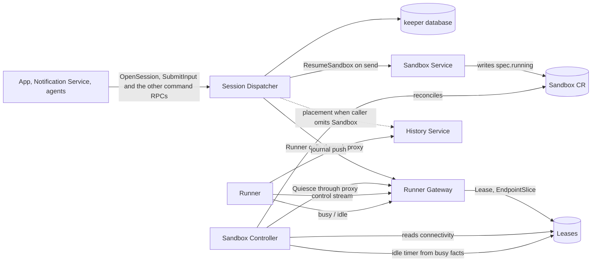
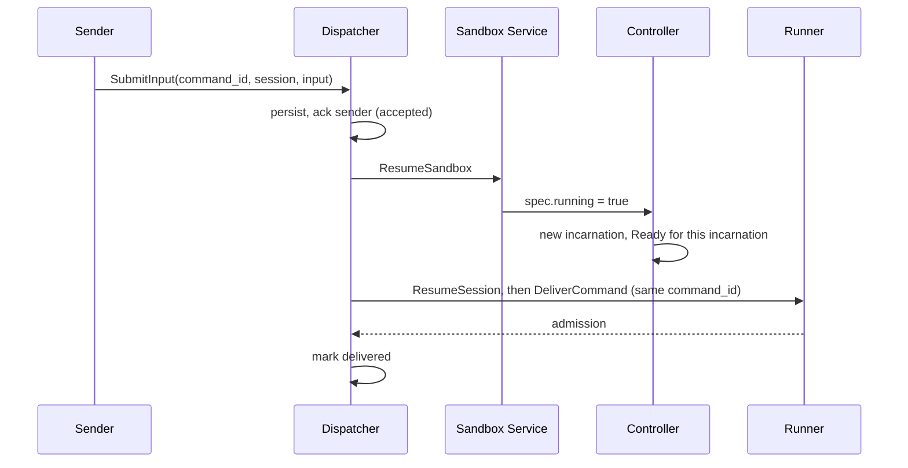

# Sandbox and Session control: who owns what

Status: **proposal, for the operator to accept or redirect; every boundary and name is open.** Nothing here is decided; each fork
names a recommendation and what would change it. Questions for the operator are collected in
[Open decisions](#open-decisions).

Scope: the responsibilities split across the services and custom resources that run a Sandbox (Pod
or VM) and deliver work to the Sessions in it. This covers the control Service, readiness and
runner health, sealing, suspension, the Session message queue, and where each fact lives. It does
not redesign storage, the History Service, or policy.

## What has to happen

1. **Run a Sandbox.** Reconcile the `Sandbox` CR into a state volume and, while running, one Pod
   or VM. Kind (`pod` or `vm`) comes from the template.
2. **Reach its runner.** Callers address `<sandbox>-control`; the replica holding the runner's
   dial-out connection answers.
3. **Say what state it is in.** Created, starting, booting, connected, ready, sealing,
   suspended, tearing down, and why it is stuck when it is.
4. **Quiesce** (today's "seal"; one operation, names in D3). Before a Pod or VM goes away (suspend or delete), stop admitting work,
   interrupt running turns, flush every Session's journal to the ingress, and only then stop it.
5. **Deliver work to a Session whatever state its Sandbox is in.** A message to a suspended
   Sandbox's Session resumes the Sandbox and arrives once the runner is up, even if the sender is
   gone.
6. **Suspend idle Sandboxes.** Never delete on idleness (operator, 2026-10-13).
7. **Create a Session** that does not exist yet, from a client-minted ID.
8. **Keep per-Session data out of Kubernetes** (operator, 2026-10-13). Kubernetes holds Sandbox-level
   facts, including transitional conditions such as sealed or unsealed; Session-level records live
   in a service database.

## Current state

- **Sandbox Controller** (Go, `sandbox_controller/`): state PVC, Pod or VM, ServiceAccount,
  `PolicyBinding`, launch ConfigMap, finalizer. It drives seals: it calls `Runner.Seal` through the
  gateway's runner proxy and records `status.sealedIncarnation` and `SessionsSealed`. It publishes
  `Running` and, since #10326, `Ready` (workload readiness only; it says nothing of the runner's
  connection).
- **Runner Gateway** (`runner_gateway/`): the `RunnerControl.Connect` listener and the proxy of the
  runner's `Runner` service. It creates, per Sandbox, a Lease (holder, epoch, liveness), a headless
  selector-less `<sandbox>-control` Service and an EndpointSlice pointing at the holding replica
  (`connection_records.py`). The records are owned by the Sandbox. It still wraps `Runner` with
  Session registry, readiness checks (`destinations.py`) and a database until
  `GATEWAY_WRAPPER_RETIRE` and `GATEWAY_DATABASE_DROP`. Its API promises that session and command
  RPCs never provision, resume or wake a Sandbox.
- **Sandbox Service** (`sandbox_service/`): `CreateSandbox`, `SuspendSandbox`, `ResumeSandbox`,
  `DeleteSandbox`, grants. It writes the Sandbox's desired state; the controller validates it. It is
  to fold into the controller later (`AGENTPLANE_SANDBOX_RESOURCE`).
- **Runner**: harnesses, journal, command admission, `Seal` (durably refuses new and resumed
  Sessions, stops harnesses, seals every journal; repeated until flushed). The Sandbox's
  `bootstrap` runs inside the first `OpenSession`.
- **History Service**: ingress (journals pushed by runners, acked by cursor), raw log, fold, reads;
  records which Sandbox wrote each Session. Folds `last_model_activity_at`.
- **In flight** (verify status before relying on it): the Sandbox Service's `Sealing` and
  `Tearing down` phases (#10328); runner connectivity folded into `Ready`, reported by the gateway
  over gRPC health (approved DAG node, after #10326).

Message sending has no queue today: the app calls `SubmitCommand`, which forwards to a running
harness or fails. Nothing resumes a Sandbox on a message.

## Where the lines could fall

The "session controller" bundles three jobs that need different things, so the first question is
where to cut, not what to call the result.

| Job                                                                   | Needs                                                                     |
| --------------------------------------------------------------------- | ------------------------------------------------------------------------- |
| Workload and runner-aware lifecycle: wake, seal, suspend, delete      | The Sandbox CR, the runner connection facts, leader election; no database |
| Idle policy: decide a Sandbox has been idle long enough               | The same runner facts and a per-Sandbox setting; no database              |
| Delivery: durable queue of messages and Session creations per Sandbox | A database, the sender's identity, the gateway                            |

| Cut                                                                                                                               | Result                                                                                                                                                                                                            |
| --------------------------------------------------------------------------------------------------------------------------------- | ----------------------------------------------------------------------------------------------------------------------------------------------------------------------------------------------------------------- |
| 1. One new service takes all three (the earlier plan-burn-down sketch)                                                            | The new service writes desired state, runs timers and holds a database; the controller keeps only Pods, so lifecycle policy is split across two reconcilers of the same CR                                        |
| **2. Lifecycle and idle policy stay in the Sandbox Controller; a new service holds only the queue**                               | Idle is declarative (`spec.idleSuspendAfter`) and decided by a leader-elected reconciler that already drives seals; the queue service has one job and one store; no timer state outside Kubernetes and the runner |
| 3. As 2, and later split the controller into a generic workload layer and a runner-aware layer above it (`SANDBOX_GENERIC_SPLIT`) | Compatible with 2: the runner-aware layer is where seal, connectivity and idle already sit, so the split moves files, not responsibilities                                                                        |
| 4. No new service: queue in the gateway, or in the History Service                                                                | The gateway gains a database and the power to wake Sandboxes; the History Service gains routing and waking. Both break an agreed invariant                                                                        |

Recommend **2**, and the rest of this document assumes it. Cut 1 is rejected only because idle
policy needs nothing the queue has and everything the controller has; if the operator prefers one
component that "keeps Sandboxes and their messages", D4 shows what would move.

## Proposed split



| Component          | Owns                                                                                                                                                          | Does not own                                                        |
| ------------------ | ------------------------------------------------------------------------------------------------------------------------------------------------------------- | ------------------------------------------------------------------- |
| Sandbox CR         | Desired state (`spec.running`, template), current facts (`status`: incarnation, `quiescedIncarnation`, conditions)                                            | Anything per Session                                                |
| Sandbox Controller | Pod or VM, state volume, identity, the `<sandbox>-control` Service, quiesce sequencing, idle suspension, deletion, folding every layer's fact into conditions | Runner connection, Session records, queues                          |
| Runner Gateway     | The runner connection and its authentication, the Lease and EndpointSlice, the proxy of `Runner`, per-method authorization                                    | Any Kubernetes object besides those two, Sessions, queues           |
| Runner             | Harnesses, journal, admission, seal mechanics, busy state                                                                                                     | Policy about when to suspend                                        |
| History Service    | Event log, fold, Session directory including the writing Sandbox                                                                                              | Routing, waking, suspending                                         |
| Session Dispatcher | The durable queue of messages and Session creations, wake-on-send, send-side authorization (who may wake), delivery states                                    | Sandbox objects (it asks the Sandbox Service), idle policy, history |

"Session Dispatcher" is a placeholder name for the queue service; it is not a controller. Idle is a
Sandbox-level fact (every Session in the Sandbox idle), which is why its policy sits on the Sandbox.

## Decisions

### D1. Who owns the per-Sandbox control Service

Today the gateway creates the Service, the Lease and the EndpointSlice on the first connection. The
Service is static (name, port); the slice and Lease are the dynamic connection fact.

| Option                                                                    | For                                                                                                                                              | Against                                                                                                              |
| ------------------------------------------------------------------------- | ------------------------------------------------------------------------------------------------------------------------------------------------ | -------------------------------------------------------------------------------------------------------------------- |
| A. Gateway owns all three (today)                                         | One writer of connection state; nothing to coordinate                                                                                            | The gateway needs `create` on Services; the name appears only after a runner connects; a stale-owner replace dance   |
| **B. Controller creates the Service; gateway writes the Lease and slice** | The Service exists, Sandbox-owned, from creation; before a runner connects the caller sees no endpoints, not a DNS failure; gateway RBAC shrinks | The controller and gateway must agree on name and port (one shared constant)                                         |
| C. No per-Sandbox Service; any gateway replica forwards to the holder     | No Kubernetes object per connection; one address for callers                                                                                     | Adds a replica-to-replica hop and trust; reverses the operator's 2026-10-12 choice of a dialed-hostname Sandbox name |

**Decided (operator, 2026-10-13): B.** The Service is part of the Sandbox's identity, like its ServiceAccount; only the
connection is the gateway's to assert. The cost is small either way, so this is the least
consequential fork. C is the option to revisit if the per-connection writes ever become a load
problem.

### D2. How readiness and runner health reach the Sandbox's conditions

Facts have different truth sources, so each gets its own condition and `Ready` is their AND:

| Condition         | Source of truth                                                               | Meaning                                                                                     |
| ----------------- | ----------------------------------------------------------------------------- | ------------------------------------------------------------------------------------------- |
| `Running`         | controller (Pod or VMI)                                                       | an incarnation exists and runs                                                              |
| `WorkloadReady`   | controller (Pod Ready)                                                        | what `Ready` reports today (#10326)                                                         |
| `RunnerConnected` | gateway (connection Lease)                                                    | a runner of this incarnation holds a live connection                                        |
| `Bootstrapped`    | runner (bootstrap result)                                                     | the Sandbox's bootstrap ran to success                                                      |
| `Ready`           | controller                                                                    | all of the above for the current incarnation                                                |
| `Quiesced`        | controller, from the runner's quiesce stage published on the connection Lease | False with reason `Draining`, then `Flushing`; True once every final cursor is acknowledged |

Two rules make this safe. Conditions are keyed to the incarnation UID, so a connection or boot
fact from incarnation N is never read as incarnation N+1's. And a condition is written by exactly
one actor: the controller writes them all; every other layer publishes a fact the controller reads.

Transport for the gateway's and runner's facts:

| Option                                                                        | For                                                                                                                                                                    | Against                                                                                                                 |
| ----------------------------------------------------------------------------- | ---------------------------------------------------------------------------------------------------------------------------------------------------------------------- | ----------------------------------------------------------------------------------------------------------------------- |
| gRPC health from the gateway (the approved node)                              | Explicit; carries any shape of fact                                                                                                                                    | The controller holds a watch per Sandbox against a replica-sharded service; a gateway outage reads as every runner down |
| **Lease and its annotations** (already written by the gateway, Sandbox-owned) | No new API; Kubernetes-native watch; survives gateway restarts as a stale-but-honest record (`renewTime` plus duration); the Lease already carries pod UID and boot ID | Controller must requeue on expiry; each fact the runner adds costs a Lease write, so write transitions only             |
| Gateway writes the Sandbox's status                                           | Fewest hops                                                                                                                                                            | Two writers on one status; breaks "layers that act on CRs do not edit them"                                             |

**Decided (operator, 2026-10-13): the Lease.** `RunnerConnected` is the Lease's liveness, and runner-reported facts
(`Bootstrapped`, busy state, the quiesce stage of D3) ride its annotations, written on transition only. If the approved
gRPC-health node is built, its output should still land as a fact the controller folds; the choice
here is only the transport. A gateway rollout drops every connection at once; the controller must
treat the reconnect window as connectivity lost, not as a Sandbox failure, and must not replace or
restart anything because of it (no automatic spec replacement, operator 2026-10-13).

**etcd write cost of runner facts (accepted by the operator, 2026-10-13).** The gateway already renews every connected Sandbox's Lease every
`touch_s` (15 s by default), so each connected Sandbox costs about four etcd writes a minute before this
design adds anything. Runner facts therefore add no writes: the gateway holds the latest busy/idle and stage
facts in memory and puts them on the Lease in the next scheduled renewal, so an annotation change rides a write
that happens anyway. Busy/idle transitions can be frequent while an agent works (each turn ends and starts),
which is why they are not written on their own; the controller needs `idleSince` only to minutes of
precision, so up to one renewal interval of lag is harmless. The quiesce stage is rare and takes the same
path. Cost on the reading side: the controller's Lease watch already sees a renewal event every 15 s per
connected Sandbox and must filter on annotation or holder changes rather than reconcile on each. Rejected
here: the controller subscribing to a gateway gRPC watch for idle. It saves no write that matters next to the
renewals, and it needs the controller to find and track every gateway replica, resynchronise after a gateway
or controller restart, and depend on the gateway being up to decide anything; the Lease is a record that
outlives both. Revisit only if the renewal write rate itself becomes a problem, and then lengthen `touch_s`
before adding a second channel.

### D3. Quiescing is one operation; names say which stage a Sandbox is in

**Quiescing is one operation on the whole runner, not on its Sessions** (operator, 2026-10-13). It
puts the runner in a durable lameduck state, in which it accepts only the operations that drain it,
and drains it. The state survives a runner restart within the incarnation and ends with the incarnation
(below). What stays per
Session is only the bookkeeping the drain finishes: each journal's final cursor and whether the
ingress has acknowledged it.

| Once quiescing has begun, the runner                                                 |
| ------------------------------------------------------------------------------------ |
| refuses `OpenSession`, `ResumeSession` and any command that starts or continues work |
| accepts interrupts, reads (`ListSessions`) and repeated `Quiesce`                    |
| interrupts active turns, stops harnesses, finalizes journals, pushes through cursors |

**Lameduck belongs to an incarnation.** A runner restart inside an incarnation (a crashed runner
container, a guest reboot in the same VMI) keeps the runner quiesced; a new incarnation on the same
state volume starts unquiesced. Today the runner records the state as an empty `sealed` marker file
under `--state-dir`, which is the state volume and therefore outlives the incarnation, so a resumed
Sandbox's runner would find the marker and refuse every new and resumed Session. The marker must name
the incarnation it was entered in:

- **Incarnation identity.** The runner does not choose it. The gateway already authenticates the
  connecting Pod and refuses one that is not the Sandbox's current incarnation
  (`runner_gateway/runner_control.py`); its `Welcome` carries that incarnation's UID (the Pod, or a
  VM's virt-launcher Pod, as `status.incarnation` names it). `runner_boot_id` cannot serve: it
  changes on every runner process start, restarts included.
- **Keying.** Entering lameduck writes the marker with the incarnation UID the runner last saw in a
  `Welcome`. The runner serves nothing before it connects, since every call arrives over the control
  stream, so on each `Welcome` it compares: same UID, the marker stands and the runner stays
  quiesced across the restart; different UID, the marker belongs to an earlier incarnation and is
  removed before any call is accepted, and the runner starts unquiesced.
- **Journals.** Each Session's journal sealed at its final cursor in the earlier incarnation. The
  new incarnation continues it after that cursor with an entry recording that it resumed; how a
  sealed journal is reopened and what the ingress does with the next cursor range is
  `SESSION_INCARNATIONS`'s to define, and the earlier incarnation's acknowledgement stays valid for
  it.
- **Outside the runner.** The Lease's stage annotation carries the incarnation UID it describes, and
  the gateway clears the stage when it accepts a connection for a different incarnation, so a stale
  `Quiesced` is never read for the new one. The controller's `quiescedIncarnation` is compared with
  the current `status.incarnation`; after a resume they differ, which is what makes the new
  incarnation unquiesced there as well.

**Names.** Today one word, "sealed", covers three different facts: the runner refuses new work, its
journals are final, and the ingress has acknowledged them. A `Sealed` condition that is True while
the runner is only refusing new work is wrong. Proposed:

| Today                      | Proposed                                                                | Meaning                                                                   |
| -------------------------- | ----------------------------------------------------------------------- | ------------------------------------------------------------------------- |
| RPC `Runner.Seal`          | `Runner.Quiesce`                                                        | The one operation; idempotent, so a repeat is safe                        |
| (no name)                  | reason `Draining`                                                       | Refusing new work; interrupting turns, stopping harnesses                 |
| (no name)                  | reason `Flushing`                                                       | Harnesses stopped, journals final; waiting for the ingress to acknowledge |
| `Sealed`, `SessionsSealed` | condition `Quiesced`, True only when every final cursor is acknowledged | Safe to remove the Pod or VM                                              |
| `status.sealedIncarnation` | `status.quiescedIncarnation`                                            | UID of the last incarnation that reached `Quiesced`                       |
| Sandbox phases `Sealing`   | `Quiescing`                                                             | Draining or Flushing                                                      |
| `Ready` while refusing     | `Ready` False, reason `Draining`                                        | Callers and the Dispatcher read "not accepting work" from `Ready`         |

`Quiesced` is False with reason `Draining`, then `Flushing`, until it is True; `NeverRan` and
`NotQuiesced` cover a Sandbox whose runner never connected and one stopped without quiescing. The
journal keeps the word "sealed": a journal is sealed at its final cursor, which is one step of
`Flushing` and per Session, so it never names a Sandbox condition. Per-Session cursors never appear
in Kubernetes. The remaining sections use the proposed names; the Current state section keeps today's.

Today the runner refuses new Sessions immediately, but commands to a Session whose journal is not
yet sealed are still admitted, and a turn is stopped rather than interrupted through the command
protocol. The change is to refuse at entry and interrupt before stopping, inside the same
operation.

Sequence for suspend and delete:

```mermaid
sequenceDiagram
    participant C as Sandbox Controller
    participant R as Runner (through gateway proxy)
    participant I as Ingress (History Service)
    participant L as Connection Lease
    C->>R: Quiesce (one call, returns once lameduck is entered)
    R->>R: enter lameduck (durable): refuse all but draining operations [Draining]
    R-->>L: stage = Draining (Lease annotation, through the gateway)
    R->>R: interrupt active turns (InterruptTurn), wait up to a deadline
    R->>R: stop harnesses, seal journals
    R-->>L: stage = Flushing
    R->>I: push to the final cursor
    I-->>R: ack
    R-->>L: stage = Quiesced
    L-->>C: watch event
    C->>C: Quiesced; record quiescedIncarnation, then delete Pod or VM
```

Interruption is part of `Quiesce` rather than a second RPC: the runner already owns turn state, and
a caller wanting "suspend only if still idle" is better served by a precondition on the suspend
request (`if idle since T`) than by a drain phase to coordinate. It needs a deadline after which a
turn that ignores the interrupt is stopped anyway, and a defined history entry showing a turn ended
by teardown.

**The controller is told, not polling.** Today the controller repeats `Seal` every few seconds
until every Session reports flushed. Instead, `Quiesce` is called once and returns when the runner
has entered lameduck. From then on the runner publishes its stage (`Draining`, `Flushing`,
`Quiesced`) as a connection-Lease annotation, written on each transition by the gateway replica
holding its connection (D2's transport), and the controller reacts to the Lease watch event. The
runner, not the controller, knows when the ingress acknowledges the last cursor, so the signal
originates where the fact is, and the History Service is never a dependency of the controller.

Two things keep this level-triggered rather than reliant on one event: the runner republishes its
stage whenever it reconnects (a gateway rollout or a dropped stream loses nothing), and the
controller re-issues the idempotent `Quiesce` when it finds a Sandbox that should be quiescing
whose Lease shows no stage. A runner that never progresses is caught by a deadline the controller
requeues for, not by periodic checks, and ends as a stuck `Quiescing` Sandbox whose finalizer an
operator removes by hand. Rejected: a server-streaming `Quiesce` held open by the controller (it
is lost on every gateway rollout and ties up a connection per quiescing Sandbox for no fact the
Lease does not already carry), and the History Service notifying the controller (a new
dependency the other path does not need).

Commands arriving at a draining runner are refused with a code the Dispatcher reads as "retry after
resume", not as failure.

### D4. The queue service: required or optional, one door or two, separate or merged

The queue service does one job: **delivery.** Accept a message durably, wake the
Sandbox, deliver once the runner is Ready, survive the sender leaving. It needs a database, the
Sandbox's name, the gateway and the Sandbox Service. Idle policy is the controller's (below).

**Required or optional.** Recommended: _required for senders, not for the platform._ Everything
that sends work to a Session (app composer, Notification Service, agent messaging) goes through the
Dispatcher's command RPCs, so there is one set of delivery semantics: accepted, then delivered, or failed
with a reason. A second direct path for the same senders means "sometimes queued, sometimes an
immediate error", which the suspended composer story cannot present. The runner proxy at the
gateway stays the only runner surface, and system callers still use it directly: the Dispatcher itself,
the controller's `Quiesce`, operator diagnostics and acceptance tests. Per-method authorization at the
gateway is where "only these callers may call `DeliverCommand`" is enforced; it is a policy edit,
not a new path.

What remains of the runner surface for direct use once the Dispatcher exists:

| `Runner` method  | After the Dispatcher                                                             |
| ---------------- | -------------------------------------------------------------------------------- |
| `DeliverCommand` | Dispatcher (senders); direct for system callers and tests                        |
| `OpenSession`    | Dispatcher (its own `OpenSession`); direct for system callers                    |
| `ResumeSession`  | Dispatcher, as an internal step of each command RPC (the harness half of waking) |
| `Quiesce`        | Sandbox Controller only                                                          |
| `ListSessions`   | direct; reads need no wake                                                       |

A deployment with no Dispatcher is a valid reduced configuration (a Sandbox that is started by hand
and never suspended), because the runner, gateway and controller do not depend on the Dispatcher. It
just has no wake-on-send and no idle suspension. That optionality costs nothing in code: absent
callers.

**The Dispatcher's RPC surface.** Callers state intent; waking, resuming and delivering are internal steps:

- `OpenSession(session_id, sandbox, spec, setup_script?)`: stores the Session's creation durably and
  returns `QUEUED`. The client mints the Session ID, as everywhere (invariant: one ID, client-minted),
  which makes it idempotent: a retry with the same payload returns the same record, and another Sandbox,
  spec or setup script for a known ID is refused. The Dispatcher waits for the Sandbox to be `Ready`
  (resuming it where the sender may wake it) and calls the runner's `OpenSession`, which is itself
  idempotent. The Dispatcher's `OpenSession` is a different RPC from the runner's of the same name
  (kept by the operator, 2026-10-13): it queues, the runner's executes.
- One RPC per command, mirroring the runner's: `SubmitInput`, `ChangeModel`, `ChangeReasoningEffort`,
  `InterruptTurn` and `StopRunnerSession`, each taking `(command_id, session_id, <that command's fields>)`.
  Each stores the command durably and returns `QUEUED`; none waits for delivery. `command_id` is the
  idempotency key across all of them: a retry of the same operation and payload returns the same record, and
  the same ID under another operation or payload fails `ALREADY_EXISTS`, as the runner's own admission
  does. The Dispatcher resolves the Session's Sandbox from its own record or the History Service's Session
  directory, resumes the Sandbox if suspended (where the sender may wake it), waits for `Ready`, resumes a
  stopped harness, and calls the runner's RPC of the same name. An unknown Session fails `NOT_FOUND`; a
  command queued behind its Session's `OpenSession` waits for it. A notification is a `SubmitInput` from a
  different caller, authorized by caller identity, so it has no RPC of its own. `InterruptTurn` and `StopRunnerSession` never wake a suspended Sandbox (operator, 2026-10-13): with nothing running there is nothing to interrupt or stop, so they complete as no-ops.
- `GetDispatch`, `WatchDispatches` (stream, by Session or Sandbox), `ListDispatches`, `CancelDispatch`
  (not once delivery is ambiguous). A Session's open is a dispatch like a command, with the same states.

**Where a new Session's spec comes from.** `OpenSession` carries it, from the caller (the app resolves its
presets into a concrete `SessionSpec` first; the Dispatcher knows no preset). The Dispatcher stores it with the
Session record and does not interpret it.

**The Dispatcher never creates Sandboxes.** The Sandbox named in `OpenSession` must exist; a missing one
fails the dispatch. Creating, deleting and templating Sandboxes stays with the Sandbox Service. The Dispatcher
only asks it to resume a suspended one. It needs a Sandbox _name_, never an address; the gateway resolves the
name from the dialed host.

**Placement.** Callers pass the Sandbox when they know it (the app resolves Thread to Session to
Sandbox through the History Service already). The Dispatcher falls back to the History Service's
Session directory when they do not. A Session that is only queued for creation is known to the
Dispatcher alone until its runner pushes, so the Dispatcher's own record is authoritative until then.

**History Service dependency.** Delivery does not need it: admission is the runner's receipt, and
placement is passed or looked up. Placement lookup and the reading of final-cursor acks (already required
for any suspend or delete) are the only touches. For idle policy the controller should not derive
activity from history at all (below), so idle policy and the Dispatcher run with the History Service down, except
that, as today, nothing can finish sealing while the ingress is down. An outage therefore blocks
suspension and deletion, not messaging.

**Idle signal.** Two different things get called "last active":

- _Busyness_: is any turn, command, background process or attached terminal active in this runner
  right now? The runner knows authoritatively and the controller must have it without the History
  Service.
- _Last model activity_: a folded timestamp the UI and notification quiet-window read. The History
  Service owns it.

Recommend suspension uses the first: the runner publishes `busy` and `idleSince` on transitions
(carried like other runner facts in D2), and the Sandbox Controller runs the timer against
`spec.idleSuspendAfter`, then suspends through the D3 sequence. The timer is restartable because
the facts live in the runner and Lease, not in controller memory. A message sent to an idle Sandbox
that is about to suspend is safe without a lock: the sealing runner refuses it with a retryable code
and the Dispatcher redelivers after resume. To avoid pointless suspend-resume flapping the Dispatcher
marks a Sandbox it holds pending messages for (a Sandbox-level annotation, not a per-Session list)
and the controller does not start an idle suspend while the mark is set. `SESSION_ACTIVITY_STREAM` (the UI's activity facts) uses the same runner busy/idle definition (operator, 2026-10-13), so there is one definition of idle; the History Service's folded `last_model_activity_at` stays a separate timestamp for the UI and the notification quiet window.

**Separate service or merge with the gateway.** "Both required" is not an argument to merge:
required-ness says nothing about failure domain, state or replica shape.

| Option                    | For                                                                                                                                                                                                                                                             | Against                                                                                                                                                         |
| ------------------------- | --------------------------------------------------------------------------------------------------------------------------------------------------------------------------------------------------------------------------------------------------------------- | --------------------------------------------------------------------------------------------------------------------------------------------------------------- |
| **Separate service**      | Gateway stays stateless and database-free (`GATEWAY_DATABASE_DROP`), keeps working through a Dispatcher or History outage; Dispatcher has one active owner per Sandbox without constraining gateway replicas; gateway keeps its "never wakes a Sandbox" promise | One extra hop; a second Deployment with its own database                                                                                                        |
| In the gateway            | One fewer service                                                                                                                                                                                                                                               | Gives the gateway a database and the power to resume Sandboxes; couples queue ownership to connection-holder replicas, which are sharded for a different reason |
| In the Sandbox Controller | Nearest the desired state                                                                                                                                                                                                                                       | A leader-elected reconciler with no database would gain a queue; Kubernetes would hold per-Session data. Idle policy, which needs no database, does belong here |
| A CR per queued message   | No new store                                                                                                                                                                                                                                                    | Per-Session data in Kubernetes, against the stated boundary; etcd write rate                                                                                    |

Recommend **separate** (cut 2). Multiple Dispatcher replicas shard Sandboxes by a per-Sandbox Lease so each
Sandbox has one active owner, as the gateway fences connection epochs.

**Who may wake.** The Dispatcher knows the sender's identity, so it enforces which kinds of sender may
resume a Sandbox (user message and notification yes; agent message no unless decided,
`AGENT_MESSAGE_RECEPTION`). Its ServiceAccount holds the Sandbox Service grant to resume; the
Sandbox Service stays the only writer of desired state.

### D5. Where each fact lives

| Fact                                                                                                              | Home                                             |
| ----------------------------------------------------------------------------------------------------------------- | ------------------------------------------------ |
| Desired running, template, incarnations, conditions, `quiescedIncarnation`, the rendered spec of each incarnation | Sandbox CR (Kubernetes)                          |
| Runner connected, boot state, busy state                                                                          | Lease annotations (Kubernetes, Sandbox-level)    |
| Session events, directory, writing Sandbox, summaries                                                             | History Service database                         |
| Queued messages, their delivery state, queued Session creations, the pending mark's source                        | Dispatcher database                              |
| Session journal and cursors                                                                                       | Runner volume, mirrored by the ingress           |
| Per-Session seal cursors and flush state                                                                          | the quiesce response and the ingress, never a CR |

Conditions and annotations carry Sandbox-level, transitional facts only. A per-Session list in
Kubernetes is the line not to cross.

## Sandbox lifecycle

Phase is derived, never stored (as for the Sandbox Service today):

```text
Creating -> Starting -> Booting -> Ready -> Quiescing -> Suspended
                                   ^                                |
                                   |------------ Resuming ----------|
Any state --delete--> Quiescing (if not quiesced) -> Tearing down -> gone
```

- Suspend and delete both run the D3 sequence; a suspended, already-sealed Sandbox deletes without
  waking (`quiescedIncarnation`).
- A wedged seal is cleared by removing the finalizer by hand. No force-seal exists to build around.
- Spec update is suspend, then resume, which re-derives the spec from the current template. The
  rendered spec of each incarnation is stored on the Sandbox for diffing.

Message to a suspended Session:



## What this makes adoptable

Each DAG node fits without reshaping the split. Node edits belong to the Plans burn-down lane.

| Node                                                        | Where it lands                                                                                                            |
| ----------------------------------------------------------- | ------------------------------------------------------------------------------------------------------------------------- |
| `SESSION_QUEUE_DESIGN`, `SESSION_MESSAGE_QUEUE`             | Dispatcher; this document answers the new-service fork and the dependency questions                                       |
| `SESSION_ACTIVITY_STREAM`                                   | Built on the runner's busy/idle facts, the same definition idle suspension uses (operator, 2026-10-13)                    |
| `SANDBOX_IDLE_EXPIRY`                                       | Controller: `spec.idleSuspendAfter`, runner busy facts, the D3 sequence                                                   |
| `SESSION_REVIVE`, `SESSION_INCARNATIONS`                    | Controller starts the incarnation; History Service records it from the runner's announcement                              |
| `BOOTSTRAP_PROGRESS_CONTRACT`                               | Runner fact on the Lease; `Bootstrapped` condition                                                                        |
| `CONTROLLER_SEALS`, `SANDBOX_LIFECYCLE`                     | Already the controller's; D3 adds the interrupt step                                                                      |
| `SANDBOX_GENERIC_SPLIT`                                     | The controller keeps Pod, VM, volume; sealing and runner facts become an optional layer on top; the Dispatcher is outside |
| `SANDBOX_SPEC_EDIT`, `SANDBOX_IMAGE_REPLACE`                | Suspend then resume; no change to the split                                                                               |
| `STATE_VOLUME_BLOCK`, `WORKSPACE_VOLUME`, `SANDBOX_ARCHIVE` | Controller; the Dispatcher only waits for `Ready`                                                                         |
| `VM_RAM_SUSPEND`                                            | Needs its own answer to "seal before suspend": see below                                                                  |
| `THREAD_SUCCESSOR_DELIVERY`, `COMMAND_DELIVERY_STATES`      | The Dispatcher's delivery states are the vocabulary; the ambiguous-admission case is its `unknown`                        |
| `AGENT_MESSAGING`, `SUSPENDED_COMPOSER`                     | Senders of the command RPCs                                                                                               |

## Complexities not yet named

- **Suspend versus an arriving message.** A message accepted while the Sandbox is sealing must wait
  for the _next_ incarnation to be Ready; delivering to the sealing runner loses it or errors. Key
  every delivery attempt to the incarnation UID, and make the runner refuse once quiescing begins with a
  distinct code.
- **At-least-once with ambiguity.** The Dispatcher persists the command before acknowledging the
  sender; the runner deduplicates on `command_id`. A call whose reply was lost across an
  incarnation boundary is `unknown`, not replayed (`THREAD_SUCCESSOR_DELIVERY`).
- **Competing desires.** An operator suspend, a queued message, an idle timer and a deletion can all
  be live at once. Decide precedence: deletion beats everything; an explicit operator suspend
  needs a way to say "hold, do not wake" or it is undone by the next notification.
- **What idle means.** Background processes, durable SSH processes and an attached terminal or
  console must count as busy, or a Sandbox is suspended under a running job.
- **Wake cost and abuse.** Resume starts a Pod or VM and every harness. Notifications and agent
  messages can wake Sandboxes in bulk; rate limits, per-sender quotas and per-Session lazy
  `ResumeSession` (only Sessions with pending work) are needed. A resume storm also hits scheduling
  and the state volume's node.
- **Resume can be impossible.** With node-local volumes the Sandbox can only resume where its PVC
  lives; the node may be down or full. The queue needs a visible, bounded wait with a reason, and a
  message TTL.
- **Failed or deleted targets.** A message for a deleted Sandbox or Session, a failed revival, a
  poison command: each needs a terminal state the sender can read, not a silent retry.
- **History outage blocks suspend and delete.** Intended, since sealing waits for the ingress ack,
  but it means idle Sandboxes keep running through the outage. The controller must back off, not retry
  every few seconds per Sandbox.
- **Interrupt semantics.** A turn interrupted by teardown needs a history entry distinguishing it
  from a user interrupt, and a harness that ignores the interrupt needs the deadline in D3.
- **VM RAM suspend.** If a VM keeps harness processes alive across suspend, "seal before suspend"
  means something different (flush the journal, keep the harness). Settle this before
  `VM_RAM_SUSPEND` assumes the Pod sequence.
- **Rolling out together.** The gateway rollout reconnects every runner at once and flaps
  `RunnerConnected`; debounce it. Runner, gateway, controller and Dispatcher roll independently, so
  protocol additions (interrupt in `Quiesce`, Lease annotations) must be accepted by readers before
  writers emit them (image before config).
- **Credentials across suspension.** Egress grants, PolicyBindings and projected tokens must still
  be valid when a Sandbox resumes hours later; a resume that comes up with expired grants looks
  like a broken Sandbox.
- **Time.** `idleSince` is measured on the runner; the controller should measure its own elapsed time
  from observed transitions, so clock skew and a restarted runner cannot suspend early.
- **Why-not observability.** "Why hasn't my message arrived" needs per-message state (queued,
  waiting for Ready, delivering, delivered, unknown, failed with reason) readable by the sender and
  the same Sandbox conditions as above.
- **Multiple Sessions per Sandbox.** Idle is the conjunction over all of them, and waking Sandbox
  for one Session should not start the others' harnesses.
- **Session ID collision.** The client-minted ID must be unique across Sandboxes; the Dispatcher's
  record covers the window before the History Service has seen the Session, and the History
  Service's first-writer binding covers the rest.

## Open decisions

1. **Dispatcher as the required door for senders, with direct runner access for system callers?**
   Recommend yes (D4).
2. **Dispatcher as its own service rather than in the gateway?** Recommend yes (D4).
3. **Idle policy in the Sandbox Controller (declarative, from runner-reported busyness) rather
   than in the queue service or driven by history?** Recommend yes (cut 2, D4).
4. ~~Lease annotations rather than gRPC health as the runner-fact transport?~~ **Decided
   (operator, 2026-10-13): Lease annotations** (D2). This replaces the mechanism of the earlier
   gateway-health connectivity node, not its goal.
5. ~~Controller creates the control Service?~~ **Decided (operator, 2026-10-13): yes** (D1).
6. **Interrupt inside the one `Quiesce` operation, and the renames in D3 (`Quiesced`, `Draining`, `Flushing`, `quiescedIncarnation`)?** Recommend yes (D3).
7. ~~A way for an operator to hold a Sandbox suspended against wake-on-send?~~ **Decided
   (operator, 2026-10-13): `spec.wakeOnSend: false`.** A Sandbox with it set is not woken by a send:
   the Dispatcher queues the message and the Sandbox stays suspended. It doubles as the feature gate
   for wake-on-send, so the Dispatcher can land with waking off.
8. **Name.** Session Dispatcher, `Quiesce`, `Quiesced`, `Draining` and `Flushing` are confirmed
   (operator, 2026-10-13). The Dispatcher has an explicit `OpenSession` (the spec and setup script are
   real input) and one RPC per command, each taking a Session ID; waking and resuming are internal (D4). The queue service is "Session Dispatcher" and a dispatch is one queued command or
   Session creation. The names to avoid are taken:
   `inbox` is the Notification Service's (`inbox_id`, `InboxView`), `outbox` is the Action
   Service's (`action_outbox`), "mailbox" is already the task DAG's word for an agent's receiving
   side (`AGENT_MESSAGING`), `relay` is the egress `SidecarRelay`, `queue` names the runner's and
   Claude's input queue ([input queueing](claude_input_queue.md)), and `hold` is the History
   Service's retention hold. No `Dispatcher` or `dispatch` identifier exists in the code today;
   "Delivery Service" is the runner-up but collides with the runner's `DeliverCommand`, the last hop
   it makes.
