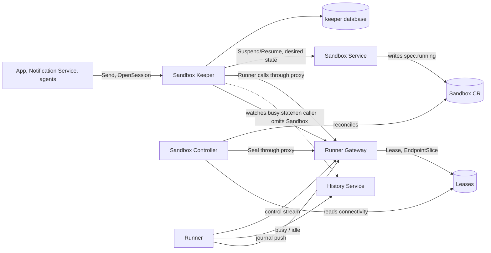
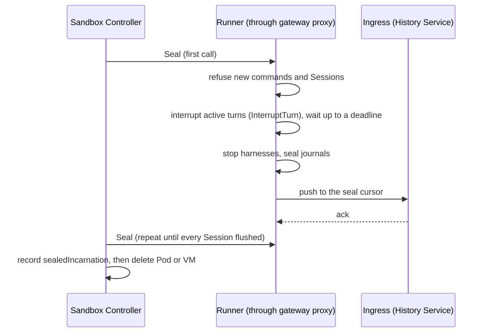
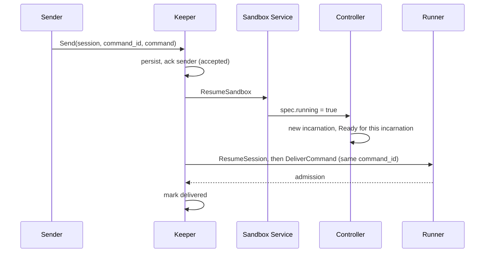

# Sandbox and Session control: who owns what

Status: **proposal, for the operator to accept or redirect.** Nothing here is decided; each fork
names a recommendation and what would change it. Questions for the operator are collected in
[Open decisions](#open-decisions).

Scope: the responsibilities split across the services and custom resources that run a Sandbox (Pod
or VM) and deliver work to the Sessions in it. This covers the control Service, readiness and
runner health, sealing, suspension, the Session message queue, and where each fact lives. It does
not redesign storage, the History Service, or policy.

## What has to happen

1. **Run a Sandbox.** Reconcile the `Sandbox` CR into a state volume and, while running, one Pod
   or VM. Kind (`pod` or `vm`) comes from the template.
2. **Reach its runner.** Callers address `<sandbox>-control`; the replica holding the runner's
   dial-out connection answers.
3. **Say what state it is in.** Created, starting, booting, connected, ready, quiescing, sealing,
   suspended, tearing down, and why it is stuck when it is.
4. **Quiesce and seal.** Before a Pod or VM goes away (suspend or delete), stop admitting work,
   interrupt running turns, flush every Session's journal to the ingress, and only then stop it.
5. **Deliver work to a Session whatever state its Sandbox is in.** A message to a suspended
   Sandbox's Session resumes the Sandbox and arrives once the runner is up, even if the sender is
   gone.
6. **Suspend idle Sandboxes.** Never delete on idleness (operator, 2026-10-13).
7. **Create a Session** that does not exist yet, from a client-minted ID.
8. **Keep per-Session data out of Kubernetes** (operator, 2026-10-13). Kubernetes holds Sandbox-level
   facts, including transitional conditions such as sealed or unsealed; Session-level records live
   in a service database.

## Current state

- **Sandbox Controller** (Go, `sandbox_controller/`): state PVC, Pod or VM, ServiceAccount,
  `PolicyBinding`, launch ConfigMap, finalizer. It drives seals: it calls `Runner.Seal` through the
  gateway's runner proxy and records `status.sealedIncarnation` and `SessionsSealed`. It publishes
  `Running` and, since #10326, `Ready` (workload readiness only; it says nothing of the runner's
  connection).
- **Runner Gateway** (`runner_gateway/`): the `RunnerControl.Connect` listener and the proxy of the
  runner's `Runner` service. It creates, per Sandbox, a Lease (holder, epoch, liveness), a headless
  selector-less `<sandbox>-control` Service and an EndpointSlice pointing at the holding replica
  (`connection_records.py`). The records are owned by the Sandbox. It still wraps `Runner` with
  Session registry, readiness checks (`destinations.py`) and a database until
  `GATEWAY_WRAPPER_RETIRE` and `GATEWAY_DATABASE_DROP`. Its API promises that session and command
  RPCs never provision, resume or wake a Sandbox.
- **Sandbox Service** (`sandbox_service/`): `CreateSandbox`, `SuspendSandbox`, `ResumeSandbox`,
  `DeleteSandbox`, grants. It writes the Sandbox's desired state; the controller validates it. It is
  to fold into the controller later (`AGENTPLANE_SANDBOX_RESOURCE`).
- **Runner**: harnesses, journal, command admission, `Seal` (durably refuses new and resumed
  Sessions, stops harnesses, seals every journal; repeated until flushed). The Sandbox's
  `bootstrap` runs inside the first `OpenSession`.
- **History Service**: ingress (journals pushed by runners, acked by cursor), raw log, fold, reads;
  records which Sandbox wrote each Session. Folds `last_model_activity_at`.
- **In flight** (verify status before relying on it): the Sandbox Service's `Sealing` and
  `Tearing down` phases (#10328); runner connectivity folded into `Ready`, reported by the gateway
  over gRPC health (approved DAG node, after #10326).

Message sending has no queue today: the app calls `SubmitCommand`, which forwards to a running
harness or fails. Nothing resumes a Sandbox on a message.

## Proposed split



| Component          | Owns                                                                                                                                                  | Does not own                                              |
| ------------------ | ----------------------------------------------------------------------------------------------------------------------------------------------------- | --------------------------------------------------------- |
| Sandbox CR         | Desired state (`spec.running`, template), current facts (`status`: incarnation, `sealedIncarnation`, conditions)                                      | Anything per Session                                      |
| Sandbox Controller | Pod or VM, state volume, identity, the `<sandbox>-control` Service, quiesce and seal sequencing, deletion, folding every layer's fact into conditions | Runner connection, Session records, queues, idle policy   |
| Runner Gateway     | The runner connection and its authentication, the Lease and EndpointSlice, the proxy of `Runner`, per-method authorization                            | Any Kubernetes object besides those two, Sessions, queues |
| Runner             | Harnesses, journal, admission, quiesce and seal mechanics, busy state                                                                                 | Policy about when to suspend                              |
| History Service    | Event log, fold, Session directory including the writing Sandbox                                                                                      | Routing, waking, suspending                               |
| Sandbox Keeper     | The durable Session message queue, wake-on-send, idle timer and the decision to suspend, send-side authorization (who may wake)                       | Sandbox objects (it asks the Sandbox Service), history    |

"Sandbox Keeper" is a placeholder for the Session controller. It works at Sandbox level because
suspension needs every Session in a Sandbox idle.

## Decisions

### D1. Who owns the per-Sandbox control Service

Today the gateway creates the Service, the Lease and the EndpointSlice on the first connection. The
Service is static (name, port); the slice and Lease are the dynamic connection fact.

| Option                                                                    | For                                                                                                                                              | Against                                                                                                              |
| ------------------------------------------------------------------------- | ------------------------------------------------------------------------------------------------------------------------------------------------ | -------------------------------------------------------------------------------------------------------------------- |
| A. Gateway owns all three (today)                                         | One writer of connection state; nothing to coordinate                                                                                            | The gateway needs `create` on Services; the name appears only after a runner connects; a stale-owner replace dance   |
| **B. Controller creates the Service; gateway writes the Lease and slice** | The Service exists, Sandbox-owned, from creation; before a runner connects the caller sees no endpoints, not a DNS failure; gateway RBAC shrinks | The controller and gateway must agree on name and port (one shared constant)                                         |
| C. No per-Sandbox Service; any gateway replica forwards to the holder     | No Kubernetes object per connection; one address for callers                                                                                     | Adds a replica-to-replica hop and trust; reverses the operator's 2026-10-12 choice of a dialed-hostname Sandbox name |

Recommend **B**. The Service is part of the Sandbox's identity, like its ServiceAccount; only the
connection is the gateway's to assert. The cost is small either way, so this is the least
consequential fork. C is the option to revisit if the per-connection writes ever become a load
problem.

### D2. How readiness and runner health reach the Sandbox's conditions

Facts have different truth sources, so each gets its own condition and `Ready` is their AND:

| Condition         | Source of truth                                            | Meaning                                              |
| ----------------- | ---------------------------------------------------------- | ---------------------------------------------------- |
| `Running`         | controller (Pod or VMI)                                    | an incarnation exists and runs                       |
| `WorkloadReady`   | controller (Pod Ready)                                     | what `Ready` reports today (#10326)                  |
| `RunnerConnected` | gateway (connection Lease)                                 | a runner of this incarnation holds a live connection |
| `Bootstrapped`    | runner (bootstrap result)                                  | the Sandbox's bootstrap ran to success               |
| `Ready`           | controller                                                 | all of the above for the current incarnation         |
| `Sealed`          | controller, from the runner's seal result and ingress acks | the last incarnation's Sessions are flushed          |

Two rules make this safe. Conditions are keyed to the incarnation UID, so a connection or boot
fact from incarnation N is never read as incarnation N+1's. And a condition is written by exactly
one actor: the controller writes them all; every other layer publishes a fact the controller reads.

Transport for the gateway's and runner's facts:

| Option                                                                        | For                                                                                                                                                                    | Against                                                                                                                 |
| ----------------------------------------------------------------------------- | ---------------------------------------------------------------------------------------------------------------------------------------------------------------------- | ----------------------------------------------------------------------------------------------------------------------- |
| gRPC health from the gateway (the approved node)                              | Explicit; carries any shape of fact                                                                                                                                    | The controller holds a watch per Sandbox against a replica-sharded service; a gateway outage reads as every runner down |
| **Lease and its annotations** (already written by the gateway, Sandbox-owned) | No new API; Kubernetes-native watch; survives gateway restarts as a stale-but-honest record (`renewTime` plus duration); the Lease already carries pod UID and boot ID | Controller must requeue on expiry; each fact the runner adds costs a Lease write, so write transitions only             |
| Gateway writes the Sandbox's status                                           | Fewest hops                                                                                                                                                            | Two writers on one status; breaks "layers that act on CRs do not edit them"                                             |

Recommend the **Lease**: `RunnerConnected` is the Lease's liveness, and runner-reported facts
(`Bootstrapped`, busy state) ride its annotations, written on transition only. If the approved
gRPC-health node is built, its output should still land as a fact the controller folds; the choice
here is only the transport. A gateway rollout drops every connection at once; the controller must
treat the reconnect window as connectivity lost, not as a Sandbox failure, and must not replace or
restart anything because of it (no automatic spec replacement, operator 2026-10-13).

### D3. Sealing is per Sandbox, and quiescing precedes it

Sealing already operates on the Sandbox: one `Runner.Seal` covers every Session in the runner, and
`Sealed` is a Sandbox condition. What stays per Session is bookkeeping inside the seal response
(cursor, flushed) and the ingress acks. That is the right level and this proposal keeps it.

Quiesce is the missing step. Today `Seal` refuses new Sessions and stops harnesses, but a running
turn is stopped, not interrupted through the command protocol, and nothing stops new commands from
being admitted between the decision to seal and the seal.

Sequence for suspend and delete:



Options for where interruption lives:

- **Inside `Seal`** (recommended): one idempotent RPC; the runner already owns turn state. Needs a
  deadline after which a turn that ignores the interrupt is stopped anyway, and a defined history
  entry showing a turn ended by teardown.
- **A separate `Quiesce` RPC:** lets a caller drain without sealing. Only worth it if the Keeper
  needs a compare-and-suspend ("suspend only if still idle"); that is better expressed as a
  precondition on the suspend request (`if idle since T`) than as a second phase to coordinate.

Commands arriving at a sealing runner are refused with a code the Keeper reads as "retry after
resume", not as failure.

### D4. The Session controller: required or optional, one door or two, separate or merged

The component does two jobs, separable by what they need:

1. **Delivery:** a durable queue; wake the Sandbox; deliver once the runner is Ready; survive the
   sender leaving. Needs: its own database, the Sandbox's name, the gateway, the Sandbox Service.
2. **Idle policy:** decide a Sandbox is idle and ask for suspension. Needs: a busy or activity
   signal and a timer.

**Required or optional.** Recommended: _required for senders, not for the platform._ Everything
that sends work to a Session (app composer, Notification Service, agent messaging) goes through the
Keeper's `Send`, so there is one set of delivery semantics: accepted, then delivered, or failed
with a reason. A second direct path for the same senders means "sometimes queued, sometimes an
immediate error", which the suspended composer story cannot present. The runner proxy at the
gateway stays the only runner surface, and system callers still use it directly: the Keeper itself,
the controller's `Seal`, operator diagnostics and acceptance tests. Per-method authorization at the
gateway is where "only these callers may call `DeliverCommand`" is enforced; it is a policy edit,
not a new path.

What remains of the runner surface for direct use once the Keeper exists:

| `Runner` method  | After the Keeper                                                     |
| ---------------- | -------------------------------------------------------------------- |
| `DeliverCommand` | Keeper (senders); direct for system callers and tests                |
| `OpenSession`    | Keeper (it can wait for a Sandbox to run); direct for system callers |
| `ResumeSession`  | Keeper only in practice: it is the harness half of waking            |
| `Seal`           | Sandbox Controller only                                              |
| `ListSessions`   | direct; reads need no wake                                           |

A deployment with no Keeper is a valid reduced configuration (a Sandbox that is started by hand
and never suspended), because the runner, gateway and controller do not depend on the Keeper. It
just has no wake-on-send and no idle suspension. That optionality costs nothing in code: absent
callers.

**Starting a Session that does not exist.** The client mints the Session ID, as everywhere
(invariant: one ID, client-minted). `OpenSession(session_id, sandbox, spec)` is stored durably in
the Keeper's database and made idempotent by the ID: a retry returns the same record, the same ID in
another Sandbox is refused. The Keeper then waits for the Sandbox to be Ready and calls the runner's
`OpenSession`, which is itself idempotent. The Keeper needs a Sandbox _name_, never an address; the
gateway resolves the name from the dialed host.

**Placement.** Callers pass the Sandbox when they know it (the app resolves Thread to Session to
Sandbox through the History Service already). The Keeper falls back to the History Service's
Session directory when they do not. A Session that is only queued for creation is known to the
Keeper alone until its runner pushes, so the Keeper's own record is authoritative until then.

**History Service dependency.** Delivery does not need it: admission is the runner's receipt, and
placement is passed or looked up. Placement lookup and the reading of seal acks (already required
for any suspend or delete) are the only touches. For idle policy the Keeper should not derive
activity from history at all (below), so the Keeper runs with the History Service down, except
that, as today, nothing can finish sealing while the ingress is down. An outage therefore blocks
suspension and deletion, not messaging.

**Idle signal.** Two different things get called "last active":

- _Busyness_: is any turn, command, background process or attached terminal active in this runner
  right now? The runner knows authoritatively and the Keeper must have it without the History
  Service.
- _Last model activity_: a folded timestamp the UI and notification quiet-window read. The History
  Service owns it.

Recommend suspension uses the first: the runner publishes `busy` and `idleSince` on transitions
(carried like other runner facts in D2), and the Keeper runs the timer. The timer is restartable
because the facts live in the runner and Lease, not in Keeper memory. `SESSION_ACTIVITY_STREAM`
still decides the shared derivation for notifications and the UI; this proposal only says
suspension should not wait on it, and that if the stream becomes the one derivation, busyness is
its input rather than a competing definition.

**Separate service or merge with the gateway.** "Both required" is not an argument to merge:
required-ness says nothing about failure domain, state or replica shape.

| Option                    | For                                                                                                                                                                                                                                                     | Against                                                                                                                                                         |
| ------------------------- | ------------------------------------------------------------------------------------------------------------------------------------------------------------------------------------------------------------------------------------------------------- | --------------------------------------------------------------------------------------------------------------------------------------------------------------- |
| **Separate service**      | Gateway stays stateless and database-free (`GATEWAY_DATABASE_DROP`), keeps working through a Keeper or History outage; Keeper has one active owner per Sandbox without constraining gateway replicas; gateway keeps its "never wakes a Sandbox" promise | One extra hop; a second Deployment with its own database                                                                                                        |
| In the gateway            | One fewer service                                                                                                                                                                                                                                       | Gives the gateway a database and the power to resume Sandboxes; couples queue ownership to connection-holder replicas, which are sharded for a different reason |
| In the Sandbox Controller | Nearest the desired state                                                                                                                                                                                                                               | A leader-elected reconciler with no database and no event inputs would gain a queue; Kubernetes would hold per-Session data                                     |
| A CR per queued message   | No new store                                                                                                                                                                                                                                            | Per-Session data in Kubernetes, against the stated boundary; etcd write rate                                                                                    |

Recommend **separate**. Multiple Keeper replicas shard Sandboxes by a per-Sandbox Lease so each
Sandbox has one active owner, as the gateway fences connection epochs.

**Who may wake.** The Keeper knows the sender's identity, so it enforces which kinds of sender may
resume a Sandbox (user message and notification yes; agent message no unless decided,
`AGENT_MESSAGE_RECEPTION`). Its ServiceAccount holds the Sandbox Service grant to resume; the
Sandbox Service stays the only writer of desired state.

### D5. Where each fact lives

| Fact                                                                                                            | Home                                          |
| --------------------------------------------------------------------------------------------------------------- | --------------------------------------------- |
| Desired running, template, incarnations, conditions, `sealedIncarnation`, the rendered spec of each incarnation | Sandbox CR (Kubernetes)                       |
| Runner connected, boot state, busy state                                                                        | Lease annotations (Kubernetes, Sandbox-level) |
| Session events, directory, writing Sandbox, summaries                                                           | History Service database                      |
| Queued messages, their delivery state, queued Session creations, idle timers' bookkeeping                       | Keeper database                               |
| Session journal and cursors                                                                                     | Runner volume, mirrored by the ingress        |
| Per-Session seal cursors and flush state                                                                        | the seal response and the ingress, never a CR |

Conditions and annotations carry Sandbox-level, transitional facts only. A per-Session list in
Kubernetes is the line not to cross.

## Sandbox lifecycle

Phase is derived, never stored (as for the Sandbox Service today):

```text
Creating -> Starting -> Booting -> Ready -> Quiescing/Sealing -> Suspended
                                   ^                                |
                                   |------------ Resuming ----------|
Any state --delete--> Sealing (if unsealed) -> Tearing down -> gone
```

- Suspend and delete both run the D3 sequence; a suspended, already-sealed Sandbox deletes without
  waking (`sealedIncarnation`).
- A wedged seal is cleared by removing the finalizer by hand. No force-seal exists to build around.
- Spec update is suspend, then resume, which re-derives the spec from the current template. The
  rendered spec of each incarnation is stored on the Sandbox for diffing.

Message to a suspended Session:



## What this makes adoptable

Each DAG node fits without reshaping the split. Node edits belong to the Plans burn-down lane.

| Node                                                        | Where it lands                                                                                                                |
| ----------------------------------------------------------- | ----------------------------------------------------------------------------------------------------------------------------- |
| `SESSION_QUEUE_DESIGN`, `SESSION_MESSAGE_QUEUE`             | Keeper; this document answers the new-service fork and the dependency questions                                               |
| `SESSION_ACTIVITY_STREAM`                                   | Open; busyness is the Keeper's input, folded activity stays the History Service's                                             |
| `SANDBOX_IDLE_EXPIRY`                                       | Keeper timer plus a suspend request                                                                                           |
| `SESSION_REVIVE`, `SESSION_INCARNATIONS`                    | Controller starts the incarnation; History Service records it from the runner's announcement                                  |
| `BOOTSTRAP_PROGRESS_CONTRACT`                               | Runner fact on the Lease; `Bootstrapped` condition                                                                            |
| `CONTROLLER_SEALS`, `SANDBOX_LIFECYCLE`                     | Already the controller's; D3 adds the interrupt step                                                                          |
| `SANDBOX_GENERIC_SPLIT`                                     | The controller keeps Pod, VM, volume; sealing and runner facts become an optional layer on top; the Keeper is already outside |
| `SANDBOX_SPEC_EDIT`, `SANDBOX_IMAGE_REPLACE`                | Suspend then resume; no change to the split                                                                                   |
| `STATE_VOLUME_BLOCK`, `WORKSPACE_VOLUME`, `SANDBOX_ARCHIVE` | Controller; the Keeper only waits for `Ready`                                                                                 |
| `VM_RAM_SUSPEND`                                            | Needs its own answer to "seal before suspend": see below                                                                      |
| `THREAD_SUCCESSOR_DELIVERY`, `COMMAND_DELIVERY_STATES`      | The Keeper's delivery states are the vocabulary; the ambiguous-admission case is its `unknown`                                |
| `AGENT_MESSAGING`, `SUSPENDED_COMPOSER`                     | Senders of `Send`                                                                                                             |

## Complexities not yet named

- **Suspend versus an arriving message.** A message accepted while the Sandbox is sealing must wait
  for the _next_ incarnation to be Ready; delivering to the sealing runner loses it or errors. Key
  every delivery attempt to the incarnation UID, and make the runner refuse after seal with a
  distinct code.
- **At-least-once with ambiguity.** The Keeper persists the command before acknowledging the
  sender; the runner deduplicates on `command_id`. A call whose reply was lost across an
  incarnation boundary is `unknown`, not replayed (`THREAD_SUCCESSOR_DELIVERY`).
- **Competing desires.** An operator suspend, a queued message, an idle timer and a deletion can all
  be live at once. Decide precedence: deletion beats everything; an explicit operator suspend
  needs a way to say "hold, do not wake" or it is undone by the next notification.
- **What idle means.** Background processes, durable SSH processes and an attached terminal or
  console must count as busy, or a Sandbox is suspended under a running job.
- **Wake cost and abuse.** Resume starts a Pod or VM and every harness. Notifications and agent
  messages can wake Sandboxes in bulk; rate limits, per-sender quotas and per-Session lazy
  `ResumeSession` (only Sessions with pending work) are needed. A resume storm also hits scheduling
  and the state volume's node.
- **Resume can be impossible.** With node-local volumes the Sandbox can only resume where its PVC
  lives; the node may be down or full. The queue needs a visible, bounded wait with a reason, and a
  message TTL.
- **Failed or deleted targets.** A message for a deleted Sandbox or Session, a failed revival, a
  poison command: each needs a terminal state the sender can read, not a silent retry.
- **History outage blocks suspend and delete.** Intended, since sealing waits for the ingress ack,
  but it means idle Sandboxes keep running through the outage. The Keeper must back off, not retry
  every few seconds per Sandbox.
- **Interrupt semantics.** A turn interrupted by teardown needs a history entry distinguishing it
  from a user interrupt, and a harness that ignores the interrupt needs the deadline in D3.
- **VM RAM suspend.** If a VM keeps harness processes alive across suspend, "seal before suspend"
  means something different (flush the journal, keep the harness). Settle this before
  `VM_RAM_SUSPEND` assumes the Pod sequence.
- **Rolling out together.** The gateway rollout reconnects every runner at once and flaps
  `RunnerConnected`; debounce it. Runner, gateway, controller and Keeper roll independently, so
  protocol additions (interrupt in `Seal`, Lease annotations) must be accepted by readers before
  writers emit them (image before config).
- **Credentials across suspension.** Egress grants, PolicyBindings and projected tokens must still
  be valid when a Sandbox resumes hours later; a resume that comes up with expired grants looks
  like a broken Sandbox.
- **Time.** `idleSince` is measured on the runner; the Keeper should measure its own elapsed time
  from observed transitions, so clock skew and a restarted runner cannot suspend early.
- **Why-not observability.** "Why hasn't my message arrived" needs per-message state (queued,
  waiting for Ready, delivering, delivered, unknown, failed with reason) readable by the sender and
  the same Sandbox conditions as above.
- **Multiple Sessions per Sandbox.** Idle is the conjunction over all of them, and waking Sandbox
  for one Session should not start the others' harnesses.
- **Session ID collision.** The client-minted ID must be unique across Sandboxes; the Keeper's
  record covers the window before the History Service has seen the Session, and the History
  Service's first-writer binding covers the rest.

## Open decisions

1. **Keeper as the required door for senders, with direct runner access for system callers?**
   Recommend yes (D4).
2. **Keeper as its own service rather than in the gateway?** Recommend yes (D4).
3. **Suspension driven by runner-reported busyness, not history?** Recommend yes (D4).
4. **Lease annotations rather than gRPC health as the runner-fact transport?** Recommend Lease
   (D2); this changes the approved connectivity node's mechanism, not its goal.
5. **Controller creates the control Service?** Recommend yes; low stakes (D1).
6. **Interrupt inside `Seal`?** Recommend yes (D3).
7. **A way for an operator to hold a Sandbox suspended against wake-on-send?** Needs a decision
   before the Keeper lands.
8. **Name.** Sandbox Keeper is the placeholder.
