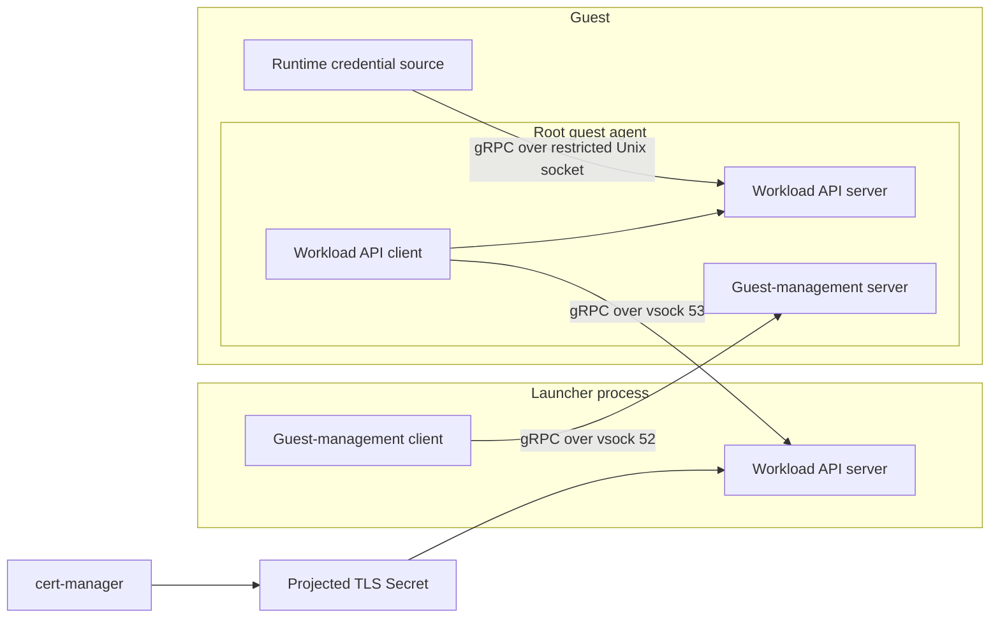

# Firecracker Sandboxes

`SandboxTemplate.spec.firecracker` selects a Firecracker guest supervised inside a Sandbox-owned
Pod. It is an alternative to `spec.pod` and `spec.vm`; exactly one arm is required. The launcher
is a trusted, privileged host process. The guest runs the same Environment Runtime, systemd
supervision, harnesses and Execution Service as the NixOS KubeVirt image.

This backend is opt-in. `Environment.firecracker_sandboxes` defaults to false; this change does not
add a staging launch preset or migrate existing Sandboxes. Enabling it requires a KVM-capable
x86-64 node, the `devices.kubevirt.io/kvm` device resource, `/dev/net/tun`, native sidecars,
Kubernetes image volumes and permission to run a privileged launcher. The launcher uses the Pod
network namespace, not host networking, host PID or host cgroups.

## Template and images

The Firecracker arm contains `pod` (launcher and relay Pod template), `bootImage`, `runnerImage`,
`vcpuCount` and `memoryMiB`. Image references should be immutable digests. The controller adds the
Sandbox identity, launch file, TLS Secret, retained disks, image volumes and downward-API intent;
these are not supplied by users of the template.

Three artifacts have separate release boundaries:

- `agentplane-environment-firecracker`: Nix-built OCI image containing an ELF `vmlinux`, writable
  ext4 seed `rootfs.ext4`, and `init` text file naming the NixOS init program. The guest kernel has
  built-in virtio, ext4, EROFS, ISO9660 and vsock support.
- `agentplane-runner-disk`: existing independently built runner image, including the root-only
  Firecracker thaw agent. `/disk/runner.img` is the read-only EROFS device used by the guest.
- `agentplane-firecracker-launcher`: `//agentplane/firecracker:image`, with the pinned Firecracker
  VMM, disk tooling and Go supervisor. It never exposes the Firecracker API socket over TCP.

The guest device order is fixed by
[`firecracker_guest_contract.json`](../env/images/firecracker_guest_contract.json): root, runner,
state, workspace, public config, launch and egress trust. Firecracker's
block serials depend on backing inodes, so the guest uses `/dev/vda` through `/dev/vdg` rather than
KubeVirt serial names. The generated Runtime config identifies the workspace as `/dev/vdd`.

State must use `RawDiskImage` on a Filesystem PVC. Workspace must use `RawDiskImage` on a
Filesystem PVC or `BlockFilesystem` on a Block PVC, both ext4. There is no automatic conversion
from a Pod's directory tree. Existing ext4 data is preserved; unknown signatures or unsigned
nonzero block contents are refused. A new block workspace is formatted only after a full zero
scan. New image files are created with
2 GiB state and 8 GiB workspace defaults; these are launcher configuration values, independent of
PVC capacity. The opt-in chart reserves 100 GiB for state because it also stores the root disk,
runner disk and full memory/disk checkpoints. Size this PVC for the actual guest root, memory and
workspace contents, including both old and new checkpoints during capture. Snapshots contain
private keys and workload memory and need the same storage access controls as retained state.

## Control and RAM suspension

```mermaid
sequenceDiagram
    participant C as Sandbox controller
    participant P as Launcher Pod
    participant V as Firecracker
    participant R as Guest Runtime
    participant G as Runner Gateway
    C->>P: annotation firecracker-running=false
    P->>P: Fence guest networking
    P->>V: Pause; capture full RAM and device state
    P->>P: Copy every backing disk; fsync; publish manifest
    P->>V: Terminate VMM; release guest RAM
    C->>P: Read /state through Kubernetes pods/proxy
    P-->>C: suspended, exact Pod UID
    C->>P: annotation firecracker-running=true
    P->>P: Verify ownership, compatible inputs, complete file set and sizes
    P->>V: Restore matching disks, RAM and device state
    P->>R: vsock: set wall clock; refresh Workload API subscription
    P->>P: Open guest networking
    G->>R: Reconnect with existing Runtime identity, new connection epoch
```

Suspend bypasses Runtime `Quiesce`: quiescing seals the Runtime and destroys the processes this
backend preserves. Both explicit and idle suspension retain the launcher Pod, Sandbox ServiceAccount,
Pod-bound credentials and Runtime boot identity. The VMM process exits; the small supervisor and
relay remain resident. Kubernetes retains the Pod resource requests while suspended; this backend
does not return its scheduling reservation to the cluster. The controller declares stopped only after the supervisor acknowledges the
checkpoint. Final deletion first resumes the Runtime and waits for a verified, live Gateway
connection with an epoch newer than the suspended connection before attempting the ordinary
quiesce/delete path. A pending reconnect does not consume the persisted quiesce attempt.

The supervisor holds an exclusive host-side state-PVC `flock` for its lifetime. A checkpoint
manifest binds the Sandbox UID, Pod UID, launcher configuration, VMM binary and complete disk set.
An active-continuation marker fences uncertain failures; incomplete or mismatched snapshots fail
closed. The controller does not authorize replay by replacing a failed launcher.

Restore always copies backing disks from the committed generation. It checks file types and
sizes before starting those copies, without scanning RAM or disk contents for hashes. Configuration
and VMM digests reject incompatible restores. Silent, same-sized content corruption is outside this
local checkpoint contract; the paused capture, owner lock, continuation fence and durable manifest
publication establish the RAM/disk boundary. Earlier experimental manifests are rejected.

**RAM recovery is limited to the same launcher Pod.** Pod deletion, node loss, launcher failure
while running, CPU changes, image/config changes or storage exhaustion are failures requiring
operator investigation, not automatic migration or cold boot. The retained checkpoint is not an
exportable clone. Established external connections may expire while suspended; applications must
reconnect. The guest thaw agent repairs wall time before traffic resumes; monotonic time and
process state retain Firecracker's snapshot semantics.

Native execution sessions still follow the existing transport lifecycle: a new Gateway connection
epoch closes the old `Executor.OpenSession` stream and its native WebSocket. Codex's detached
session has a 30-second reattachment grace while the guest is running. The sampler currently
reattaches on its next operation, so RAM preservation alone does not guarantee that native child
processes remain alive indefinitely after resume. Immediate reattachment can preserve the native
session and its processes; a successful immediate-resume proof does not establish an execution
lease across a prolonged control-plane outage. Supporting that requires explicit session parking
and durable terminal release, rather than weakening epoch fencing or retaining orphaned sessions.

## Credentials and network boundaries

The relay presents the Runtime SVID to the central proxy and first-party service listeners.
Runtime presents the same SVID to History over the relay's CONNECT tunnel. Only the relay mounts
the destination-scoped Kubernetes API token; no ServiceAccount token is copied into a guest disk
or RAM snapshot. Workload programs receive the public CA bundle and no private SVID material.



The host holds the Runtime TLS Secret, issued and renewed by cert-manager. The launcher serves
its current certificate, key and trust bundle through the standard SPIFFE Workload API X.509
stream. The root guest agent subscribes over vsock port 53 and mirrors updates to a mode-0600
Unix socket in Runtime's private directory. Runtime watches the stream with go-spiffe and keeps pinned credential snapshots in memory for
control and History TLS handshakes without restarting or replacing certificate files. JWT issuance is disabled.

The supervisor verifies the kernel boot ID through guest management on port 52 before starting
credential delivery. On each start/restore, `Synchronize` repairs wall time, replaces the guest's
old subscription, and waits for a fresh credential update before acknowledging the boot ID.
The launcher then enables networking; Runtime consumes the update asynchronously. Both guest
listeners accept only host CID 2 and bind privileged ports. The host initiates both byte streams;
on the credential stream, it serves gRPC and the guest is the client. Unprivileged guest programs
cannot impersonate these listeners or dial a host credential endpoint. The existing launcher and
guest agent own these services; no bridge executable is added.

The host stops credential delivery before pausing the VM. Thaw always resubscribes, even if RAM
contains old credentials and stream state. Complete snapshots and reconnect behavior follow the
[Workload API specification](https://github.com/spiffe/spiffe/blob/main/standards/SPIFFE_Workload_API.md).
The transport adapters live under [`agentplane/firecracker/vsock`](../firecracker/vsock/README.md).
Invalid updates are rejected while the last valid credential remains usable until expiry; renewal
does not reauthenticate established TLS connections. The public egress CA disk remains separate.

The guest reaches the relay at `192.0.2.1:3128` or `[fd00:fc::1]:3128` and explicitly declared
platform-route ports. TAP and guest MTUs are 1280. Pod-local IPv4/IPv6 filtering rejects direct
forwarded egress, other host ports and UDP; IPv6 neighbor discovery remains available. The outer
Cilium policy restricts relay egress. Gateway ingress on Pod port 9090 is forwarded to the guest's
mTLS Runtime listener. Port 9092 exposes only read-only status/readiness, fenced from the guest
and admitted for API-server/host proxy access. The controller additionally verifies the returned
Pod UID; annotations express intent and the supervisor reports observation.

## Validation boundaries

The [primitive spike report](../debug/2026_11_02_firecracker_spike.md) proves Firecracker RAM and
disk behavior and proxy-only networking on the existing KVM Kubernetes node. It used a synthetic
guest workload and does not establish an end-to-end Agentplane control-plane result.

This backend adds controller/admission, generated-template, guest thaw, checkpoint consistency and
supervisor ordering tests. A deployment acceptance run must additionally boot the published NixOS
image, connect the real Gateway/Runtime, suspend a running Session twice, rotate credentials while
suspended, and verify the same processes and journals continue without replay. The ordinary RBE
pool has no KVM. The CI
[`test_firecracker`](../system_tests/firecracker/README.md) suite runs its
disposable k3s stack on the existing `wyrm2-kvm-vm` BuildBuddy executor. It uses a small Bazel-built Debian guest with the production launcher and runner disk,
creates its Sandbox through the app, and checks a
scripted Codex tool turn followed by one RAM-preserving suspend/resume. It asserts unchanged Pod,
guest and Runtime boot identities, native process identity, and a progressing child with a
random memory-resident marker. The suite reissues credentials while running and while suspended,
then verifies Runtime serves the new leaf through a fresh authenticated TLS handshake. Acceptance
uses only the lighter Bazel-built filesystem; it does not validate the production NixOS guest.
Cilium policy enforcement remains outside this suite's coverage. Never run the fixture's host-cgroup cleanup in a privileged
live-cluster Pod.
