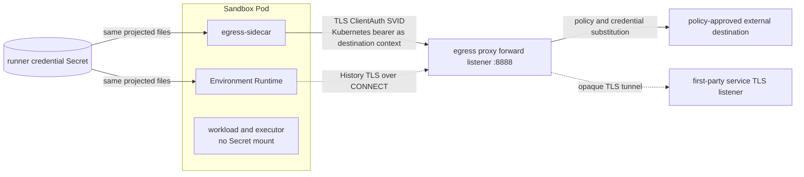

# Runner control

The runner serves native gRPC on one private listener: `Runner`, `Executor` and standard gRPC
health. The Environments proxy derives its address from the current workload's Pod IP and the runner port;
KubeVirt forwards that port into the guest. Environments proxy and Controller binding-observer peers reach it with separate method authority. History Event
ingress remains a separate outbound platform route.

Runner configuration requires `control.listen_address` and `control.security.mode`; the Environments proxy
requires the matching `environment_service.runtime_proxy.runner_security.mode`. Each explicitly selects `mtls` or `insecure`. `mtls`
requires a `tls` block with absolute `cert_file`, `key_file` and `ca_file` paths, or a local
`workload_api_socket` Unix URI. A file-backed block may add `client_ca_file`, which then alone
verifies the client certificates this side serves; `ca_file` keeps verifying its own chain and the
servers it dials. Firecracker Runtime selects the Workload API; the proxy uses
projected files. Source forms cannot be mixed. `insecure` rejects a TLS block. Missing/unknown modes and partial or contradictory configuration fail startup.
The service definitions are `env/runtime/control/environment_runtime.proto` and `env/runtime/execution/executor.proto`;
`proto/environment_runtime_state.proto` defines the facts published by `Runner.WatchState`.

## State observation and fencing

The Controller serves EnvironmentService on every replica at `sandbox-controller:8082`, using its
existing service SVID. This inventory/desired-state listener has no Runtime command client and does
not change the leader-only observation below. The optional Runtime proxy on the same listener
separately owns callable Runtime connections on every replica. Its readiness depends on
local serving and policy watches, independently of leadership. App, Actions and Sandbox CLIs call this receiver with their service or workload SVIDs. The Sessions binary
does not register EnvironmentService; automatic wake grants remain with the Dispatcher. See [the Controller contract](../environments/SPEC.md#environmentservice-listener).

The leader-elected Sandbox Controller independently opens `WatchState(observe_only=true)` directly
to each accepted incarnation, authenticating with its dedicated client SVID. This stream grants no
command or Executor authority. Its authenticated request names the
Sandbox UID and current workload Pod UID; for a VM, the incarnation is the virt-launcher Pod UID.
Runtime uses this watch to bind the incarnation for its process lifetime and completes ordinary
lifecycle adoption before returning the first snapshot. Each Runtime process has a fresh boot ID.
The Controller supplies the current workload UID to a new process, and reconnects may retry that
UID; neither the Controller nor a proxy may change the binding after adoption begins. The
Controller keeps bootstrap, quiesce, setup, idle and blocker facts in memory keyed by Sandbox UID,
incarnation UID and boot ID.
A local watch generation fences callbacks from replaced streams. A new leader relists Sandboxes
and starts fresh watches and idle timers. Lost streams retry after one second; a 30-second
heartbeat timeout clears idle eligibility immediately, while connectivity status keeps a one-minute
grace. Reconnects start a full idle timer, even when the Runtime reports the same idle timestamp.
Quiesce attempts remain persisted, and an unobserved published incarnation must still seal before
stop or deletion. Bootstrap failure remains terminal for its incarnation.

Every Environments proxy replica independently opens a direct `WatchState` to the current Runtime.
The Controller's authenticated `observe_only` watch binds the Runtime to the
Sandbox UID and accepted workload Pod UID before proxy watches arrive; a proxy can observe that
binding but cannot select or advance it. Each replica learns the Runtime boot ID from its own
authenticated watch and can serve calls for the current incarnation. The stable `sandbox-controller:8082`
Service routes callers to any replica. Observation loss removes that replica's callable connection
and starts a fresh attempt after one second; it does not revoke another replica's connection.
Replacement observers wait for their predecessor to exit before publishing their local connection.

Unary Runner calls and typed `Executor` calls carry the Sandbox UID, incarnation UID and Runtime
boot ID. Runtime checks those values against its Controller-bound identity and process boot; stale
Sandbox, incarnation or boot calls fail before admission. Loss of one replica's observation does not
revoke another replica's connection or cancel Runtime-owned admitted work. `ABORTED` remains the
explicit refusal of new work for a workload incarnation.
`Executor.OpenSession` holds the Runner-side Codex connection with a server stream; typed unary
process and file RPCs use its opaque session ID. JSON-RPC framing, initialization and native
notifications stay in the Runner adapter. Both hops use the same sandbox-owned
[Executor contract](../env/runtime/execution/executor.proto). Closing the session stream releases the local
WebSocket; Codex retains its detached session for 30 seconds before expiring it and terminating
remaining processes. Request IDs provide correlation, not
deduplication or durable admission; uncertain mutations are never automatically replayed.

A lost RPC response does not establish whether its command was admitted. Reconnect never replays
RPCs automatically. Durable command retry retains the original command ID and reconciles the
runner journal; a repeated ID with a different operation or payload fails `ALREADY_EXISTS`.

## Runner proxy

Every Environments replica serves `agentplane.env.runtime.control.EnvironmentRuntime` on
`sandbox-controller:8082` and forwards unary calls over its own direct Runtime connection.
Notifications, Sessions, central sampler and Controller lifecycle callers pin the Sandbox Controller
server SVID. App diagnostics use `EnvironmentService.GetRuntimeDiagnostics` on the same listener,
without a raw-proxy grant. The Sessions binary has no Runtime proxy or Executor receiver and starts no Runtime watches.

- **Sandbox.** The caller names it in the `x-agentplane-sandbox` header. A missing or repeated header is
  `INVALID_ARGUMENT`, an unknown Sandbox `NOT_FOUND`.
- **Expected identity.** Callers must supply `x-agentplane-sandbox-uid`,
  `x-agentplane-sandbox-owner-namespace` and `x-agentplane-sandbox-owner-name` exactly once.
  The proxy checks them against the current Sandbox and ready runner Pod before resolving its
  connection. A stale UID or owner returns `NOT_FOUND`; an unavailable runner returns `UNAVAILABLE`.
- **Authorization.** Exact service SVIDs grant Notifications `ListSessions` and `GetStatus`,
  Sessions creation and command methods, and Controller lifecycle methods. Executor grants admit
  only the central sampler. Proxy calls reject bearers, workload Identities and delegation; public
  Session callers use SessionDispatcher with their existing direct or delegated authority. See the [proxy contract](../environments/runtimeproxy/SPEC.md).
- **Replica.** Any Environments replica with a fresh observation of the current Sandbox incarnation can
  serve the request. A replica without a matching local Runtime connection answers `UNAVAILABLE`.
- **Deadline.** The proxy propagates the caller's remaining gRPC deadline; a call without one waits until
  the runner answers or the connection ends.

## Event ingress

The SandboxTemplate sets one `ingress.target` for every Session journal in its Sandbox. The
Runtime pushes to that endpoint independently of control RPCs. Deployments that keep History
use the [History ingress transport and writer binding](../history_service/README.md#runner-ingress).
A deployment can instead implement [`SessionJournalIngress.Push`](../history_service/api/ingress/session_ingress.proto)
with its configured authentication. Downstream fan-out belongs to the ingress.

The Runtime opens one stream per Session at startup, on creation, and after stream loss until
the seal is acknowledged. The streams share a connection, so one Session's catch-up does not
hold up another Session's delivery or commands. Every call starts with an `Attached` snapshot.
The ingress replies with the committed cursor, then the Runtime streams the remaining journal
in order and sends the seal after its last entry. History accepts exact replays, so a lost
acknowledgement can be recovered by reconnecting.

The [Runtime ingress client](../env/runtime/ingress/client.go) limits entries in flight and
checks acknowledgements against the local journal. It treats an initial acknowledgement beyond
the local tail as `FAILED_PRECONDITION`. Remote failures retry per Session through
[the shared stream backoff](../env/runtime/stream/retry.go), with the maximum delay for
`PERMISSION_DENIED` or `FAILED_PRECONDITION`. The Runtime persists the latest acknowledgement
and keeps the journal entries on its state volume. Unacknowledged lag is bounded by that volume.

`Quiesce` closes admission and starts draining and sealing the journals. `WatchState` reports
`quiesced` after ingress acknowledges every seal. Repeated `Quiesce` requests continue the same
operation. The Sandbox Controller retries an unfinished request at its one-minute deadline
and reconciles sooner on an observed stage change. The persisted request time survives a
Controller restart. Volume deletion waits for acknowledged seals. A Runtime that cannot report
leaves the Sandbox sealing for the operator.

## Runtime routing

Environments proxy replicas connect to the current Runtime using its Pod IP and private listener. No
per-Sandbox `<sandbox>-control` EndpointSlice or connection Lease decides which replica may call.
Runtime proxy caller traffic uses the stable `sandbox-controller:8082` Service; the Runtime identity in each call
provides stale-Sandbox, stale-workload and stale-process fencing. The Dispatcher delivery Lease is
unrelated and remains part of durable command scheduling.

## Lifecycle operations

Sessions makes native Session calls and Notifications reads inventory through the Environments
proxy at `sandbox-controller:8082`. App diagnostics go through EnvironmentService instead.

- `ListSessions` reads retained Session inventory.
- `GetStatus` reads a coherent live snapshot of process incarnations, Session assignments and
  execution status. It never wakes the Sandbox or starts a harness.
- `CreateSession` durably reserves or confirms the immutable Session configuration. Its response
  does not assert native conversation creation or process readiness.
- `SubmitInput` durably admits work before the runner starts/resumes its harness and reconciles
  native evidence. Startup/delivery failures are later journaled outcomes. Caller disconnect does
  not abandon admitted work. Model/effort changes use the same runner-owned preparation path.
- `InterruptTurn` requires the exact active turn. A stale target fails `FAILED_PRECONDITION` before
  admission. An already admitted retry returns its original receipt; native dispatch cannot affect
  a successor turn. It never starts a harness.
- `Quiesce` fences, interrupts active turns, stops harnesses and seals journals. Running Session
  setup and Sandbox bootstrap finish naturally before teardown completes; they are not cancelled.
  It waits for preceding admissions; subsequent new-work calls fail `ABORTED`. Final ingress acknowledgement
  is required for `QUIESCED`.

Any Environments replica with a current observation may call the Runtime. Runtime connectivity is
independent of Dispatcher scheduling ownership. Transport reconnect never replays calls; durable
command retry uses the original command ID. Process identities in diagnostics are per-spawn UUIDs,
not command addresses.
Stored native conversations may be dormant while their store's app server is running. A Session
becomes ready after its native conversation preparation/reconciliation, without needing a turn.

| Caller/path                    | Control operation                                   |
| ------------------------------ | --------------------------------------------------- |
| App and Notification inventory | `ListSessions`                                      |
| App Sandbox diagnostics        | `GetStatus`                                         |
| Session Dispatcher creation    | `CreateSession` with the admitted Session ID        |
| Teardown sealing               | `Quiesce`, repeated until journals are acknowledged |
| Dispatcher command delivery    | Matching per-operation Runner RPC                   |

## Authentication and incarnation binding

Cluster and k3s Environments proxies dial the Runtime's private TLS listener using mTLS and the
`spiffe://agentplane/runtime-proxy` client identity. A bearer cannot replace a certificate. Proxy
callers require exact per-method service SVID grants; public Session callers use Dispatcher.

Standalone behavior tests can explicitly select insecure transport at both endpoints. It supplies
plaintext without peer authentication; it never fabricates a certificate identity. Live Sandbox/Pod/VM
ownership and incarnation validation, Sandbox/incarnation/boot-ID fencing and command admission
remain enforced.
Every Sandbox incarnation gets a credential; k3s keeps real cert-manager/trust-manager and
mTLS in every stack. Bad mTLS credentials never trigger an insecure retry.

The proxy's certificate has URI SAN `spiffe://agentplane/runtime-proxy`. Each Environment Runtime
certificate has exactly one URI SAN, its WorkloadCredential's
`spiffe://agentplane/<namespace>/<sandbox-name>/<credential-id>`.
Certificates must chain to the configured trust roots and permit the peer's client/server EKU.
A CA-valid certificate with the wrong URI is rejected.

Before each workload incarnation the Sandbox Controller requests a credential through the
Sandbox's [WorkloadCredential](workload_authentication.md#workloadcredentials); the Policy
Controller mints its ID and cert-manager issues its certificate into a distinct Secret. The workload carries that ID. Proxy authorization checks the current Sandbox UID, current incarnation Pod, owner
chain and credential ID. VM authorization checks the launcher, VMI and Sandbox-owned VM.
An old credential ID never authorizes a replacement workload. Names and addresses
are not identity evidence.

cert-manager owns leaf renewal through the `agentplane-workload` ClusterIssuer, the
[Agentplane workload CA](workload_authentication.md#the-workload-ca), an intermediate signed by
the cluster internal CA. trust-manager distributes the workload CA alone, which every SVID peer
verifies against. A Pod or KubeVirt runner's control listener verifies the proxy's client SVID
against it (`client_ca_file`), so a `cluster-internal-ca` leaf naming
`spiffe://agentplane/runtime-proxy` is refused. A Firecracker launcher serves the workload CA alone
as the guest's Workload API bundle for the `agentplane` trust domain, so the guest's listener refuses
that leaf too; the guest Runtime receives no cluster bundle. Runtime admits only the
Environments proxy SVID for control calls and the narrow Controller SVID for passive observation;
the retired Gateway SVID is refused even when signed by the workload CA. The Environments proxy's `environment_service.runtime_proxy.runner_security` and the
egress sidecar verify server SVIDs against the workload CA too, so the proxy refuses a
`cluster-internal-ca` leaf naming a runner's URI at that runner's address.
Pods use projected credential files; KubeVirt guests use a mounted Secret filesystem. Firecracker
launchers stream the same material through the host-initiated vsock Workload API to the root guest
agent, which serves Runtime through its restricted Unix socket. Runtime retains pinned credential
snapshots shared by its control server and History client until joined shutdown. Both ends verify
the peer with go-spiffe against their current roots and authorize exactly the expected SPIFFE ID
and EKU. Replaced files and streamed updates provide credentials for subsequent TLS handshakes. Every control call
and observation snapshot rechecks the peer leaf's validity period. Established gRPC connections close
when either selected leaf expires, so a persistent channel reconnects with rotated credentials. A
connection keeps the roots it was verified with until it closes. Workload deletion or replacement is
checked on continuing observation.

The certificate authenticates the Sandbox workload, not every process within it. Code able to read
the runner's private key can act as that workload. No runner certificate authenticates as the
Runtime proxy, and certificates do not replace command authorization or journal deduplication.

### Receiver retirement and rollback

All Runtime proxy callers target Environments before the Gateway receiver is removed. Gateway
receiver retirement keeps its old settings decodable and leaves deployed certificates, mounts and
network permissions until an image without Runtime calls is pinned and running. Manifest cleanup
then removes those unused resources and fields; strict code decoders remove the fields only after
that configuration has rolled. The Dispatcher keeps its workload/policy inventory, wake permissions
and independent delivery Leases.

Rollback first restores a Gateway image with the receiver, its Runtime client certificate, method
grants and network permissions. Confirm the listener and Runtime observations are healthy before
restoring caller targets and exact server pins together. Roll callers after Flux applies their
settings, then check readiness, auth/TLS errors, diagnostics, native admission, Executor and idle
quiesce/suspend. Keep retained Sandbox state, journals, identities and History. Never retry an
uncertain command under a fresh command ID.

## Heartbeat and liveness

`WatchState` publishes a snapshot on a fact change and every 10 seconds while idle. The Controller and Environments proxy end their separate observations after 30 seconds without a
snapshot. Proxy observation also ends on transport failure or identity/ownership loss. Healthy observations have no age limit. It supervises a new observation while the
workload remains current. A live observation establishes control connectivity, not harness readiness,
command admission or native execution. Losing it does not establish that admitted work failed.

## Path through the egress proxy

Runner control stays on the Environments proxy's direct mTLS connection; its private key and control calls do
not pass through HTTP interception. Separately, the egress sidecar relays runner HTTP(S) traffic to
the central proxy. With TLS transport and SPIFFE authentication selected, the sidecar presents the
same per-incarnation Runner certificate to the proxy's TLS-enabled forward listener under
the Sandbox's WorkloadCredential URI. The Kubernetes destination retains its projected
bearer, bound to the Sandbox's recorded Pod; first-party services verify the SVID themselves through
opaque tunnels. The Certificate carries server auth for Runtime control and client auth for this hop.

For the standard runner Pod, the controller mounts one projected Secret, the cluster trust bundle
(`ca.crt`) and the workload CA (`workload-ca.crt`) into the Environment Runtime and egress sidecar; workload and executor containers do not mount it.
Custom runtime-only templates remain supported and receive the projection only in Runtime. For KubeVirt, the guest Runtime reads the same
Secret from its existing root-only virtiofs mount and each bundle from its own virtiofs mount, while the launcher relay gets a projection of that
Secret into its own sidecar mount. For Firecracker, the launcher and relay receive the projection;
the guest Runtime receives the streamed Workload API source, and workload programs cannot read
either the host projection or the root-only guest socket.
Kyverno checks the live Sandbox status binding against the VM annotation, current VMI UID and
credential label before injection. Its admission controller has a namespace-scoped Role granting
only `get` on Sandboxes for that lookup; it does not read the Secret. A missing accepted credential
fails mutation, so KubeVirt retries after the binding is recorded instead of admitting a Pod with
a placeholder Secret name. The sidecar verifies the proxy's fixed SPIFFE identity; the proxy
checks the Runner client identity against current Sandbox/incarnation state.

The sidecar's `proxy` contains an address and a tagged `transport`. TLS owns the CA bundle;
its `auth` variant owns the Runner certificate/key pair. The proxy's configured authentication
policy admits only SPIFFE. A TLS failure ends the request, and files reload on rotation.

The Rules RPC shares that policy and serving TLS material on the native gRPC port 8081. The
workload dials its shared local platform gRPC listener on port 3130. The sidecar opens destination TLS through opaque
central CONNECT for Rules, Notification, Dispatcher, Action
and LLM routes; each service verifies the actual peer itself. Runtime dials History with its own
certificate. Kubernetes retains its destination-audience token, bound to the Sandbox's recorded
Pod. Callers without Sandbox certificates require a separate authentication design.

## Environments receiver

Deployment enables `environment_service.runtime_proxy` to register the same Runtime proxy and
Executor wire services on `sandbox-controller:8082`. Every replica owns its routing cache and
callable Runtime watches independently of leadership, while the Controller's incarnation-binding
facts watch stays leader-only. This receiver presents the dedicated `runtime-proxy` SVID to Runtime;
callers verify the existing Sandbox Controller server SVID and receive only their exact per-method
service grants. It admits no bearer, workload Identity or delegated proxy calls, and requires no
proxy audience. Sandbox/Pod/boot fences and uncertain outcomes remain unchanged. Caller targets
now select Environments for diagnostics, inventory, native delivery, lifecycle and Executor.
Dispatcher API callers retain their separate `session-dispatcher:8080` endpoint and server pin.
Enable receiver configuration only after its accepting image is pinned and running. See the
[receiver contract](../environments/SPEC.md#optional-runtime-proxy-and-executor-receiver).

## EnvironmentService diagnostics

`GetRuntimeDiagnostics` gives the App service peer a live snapshot with Environment UID,
workload incarnation, boot ID and observation time. Environments uses its private fenced Runtime
transport and checks the live Sandbox incarnation before and after reading. Offline state returns
an unavailable error and never triggers wake. The [Environments contract](../environments/SPEC.md#live-runtime-diagnostics)
defines its authorization and freshness. The App uses this RPC for on-demand Runtime diagnostics.
Session running marks and the archive guard read Dispatcher activity.
