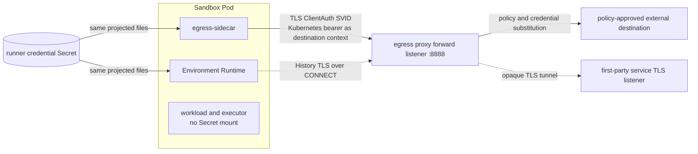

# Runner control

The runner serves native gRPC on one private listener: `Runner`, `Executor` and standard gRPC
health. The Gateway derives its address from the current workload's Pod IP and the runner port;
KubeVirt forwards that port into the guest. Gateway workloads and the Sandbox Controller may reach it; method authorization separates their roles. History Event
ingress remains a separate outbound platform route.

Runner configuration requires `control.listen_address` and `control.security.mode`; the Gateway
requires the matching `runner_security.mode`. Each explicitly selects `mtls` or `insecure`. `mtls`
requires a `tls` block with absolute `cert_file`, `key_file` and `ca_file` paths, or a local
`workload_api_socket` Unix URI. A file-backed block may add `client_ca_file`, which then alone
verifies the client certificates this side serves; `ca_file` keeps verifying its own chain and the
servers it dials. Firecracker Runtime selects the Workload API; the Gateway uses
projected files. Source forms cannot be mixed. `insecure` rejects a TLS block. Missing/unknown modes and partial or contradictory configuration fail startup.
The service definitions are `env/runtime/control/environment_runtime.proto` and `env/runtime/execution/executor.proto`;
`proto/environment_runtime_state.proto` defines the facts published by `Runner.WatchState`.

## State observation and fencing

The leader-elected Sandbox Controller independently opens `WatchState(observe_only=true)` directly
to each accepted incarnation, authenticating with its dedicated client SVID. This stream carries no
Gateway epoch and grants no command or Executor authority. Its authenticated request names the
Sandbox UID and current workload Pod UID; for a VM, the incarnation is the virt-launcher Pod UID.
Runtime uses this watch to bind the incarnation for its process lifetime and completes ordinary
lifecycle adoption before returning the first snapshot. Each Runtime process has a fresh boot ID.
The Controller supplies the current workload UID to a new process, and reconnects may retry that
UID; neither the Controller nor a Gateway may change the binding after adoption begins. The
Controller keeps bootstrap, quiesce, setup, idle and blocker facts in memory keyed by Sandbox UID,
incarnation UID and boot ID.
A local watch generation fences callbacks from replaced streams. A new leader relists Sandboxes
and starts fresh watches and idle timers. Lost streams retry after one second; a 30-second
heartbeat timeout clears idle eligibility immediately, while connectivity status keeps a one-minute
grace. Reconnects start a full idle timer, even when the Runtime reports the same idle timestamp.
Quiesce attempts remain persisted, and an unobserved published incarnation must still seal before
stop or deletion. Bootstrap failure remains terminal for its incarnation.

Every Gateway replica independently opens a direct `WatchState` to the current Runtime with no
connection epoch. The Controller's authenticated `observe_only` watch binds the Runtime to the
Sandbox UID and accepted workload Pod UID before Gateway watches arrive; a Gateway can observe that
binding but cannot select or advance it. Each replica learns the Runtime boot ID from its own
authenticated watch and can serve calls for the current incarnation. The stable `runner-gateway`
Service routes callers to any replica. Observation loss removes that replica's callable connection
and starts a fresh attempt after one second; it does not revoke another replica's connection.
Replacement observers wait for their predecessor to exit before publishing their local connection.

Unary Runner calls and typed `Executor` calls carry the Sandbox UID, incarnation UID and Runtime
boot ID. Runtime checks those values against its Controller-bound identity and process boot; stale
Sandbox, incarnation or boot calls fail before admission. The receiver retains legacy nonzero epoch
tolerance for older Gateway binaries during the rollback window, but the selected Gateway call
contract allocates and sends no epoch. Loss of one replica's observation does not revoke another
replica's connection or cancel Runtime-owned admitted work. `ABORTED` remains the explicit refusal
of new work for a workload incarnation.
`Executor.OpenSession` holds the Runner-side Codex connection with a server stream; typed unary
process and file RPCs use its opaque session ID. JSON-RPC framing, initialization and native
notifications stay in the Runner adapter. Both hops use the same sandbox-owned
[Executor contract](../env/runtime/execution/executor.proto). Closing the session stream releases the local
WebSocket; Codex retains its detached session for 30 seconds before expiring it and terminating
remaining processes. Request IDs provide correlation, not
deduplication or durable admission; uncertain mutations are never automatically replayed.

A lost RPC response does not establish whether its command was admitted. Reconnect never replays
RPCs automatically. Durable command retry retains the original command ID and reconciles the
runner journal; a repeated ID with a different operation or payload fails `ALREADY_EXISTS`.

## Runner proxy

Every Gateway replica serves `agentplane.env.runtime.control.EnvironmentRuntime` on the shared gRPC
listener and can forward unary calls over its own direct Runtime connection. Callers reach that
listener through the stable `runner-gateway` Service.

- **Sandbox.** The caller names it in the `x-agentplane-sandbox` header. A missing or repeated header is
  `INVALID_ARGUMENT`, an unknown Sandbox `NOT_FOUND`.
- **Expected identity.** Callers must supply `x-agentplane-sandbox-uid`,
  `x-agentplane-sandbox-owner-namespace` and `x-agentplane-sandbox-owner-name` exactly once.
  The proxy checks them against the current Sandbox and ready runner Pod before resolving its
  connection. A stale UID or owner returns `NOT_FOUND`; an unavailable runner returns `UNAVAILABLE`.
- **Authorization.** A Pod-bound `gateway_audience` bearer proves the caller. `gateway_callers`
  grants only `ListSessions` and `GetStatus`. Runtime Session creation and commands admit only the
  verified combined Gateway/Dispatcher workload; clients use SessionDispatcher with their existing
  direct or delegated authority. Only `sandbox_controller_account` may `Quiesce`; unset, nobody may.
  Executor permissions stay separate. See the [proxy contract](../runner_gateway/internal/gateway/SPEC.md).
- **Replica.** Any Gateway replica with a fresh observation of the current Sandbox incarnation can
  serve the request. A replica without a matching local Runtime connection answers `UNAVAILABLE`.
- **Deadline.** The proxy propagates the caller's remaining gRPC deadline; a call without one waits until
  the runner answers or the connection ends.

## Event ingress

The runner pushes to the `ingress` endpoint in its configuration (`env/configuration/configuration.go`) and
reports `flushed` from what it recorded. The History
Service serves the ingress (`history_service/internal/ingress/ingress.go`) on a listener of its own, and follows no
runner.

The runner pushes each Session's journal to one **ingress**, the endpoint its Sandbox names, and
nothing else reads its journals. The History Service is the ingress when history is kept. A client
that keeps no history implements the ingress itself and sends Session commands through
the Session Dispatcher and lifecycle requests through EnvironmentService like any other client. Fan-out to further readers is the ingress's concern, or
a service's behind it, never a second destination on the runner.

Rejected: following runners through the Sandbox Service, which made it fan out a journal it does
not keep and needed retention holds for durability; and merging the raw log into the Sandbox
Service, which makes a historyless client unlike any other and couples live delivery to the history
database.

```protobuf
// agentplane/history_service/api/ingress/session_ingress.proto
service SessionJournalIngress {
  rpc Push(stream PushFrame) returns (stream Acknowledgement);
}

message PushFrame {
  oneof frame {
    agentplane.proto.Attached announce = 1;   // first frame, exactly once
    agentplane.proto.EventEntry entry = 2;    // the journal's, verbatim, in cursor order
    agentplane.proto.Sealed sealed = 3;       // terminal
    Heartbeat heartbeat = 4;
  }
}

message Acknowledgement {
  uint64 cursor = 1;                  // every entry through it is committed; never decreases
  bool sealed = 2;                    // the seal at `cursor` is committed
}
```

The ingress is its own service, `agentplane.history_service.SessionJournalIngress`, apart from `HistoryService`: another server implements
it, under its own token audience, and a historyless client needs only it.

1. **One call per Session.** The runner opens a `Push` call for every Session in its state
   directory whose seal the ingress has not acknowledged: at startup, when `CreateSession` creates a
   Session, and after a call is lost. Its calls share one HTTP/2 connection to the ingress, separate from control RPCs, and each is its own HTTP/2 stream, so one Session's catch-up
   stalls neither another Session's live entries nor any command.
2. **Announcement.** The first frame, `announce`, is the Session's `Attached` snapshot: its Session
   ID, the UUID the client minted and passed in `CreateSession`, with spec, harness and setup state
   and the journal's last cursor. `Attached.execution_principal`, when present, is the immutable
   ServiceAccount namespace/name/UID admitted by the Dispatcher for this Session; it is retained with
   the Runner record and announced independently of the journal writer, Sandbox, or creator. Native
   announcements must match the authenticated Runner ServiceAccount exactly. Central sampler
   announcements retain the Dispatcher-provided principal only when it matches the fixed executor
   account. Older or legacy records without that association remain unassociated; a later current
   ServiceAccount identity is never inferred for them. `Attached.execution_identity`, when present, is the
   Identity name/UID the Dispatcher recorded from the Sandbox's `spec.identity`, retained and announced the
   same way beside `execution_principal`. Every call announces again; the first the ingress accepts adds
   the Session to its index of Sessions. The ingress answers with an `Acknowledgement` of what it
   has already committed for the Session, cursor zero for a new one.
   **Deviation:** `Attached.incarnation_uid` and `Sealed.incarnation_uid` name the incarnation that
   announced and the one that sealed. A Session whose seal names another incarnation and whose
   announcement reaches the seal's cursor is reopened: the ingress drops the seal, acknowledges the
   seal's cursor as unsealed and takes entries from the next cursor. The incarnation that sealed gets
   its seal back, and an announcement without a UID never reopens. Every runner seal has a nonempty
   incarnation UID; UID-less seals are invalid.
3. **Entries.** The runner then sends the journal's `EventEntry`s after that acknowledgement's
   cursor, replayed and then live, reading the journal in pages as the stream drains. Once the
   journal is sealed and every entry through the seal is sent, it sends `sealed` and nothing more.
4. **Acknowledgement.** The ingress acknowledges a cursor only after committing every entry through
   it, and sets `sealed` only after committing the seal. The runner records the latest
   acknowledgement per Session on its state volume and resumes after it; it deletes no journal
   entry on acknowledgement. Delivery is therefore at least once and idempotent by cursor: an entry
   at or below the committed cursor that equals the committed one is accepted and ignored.
5. **Backpressure.** The runner sends at most 1024 entries per Session beyond the latest
   acknowledgement and waits for acknowledgements past that; gRPC's per-stream flow control bounds
   the bytes in flight. The ingress commits and acknowledges in batches of its choosing.
6. **Liveness.** On an idle call the runner sends `heartbeat` and the ingress repeats its latest
   acknowledgement every 10 s; either side ends a call after 30 s without a frame.
7. **Replicas.** Any ingress replica serves any Session's call, and its store serializes appends
   per Session, so two calls for one Session, such as a restarted runner's racing its
   predecessor's, are harmless.

Rejected: one `Push` stream per runner multiplexing its Sessions. It saves streams but puts every
Session behind one flow-control window, so a catch-up would delay every live Session and the
runner would have to schedule fairly itself; and its writer binding and acknowledgement would be
per frame instead of per call.

**Writer binding.** The ingress authenticates every call's bearer for its own audience with a
TokenReview through `identity/auth.Resolver`
([workload authentication](workload_authentication.md)), and resolves no Sandbox. The first accepted announcement binds the Session to its writer's ServiceAccount, by namespace, name
and the UID TokenReview returns, in the transaction that records the Session, so of two concurrent
first writers one is refused. A call for the Session from any other ServiceAccount fails with
`PERMISSION_DENIED`. Every Sandbox runs as a ServiceAccount named for it, so this ties the Session to its
Sandbox, and the History Service reads the Sandbox off the writer's namespace and name without
resolving it. The Pod is not part of the binding, so a replacement
Pod of the same Sandbox, opening the same journal from the state volume, keeps writing; the UID
makes an account recreated under the same name a different writer. Within the Sandbox the trust
boundary is the control connection's: the binding keeps other Sandboxes out, not processes beside the runner.

**Status codes.** The ingress ends a call with `UNAUTHENTICATED`, `PERMISSION_DENIED` (another
writer's Session), `INVALID_ARGUMENT` (a Session ID that is not a UUID, a frame out of order, a
cursor gap, a frame after `sealed`), `FAILED_PRECONDITION` (an entry or source that differs from
what it committed at that cursor) or `UNAVAILABLE`. The runner cancels a call itself, and treats it as
`FAILED_PRECONDITION`, when the first acknowledgement is beyond its journal's last cursor, since the
ingress then holds entries this journal never wrote.

**Ingress unreachable or refusing.** The journal is the buffer. The runner keeps admitting commands
and journaling, and each Session's call retries with the control connection's backoff, 0.5 s to 30 s.
`PERMISSION_DENIED` and `FAILED_PRECONDITION` back off at the maximum and are logged as errors,
since only an operator resolves them; a refused Session holds up no other. Unacknowledged lag is
bounded only by the state volume, and a Sandbox cannot finish teardown while any is left.

**Endpoint and authentication.** The SandboxTemplate sets the runner's ingress endpoint and private
control listener: one ingress for every Sandbox (the History Service, or a historyless deployment's own sink). A create request cannot choose either; an ingress per Sandbox is not built. The runner reaches the ingress over its
egress sidecar's platform route: the sidecar
attaches the Pod's projected token for that ingress's own audience, `agentplane-runner-ingress` for
the History Service, and an audience of its own for a historyless client. No other recipient
can replay a token the ingress saw, and an ingress token opens no control connection.

**Sealing.** `Quiesce` closes admission and starts draining and sealing every journal, returning the
current quiesce stage. The runner publishes subsequent stages through
`WatchState`; `quiesced` means every journal's seal is acknowledged by ingress. The runner records
acknowledgements on its state volume, so progress survives a runner restart. Repeated `Quiesce`
requests continue the same operation. The Sandbox Controller retries an unfinished request at its
one-minute deadline; directly observed stage changes enqueue it sooner, and the persisted request time prevents
other watch events or a controller restart from bypassing that deadline. Only after every Session is
flushed may the Sandbox's volume go. A runner that cannot report leaves the Sandbox in sealing for
the operator.

## Runtime routing

Gateway replicas connect to the current Runtime using its Pod IP and private listener. The selected
route does not use a per-Sandbox `<sandbox>-control` EndpointSlice or connection Lease to decide
which replica may call. All caller traffic uses the stable `runner-gateway` Service; the Runtime
identity in each call provides stale-Sandbox, stale-workload and stale-process fencing. The
Dispatcher delivery Lease is unrelated and remains part of durable command scheduling.

## Lifecycle operations

The Runner Gateway makes Session calls over the runner gRPC connection. App and Notification callers
reach any replica through the stable `runner-gateway` Service.

- `ListSessions` reads retained Session inventory.
- `GetStatus` reads a coherent live snapshot of process incarnations, Session assignments and
  execution status. It never wakes the Sandbox or starts a harness.
- `CreateSession` durably reserves or confirms the immutable Session configuration. Its response
  does not assert native conversation creation or process readiness.
- `SubmitInput` durably admits work before the runner starts/resumes its harness and reconciles
  native evidence. Startup/delivery failures are later journaled outcomes. Caller disconnect does
  not abandon admitted work. Model/effort changes use the same runner-owned preparation path.
- `InterruptTurn` requires the exact active turn. A stale target fails `FAILED_PRECONDITION` before
  admission. An already admitted retry returns its original receipt; native dispatch cannot affect
  a successor turn. It never starts a harness.
- `Quiesce` fences, interrupts active turns, stops harnesses and seals journals. Running Session
  setup and Sandbox bootstrap finish naturally before teardown completes; they are not cancelled.
  It waits for preceding admissions; subsequent new-work calls fail `ABORTED`. Final ingress acknowledgement
  is required for `QUIESCED`.

Any Gateway replica with a current observation may call the Runtime. Runtime connectivity is
independent of Dispatcher scheduling ownership. Transport reconnect never replays calls; durable
command retry uses the original command ID. Process identities in diagnostics are per-spawn UUIDs,
not command addresses.
Stored native conversations may be dormant while their store's app server is running. A Session
becomes ready after its native conversation preparation/reconciliation, without needing a turn.

| Caller/path                    | Control operation                                   |
| ------------------------------ | --------------------------------------------------- |
| App and Notification inventory | `ListSessions`                                      |
| App Sandbox diagnostics        | `GetStatus`                                         |
| Session Dispatcher creation    | `CreateSession` with the admitted Session ID        |
| Teardown sealing               | `Quiesce`, repeated until journals are acknowledged |
| Dispatcher command delivery    | Matching per-operation Runner RPC                   |

## Authentication and incarnation binding

Cluster and k3s Gateways dial the runner's private TLS listener using mTLS. The runner accepts the Gateway
certificate identity; a bearer cannot replace a certificate.
Public Gateway callers still use their existing workload bearers and per-method authorization.

Standalone behavior tests can explicitly select insecure transport at both endpoints. It supplies
plaintext without peer authentication; it never fabricates a certificate identity. Live Sandbox/Pod/VM
ownership and incarnation validation, Sandbox/incarnation/boot-ID fencing and command admission
remain enforced.
Every Sandbox incarnation gets a credential; k3s keeps real cert-manager/trust-manager and
mTLS in every stack. Bad mTLS credentials never trigger an insecure retry.

The Gateway's certificate has URI SAN `spiffe://agentplane/runner-gateway`. Each Environment Runtime
certificate has exactly one URI SAN, its WorkloadCredential's
`spiffe://agentplane/<namespace>/<sandbox-name>/<credential-id>`.
Certificates must chain to the configured trust roots and permit the peer's client/server EKU.
A CA-valid certificate with the wrong URI is rejected.

Before each workload incarnation the Sandbox Controller requests a credential through the
Sandbox's [WorkloadCredential](workload_authentication.md#workloadcredentials); the Policy
Controller mints its ID and cert-manager issues its certificate into a distinct Secret. The workload carries that ID. Gateway authorization checks the current Sandbox UID, current incarnation Pod, owner
chain and credential ID. VM authorization checks the launcher, VMI and Sandbox-owned VM.
An old credential ID never authorizes a replacement workload. Names and addresses
are not identity evidence.

cert-manager owns leaf renewal through the `agentplane-workload` ClusterIssuer, the
[Agentplane workload CA](workload_authentication.md#the-workload-ca), an intermediate signed by
the cluster internal CA. trust-manager distributes the workload CA alone, which every SVID peer
verifies against. A Pod or KubeVirt runner's control listener verifies the Gateway's client SVID
against it (`client_ca_file`), so a `cluster-internal-ca` leaf naming
`spiffe://agentplane/runner-gateway` is refused. A Firecracker launcher serves the workload CA alone
as the guest's Workload API bundle for the `agentplane` trust domain, so the guest's listener refuses
that leaf too; the guest Runtime receives no cluster bundle. The Gateway's `runner_security` and the
egress sidecar verify server SVIDs against the workload CA too, so the Gateway refuses a
`cluster-internal-ca` leaf naming a runner's URI at that runner's address.
Pods use projected credential files; KubeVirt guests use a mounted Secret filesystem. Firecracker
launchers stream the same material through the host-initiated vsock Workload API to the root guest
agent, which serves Runtime through its restricted Unix socket. Runtime retains pinned credential
snapshots shared by its control server and History client until joined shutdown. Both ends verify
the peer with go-spiffe against their current roots and authorize exactly the expected SPIFFE ID
and EKU. Replaced files and streamed updates provide credentials for subsequent TLS handshakes. Every control call
and observation snapshot rechecks the peer leaf's validity period. Established gRPC connections close
when either selected leaf expires, so a persistent channel reconnects with rotated credentials. A
connection keeps the roots it was verified with until it closes. Workload deletion or replacement is
checked on continuing observation.

The certificate authenticates the Sandbox workload, not every process within it. Code able to read
the runner's private key can act as that workload. No runner certificate authenticates as the
Gateway, and certificates do not replace command authorization or journal deduplication.

### Coordinated transport and authentication cutover

This change requires matching runner, Sandbox Controller, Gateway and template configuration.
Old runner binaries do not serve the private mTLS listener. Before updating the Gateway,
quiesce and suspend existing runners through the old Gateway and wait for their retained journal
state to flush. Preserve Sandbox objects and state PVCs. Provision the Issuer, Gateway Certificate,
trust bundle and network policy, then deploy the matching services and templates. Resume the Sandboxes after certificates become Ready. Verify
`EnvironmentRuntimeConnected`, bootstrap readiness, journal/history continuity and a new admitted command for
Pod and VM runners. A ready Pod alone does not establish control connectivity.

Rollback also requires matching binaries and configuration: quiesce through the working Gateway,
restore the prior Gateway, Controller and template versions together, and resume against retained
state. Do not retry an uncertain command with a new command ID; reconcile the journal admission
receipt first. Certificate resources can remain while rolling back; prior runners do not use them.

## Heartbeat and liveness

`WatchState` publishes a snapshot on a fact change and every 10 seconds while idle. The Controller
and Gateway each end their separate observation after 30 seconds without a snapshot. The Gateway also
ends observation after 30 seconds without a snapshot, on transport failure, or on identity or
ownership loss. Healthy observations have no age limit. It supervises a new observation while the
workload remains current. A live observation establishes control connectivity, not harness readiness,
command admission or native execution. Losing it does not establish that admitted work failed.

## Path through the egress proxy



Runner control stays on the Gateway's direct mTLS connection; its private key and control calls do
not pass through HTTP interception. Separately, the egress sidecar relays runner HTTP(S) traffic to
the central proxy. With TLS transport and SPIFFE authentication selected, the sidecar presents the
same per-incarnation Runner certificate to the proxy's TLS-enabled forward listener under
the Sandbox's WorkloadCredential URI. The Kubernetes destination retains its projected
bearer, bound to the Sandbox's recorded Pod; first-party services verify the SVID themselves through
opaque tunnels. The Certificate carries server auth for Runtime control and client auth for this hop.

For the standard runner Pod, the controller mounts one projected Secret, the cluster trust bundle
(`ca.crt`) and the workload CA (`workload-ca.crt`) into the Environment Runtime and egress sidecar; workload and executor containers do not mount it.
Custom runtime-only templates remain supported and receive the projection only in Runtime. For KubeVirt, the guest Runtime reads the same
Secret from its existing root-only virtiofs mount and each bundle from its own virtiofs mount, while the launcher relay gets a projection of that
Secret into its own sidecar mount. For Firecracker, the launcher and relay receive the projection;
the guest Runtime receives the streamed Workload API source, and workload programs cannot read
either the host projection or the root-only guest socket.
Kyverno checks the live Sandbox status binding against the VM annotation, current VMI UID and
credential label before injection. Its admission controller has a namespace-scoped Role granting
only `get` on Sandboxes for that lookup; it does not read the Secret. A missing accepted credential
fails mutation, so KubeVirt retries after the binding is recorded instead of admitting a Pod with
a placeholder Secret name. The sidecar verifies the proxy's fixed SPIFFE identity; the proxy
checks the Runner client identity against current Sandbox/incarnation state.

The sidecar's `proxy` contains an address and a tagged `transport`. TLS owns the CA bundle;
its `auth` variant owns the Runner certificate/key pair. The proxy's configured authentication
policy admits only SPIFFE. A TLS failure ends the request, and files reload on rotation.

The Rules RPC shares that policy and serving TLS material on the native gRPC port 8081. The
workload dials its shared local platform gRPC listener on port 3130. The sidecar opens destination TLS through opaque
central CONNECT for Rules, Notification, Dispatcher, Action
and LLM routes; each service verifies the actual peer itself. Runtime dials History with its own
certificate. Kubernetes retains its destination-audience token, bound to the Sandbox's recorded
Pod. Callers without Sandbox certificates require a separate authentication design.
