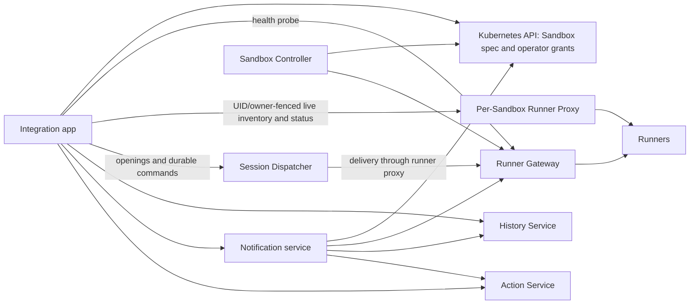

# Agentplane service boundaries

The integration app is a user-facing composition layer, not a backend dependency. The former
Sandbox Service is not deployed: the app submits Sandbox desired state and operator grants through
Kubernetes as the requesting operator, and the Sandbox Controller reconciles resources and owns
`Sandbox.status`.

## The integration app is a client

Other Agentplane services must not depend on the app. The dependency direction is app to services
and shared infrastructure, never services to the app.

The graph shows ownership direction, not every infrastructure dependency.

For backend operations, this forbids:

- Calling the app's Thread, runner, provisioning, or private identity endpoints as a service API.
- Reading app-owned tables or importing `agentplane.app` implementation modules from another backend.
- Depending on the app's process/attachment, a browser session, or an app-issued ticket merely to act
  as a service. Shared authentication and independently owned operator authority are different things.
- Making the app the only source of session instructions, provider configuration, or destination IDs
  needed to create or manage sessions independently.
- A temporary app API or proxy that becomes a prerequisite for notification delivery.

A shared helper belongs in an independently owned package. Backend records belong to their backend
owner; a shared database server does not make private tables a supported API. The app can retain
presentation state and projections, but those must not become hidden sources of backend authority.
The Sandbox and SandboxTemplate Go API types and scheme live in [`sandboxes/api`](../sandboxes/api/types.go),
so backend readers and the controller share the same typed Kubernetes contract.

## HTTP and gRPC boundaries

Translate at the client boundary. Agentplane services call backend RPCs over native gRPC, including
when both processes expose HTTP listeners. A backend's HTTP/JSON facade is not an internal transport.

The integration app owns the browser's HTTP/JSON and streaming boundary. It calls each backend's
generated gRPC client with the credential that backend expects, and returns the generated message's
ProtoJSON form or a UI-specific composition. The app never forwards browser cookies or browser-supplied upstream credentials. Backend authentication and authorization still run on every RPC; the app neither
replaces that authority nor turns a browser session into a backend dependency.

A service does not acquire an HTTP facade merely because it serves gRPC. A facade needs an explicit
direct HTTP-client contract independent of the browser app. Existing published service HTTP APIs
remain available to such clients: Notifications and egress rules have HTTP CLI consumers; Actions,
Connections and Dispatcher also publish direct HTTP APIs. The Actions CLI itself uses native gRPC.
Removing a published API requires its own caller/contract review; the app does not consume those
facades. Agents and automation must remain able to use backend APIs while the app is unavailable.
Consolidating their HTTP endpoints would require an independent API gateway, not routing them through
the integration app.

Use generated gateway handlers and protobuf messages instead of a handwritten HTTP-to-RPC
transcoder or duplicate wire models. A language without a generated gateway may use small typed
browser adapters over generated stubs. Each adapter preserves deadlines, cancellation, streaming
status and the backend's authorization, with no automatic mutation retries. See the
[gRPC implementation pattern](grpc_services.md#httpjson-facades).

OAuth endpoints and callbacks, webhooks, MCP, Electric shapes, model APIs and telemetry protocols
remain HTTP at their owning components. They are protocol endpoints, not alternate RPC transports.

## Ownership

- **Integration app:** user-facing composition and interaction. As the requesting operator, it writes
  Sandbox `spec` and operator-owned `PolicyBinding` grants through Kubernetes. It reads Sandbox
  projections for the UI, opens Sessions and submits commands through the Session Dispatcher, uses
  the Runner Gateway for placement, and uses each Sandbox's Runner Proxy for UID/owner-fenced live
  inventory and process/Session diagnostics. Manual resume is a Sandbox lifecycle request through
  Kubernetes; the Runner owns native-state recovery after startup. It owns harness startup and
  reconciliation after command admission. The app reads Session history and Threads from the History
  Service. See the [Runner Gateway](../runner_gateway/README.md) and
  [Session Dispatcher](../runner_gateway/dispatcher/README.md) contracts.
- **Sandbox Controller:** reconciles requested Sandbox state into ServiceAccounts, Pods or VMs,
  state volumes and controller-owned grants. It owns `Sandbox.status`, including quiescing facts,
  and asks the Runner Gateway to seal Sessions before stopping or deleting a runner.
- **Runner Gateway:** runner control stream, verified destination bindings, the per-Sandbox Runner
  Proxy and read-only Sandbox inventory. It does not own Session records or command admission. The
  app and Dispatcher use the proxy for live Runner RPCs; the Dispatcher owns sender-facing durable
  command admission and delivery state. The retired `sandbox_commands` database resource is absent
  from current manifests.
- **History Service:** the Session Event archive, the ingress runners push their journals to, the
  Thread fold of each Session, and the read API over both. It retains the existing `sandbox_service`
  PostgreSQL database and its authored history.
- **Runner:** native harness scheduling and execution, durable command journal, canonical execution
  Events and causal receipts.
- **Notification service:** providers, subscriptions, persisted payloads, inbox HWM, notice policy,
  and notice delivery bookkeeping.
- **Action Service:** Action authorization and Decisions, execution lifecycle, and canonical Action
  history.

`app/threads/` owns only the app's Thread metadata, projections, and browser-facing composition. Its
session adapter uses the History Service; it does not own Sandbox reconciliation or connect directly
to runners. Thread identities do not travel in Runner control-stream metadata.

## Invariants

- **One durable event log outside the runner:** the History Service's, written only through its ingress.
  The Dispatcher's command records are receipts of admission and delivery, not a second log.
- **One Thread projection:** the History Service fold. No other service derives Thread state from Session
  events, Electric serves only that fold, and the `app` database holds no raw Events or fold tables. Any fold
  table can be dropped and rebuilt from the raw log.
- **One database per service**, named for it, with its own role. No service reads another's database;
  Electric's logical replication of the history fold is the one exception.
- **The Runner Gateway routes and does not provision.** It holds the control stream and serves each runner's
  own `Runner` service at its Sandbox's control address; it keeps no Session records and creates no Kubernetes
  objects besides its connection records.
- **The History Service never routes to, reads or manages Sandboxes.** It records which Sandbox wrote each
  Session.
- **One Session ID everywhere,** minted by the client: runner, Gateway, History Service and app use the same
  UUID.
- **Runner control is private.** The Gateway dials each runner's mTLS gRPC listener; only Gateway workloads may reach it.
- **The app is a facade.** It stores browser sessions, operator-set Thread metadata and the Thread → Session
  link, and asks the History Service where a Session runs.
- **Coordination lives in Kubernetes** (Leases, Services), except a fence that must commit in the same
  transaction as the data it guards, the fold's `session_projection_lease`.

## Session access without the app

The Runner Gateway authenticates proxy callers, resolves the current Sandbox and runner connection,
and routes Runner RPCs to the replica holding the outbound stream. The app and Notification service
use it for live Runner inventory; the Sandbox Controller uses its controller-only proxy authorization
for quiesce. The app requests Sandbox lifecycle changes through Kubernetes. The Session Dispatcher owns durable sender-facing command admission and delivery.
No backend needs the app process to keep serving these operations.

Notification-triggered wake and durable acceptance for offline destinations are separate features
with their own rollout gates. Do not create another runner-command queue as a side effect of a
service-boundary change.

Runner journals remain durable on runner state volumes. Runners push them to the History Service,
whose Session Event archive outlives the runner volume; the app reads history from that archive and
keeps its UI projections.

The Runner Gateway is the only production server of the runner control stream. It does not proxy
runner outbound model, Actions, or egress traffic. Administrative and test exceptions must be explicit;
there is no production direct-runner fallback in the app or notifications.

## Existing staging data

Backend independence is not a reason to discard the current staging instance. When state moves
between services, preserve existing data and identities, with an inventory, tested migration/restore
path, and controlled ownership handoff. One-time migration of app-owned records is distinct from a
steady-state dependency on app tables. See [staging data preservation](staging_data_preservation.md).
Any necessary loss/reset must be described and explicitly approved before execution; the general
staging-disposability rule in [`../AGENTS.md`](../AGENTS.md) is not permission to bypass this
requirement.

## Review and acceptance gates

- Reject reverse imports, app API clients, app-table reads, or app-only bootstrap dependencies in
  backend code. Make this rule visible to coding agents in [`../AGENTS.md`](../AGENTS.md).
- Give each record, queue, lifecycle operation, and authorization decision one owner. Avoid
  overlapping command authorities or implicit persistence semantics.
- Exercise notification ingestion/subscription, payload read/ack, command delivery, and receipt replay
  with the app unavailable. Sandbox desired state is an operator request; reconciliation and runner
  sealing remain owned by the controller and Gateway.
- Verify restart/recovery does not depend on the app process after desired state has been accepted.
- Test authorization failures and preserve the distinction between accepted intent, runner admission,
  and harness effect. Human decision requirements stay in their backend authority even if the UI is down.

## Sandbox lifecycle and Runner Gateway callers

The Sandbox Service API, server source, and Deployment are retired. The History Service retains the
existing `sandbox_service` database and its authored Session history. The app submits Sandbox desired
state and operator grants through the Kubernetes API as the requesting operator; the Sandbox
Controller reconciles `spec` and owns `status`.

Shared read-only Sandbox projections may be used by the app, notifications and Runner Gateway. They
carry no create/delete/grant/session authority. Runner and History protobuf/client types remain
service-owned APIs; the Gateway-specific Session API and the Sandbox Service API have no client here.

Thread launch defaults live in the app's configured preset catalog and are selected by the preset
label on a Sandbox. The shared Sandbox creation request has no per-Sandbox Session defaults. The
shared Sandbox read model carries the Sandbox's bootstrap script but no launch defaults. The app
resolves a complete Session spec from the preset before sending its opening to the Dispatcher. No
database schema, identities, or retained logs change with package renames.
