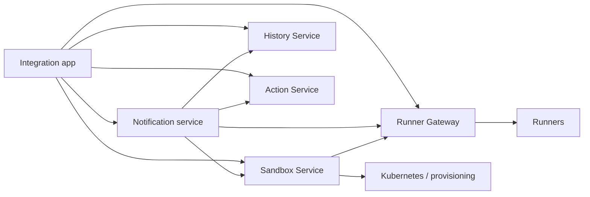

# Agentplane service dependency rule

Status: **accepted architecture constraint.** The Sandbox Service, the Runner Gateway, the History
Service, and the app's clients of them are implemented and deployed.

## The integration app is a client

The integration app integrates independent capabilities into a user-facing view. **Other Agentplane
services must not depend on it.** The dependency direction is app to services, never services to app.

The services may depend on shared infrastructure and explicit backend APIs. The graph is the relevant
ownership direction, not an exhaustive list of existing infrastructure dependencies.

For backend operations, this forbids:

- Calling the app's Thread, runner, provisioning, or private identity endpoints as a service API.
- Reading app-owned tables or importing `agentplane.app` implementation modules from another backend.
- Depending on the app's process/attachment, a browser session, or an app-issued ticket merely to act
  as a service. Shared authentication and independently owned operator authority are different things.
- Making the app the only source of session instructions, provider configuration, or destination IDs
  needed to create/manage sessions independently.
- A "temporary v1" app API or app proxy that becomes a prerequisite for notification delivery.

A shared helper belongs in an independently owned package. Backend records belong to their backend
owner; a shared database server does not make private tables a supported API. The app can retain
presentation state and projections, but those must not become hidden sources of backend authority.

## Ownership

- **Sandbox Service:** Sandbox provisioning and lifecycle, templates, grants and egress,
  teardown, and the runner endpoints each new Sandbox's runner dials. It has no database.
- **Runner Gateway:** the runner control stream, verified destination bindings, the Session registry,
  authorized runner-session access, command admission and delivery, command receipt reads, the
  `sandbox_commands` database, and sealing a Sandbox's runner on the Sandbox Service's request.
- **History Service:** the Session Event archive, the ingress runners push their journals to, the Thread
  fold of each Session, and the read API over both.
- **Runner:** native harness scheduling/execution, durable command journal, canonical execution Events
  and causal receipts.
- **Notification service:** providers, subscriptions, persisted payloads, inbox HWM, notice policy, and
  notice delivery bookkeeping.
- **Action Service:** Action authorization/Decisions, execution lifecycle, and canonical Action history.
- **Integration app:** user-facing composition, interaction, presentation, and app-only projections/state;
  a client of the above that reads Session history and Threads from the History Service.

`app/threads/` owns only the app's thread metadata, projections, and browser-facing composition. Its
session adapter uses the service client; it does not provision sandboxes or connect to runners.
Thread identities never enter the Sandbox Service or Runner Gateway API.

## Session access without the app

The [Runner Gateway](../runner_gateway/README.md) resolves explicit session destinations, exposes
authorized command delivery and receipt reads, and distinguishes available, unavailable,
and permanently removed destinations without querying the app; the
[Sandbox Service](../sandbox_service/README.md) provisions, suspends and resumes Sandboxes.
Notification-triggered wake and durable acceptance of commands for offline destinations are separate,
deferred product features. A service boundary is not permission to silently create a second
runner-command queue.

Runner journals remain durable on runner state volumes. Runners push them to the History Service,
whose Session Event archive outlives the runner volume; the app reads history from that archive through the
History Service and keeps its UI projections.

The Sandbox Service and the Runner Gateway serve protobuf/gRPC APIs; the app retains its
browser-facing HTTP API. The Runner Gateway is the only production server of the runner control
stream. It does not proxy runner outbound model, Actions, or egress traffic. Administrative/test
exceptions must be explicit; there is no production direct-runner fallback in the app or notifications.

## Existing staging data

Backend independence is not a reason to discard the current staging instance. When state moves
between services, preserve existing data and identities, with an inventory, tested migration/restore
path, and controlled ownership handoff. One-time migration of app-owned records is distinct from a
steady-state dependency on app tables. See [staging data preservation](staging_data_preservation.md).
Any necessary loss/reset must be described and explicitly approved before execution; the general
staging-disposability rule in [`../AGENTS.md`](../AGENTS.md) is not permission to bypass this requirement.

## Review and acceptance gates

- Reject new reverse imports, app API clients, app-table reads, or app-only bootstrap dependencies in
  backend code. Make this rule visible to coding agents in [`../AGENTS.md`](../AGENTS.md).
- Give each record, queue, lifecycle operation, and auth decision one owner. No overlapping command
  authorities or implicit new persistence semantics.
- Exercise provisioning/session setup, notification ingestion/subscription, payload read/ack, command
  delivery, and receipt replay **with the integration app unavailable**, from a backend path's first
  implementation.
- Verify restart/recovery also works without the app: a happy path using state pre-created by the app
  alone does not demonstrate backend independence.
- Test authorization failures and preserve the distinction between accepted intent, runner admission,
  and harness effect. Human decision requirements stay in their backend authority even if the UI is down.

## Sandbox Service and Runner Gateway callers

Sandbox provisioning, grant mutations, Session operations and runner RPCs are service-owned
operations. Consumers call the authenticated Sandbox Service or Runner Gateway API, not instantiate
their inventory, provisioner, reconciler, destination resolver, command relay, or lifecycle
implementation. Do not introduce local-or-remote unions, in-process fallbacks, or a second
provisioning dependency in the app. Sandbox Service implementation targets are visible only inside
that service, except the inventory and destination resolver the Runner Gateway reads.

Public protobuf/client models and read-only Kubernetes projections can be shared. The projection
modules carry no create/delete/grant/session authority. Consumer acceptance tests use the real gRPC
boundary through service-owned test fixtures; tests of backend mutations live with the service.

Bazel defaults keep app implementation visible only to the app and its explicit acceptance/deployment
consumers. Public DTOs, client/protobufs, and read-only projections are opt-in exports. The direct
runner transport and its generated gRPC stub are visible only to runner code, the Runner Gateway, and
Sandbox Service test support. Archive fault tests get
an explicit test-only transport dependency, which production app targets cannot use. Shared runner
error types live separately so importing an error does not grant a transport
dependency. Use concrete service clients, not protocols introduced solely to allow alternate
in-process implementations in consumer tests.

Session defaults are named `SessionDefaults` / `session_defaults` in the API and in the Sandbox
binding annotation. No database schema, identities, or retained logs change with package renames.
