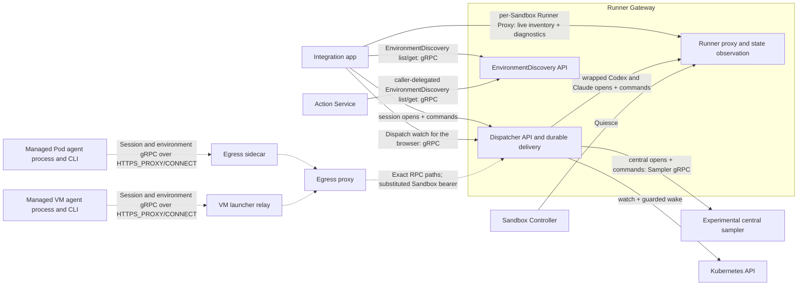
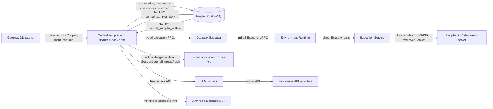
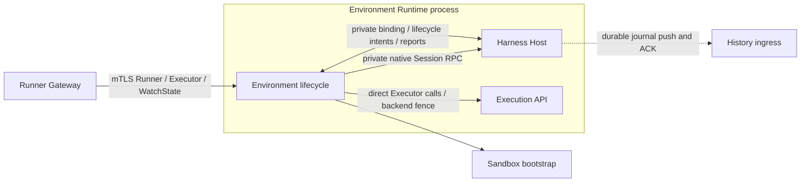
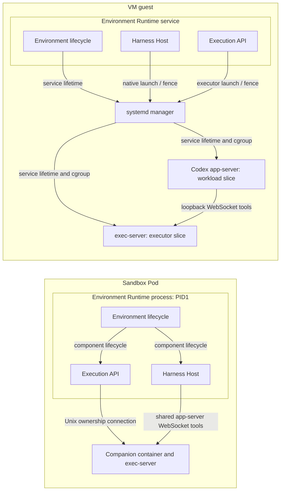
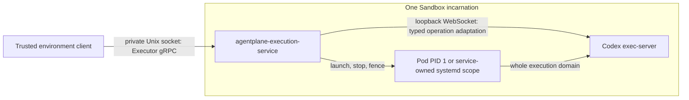
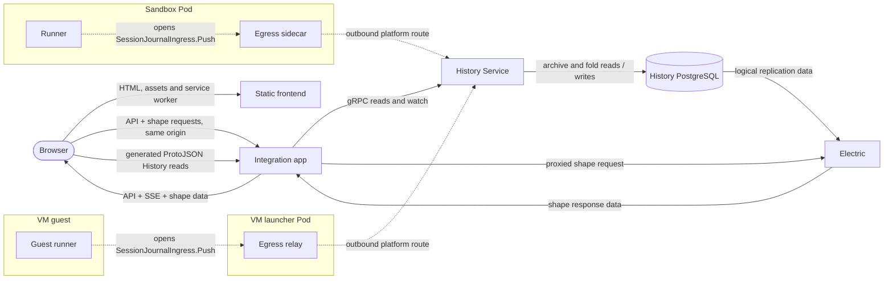

# Agentplane system overview: focused diagrams

Per-path detail for the [README system overview](../README.md#system-overview), same conventions:
API arrows point caller to callee, labels like `response` or `replication` show data on that edge,
dashed arrows are runner-initiated platform routes.

The optional central sampler runs as its own Deployment and Service in staging and the
[k3s acceptance scenarios](../system_tests/README.md#central-sampler), using the shared cdk8s
construct and its own image. Responses models use the projected service-account token to call LLM
ingress; selected Anthropic API models use a dedicated mounted key and a host-pinned Cilium egress rule.

## Session delivery

Managed Pod and VM callers receive only the inert `AGENTPLANE_SESSIONS_CREDENTIAL` placeholder. The
`AGENTPLANE_SESSIONS_URL` targets `session-dispatcher.<namespace>.svc.cluster.local:8080`. The egress sidecar
or VM launcher relay holds the short-lived `session-dispatcher` audience token; the central proxy substitutes
it on the allowlisted SessionDispatcher and EnvironmentDiscovery RPC paths. Backend checks of the Sandbox
identity and object UID remain authoritative; network reachability grants no Session authority.
The Action Service uses the same Dispatcher audience and a pod-bound Actions token on the explicitly
opted-in discovery methods. The receiver applies the caller identity from the shared delegation
envelope, then performs the same live Sandbox and execution-ServiceAccount UID checks as a direct
caller. This read path does not grant Session writes, wake, or provisioning authority.

## Central code-mode sampling (opt in)

The staging picker gives direct Anthropic models only to the central sampler, keeping them out of the
subscription-backed Codex and Claude harnesses. The Anthropic key is copied by ESO from the existing
LiteLLM-owned secret and mounted only in the sampler container; Cilium pins direct API traffic to
`api.anthropic.com` and its TLS server name. Responses calls retain the existing LLM ingress token path.

The sampler lazily starts one shared Codex host process when code-mode work needs it and multiplexes
logical Sessions through it. The host retains per-Session `store()` / `load()` values across cells
and idle turns; each code-mode cell runs in a fresh V8 isolate with no shared JavaScript globals.
Provider continuation stays in the sampler. A resident replica keeps the Session's database
ownership lease and a lightweight driver/heartbeat while idle; this does not consume a
`max_live_sessions` active-execution slot. Any replica may admit commands, and a transactional,
payloadless `central_sampler_work` notification wakes local lease holders to query pending work.
The separate `central_sampler_outbox` notification wakes History export. Notifications carry no
Session or Pod routing, and startup scans, listener reconnect catch-up and periodic reconciliation
cover missed signals.
The Pod has aggregate CPU/memory limits, with no per-Session or per-cell kernel boundary today.
Gateway proxies the sandbox-owned [Executor service](../env/runtime/execution/executor.proto) through Environment Runtime to Execution Service,
whose execution adapter owns the local
Codex JSON-RPC connection and native session handshake. A held `OpenSession` stream owns that
connection; process and file operations use unary RPCs. Native frames return as evidence for the
sampler's existing journal. No new persistence or operation receipts are introduced, and a lost
reply can still leave an operation outcome unknown. Dispatcher is absent from that tool path. Sandbox UID and incarnation fence the executor binding; v1 does
not replace an executor. An unavailable executor does not remove the sampler's persisted history
or prevent its control RPCs. Existing Dispatcher routing still requires the bound Sandbox object.

History retains source evidence and derives the lossy Thread display. Its entries are not a
provider continuation format: the sampler owns that state in its database. Wrapped native
harnesses keep their current local sampling, execution and persistence paths. See the
[standalone API and recovery contract](../central_sampler/SPEC.md).

## Environment control and native Sessions

The components share one process. Runtime owns environment identity, bootstrap, health and aggregate lifecycle. Host owns native Session
admission, state and journals; it rechecks Runtime boot, Host boot and generation before durable work.
Host reports native stop before Runtime acknowledges Execution fencing, then seals and flushes exact
History cursors. Public connection Leases and epoch fencing remain in Runtime's control endpoint.
Central sampler remains a separate control-plane process outside the environment.

## Codex execution inside a Sandbox

The Pod executor has a private PID namespace and Kubernetes resource limits. VM native processes use
separate service scopes and slice budgets. Both share Sandbox identity and filesystem paths with the
harness. Runtime aggregates process fence proof; Host cannot restart or fence Execution. An abnormal
Runtime exit requires the outer container fence before replacement. Local tools remain a deployment
mode. See [executor isolation](../env/runtime/execution/docs/codex_executor.md).

## Standalone execution service

The separately runnable [`agentplane-execution-service`](../env/runtime/execution/README.md) owns the same
Executor adapter and native backend without a Runner or native agent harness. Its real container
acceptance client uses the private Unix socket. Production Gateway routing still reaches the
Runner's embedded adapter; deploying the separate process and changing that route are separate work.

The private directory and lifetime lock admit one local owner. Scope validation precedes dispatch;
closing a unary caller does not imply its native operation stopped. Backend exit closes sessions and
ends the service lifetime without replaying mutations. No new persistence or environment-attachment
API is introduced.

## Telemetry

The browser exports protobuf traces to the same-origin App endpoint. The App fixes the upstream
receiver from its server-side configuration and forwards the bounded request to Alloy over OTLP/HTTP;
the browser cannot choose a destination. Instrumented backend services export OTLP/gRPC directly to
Alloy. Runners use an unauthenticated local gRPC route in their egress sidecar; VM guests use the
launcher relay at the guest gateway. Both relays forward to Alloy, and the sidecar and relay export
their own traces directly there as well.

## History and browser sync

The app initiates each Electric HTTP request and streams the shape response through to the browser.
Generated History HTTP routes at the app's `/upstream/history/v1/` prefix let the browser call
annotated unary History reads; the app forwards them over gRPC with its projected service token.
The separate `History PostgreSQL → Electric → app → browser` arrows show replicated and returned data.
The HTTPS Gateway routes static files directly to the frontend Service and all API, login and stream
requests to the app Service. The frontend has no backend credentials and makes no outbound service
calls; its History reads use the app's same-origin facade.

## Notifications

The Notification service does not call the integration app, which watches subscription and notice
state over the operator-only `NotificationsOperator` gRPC service. GitHub sends it signed webhooks; it
makes GitHub App REST calls, reads receipt evidence from History before retrying a delivery, and
submits every runner notice through the Session Dispatcher. It authorizes a message against the
PolicySets and PolicyBindings it watches, and asks History which Sandbox wrote a Session before a
message opens that Session's inbox.

## Actions and egress

The egress proxy substitutes a configured credential only for the destination covered by its
policy. LiteLLM is a separate hop behind LLM ingress; only that service holds the LiteLLM virtual key.
The app has independent `action_federation.service_url` and `connection_service_url` settings.
Both tiers send operator Connection calls and gRPC health probes to the [MCP edge](../mcp_edge/README.md).
Staging's external MCP/OAuth routes terminate there too, preserving the public issuer/resource URLs.
Actions retains upstream MCP linkage and its public client metadata; it no longer serves staging's
integrated ConnectionService or OAuth issuer. The edge verifies operator OIDC separately from
external MCP bearers and forwards workload calls under the bound ServiceAccount's token.

## Service definitions

- gRPC: [Actions](../action_service/action_service.proto), [operator Actions](../action_service/operator_action_service.proto), [Connections](../mcp_edge/connection_service.proto), [Web Push](../action_service/web_push_service.proto), [Runner RPCs](../runner/environment_runtime.proto), [Executor](../env/runtime/execution/executor.proto), [SessionJournalIngress](../history_service/session_ingress.proto), [Session Dispatcher](../runner_gateway/dispatcher/session_dispatcher.proto), [History Service](../history_service/history_service.proto), and the Notification Service's [workload](../notification_service/notifications.proto) and [operator](../notification_service/notifications_operator.proto) APIs (the workload API also has an HTTP form). The Runner Gateway also serves standard gRPC health and proxies the Runner and Executor services over a direct mTLS connection to each runner.
- HTTP and streaming APIs: [Integration app](../app/api.py), [Electric proxy](../app/electric.py), [Action Service generated facade](../action_service/action_service.proto), [LLM ingress](../llm_ingress/server.go), and [Git index](../indexing/app.py).
- Controllers and egress: [Sandbox Controller](../sandbox_controller/controller.go), [Policy Controller](../policy_controller/controller.go), [central egress proxy](../egress/proxy/proxy.go), [Go sidecar](../egress/sidecar/main.go), and [sidecar route configuration](../egress/platform_routes.py).
