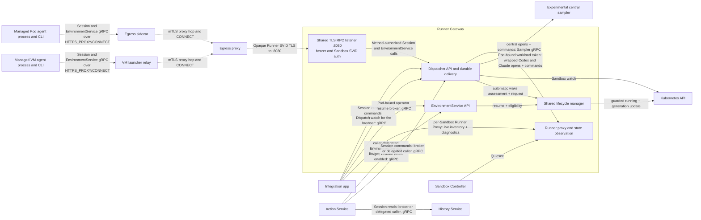
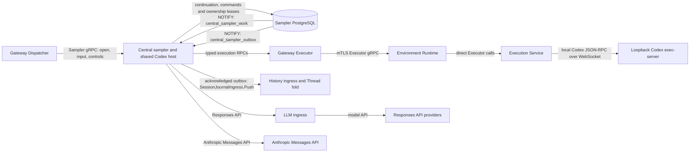
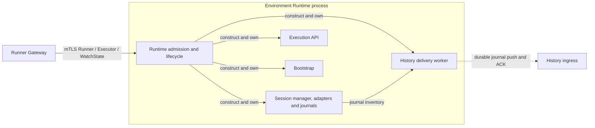
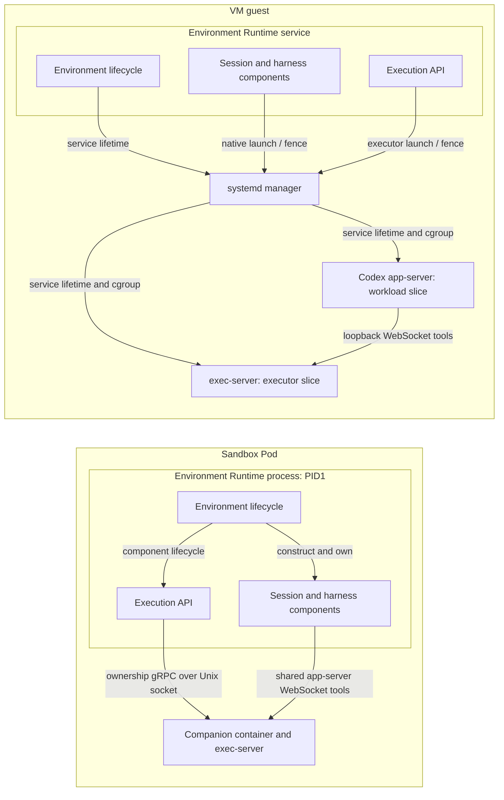
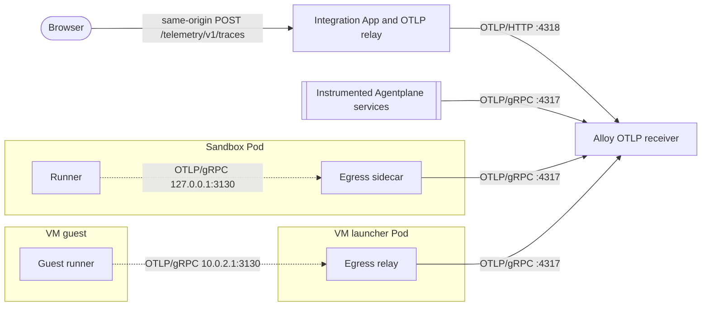
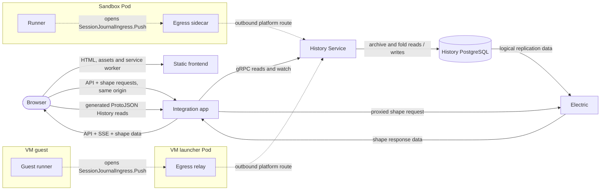
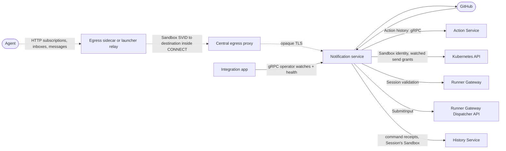
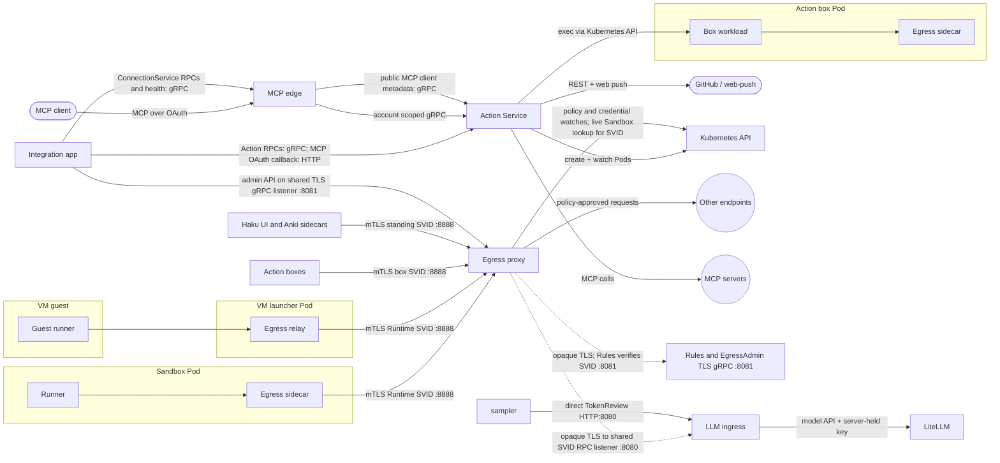

# Agentplane system overview

## System overview

Service boundaries and traffic, independent of environment or replica layout. API arrows point
caller to callee; labels such as `response` show data on that edge; dashed arrows are
runner-initiated platform routes. Per-path diagrams (session delivery, runner control,
history and browser sync, notifications, actions and egress) and direct API definition links:
[focused diagrams below](#focused-diagrams).

```mermaid
flowchart LR
    browser([Browser])
    edge[HTTPS Gateway]
    frontend[Static frontend]
    app[Integration API]
    subgraph services[Agentplane services]
        direction TB
        gw[Runner Gateway TLS RPC :8080: Dispatcher, EnvironmentService, proxy and observation]
        sandboxctl[Sandbox Controller]
        policy[Policy Controller]
        hs[History TLS RPC :8080: readers and JournalIngress]
        notif[Notification TLS RPC :8080; signed webhook HTTP :8081]
        actions[Action TLS RPC :8080]
        edge[MCP edge]
        egress[Egress proxy]
        egressRules[Rules and EgressAdmin TLS gRPC :8081]
        llm[LLM inference HTTP and ModelConfig RPC over TLS :8080]
        electric[Electric]
        sampler[Experimental central sampler]
        samplerdb[(Sampler PostgreSQL)]
    end
    subgraph runtimes[Sandbox environments]
      direction LR
      subgraph sandbox[Sandbox Pod]
        subgraph pod_runtime[Environment Runtime process: PID1]
          runtime[Environment lifecycle]
          runner[Runtime Session components + native drivers]
          execution[Execution API]
        end
        runtime -->|direct lifecycle and Session calls| runner
        runtime -->|lifecycle and execution RPC| execution
        execution -->|companion ownership: gRPC over Unix socket| podexec
        agent[Managed agent process and CLI]
        podexec[Codex executor container]
        sidecar[Egress sidecar]
      end
      subgraph vm_guest[VM guest]
        subgraph vm_runtime[Environment Runtime process]
          vmruntime[Environment lifecycle]
          guest[Runtime Session components + native drivers]
          vmexecution[Execution API]
        end
        vmruntime -->|direct lifecycle and Session calls| guest
        vmruntime -->|lifecycle and execution RPC| vmexecution
        guest_agent[Managed agent process and CLI]
        manager[systemd manager]
        vmexec[Codex executor service]
        vmruntime -->|process lifetime| manager
        guest -->|native supervision| manager
        vmexecution -->|executor supervision| manager
        manager -->|service lifetime and cgroup| vmexec
      end
      subgraph vm_sandbox[VM launcher Pod]
        relay[Egress relay]
      end
    end
    k8s[Kubernetes API]
    subgraph independent[Independent service]
      direction LR
        index[Git index]
    end
    alloy[Alloy OTLP receiver]
    sdk_services[[Instrumented Agentplane services]]
    responses[Responses API providers]
    anthropic[Anthropic Messages API]

    browser -->|HTTPS, one origin| edge
    edge -->|HTML, assets and service worker| frontend
    edge -->|API, auth and streams| app
    app -->|gRPC health + read-only Runtime diagnostics| gw
    app -->|Dispatcher commands and watches: gRPC| gw
    app --> hs
    app -->|gRPC operator watches + health| notif
    app -->|Action and MCP Linkage RPCs: gRPC| actions
    app -->|ConnectionService RPCs and health: gRPC| edge
    edge -->|authenticated ActionService gRPC| actions
    edge -->|public MCP client metadata: gRPC| actions
    notif -->|Action history: gRPC| actions
    actions -->|Session commands: broker or delegated caller, gRPC| gw
    actions -->|caller-delegated EnvironmentService list/get: gRPC| gw
    actions -->|Session reads: broker or delegated caller, gRPC| hs
    app -->|gRPC| egress
    app --> electric
    app --> k8s
    sdk_services -->|OTLP/gRPC| alloy
    app -->|browser trace relay: OTLP/HTTP| alloy

    gw -->|central Session commands: Sampler gRPC| sampler
    sampler -->|continuation, commands and ownership leases| samplerdb
    samplerdb -->|NOTIFY: central_sampler_work| sampler
    samplerdb -->|NOTIFY: central_sampler_outbox| sampler
    sampler -->|typed execution: Executor gRPC| gw
    sampler -->|SessionJournalIngress.Push| hs
    sampler -->|Responses API| llm -->|model API| responses
    sampler -->|direct Anthropic Messages API| anthropic
    gw --> k8s
    notif --> k8s
    actions -->|Action Pods, launched Sandboxes and their launcher grants| k8s
    policy --> k8s
    sandboxctl --> k8s
    sandboxctl --> gw
    runner -->|local Codex JSON-RPC over WebSocket, isolated mode| podexec
    runner -->|starts| agent
    podexec --> sidecar
    guest -->|local Codex JSON-RPC over WebSocket, isolated mode| vmexec
    guest -->|starts| guest_agent
    vmexec --> relay
    runner -->|local HTTP CONNECT| sidecar
    sidecar -->|mTLS Runtime SVID :8888| egress
    guest -->|HTTP CONNECT through launcher relay| relay
    relay -->|mTLS Runtime SVID :8888| egress
    agent -.->|local Rules gRPC :3130| sidecar
    sidecar -.->|service SVID TLS through CONNECT| egress
    guest_agent -.->|local Rules gRPC :3130| relay
    relay -.->|service SVID TLS through CONNECT| egress
    egress -.->|opaque Action gRPC TLS, verified by the service| actions
    runner -.->|OTLP/gRPC telemetry route| sidecar
    sidecar -->|OTLP/gRPC| alloy
    guest -.->|OTLP/gRPC telemetry route| relay
    relay -->|OTLP/gRPC| alloy
    gw -->|mTLS Runner and Executor gRPC| runtime
    gw -->|mTLS Runner and Executor gRPC| vmruntime
    runner -.->|History mTLS through CONNECT| sidecar
    sidecar -.->|opaque History TLS| egress
    egress -.->|opaque SessionJournalIngress.Push TLS| hs
    agent -.->|managed CLI History reads through exact-origin route| sidecar
    sidecar -.->|History Service SVID TLS through CONNECT| egress
    egress -.->|opaque History read TLS| hs
    agent -.->|Session and EnvironmentService gRPC through HTTPS_PROXY/CONNECT| sidecar
    guest -.->|History mTLS through CONNECT| relay
    relay -.->|opaque History TLS| egress
    guest_agent -.->|managed CLI History reads through exact-origin route| relay
    relay -.->|History Service SVID TLS through CONNECT| egress
    guest_agent -.->|Session and EnvironmentService gRPC through HTTPS_PROXY/CONNECT| relay
    egress -.->|opaque Dispatcher SVID TLS| gw

    egress -.->|opaque TLS; Rules verifies SVID :8081| egressRules
    agent -.->|Notification HTTP| sidecar
    guest_agent -.->|Notification HTTP| relay
    sidecar -.->|Notification SVID TLS through CONNECT| egress
    relay -.->|Notification SVID TLS through CONNECT| egress
    egress -.->|opaque Notification TLS| notif
    agent -.->|local Notification gRPC :3130| sidecar
    guest_agent -.->|local Notification gRPC :3130| relay
    runner -.->|local model configuration gRPC :3130| sidecar
    guest -.->|local model configuration gRPC :3130| relay
    sidecar -.->|model configuration SVID TLS through CONNECT| egress
    relay -.->|model configuration SVID TLS through CONNECT| egress
    egress -.->|opaque model configuration TLS| llm


    click app href "../app/go/server.go" "Integration app API server"
    click gw href "runner_control.md" "Runner gRPC and proxy"
    click hs href "../history_service/history_service.proto" "History Service API"
    click notif href "../notification_service/notifications.proto" "Notification Service API"
    click actions href "../action_service/action_service.proto" "Action Service API"
    click edge href "../mcp_edge/connection_service.proto" "Connection API"
    click policy href "../policy_controller/controller.go" "Policy Controller"
    click sandboxctl href "../sandbox_controller/controller.go" "Sandbox Controller"
    click egress href "../egress/proxy/proxy.go" "Egress proxy"
    click llm href "../llm_ingress/server.go" "LLM ingress"
    click electric href "../../cluster/cdk8s/agentplane/electric.py" "Electric deployment"
    click index href "../x/indexing/app.py" "Git index API"
```

Each runner incarnation has one Secret, issued by the Policy Controller for the Sandbox's
`WorkloadCredential`. The Sandbox Controller projects it to Environment Runtime and the egress
sidecar only; workload containers have no mount. The KubeVirt launcher relay gets that same Secret
through the existing Kyverno injection after a live check that the record has accepted the
launcher's VMI for the VM's credential. Staging
and testing use the SVID hop; TLS mode never falls back to token mode.

Firecracker Sandboxes use a controller-owned launcher Pod, a separate SVID-authenticated relay and a
NixOS guest. Their supervisor checkpoints RAM and all disks, then restores the same Runtime and
processes in the same Pod. Its launcher serves SPIFFE Workload API credentials over vsock to the
root guest agent, which serves a restricted Unix endpoint consumed by Runtime. Guest management
uses a separate gRPC connection for boot/thaw readiness. See [Firecracker Sandboxes](firecracker_sandboxes.md) for the control,
credential and network boundaries.

A VM guest runs Environment Runtime with Session components and Execution; its relay is in the separate KubeVirt launcher Pod. The Git index is
standalone, with no dependency on the backend services or the app: it polls a configured Git remote,
embeds files through an embedding endpoint and owns its own PostgreSQL database
([indexing README](../x/indexing/README.md)).

- **Sessions and Threads.** A Session is a runner's raw Event stream; a Thread is its conversation
  view, folded by the History Service. Runners push Events to the History Service, the only way into
  retained history.
- **Runner control uses native gRPC.** The Gateway dials each runner's private server using mTLS.
  It validates the certificate against the active Sandbox/workload and retains `<sandbox>-control`
  routing and `<sandbox>-runner` observation Leases. History push and ordinary Sandbox egress retain
  their sidecar or VM relay paths; History terminates and verifies the Runtime SVID itself
  ([runner control](runner_control.md)).
- **Telemetry uses Alloy as its collector.** SDK-instrumented services export OTLP/gRPC to Alloy.
  Browser spans post to the same-origin App relay, which forwards OTLP/HTTP to Alloy. Runner spans use
  the sidecar's local telemetry route; VM guest spans use the launcher relay's guest gateway route.

### Database inventory

Each service owns a database on one shared CNPG cluster: `app`, `sandbox_service`
(Session history, owned by the History Service), `actions`, `egress`, `notifications` and
`session_dispatcher` (also the Gateway's queue; the Gateway has no registry database). The
optional central sampler owns its separate continuation database and uses PostgreSQL notifications
for resident Session work and History export wakeups.

### Sandbox lifecycle and runner control

The app forwards authenticated Sandbox management requests to the Runner Gateway's
`EnvironmentService`, which writes Sandbox desired state to Kubernetes; the Sandbox Controller
reconciles it, owns `Sandbox.status`, and holds
deletion until the runner has sealed its Sessions through the Gateway. Notifications and the
Runner Gateway read Sandbox inventory directly. The Runner Gateway implements Dispatcher Session
openings and durable command admission/delivery alongside the control stream; the app reads live
runner inventory and diagnostics through the Runner Proxy, which checks the live Sandbox name, UID
and owner. The Runner starts and resumes its own harnesses.

Status, open work and design gates: [`plans/`](../plans/README.md).

## Focused diagrams

Per-path detail for the [system overview above](#system-overview), using the same conventions:
API arrows point caller to callee, labels like `response` or `replication` show data on that edge,
dashed arrows are runner-initiated platform routes.

The optional central sampler runs as its own Deployment and Service in staging and the
[k3s acceptance scenarios](../system_tests/README.md#central-sampler), using the shared cdk8s
construct and its own image. Responses models use the projected service-account token to call LLM
ingress; selected Anthropic API models use a dedicated mounted key and a host-pinned Cilium egress rule.

## Session delivery

Managed Pod and VM callers receive the `AGENTPLANE_SESSIONS_URL`, but no bearer credential for the
Sandbox route. The URL targets the `session-dispatcher.<namespace>.svc.cluster.local:8080` alias of the
Gateway's shared TLS RPC listener. The egress sidecar or VM launcher relay maps that exact origin through
central CONNECT and presents its Runner SVID on the same `:8080` listener; the central proxy carries the
destination TLS bytes opaquely. The Gateway resolves the current Sandbox credential and ServiceAccount UID before applying
the unchanged Session and EnvironmentService method rules. No Dispatcher audience token is projected
into Sandbox Pods. Backend checks of the Sandbox identity and
object UID remain authoritative; network reachability grants no Session authority. The Action Service
continues to use the configured Dispatcher audience and a pod-bound Actions token on the opted-in
`EnvironmentService` list/get methods and its separately configured
`EnvironmentService.ResumeEnvironment` method. The receiver applies the caller identity from the
shared delegation envelope, then checks the current Sandbox and
execution-ServiceAccount identity and resume policy. The integration app uses its own Pod-bound
token as a distinct operator broker; it does not forward browser identity. Resume acceptance is not
readiness, and no resume path replays Session input or creates a grant.
Dispatcher automatic wake uses the same lifecycle manager with the original effective caller
and the `wakeOnSend` and `wake_callers` checks.
The opt-in Session tools also forward the effective caller to Dispatcher commands and retained
History reads. Those receivers enforce their own same-principal checks; the existing
`orchestration_v1` broker path retains its separate authority.

Managed Pod, VM and Firecracker CLIs also receive `AGENTPLANE_HISTORY_URL`, set to
`http://history-service.<namespace>.svc.cluster.local:8080`. The exact-origin route sends CLI gRPC
through the Pod sidecar or VM relay, which presents the Sandbox Workload SVID with
and verifies History's `HISTORY_SERVICE_URI`; the central proxy carries that TLS connection opaquely. History authorizes the
read against the exact Identity name and UID in the SVID. This path uses no History bearer credential
or projected audience token and adds no `reader_accounts` grant.

## Central code-mode sampling (opt in)

The staging picker gives direct Anthropic models only to the central sampler, keeping them out of the
subscription-backed Codex and Claude harnesses. The Anthropic key is copied by ESO from the existing
LiteLLM-owned secret and mounted only in the sampler container; Cilium pins direct API traffic to
`api.anthropic.com` and its TLS server name. Responses calls use the LLM ingress HTTPS endpoint with
the sampler's audience-scoped bearer token and verified service TLS.

The sampler lazily starts one shared Codex host process when code-mode work needs it and multiplexes
logical Sessions through it. The host retains per-Session `store()` / `load()` values across cells
and idle turns; each code-mode cell runs in a fresh V8 isolate with no shared JavaScript globals.
Provider continuation stays in the sampler. A resident replica keeps the Session's database
ownership lease and a lightweight driver/heartbeat while idle; this does not consume a
`max_live_sessions` active-execution slot. Any replica may admit commands, and a transactional,
payloadless `central_sampler_work` notification wakes local lease holders to query pending work.
The separate `central_sampler_outbox` notification wakes History export. Notifications carry no
Session or Pod routing, and startup scans, listener reconnect catch-up and periodic reconciliation
cover missed signals.
The Pod has aggregate CPU/memory limits, with no per-Session or per-cell kernel boundary today.
Gateway proxies the sandbox-owned [Executor service](../env/runtime/execution/executor.proto) through Environment Runtime to Execution Service,
whose execution adapter owns the local
Codex JSON-RPC connection and native session handshake. A held `OpenSession` stream owns that
connection; process and file operations use unary RPCs. Native frames return as evidence for the
sampler's existing journal. No new persistence or operation receipts are introduced, and a lost
reply can still leave an operation outcome unknown. Dispatcher is absent from that tool path. Sandbox UID and incarnation fence the executor binding; v1 does
not replace an executor. An unavailable executor does not remove the sampler's persisted history
or prevent its control RPCs. Existing Dispatcher routing still requires the bound Sandbox object.

History retains source evidence and derives the lossy Thread display. Its entries are not a
provider continuation format: the sampler owns that state in its database. Wrapped native
harnesses keep their current local sampling, execution and persistence paths. See the
[standalone API and recovery contract](../central_sampler/SPEC.md).

## Environment control and native Sessions

Runtime owns the components and one desired lifecycle revision. Native Session admission rechecks
that accepted revision and the public caller epoch before durable work. Component observations
prove native cleanup; Execution fencing precedes journal sealing, and exact durable History ACKs
precede delivery/journal closure and owner release. The external control Lease and epoch boundaries
remain in Runtime's endpoint. Central sampler remains a separate control-plane process.

## Codex execution inside a Sandbox

The Pod executor has a private PID namespace and Kubernetes resource limits. VM native processes use
separate service scopes and slice budgets. Both share Sandbox identity and filesystem paths with the
harness. Runtime aggregates process fence proof; Host cannot restart or fence Execution. An abnormal
Runtime exit requires the outer container fence before replacement. Local tools remain a deployment
mode. See [executor isolation](../env/runtime/execution/docs/codex_executor.md).

## Telemetry

The browser exports protobuf traces to the same-origin App endpoint. The App fixes the upstream
receiver from its server-side configuration and forwards the bounded request to Alloy over OTLP/HTTP;
the browser cannot choose a destination. Instrumented backend services export OTLP/gRPC directly to
Alloy. Runners use an unauthenticated local gRPC route in their egress sidecar; VM guests use the
launcher relay at the guest gateway. Both relays forward to Alloy, and the sidecar and relay export
their own traces directly there as well.

## History and browser sync

The app initiates each Electric HTTP request and streams the shape response through to the browser.
Generated History HTTP routes at the app's `/upstream/history/v1/` prefix let the browser call
annotated unary History reads; the app forwards them over gRPC with its projected service token.
The separate `History PostgreSQL → Electric → app → browser` arrows show replicated and returned data.
The HTTPS Gateway routes static files directly to the frontend Service and all API, login and stream
requests to the app Service. The frontend has no backend credentials and makes no outbound service
calls; its History reads use the app's same-origin facade.

## Notifications

Sandboxes keep their existing HTTP service URL. Their sidecar or relay recognizes the exact origin,
opens CONNECT through the central proxy, and presents the Runner SVID to Notification's shared TLS
RPC listener. Notification resolves the current Sandbox and its ServiceAccount; inbox ownership and
send grants are unchanged. Backend and operator callers retain their method-specific bearer
authorization on that listener.

The Notification service does not call the integration app, which watches subscription and notice
state over the operator-only `NotificationsOperator` gRPC service. GitHub sends it signed webhooks; it
makes GitHub App REST calls, reads receipt evidence from History before retrying a delivery, and
submits every runner notice through the Session Dispatcher. It authorizes a message against the
PolicySets and PolicyBindings it watches, and asks History which Sandbox wrote a Session before a
message opens that Session's inbox.

## Actions and egress

The required mTLS hop resolves the SVID's live `WorkloadCredential` before using its subject
ServiceAccount as the policy subject; no bearer authenticates it. Rules uses that same
authentication policy
and terminates TLS through an opaque central tunnel;
the proxy never asserts the caller. History, Notification, Gateway, Action and LLM each serve
bearer-authenticated and Sandbox-SVID RPCs on their primary TLS listener, with method-specific
authorization preserved. The central sampler uses verified service TLS with projected
ServiceAccount bearer tokens and holds no SVID. Only LLM ingress holds the LiteLLM key.
Kubernetes retains its destination-scoped projected token until the later impersonation cutover.
Rules, Notification, ModelConfig and telemetry share the local gRPC listener on port 3130; exact
service prefixes select independent upstream connections and authentication.

Action command/build boxes present their own `WorkloadCredential`'s SVID, subject their caller's
ServiceAccount; Haku UI/Anki present their standing records' SVIDs, subject `haku-ui`. Their
sidecars alone hold credentials. The later shared
identity and SVID lifecycle is independent of Sandboxes; no Identity/account cutover is included
here. Existing Sandbox processes need recreation to read the new mode/route configuration; image
updates alone do not replace running Pods.
The app has independent `action_federation.service_url` and `connection_service_url` settings.
Both tiers send operator Connection calls and gRPC health probes to the [MCP edge](../mcp_edge/README.md).
Staging's external MCP/OAuth routes terminate there too, preserving the public issuer/resource URLs.
Actions retains upstream MCP linkage and its public client metadata. The edge verifies operator OIDC separately from
external MCP bearers and forwards workload calls under the bound ServiceAccount's token.

## Service definitions

- gRPC: [Actions](../action_service/action_service.proto), [operator Actions](../action_service/operator_action_service.proto), [Connections](../mcp_edge/connection_service.proto), [Web Push](../action_service/web_push_service.proto), [Environment Service](../environments/v1/environment_service.proto), [Environment Runtime](../env/runtime/control/environment_runtime.proto), [Executor](../env/runtime/execution/executor.proto), [SessionJournalIngress](../history_service/session_ingress.proto), [Session Dispatcher](../runner_gateway/dispatcher/session_dispatcher.proto), [History Service](../history_service/history_service.proto), and the [Notification Service](../notification_service/notifications.proto) API (whose HTTP annotations generate the App browser facade; the service itself serves workload calls over gRPC). The Runner Gateway also serves standard gRPC health and proxies the Environment Runtime and Executor services over a direct mTLS connection to each runner.
- HTTP and streaming APIs: [Integration app](../app/go/) (Bazel target: `//agentplane/app/go:agentplane-app`), [Electric proxy](../app/go/proxy/electric.go), [Action Service generated facade](../action_service/action_service.proto), [LLM ingress](../llm_ingress/server.go), and [Git index](../x/indexing/app.py).
- Controllers and egress: [Sandbox Controller](../sandbox_controller/controller.go), [Policy Controller](../policy_controller/controller.go), [central egress proxy](../egress/proxy/proxy.go), [Go sidecar](../egress/sidecar/main.go), and [sidecar route configuration](../egress/platform_routes.py).
