# Agentplane system overview

## System overview

Service boundaries and traffic, independent of environment or replica layout. API arrows point
caller to callee; labels such as `response` show data on that edge; dashed arrows are
runner-initiated platform routes. Per-path diagrams (session delivery, runner control,
history and browser sync, notifications, actions and egress) and direct API definition links:
[focused diagrams below](#focused-diagrams).

Sessions serves Dispatcher and gRPC health at `sessions:8080`. The App, Actions and Notifications
use service SVIDs. The App reads Session activity through `WatchSessions` and checks `GetSession`
before archiving because activity can be unknown or work can still be pending. Sessions uses
PostgreSQL leases for delivery and `spiffe://agentplane/sessions` for outbound HarnessHost calls.

Environments serves EnvironmentService, Runtime proxy, HarnessHost and Executor at
`environments:8082`. Each replica owns its routing watches. The elected Sandbox Controller
independently watches Runtime lifecycle facts and uses the `agentplane-sandbox-controller`
leader-election Lease. EnvironmentService uses uncached Kubernetes reads and exact service roles.
Actions retains typed delegation. The App-only `GetRuntimeDiagnostics` reads through the
replica-local Runtime transport with incarnation and boot fences and never wakes an environment.

Managed Sandbox CLIs use `AGENTPLANE_ENVIRONMENTS_URL` on the local platform listener. Its
EnvironmentService route presents the Sandbox SVID through central CONNECT to
`environments:8082`. Managed Session calls use the separately configured
`AGENTPLANE_SESSIONS_URL` through central CONNECT to `sessions:8080`.

Clients verify `spiffe://agentplane/session-dispatcher` for Sessions and
`spiffe://agentplane/sandbox-controller` for Environments. OpenTelemetry retains the service names
`runner-gateway` and `sandbox-controller`. The controller's metrics scrape targets the
`environments` Service on port `8080`.

```mermaid
flowchart LR
    browser([Browser])
    liveTests([Manual live system tests])
    httpsGateway[HTTPS Gateway]
    frontend[Static frontend]
    app[Integration API]
    subgraph services[Agentplane services]
        direction TB
        gw["Sessions TLS RPC :8080<br/>Dispatcher"]
        sandboxctl["Environments TLS RPC :8082<br/>EnvironmentService, Runtime proxy, HarnessHost and Executor"]
        policy[Policy Controller]
        hs[History SVID-only TLS RPC :8080: readers and JournalIngress]
        notif[Notification TLS RPC :8080; signed webhook HTTP :8081]
        actions[Action TLS RPC :8080]
        edge["MCP edge<br/>mTLS gRPC 8443 + HTTP 8081"]
        egress[Egress proxy]
        egressRules[Rules and EgressAdmin TLS gRPC :8081]
        llm[LLM inference HTTP and ModelConfig RPC over TLS :8080]
        electric[Electric]
        sampler[Central sampler TLS gRPC :8083]
        samplerdb[(Sampler PostgreSQL)]
    end
    subgraph runtimes[Sandbox environments]
      direction LR
      subgraph sandbox[Sandbox Pod]
        subgraph pod_runtime[Environment Runtime process: PID1]
          runtime[Environment lifecycle]
          runner[Runtime Session components + native drivers]
          execution[Execution API]
        end
        runtime -->|direct lifecycle and Session calls| runner
        runtime -->|lifecycle and execution RPC| execution
        execution -->|companion ownership: gRPC over Unix socket| podexec
        agent[Managed agent process and CLI]
        podexec[Codex executor container]
        sidecar[Egress sidecar]
      end
      subgraph vm_guest[VM guest]
        subgraph vm_runtime[Environment Runtime process]
          vmruntime[Environment lifecycle]
          guest[Runtime Session components + native drivers]
          vmexecution[Execution API]
        end
        vmruntime -->|direct lifecycle and Session calls| guest
        vmruntime -->|lifecycle and execution RPC| vmexecution
        guest_agent[Managed agent process and CLI]
        manager[systemd manager]
        vmexec[Codex executor service]
        vmruntime -->|process lifetime| manager
        guest -->|native supervision| manager
        vmexecution -->|executor supervision| manager
        manager -->|service lifetime and cgroup| vmexec
      end
      subgraph vm_sandbox[VM launcher Pod]
        relay[Egress relay]
      end
    end
    k8s[Kubernetes API]
    subgraph independent[Independent service]
      direction LR
        index[Git index]
    end
    alloy[Alloy OTLP receiver]
    sdk_services[[Instrumented Agentplane services]]
    responses[Responses API providers]
    anthropic[Anthropic Messages API]

    liveTests -->|HTTPS: operator OIDC ID token only| app
    browser -->|HTTPS, one origin| httpsGateway
    httpsGateway -->|HTML, assets and service worker| frontend
    httpsGateway -->|API, auth and streams| app
    app -->|App SVID mTLS via sessions:8080: Dispatcher commands, WatchSessions and archive GetSession| gw
    app -->|App SVID mTLS via environments:8082: EnvironmentService, diagnostics and health| sandboxctl
    app -->|service SVID mTLS: History reads| hs
    app -->|service SVID mTLS: operator watches and health| notif
    app -->|mTLS plus operator authority: Action and MCP Linkage RPCs| actions
    app -->|mTLS peer plus operator OIDC: ConnectionService and health| edge
    app -->|PolicyService gRPC :8083: service SVID only| policy
    edge -->|authenticated ActionService gRPC| actions
    edge -->|public MCP client metadata: gRPC| actions
    notif -->|Action history: gRPC mTLS, Notifications SVID| actions
    notif -->|Session validation + SubmitInput via sessions:8080: Notifications SVID mTLS| gw
    actions -->|sessions:8080; Actions SVID mTLS: Session commands; typed envelope for delegation| gw
    actions -->|environments:8082; EnvironmentService: Actions SVID mTLS; typed delegation for list/get/resume| sandboxctl
    actions -->|Actions SVID mTLS: Session reads; typed envelope for delegation| hs
    app -->|service SVID mTLS: admin reads| egress
    app --> electric
    app --> k8s
    sdk_services -->|OTLP/gRPC| alloy
    app -->|browser trace relay: OTLP/HTTP| alloy

    gw -->|central HarnessHost creation, commands + WatchSessions: Sessions SVID mTLS| sampler
    sampler -->|continuation, commands and ownership leases| samplerdb
    samplerdb -->|NOTIFY: central_sampler_work| sampler
    samplerdb -->|NOTIFY: central_sampler_outbox| sampler
    sampler -.->|optional Action tools: service mTLS and Session delegation, gRPC| actions
    sampler -->|Executor gRPC via environments:8082, sampler SVID mTLS| sandboxctl
    sampler -->|mTLS sampler SVID + typed Session delegation: journal push| hs
    sampler -->|Responses HTTPS: sampler SVID mTLS + typed Identity/Session delegation| llm -->|model API| responses
    sampler -->|direct Anthropic Messages API| anthropic
    gw --> k8s
    notif -->|live workload credentials, Identities, Sandboxes and send grants| k8s
    actions -->|Action Pods, launched Sandboxes and their launcher grants| k8s
    policy --> k8s
    sandboxctl --> k8s
    sandboxctl -->|Quiesce and suspend admission: service SVID mTLS to every-replica proxy| sandboxctl
    gw -->|HarnessHost creation, commands + WatchSessions via environments:8082, Sessions SVID mTLS| sandboxctl
    sandboxctl -->|proxy / Executor: runtime-proxy SVID; independent watches and fenced calls| runtime
    sandboxctl -->|proxy / Executor: runtime-proxy SVID; independent watches and fenced calls| vmruntime
    sandboxctl -->|passive WatchState binds workload UID and observes facts: mTLS gRPC| runtime
    sandboxctl -->|passive WatchState binds workload UID and observes facts: mTLS gRPC| vmruntime
    runner -->|local Codex JSON-RPC over WebSocket, isolated mode| podexec
    runner -->|starts| agent
    podexec --> sidecar
    guest -->|local Codex JSON-RPC over WebSocket, isolated mode| vmexec
    guest -->|starts| guest_agent
    vmexec --> relay
    runner -->|local HTTP CONNECT| sidecar
    sidecar -->|mTLS Runtime SVID :8888| egress
    guest -->|HTTP CONNECT through launcher relay| relay
    relay -->|mTLS Runtime SVID :8888| egress
    agent -.->|local Rules gRPC :3130| sidecar
    sidecar -.->|service SVID TLS through CONNECT| egress
    guest_agent -.->|local Rules gRPC :3130| relay
    relay -.->|service SVID TLS through CONNECT| egress
    egress -.->|opaque Action gRPC TLS, verified by the service| actions
    egress -.->|opaque Sandbox SVID TLS: EnvironmentService via environments:8082| sandboxctl
    runner -.->|OTLP/gRPC telemetry route| sidecar
    sidecar -->|OTLP/gRPC| alloy
    guest -.->|OTLP/gRPC telemetry route| relay
    relay -->|OTLP/gRPC| alloy
    runner -.->|History mTLS through CONNECT| sidecar
    sidecar -.->|opaque History TLS| egress
    egress -.->|opaque SessionJournalIngress.Push TLS| hs
    agent -.->|managed CLI History gRPC :3130| sidecar
    sidecar -.->|Sandbox SVID TLS through CONNECT; verifies History SVID| egress
    agent -.->|Session gRPC through HTTPS_PROXY/CONNECT; EnvironmentService gRPC :3130| sidecar
    guest -.->|History mTLS through CONNECT| relay
    relay -.->|opaque History TLS| egress
    guest_agent -.->|managed CLI History gRPC :3130| relay
    relay -.->|Sandbox SVID TLS through CONNECT; verifies History SVID| egress
    guest_agent -.->|Session gRPC through HTTPS_PROXY/CONNECT; EnvironmentService gRPC :3130| relay
    egress -.->|opaque Sandbox SVID TLS via sessions:8080| gw

    egress -.->|opaque TLS; Rules verifies SVID :8081| egressRules
    agent -.->|Notification HTTP| sidecar
    guest_agent -.->|Notification HTTP| relay
    sidecar -.->|Notification SVID TLS through CONNECT| egress
    relay -.->|Notification SVID TLS through CONNECT| egress
    egress -.->|opaque Notification TLS| notif
    agent -.->|local Notification gRPC :3130| sidecar
    guest_agent -.->|local Notification gRPC :3130| relay
    runner -.->|local model configuration gRPC :3130| sidecar
    guest -.->|local model configuration gRPC :3130| relay
    sidecar -.->|model configuration SVID TLS through CONNECT| egress
    relay -.->|model configuration SVID TLS through CONNECT| egress
    egress -.->|opaque model configuration TLS| llm


    click app href "../app/internal/server/server.go" "Integration app API server"
    click gw href "../session_dispatcher/dispatcher/SPEC.md" "Session Dispatcher"
    click hs href "../history_service/api/history/history_service.proto" "History Service API"
    click notif href "../notification_service/api/notifications/notifications.proto" "Notification Service API"
    click actions href "../action_service/api/contracts/action_service.proto" "Action Service API"
    click edge href "../mcp_edge/api/connection/connection_service.proto" "Connection API"
    click policy href "../policy_controller/internal/controller/controller.go" "Policy Controller"
    click sandboxctl href "../environments/internal/controller/controller.go" "Sandbox Controller"
    click egress href "../egress/internal/proxy/proxy.go" "Egress proxy"
    click llm href "../llm_ingress/server.go" "LLM ingress"
    click electric href "../../cluster/cdk8s/agentplane/electric.py" "Electric deployment"
    click index href "../x/indexing/app.py" "Git index API"
```

First-party backend calls use mounted service SVIDs and the workload trust bundle. Their Pods
do not project destination-audience ServiceAccount tokens and have no TokenReview RBAC grants.
Kubernetes API credentials remain separate.

Each runner incarnation has one Secret, issued by the Policy Controller for the Sandbox's
`WorkloadCredential`. The Sandbox Controller projects it to Environment Runtime and the egress
sidecar only; workload containers have no mount. The KubeVirt launcher relay gets that same Secret
through the existing Kyverno injection after a live check that the record has accepted the
launcher's VMI for the VM's credential. Staging
and testing use the SVID hop; TLS mode never falls back to token mode.

Sessions uses its caller SVID (`spiffe://agentplane/sessions`) to reach the Environments proxy
and sampler. Environments uses `spiffe://agentplane/runtime-proxy` for outbound Runtime control,
independent of the Controller's binding observer. The Sessions-to-Environments hop has its own
network and method grants.

Firecracker Sandboxes use a controller-owned launcher Pod, a separate SVID-authenticated relay and a
NixOS guest. Their supervisor checkpoints RAM and all disks, then restores the same Runtime and
processes in the same Pod. Its launcher serves SPIFFE Workload API credentials over vsock to the
root guest agent, which serves a restricted Unix endpoint consumed by Runtime. Guest management
uses a separate gRPC connection for boot/thaw readiness. See [Firecracker Sandboxes](firecracker_sandboxes.md) for the control,
credential and network boundaries.

A VM guest runs Environment Runtime with Session components and Execution; its relay is in the separate KubeVirt launcher Pod. The Git index is
standalone, with no dependency on the backend services or the app: it polls a configured Git remote,
embeds files through an embedding endpoint and owns its own PostgreSQL database
([indexing README](../x/indexing/README.md)).

- **Sessions and Threads.** A Session is a runner's raw Event stream; a Thread is its conversation
  view, folded by the History Service. Runners push Events to the History Service, the only way into
  retained history.
- **Runner control uses native gRPC.** Every Environments proxy replica independently dials each current
  Runtime's private server using mTLS and opens a state watch. Its calls carry the live
  Sandbox UID, accepted workload Pod UID and observed Runtime boot ID. The Sandbox Controller's
  direct mTLS `observe_only` watch binds the workload UID before the first facts snapshot; the
  Controller keeps those facts in memory per Sandbox, incarnation and boot. Proxy watches cannot
  select or replace that binding. Callers use `environments:8082`. Each proxy replica owns its
  Runtime calls through the live incarnation and boot fences.
  Loss of one observation does not revoke another proxy replica's calls or Runtime-owned admitted
  work. History push and ordinary Sandbox egress retain
  their sidecar or VM relay paths; History terminates and verifies the Runtime SVID itself.
- **Telemetry uses Alloy as its collector.** SDK-instrumented services export OTLP/gRPC to Alloy.
  Browser spans post to the same-origin App relay, which forwards OTLP/HTTP to Alloy. Runner spans use
  the sidecar's local telemetry route; VM guest spans use the launcher relay's guest gateway route.

### Database inventory

Each service owns a database on one shared CNPG cluster: `app`, `sandbox_service`
(Session history, owned by the History Service), `actions`, `egress`, `notifications` and
`session_dispatcher` (including the Sessions queue). The
optional central sampler owns its separate continuation database and uses PostgreSQL notifications
for resident Session work and History export wakeups.

### Sandbox lifecycle and runner control

The App sends Sandbox management requests to EnvironmentService. Every Environments replica
can write Sandbox desired state. The elected Controller reconciles it, owns `Sandbox.status` and
waits for Runtime to seal its Sessions before deleting the Sandbox. Notifications and Sessions
read Sandbox inventory from Kubernetes. Sessions admits and delivers Dispatcher commands. The App
reads live Runtime diagnostics through Environments, which verifies the current Sandbox,
incarnation and boot. Runtime starts and resumes its local harnesses.

## Focused diagrams

Per-path detail for the [system overview above](#system-overview), using the same conventions:
API arrows point caller to callee, labels like `response` or `replication` show data on that edge,
dashed arrows are runner-initiated platform routes.

The optional central sampler runs as its own Deployment and Service in staging and the
[k3s acceptance scenarios](../system_tests/README.md#central-sampler), using the shared cdk8s
construct and its own image. Responses models call LLM ingress with the sampler service SVID over
mTLS and typed execution Identity/Session delegation; selected Anthropic API models use a dedicated
mounted key and a host-pinned Cilium egress rule.

## Session delivery

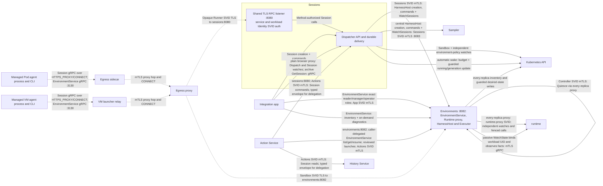

Managed Pod and guest callers receive `AGENTPLANE_SESSIONS_URL` at
`sessions.<namespace>.svc.cluster.local:8080`. The egress sidecar or launcher relay maps that
origin through central CONNECT and presents its Runner SVID to the Sessions listener. The central
proxy carries the destination TLS bytes opaquely. Sessions resolves the live workload credential and exact Identity UID
before applying the Session method rules. No Dispatcher audience token is projected
into Sandbox Pods. Backend checks of the Sandbox identity and
object UID remain authoritative; network reachability grants no Session authority. The Action Service
presents its service SVID on Dispatcher, History and EnvironmentService calls, including the opted-in
`EnvironmentService` list/get methods and its separately configured
`EnvironmentService.ResumeEnvironment` method. The receiver applies the caller identity from the
shared delegation envelope, then checks the current Sandbox and explicit Identity resume grant.
The lifecycle consumer watches PolicySets, PolicyBindings and Identities through its typed policy index;
a failed policy watch refuses explicit Identity resume while implied self-reads remain available.
Dispatcher constructs its own environment-policy index and watches for native Identity `CreateSession`
with `bind_session`; it records the placed Sandbox's exact live Identity as the Session principal,
and retains the effective creator and actor separately. These consumers share an evaluator library,
not an in-process index. The integration app uses its own Pod-bound
token as a distinct operator broker; it does not forward browser identity. Resume acceptance is not
readiness, and no resume path replays Session input or creates a grant.
Explicit resume is internal to Environments and accepts no wake budget. Dispatcher owns automatic
wake execution and PostgreSQL budgeting, preserving row attribution and applying `wakeOnSend` plus
the retained caller's policy or a configured service-broker check. An Action-attributed row uses the
Actions service actor's Dispatcher broker grant while retaining its effective Identity. Both owners
use the same `environments/lifecycle`
authorization and guarded-write code with independent policy views; Environments does not call
Sessions. Conflicts reread and reauthorize, while an uncertain patch outcome is never replayed.
The opt-in Session tools also forward the effective caller to Dispatcher commands and retained
History reads. Those receivers enforce their own same-principal checks; the existing
`orchestration_v1` broker path retains its separate authority.

Managed Pod, VM and Firecracker CLIs also receive `AGENTPLANE_HISTORY_URL`, set to the shared local
platform gRPC listener at `http://<local gateway>:3130`. Its History method route connects to
`history-service.<namespace>.svc.cluster.local:8080` with TLS. The sidecar presents the Sandbox
Workload SVID and verifies `HISTORY_SERVICE_URI`; the central proxy carries that TLS connection
opaquely. History authorizes the read against the exact Identity name and UID in the SVID. This path
uses no History bearer credential or projected audience token and adds no `reader_accounts` grant.

### Sessions and Environments admission

Sessions admits exact service SVIDs for Dispatcher component calls. Environments grants Runtime
proxy and Executor methods separately.
Dispatcher also admits live workload Identity SVIDs and configured service delegation.
EnvironmentService has its own receiver and separate reader, manager, launcher and operator grants.
App and Notifications have exact service-SVID automatic wake-broker grants, separately from
explicit operator resume. Dispatcher also configures Actions as a service wake broker for rows
carrying its Action proof. The Environments service has a separate wake-caller list for its own
assessments. Notification wake remains conditional on the target's wake-on-send policy.
When `orchestration_v1` is configured, the exact `spiffe://agentplane/actions` SVID also receives
Dispatcher component authority and EnvironmentService launcher authority. Both grants follow the
existing `actions.orchestration_callers` map; session delegation alone does not enable them. The
launcher handler allows template listing and environment creation with a complete Action launch
origin, while the Dispatcher role remains separate from operator authority. History's exact reader
SVID list includes Actions. Actions presents that SVID for both direct orchestration and
caller-delegated Dispatcher/History requests. Delegated calls retain their typed Action/Identity
envelope and the receiver checks the effective caller's authority. Sessions and Environments use
SVID admission without service-token projections or TokenReview RBAC. History's read and journal
paths admit workload or exact service SVIDs only.

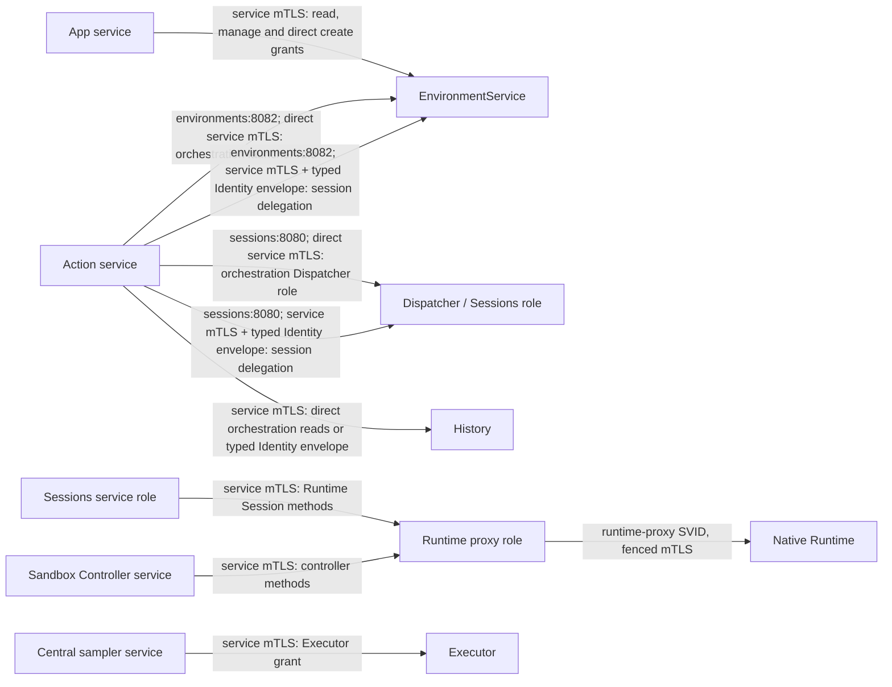

## Central code-mode sampling (opt in)

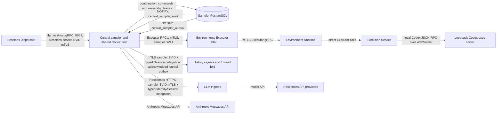

The sampler's TLS listener trusts the workload bundle and admits exactly
`spiffe://agentplane/sessions`, the owner stored by the explicit Gateway-account Session rewrite.
Sessions presents its role certificate and verifies the sampler server SVID.
Sampler application RPCs require the admitted Sessions service SVID. Bearer settings no longer
grant access. Application RPCs use only the TLS listener; port 8081 serves health checks only.

The staging picker gives direct Anthropic models only to the central sampler, keeping them out of the
subscription-backed Codex and Claude harnesses. The Anthropic key is copied by ESO from the existing
LiteLLM-owned secret and mounted only in the sampler container; Cilium pins direct API traffic to
`api.anthropic.com` and its TLS server name. Responses calls use the LLM ingress HTTPS endpoint with
the sampler's service SVID over mTLS and typed Identity/Session delegation. The ingress authorizes
the recorded effective Identity; the sampler certificate supplies only the actor proof.

The sampler lazily starts one shared Codex host process when code-mode work needs it and multiplexes
logical Sessions through it. The host retains per-Session `store()` / `load()` values across cells
and idle turns; each code-mode cell runs in a fresh V8 isolate with no shared JavaScript globals.
Provider continuation stays in the sampler. A resident replica keeps the Session's database
ownership lease and a lightweight driver/heartbeat while idle; this does not consume a
`max_live_sessions` active-execution slot. Any replica may admit commands, and a transactional,
payloadless `central_sampler_work` notification wakes local lease holders to query pending work.
The separate `central_sampler_outbox` notification wakes History export. Notifications carry no
Session or Pod routing, and startup scans, listener reconnect catch-up and periodic reconciliation
cover missed signals.
The Pod has aggregate CPU/memory limits, with no per-Session or per-cell kernel boundary today.
Environments proxies the sandbox-owned [Executor service](../env/runtime/execution/executor.proto) through Environment Runtime to Execution Service,
whose execution adapter owns the local
Codex JSON-RPC connection and native session handshake. A held `OpenSession` stream owns that
connection; process and file operations use unary RPCs. Native frames return as evidence for the
sampler's existing journal. No new persistence or operation receipts are introduced, and a lost
reply can still leave an operation outcome unknown. Dispatcher is absent from that tool path. Sandbox UID and incarnation fence the executor binding; v1 does
not replace an executor. An unavailable executor does not remove the sampler's persisted history
or prevent its control RPCs. Existing Dispatcher routing still requires the bound Sandbox object.

History retains source evidence and derives the lossy Thread display. Its entries are not a
provider continuation format: the sampler owns that state in its database. Wrapped native
harnesses keep their current local sampling, execution and persistence paths. See the
[standalone API and recovery contract](../sampler/SPEC.md).

### Sampler service admission

The sampler admits only explicitly configured Sessions service SVIDs and performs no TokenReview.
Service ownership is stored as the real SPIFFE ID, separately from ServiceAccount UID ownership.
The explicit Gateway-account ownership rewrite preserves the retained Session IDs and History
references before the caller switch. Sessions presents the same SPIFFE ID that was recorded for the owner.

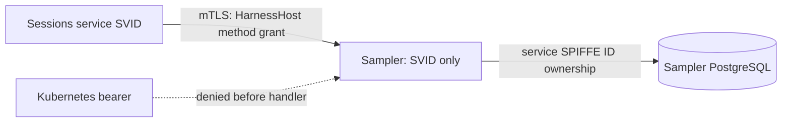

### LLM ingress certificate admission

Exact service SVID allowlists cover ModelConfig reads and the Central Sampler's typed inference
calls. A sampler actor must also prove the effective live Identity and Session in the delegation
envelope. Workload calls resolve the live credential's Identity; inference and ModelConfig never
admit Kubernetes bearers. A failed certificate cannot fall back to a token.

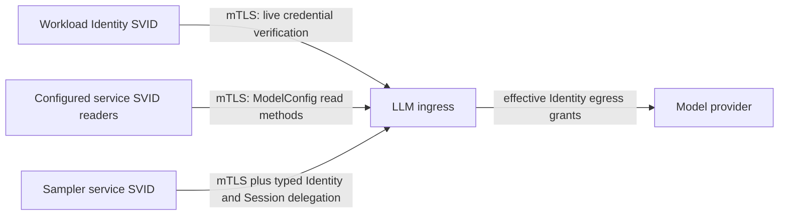

## Environment control and native Sessions

The Environments Runtime proxy, HarnessHost and Executor admit only exact component service SVIDs: configured Runtime
readers and Sessions for HarnessHost session inventory reads, Sessions for native Session creation, commands and
watches, Sandbox Controller for lifecycle operations, and Central Sampler for Executor methods. HarnessHost inventory
admits the union of `session_callers` and `readers`; existing EnvironmentRuntime diagnostics retain their configured
reader grants.
These are independent method grants. Caller configuration activates each edge only after its image
is pinned; the proxy's existing native Runtime mTLS identity remains separate.

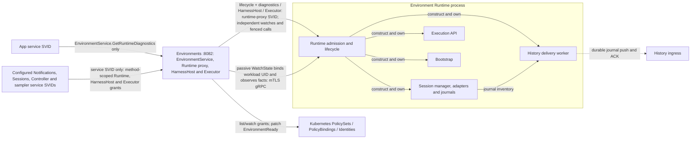

Runtime owns the components and one desired lifecycle revision. Native Session admission rechecks
that accepted revision and the fenced caller identity before durable work. Component observations
prove native cleanup; Execution fencing precedes journal sealing, and exact durable History ACKs
precede delivery/journal closure and owner release. Calls use the immutable Controller-bound
Sandbox and incarnation identity plus the Runtime boot ID. Central sampler remains
a separate control-plane process.

## Codex execution inside a Sandbox

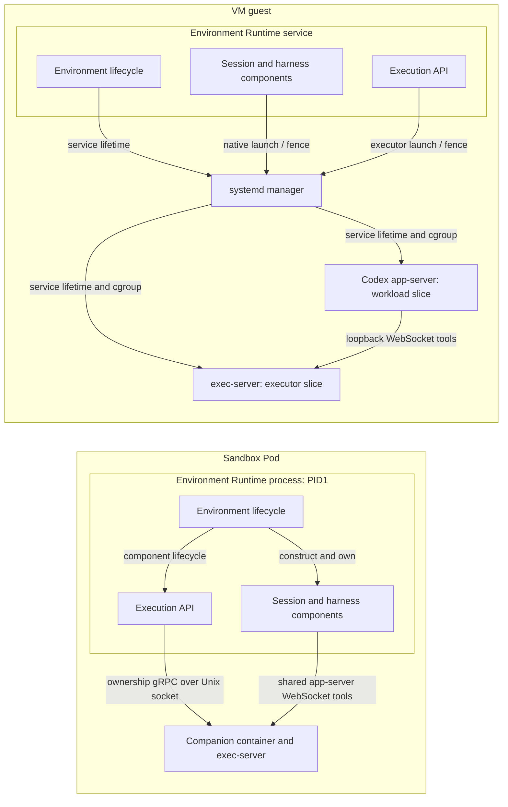

The Pod executor has a private PID namespace and Kubernetes resource limits. VM native processes use
separate service scopes and slice budgets. Both share Sandbox identity and filesystem paths with the
harness. Runtime aggregates process fence proof; Host cannot restart or fence Execution. An abnormal
Runtime exit requires the outer container fence before replacement. Local tools remain a deployment
mode. See [executor isolation](../env/runtime/execution/docs/codex_executor.md).

## Telemetry

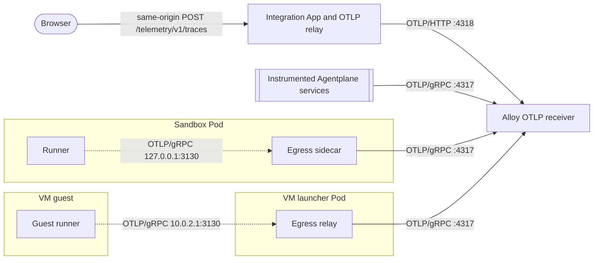

The browser exports protobuf traces to the same-origin App endpoint. The App fixes the upstream
receiver from its server-side configuration and forwards the bounded request to Alloy over OTLP/HTTP;
the browser cannot choose a destination. Instrumented backend services export OTLP/gRPC directly to
Alloy. Runners use an unauthenticated local gRPC route in their egress sidecar; VM guests use the
launcher relay at the guest gateway. Both relays forward to Alloy, and the sidecar and relay export
their own traces directly there as well.

## History and browser sync

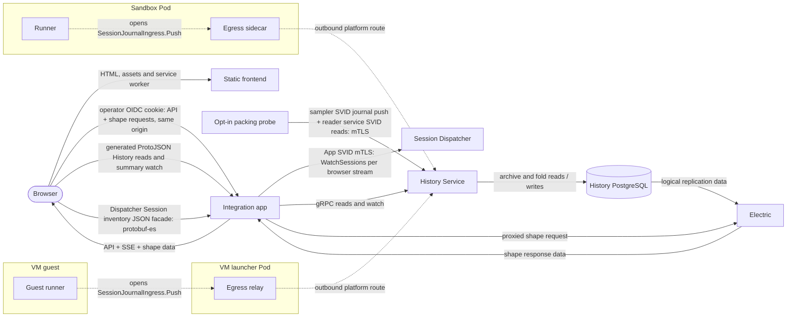

The App authorizes the Session inventory stream at its operator-only browser login boundary and
ends it on logout or expiry. The proxied Dispatcher watch supplies membership and materialization;
App metadata supplies titles/archived state, and History supplies conversation and existing activity
observations. No browser connects directly to Dispatcher; there is no ListSessions bootstrap.

The app initiates each Electric HTTP request and streams the shape response through to the browser.
Generated History HTTP routes at the app's `/upstream/history/v1/` prefix let the browser call
annotated History reads and summary watches; the app forwards them over gRPC with its service SVID
over mTLS. The browser joins these with Dispatcher inventory and App-owned titles/archived state;
there is no App History relay or membership cache.
The separate `History PostgreSQL → Electric → app → browser` arrows show replicated and returned data.
The HTTPS Gateway routes static files directly to the frontend Service and all API, login and stream
requests to the app Service. The frontend has no backend credentials and makes no outbound service
calls; its History reads use the app's same-origin facade.

## Notifications

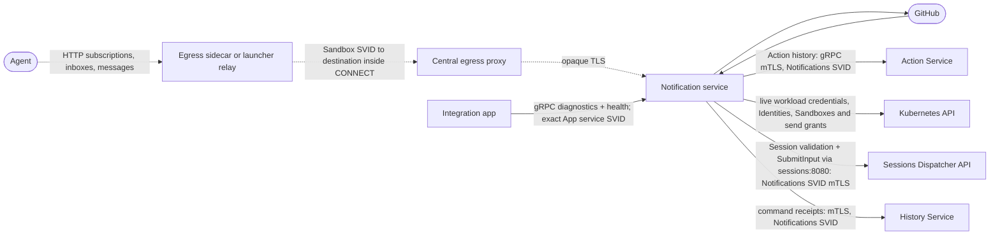

Sandboxes keep their existing HTTP service URL. Their sidecar or relay recognizes the exact origin,
opens CONNECT through the central proxy, and presents the Runner SVID to Notification's shared TLS
RPC listener. Notification resolves the credential's current Identity name and UID and preserves the
existing Session and Sandbox ownership checks. The receiver rejects Kubernetes bearer credentials and
performs no TokenReview. It accepts the exact App service SVID only for the five read-only Session
diagnostic methods. That service grant never supplies an agent Identity or permits inbox mutation.

The Notification service does not call the integration app, which watches subscription and notice
state over the diagnostic methods of the `Notifications` gRPC service. GitHub sends it signed webhooks; it
makes GitHub App REST calls, reads receipt evidence from History before retrying a delivery, and
submits every runner notice through the Session Dispatcher. It authorizes a message against the
PolicySets and PolicyBindings it watches, and asks History which Sandbox wrote a Session before a
message opens that Session's inbox.

## Actions and egress

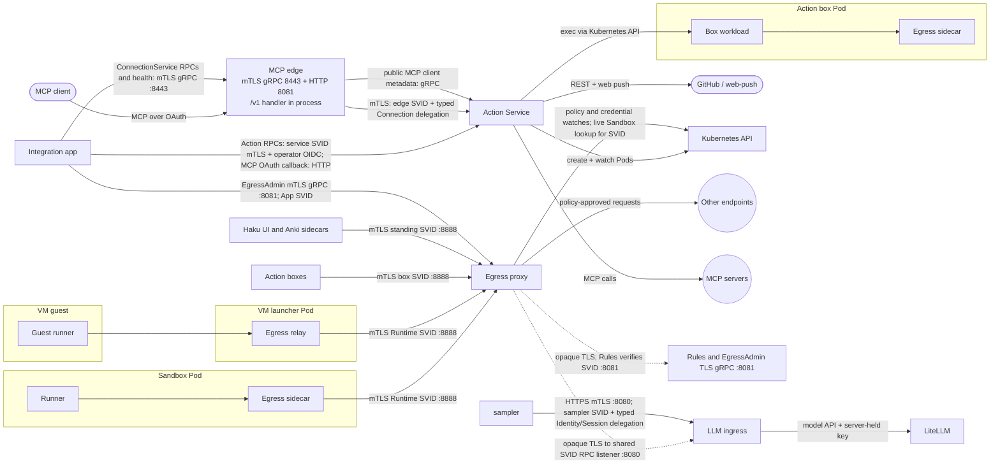

The required mTLS hop resolves the SVID's live `WorkloadCredential` before using its subject
ServiceAccount as the policy subject; no bearer authenticates it. Rules uses that same
authentication policy
and terminates TLS through an opaque central tunnel;
the proxy never asserts the caller. History, Notifications, Sessions and Actions apply their
own method authorization. LLM ingress authenticates
workload and service SVIDs on its primary TLS listener, with no bearer admission. With `service_callers` configured, the central sampler's TLS listener
presents its service SVID and admits exact service peers. Its History exporter presents the
sampler SVID with typed Session delegation for the effective Identity. Only LLM ingress holds the LiteLLM key.
The Qwen Chat Completions canary posts to `/v1/chat/completions` over this hop. LiteLLM forwards it
to TabbyAPI using the same Qwen model as the existing Responses route.
Kubernetes retains its destination-scoped projected token until the later impersonation cutover.
Rules, Notification, ModelConfig and telemetry share the local gRPC listener on port 3130; exact
service prefixes select independent upstream connections and authentication.

EgressAdmin admits only the exact configured service identities over mTLS. The App presents
`spiffe://agentplane/app`; bearer credentials cannot authenticate its admin reads.

Action command/build boxes present their own `WorkloadCredential`'s SVID, subject their caller's
ServiceAccount; Haku UI/Anki present their standing records' SVIDs, subject `haku-ui`. Their
sidecars alone hold credentials. The later shared
identity and SVID lifecycle is independent of Sandboxes; no Identity/account cutover is included
here. Existing Sandbox processes need recreation to read the new mode/route configuration; image
updates alone do not replace running Pods.
The app has independent `action_federation.service_url` and `connection_service_url` settings.
Both tiers send operator Connection calls and gRPC health probes to the [MCP edge](../mcp_edge/README.md).
Staging's external MCP/OAuth routes terminate there too, preserving the public issuer/resource URLs.
Actions retains upstream MCP linkage and its public client metadata. The edge verifies operator OIDC separately from
external MCP bearers, then calls Actions with its exact service SVID and typed Connection/grant provenance. It sends no
Action audience bearer and has no bearer fallback. Its gRPC listener on port 8443 checks the App
service SVID against the workload CA; operator OIDC remains required for App's operator methods and
is separate from the edge's Connection delegation. The App uses that TLS listener.

## Action Service certificate callers

The Actions receiver accepts exact App and Notifications service SVID grants and live workload
Identity SVIDs. Kubernetes TokenReview bearers grant no admission. App operator calls also require
independently verified operator OIDC; Notifications receives read-only request access. MCP edge
presents its exact service SVID with typed Connection delegation, and Session delegation likewise
requires its configured service actor. Delegation keeps the service actor separate from the effective
Identity, whose grants and live UID govern the call. Public OAuth and client metadata endpoints retain
their method-specific authentication exceptions.

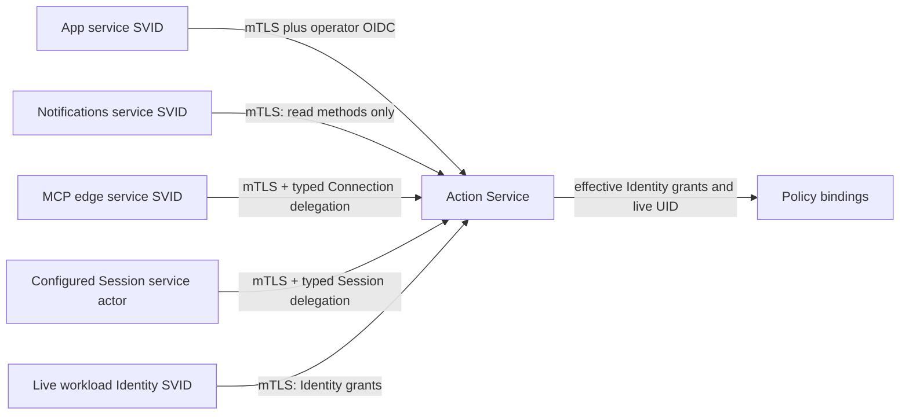

## Service definitions

- gRPC: [Actions](../action_service/api/contracts/action_service.proto), [operator Actions](../action_service/api/contracts/operator_action_service.proto), [Connections](../mcp_edge/api/connection/connection_service.proto), [Web Push](../action_service/api/web_push/web_push_service.proto), [Environment Service](../environments/v1/environment_service.proto), [Environment Runtime](../env/runtime/control/environment_runtime.proto), [HarnessHost](../harness_host/harness_host.proto), [Executor](../env/runtime/execution/executor.proto), [SessionJournalIngress](../history_service/api/ingress/session_ingress.proto), [Session Dispatcher](../session_dispatcher/dispatcher/api/session/session_dispatcher.proto), [History Service](../history_service/api/history/history_service.proto), and the [Notification Service](../notification_service/api/notifications/notifications.proto) API (whose HTTP annotations generate the App browser facade; the service itself serves workload calls over gRPC). Sessions serves Dispatcher and standard gRPC health, and Environments proxies the Environment Runtime, HarnessHost and Executor services over direct mTLS connections.
- HTTP and streaming APIs: [Integration app](../app/) (Bazel target: `//agentplane/app/cmd:agentplane-app`), [Electric proxy](../app/internal/electricproxy/electric.go), [Action Service generated facade](../action_service/api/contracts/action_service.proto), [LLM ingress](../llm_ingress/internal/server/server.go), and [Git index](../x/indexing/app.py).
- Controllers and egress: [Sandbox Controller](../environments/internal/controller/controller.go), [Policy Controller](../policy_controller/internal/controller/controller.go), [central egress proxy](../egress/internal/proxy/proxy.go), [Go sidecar](../egress/sidecar/cmd/main.go), and [sidecar route configuration](../egress/platform_routes.py).

## Runtime proxy caller identity

Runtime admits `spiffe://agentplane/runtime-proxy` for control and Executor calls.
Sessions calls the Environments proxy with its own SVID. The Controller uses its separate
SVID for passive observation.

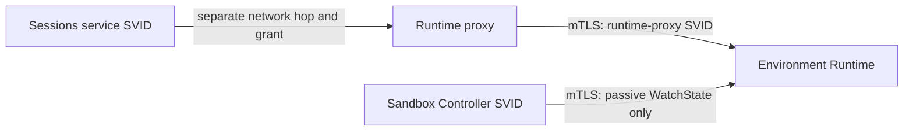

## Policy and Egress Admin certificate admission

The Policy TLS listener verifies client SVIDs against the workload CA and grants the exact App SVID
separate reader and writer authority. App→Policy presents the App SVID over verified mTLS.
PolicyService accepts only service SVIDs; bearers, workload SVIDs and delegation envelopes are refused.
Egress Admin admits only configured service SVIDs, and the App uses its SVID over mTLS. The forward proxy continues
to authenticate workload Identities independently of its admin API.

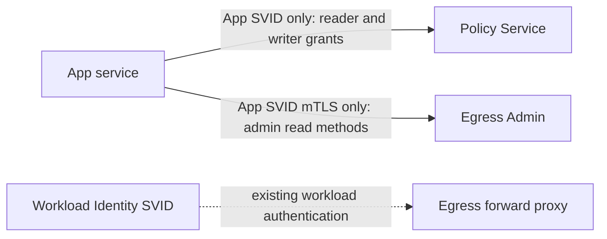

## Dispatcher and EnvironmentService service grants

The Sessions listener admits the exact App and Notifications service SVIDs to the
Dispatcher, and Actions when `orchestration_v1` grants it the component role. Its live workload
Identity SVID path and typed service delegation remain; Kubernetes
bearers grant no admission. The App SVID separately has EnvironmentService
inventory and management grants. Staging explicitly grants the App SVID resume and automatic
wake authority; these grants are independent of delegation and direct Dispatcher admission.
Actions has its own Dispatcher automatic-wake broker grant for Action-attributed rows. The
Environments service's wake assessment list remains separate. Actions service grants and delegated
Resume require their own reviewed configuration.

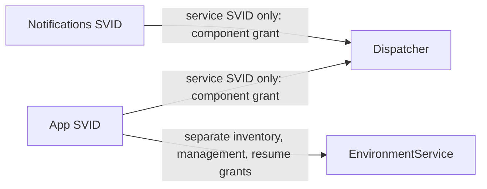

## Actions service delegation to explicit environment resume

The EnvironmentService receiver can admit an explicitly configured Actions service SVID with
the typed Action delegation envelope for `ResumeEnvironment`, in addition to its four delegated
read methods. The effective Identity's current environment resume grant remains the authority;
the actor certificate never grants operator authority or waives `resume_token`. Environments keeps
its separate wake assessment list; Dispatcher Action-attributed rows use its Actions service broker
grant. This receiver capability requires
a pinned image before configuration grants it to Actions; caller activation follows separately.

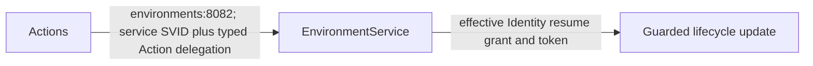

## Sessions role to the Runtime proxy

The Dispatcher delivery worker presents its separate `spiffe://agentplane/sessions` certificate
when dialing `environments:8082`, independently of which proxy replica watches the
Runtime. It verifies the receiver's `spiffe://agentplane/sandbox-controller` server certificate. The receiver grants HarnessHost creation, commands and current-state watches to that role. The Dispatcher uses the same HarnessHost client for hosted and central delivery.
Sessions presents the same certificate to the central sampler, which records this SPIFFE ID as
the service owner. A rollback to bearer requires the reviewed reverse ownership Job.

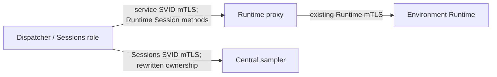

## Environments Runtime transport receiver

The `environment_service.runtime_proxy` configuration enables Runtime proxy, HarnessHost and
Executor on each replica at `environments:8082`. Each replica maintains its own routing inventory
and callable Runtime watches. Exact method grants separate Sessions delivery, central sampler
Executor calls and Controller lifecycle operations. App diagnostics use EnvironmentService on
the same listener. Dispatcher calls go to `sessions:8080`.
