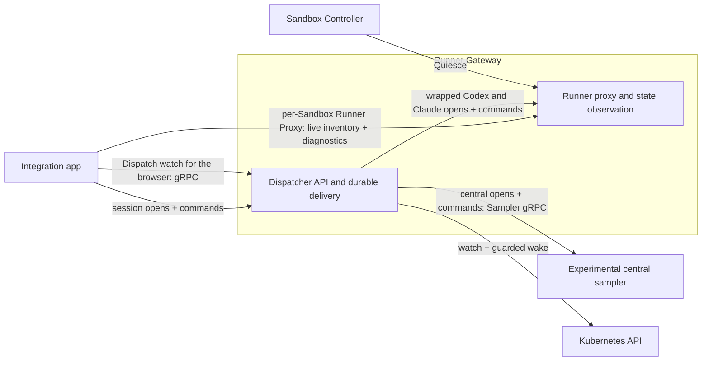
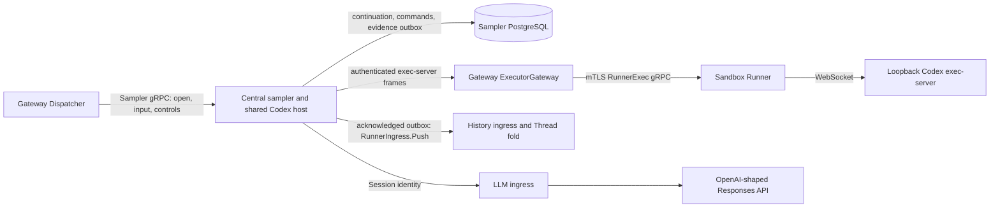
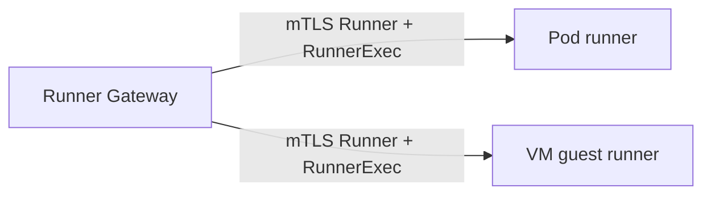
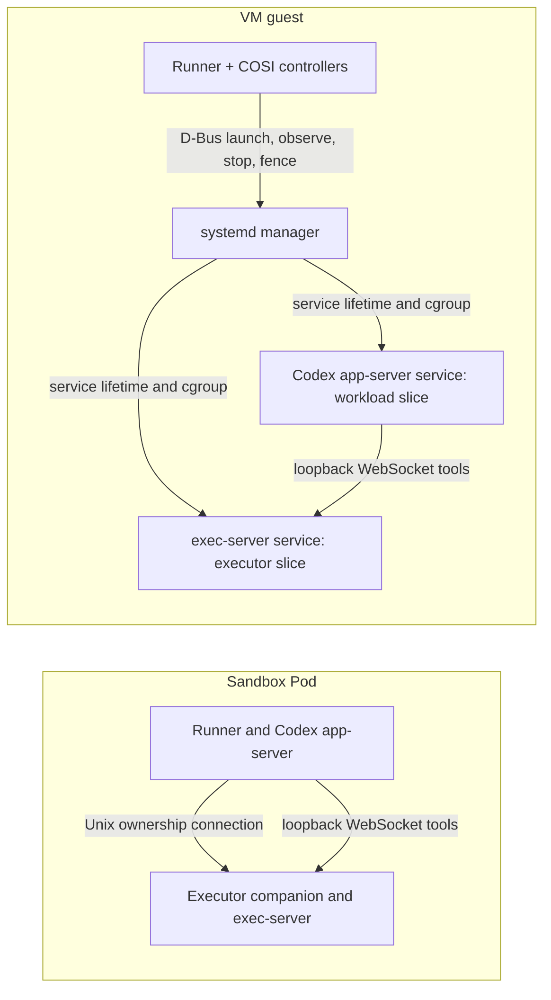
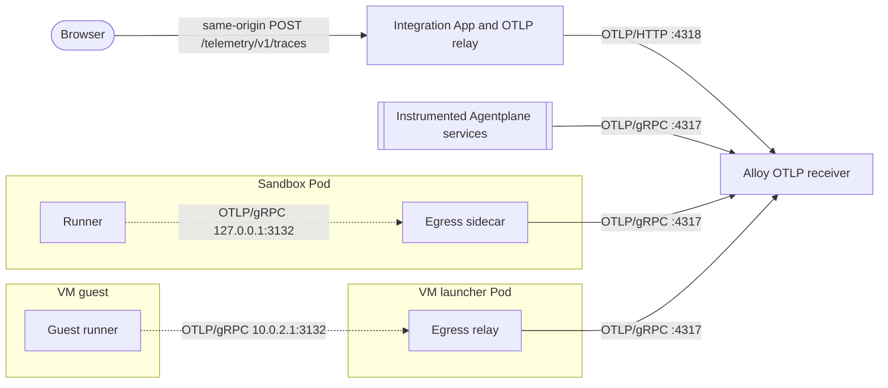
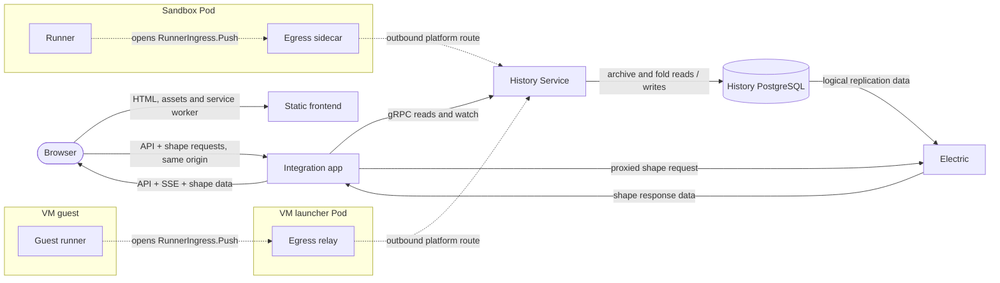
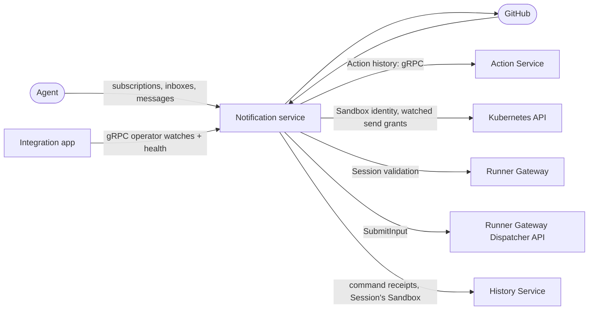
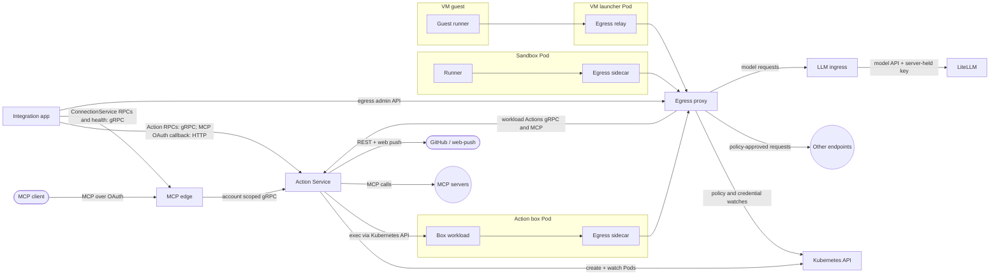

# Agentplane system overview: focused diagrams

Per-path detail for the [README system overview](../README.md#system-overview), same conventions:
API arrows point caller to callee, labels like `response` or `replication` show data on that edge,
dashed arrows are runner-initiated platform routes.

The optional central sampler runs as its own Deployment and Service in staging and the
[k3s acceptance scenarios](../system_tests/README.md#central-sampler), using the shared cdk8s
construct, its own image and projected service-account credentials.

## Session delivery

## Central code-mode sampling (opt in)

The sampler lazily starts one shared Codex host process when code-mode work needs it and multiplexes
logical Sessions through it. The host retains per-Session `store()` / `load()` values across cells
and idle turns; each code-mode cell runs in a fresh V8 isolate with no shared JavaScript globals.
Provider continuation stays in the sampler.
The Pod has aggregate CPU/memory limits, with no per-Session or per-cell kernel boundary today.
Gateway relays the pinned upstream exec-server protocol without interpreting tools. Dispatcher
is absent from that tool path. Sandbox UID and incarnation fence the executor binding; v1 does
not replace an executor. An unavailable executor does not remove the sampler's persisted history
or prevent its control RPCs. Existing Dispatcher routing still requires the bound Sandbox object.

History retains source evidence and derives the lossy Thread display. Its entries are not a
provider continuation format: the sampler owns that state in its database. Wrapped native
harnesses keep their current local sampling, execution and persistence paths. See the
[standalone API and recovery contract](../x/central_sampler/SPEC.md).

## Runner control

The Gateway dials native gRPC and a state watch on each runner. Incarnation fencing, connection
Leases and command IDs protect runner-owned journals. History push remains a separate outbound platform route.

## Codex execution inside a Sandbox

The Pod executor has a private PID namespace and Kubernetes resource limits. The VM executor has a
sibling systemd slice budget. Both share the Sandbox's identity and filesystem paths with the harness.
Runner owns restart and fences old commands before reopening Session state or sealing journals.
Local execution remains a deployment mode. See [executor isolation](../runner/docs/codex_executor.md).

## Telemetry

The browser exports protobuf traces to the same-origin App endpoint. The App fixes the upstream
receiver from its server-side configuration and forwards the bounded request to Alloy over OTLP/HTTP;
the browser cannot choose a destination. Instrumented backend services export OTLP/gRPC directly to
Alloy. Runners use an unauthenticated local gRPC route in their egress sidecar; VM guests use the
launcher relay at the guest gateway. Both relays forward to Alloy, and the sidecar and relay export
their own traces directly there as well.

## History and browser sync

The app initiates each Electric HTTP request and streams the shape response through to the browser.
The separate `History PostgreSQL → Electric → app → browser` arrows show replicated and returned data.
The HTTPS Gateway routes static files directly to the frontend Service and all API, login and stream
requests to the app Service. The frontend has no backend credentials or outbound service calls.

## Notifications

The Notification service does not call the integration app, which watches subscription and notice
state over the operator-only `NotificationsOperator` gRPC service. GitHub sends it signed webhooks; it
makes GitHub App REST calls, reads receipt evidence from History before retrying a delivery, and
submits every runner notice through the Session Dispatcher. It authorizes a message against the
PolicySets and PolicyBindings it watches, and asks History which Sandbox wrote a Session before a
message opens that Session's inbox.

## Actions and egress

The egress proxy substitutes a configured credential only for the destination covered by its
policy. LiteLLM is a separate hop behind LLM ingress; only that service holds the LiteLLM virtual key.
The app has independent `action_federation.service_url` and `connection_service_url` settings.
Both tiers send operator Connection calls and gRPC health probes to the [MCP edge](../mcp_edge/README.md).
Staging's external MCP/OAuth routes terminate there too, preserving the public issuer/resource URLs.
Actions retains upstream MCP linkage and its public client metadata; it no longer serves staging's
integrated ConnectionService or OAuth issuer. The edge verifies operator OIDC separately from
external MCP bearers and forwards workload calls under the bound ServiceAccount's token.

## Service definitions

- gRPC: [Actions](../action_service/action_service.proto), [operator Actions](../action_service/operator_action_service.proto), [Connections](../mcp_edge/connection_service.proto), [Web Push](../action_service/web_push_service.proto), [Runner RPCs](../runner/runner_service.proto), [RunnerIngress](../history_service/runner_ingress.proto), [Session Dispatcher](../runner_gateway/dispatcher/session_dispatcher.proto), [History Service](../history_service/history_service.proto), and the Notification Service's [workload](../notification_service/notifications.proto) and [operator](../notification_service/notifications_operator.proto) APIs (the workload API also has an HTTP form). The Runner Gateway also serves standard gRPC health and proxies the Runner service over a direct mTLS connection to each runner.
- HTTP and streaming APIs: [Integration app](../app/api.py), [Electric proxy](../app/electric.py), [Action Service generated facade](../action_service/action_service.proto), [LLM ingress](../llm_ingress/server.go), and [Git index](../indexing/app.py).
- Controllers and egress: [Sandbox Controller](../sandbox_controller/controller.go), [Policy Controller](../policy_controller/controller.go), [central egress proxy](../egress/proxy/proxy.go), [Go sidecar](../egress/sidecar/main.go), and [sidecar route configuration](../egress/sidecar/configpb/config.proto).
