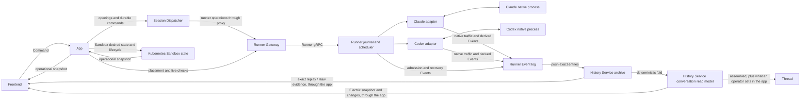
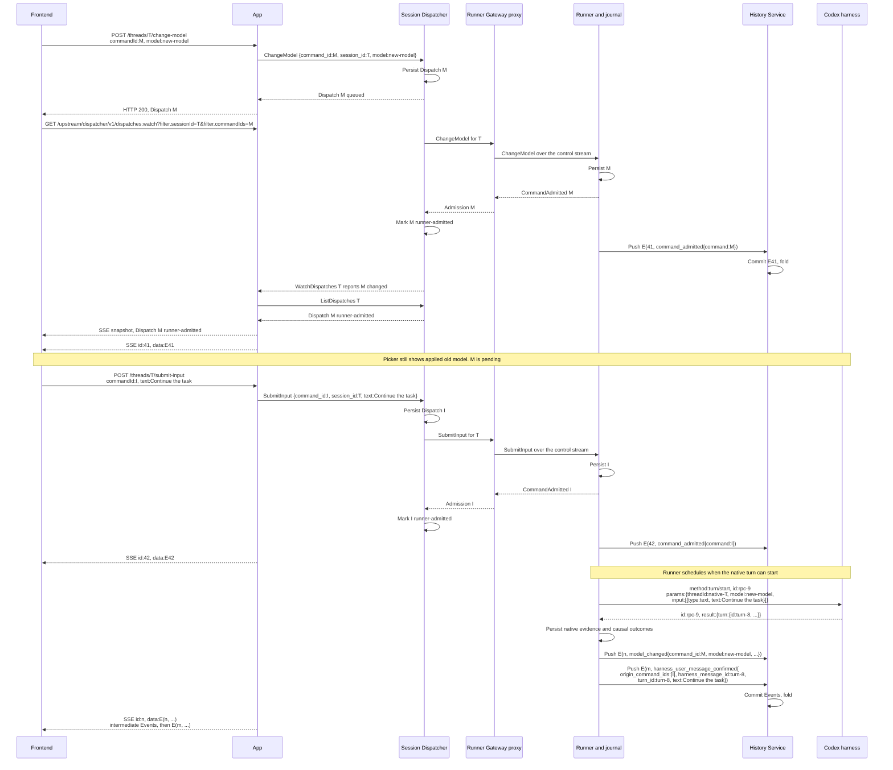
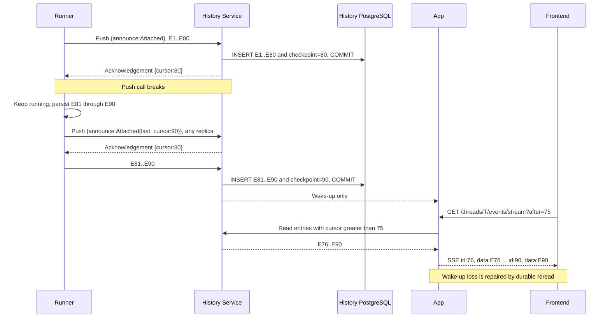
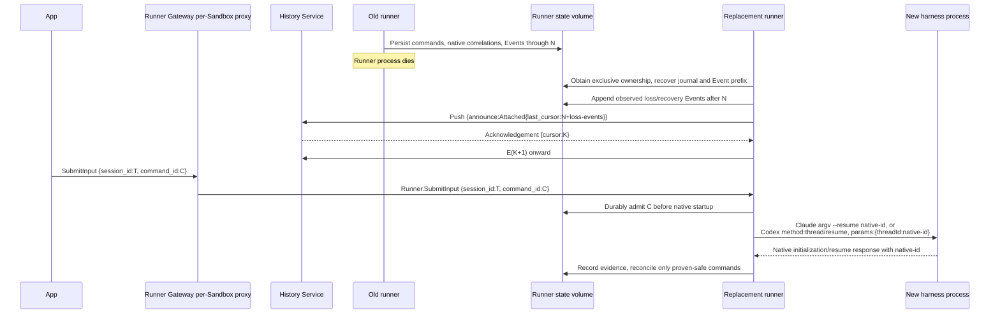

# Thread, runner, and harness layering

Status: **cross-layer design under review.** The app opens Sessions and submits commands through
Session Dispatcher; History owns retained Session/Thread views; Runner Gateway owns runner
state observation and the authorized live Runner proxy. The materialized Thread projection and Electric-backed
conversation sync described in [Thread view synchronization](thread_view_sync.md) are implemented;
remaining acceptance gates are in [conversation acceptance](../debug/conversation_acceptance.md).
This document covers identity, durability, command handling and presentation, while the
[runner specification](../runner/SPEC.md) describes the implemented runner contract. It does not
claim every recovery case works today. Protocol changes are atomic monorepo cutovers, with no
old-runner/data compatibility.

## Sandbox isolation boundary

The **Sandbox**, not an individual Thread or Session within it, is the security isolation
boundary. Sessions co-resident in a Sandbox share filesystem, workspace, credentials and the
Sandbox's ServiceAccount authority. Do not claim confidentiality or independent execution
permissions between them, even if their histories have different read labels or their harnesses
run as different processes. Admit Sessions with incompatible trust or credential requirements
only into separate Sandboxes. No sandboxing-within-a-Sandbox is planned; a future change to this
boundary would require its own isolation mechanism and a separate security review, not a new
Session label or archive ACL. Scoped archive reads can restrict _external_ callers, but cannot
isolate co-resident processes. Nothing enforces compatible placement yet; a scoped-read policy would
need it at Open, adoption and replacement.

## Product requirements

Agentplane manages Sandboxes and presents Threads as conversations. A user must be
able to trust what the page says:

- A saved input remains recoverable after reload and app restart.
- Submission, runner admission, native message confirmation, and completed model
  output are different facts. A model picker changes its applied value only on
  evidence of application; an interrupt request is not yet a stopped turn.
- The runner continues executing and recording while the app is unavailable.
- The History Service retains history after the Sandbox is deleted.
- Native traffic remains inspectable on demand even when normal conversation sync omits it.
  The initial design retains it losslessly; optional retention controls are a separate,
  deferred contract, never an implicit consequence of filtered delivery.
- Sandbox lifecycle, connection health, and native harness state remain distinguishable.
- The simple workflow is preset, message, Enter. The Session Dispatcher durably accepts work while
  a Sandbox is not ready and delivers it when the runner is available; a queued command is not proof
  of runner admission or harness effect.

Presets literally pre-fill editable fields, including Sandbox template, model,
standing instructions, egress policies, and action policy sets. Manual creation of a
Sandbox without a Thread and manual lifecycle/inspection surfaces remain useful.

## Authorities and representations

A **Session** is the raw Event stream: harness messages, protocol reconciliation chatter and
everything else the runner journals. A **Thread** is the conversation-style projection of a
Session, its messages and the like. Names follow that split wherever the data lives: the fold's
tables are `thread_*` in the History Service too, although they are keyed by public Session ID.



The runner is the harness-neutral command/event boundary. Its two adapters interpret
Claude and Codex semantics; they preserve the native messages they observe as well as
derived Events. Unknown native messages remain available for debugging. Derived facts
cite their native evidence. An outbound native frame records an attempted write, not
proof that the harness received or acted on it.

“Lossless” applies to retaining observed protocol traffic alongside its interpretation.
The common conversation projection is intentionally lossy. Neither the raw log nor
that projection claims to contain hidden harness state, every system prompt, or the
exact LLM API conversation. The runner also cannot preserve a native frame it never
received. Mocked-LLM tests observe a further boundary and establish what native receipts
actually prove. See the [scripted harness capability index](../native/README.md#behavioral-coverage)
and its linked protocol-specific test cases.

The normal conversation view reads the materialized Thread projection through the implemented
[conversation-view sync](thread_view_sync.md). The exact archive remains available for replay and
Raw evidence; the projection does not change runner Events or command admission.

| Representation                       | Authority and identity                                                                                                                                             | Ordering                                                                                       |
| ------------------------------------ | ------------------------------------------------------------------------------------------------------------------------------------------------------------------ | ---------------------------------------------------------------------------------------------- |
| Native conversation                  | The selected harness; native ids and resume artifacts                                                                                                              | Harness-defined; not portable between Claude and Codex                                         |
| Thread                               | Assembled from one Event log: the conversation view projected from its Events, under the log's id and stable URL, plus the name and archive state an operator sets | Its Event log's sequence, as the conversation view presents it                                 |
| Runner session / harness incarnation | Attachment and execution provenance within an Event log                                                                                                            | Does not create a new conversation or a new Event counter                                      |
| Runner command journal               | Exact immutable `Command`, identified by `command_id` within its execution scope                                                                                   | Serialized admission; operation-specific execution                                             |
| Runner Event log and history copy    | Runner appends and pushes; the History Service keys the copy by the public Session ID, bound to the pushing ServiceAccount, and persists the same `EventEntry`     | One sequence per log across supported harness incarnations; history and browser track prefixes |
| Sandbox and bootstrap state          | Kubernetes desired/observed objects; bootstrap's own log                                                                                                           | Separate operational state, with its own provenance                                            |
| Conversation view                    | Pure projection of runner Events                                                                                                                                   | Cards anchored to their causal Event; streaming may compact several Events                     |

One Sandbox can host multiple Threads. A Thread may resume through several harness
processes on that Sandbox. Current runner storage calls its durable, resumable container
a “session”; it already spans process restarts. That existing name does not establish
the target product Thread/incarnation relationship. The Gateway has no Session placement registry;
it resolves proxy destinations from current Sandbox identity and connection state. History separately
records the writer's namespace and name.
App commands use the Thread's stored Sandbox name and send it to Dispatcher, which records the current
Sandbox UID without checking the Session's earlier association. The complete Session-to-incarnation
authority across opens, commands and resume remains under review in the
[service-boundary contract](service_boundaries.md).

A Thread is a view/fold of one durable logical Session's Event log, with its own
operator-set presentation; it is not a second execution source. Its id is the client-minted public
Session UUID submitted through Dispatcher `OpenSession`. History materializes an empty Thread view
once it retains the authenticated runner admission, even before any Event exists. A catalog entry
or Dispatcher queue receipt alone does not establish that view. At cursor zero there is no Event
source, native process or effective model/effort to infer. The first real Event binds the fold's
source; later Events must keep that source. Opening the view never starts a native process.
Without this empty admitted state, lazy startup deadlocks the composer: rendering waits for a
native Event that cannot occur until the user can submit input. Nonempty history still requires
its verified folded prefix; an empty view must never replace a stalled or existing projection.
A suspend/resume on retained storage reuses that Session ID,
native conversation, and Event sequence; a fresh harness process is an incarnation,
not another Session. Runner restart tests verify the identical ID and contiguous
Event prefix after crash and SIGTERM; the Sandbox suspend/resume acceptance exercises
both harnesses after Pod replacement. For the one-Thread-per-Session model, adopt one
globally unique stable ID for the logical Session and its Thread view. Sharing an ID
does not give a live Session caller permission to read the archive; Sandbox, process,
and native harness identities remain separate. A portable runtime may retain this
ID across Sandboxes only if it restores the same fenced journal and native state;
separate copied-state tests gate that claim. For existing histories, keep the
app UUID as the canonical public ID. History currently retains Sandbox namespace/name; any migration
to preserve the prior Session-to-incarnation association must retain recorded UIDs and leave missing
UIDs unknown instead of inferring them. The runner ID remains the physical storage/runtime locator: its
native files, directories, and workspace paths need no rekey. The client mints its
Session's UUID, which is the runner locator too. A future multi-Session Thread would
need a new explicit model rather than overloading this one-to-one identity.

Resume and command take the public ID, and replay reads the History Service by that ID. A legacy row
whose Sandbox UID was never recorded stays readable but cannot be resumed or polled. Each Session
keeps one Event counter, the runner's cursor, contiguous from 1 in the history archive.

A runner's Event sequence goes into a Thread but is not itself the Thread. The runner pushes
the Session's Events, with its feed state, to the History Service's ingress, which stores them
under the public Session ID and folds the conversation view from them. The Thread is assembled
from that log: the History Service's conversation view under the log's id, plus what an operator
sets in the app (a name, and whether it is archived).

## What storage guarantees

The runner already has a command journal, Event log, and native resume artifacts.
These serve different purposes: retaining requested work, replaying observed facts,
and restoring the harness's own conversation. The History Service's copy supplies
history while a runner is unreachable and after its Sandbox has gone away.

### Command protocol: intent, admission, then outcome

| Fact                | Evidence                                                                                                             | Meaning                                                     |
| ------------------- | -------------------------------------------------------------------------------------------------------------------- | ----------------------------------------------------------- |
| Local submission    | Browser retains the exact command and id                                                                             | Awaiting durable Dispatcher confirmation                    |
| Dispatcher queued   | Committed Dispatcher record returned as a `Dispatch`                                                                 | Sender intent is durable; runner admission is not implied   |
| Runner admitted     | Durable runner journal and `CommandAdmitted`, which includes the full `Command`                                      | Runner owns processing; no native effect is implied         |
| Effect              | Causal `HarnessUserMessageConfirmed`, `ModelChanged`, interrupted `TurnCompleted`, or command-caused `HarnessExited` | The specifically evidenced operation took effect            |
| Terminal non-effect | `CommandFailed` or `CommandNoop`, with reason                                                                        | The command will not subsequently take effect in that scope |

A network write, timeout, or disconnected attachment is not one of the terminal
outcomes. Absence of an observed admission means “admission not observed,” not
“definitely never reached the runner.”

Retrying the same id and payload against the Dispatcher returns the same durable record; the worker
delivers with the same id to the runner, whose journal returns the original admission. A different
payload under a known id is rejected at the corresponding owner. This transport property
does not by itself make native execution exactly-once across a crash. The difficult
window is native execution followed by a runner crash before durable evidence of that
execution. Recovery needs native correlation/history or a native idempotency mechanism.
Blindly invoking the native operation again cannot supply the guarantee.

Saved input remains inspectable even if continuation is blocked. Unproven recovery
must expose its last durable facts and the blocked operation; it cannot invent success,
failure, or safe-to-retry status. A generic “uncertain” terminal outcome adds no proof.
Operations only become automatically recoverable after tests establish that recovery.

### Runner independence and Event durability

The target log must be an immutable prefix across replay, process restart, and the
declared storage failures. Every published entry, including Native frames and streaming
deltas, must survive the supported restart boundary and retain its cursor. Persist
before publication; batching may amortize synchronization but publication must wait
for the batch's durability fence. Losing an already published tail can otherwise
reuse cursors for different facts. The runner commits every public entry through
its SQLite durability fence.

The History Service's ingress commits pushed entries and advances the Session's contiguous
checkpoint in the same transaction, and acknowledges only after commit. Duplicate entries must
agree in payload and provenance; a conflicting entry is refused, never hidden. Readers are woken
only after commit. Lost wake-ups trigger rereads, not loss of history.

Neither the app nor the History Service being unavailable stops a runner. Runner-local
storage permits independent progress, and the push resumes after the last acknowledged cursor. Storage exhaustion must
surface explicitly and stop accepting more work before the runner cannot record it;
silently trimming unreplicated history violates this contract.

### One Event high-water mark per log across harness sessions

There is one runner-owned sequence per Event log, and so per Thread, continued from
its durable journal through supported runner/harness restarts. The History Service's checkpoint
says how much it has stored; the browser checkpoint says how much it has consumed. They are
positions in the same sequence, not additional Event counters.

Only one runner writer may own a log's journal at a time. Local storage ownership
and replacement handoff must fence the old writer before a successor appends or
retries commands. Fencing the copy into PostgreSQL does not fence native execution or
two runners writing the same log.

A copied high-water mark alone cannot recover lost runner state. The runner might
have emitted an unpushed suffix while the History Service was unreachable. Starting a replacement
at “history high-water mark + 1” could reuse those positions and says nothing about lost
commands or native history. Restore the authoritative journal and recovery state
before continuation. If that is impossible, retain the known history prefix and report
the unavailable history/recovery; do not silently manufacture continuous history.

### Storage loss and Sandbox lifecycle

Process restart with a surviving state volume is the supported recovery foundation.
Total loss of that volume while the History Service lacks its tail is a different failure class;
the Dispatcher preserves queued command intent but cannot recreate missing output or native
resume artifacts.

Managed suspension must preserve the runner state and allow the tested shutdown/resume
path. Kubernetes readiness does not prove native resume. The checked-in Sandbox
operating model removes the Pod on suspension and keeps its workspace PVC; processes
must be re-established. Verify the actual template's state mount and harness artifacts.

Managed deletion fences new work, seals every Session, and deletes the Sandbox only once the History
Service's ingress has acknowledged every seal. The Sandbox Controller coordinates sealing and
deletion; the app submits the request through Kubernetes. While the runner is unreachable the
Sandbox stays sealing. Externally deleting the only remaining storage while the History Service is
behind cannot carry a no-loss guarantee. A Thread's archived page still displays the history the
History Service has.

## Command queue ownership

The Session Dispatcher is the sender-facing durable queue for openings and commands. The app server
stores Thread presentation state; the browser keeps unconfirmed submissions locally. The app sends
commands to Dispatcher and reads queued/delivering/admitted results. Dispatcher wakes an eligible
suspended Sandbox, waits for `Ready`, and delivers through the Runner Gateway proxy. A queued
`Dispatch`, a runner `CommandAdmitted`, a History observation and a native effect remain separate
facts. The app has no second command queue; the Gateway has no independent command queue.
See the [Runner Gateway](../runner_gateway/README.md) and
[Session Dispatcher](../runner_gateway/dispatcher/README.md) for current service ownership and callers.

### Message sketches used below

Arrows use abbreviated protobuf text, not new message types. For example:

```text
M = Command { command_id: "M", change_model: { model: "new-model" } }
I = Command { command_id: "I", submit_input: { text: "Continue the task" } }
C = Command { command_id: "C", submit_input: { text: "Inspect this workspace" } }
X = Command { command_id: "X", interrupt_turn: { turn_id: "turn-7" } }

E(41, command_admitted { command: M }) = EventEntry {
  cursor: 41
  origin: { source_id: "opaque-thread-log-id", sequence: 41 }
  event: {
    at: <runner timestamp>
    command_admitted: { command: <full M above> }
  }
}
```

`E(n, observation)` always carries the full envelope above. `origin.sequence` and `cursor`
have the same value; they do not advance independently. The app submits the command through the
Session Dispatcher and receives a durable `Dispatch`; the Dispatcher delivers to the runner through
the Gateway proxy, and the runner later pushes `CommandAdmitted` and other entries to History with
`RunnerIngress.Push`. HTTP/SSE carry generated payloads in protobuf JSON. Native sketches omit
unrelated request fields.

### Dispatcher admission, runner result

The browser retains a command id and payload before sending. The app submits it to Dispatcher and
reports it as queued when the response confirms a durable `Dispatch`. That is sender intent, not
runner admission; the runner later journals `CommandAdmitted` and pushes it to History. The app reads
Dispatcher state through its dispatch endpoint and the conversation outcome through History.

A timeout leaves the result uncertain. The browser retries the same command id and payload against
Dispatcher, which returns the existing record or rejects a conflict. The worker uses the same id
when delivering to the runner, whose journal deduplicates admitted commands. This provides durable
queueing while the Sandbox is not ready; it does not preserve an unadmitted command after the
Dispatcher's Sandbox-deletion outcome or prove native execution.

#### Dispatcher queues a model change



The diagram omits intermediate Native/turn Events; `n` and `m` identify the
respective outcomes with any intervening Events preserved in replay.
Admission order is serialized at
the runner; network arrival order across app replicas is not a global order.
Effects can occur in a different order. If a client needs model selection before its
next input, it must establish admission order, not race independent requests.

The app must not withhold that input until `ModelChanged`: Codex's effect depends on the
next `turn/start`. The runner scheduler handles native dependencies. An interrupt targets the
clicked turn and must not wait for queued inputs to finish. The Session Dispatcher owns sender
delivery and ordering; the app does not maintain a second command queue.

## Session opening and command ownership

Sandbox creation and Session opening are separate operations. The app creates and manages the
Sandbox through Kubernetes; `POST /sandboxes/{name}/sessions` sends a client-minted Session ID and
resolved spec to Dispatcher `OpenSession`. The Dispatcher records the opening and delivers it when
the Sandbox is ready. The first input, if any, is a separate command with its own ID and durable
Dispatcher result; there is no app transaction that queues an initial input with Sandbox creation.

## Reconnect and catch-up

### The push breaks while the runner continues



Any app replica may relay commands and serve any Thread; none copies history. The ingress
serializes concurrent pushes for one Session in the transaction that appends them, so any History
Service replica serves any push, and the fold runs under per-Session leases. No database
transaction spans a network call.

### Browser loses a submit response, then reloads

```mermaid
sequenceDiagram
    participant F as Frontend
    participant A as App
    participant SD as Session Dispatcher
    participant G as Runner Gateway proxy
    participant R as Runner
    participant HS as History Service
    F->>F: Persist typed operation C and id for retry
    F->>A: POST /threads/T/submit-input, commandId:C and text
    A->>SD: SubmitInput C
    SD->>SD: Commit Dispatch C
    SD-->>A: Dispatch C
    SD->>G: runner operation for C after Sandbox is Ready
    G->>R: C over the control stream
    R->>R: Persist C once
    R-->>G: CommandAdmitted C
    G-->>SD: Admission C
    SD->>SD: Mark C runner-admitted
    A--xF: Connection lost before saved confirmation reaches browser
    Note over F: Reload
    F->>A: GET /upstream/dispatcher/v1/dispatches:watch?filter.sessionId=T&filter.commandIds=C
    A->>SD: the same read over the HTTP/JSON facade
    alt Dispatcher has the durable Dispatch
        SD-->>A: Dispatch C, then CaughtUp
        A-->>F: the same frames; continue watching History for outcomes
    else No durable Dispatch is found
        F->>A: POST same Command C with same ID and payload
        A->>SD: per-operation RPC for C
        SD->>SD: Create the one durable Dispatch for C
        SD-->>A: Dispatch C
        A-->>F: Dispatch C
    end
    R->>HS: Push E101 and later Events
    HS-->>A: Retained event prefix includes E101
    A-->>F: SSE id:101, data:E(101, command_admitted{command:C})
```

A browser may follow from zero on a fresh load. A saved cursor is valid only with the
corresponding cached prefix/projection; persisting the cursor alone would skip history.
Duplicate delivery is harmless; missing or conflicting sequence entries are errors.
Replay hands off to live following without a gap. Notifications are wakeups, never
the authoritative transport of history.

### Runner restarts with its state intact



A harness-only crash follows the same evidence rules without replacing the runner.
An app or History Service outage by itself never triggers native resume. A broken control
stream or push is not a harness stop. Sharing a Thread id and counter does not prove native continuation.
The app submits input through Dispatcher to the exact Sandbox/Session destination. The runner
validates membership, durably admits work and prepares its retained native conversation. The proxy
checks the live Sandbox UID and owner; caller reconnect and opening a Thread do not start a harness.

## Timeline, pending queue, and operational state

The Thread page combines three views with different meanings:

- **Conversation:** a deterministic fold of runner Events. Confirmed user input is
  placed at its confirmation; assistant/tool items are anchored at their start and
  updated by subsequent deltas. Control effects get distinct system cards.
- **Pending commands:** Dispatcher states before a terminal result, plus runner admissions without
  terminal outcomes. Local unconfirmed submissions are visibly local until matched with a durable
  Dispatcher receipt.
- **Operational state:** Sandbox desired/observed state, bootstrap output, and runner
  connection health, including staleness. These can explain blocked work.

The normal conversation approximates what the harness exposes. A native acknowledgement
need not prove an LLM request was made or native history was durably flushed. Input
confirmation retains all originating command ids and the evidenced native text/grouping:
Claude can coalesce requests; Codex can preserve them separately. Receipt strength must
remain tied to the tested harness behavior.

Raw mode adds native frames, exact Events, ids, source references, and command details
to the same page. A streaming card can span many interleaved Events; expanding it must
preserve access to their exact order. Normal card order is not the chronology of every
delta. Confirmed input can appear after assistant output emitted while that input waited.

The app uses one chronological conversation-block projection in both modes. Confirmed input and
control observations split collapsible item runs; toggling Raw does not substitute a different
conversation order or reset its disclosures. A block's cards show the current aggregate at their
first-observed position, explicitly labelled with the consumed prefix in Raw. Its exact Events
remain in cursor order below the aggregate, including complete native envelopes and causal links.
The operational `Attached` disclosure stays outside that timeline and shows both advertised and
consumed cursors. Pending commands remain above the composer, separate from confirmed messages.

### Shared vocabulary does not require a fabricated single history

The runner and the History Service hold the same runner Event log, preserving cursor,
origin, and payload, as different retained prefixes of it. Operational snapshots
already have a separate app source; those are useful state even without a lifecycle
audit log. History/audit, if desired, must persist observations with their source and
cannot be reconstructed exactly from Kubernetes' current snapshot.

The runner's `Attached` snapshot is another distinct observation: its `last_cursor`
can exceed the History Service's stored prefix while the push catches up. Report its runner
provenance and as-of cursor separately; do not seed or overwrite a conversation or
pending-command reducer with state from beyond its stored prefix.

The browser retains local command IDs and payloads until it confirms a Dispatcher receipt. Its
progress view combines that local submission with the latest Dispatcher state and History Events,
keeping queued delivery separate from runner admission and harness effect. History remains the
source for conversation outcomes; no second server command ledger is needed in the app.

If a future single activity feed includes app admission or Kubernetes observations,
it must be explicitly an **app activity projection**. Preserve each runner Event and
its original cursor inside it; an app activity cursor means app observation/commit
order, not harness execution order. Multiplexing kinds on one connection cannot make
their independent orders a total causal order. A new activity log is optional and
should earn its persistence/replay machinery from an actual audit requirement.

The current UI uses the materialized Thread view for normal conversation loading, and the existing
operational snapshot mechanism for Sandbox state. Component-local state remains for drafts and
presentation, not server delivery orchestration.

## Implemented conversation-view synchronization

The [Thread view synchronization design](thread_view_sync.md) documents the implemented
conversation records, sync-engine integration, materialization, snapshot/live handoff, long-gap
catch-up, history/payload hydration, on-demand Raw, frontend ownership and validation.
It is an explicitly derived read API, not a filtered version of the runner Event
stream. The HTTP/SSE sequence diagrams above describe the current implementation.

The normal view loads selected assembled state and follows it through Electric. Long content is
loaded on demand, while the browser store retains loaded rows and bodies until the Thread closes;
bounded browser-cache retention is a deferred desire (D6), not an acceptance gate. Sender commands
keep their Dispatcher receipt separate from runner admission and harness effect. Operational
snapshots keep their own provenance. The exact runner archive remains available; optional
archive-retention changes require a separate, explicit contract.

## Required harness-loss and Sandbox lifecycle cross-check

| Boundary to test                            | Required evidence                                                                                                                                      |
| ------------------------------------------- | ------------------------------------------------------------------------------------------------------------------------------------------------------ |
| Native adaptation                           | Separate Claude/Codex scripted tests assert exact relevant model request contents and input cohorts, not just natural-language prompt instructions     |
| Admission and relay loss                    | Crash before admission and after admission before the push; preserve id/text, deduplicate same id, reject changed payload, recover across replicas     |
| Native execution before outcome persistence | Kill real harness/runner at that exact window; prove how history/correlation prevents duplicate LLM input or explicitly gate automatic recovery        |
| Command outcome and public Event commit     | Commit or roll back the exact outcome and Event together; multi-input coalesced receipts settle every origin atomically                                |
| Streaming durability                        | Kill process and exercise unsynced-storage loss; published Native/delta entries never disappear or reuse their cursor                                  |
| Model and interrupt scheduling              | Codex pending model plus next input makes progress; applied UI state waits for effect; interrupt does not block behind input completion                |
| Queued input interrupted                    | Each input is confirmed, dropped with evidence, or demonstrably retained for later processing; no inferred queue fate                                  |
| Long tool interrupted                       | Pin partial output, process abortion, tool result, and the fate of queued inputs on the next prompt, separately per harness                            |
| Push/browser reconnect                      | Concurrent pushes, fold lease handoff, lost wakeup, reload after lost submit response, and replay/live handoff converge on the same durable prefix     |
| Suspend/resume and deletion                 | Real state mount survives intended Pod replacement; native resume is evidenced; final archive is acknowledged before managed storage removal           |
| Writer replacement                          | Fence old runner, continue the same Event journal, preserve native references; missing journal cannot be replaced by a history checkpoint              |
| Normal/Raw UI                               | Streaming, grouped inputs, admission without effect, failed/no-op, suspended/deleted Sandbox, local unconfirmed submission, and additive native detail |

### Deferred: commands unsettled across successor sessions

Keeping one Event journal per log does not decide whether an unsettled command is
valid in a successor execution scope. Preserve the original target and causal ids.
Do not replay automatically into a successor until both harnesses' native evidence
and the operation's target semantics establish that this is safe.

## Review boundaries

### Runner SQLite mode

The runner uses SQLite rollback journaling with `synchronous=EXTRA`, including the
directory fence after journal removal. The Bazel Python runtime verified for this
cutover links SQLite 3.50.4, which predates the
[WAL-reset repair](https://sqlite.org/wal.html#walreset). WAL is inappropriate until
the linked runtime contains that repair (3.50.7 backport or 3.51.3 and later).
The runner's serialized connection does not require WAL's concurrent-reader benefit.
SQLite owns crash recovery; no custom JSONL repair or old-format import remains.

### Remaining identity and delivery boundaries

The [current runner specification](../runner/SPEC.md) exposes a session-scoped SQLite
journal with atomic command/Event commits and publication after the storage fence.
The target runner Thread identity/cursor change and native crash recovery need implementation
and integration evidence. Canonical Thread pages replay the archived prefix without a live runner;
the app's command response confirms a Dispatcher receipt, while a later runner admission and harness
effect require separate evidence.

No cross-harness transcript portability, inferred native effects, or old-protocol
compatibility is promised.
