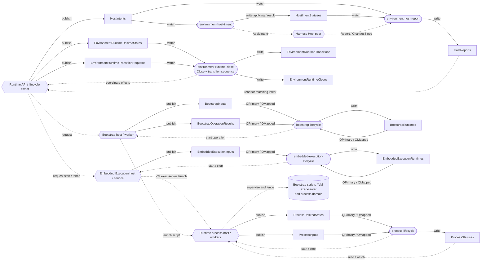
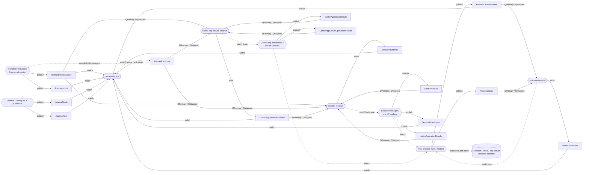
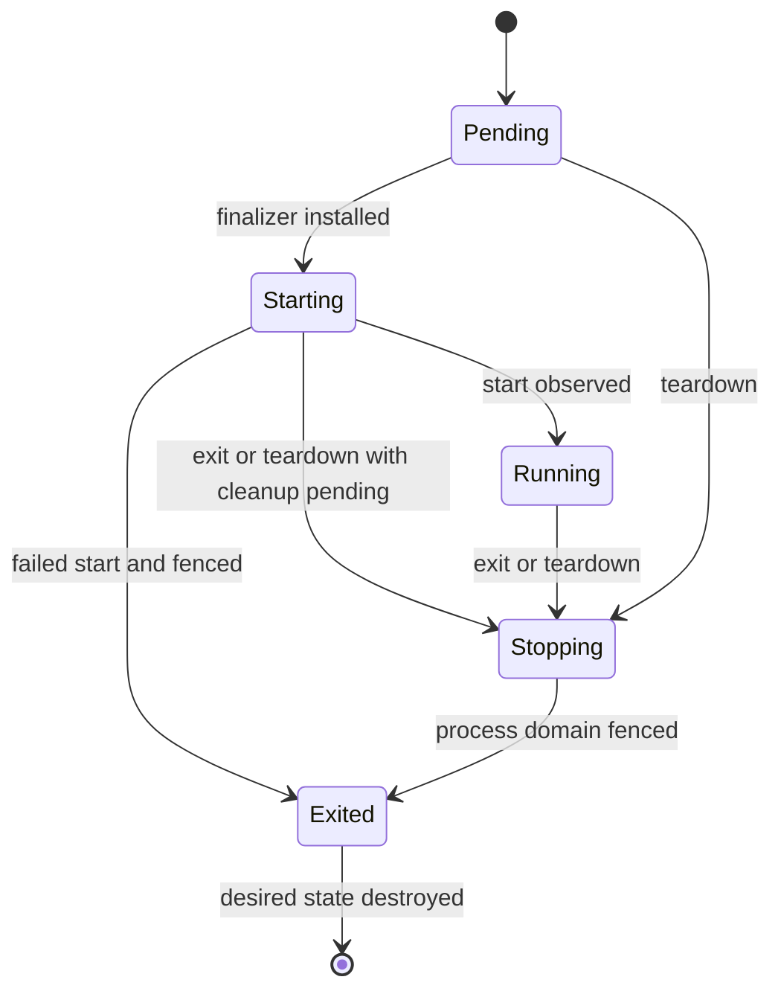
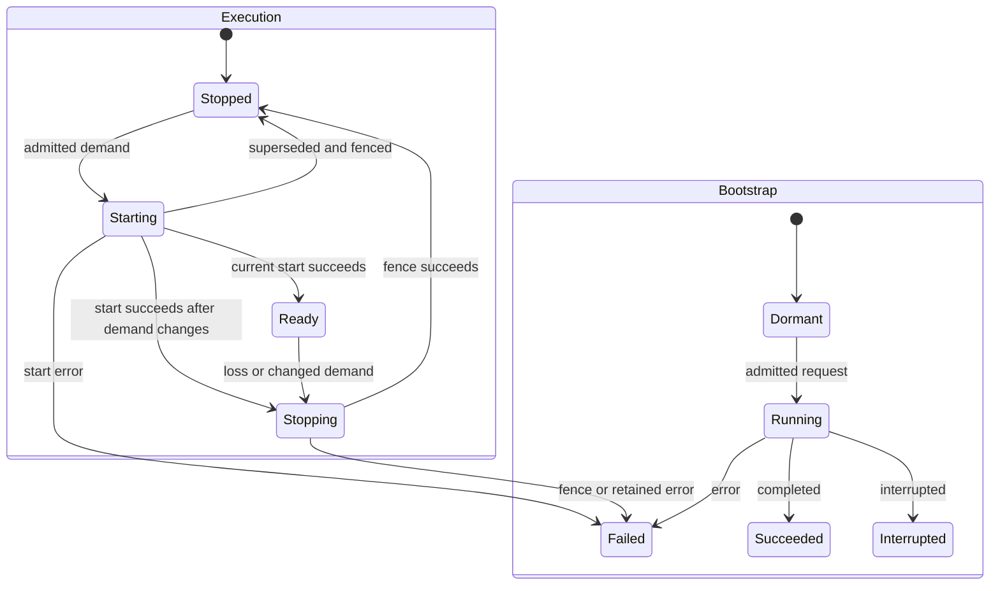
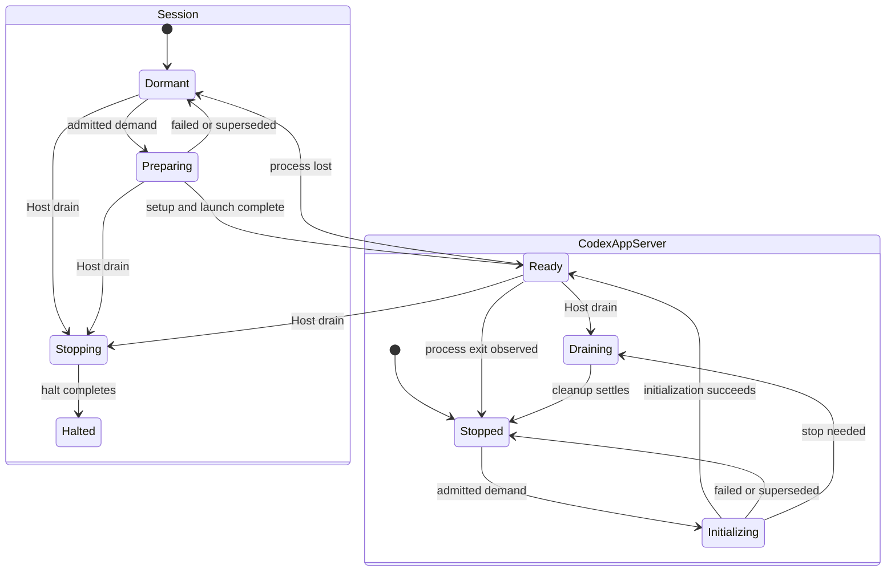
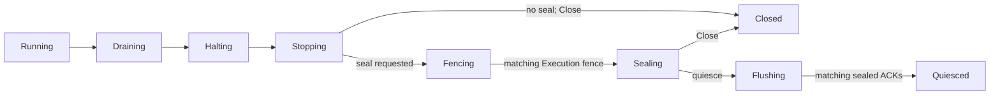
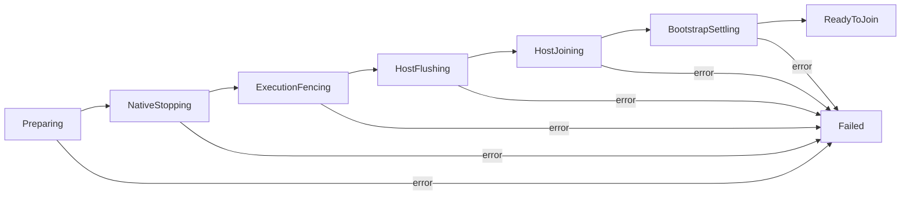

# Environment Runtime COSI map

This is a map of the controllers and resources registered in the Runtime's **single in-memory
COSI engine** and the single `environment-runtime` COSI namespace. That namespace is not a
process, cgroup, Kubernetes namespace, or durable store. Harness Host registers its controllers
into the same engine. The embedded Execution controller exists only when Execution
is configured; the Codex app-server controller exists only when Codex is configured.

Resource names below omit the common `.agentplane` suffix. A solid arrow means a resource is
published/written or read/watched; a dashed arrow is an in-process call, worker effect, or
notification. Boxes are resources, rounded boxes are controllers, and the other shapes are host
code or external effects. A controller may read its own output without subscribing to it. The
`QPrimary` and `QMapped` distinctions in the tables describe **event subscriptions**, not all
synchronous reads. Host publishers and one-off workers are not COSI controllers.

## Runtime coordination

The optional embedded Execution controller shares the namespace and engine. Its host publishes `EmbeddedExecutionInputs`; `embedded-execution-lifecycle` reads those inputs and
its own `EmbeddedExecutionRuntimes`, and writes the latter. Its effect starts/stops the embedded
service; for a VM, that service uses the Runtime process host above to launch the native exec-server.
In a Pod the native executor is in the separate companion container. The Runtime's transition and
Close workers call and wait on these components, so those effect dependencies are not additional
COSI input subscriptions.

| Controller                     | Watched inputs                                                                                           | Controller output                                                       | Other relevant work                                                                                                      |
| ------------------------------ | -------------------------------------------------------------------------------------------------------- | ----------------------------------------------------------------------- | ------------------------------------------------------------------------------------------------------------------------ |
| `environment-runtime-close`    | `EnvironmentRuntimeDesiredStates`, `EnvironmentRuntimeTransitionRequests` (weak)                         | `EnvironmentRuntimeCloses`, `EnvironmentRuntimeTransitions` (exclusive) | Close and adopt/quiesce are coordinated by this one controller; workers publish completion by waking its loop.           |
| `environment-host-intent`      | `HostIntents` (weak)                                                                                     | `HostIntentStatuses` (exclusive)                                        | Records applying before calling Host; an uncertain apply is not replayed.                                                |
| `environment-host-report`      | `HostIntents`, `HostIntentStatuses` (weak)                                                               | `HostReports` (exclusive)                                               | Also wakes on Host notifications and samples a report for the applied intent.                                            |
| `bootstrap-lifecycle`          | `BootstrapInputs` (primary); `BootstrapRuntimes`, `BootstrapOperationResults` (mapped)                   | `BootstrapRuntimes` (exclusive)                                         | Host owns admitted one-off work and publishes operation completion. Runtime admission checks the environment generation. |
| `process-lifecycle`            | `ProcessDesiredStates` (primary), `ProcessInputs` (mapped)                                               | `ProcessStatuses` (exclusive)                                           | Runtime host owns launch callbacks, live handles, observations and workers.                                              |
| `embedded-execution-lifecycle` | `EmbeddedExecutionInputs` (primary), `EmbeddedExecutionRuntimes` (mapped), both in `environment-runtime` | `EmbeddedExecutionRuntimes` (exclusive)                                 | Runtime host queues worker outcomes through its input; the controller retains an unfenced owner on failure.              |

## Harness Host

| Controller                   | Watched inputs                                                                                                                                                                            | Controller output                    | Selection / side effects                                                                                      |
| ---------------------------- | ----------------------------------------------------------------------------------------------------------------------------------------------------------------------------------------- | ------------------------------------ | ------------------------------------------------------------------------------------------------------------- |
| `runner-lifecycle`           | `RunnerDesiredStates`, `RunnerInputs`, `SessionDrainInputs`, `SessionRuntimes`, `JournalSeals`, `IngressAcks`, `CodexAppServerRuntimes`, `ProcessDesiredStates`, `ProcessStatuses` (weak) | `RunnerRuntimes` (exclusive)         | Aggregates the Host drain barrier; explicitly queues its next step after changing status.                     |
| `session-lifecycle`          | `SessionInputs` (primary); `RunnerDesiredStates`, `RunnerRuntimes`, `CodexAppServerRuntimes`, `NativeOperationResults` (mapped)                                                           | `SessionRuntimes` (exclusive)        | Per Session. App-server updates map only to Codex Sessions; operation results map to their Session.           |
| `codex-app-server-lifecycle` | `CodexAppServerInputs` (primary); `RunnerDesiredStates`, `RunnerRuntimes`, `CodexAppServerOperationResults` (mapped)                                                                      | `CodexAppServerRuntimes` (exclusive) | Per shared app-server; native effects run in host-owned one-off workers.                                      |
| `process-lifecycle`          | `ProcessDesiredStates` (primary), `ProcessInputs` (mapped)                                                                                                                                | `ProcessStatuses` (exclusive)        | The same single controller and registry shown above; per-domain contexts and worker barriers remain separate. |

The process controller and its three resource types appear in both diagrams to show their callers;
they are one controller and one set of resources. Each desired attempt records its process domain.
Runner aggregation considers only the Host domain, while Runtime-domain attempts can continue until
the Runtime's own barriers settle. Each registered callback, live handle and worker remains bound to
its owning domain's context and join barrier.

The Host publishes `SessionDrainInputs` separately from the more frequently updated Session input;
Runner aggregation needs inspection settlement, not every dispatch change. Journal seals and History
ACKs are facts published from durable journal/ingress activity. The in-memory resource is not the
durable journal, seal, or ACK authority.

## State and barriers

These diagrams show the main paths and meaningful alternatives; reconciliation can wait at any
state for its predicates or report an error. A new desired generation can reset component state;
these are not global sequences shared by every Session or process.

### Process attempt

The controller retains its finalizer through uncertain starts and failed fences. `Exited` and
finalizer removal require the host's fence proof for a registered attempt. A systemd start reply,
unit snapshot, or leader exit in `ProcessStatuses` is an observation, not that proof. A retired
attempt ID is not reused. See [supervision](../supervision/docs/supervision.md).

### Embedded Execution and bootstrap

Execution can recover a lost service only after fencing and subject to the same binding/demand
checks. Bootstrap is a retained one-shot attempt; its request file and event log are durable.

### Session and shared Codex app-server

Session halt and process fencing are separate facts. The aggregate also waits for pending
inspections and the app-server. A Session can remain halted while its process or journal barrier is
still incomplete.

### Runner drain and Runtime Close

Runner stages are aggregate status, with a blocker describing the first unmet predicate. Fencing
is needed only when a seal is requested and the matching fence is not yet present; an already
fenced generation can proceed directly to sealing. Closing with a seal waits for sealing, while
quiescing additionally waits for exact History ACK cursors. A new running generation can leave a
terminal drain state.

`ReadyToJoin` permits the outer Runtime to stop the engine and join its workers; it is not itself
owner release. Adopt and quiesce transitions are separately sequence-bound requests handled by the
same controller. Their planned stages depend on current durable state and bindings; see
[transition planning](../transition_adoption.go) and [quiesce planning](../transition_quiesce.go).

## Source of truth and ownership boundary

Controller subscriptions and outputs are declared in each controller's `Settings` or `Inputs` and
`Outputs`. Start with [Runtime registration](../runtime.go), [Host registration](../harnesshost/lifecycle_runtime.go),
[resource contracts](../lifecycle/contracts.go), and the controller files linked from those
registrations.

One process registry supplies the single process controller. Runtime and Harness Host obtain
separate scoped views: they share attempt identities and reconciliation, but each attempt retains
its owner's context, error callback and worker wait group. The explicit `ProcessDesiredStates`
domain identifies which attempts belong to the Host drain barrier. Neither the shared COSI
namespace nor the shared controller merges native process domains, VM systemd slices, owner locks,
or the cleanup proof for any individual attempt.
