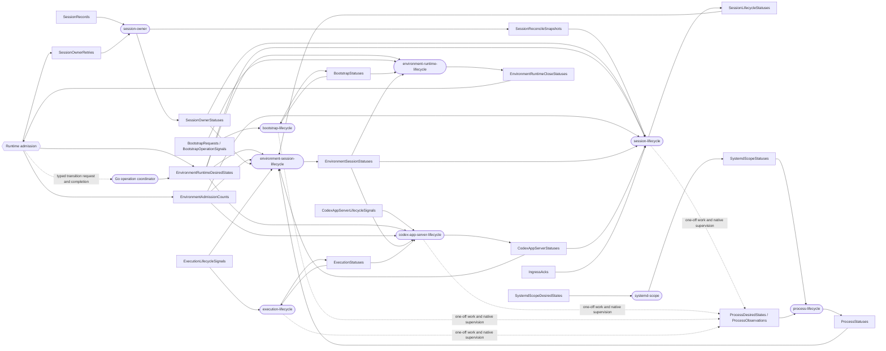
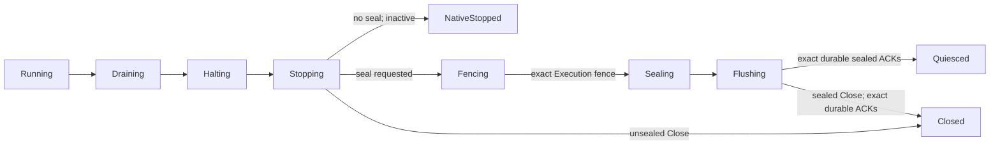
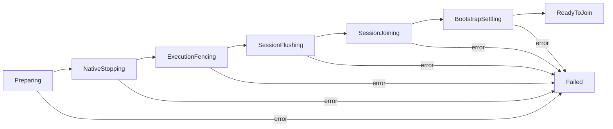

# Environment Runtime COSI map

Runtime constructs and owns one COSI engine in the `environment-runtime` namespace. The namespace
is separate from native cgroups, PID namespaces and Kubernetes namespaces. Components have distinct
resources because their observations and cleanup barriers progress independently.

The following names omit `.agentplane`. Boxes are resources; rounded boxes are controllers. Dashed
edges are direct calls or effects. Resource events schedule reconciliation; native handles, journal
connections, operation objects and cancellation functions remain in their owning components.

## Writers and subscriptions

| Controller                      | Watched inputs                                                                                                                                      | Exclusive output and effect boundary                                                                                                                         |
| ------------------------------- | --------------------------------------------------------------------------------------------------------------------------------------------------- | ------------------------------------------------------------------------------------------------------------------------------------------------------------ |
| `environment-runtime-lifecycle` | Environment desired state, aggregate Session status, bootstrap request and status, and Close worker-completion channels                             | Live Runtime Close status; Runtime-owned workers perform blocking shutdown steps                                                                             |
| `session-owner`                 | Session record (primary); explicit fresh-reservation retry (mapped)                                                                                 | Session owner status; construct and recover one live Session and its journal                                                                                 |
| `environment-session-lifecycle` | Environment desired state, admission accounting, Session lifecycle and owner statuses, app-server status, process desired/status, Execution signals | Aggregate Session status; global native cleanup and exact fence, per-Session seal and delivery status                                                        |
| `session-lifecycle`             | Session snapshot (primary); owner status, ingress ACKs, desired state, admissions, aggregate status and app-server status (mapped)                  | Session lifecycle status including generation-qualified pre-fence cleanup, admission, committed seal UID/cursor and delivery; guarded per-Session operations |
| `codex-app-server-lifecycle`    | App-server signal including operation revisions (primary); desired state, accepted admissions, aggregate status and Execution status (mapped)       | App-server status; guarded initialization, cleanup and a separate live Execution-owner readiness check                                                       |
| `execution-lifecycle`           | Execution signal (primary), Execution status (mapped)                                                                                               | Execution status; exact-attempt start/loss/fence observations, retaining an unfenced owner on failure                                                        |
| `bootstrap-lifecycle`           | Bootstrap request (primary), status and operation state (mapped)                                                                                    | Bootstrap status; selected bytes and durable event sequence govern one accepted attempt                                                                      |
| `process-lifecycle`             | Process desired state (primary), observation and systemd scope status (mapped)                                                                      | Process status; one attempt finalizer remains until its native domain is fenced                                                                              |

The `systemd-scope` controller watches volatile `SystemdScopeDesiredStates` and exclusively writes
`SystemdScopeStatuses`. Scope intent snapshots owner identity and containment configuration. Its
ready status gates process starts after stale-unit fencing; an in-process latch prevents a restarted
controller from treating current units as stale. A new Runtime owner starts with fresh scope state.

Controller settings are authoritative for primary/mapped subscriptions. Synchronous reads can also
inspect resources without subscribing to them. Registration is in [`runtime.go`](../runtime.go) and
[`session_components.go`](../session_components.go); lifecycle resources are in
[`lifecycle/contracts.go`](../lifecycle/contracts.go) and `session_lifecycle_*.go`.

Runtime exclusively publishes environment desired state and admission accounting. The admission
resource contains outstanding accepted work and `AcceptedGeneration`, the last Running revision
accepted by the synchronous gate. It wakes controllers after transition-owned recovery finishes;
it neither copies lifecycle configuration nor authorizes a stale effect. Native registration still
checks Runtime's live gate under its mutex.

The `session-owner` controller reconciles each retained Session record. Startup waits for the
initial inventory's owner statuses before History starts, and shutdown waits for every retained
Session owner before evaluating its other barriers. A fresh reservation is marked under the owner
lock before the controller can load it, so it is not mistaken for an interrupted retained Session.
Owner status is live-only; journal recovery and the durable record remain authoritative on restart.
An explicitly retried fresh reservation wakes the owner through a live-only `SessionOwnerRetries`
resource after a pre-publication failure; it does not replay a native effect or interrupted setup.

Session snapshots carry demand, setup, pending commands, process liveness and inspection facts.
Their `OperationRevision` advances on operation start and completion, including when those facts
are unchanged. It schedules reconciliation without requesting execution; normal snapshot writes and
demand resets preserve it. The operation slot mutex serializes completion publication and local
completion with consumption.
Session and app-server statuses record `EnvironmentGeneration`; demand and `ObservedDemand` are
component request sequences, not native attempt counts. One-off operation slots survive controller
restarts within the process and publish completion facts before their owning controller consumes them.
Runtime transition requests, cancellation and completion remain inside its Go-owned operation
coordinator. Each caller waits for its accepted operation to settle, even after caller cancellation;
Close cancels active transition work before waiting for the successor generation. Runtime starts the
coordinator with the engine and joins it on engine exit. It wakes callers before joining workers on
exit and never replays accepted transition preparation after a COSI controller restart. Only Close
reconciliation is a COSI controller; its workers do not take the transition mutex.
The separate live Runtime Close status reports the Close worker's exact generation, stage and failure.
Runtime watches it before reading it, and treats controller or engine exit before `ReadyToJoin` as
failure. The status does not replace the Session aggregate's `Closed` or prove native owner release.

The process registry supplies one controller and globally unique attempt IDs. Runtime and harness
scoped views share that registry but retain distinct domains, native supervisors and worker joins.
The Session aggregate waits only for harness-domain attempts; bootstrap and Execution retain their
Runtime-domain cleanup barriers. Observed exit or stopped systemd state does not replace a native
process-domain fence.

## Durable backing

| Resource              | Authority                                                      |
| --------------------- | -------------------------------------------------------------- |
| `BootstrapSelections` | Selected bootstrap bytes, committed before launch              |
| `BootstrapEvents`     | Dense ordered output and terminal result/interruption sequence |
| `SessionRecords`      | Durable Session reservation, setup source and native identity  |
| `IngressAcks`         | Latest durably acknowledged cursor and seal bit                |
| `EnvironmentSeals`    | Sealed incarnation UID                                         |

These registered protobuf resources persist their metadata and spec in `runtime-resources.db`.
The SQLite Session journals remain authoritative for admitted commands, frames, events,
configuration checkpoints and final sealed cursors. Native continuation evidence remains in the
harnesses' durable files. See [retained state](retained_state.md).

Desired state, bootstrap requests, aggregate/component statuses, admission counts and operation
states are live-only. Process restart therefore has different evidence from controller restart.
Recovery reconstructs durable facts and does not replay uncertain native starts, dispatched
commands or interrupted setup.

## Lifecycle observations

These are aggregate stages and a first-unmet-predicate blocker, not another environment desire.
Session halt and process stop are separate observations. A blocked per-Session seal or delivery, pending inspection,
remaining process finalizer or under-cursor ACK prevents the corresponding barrier from completing.
A successor generation cannot reuse an old status or Execution fence association.

`ReadyToJoin` lets Runtime stop and join the engine, join component workers, close journals, fence the
Pod namespace when applicable and release the owner. A canceled caller cannot cancel that accepted
Close worker. See [lifecycle ownership](lifecycle.md) for admission and shutdown ordering.
