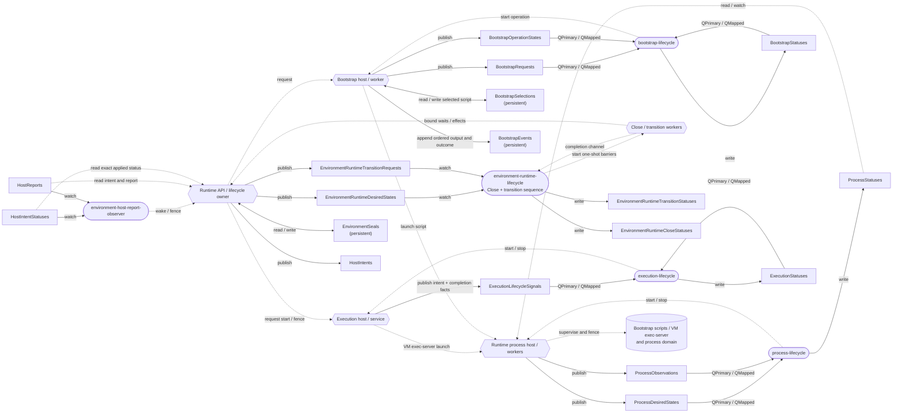
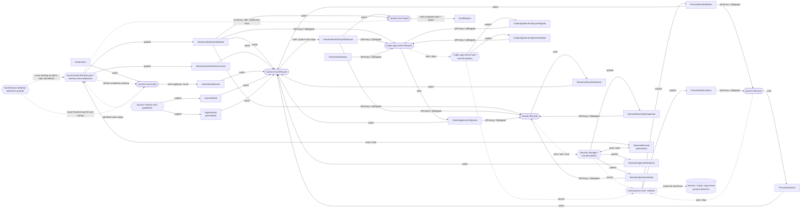
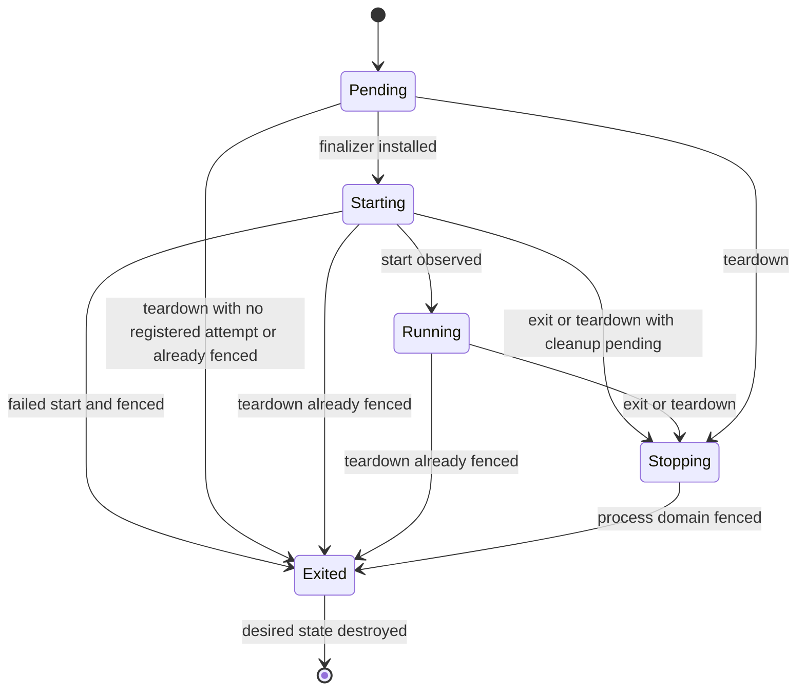
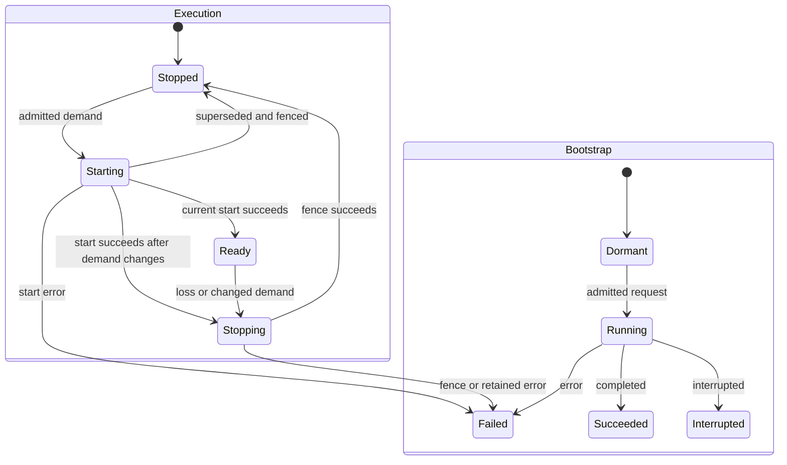
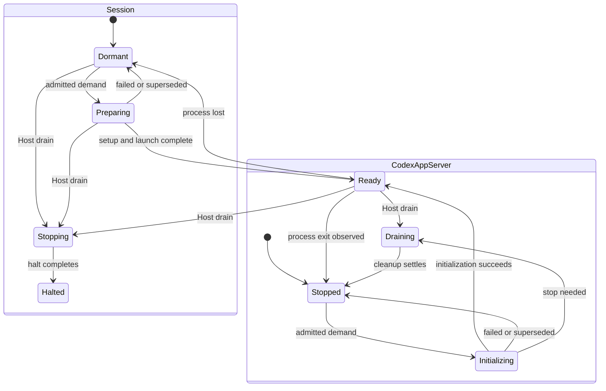
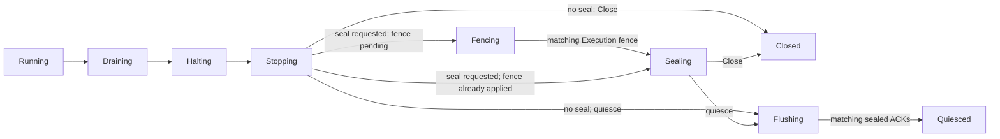
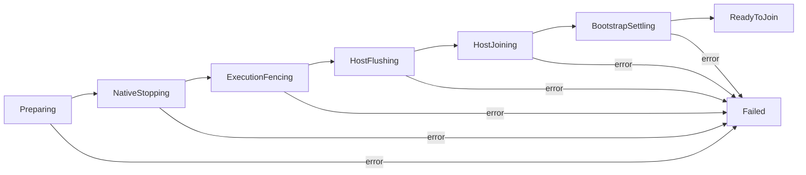

# Environment Runtime COSI map

This is a map of the controllers and resources registered in the Runtime's **single COSI engine**
and the single `environment-runtime` COSI namespace. Bootstrap selections and events, Session records,
`IngressAcks` and `EnvironmentSeals` have a persistent backing store; the other resources are in memory.
The namespace is not a process, cgroup, or Kubernetes namespace. Harness Host registers its controllers
into the same engine. The Execution controller exists only when Execution
is configured; the Codex app-server controller exists only when Codex is configured.

Resource names below omit the common `.agentplane` suffix. A solid arrow means a resource is
published/written or read/watched; a dashed arrow is an in-process call, worker effect, or
notification. Boxes are resources, rounded boxes are controllers, and the other shapes are host
code or external effects. A controller may read its own output without subscribing to it. The
`QPrimary` and `QMapped` distinctions in the tables describe **event subscriptions**, not all
synchronous reads. Host publishers and one-off workers are not COSI controllers.

## Runtime coordination

The optional Execution controller shares the namespace and engine. Its host publishes
`ExecutionLifecycleSignals` with the desired UID and demand plus generation-bound start, loss, and
fence completion facts. These completion facts carry their generation and UID, and the start fact
also records demand; the resource therefore contains current reconciliation state as well as facts
that wake `execution-lifecycle`. The controller reads the signals and its own
`ExecutionStatuses`, and writes the latter. Its effect starts and stops the service; for a VM, that
service uses the Runtime process host above to launch the native exec-server.
In a Pod the native executor is in the separate companion container. The Runtime's transition and
Close workers call and wait on these components, so those effect dependencies are not additional
COSI input subscriptions.

The coordinator keeps its active plan and worker handles in process. Each barrier reports through
its completion channel; the published transition or Close status is the observable progress, not
a durable work queue. A blocking Host binding check stays in a worker so Close can preempt a
transition. An uncertain effect retains ownership and is not automatically replayed.

| Controller                         | Watched inputs                                                                                     | Controller output                                                                     | Other relevant work                                                                                                                                                   |
| ---------------------------------- | -------------------------------------------------------------------------------------------------- | ------------------------------------------------------------------------------------- | --------------------------------------------------------------------------------------------------------------------------------------------------------------------- |
| `environment-runtime-lifecycle`    | `EnvironmentRuntimeDesiredStates`, `EnvironmentRuntimeTransitionRequests` (weak)                   | `EnvironmentRuntimeCloseStatuses`, `EnvironmentRuntimeTransitionStatuses` (exclusive) | Close and adopt/quiesce are coordinated by this one controller; workers publish completion by waking its loop.                                                        |
| `environment-host-report-observer` | `HostReports`, `HostIntentStatuses` (weak)                                                         | None                                                                                  | Wakes Runtime waiters and starts the Execution fence for an exact applied report.                                                                                     |
| `bootstrap-lifecycle`              | `BootstrapRequests` (primary); `BootstrapStatuses`, `BootstrapOperationStates` (mapped)            | `BootstrapStatuses` (exclusive)                                                       | Host owns admitted one-off work and publishes its operation state. Runtime admission checks the environment generation; the worker appends durable `BootstrapEvents`. |
| `process-lifecycle`                | `ProcessDesiredStates` (primary), `ProcessObservations` (mapped)                                   | `ProcessStatuses` (exclusive)                                                         | Host owns launch callbacks, live handles and workers; systemd observations are published in `ProcessObservations`.                                                    |
| `execution-lifecycle`              | `ExecutionLifecycleSignals` (primary), `ExecutionStatuses` (mapped), both in `environment-runtime` | `ExecutionStatuses` (exclusive)                                                       | Runtime host publishes desired UID/demand and generation-bound completion facts; the controller retains an unfenced owner on failure.                                 |

## Harness Host

| Controller                   | Watched inputs                                                                                                                                                                                                                                     | Controller output                          | Selection / side effects                                                                                                                      |
| ---------------------------- | -------------------------------------------------------------------------------------------------------------------------------------------------------------------------------------------------------------------------------------------------- | ------------------------------------------ | --------------------------------------------------------------------------------------------------------------------------------------------- |
| `harness-host-report`        | `HarnessHostDesiredStates`, `HarnessHostLifecycleStatuses` (weak), plus Host change wakeups                                                                                                                                                        | `HostReports` (exclusive)                  | Publishes inventory, blocker, idle and lifecycle facts with the full sampled intent.                                                          |
| `harness-host-intent`        | `HostIntents` (weak), plus Host startup wakeups                                                                                                                                                                                                    | `HostIntentStatuses` (exclusive)           | Checks startup and the synchronous Runtime binding gate, records Applying before the native effect, and fails closed on an unknown result.    |
| `harness-host-lifecycle`     | `HarnessHostDesiredStates`, `HarnessHostAdmissionCounts`, `HostIntentStatuses`, `SessionInspectionStatuses`, `SessionLifecycleStatuses`, `JournalSeals`, `IngressAcks`, `CodexAppServerStatuses`, `ProcessDesiredStates`, `ProcessStatuses` (weak) | `HarnessHostLifecycleStatuses` (exclusive) | Aggregates the Host drain barrier; explicitly queues its next step after changing status.                                                     |
| `session-lifecycle`          | `SessionReconcileSnapshots` (primary); `HarnessHostDesiredStates`, `HarnessHostLifecycleStatuses`, `CodexAppServerStatuses`, `SessionOperationStates` (mapped)                                                                                     | `SessionLifecycleStatuses` (exclusive)     | Per Session. App-server updates map only to Codex Sessions; operation state records map to their Session.                                     |
| `codex-app-server-lifecycle` | `CodexAppServerLifecycleSignals` (primary); `HarnessHostDesiredStates`, `HarnessHostLifecycleStatuses`, `CodexAppServerOperationStates`, `ExecutionStatuses` (mapped)                                                                              | `CodexAppServerStatuses` (exclusive)       | Per shared app-server; native effects run in host-owned one-off workers. Execution status changes wake a separate live-owner readiness check. |
| `process-lifecycle`          | `ProcessDesiredStates` (primary), `ProcessObservations` (mapped)                                                                                                                                                                                   | `ProcessStatuses` (exclusive)              | The same single controller and registry shown above; per-domain contexts and worker barriers remain separate.                                 |

The process controller and its three resource types appear in both diagrams to show their callers;
they are one controller and one set of resources. Each desired attempt records its process domain.
The Host publishes systemd observations in `ProcessObservations`; its revision also wakes reconciliation
for start, exit and stop slots whose live handles remain Host-owned. Observations do not prove fencing.
Harness Host aggregation considers only the Host domain, while Environment Runtime attempts can continue
until its own barriers settle. Each registered callback, live handle and worker remains bound to
its owning domain's context and join barrier.

`BootstrapRequests` records a request accepted under Runtime's admission lock.
`HarnessHostAdmissionCounts` records in-flight Host admissions under the Host admission lock;
its resource type also appears in drain blocker diagnostics. Harness Host publishes
`SessionInspectionStatuses` when inspection work starts or settles, separately from the more
frequently updated `SessionReconcileSnapshots`. Host aggregation needs inspection settlement, not every
dispatch change. `SessionReconcileSnapshots`, `CodexAppServerLifecycleSignals`, and
`ExecutionLifecycleSignals` each combine demand with observed or completed facts for their controller.
Journal seals are observations published from the durable journal; `IngressAcks` persists the latest
History acknowledgement cursor and seal bit. The SQLite journal remains the authority for its events.

The retained Session record supplies immutable configuration. `SessionReconcileSnapshots` carries harness kind
and demand alongside the setup, process, dispatch and inspection facts the controller reconciles.
`SessionLifecycleStatuses` records controller progress such as phase, observed demand and Host generation;
it is not desired runtime configuration. Reconciliation starts a dedicated Claude process per Session
or attaches a Codex Session thread to the shared app-server. A Codex Session's process ID identifies
that shared app-server; its per-Session attachment and router state remains in memory.

Runtime synchronously revokes the native binding gate when Host or Runtime fails, including when a
COSI write fails. Host admission also checks the exact binding under its
mutex before durable work. The Host intent controller records Applying before calling the native
apply path; an interrupted application fails closed rather than replaying the effect. The report
controller wakes on both Harness Host COSI changes and Host inventory notifications, and snapshots the
full intent. Runtime accepts a report only after that exact intent is applied, so a same-generation
Execution fence cannot validate an older report.

`EnvironmentRuntimeDesiredStates`, `HostIntents`, statuses, reports and operation state records are
in-memory coordination state. `BootstrapSelections`, `BootstrapEvents`, `SessionRecords`, `IngressAcks`
and `EnvironmentSeals` have a COSI backing store; `BootstrapRequests` is live-only. The incarnation
seal and journals have durable owners. The five backed resource specs use protobuf, including byte
fields for selected bootstrap scripts, output chunks and Session setup scripts. COSI persists their
complete metadata alongside the spec. Bootstrap events use a fixed-width resource ID and their
embedded sequence as the ordering authority; readers sort by the sequence and reject gaps or a
terminal event followed by more output. The last event carries the result or interruption, so output
and terminal outcome share one durable sequence. COSI list order is not part of the contract. An old
JSON resource in `runtime-resources.db` fails reload; legacy Session and acknowledgement files are
never imported.
`IngressAcks` persists the Harness Host's last History cursor and seal bit; `EnvironmentSeals`
persists the Runtime's sealed incarnation UID. The SQLite journal remains the event authority.
The environment owner lock has a process lifetime even though its file remains on disk; see
[lifecycle ownership](lifecycle.md#durable-owners). A
process exit observation alone does not prove that its native process domain was fenced.

## Host roles and identity scopes

The package-qualified Go types name distinct owners: `harnesshost.Host` owns Session admission and
the aggregate drain barrier, `bootstrap.Host` owns the one-off bootstrap operation,
`codexappserver.Host` owns the shared Codex process and readers, and `supervision.Host` owns process
attempts within a scoped native process domain. The outer `Runtime` owns Close and transition
coordination. Each keeps its own lifecycle and ownership barriers inside the shared COSI engine.

| Identity                              | Scope and meaning                                                                                                                                                                                                                                                                                                           |
| ------------------------------------- | --------------------------------------------------------------------------------------------------------------------------------------------------------------------------------------------------------------------------------------------------------------------------------------------------------------------------- |
| Session and app-server `Input.Demand` | A sequence of work requests for that Session or shared app-server, respectively. `ObservedDemand` in their controller status is the latest sequence recorded for reconciliation. It may advance before the native effect completes or when existing work satisfies the demand; it is not a count of native launch attempts. |
| `HostGeneration`                      | The generation of `HarnessHostDesiredStates` observed by the Session or app-server controller. It fences that controller's status across Host lifecycle changes.                                                                                                                                                            |
| Session `SetupOperationID`            | The in-process one-off setup operation ID. It remains recorded across Host status resets to prevent another setup attempt.                                                                                                                                                                                                  |
| App-server `ExitSequence`             | A counter advanced for each process exit observation. It is distinct from the Host generation and from the process incarnation ID.                                                                                                                                                                                          |
| Execution status `Generation`         | A sequence local to the Execution controller, pairing start, loss and fence completion facts with its current service attempt.                                                                                                                                                                                              |
| Process `DesiredState.Generation`     | Supplied by the process owner for that launch; it is not universally a Harness Host generation. The process resource ID uniquely identifies the individual launch attempt.                                                                                                                                                  |

The workload incarnation UID, Runtime boot ID and Lease connection epoch fence external calls at
the [control boundary](control.md#environment-runtime-control). COSI metadata phase is separate
from the `Phase` fields above, which describe domain lifecycle progress.

## State and barriers

These diagrams show the main paths and meaningful alternatives; reconciliation can wait at any
state for its predicates or report an error. A new desired generation can reset component state;
these are not global sequences shared by every Session or process.

### Process attempt

The controller retains its finalizer through uncertain starts and failed fences. `Exited` and
finalizer removal require the host's fence proof for a registered attempt. A systemd start reply,
unit snapshot, or leader exit in `ProcessStatuses` is an observation, not that proof. A retired
attempt ID is not reused. See [supervision](../supervision/docs/supervision.md).

### Embedded Execution and bootstrap

Execution can recover a lost service only after fencing and subject to the same binding/demand
checks. Bootstrap is a retained one-shot attempt; its selected script is a persistent COSI resource
and its event log is durable.

### Session and shared Codex app-server

Session halt and process fencing are separate facts. The aggregate also waits for pending
inspections and the app-server. A Session can remain halted while its process or journal barrier is
still incomplete.

### Harness Host drain and Runtime Close

Harness Host stages are aggregate status, with a blocker describing the first unmet predicate. Admission
must settle before Sessions halt; Host then waits for Session processes, the shared app-server,
Host-owned process finalizers and pending inspections. Fencing is needed only when a seal is requested
and the exact applied Host intent does not yet carry the Execution fence; after native stop, a seal-bearing
intent waits for that matching applied fence before sealing. Closing with a seal waits for sealing, while
quiescing additionally waits for exact History ACK cursors. A new running generation can leave a
terminal drain state.

`ReadyToJoin` permits the outer Runtime to stop the engine and join its workers; it is not itself
owner release. Adopt and quiesce transitions are separately sequence-bound requests handled by the
same controller. Their planned stages depend on current durable state and bindings; see
[transition planning](../transition_adoption.go) and [quiesce planning](../transition_quiesce.go).

## Source of truth and ownership boundary

Controller subscriptions and outputs are declared in each controller's `Settings` or `Inputs` and
`Outputs`. Start with [Runtime registration](../runtime.go), [Host registration](../harnesshost/lifecycle_runtime.go),
[resource contracts](../lifecycle/contracts.go), and the controller files linked from those
registrations.

One process registry supplies the single process controller. Runtime and Harness Host obtain
separate scoped views: they share attempt identities and reconciliation, but each attempt retains
its owner's context, error callback and worker wait group. The explicit `ProcessDesiredStates`
domain identifies which attempts belong to the Host drain barrier. Neither the shared COSI
namespace nor the shared controller merges native process domains, VM systemd slices,
or the cleanup proof for any individual attempt.
