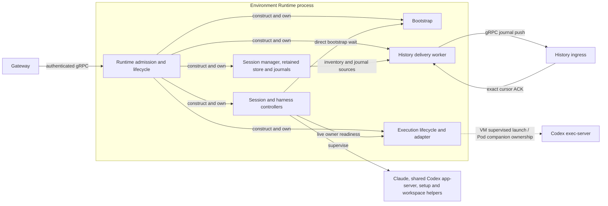

# Environment lifecycle ownership

`Runtime` owns one environment lifetime: admission, bootstrap, Session management, harness
controllers, retained records, journals, History delivery, Execution and final owner release. These
are ordinary components in one COSI engine and the `environment-runtime` namespace. The
[controller map](cosi.md) shows their independent observations and writers.



The Pod execution companion retains its external Unix ownership/fence protocol and separate PID
namespace. Native protocol probing establishes Execution readiness; a published status cannot
substitute for the live owner check. VM transient units retain their systemd invocation and cgroup
fences. See [supervision](../supervision/docs/supervision.md).

## State and identity

| State                                        | Owner and storage                                                                    |
| -------------------------------------------- | ------------------------------------------------------------------------------------ |
| Environment ownership                        | Runtime; exclusive lock on `<state_dir>/runtime-resources.db`                        |
| Incarnation seal                             | Runtime; `EnvironmentSeals` in `runtime-resources.db`                                |
| Bootstrap selection and events               | Runtime; `BootstrapSelections` and `BootstrapEvents` in `runtime-resources.db`       |
| Session records and History acknowledgements | Runtime retained store; `SessionRecords` and `IngressAcks` in `runtime-resources.db` |
| Session journals and native continuations    | Runtime Session components; `<state_dir>/sessions/`                                  |
| Shared Codex native home                     | Shared app-server component; `<state_dir>/codex/`                                    |

`EnvironmentRuntimeDesiredStates` is the sole environment lifecycle desire. Its mode, incarnation,
seal UID and generation are distinct from observations. Runtime boot ID fences an external process
lifetime; Sandbox/incarnation identity and Gateway connection epoch authorize external calls.
Session/app-server `EnvironmentGeneration` records the desired revision their controller observed.
Session demand, app-server demand, Execution attempt generation, one-off operation ID and native
process attempt ID retain their separate meanings.

Only explicitly registered COSI resources are durable. Desired state, component progress,
admission accounting and operation slots are live coordination state. A watch wakes observation;
it does not replace the SQLite journal or authorize replay of uncertain native effects.

## Admission and startup

Before accepting a new lifecycle revision, Runtime closes its admission gate under `Runtime.mu`.
Failed or uncertain desired-state writes leave that gate closed. A controller must compare the
exact expected revision through Runtime admission before registering native work. Accepted work
is counted until its component operation slot is visible, and the mutex is released while that
registration executes. Publication failure fails Runtime; controller restart cannot repeat an
uncertain registration.

On entry to Running, transition-owned preparation resets old demand, reopens eligible journals and
resumes recoverable work before reopening admission. `EnvironmentAdmissionCounts` publishes both
the accepted generation and the outstanding count, waking Session/app-server controllers when the
Running revision becomes eligible. The count is not another lifecycle desire.

Runtime locks its environment owner before Session construction. Startup reconstructs Session
records and journals and joins the initial native cleanup barrier before public control listens.
History starts after successful Session recovery. A recovery failure closes admission and prevents
History startup. Failure or Close wakes startup waiters even while recovery is unfinished.

`CreateSession` acknowledges a durable reservation. Model lookup runs outside admission; the retained
write rechecks the accepted revision and caller epoch. Native startup and setup complete separately.
Accepted setup may settle after the gate closes, and its operation/process barriers remain visible
until it does. Canceling a bootstrap waiter does not cancel the accepted bootstrap operation.

## Drain, fence, seal and acknowledgement

```mermaid
sequenceDiagram
  participant R as Runtime
  participant C as Component controllers
  participant E as Execution
  participant H as History worker
  participant I as History ingress
  R->>R: close admission; publish desired revision
  C->>C: settle admissions, setup, native processes and inspections
  C->>R: EnvironmentSessionStatuses.NativeStopped (exact generation)
  R->>E: drain calls and fence native owner
  E->>R: exact lifecycle and Execution-attempt fence completion
  C->>C: close final Session admission and seal journals at their final cursors
  H->>I: final entries and seals
  I->>H: exact sealed cursor acknowledgement
  H->>H: persist IngressAcks
  C->>C: publish per-Session sealed and delivered status
  C->>R: exact aggregate completion
```

Native cleanup includes Session halt, shared app-server cleanup, harness-domain process finalizers
and inspection writes. Each Session reports `PreFenceSettled` for the observed shutdown generation
only after its process stop proof joins native exit callbacks and its inspection queue and operation
settle. The aggregate requires that condition for every retained Session before `NativeStopped`;
it cannot depend on journal sealing because sealing waits for the global Execution fence.
Runtime-domain attempts keep their own bootstrap/Execution barriers. An old
component status cannot satisfy a successor revision. Execution fencing associates its own attempt
generation with the lifecycle generation; a successor cannot start before its predecessor is fenced.
Close observes the accepted bootstrap request and terminal status directly through COSI. A pending
request holds the bootstrap settlement stage until a status change wakes reconciliation; a terminal
failure or interruption is settled because the bootstrap owner has completed cleanup.

Close observes the exact-generation aggregate Session status for `NativeStopped` directly through
COSI. Its existing fence deadline wakes reconciliation if that status never arrives. Native-stop
errors are saved while Close attempts the Execution fence and reported at the History barrier if
that fence succeeds.

A seal request waits for native cleanup and the exact Execution fence before journals seal. The
Session lifecycle controller closes the final admission gate, settles accepted commands, commits
the seal and observes the exact durable acknowledgement. Its generation-qualified status reports
those Session boundaries to the environment aggregate. Retained COSI Session records define the
drain membership; a missing owner or lifecycle status blocks completion.
Under-cursor, unsealed or non-durable acknowledgements cannot satisfy the sealed delivery barrier.
Quiesce acceptance and Close completion are separate boundaries. Repeated Quiesce preserves a
healthy desired generation; only an error for that current generation may request a retry.

Ordinary unsealed Close drains work without creating a seal. Close preserving a seal waits for exact
durable History acknowledgements. Runtime cancels and joins History before closing journals, stops
and joins the engine before joining component workers, and releases its environment owner last.
Canceling a Close caller ends only that caller's wait. Close first settles an accepted transition and
its existing fence; failures retain ownership rather than manufacturing completion. Adoption and
Quiesce use direct requests to a Go-owned operation coordinator; per-operation completion replaces
private request/status resources. Runtime starts that coordinator with its COSI engine. The Close
controller cancels the shared lifecycle context on its first exit, even if Runtime's serving loop
has not handled a fatal error. Runtime joins the coordinator on every engine exit, including early
failure. The coordinator signals stopped before joining an
accepted worker, so callers release the transition mutex. Close is the only COSI lifecycle
controller: it observes the Closing generation after Runtime has settled the accepted operation and
its prior fence under the transition mutex. Its workers never take that mutex, so an engine failure
cannot wait on a Close worker blocked behind the operation caller. Close waits for the controller's
exact-generation live COSI status before joining the engine. Accepted work and uncertain starts remain
owned until joined or fenced.

Session recovery or History delivery failure closes admission and starts local cleanup without
inventing a seal. Failed native cleanup, engine failure or failed sealed delivery remains a failure.
For abnormal Pod Runtime loss, replacement still requires the outer container fence; lock acquisition
or leader exit alone does not establish that all descendants are gone.

## Native containment

Pod Runtime is PID 1 and owns the shared child reaper. In a VM, harness attempts use the `harness`
scope in the workload slice, while Execution uses `execution-service` in the executor slice. Both
are bound to `agentplane-environment-runtime.service` and its invocation marker. Sharing one COSI
process controller does not merge those native containment domains or their worker joins.

Each attempt receives its stop grace at launch. A process exit observation is separate from an empty
native process-domain fence. Systemd start uncertainty, changed invocation, manager disconnect or a
failed recursive cgroup-empty proof blocks a successor. Runtime holds state/workspace mounts until
accepted bootstrap and native cleanup settle.
