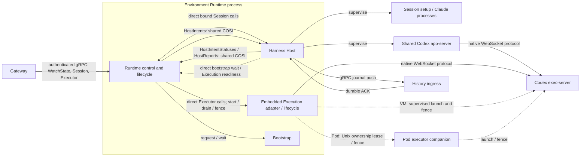

# Environment lifecycle ownership

The environment has three component owners in one management process. Environment Runtime owns identity, bootstrap, public
control and coordinated drain. Harness Host owns native Sessions, setup, app-server, journals and
History ingress. Execution Service owns typed execution and the native exec-server. Each component
has distinct typed lifecycle resources in one Runtime-owned COSI engine. Runtime owns the engine
and joins it after Host controllers reach Closed and before either component releases its state owner.
The Host still owns its Session, journal and native process resources; Runtime owns bootstrap and
environment process resources. One process controller and registry own attempt finalizers in the shared namespace;
process domains retain separate lifecycle and worker barriers.
The [COSI map](cosi.md) shows controller subscriptions, resource writers and lifecycle states.



The VM exec-server is a supervised systemd workload. In a Pod it runs in the companion's private
PID namespace; the app-server and Execution adapter reach its native WebSocket through the Pod's
network namespace. The companion's Unix socket is an ownership and fence protocol, not the
Executor API. The standalone Execution binary can serve that API on a private Unix gRPC socket;
the embedded adapter is called directly by Runtime.

## Durable owners

| State                              | Owner   | Existing path                                             |
| ---------------------------------- | ------- | --------------------------------------------------------- |
| Environment lifetime lock          | Runtime | `<state_dir>/.agentplane-environment-runtime-owner`       |
| Incarnation seal marker            | Runtime | `<state_dir>/sessions/sealed`                             |
| Bootstrap request and log          | Runtime | `<state_dir>/initialization/`                             |
| Native Session lifetime lock       | Host    | `<state_dir>/harness-host/.agentplane-harness-host-owner` |
| Session records, journals and ACKs | Host    | `<state_dir>/sessions/`                                   |
| Shared Codex native home           | Host    | `<state_dir>/codex/`                                      |

The old `.agentplane-runner-owner` files are not adopted or cleared. Runtime and Host use their new
owner-lock paths after all pre-rename workloads stop; Session IDs, native continuation state,
journal cursors and authored workspace files do not move. Lock acquisition does not establish a
prior container/node fence.

## Lifecycle coordination and admission

`env/runtime/lifecycle.proto` defines typed in-process lifecycle values. The Host-owned `HostReports`
resource includes the complete sampled intent: Runtime boot, Host boot, generation and Execution
fence. Runtime accepts a report only when `HostIntentStatuses` confirms that exact intent was applied.
Mode and incarnation changes need a new generation; Execution fencing advances monotonically within
that generation.

Runtime owns external transport authentication, connection epochs and conditional Quiesce. Its
direct Session calls carry a copied exact binding. Host checks it at direct-call ingress
and under its synchronous native admission lock. Model lookup does not hold that lock; a delayed
reservation rechecks the binding before writing retained state. Command admission remains durable
and idempotent. Unknown remote effects are never replayed after a Host lifetime failure.
The Host-owned intent controller applies `HostIntents` after Session startup. It checks the exact
Runtime and Host boot IDs through a native connection gate that Runtime revokes synchronously on
disconnect or failure, even if COSI publication fails. It records Applying before the native effect;
an interrupted application fails the Host and cannot be replayed on controller restart.

Host's admission counter is a COSI input, incremented under that barrier before durable mutation and
decremented when the handler settles. Missing accounting is an error, never an idle count. A drain
intent closes admission before asynchronous teardown begins. New native effects also compare their
expected desired generation under the same lock.

## Drain, fence, seal and flush

```mermaid
sequenceDiagram
  participant R as Environment Runtime
  participant H as Harness Host
  participant E as Execution Service
  participant I as History
  R->>H: HostIntents: QUIESCING(binding, incarnation seal)
  H->>H: close admission; settle setup and accepted writes
  H->>H: halt native processes; join readers and inspections
  H->>R: HostReports(intent, native_stopped)
  R->>E: drain and stop; prove execution domain fenced
  R->>H: HostIntents: same binding, execution_fenced=true
  H->>H: seal final journal cursors
  H->>I: final entries and seal
  I->>H: durable ACK of exact sealed cursor
  H->>R: HostReports(intent, QUIESCED)
```

Bootstrap belongs to Runtime. Session setup waits through the generation-bound Runtime call; canceling a waiter does not
cancel accepted bootstrap work. Runtime shutdown must keep that wait boundary available while
accepted Host setup settles.

Host reports native cleanup only after admissions, setup, shared app-server, process finalizers and
inspection writes settle. Runtime cannot turn an old report into a new generation's fence proof.
Host waits for the matching Execution fence before sealing. Under-cursor or unsealed ACKs leave Host
FLUSHING. CLOSING preserves an existing seal and follows the same flush path; CLOSING without a seal
performs native cleanup without ending the incarnation's history.

Host lifetime loss closes admission and starts local cleanup without inventing a seal. Local
Close callers share one cleanup; cancellation ends only the caller's wait. Engine exit and teardown
errors remain failures, and incomplete cleanup retains ownership. Controllers stop before worker joins;
journals close after workers, and the Host owner releases last. Runtime retains the environment owner
until its Host and Execution domains are fenced.

Runtime's own COSI engine also runs its Close aggregate alongside bootstrap and process controllers.
The same Runtime lifecycle coordinator owns sequence-bound adoption and Quiesce transition statuses. The Gateway holds
transition serialization while it waits for an exact sequence; canceled WatchState epochs stop
future adoption stages, and an interrupted Execution start must settle through the Execution fence
barrier before a successor can enter. A published Running intent remains current after watch loss.
If a prior transition already requested drain, its exact Host generation is reconciled before
another incarnation can be adopted. Conditional Quiesce seals durably before publishing a new
Quiescing intent and preserves a healthy generation on repeated calls. Close cancels an active
transition, then waits for its status and any uncertain-fence proof before continuing.
The aggregate observes a Closing desired generation and advances through bound Host native-stop,
Execution fence, optional Host flush, Host join and bootstrap settlement. Blocking waits and stops run
in coordinator-owned one-shot workers, leaving the COSI event loop free. Its ready-to-join status
allows Runtime to stop and join that engine, join its workers, fence the Pod PID namespace and release
the environment owner. Failed or uncertain stages retain that owner and are not replayed.

## Process domains

Production Pod Runtime is PID1; the embedded Host shares its PID1 reaper. Native helpers can occupy
separate process groups. A normal `native_stopped` report proves Host cleanup. An abnormal Runtime
exit alone cannot prove those groups are empty; replacement requires the outer container fence.
Explicit subprocess mode remains
available for local fixtures, with its parent-liveness and inherited owner-descriptor barrier.

VM Runtime, Host and Execution use distinct native scope IDs bound to the Runtime service invocation
and lifetime marker. Runtime preserves its legacy scope hash, while Host uses `harness-host` and
Execution uses `execution-service`. Completion requires service state
and an empty execution domain, including descendants. Manager disconnect and uncertain fence results
block successors. See [supervision](../supervision/docs/supervision.md).

## Host COSI state

Host wiring and aggregate reconciliation live in `env/runtime/harnesshost/lifecycle_*.go` and
`runner_controller.go`. Component controllers exclusively write their own runtime/status resources.
Resources contain lifecycle values and detached snapshots, not process handles, streams,
cancellations or journal connections. The host registry owns native handles and publishes observations.

Session input includes demand, setup, process liveness, pending commands and inspection dependencies.
Session lifecycle status records phase, attempt and native generation. The shared app-server has its own
input/runtime and readiness deadline. Process desired/status/input resources are provided by
`env/runtime/supervision`; finalizers remain until native cleanup is proven. `env/oneoff.Operation` owns
one-shot slots through result publication and consumption, preventing retries from duplicating an
in-flight effect.

Session reconciliation concurrency (default 16) limits workers, not Session inventory or admission.
Shared-service controllers reconcile one service. Stream readers and ingress workers remain
independent so replies and ACKs progress while a controller waits. The app-server controller watches
embedded Execution status changes, checks the live Execution owner through an in-process
Host-to-Runtime callback, and requeues at its dependency deadline if readiness has not arrived.
Execution separately probes the native exec-server's WebSocket protocol for backend readiness and
liveness.

Session startup reconstructs journals and records interrupted setup before publishing schedulable
input. `Session.Observe` derives attachment, busy state and autosuspend blockers from one detached
projection. Native active turns and committed active turns conservatively block idle until both
settle. Journal cursor changes wake ingress; lifecycle blocker changes wake Runtime reports. Durable
records remain authoritative when in-memory state is rebuilt.
