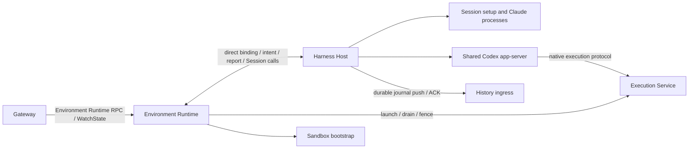

# Environment lifecycle ownership

The environment has three component owners in one management process. Environment Runtime owns identity, bootstrap, public
control and coordinated drain. Harness Host owns native Sessions, setup, app-server, journals and
History ingress. Execution Service owns typed execution and the native exec-server. Each component
has its own lifecycle state; no COSI engine crosses the component boundary.



## Durable owners

| State                              | Owner   | Existing path                                             |
| ---------------------------------- | ------- | --------------------------------------------------------- |
| Environment lifetime lock          | Runtime | `<state_dir>/.agentplane-environment-runtime-owner`       |
| Incarnation seal marker            | Runtime | `<state_dir>/sessions/sealed`                             |
| Bootstrap request and log          | Runtime | `<state_dir>/initialization/`                             |
| Native Session lifetime lock       | Host    | `<state_dir>/harness-host/.agentplane-harness-host-owner` |
| Session records, journals and ACKs | Host    | `<state_dir>/sessions/`                                   |
| Shared Codex native home           | Host    | `<state_dir>/codex/`                                      |

The old `.agentplane-runner-owner` files are not adopted or cleared. Runtime and Host use their new
owner-lock paths after all pre-rename workloads stop; Session IDs, native continuation state,
journal cursors and authored workspace files do not move. Lock acquisition does not establish a
prior container/node fence.

## Lifecycle coordination and admission

`env/runtime/lifecycle.proto` defines the typed lifecycle values shared in process. Every LifecycleIntent
and HostReport carries Runtime boot, Host boot and generation. Mode and incarnation changes need a
new generation; Execution fencing advances monotonically within that generation.

Runtime owns external transport authentication, connection epochs and conditional Quiesce. Its
direct Session calls carry a copied exact binding. Host checks it at direct-call ingress
and under its synchronous native admission lock. Model lookup does not hold that lock; a delayed
reservation rechecks the binding before writing retained state. Command admission remains durable
and idempotent. Unknown remote effects are never replayed after a Host lifetime failure.

Host's admission counter is a COSI input, incremented under that barrier before durable mutation and
decremented when the handler settles. Missing accounting is an error, never an idle count. A drain
intent closes admission before asynchronous teardown begins. New native effects also compare their
expected desired generation under the same lock.

## Drain, fence, seal and flush

```mermaid
sequenceDiagram
  participant R as Environment Runtime
  participant H as Harness Host
  participant E as Execution Service
  participant I as History
  R->>H: QUIESCING(binding, incarnation seal)
  H->>H: close admission; settle setup and accepted writes
  H->>H: halt native processes; join readers and inspections
  H->>R: HostReport(binding, native_stopped)
  R->>E: drain and stop; prove execution domain fenced
  R->>H: same binding, execution_fenced=true
  H->>H: seal final journal cursors
  H->>I: final entries and seal
  I->>H: durable ACK of exact sealed cursor
  H->>R: HostReport(binding, QUIESCED)
```

Bootstrap belongs to Runtime. Session setup waits through the generation-bound Runtime call; canceling a waiter does not
cancel accepted bootstrap work. Runtime shutdown must keep that wait boundary available while
accepted Host setup settles.

Host reports native cleanup only after admissions, setup, shared app-server, process finalizers and
inspection writes settle. Runtime cannot turn an old report into a new generation's fence proof.
Host waits for the matching Execution fence before sealing. Under-cursor or unsealed ACKs leave Host
FLUSHING. CLOSING preserves an existing seal and follows the same flush path; CLOSING without a seal
performs native cleanup without ending the incarnation's history.

Host lifetime loss closes admission and starts local cleanup without inventing a seal. Local
Close callers share one cleanup; cancellation ends only the caller's wait. Engine exit and teardown
errors remain failures, and incomplete cleanup retains ownership. Controllers stop before worker joins;
journals close after workers, and the Host owner releases last. Runtime retains the environment owner
until its Host and Execution domains are fenced.

## Process domains

Production Pod Runtime is PID1; the embedded Host shares its PID1 reaper. Native helpers can occupy
separate process groups. A normal `native_stopped` report proves Host cleanup. An abnormal Runtime
exit alone cannot prove those groups are empty; replacement requires the outer container fence.
Explicit subprocess mode remains
available for local fixtures, with its parent-liveness and inherited owner-descriptor barrier.

VM Runtime, Host and Execution use distinct native scope IDs bound to the Runtime service invocation
and lifetime marker. Runtime preserves its legacy scope hash, while Host uses `harness-host` and
Execution uses `execution-service`. Completion requires service state
and an empty execution domain, including descendants. Manager disconnect and uncertain fence results
block successors. See [supervision](../supervision/docs/supervision.md).

## Host COSI state

Host wiring and native aggregate state live in `env/runtime/harnesshost/lifecycle_*.go` and
`runtime_controller.go`. Component controllers exclusively write their own runtime/status resources.
Resources contain comparable values, never process handles, streams, environments, cancellations or
journal connections. The host registry owns native handles and publishes observations.

Session input includes demand, setup, process liveness, pending commands and inspection dependencies.
Session runtime records phase, attempt and native generation. The shared app-server has its own
input/runtime and readiness deadline. Process desired/status/input resources are provided by
`env/runtime/supervision`; finalizers remain until native cleanup is proven. `env/oneoff.Operation` owns
one-shot slots through result publication and consumption, preventing retries from duplicating an
in-flight effect.

Session reconciliation concurrency (default 16) limits workers, not Session inventory or admission.
Shared-service controllers reconcile one service. Stream readers and ingress workers remain
independent so replies and ACKs progress while a controller waits. COSI watches wake progress; readiness
polling against the separate Execution Health service uses scheduled requeues and bounded RPCs.

Session startup reconstructs journals and records interrupted setup before publishing schedulable
input. `Session.Observe` derives attachment, busy state and autosuspend blockers from one detached
projection. Native active turns and committed active turns conservatively block idle until both
settle. Journal cursor changes wake ingress; lifecycle blocker changes wake Runtime reports. Durable
records remain authoritative when in-memory state is rebuilt.
