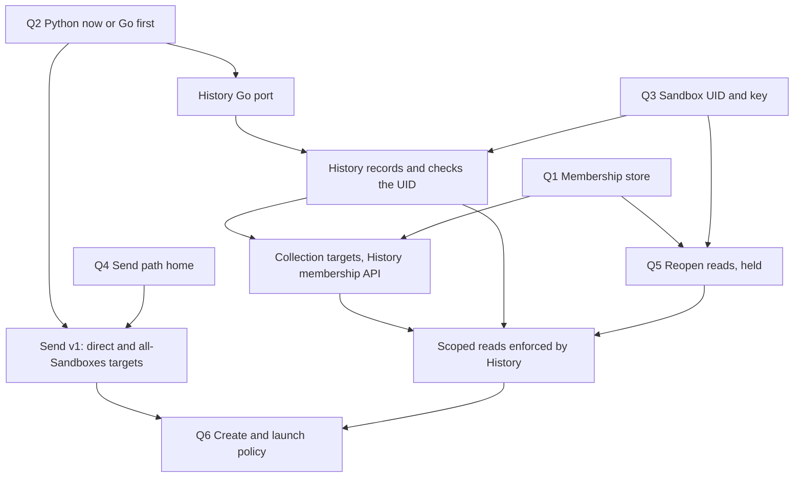

# Architecture overview: open questions and the order to settle them

Status: **not decided, 2026-10-19.** Written at the operator's request for one overview before the
design lanes go further (2026-10-19 01:12 UTC: "some kind of unified idea/overview/plan"). It decides
nothing and supersedes nothing: each plan and [task DAG](task_dag.md) node stays authoritative until
the operator answers. Questions go to him one at a time, in the order below. An answered question
leaves this file and lands in its owning doc or DAG node; the file is deleted when none remain.

## The knot

Five lanes converged on two Python services. The **History Service** is the next Go port the Go lane
recommends, the place the Sandbox UID would be recorded, the candidate owner of collection membership
and the enforcer of history reads. The **Notification service** is the home of the send path, a split
candidate, and also on the Go list. Work started in either in Python is rewritten at its port; work
held for the port delays what the operator wants. The decision that touches both, where collection
membership lives, is held with the read decisions while the draft send schema already assumes an answer.

The lanes: [agent communication](multiagent_communication.md) and
[scoped reads](scoped_session_reads.md), the Kubernetes-borrowing exploration (#10990),
[generated HTTP facades](grpc_http_facade.md), the [agent CLI](agent_cli.md), and the Go rewrite
with its library-consistency work (#10816, #10989).

## Questions, in the order to settle them

### Q1. Where does collection membership live?

**Open.** DAG: `HISTORY_ACCESS_AFTER_DELETION` (held) and the membership part of
`SESSION_ACCESS_RULES_DESIGN`. The operator's constraints:

- History of a deleted Sandbox stays readable (2026-10-18 23:29).
- Collections keep covering Sandboxes "no longer alive", such as "every Coordinator can audit every IC
  Agent" (2026-10-18 23:33).
- He leaned against splitting membership between History and Kubernetes, and against Kubernetes as a
  historical log (2026-10-17 03:22).
- Membership in a database is "okay, we could still have some kind of reconciler" (2026-10-19 01:10).

Options:

- **A. One database owned by History.** Rows keyed by Sandbox UID live as long as the history. Sets
  authored in git are copied in one way by a reconciler, and launch enrollment writes directly. Rules
  stay `PolicySet` rules in Kubernetes, where a collection is a name and not an object.
- **B. Live-only `SandboxCollectionMembership` CRs.** They die with their Sandbox, so collections stop
  covering dead members. This fails the 2026-10-18 requirement.
- **C. CRs for live sends, a database for archive reads.** This fits his tentative idea that archive
  permissions live apart from live objects (2026-10-18 22:31) but splits membership across two stores.
- **D. Never delete a Sandbox: suspend it and drop its PVC** (floated 2026-10-18 23:29). It conflicts
  with the state PVC being owned by its Sandbox, and the Dispatcher's delivery worker acquires a Lease
  for every listed Sandbox each 10 s tick, so 1,000 retained Sandboxes write about 100 Leases per
  second (`runner_gateway/dispatcher/delivery.go`).

**Recommended: A.** It is the only option that meets all four constraints. Then send v1 carries direct
and `allSandboxes` targets only; `sandboxCollections` and the membership CR leave the draft schema, and
collection targets arrive for send and read together with History's membership API. Sending then stays
independent of the read decisions, as the operator expected (2026-10-17 05:51); the one thing that tied
them was the collection target (the dashed edge into `SESSION_ACCESS_RULES`).

### Q2. Is new History and Notification work written in Python now, or after their Go ports?

**Open; the Go lane's card on the next port (2026-10-17 12:43 UTC) has no recorded answer.** The
operator put the Go rewrite first (2026-10-17). Three pieces of the other lanes are language-bound:

- The shared rule evaluator is Python `policy_watch`, imported only by the Action Service and egress.
  #10816 brings a separate Go informer and evaluator for egress. History and Notification would each
  need the evaluator in their own language.
- `HISTORY_SANDBOX_UID` is "the first node to dispatch under either alternative", and it is Python.
- The send, receipt and inbox routes are hand-written HTTP in the Notification service
  ([agent communication](multiagent_communication.md#message-storage-delivery-and-agent-tools)), while
  the [facade rollout](grpc_http_facade.md#rollout) gives that service a facade only with its Go port.

**Recommended:** port History first with its schema unchanged (the Go lane's recommendation); write UID
recording, whatever Q3 selects and the membership API in Go after it; build the send path in the
Python Notification service now, accepting that its watch consumer and rule matcher are rewritten at
that service's port. Messaging is what the operator wants soonest, and the matcher is small.

### Q3. Is the Sandbox UID recorded in History, and are Sessions keyed by it?

**Open; the operator is thinking (2026-10-17 04:45).** DAG: `HISTORY_SESSION_KEY_DESIGN`. He asked that
the ingress check a recorded UID on every push (2026-10-17 04:36), so recording is wanted if done; the re-key to
`(sandbox_uid, session_id)` touches 11 of the 12 History tables and the Electric shapes, and reverses
the 2026-10-10 read-by-Session-ID decision.

**Recommended:** record and check the UID once History is Go (Q2), keep the Session ID as the key, and
decide the re-key and the rows of already-deleted Sandboxes after recorded values exist. Membership
rows (Q1) are keyed by that UID, so recording precedes them.

### Q4. Where does the send path live, and is the service split first?

**Open.** `NOTIFICATION_SERVICE_SPLIT` is unscheduled ("some renaming and refactoring around this service at some
point", 2026-10-17); the agent-communication plan keeps v1 in the Notification service under its current name.
The operator accepted v1 addressing but called it "pretty inelegant" and may pick it up again with
those refactors (2026-10-17 04:18).

**Recommended:** no split before messaging v1; decide the split at the Notification service's Go port.
Send routes then live where the plan puts them.

### Q5. Reopen the read decisions

**Held by the operator (2026-10-17 10:56).** When reopened: the rule type for reads (separate from
sending, 2026-10-18 22:46), listing as a weaker permission, whether the archive's permissions are a
separate universe (tentative, 2026-10-18 22:31), and whether `allSandboxes` reaches histories with no
recorded UID.

**Recommended:** leave held until Q1 to Q3 are answered and History is Go with the UID recorded.

### Q6. Create and launch policy

`MULTIAGENT_MODEL`, `THREAD_CREATE_POLICY` and `AGENT_LAUNCH_POLICY_DESIGN` follow messaging and
reads and constrain neither. **Recommended:** no question until then.

## Dependencies

Independent of all of it: the Dispatcher-reads step of the facade rollout (Go already, no port),
the Go library work (#10989, then the egress port), the Dispatcher persistence, destination-authority
and sender-grant nodes (v0 trusts the app and Notification to authorize their users, so agent
messaging needs none), and `HARNESS_IDENTITY_DESIGN`.

## What the operator settled

| Date (UTC)       | Operator                                                                                            | Consequence                                             |
| ---------------- | --------------------------------------------------------------------------------------------------- | ------------------------------------------------------- |
| 2026-10-17 03:30 | Sender receipts that tell "was this acked" from "did a notice cover this"                           | Receipts in v1                                          |
| 2026-10-17 03:41 | OAuth callers get an SA through an Actions connection and send from an actions-sandbox              | No separate OAuth sender path                           |
| 2026-10-17 04:12 | Messages come with the Sandbox; wake-on-send does not look it up from a Session                     | No Session-to-Sandbox registry                          |
| 2026-10-17 05:58 | `allSandboxes` in v1, "under some kind of scope of the controller"                                  | Bounded to the PolicySet's namespace                    |
| 2026-10-17 10:56 | Keep read-permission decisions held "for now"                                                       | Q5                                                      |
| 2026-10-17 to 18 | The [agent CLI decisions](agent_cli.md#settled-decisions)                                           | Waits only for his go to build                          |
| 2026-10-18 22:39 | Agent traces and archives should not go into the control-plane etcd                                 | Per-Session data stays out of Kubernetes records        |
| 2026-10-18 22:46 | Sending and reading transcripts are "really separate capabilities we probably don't need to bundle" | First `session_access` schema carries sending only      |
| 2026-10-18 22:48 | Work towards "all grpc + maybe the standard http facades"                                           | Generated facades                                       |
| 2026-10-18 22:49 | "make all our services use the same consistent libraries"                                           | slog JSON everywhere; the loader and egress port follow |
| 2026-10-18 23:14 | Delay the Go egress merge until the library refactors land                                          | #10816 waits                                            |
| 2026-10-18 23:17 | The app fronting the facades first is fine; browser direct is nice but "i don't insist" (23:16)     | App-fronted first, direct later                         |
| 2026-10-18 23:19 | No need to name a different namespace                                                               | Direct targets are same-namespace                       |
| 2026-10-18 23:33 | Collections keep covering Sandboxes no longer alive                                                 | Rules out live-members-only collections for reads       |

His tentative words, not decisions: archive permissions "in a possibly separate universe"
(2026-10-18 22:31), membership in a database with a reconciler (2026-10-19 01:10), and suspending
instead of deleting Sandboxes as "one consistent way" (2026-10-18 23:29).

## Assumed by a lane and never confirmed

| Assumption                                                                                                    | Where it lives                                         | What the operator said                                                        |
| ------------------------------------------------------------------------------------------------------------- | ------------------------------------------------------ | ----------------------------------------------------------------------------- |
| `session_access` rule shape, `targets` union, one `SandboxCollectionMembership` CR per Sandbox and collection | #10987, plan                                           | Only the two target decisions above                                           |
| Resync of 300 s, refusal after three missed cycles, `policy_resync_seconds`                                   | #10987                                                 | Asked "Shouldn't freshness just come from a k8s watch?" The number is not his |
| Payloads expire at 30 days, 128 unacknowledged per sender per inbox, idempotency key, recipient states        | [plan](multiagent_communication.md), #10987            | Never answered that batch; he later asked for one question at a time          |
| History owns membership, keyed by Sandbox UID                                                                 | #10990                                                 | "okay" to a database, not to the owner or key                                 |
| Records stay in the primary cluster's Kubernetes API                                                          | #10990 "Take"                                          | Raised a second control plane as a possibility, no answer                     |
| gRPC-Gateway in each service's process over loopback, NDJSON streams, per-service rollout with the Go port    | [facade plan](grpc_http_facade.md), merged as proposed | The direction and the app-first path only                                     |
| History is the next Go port                                                                                   | Go lane card                                           | No recorded answer                                                            |

## Open PRs that encode unconfirmed defaults

| PR     | Encodes                                                                      | Handling                                                                                         |
| ------ | ---------------------------------------------------------------------------- | ------------------------------------------------------------------------------------------------ |
| #10987 | The draft send schema with the membership CR, freshness and recipient states | Do not merge before Q1; after A, drop the CR and collection targets, then merge                  |
| #10990 | History as default membership owner; records stay in the primary API         | Narrow to the options not chosen once Q1 is answered, then merge                                 |
| #10816 | A Go egress policy evaluator and informer beside the Python ones             | Already delayed by the operator; its Go evaluator is the second implementation in C2             |
| #10989 | A shared Go settings loader                                                  | The operator asked "do we need one?"; the lane compared `kong` and `koanf`; his merge answers it |

## Conflicts between lanes

- **C1. Membership in two places.** #10987 reads CRs in the Notification service's watch; #10990
  recommends a History database; the operator said not to split membership and also said a database
  is "okay". Settled by Q1.
- **C2. Shared code versus Go first.** The agent-communication plan shares one evaluator; the Go
  lane and #10816 write Go evaluators. Settled by Q2.
- **C3. First to dispatch versus Go first.** The DAG makes `HISTORY_SANDBOX_UID` the first node to
  dispatch, in Python, while the Go lane's open card puts the same nodes in Go. Settled by Q2 and Q3.
- **C4. New HTTP routes on a service that gets its facade at its port.** The send path and the CLI's
  `notifications` group target hand-written HTTP that the port replaces. Accepted by Q2's
  recommendation; the CLI group waits for the send API to exist.
- **C5. Keeping Sandboxes versus Sandbox ownership.** Option D contradicts the state PVC being owned
  by its Sandbox and adds a Dispatcher Lease per dead Sandbox. Settled by Q1.

## Parked

Nothing waits on these:

- [API aggregation](api_aggregation_exploration.md) is held by the operator.
- A second control plane is revisited only when etcd pressure from Agentplane records, a second
  workload cluster, or a Sandbox count at which the Lease rate matters is measured (#10990).
