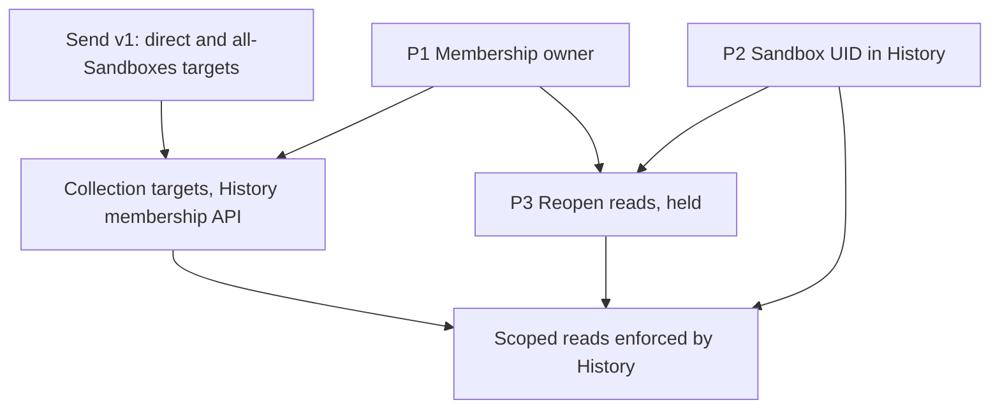

# Architecture overview: where each object lives

Status: **not decided, 2026-10-19.** Written at the operator's request for one overview before the
design lanes go further (2026-10-19 01:12 UTC: "some kind of unified idea/overview/plan"). He then
named the subject: the Python and Go ports "can probably be sequenced really in any order relative to
the other things", and "the more important things we were talking about were things like 'where do
what objects live'" (01:37 UTC). This file is that map. It decides nothing and supersedes nothing:
each plan and [task DAG](task_dag.md) node stays authoritative until he answers. Questions go to him
one at a time, in the order below. An answered question leaves this file and lands in its owning doc
or DAG node; the file is deleted when none remain.

What separates the places an object can live: whether its lifetime ends with its Sandbox; whether it
needs Kubernetes machinery (ownership and garbage collection, conflict-checked writes, watches, RBAC,
Flux); its volume and write rate; who authors it (git, the app, a controller, an agent); and which
services read it, including whether a reference to a deleted object is acceptable.

## The map

### Kubernetes records

- **Sandbox.** Now: a `Sandbox` CR. The app writes desired state, the Sandbox Controller writes
  status, and the Dispatcher patches the wake fields. Proposed: stays (#10990: about 190 KB of
  Agentplane records in staging, no Session data). Operator: deletes a Sandbox when done and wants its
  history kept (2026-10-18 23:29), and floated suspending instead of deleting.
- **Sandbox children** (Pod or VM, state PVC, ServiceAccount, `<sandbox>-control` Service, the
  Sandbox's own `PolicyBinding`). Now: owned by the Sandbox and removed with it. Nothing proposed.
- **Grants and catalog** (`PolicySet`, static `PolicyBinding`s, `SandboxTemplate`,
  `EgressCredential`). Now: authored in git and applied by Flux; the app writes runtime grants as
  bindings owned by the Sandbox. Proposed: stay; a second control plane would need a mirror reconciler
  or Flux pointed at it (#10990). Operator: wants the Flux-managed shared permission sets kept
  gitops-driven, and floated a second control plane "if it came to it" (2026-10-18 22:54, 23:02).
- **Leases.** Now: `dispatcher-<sandbox UID>`, renewed every 10 s (`LeaseRenewInterval`), and
  `<sandbox>-runner` from the Gateway. The Dispatcher also keeps a Postgres `sandbox_ownership`
  generation fence per Sandbox. #10990 counts 0.1 to 0.17 writes per second per Sandbox and did not
  check whether the Dispatcher Lease is still needed beside the Postgres row.

### Databases and runner storage

- **Session history** (raw Events, observations, settlements, the Thread fold). Now: the History
  database `sandbox_service`, which outlives the Sandbox; four fold tables replicate through Electric to
  the browser. Operator: agent traces and big objects should not go into the control-plane etcd
  (2026-10-18 22:39).
- **Which Sandbox wrote a Session.** Now: History records the namespace and name its writer
  ServiceAccount implies, and no UID ([History README](../history_service/README.md#which-sandbox-wrote-a-session)).
  Proposed: a nullable `session_history.sandbox_uid`, checked on every push, and optionally keys by it
  (`HISTORY_SESSION_KEY_DESIGN`). Operator: wants the per-push check if the UID is recorded (2026-10-17
  04:36); "i'll want to think about it" (04:45).
- **Thread** (the app's link and metadata for a Session). Now: the app database, keyed by Session ID
  with no Sandbox column. Proposed: add `sandbox_uid` only if History re-keys.
- **Commands and Session openings.** Now: the Dispatcher database (`dispatch`, `session_opening`,
  `wake_attempt`, `sandbox_ownership`), every row carrying the Sandbox UID. Proposed:
  `DISPATCHER_PERSISTENCE_MODEL_DESIGN` compares the durable queue with direct admission. Operator: the
  Dispatcher keeps no Session-to-Sandbox registry (2026-10-17 03:53, 04:12).
- **Inbox entries, notices, subscriptions.** Now: the Notification database; entries survive their
  inbox's retirement when the Sandbox is gone. Proposed: peer messages and sender receipts join this
  store, and the service split stays unscheduled. Operator: wants receipts that tell "was this acked"
  from "did a notice cover this" (2026-10-17 03:30), and may revisit the service with later
  "refactors/splits/reshuffles" (04:18).
- **Action requests, Decisions, connections** (Actions database), **egress admission decisions**
  (egress database), **launch presets** (app configuration, with a label and a compact annotation on
  the Sandbox). Nothing proposed.
- **Runner journal.** Now: one SQLite file per Session on the Sandbox's state volume; History is the
  retained copy once the runner pushes it. Nothing proposed.

### Not stored yet

- **Collection membership** (which Sandboxes a named collection holds, for grants). Proposed: #10987
  makes one `SandboxCollectionMembership` CR per Sandbox and collection; #10990 recommends rows in
  History's database keyed by Sandbox UID, with git-authored sets reconciled in one way. Operator:
  collections must keep covering Sandboxes "no longer alive" (2026-10-18 23:33); a database is "okay,
  we could still have some kind of reconciler" (2026-10-19 01:10).
- **Session-access grants** (who may send to, or read, which Sandbox's Sessions). Now: History's
  configured `reader_accounts` are the only gate on reads, and the Dispatcher trusts the app and
  Notification to authorize their users. Proposed: `session_access` rules in `PolicySet`s, assigned by
  `PolicyBinding`s and enforced by the owning service
  ([plan](multiagent_communication.md#tentative-implementation-direction)). Operator: sending and
  reading transcripts are "really separate capabilities" (2026-10-18 22:46); archive permissions maybe
  "in a possibly separate universe" from live objects (22:31, tentative); read decisions held
  (2026-10-17 10:56).

## Questions, in the order to settle them

### P1. Which service's database holds collection membership?

**Open; a database is his tentative answer.** Rows are keyed by Sandbox UID, the key the Dispatcher,
Gateway and Notification already use, and live as long as the history. Static sets stay authored in git
and a one-way reconciler copies them in; launch enrollment writes directly.

- **A. History's database (default; the lane's recommendation).** History must enforce reads of
  archived history, and the Notification service already calls History, so a send check asks History.
- **B. Notification's database.** The send check is local, but History would call Notification to
  enforce reads, reversing a dependency that runs the other way today.
- **C. A new store.** One more database and service for a small table.

**Recommended: A.** Then send v1 carries direct and `allSandboxes` targets only; `sandboxCollections`
and the membership CR leave the draft schema in #10987, and collection targets arrive for send and
read together with History's membership API. Sending then stays independent of the read decisions, as
the operator expected (2026-10-17 05:51); the collection target was the only thing tying them (the
dashed edge into `SESSION_ACCESS_RULES` in the DAG).

### P2. Does History record the Sandbox UID, and are Sessions keyed by it?

**Open; the operator is thinking (2026-10-17 04:45).** DAG: `HISTORY_SESSION_KEY_DESIGN`. Recording is
wanted if done; the re-key to `(sandbox_uid, session_id)` touches 11 of the 12 History tables and the
Electric shapes, and reverses the 2026-10-10 read-by-Session-ID decision. Membership (P1) needs none of
it; scoped reads do.

**Recommended:** record and check the UID, keep the Session ID as the key, and decide the re-key and the
rows of already-deleted Sandboxes after recorded values exist.

### P3. Reopen the read decisions

**Held by the operator (2026-10-17 10:56).** When reopened: whether archive reads carry their own grants
beside History's membership (a separate universe from live-object `PolicySet`s) or `PolicySet` rules
name Sandboxes as strings; the rule type for reads; listing as a weaker permission; and whether
`allSandboxes` reaches histories with no recorded UID.

**Recommended:** leave held until P1 and P2 are answered.

### Independent of the three

The Python and Go port order (operator, 2026-10-19 01:37), the generated HTTP facades, the agent CLI,
the Dispatcher queue-versus-direct-admission comparison, whether the hot Leases stay in Kubernetes
(first check the Dispatcher Lease against its Postgres fence), the Notification service split, and
create and launch policy (`MULTIAGENT_MODEL` and the nodes after it), which follows messaging and reads.

## Dependencies

## What the operator settled

| Date (UTC)       | Operator                                                                                            | Consequence                                        |
| ---------------- | --------------------------------------------------------------------------------------------------- | -------------------------------------------------- |
| 2026-10-17 03:30 | Sender receipts that tell "was this acked" from "did a notice cover this"                           | Receipts in v1                                     |
| 2026-10-17 03:41 | OAuth callers get an SA through an Actions connection and send from an actions-sandbox              | No separate OAuth sender path                      |
| 2026-10-17 04:12 | Messages come with the Sandbox; wake-on-send does not look it up from a Session                     | No Session-to-Sandbox registry                     |
| 2026-10-17 05:58 | `allSandboxes` in v1, "under some kind of scope of the controller"                                  | Bounded to the PolicySet's namespace               |
| 2026-10-17 10:56 | Keep read-permission decisions held "for now"                                                       | P3                                                 |
| 2026-10-18 22:39 | Agent traces and archives should not go into the control-plane etcd                                 | Per-Session data stays out of Kubernetes records   |
| 2026-10-18 22:46 | Sending and reading transcripts are "really separate capabilities we probably don't need to bundle" | First `session_access` schema carries sending only |
| 2026-10-18 23:19 | No need to name a different namespace                                                               | Direct targets are same-namespace                  |
| 2026-10-18 23:33 | Collections keep covering Sandboxes no longer alive                                                 | Rules out live-members-only collections for reads  |
| 2026-10-19 01:37 | Python and Go ports can be sequenced in any order relative to the other things                      | Ports are not part of this map                     |

His tentative words, not decisions: archive permissions "in a possibly separate universe"
(2026-10-18 22:31), membership in a database with a reconciler (2026-10-19 01:10), and suspending
instead of deleting Sandboxes as "one consistent way" (2026-10-18 23:29).

## Assumed by a lane and never confirmed

| Assumption                                                                                                    | Where it lives                              | What the operator said                                                        |
| ------------------------------------------------------------------------------------------------------------- | ------------------------------------------- | ----------------------------------------------------------------------------- |
| `session_access` rule shape, `targets` union, one `SandboxCollectionMembership` CR per Sandbox and collection | #10987, plan                                | Only the two target decisions above                                           |
| Resync of 300 s, refusal after three missed cycles, `policy_resync_seconds`                                   | #10987                                      | Asked "Shouldn't freshness just come from a k8s watch?" The number is not his |
| Payloads expire at 30 days, 128 unacknowledged per sender per inbox, idempotency key, recipient states        | [plan](multiagent_communication.md), #10987 | Never answered that batch; he later asked for one question at a time          |
| History owns membership, keyed by Sandbox UID                                                                 | #10990                                      | Tentatively okay to a database, not to the owner or key                       |
| Records stay in the primary cluster's Kubernetes API                                                          | #10990 "Take"                               | Raised a second control plane as a possibility, no answer                     |

## Open PRs that encode unconfirmed defaults

| PR     | Encodes                                                                      | Handling                                                         |
| ------ | ---------------------------------------------------------------------------- | ---------------------------------------------------------------- |
| #10987 | The draft send schema with the membership CR, freshness and recipient states | Update for P1 before merging: drop the CR and collection targets |
| #10990 | History as default membership owner; records stay in the primary API         | Narrow once P1's owner is confirmed, then merge                  |

## Conflicts between lanes

- **C1. Membership in two places.** #10987 reads CRs in the Notification service's watch; #10990
  recommends a History database; the operator leaned against splitting membership and later said a
  database is okay. P1 leans to the database; #10987 still assumes CRs.
- **C2. Read grants in Kubernetes or in the archive.** The plan puts every grant in `PolicySet`s, while
  the operator floated archive permissions as a separate universe. Held with P3.
- **C3. Keeping Sandboxes.** Suspending instead of deleting contradicts the state PVC being owned by its
  Sandbox and costs a Dispatcher Lease write every 10 s per dead Sandbox (about 100 per second at 1,000;
  `runner_gateway/dispatcher/delivery.go`). A membership database removes the reason for it.

## Parked

Nothing waits on these:

- [API aggregation](api_aggregation_exploration.md) is held by the operator.
- A second control plane is revisited only when etcd pressure from Agentplane records, a second
  workload cluster, or a Sandbox count at which the Lease rate matters is measured (#10990).
