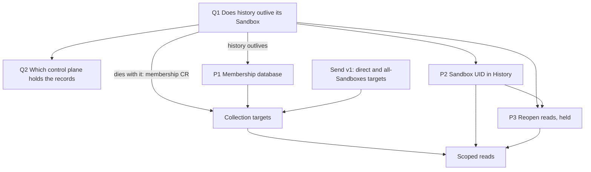

# Architecture overview: where each object lives

Status: **not decided, 2026-10-19.** Written at the operator's request for one overview before the
design lanes go further (2026-10-19 01:12 UTC: "some kind of unified idea/overview/plan"). The
operator named the subject as "where do what objects live", with the Python and Go ports sequenced
"really in any order relative to the other things" (01:37). They then asked for the question under
it: "should we run on k8s, should our cp be the same as the outer cluster's cp, or should we have
some database for our objects that just reconciles via e.g. tofu or something" (01:58), and offered a
second consistent lifetime for a Sandbox's history (02:04). This file decides nothing and supersedes
nothing: each plan and [task DAG](task_dag.md) node stays authoritative until the operator answers.
Questions go to the operator one at a time, in the order below. An answered question leaves this
file and lands in its owning doc or DAG node; the file is deleted when none remain.

What separates the places an object can live: whether its lifetime ends with its Sandbox; whether it
needs Kubernetes machinery (ownership and garbage collection, conflict-checked writes, watches, RBAC,
Flux); its volume and write rate; who authors it (git, the app, a controller, an agent); and which
services read it, including whether a reference to a deleted object is acceptable.

## Q1. Does a Sandbox's history outlive the Sandbox?

The operator: keeping grants for Sandboxes that no longer exist is "mostly an artifact of my workflow
being a weird hybrid", and "one other consistent option would be e.g. 'deleting a Sandbox also
deletes its history records'", with the Sandbox kept when "done with it" (2026-10-19 02:04).

- **A. History outlives its Sandbox (today's workflow).** The operator deletes a Sandbox when done
  and wants its history readable (2026-10-18 23:29), and collections keep covering Sandboxes "no
  longer alive" (23:33). Membership, archive grants and History's record of the writer then outlive
  the object they name. Garbage collection removes a Sandbox-owned Kubernetes object with the
  Sandbox, so these need a store that outlives Sandboxes (P1), and reads may need grants apart from
  live objects (P3).
- **B. A Sandbox and its history live and die together.** Done means retired: stopped with
  `spec.wakeOnSend: false`, two fields that exist today. Deleting is the one decision that drops the
  history. Nothing outlives its Sandbox, so garbage collection covers cleanup, and grants and
  collections only name Sandboxes that exist. It needs:
  - the Dispatcher to skip retired Sandboxes. Today each 10 s tick lists every Sandbox in the
    namespace, with no filter on state, and creates or renews its `dispatcher-<sandbox UID>` Lease
    (`runner_gateway/dispatcher/delivery.go`, `sandbox_kubernetes.go`); staging showed three renewing
    every 10 s while no runner had connected for 17 to 25 hours (#10990);
  - a delete that cascades, held by the Sandbox Controller's finalizer, which already waits for the
    runner to seal. History has no delete RPC (`proto/history_service.proto`) and would delete by
    the writing Sandbox's UID, which it does not record yet (P2), because a name can be reused.
    Notification deletes the inboxes and entries it now keeps after retirement. The app drops its
    Threads from its own watch, since no service calls the app
    ([dependency rule](../docs/service_boundaries.md)). The Dispatcher already ends a deleted
    Sandbox's rows;
  - room for retired Sandboxes: each keeps its ServiceAccount, `PolicyBinding`, state PVC and an
    entry in every Sandbox watcher's cache. By staging's object sizes (#10990) that is about 10 KB of
    records per Sandbox, 10 MB per thousand; arithmetic, not a measurement. Dropping a retired
    Sandbox's PVC would be a new state: today stopping never deletes it
    ([storage](../docs/sandbox_storage.md)).

**Recommended: B.** It removes the class of records that outlive their Sandbox, and with it P1 and
the separate archive universe in P3. Its cost is bounded work in three services and records that
grow with the retired Sandboxes, which Q2 weighs.

## Q2. Which control plane holds Agentplane's records?

Sandbox workloads run on Kubernetes under every answer ([principles](../docs/principles.md):
Kubernetes is a shared baseline). The question is where the records live: the five CRD kinds and the
Leases. #10990 inventories what each borrows from Kubernetes.

- **A. The outer cluster's Kubernetes API (today).** Watches, conflict-checked writes, status,
  ownership and garbage collection, RBAC, Pod-bound tokens, Flux and `kubectl` come with nothing to
  run. Costs: the records and their watches share the apiserver and etcd that run the whole cluster.
  The CRDs are cluster-scoped and applied from `devel` by one `agentplane-crds` Kustomization, so a
  CRD change reaches staging when it reaches testing. Under Q1 A, records that outlive their Sandbox
  go to a service database.
- **B. Agentplane's own control plane.** A nodeless kube-apiserver per environment, on kine over the
  CNPG cluster or on its own etcd, or our own implementation of the parts we use. Gains: records and
  their write rate leave the cluster's etcd, CRDs are per environment, records are backed up with
  CNPG, and the protocol, clients, `kubectl` and Flux (`spec.kubeConfig`) stay. Costs:
  - another control plane per environment to run;
  - ownership does not cross apiservers, so the Sandbox Controller deletes each child itself, and
    the Gateway's Pod-to-Sandbox check and the launcher relay policy need a binding other than an
    owner UID;
  - identity stays on the primary: the second plane accepts the same tokens only through webhook
    token authentication to the primary (not tried), and keeps its own RBAC;
  - services that read records and also touch cluster objects (the app, both controllers, the
    Gateway, egress, the Action Service) hold two clients;
  - it does not by itself take records out of memory: the apiserver's watch cache is on by default,
    and whether turning it off covers custom resources was not checked.
- **C. A database owns the records, and git-authored ones are reconciled in.** Rows in a service's
  own database behind its own API, as the Dispatcher's are. `PolicySet`s and templates arrive through
  tofu-controller, as `tf/gitops/` does for Authentik and Forgejo (with a provider we would write),
  or through an importer. Gains: any lifetime and write rate, and transactions shared with the
  service's tables. Costs:
  - we build the resumable watch, status, conflict checks, cascade deletion, authorization and audit
    (#10990 rates the watch hardest);
  - `kubectl`, Flux, `kubernetes_asyncio` (about 27 Python files) and controller-runtime no longer
    reach these records;
  - it brings back a service that owns Sandboxes, which the
    [session-control ADR](../docs/adr_sandbox_session_control.md#decisions) removed on 2026-10-14;
  - ServiceAccounts, RoleBindings, Secrets and workloads stay in the cluster, so a controller still
    bridges the two.

Kinds can also go different ways. The catalog (`PolicySet`, `SandboxTemplate`, `EgressCredential`,
static bindings) owns nothing and moves freely. The Sandbox family is tied to its workload children
by ownership (#10990, "Which kinds could move").

**Recommended: A, revisited on measurement.** With Q1 B every record stays Kubernetes-shaped, and the
growth is retired Sandboxes at about 10 KB each. Staging holds about 190 KB of Agentplane records,
and etcd itself was not read (#10990). B speaks the same protocol, so A keeps it open, and C is the
hardest to reverse. Revisit on any of: etcd pressure from Agentplane records, a CRD change staging
cannot take at the same moment as testing, a second workload cluster, or retired Sandboxes in the
thousands.

## The map today

### Kubernetes records

- **Sandbox.** A `Sandbox` CR. The app writes desired state, the Sandbox Controller writes status,
  and the Dispatcher patches the wake fields. Operator: deletes a Sandbox when done and wants its
  history kept (2026-10-18 23:29), floated suspending instead of deleting, and offered deleting the
  history with the Sandbox (Q1).
- **Sandbox children** (Pod or VM, state PVC, ServiceAccount, `<sandbox>-control` Service, the
  Sandbox's own `PolicyBinding`). Owned by the Sandbox and removed with it.
- **Grants and catalog** (`PolicySet`, static `PolicyBinding`s, `SandboxTemplate`,
  `EgressCredential`). Authored in git and applied by Flux; the app writes runtime grants as bindings
  owned by the Sandbox. Operator: wants the Flux-managed shared permission sets kept gitops-driven,
  and floated a second control plane "if it came to it" (2026-10-18 22:54, 23:02).
- **Leases.** `dispatcher-<sandbox UID>`, renewed every 10 s (`LeaseRenewInterval`) for every
  Sandbox, suspended or not, and `<sandbox>-runner` from the Gateway while a runner is connected. The Dispatcher also keeps a Postgres `sandbox_ownership`
  generation fence per Sandbox. #10990 counts 0.1 to 0.17 writes per second per Sandbox and did not
  check whether the Dispatcher Lease is still needed beside the Postgres row.

### Databases and runner storage

- **Session history** (raw Events, observations, settlements, the Thread fold). The History database
  `sandbox_service`, which outlives the Sandbox; four fold tables replicate through Electric to the
  browser. Operator: agent traces and big objects should not go into the control-plane etcd
  (2026-10-18 22:39).
- **Which Sandbox wrote a Session.** History records the namespace and name its writer
  ServiceAccount implies, and no UID ([History README](../history_service/README.md#which-sandbox-wrote-a-session)).
  Proposed: a nullable `session_history.sandbox_uid`, checked on every push, and optionally keys by it
  (`HISTORY_SESSION_KEY_DESIGN`). Operator: wants the per-push check if the UID is recorded (2026-10-17
  04:36); "i'll want to think about it" (04:45).
- **Thread** (the app's link and metadata for a Session). The app database, keyed by Session ID with
  no Sandbox column. Proposed: add `sandbox_uid` only if History re-keys.
- **Commands and Session openings.** The Dispatcher database (`dispatch`, `session_opening`,
  `wake_attempt`, `sandbox_ownership`), every row carrying the Sandbox UID and ended when the Sandbox
  is gone. Proposed: `DISPATCHER_PERSISTENCE_MODEL_DESIGN` compares the durable queue with direct
  admission. Operator: the Dispatcher keeps no Session-to-Sandbox registry (2026-10-17 03:53, 04:12).
- **Inbox entries, notices, subscriptions.** The Notification database; entries survive their
  inbox's retirement when the Sandbox is gone. Proposed: peer messages and sender receipts join this
  store, and the service split stays unscheduled. Operator: wants receipts that tell "was this acked"
  from "did a notice cover this" (2026-10-17 03:30), and may revisit the service with later
  "refactors/splits/reshuffles" (04:18).
- **Action requests, Decisions, connections** (Actions database), **egress admission decisions**
  (egress database), **launch presets** (app configuration, with a label and a compact annotation on
  the Sandbox). Nothing proposed.
- **Runner journal.** One SQLite file per Session on the Sandbox's state volume; History is the
  retained copy once the runner pushes it. Nothing proposed.

### Not stored yet

- **Collection membership** (which Sandboxes a named collection holds, for grants). Proposed: #10987
  makes one Sandbox-owned `SandboxCollectionMembership` CR per Sandbox and collection; #10990
  recommends rows in History's database keyed by Sandbox UID, with git-authored sets reconciled in one
  way. Operator: collections must keep covering Sandboxes "no longer alive" (2026-10-18 23:33); a
  database is "okay, we could still have some kind of reconciler" (2026-10-19 01:10).
- **Session-access grants** (who may send to, or read, which Sandbox's Sessions). History's
  configured `reader_accounts` are the only gate on reads, and the Dispatcher trusts the app and
  Notification to authorize their users. Proposed: `session_access` rules in `PolicySet`s, assigned by
  `PolicyBinding`s and enforced by the owning service
  ([plan](multiagent_communication.md#tentative-implementation-direction)). Operator: sending and
  reading transcripts are "really separate capabilities" (2026-10-18 22:46); archive permissions maybe
  "in a possibly separate universe" from live objects (22:31, tentative); read decisions held
  (2026-10-17 10:56).

## Questions after Q1 and Q2

### P1. Which service's database holds collection membership? (Q1 A only)

Under Q1 B, a retired Sandbox still exists, so #10987's Sandbox-owned membership CR covers it and this
question goes away. Under Q1 A, rows are keyed by Sandbox UID, the key the Dispatcher, Gateway and
Notification already use, and live as long as the history. Static sets stay authored in git and a
one-way reconciler copies them in; launch enrollment writes directly.

- **A. History's database (default; the lane's recommendation).** History must enforce reads of
  archived history, and the Notification service already calls History, so a send check asks History.
- **B. Notification's database.** The send check is local, but History would call Notification to
  enforce reads, reversing a dependency that runs the other way today.
- **C. A new store.** One more database and service for a small table.

**Recommended: A.** Then send v1 carries direct and `allSandboxes` targets only, and collection
targets arrive for send and read together with History's membership API. Sending then stays
independent of the read decisions, as the operator expected (2026-10-17 05:51).

### P2. Does History record the Sandbox UID, and are Sessions keyed by it?

**Open; the operator is thinking (2026-10-17 04:45).** DAG: `HISTORY_SESSION_KEY_DESIGN`. Q1 B needs
the recording, to delete the right Sessions. The re-key to `(sandbox_uid, session_id)` touches 11 of
the 12 History tables and the Electric shapes, and reverses the 2026-10-10 read-by-Session-ID
decision.

**Recommended:** record and check the UID, keep the Session ID as the key, and decide the re-key after
recorded values exist.

### P3. Reopen the read decisions

**Held by the operator (2026-10-17 10:56).** Under Q1 B no history outlives its Sandbox, so read
grants name live or retired Sandboxes and the separate archive universe has no reason to exist. Under
Q1 A, when reopened: whether archive reads carry their own grants beside History's membership or
`PolicySet` rules name Sandboxes as strings; the rule type for reads; listing as a weaker permission;
and whether `allSandboxes` reaches histories with no recorded UID.

**Recommended:** leave held until Q1 and P2 are answered.

### Independent of these

The Python and Go port order (operator, 2026-10-19 01:37), the generated HTTP facades, the agent CLI,
the Dispatcher queue-versus-direct-admission comparison, which Sandboxes the Dispatcher leases, the
Notification service split, and create and launch policy (`MULTIAGENT_MODEL` and the nodes after
it), which follows messaging and reads.

The Dispatcher's loop is not polling: Sandbox changes arrive from its informer and queue changes from
Postgres notifications, the listing reads the watch cache, and the 10 s tick is the Lease heartbeat
(`delivery.go`). The open part is which Sandboxes hold a Lease at all: one with nothing queued and no
wake allowed may need none, ownership could be taken when a command or a wakeable Sandbox appears,
and whether the Lease is needed beside the Postgres fence was not checked.

## Dependencies

## What the operator settled

| Date (UTC)       | Operator                                                                                            | Consequence                                        |
| ---------------- | --------------------------------------------------------------------------------------------------- | -------------------------------------------------- |
| 2026-10-17 03:30 | Sender receipts that tell "was this acked" from "did a notice cover this"                           | Receipts in v1                                     |
| 2026-10-17 03:41 | OAuth callers get an SA through an Actions connection and send from an actions-sandbox              | No separate OAuth sender path                      |
| 2026-10-17 04:12 | Messages come with the Sandbox; wake-on-send does not look it up from a Session                     | No Session-to-Sandbox registry                     |
| 2026-10-17 05:58 | `allSandboxes` in v1, "under some kind of scope of the controller"                                  | Bounded to the PolicySet's namespace               |
| 2026-10-17 10:56 | Keep read-permission decisions held "for now"                                                       | P3                                                 |
| 2026-10-18 22:39 | Agent traces and archives should not go into the control-plane etcd                                 | Per-Session data stays out of Kubernetes records   |
| 2026-10-18 22:46 | Sending and reading transcripts are "really separate capabilities we probably don't need to bundle" | First `session_access` schema carries sending only |
| 2026-10-18 23:19 | No need to name a different namespace                                                               | Direct targets are same-namespace                  |
| 2026-10-18 23:33 | Collections keep covering Sandboxes no longer alive                                                 | Rules out live-members-only collections for reads  |
| 2026-10-19 01:37 | Python and Go ports can be sequenced in any order relative to the other things                      | Ports are not part of this map                     |

Tentative words, not decisions: archive permissions "in a possibly separate universe" (2026-10-18
22:31), suspending instead of deleting Sandboxes as "one consistent way" (23:29), membership in a
database with a reconciler (2026-10-19 01:10), and deleting a Sandbox's history with it as "one other
consistent option" (02:04).

## Assumed by a lane and never confirmed

| Assumption                                                                                                    | Where it lives                              | What the operator said                                                        |
| ------------------------------------------------------------------------------------------------------------- | ------------------------------------------- | ----------------------------------------------------------------------------- |
| `session_access` rule shape, `targets` union, one `SandboxCollectionMembership` CR per Sandbox and collection | #10987, plan                                | Only the two target decisions above                                           |
| Resync of 300 s, refusal after three missed cycles, `policy_resync_seconds`                                   | #10987                                      | Asked "Shouldn't freshness just come from a k8s watch?" The number is not his |
| Payloads expire at 30 days, 128 unacknowledged per sender per inbox, idempotency key, recipient states        | [plan](multiagent_communication.md), #10987 | Never answered that batch; later asked for one question at a time             |
| History owns membership, keyed by Sandbox UID                                                                 | #10990                                      | Tentatively okay to a database, not to the owner or key; needed only if Q1 A  |
| Records stay in the primary cluster's Kubernetes API                                                          | #10990 "Take"                               | Asked it as the open question under the map (2026-10-19 01:58): Q2            |

## Open PRs that encode unconfirmed defaults

| PR     | Encodes                                                                      | Handling                                                                             |
| ------ | ---------------------------------------------------------------------------- | ------------------------------------------------------------------------------------ |
| #10987 | The draft send schema with the membership CR, freshness and recipient states | Under Q1 B the CR stays; under Q1 A drop the CR and collection targets (P1)          |
| #10990 | History as default membership owner; records stay in the primary API         | Its inventory backs Q2; narrow its membership section and Take once Q1 and Q2 settle |

## Conflicts between lanes

- **C1. Membership in two places.** #10987 reads CRs in the Notification service's watch; #10990
  recommends a History database. Q1 B keeps the CR; Q1 A leads to P1's database.
- **C2. Read grants in Kubernetes or in the archive.** The plan puts every grant in `PolicySet`s,
  while the operator floated archive permissions as a separate universe. Q1 B removes the archive
  that would need it; under Q1 A it is held with P3.
- **C3. Keeping Sandboxes.** Keeping them costs a Dispatcher Lease write every 10 s per kept Sandbox
  (about 100 per second at 1,000) unless the Dispatcher skips retired ones, plus their PVCs. This is
  Q1 B's cost.

## Parked

[API aggregation](api_aggregation_exploration.md) is held by the operator. Nothing waits on it.
