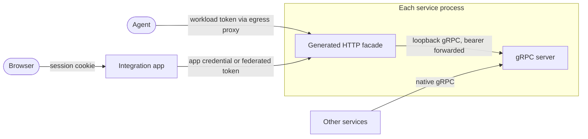

# Generated HTTP facades for every service API, browser included

Status: **the operator chose the app-fronted browser path for the first steps (2026-10-19); the
Dispatcher reads and the egress admin gRPC interface have landed.** It extends the transport
direction approved on 2026-10-15
([API transports and agent workflows](../docs/runner_delivery_and_harness_design.md#api-transports-and-agent-workflows):
gRPC between services, a gRPC-Gateway HTTP/JSON facade, an ergonomic CLI, adopted one service and
interface at a time) from agents to the browser. Direct browser access to the facades stays open as a
[later option](#direct-browser-access-later). The rollout is the
[transport tracks](task_dag.md#service-api-transport-tracks) in the task DAG; the contract below
graduates to a doc under `docs/` as its first step lands.

A service's API is its proto. Every RPC meant to be reached over HTTP carries a `google.api.http`
rule, and gRPC-Gateway generates the JSON facade from it inside the service's own process. Agents
reach a facade through the egress proxy, as they reach the HTTP APIs now. The browser reaches the same
facades through the integration app, which keeps operator login and CSRF, swaps the session for the
credential the service expects, and forwards. For every API a service already owns, the browser's
generated client replaces the app's route, relay and mirror-model layers. The app's own composed
views stay as they are until a separate decision.

## Where the translation is written by hand

Counted at `devel` f2741979 (#10982).

| Hand-written layer                       | Where                                                                                                                                                                                                                                                                     | What it restates                                                                                                                                        |
| ---------------------------------------- | ------------------------------------------------------------------------------------------------------------------------------------------------------------------------------------------------------------------------------------------------------------------------- | ------------------------------------------------------------------------------------------------------------------------------------------------------- |
| Action Service operator surface, 3 times | 26 operator routes of 39 in `action_service/api.py`; one `OperatorActionServiceClient` method per route (`action_service/client.py`, 168 lines); about 30 of the app's 83 routes, a ~330-line block of the actions, push, consent and connections routers in `app/api.py` | One request and response per route. The app imports the service's Pydantic models, so the schema is declared once and each route three times.           |
| Operator stream relays                   | `_operator_relay`, `_operator_resource_stream`, `_notifications_proxy`, `_action_chunks`, `_renewed`, `_without_repeated_snapshots` in `app/api.py`                                                                                                                       | A byte relay of the upstream's SSE that adds two things: the stream ends when the operator session does, and the upstream reopens under a fresh token.  |
| History reads                            | `app/threads/view/content.py`, `app/threads/events/debug.py`: Pydantic mirrors of `ReadEntityEvidenceResponse`, `ReadNativeFramesResponse` and the observation pages                                                                                                      | The proto3 JSON mapping: `uint64` as a decimal string (the `DecimalCursor` comment in `app/api.py` justifies it by hand) and absent `optional` as null. |
| Status mapping                           | `service_error` and `_ERROR_STATUS` in `app/api.py`, `_ERRORS` in `action_service/api.py`                                                                                                                                                                                 | gRPC status and exception to HTTP status, in three tables.                                                                                              |
| Frontend                                 | `client.ts`: `openapi-fetch` over types generated from FastAPI's OpenAPI document (`js_openapi_schema`), 46 call sites; seven `followStream` call sites over `EventSource`                                                                                                | The app's own routes. Proto messages already cross as proto-JSON (`MessageToDict`) and decode with protobuf-es.                                         |

Not translation, so outside this plan: the Thread routes' composition (archive check, Thread to
Sandbox lookup, model-catalog validation before `SubmitInput`), Sandbox views assembled from
Kubernetes, runner status and egress, and the multi-source snapshot frames of `app/live.py`. Those
are the app's own logic.

## Services by transport today

| Service                                           | Language | API today                                        | Facade                                                                  |
| ------------------------------------------------- | -------- | ------------------------------------------------ | ----------------------------------------------------------------------- |
| Runner Gateway: Dispatcher, control, Runner proxy | Go       | gRPC; Dispatcher has 10 RPCs, one watch          | Dispatcher reads for the browser. Control stream and proxy stay native. |
| History Service                                   | Python   | gRPC, 9 RPCs, one watch that only says "changed" | Reads, with its Go port                                                 |
| Action Service                                    | Python   | HTTP, 39 routes, plus MCP and OAuth              | Operator and workload surfaces, with its Go port                        |
| Notification Service                              | Python   | HTTP, 15 routes                                  | Subscriptions, inboxes, operator streams                                |
| Egress admin and rules API                        | Go       | gRPC `EgressAdmin` and `EgressRules`             | Rules route generated; nothing more                                     |
| Git index                                         | Python   | HTTP, 3 routes                                   | `/search`, when an agent needs it                                       |
| LLM ingress                                       | Go       | Provider-native HTTP                             | None: it passes provider bodies through unchanged                       |
| Integration app                                   | Python   | HTTP, 83 routes, SSE                             | Its own contract is a separate decision                                 |

## Proposal

### Contract: a proto, exposure by annotation

- One `agentplane/proto/<name>.proto` per API, as in [gRPC services](../docs/grpc_services.md). Each
  RPC reachable over HTTP carries one `google.api.http` rule; an unannotated RPC is not. That keeps
  `RunnerControl.Connect` and `RunnerIngress.Push` (full duplex, native gRPC per the approved
  direction) and the tunneled `Runner` service off HTTP.
- Operator and workload audiences are separate proto services, as the Action Service already
  separates `/v1/operator/...` from `/v1/...` with different authenticators. An annotation then
  names its audience.
- `google/api/annotations.proto` is already in the build (`@googleapis//google/api:annotations_proto`).
  `third_party/go.mod` does not carry `grpc-gateway/v2`; adding it and running its two protoc plugins
  under Bazel is the toolchain work the first step does.

### Facade: gRPC-Gateway in the service's process, over loopback

- A `runtime.ServeMux` registered with `Register<Service>HandlerFromEndpoint` against the service's
  own gRPC listener. The generated in-process `Register<Service>HandlerServer` skips gRPC
  interceptors and, per its generated documentation, does not support streaming. Going through the
  listener also runs the servicer's own authentication on every call, so "a transport conversion must
  not weaken a service's existing permission checks" holds by construction. The gateway forwards
  `Authorization` as `authorization` metadata; the first step confirms that.
- One shared serve helper per runtime fixes the marshaler options once (unpopulated fields, enum
  names, JSON field names), so no service picks its own.
- A Python service gets no facade of its own: the facade arrives with its Go port, from the same
  proto, and a Python servicer written now is thrown away at the port. Where a consumer cannot wait,
  a small Go binary that registers the generated handlers fronts the Python gRPC server as a sidecar.

### Streams: newline-delimited JSON, frames as `oneof`

- As approved, a stream is gRPC-Gateway's newline-delimited envelope, `{"result": ...}` per message
  and a last `{"error": ...}` on failure, not SSE. No built-in SSE mode was found; the requests are
  [#26](https://github.com/grpc-ecosystem/grpc-gateway/issues/26) and
  [#2786](https://github.com/grpc-ecosystem/grpc-gateway/issues/2786).
- A watch response is a `oneof` of frames (`snapshot`, `changed`, `health`, `reconnect_required`), as
  `WatchSessionSummariesResponse` already is. The app's `snapshot` and `health` SSE events map onto
  them one to one.
- `followWatch` (`watch_stream.ts`) is `fetch` plus a line reader with `followStream`'s backoff, and a
  failed open exposes its status and body, which `EventSource` hides. A watch has no resume position, so
  each connection replays the state and the consumer judges what is missing by that replay. The
  app's other `followStream` call sites move to it as their routes become facade reads, and
  `followStream` goes with the last one.

### Browser path: through the app

The app stays the one browser origin. A generic upstream proxy, written once, replaces the per-route
code:

- It maps one path prefix per upstream (`/upstream/<service>/...`) to that upstream's facade, `GET`
  only: a command keeps the app's typed route while the app's Thread checks live there. A browser
  cannot reach a service's workload routes this way. The Dispatcher's is `app/upstream_proxy.py`.
- It authenticates as `require_caller` does today, including the exact-Origin check on unsafe
  methods, then forwards with the credential the upstream expects: the app's projected token, read on
  every call, for services that admit the app as a caller; the per-request federated exchange token
  for the Action Service ([operator federation](../docs/operator_federation.md)).
- A stream ends when the operator session does, as `operator_relay` ends every operator stream.
- It reads no body and keeps no route table; exposure is the upstream's annotations.

Apart from the Action Service, which already validates the exchanged operator token, services keep
admitting only service accounts. The dependency direction in
[service boundaries](../docs/service_boundaries.md) is unchanged. Cookie versus bearer is
not a property of the transport ([operator federation](../docs/operator_federation.md)), so this
neither depends on nor changes it. The app README's "no gRPC-Web or Connect surface for browsers"
still holds: the facade is plain HTTP/JSON.

### Types and client

`protoc-gen-openapiv2` emits OpenAPI 2.0, and as I understand it the repo's `openapi-typescript` (7.x)
reads only 3.x. A service whose reads move picks between an OpenAPI 3 generator (google/gnostic
`protoc-gen-openapi`), which keeps `openapi-fetch` call sites as they are, and a small client over
the protobuf-es messages the frontend already generates. The default is OpenAPI 3. Until the app's own
contract moves, the frontend holds two generated schemas behind one client.

The Dispatcher's watch used neither: its frames are the proto-JSON `Dispatch` the typed Thread routes
already return, which `dispatchReceipt` validates, so the browser holds no generated type for them. A
`session_dispatcher_pb` from `ts_proto_library` builds only with a root `google/api` package that
copies googleapis' `http.proto` and `annotations.proto` and generates their TypeScript, because
protoc-gen-es imports `../../google/api/annotations_pb` and `ts_proto_library` declares its outputs
beside a proto of its own package. That is the cost of generated messages for any annotated proto.

### Errors

Unary failures are `google.rpc.Status` JSON with gRPC-Gateway's status table: `FAILED_PRECONDITION`
and `INVALID_ARGUMENT` are 400, `ALREADY_EXISTS` and `ABORTED` 409, `RESOURCE_EXHAUSTED` 429,
`UNAVAILABLE` 503. The app maps the first two to 409 and 422. The frontend branches on HTTP status
in three places (`sandbox_page.tsx`, twice in `settings/connections.tsx`); they move to the body's
`code`, and `HttpError` carries it. No custom error handler on the gateway, so no service differs from
stock.

### What stays hand-written HTTP

The OIDC login, callback and logout; `GET /sw.js`; the Electric shape proxy; the Sandbox console
bridge from WebSocket; the Action Service's MCP endpoint, OAuth metadata and MCP linkage callback;
the Notification Service's signed GitHub webhook; LLM ingress; health, readiness and metrics routes.
Each is a browser, provider or Kubernetes protocol, not an RPC.

## Options compared

| Option                                                 | Fit                                                                                                                                                                                                                                                                                                                                                                                                                                                                                                                                                                                                                                                                                                                                                                              | Verdict                                                |
| ------------------------------------------------------ | -------------------------------------------------------------------------------------------------------------------------------------------------------------------------------------------------------------------------------------------------------------------------------------------------------------------------------------------------------------------------------------------------------------------------------------------------------------------------------------------------------------------------------------------------------------------------------------------------------------------------------------------------------------------------------------------------------------------------------------------------------------------------------- | ------------------------------------------------------ |
| gRPC-Gateway, embedded in each service                 | Chosen by the operator for agents. A Go library, so it embeds in the services being ported, and JSON streams are newline-delimited, readable with `curl` and `jq`. REST-shaped paths keep the agent-facing routes (`/v1/action-requests`) as they are.                                                                                                                                                                                                                                                                                                                                                                                                                                                                                                                           | **Recommended.**                                       |
| Connect (`connect-go`, `connect-es`, `connect-python`) | One handler speaks gRPC, gRPC-Web and Connect with no gateway, and `connect-es` pairs with protobuf-es. URLs are RPC-shaped (`/<package>.<Service>/<Method>`) and streams are enveloped binary frames, so `curl` and `jq` cannot read a watch. Running it beside gRPC-Gateway is a second agent-facing path ([explain overlapping paths](../docs/principles.md#explain-overlapping-paths)). The parked Connect PRs ([#7079](https://github.com/agentydragon/ducktape/pull/7079), [#7083](https://github.com/agentydragon/ducktape/pull/7083)) recorded an open stream that yielded no frames and unexplained authorization wiring ([transport experiments](../docs/thread_view_sync.md#transport-experiments)); I did not re-evaluate them against the current `connect-python`. | No: it replaces the approved choice, not completes it. |
| gRPC-Web through Envoy                                 | The spike worked but needed a translation hop in production and in the browser acceptance environment ([transport experiments](../docs/thread_view_sync.md#transport-experiments)).                                                                                                                                                                                                                                                                                                                                                                                                                                                                                                                                                                                              | No.                                                    |
| Envoy `grpc_json_transcoder`                           | Needs a descriptor set distributed to the proxy and the filter built into the cluster's Envoy. Whether Cilium's Envoy carries it is unchecked. Services would then depend on cluster edge config for their HTTP API.                                                                                                                                                                                                                                                                                                                                                                                                                                                                                                                                                             | No: the facade should travel with the service.         |
| SSE through a custom gateway marshaler                 | Keeps `EventSource` and its reconnect. It is a community workaround, not an upstream mode, and gives agents and browsers different stream formats.                                                                                                                                                                                                                                                                                                                                                                                                                                                                                                                                                                                                                               | Fallback only if `fetch` reconnect proves costly.      |
| Kubernetes API aggregation                             | Held ([plan](api_aggregation_exploration.md)). Independent of this: it would replace a service's surface, not translate it.                                                                                                                                                                                                                                                                                                                                                                                                                                                                                                                                                                                                                                                      | Unchanged.                                             |

## Gaps the facade does not close

- **Resumable watches.** The Action request stream sends the whole history as its first frame,
  megabytes (#7922), and ends every minute with the exchanged token, so the app reopens it and
  `_without_repeated_snapshots` drops the repeat. A generic proxy cannot parse frames, so the Action
  watch needs a resume cursor or delta frames in its proto before its operator surface migrates.
- **Tick-only watches.** `WatchSessionSummaries` says only that something changed. Exposed as it is,
  the browser still re-reads after every tick. A browser-facing watch carries state, as
  `WatchDispatches` does.
- **Thread checks on History reads.** `thread_observations` answers 404 for a Session the app does not
  link as a Thread. A proxied read answers for any Session ID the History Service holds. All operators
  are equal here, so this is a behavior to keep or drop on purpose, not a hole.
- **Attribution.** Services see the app, not the operator, as today; the Dispatcher's per-caller wake
  budget stays per app. Per-operator attribution is the separate delegated-caller question.

## Rollout

The steps are the [transport tracks](task_dag.md#service-api-transport-tracks) in the task DAG. Each
lands as separate, independently landable changes with no shim: a service's change deletes its
hand-written routes, client methods and app relays, and updates the agent guides and the
[agent CLI](../docs/agent_cli.md) with it. The service's `docs/agents/http_api.md` goes too: the
facade serves an OpenAPI 3 document generated from the proto comments in its place, so a route's
description is written once, in the proto. The CLI's group for that service may then speak gRPC
through generated stubs or stay on the HTTP facade; either is fine, and the stubs are preferred for
their type safety. Manifests follow the pinned image.

Not yet on the DAG: the Dispatcher's commands have generated routes, but the browser keeps reaching them
through the app's typed routes until the app's Thread checks have a home that is not a hand-written
route, which is the app-contract decision. Deferred, not asked: whether the app's own views (Threads,
Sandboxes) become protos. The tracks do not need it, and an early answer would be hard to reverse.

## Direct browser access, later

_Through the app_ keeps one browser origin, one login and one CSRF check, and leaves the History
Service, Dispatcher, Notification Service and Egress admin API admitting only service accounts. The
operator would accept _direct_ calls from the browser to each facade if they work well, and chose the
app first as the lower risk. Nothing in the app-fronted steps blocks the move: protos, annotations and
facades are identical either way, and only the proxy hop and the credential change. A service takes it
only once these hold:

- **A bearer the browser can hold.** The browser cannot run the Authentik exchange; the login access
  token it is made from stays in `operator_browser_session`. The route
  [operator federation](../docs/operator_federation.md) records as available is one
  cookie-authenticated app call that returns a short-lived token from the same Authentik exchange the
  Action Service already validates, which the browser sends in a header. Never an app-signed token.
  The cost is the one federation names: the token is readable by script for its lifetime, where the
  `__Host-` cookie never is, and revocation is lifetime-bounded rather than immediate.
- **Operator admission in each service.** Each service validates issuer, audience and signature
  beside its ServiceAccount TokenReview, as `action_service/operator_oidc.py` does. Each target needs
  its own Authentik provider, application and policy under `tf/gitops/sso-providers`, or all share
  one operator audience, which makes one bearer acceptable everywhere. Choose between them when the
  first service goes direct.
- **Edge routing.** One hostname with a path per facade avoids CORS. The Gateway API already routes
  the app and the Action Service this way. The Action Service's public origin keeps operator REST
  endpoints off it on purpose, so its operator facade needs a separate route.
- **Streams end at token expiry.** The browser reopens with a fresh token on `reconnect_required`,
  the frame `WatchSessionSummaries` already carries. Logout no longer ends a stream; expiry does.
- **What the app supplies today moves or is dropped on purpose:** the Thread checks on History reads
  (see [gaps](#gaps-the-facade-does-not-close)), and the Dispatcher's wake budget, keyed on a service
  account now, would need the operator's identity to attribute a wake to them. CSRF stops applying,
  because the credential is not ambient.

Revisit once the Dispatcher reads have landed through the app and the proxy hop costs something
measurable (a stream held open per tab, per-upstream settings), or when per-operator attribution is
wanted.
