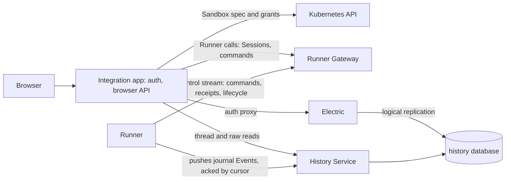

# History Service target

Status: **in progress.** The [task DAG](task_dag.md) owns the remaining steps and their edges; this
plan owns the target the refactor converges on and the decisions still binding it.

## Target

| Component          | Owns                                                                                                                                                    | Does not own                                                        |
| ------------------ | ------------------------------------------------------------------------------------------------------------------------------------------------------- | ------------------------------------------------------------------- |
| Runner             | harness driving, journal, journal-ordered command admission, pushing its journal to one ingress                                                         | durable history beyond its volume                                   |
| Sandbox Controller | reconciles Sandbox lifecycle, grants and teardown; owns status and runner endpoints each Sandbox uses                                                   | Session records, commands, Events                                   |
| Runner Gateway     | the runner control stream and its authentication, serving each runner's `Runner` service at its Sandbox's control address                               | Sandboxes, Sessions, Events, stored history                         |
| History Service    | ingress, raw event log, delta settlement, thread fold and projection, read API, scoped history reads, which Sessions exist and which Sandbox wrote each | Sandbox lifecycle, routing, commands                                |
| App                | browser auth and API, app-only Thread metadata, Session spec defaults (for now)                                                                         | folds, raw history, runner routing, which Sandbox a Session runs in |

Properties the target keeps:

- **Ingress is pluggable per deployment, control is not:** the Sandbox configuration
  names the one ingress every Sandbox pushes to; the control endpoint is always the Runner Gateway, so lifecycle requests such as
  `Seal` always have a path. A historyless client implements the ingress itself and sends commands
  through the gateway. The History Service knows Sessions from what it is pushed, binds each Session to the
  workload identity of its first writer, and records the Sandbox that writer is.
- **One History Service** (operator, 2026-10-11 PDT): one binary and Deployment takes what runners
  push and serves reads from the same database. The ingress keeps a listener of its own, so the
  network fence admits Sandboxes to it and nothing else.
- **History Service outage:** runners keep running and commands keep flowing. The runner journal
  is the buffer, so an outage is unacknowledged lag; teardown waits until the ingress has
  acknowledged through every seal cursor.
- **Sessions can outlive a Sandbox later:** the History Service keys by Session and records each
  Sandbox as an incarnation, and a teardown seal ends an incarnation, not the Session, so reviving a
  Session in a new Sandbox ([task DAG section 7](task_dag.md#7-our-own-sandbox-resource-sessions-that-outlive-their-pod))
  needs no change here.

Invariants once the refactor is done (operator, 2026-10-11 PDT). Each one still broken is closed by
a node in the [task DAG](task_dag.md):

- **One requested-state writer.** The app submits Sandbox changes as the requesting operator;
  the Sandbox Controller reconciles them. Action Service boxes are plain Pods, not Sandboxes (#10012).
- **One durable event log outside the runner:** the History Service's, written only through its
  ingress. The Runner Gateway's command submission records keep each admission entry; they are
  command receipts, not a second log.
- **One Thread projection:** the History Service fold. No other service derives Thread state from
  Session events, and Electric serves only that fold.
- **No old history in the app:** no raw Events and no fold tables in the `app` database.
- **One database per service**, named for it, with its own role. No service reads another's
  database; Electric's logical replication of the history fold is the one exception.
- **The Runner Gateway routes and does not provision.** It holds the control stream and serves each
  runner's own `Runner` service at its Sandbox's control address, as if the runner listened. It
  keeps no database, no Session records, and creates no Kubernetes objects besides its connection
  records.
- **The History Service records which Sandbox wrote each Session** (operator, 2026-10-12 PDT), and
  never routes to, reads or manages Sandboxes.
- **One Session ID everywhere**, minted by the client: runner, gateway, History Service and app
  use the same UUID.
- **Runners only dial out.** No runner listens for connections.
- **Derived data is rebuildable:** any fold table can be dropped and rebuilt from the raw log.
- **The app is a facade.** It stores browser sessions, operator-set Thread metadata and the Thread
  → Session link, and asks the History Service where a Session runs.
- **Coordination lives in Kubernetes** (Leases, Services), except a fence that must commit in the
  same transaction as the data it guards (the fold's `session_projection_lease`).
- **No transitional leftovers:** no compatibility shims, met `CLEANUP` tombstones, unread tables or
  columns, or cutover names.

## Decided (operator, 2026-10-10 PDT)

- **Reads:** for now only the app's ServiceAccount reads history, for every Session; agent reads
  come with `THREAD_READ_POLICY`, enforced in the History Service.
- **Command submissions** (operator, 2026-10-12 PDT): the Runner Gateway keeps none; a command's
  admission is read back from the Session's history.
- **Runner Gateway shape** (operator, 2026-10-12 PDT): a Session is held by one Sandbox for its
  whole life, so routing needs only Sandbox → the replica holding its runner connection, which the
  runner's authenticated `Connect` gives. The gateway serves the runner's `Runner` service at
  `<sandbox>-control`, naming the Sandbox by the dialed host (`:authority`), or by a header the
  shared client sets from the same target if the server cannot read it. Steps:
  [task DAG section 12](task_dag.md#12-the-runner-gateway-serves-the-runners-own-service).
- **Session specs, a for-now choice** (operator, 2026-10-12 PDT; revisit freely): the runner takes a
  complete `SessionSpec` and applies no defaults; per-Sandbox defaults are the app's, from its
  presets. A defaults layer in Agentplane itself, kept on the Sandbox, stays open for later. Not
  defaults, so the runner applies them for every caller: the Sandbox's `bootstrap`, run once, and
  the platform instructions with the Session's own Sandbox and ID.
