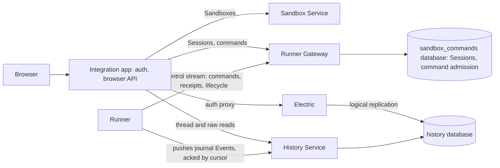

# History Service target

Status: **in progress.** The [task DAG](task_dag.md) owns the remaining steps and their edges; this
plan owns the target the refactor converges on and the decisions still binding it.

## Target

| Component       | Owns                                                                                                                                    | Does not own                                                        |
| --------------- | --------------------------------------------------------------------------------------------------------------------------------------- | ------------------------------------------------------------------- |
| Runner          | harness driving, journal, journal-ordered command admission, pushing its journal to one ingress                                         | durable history beyond its volume                                   |
| Sandbox Service | provisioning for every caller, lifecycle, grants, egress, teardown, the runner endpoints each Sandbox is created with                   | Sessions, commands, Events                                          |
| Runner Gateway  | the runner control stream and its authentication, the Session registry, durable command submission, Session ↔ Sandbox routing           | Sandboxes, Events, stored history                                   |
| History Service | ingress, raw event log, delta settlement, thread fold and projection, read API, scoped history reads, the index of which Sessions exist | Sandboxes, commands                                                 |
| App             | browser auth and API, app-only Thread metadata                                                                                          | folds, raw history, runner routing, which Sandbox a Session runs in |

Properties the target keeps:

- **Ingress is pluggable per deployment, control is not:** the Sandbox Service's configuration
  names the one ingress every Sandbox it creates pushes to; the control endpoint is always the Runner Gateway, so lifecycle requests such as
  `Seal` always have a path. A historyless client implements the ingress itself and sends commands
  through the gateway. The History Service knows Sessions from what it is pushed, not Sandboxes, and
  binds each Session to the workload identity of its first writer.
- **One History Service** (operator, 2026-10-11 PDT): one binary and Deployment takes what runners
  push and serves reads from the same database. The ingress keeps a listener of its own, so the
  network fence admits Sandboxes to it and nothing else.
- **History Service outage:** runners keep running and commands keep flowing. The runner journal
  is the buffer, so an outage is unacknowledged lag; teardown waits until the ingress has
  acknowledged through every seal cursor.
- **Sessions can outlive a Sandbox later:** the History Service keys by Session and records each
  Sandbox as an incarnation, and a teardown seal ends an incarnation, not the Session, so reviving a
  Session in a new Sandbox ([task DAG section 8](task_dag.md#8-sessions-that-outlive-their-sandbox))
  needs no change here.

Invariants once the refactor is done (operator, 2026-10-11 PDT). Each one still broken is closed by
a node in the [task DAG](task_dag.md):

- **One provisioner.** Only the Sandbox Service creates, changes or deletes Sandboxes, whoever asks
  for them, the Action Service's command Sandboxes included.
- **One durable event log outside the runner:** the History Service's, written only through its
  ingress. The Runner Gateway's command submission records keep each admission entry; they are
  command receipts, not a second log.
- **One Thread projection:** the History Service fold. No other service derives Thread state from
  Session events, and Electric serves only that fold.
- **No old history in the app:** no raw Events and no fold tables in the `app` database.
- **One database per service**, named for it, with its own role. No service reads another's
  database; Electric's logical replication of the history fold is the one exception.
- **The Runner Gateway routes and does not provision.** It holds the control stream, Session ↔
  Sandbox routing and command submissions, and creates no Kubernetes objects.
- **The History Service knows Sessions and their writers, never Sandboxes.**
- **One Session ID everywhere**, minted by the client: runner, gateway, History Service and app
  use the same UUID.
- **Runners only dial out.** No runner listens for connections.
- **Derived data is rebuildable:** any fold table can be dropped and rebuilt from the raw log.
- **The app is a facade.** It stores browser sessions, operator-set Thread metadata and the Thread
  → Session link, and asks the gateway where a Session runs.
- **Coordination lives in Kubernetes** (Leases, Services), except a fence that must commit in the
  same transaction as the data it guards (the fold's `session_projection_lease`).
- **No transitional leftovers:** no compatibility shims, met `CLEANUP` tombstones, unread tables or
  columns, or cutover names.

## Decided (operator, 2026-10-10 PDT)

- **Reads:** for now only the app's ServiceAccount reads history, for every Session; agent reads
  come with `THREAD_READ_POLICY`, enforced in the History Service.
- **Command submission records** stay in the Runner Gateway for now (`COMMAND_RECORDS_RETIRE`).
