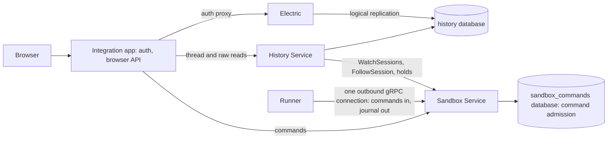

# History Service extraction, runner dial-out and delta settlement

Status: **in progress.** The [task DAG](task_dag.md#7-history-service-extraction-and-delta-settlement)
owns every step, its status and its edges; this plan owns the target, the facts the order rests
on, and the decisions behind it.

Three workstreams meet here: moving the raw event log and the thread fold into one History Service,
inverting runner connections, and settling streamed deltas. They touch the same ingestion path, so
they are sequenced together, but each can land in bounded steps without waiting for the others
except where an edge says so.

## Target



| Component       | Owns                                                                                                                                                                               | Does not own                       |
| --------------- | ---------------------------------------------------------------------------------------------------------------------------------------------------------------------------------- | ---------------------------------- |
| Runner          | harness driving, journal, journal-ordered command admission, spool                                                                                                                 | durable history beyond its volume  |
| Sandbox Service | provisioning, lifecycle, grants, egress, the runner channel and its authentication, durable command submission, locator ↔ Sandbox binding, live follow and replay, retention holds | stored history, folds              |
| History Service | raw event log, delta settlement, thread fold and projection, read API, scoped history reads                                                                                        | runner connections, commands       |
| App             | browser auth and API, app-only Thread metadata                                                                                                                                     | folds, raw history, runner routing |

Properties the target keeps:

- **One client surface:** the History Service subscribes with the same Sandbox Service calls a
  historyless client uses (`WatchSessions`, `FollowSession`), plus retention holds, which any client
  may place. The Sandbox Service stores no history and pushes to no one, so running without history
  means running no subscriber, and someone's own archiver is another subscriber. Driving a runner
  directly needs neither service.
- **History Service outage:** runners keep running and commands keep flowing. The runner journal
  is the buffer for every subscriber, so an outage is cursor lag; a hold keeps the Sandbox from
  being deleted until the History Service catches up through the seal.
- **Settlement beside the fold:** the log, settlement and fold evidence live in one database,
  and a settlement commits with the completion it settles, so every page carrying that completion
  carries the settlement and the fold drops the chunks' evidence when it reaches it. Readers outside
  the History Service see settled ranges only through its read API.
- **Sessions can outlive a Sandbox later:** the History Service keys by Session and records each
  Sandbox as an incarnation, and a teardown seal ends an incarnation, not the Session, so reviving a
  Session in a new Sandbox ([task DAG section 8](task_dag.md#8-sessions-that-outlive-their-sandbox))
  needs no change here.
- **No reads of runners from the History Service:** it reads only through the Sandbox Service, so the locator ↔ Sandbox identity check stays where the authenticated runner channel
  terminates.

## Facts the order rests on

- **The `sandbox_service` database holds Session history** (`session_history` and
  `session_event`, `sandbox_service/session_history/db.py`; the package has its own migrations).
  Handing it to the History Service moves the raw log with no copy. The Session registry and command
  admission live in the Sandbox Service's own `sandbox_commands` database.
- **The app still keeps its own copy of the fold** (`thread_entity`, `thread_evidence`,
  `thread_native_link`, `thread_payload_chunk`/`_manifest`, `thread_checkpoint`,
  `session_projection_lease`) with its projector and Electric source, though both environments
  now read the History Service's projection through its own Electric source.
- **Projections are derived.** A rebuild into a new epoch from the raw log is supported
  ([storage and durability](../docs/thread_view_sync.md#storage-and-durability)); only the raw log is
  irreplaceable. The staging-preservation rule ([`AGENTS.md`](../AGENTS.md#preserve-staging-data-during-the-sandbox-service-extraction))
  binds the raw log and identities, not a rebuildable projection.
- **Settlement's target** is the 4.3 GB `session_event` and the 2.2 GB of per-delta evidence rows
  (2026-10-10 sample).

## Decided (operator, 2026-10-10 PDT)

- **Store placement:** the History Service takes over the existing `sandbox_service` database and
  role; the Sandbox Service gets a new `sandbox_commands` database for command admission. A `TODO` at the database
  declaration records that the name is then a misnomer. Rejected: a new database with a one-off
  copy of `session_event`, which is a second migration like the one just finished; its one
  advantage, returning disk by dropping the old copy, `pg_repack` also gives in place.
- **No rename:** `session_event` keeps its name.
- **Fold data:** the History Service projection is rebuilt from the raw log, not copied from the
  app. It is a long migration and runs as resumable, rate-bounded background work.
- **Live updates:** Electric replicates the history database behind the app's unchanged
  authorization proxy, at least for now. A History Service subscription API stays one of the
  [thread sync](thread_sync/README.md#a-second-implementation) candidates.
- **Admission reconciliation:** the Sandbox Service reconciles spooled receipts from the stream it
  terminates and acknowledges a prefix to the runner after its own commit, waiting on no subscriber.
  Positive admission evidence still cannot regress. This replaces reconciling in the archive
  transaction, which cannot hold once the archive leaves the Sandbox Service.
- **Fold placement:** the projector and fold (`thread_fold/`, shared by the app and the History
  Service), the projection tables above with their per-Session leases, and
  `thread_history_summary` (every field derived from the log) move. Thread `name` and `archived`,
  which the operator authors, stay in the app, as does `event_log` reduced to the Thread → Session
  link, its harness, model and cwd copies dropped. The read API keys by public Session ID and serves
  list summaries, an entity window, payloads by reference and raw/debug reads.
- **Reads:** for now only the app's ServiceAccount reads history, for every Session; agent reads
  come with `THREAD_READ_POLICY`, enforced in the History Service.
- **Existing runners:** not upgraded in place. Sandboxes on images that cannot dial out are archived
  and deleted, and inbound access is retired once none is left.

## APIs

What is still to build, beside the implemented `sandbox_service/protocol.proto` and
`history_service/protocol.proto` ([Sandbox Service API](../sandbox_service/API.md)); names are not
final.

```proto
service SandboxService {
  rpc GetCommand(GetCommandRequest) returns (CommandStatus);
}

service HistoryService {
  // Committed cursor, incarnations with seal cursors, fold cursor or error.
  rpc GetSessionHistory(GetSessionHistoryRequest) returns (SessionHistoryStatus);
}
```

Live browser updates are not an RPC: Electric replicates the projection tables behind the app's
authorization proxy. The History Service ingester loops: `WatchSessions`; per Session under its
claim, `PlaceHold`, then `FollowSession` from its committed cursor; per batch, one transaction that
stores entries, settles and advances the checkpoint; then `ConfirmHold`. The fold reads the
settlement with the completion that triggered it and drops the settled cursors' evidence in its
own transaction. On `sealed` it records the incarnation's end and keeps the hold until the Sandbox is
gone.

| Caller               | Sandbox Service                                    | History Service                    |
| -------------------- | -------------------------------------------------- | ---------------------------------- |
| App                  | sandboxes, Sessions, `SubmitCommand`, `GetCommand` | summaries, entities, payloads, raw |
| History Service      | `WatchSessions`, `FollowSession`, holds            |                                    |
| Historyless client   | Sessions, `SubmitCommand`, `FollowSession`         |                                    |
| Notification Service | `SubmitCommand`                                    |                                    |
