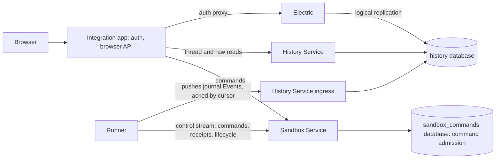

# History Service extraction, runner dial-out and delta settlement

Status: **in progress.** The [task DAG](task_dag.md#7-history-service-extraction-and-delta-settlement)
owns every step, its status and its edges; this plan owns the target, the facts the order rests
on, and the decisions behind it.

Three workstreams meet here: moving the raw event log and the thread fold into one History Service,
inverting runner connections, and settling streamed deltas. They touch the same ingestion path, so
they are sequenced together, but each can land in bounded steps without waiting for the others
except where an edge says so.

## Target

| Component       | Owns                                                                                                                                             | Does not own                       |
| --------------- | ------------------------------------------------------------------------------------------------------------------------------------------------ | ---------------------------------- |
| Runner          | harness driving, journal, journal-ordered command admission, pushing its journal to one ingress                                                  | durable history beyond its volume  |
| Sandbox Service | provisioning, lifecycle, grants, egress, the runner control stream and its authentication, durable command submission, Session ↔ Sandbox routing | Events, stored history, folds      |
| History Service | ingress, raw event log, delta settlement, thread fold and projection, read API, scoped history reads, the index of which Sessions exist          | Sandboxes, commands                |
| App             | browser auth and API, app-only Thread metadata                                                                                                   | folds, raw history, runner routing |

Properties the target keeps:

- **Ingress is pluggable per deployment, control is not:** the Sandbox Service's configuration
  names the one ingress every Sandbox it creates pushes to; the control endpoint is always the Runner Gateway, so lifecycle requests such as
  `Seal` always have a path. A historyless client implements the ingress itself and sends commands
  through the gateway. The History Service knows Sessions from what it is pushed, not Sandboxes, and
  binds each Session to the workload identity of its first writer.
- **History Service outage:** runners keep running and commands keep flowing. The runner journal
  is the buffer, so an outage is unacknowledged lag; teardown waits until the ingress has
  acknowledged through every seal cursor.
- **Sessions can outlive a Sandbox later:** the History Service keys by Session and records each
  Sandbox as an incarnation, and a teardown seal ends an incarnation, not the Session, so reviving a
  Session in a new Sandbox ([task DAG section 8](task_dag.md#8-sessions-that-outlive-their-sandbox))
  needs no change here.

## Facts the order rests on

- **The `sandbox_service` database holds Session history** (`session_history` and
  `session_event`, `history_service/storage/db.py`; the package has its own migrations).
  Handing it to the History Service moves the raw log with no copy. The Session registry and command
  admission live in the Sandbox Service's own `sandbox_commands` database.
- **The app still keeps its own copy of the fold** (`thread_entity`, `thread_evidence`,
  `thread_native_link`, `thread_payload_chunk`/`_manifest`, `thread_checkpoint`,
  `session_projection_lease`) with its projector and Electric source, though both environments
  now read the History Service's projection through its own Electric source.
- **Projections are derived.** A rebuild into a new epoch from the raw log is supported
  ([storage and durability](../docs/thread_view_sync.md#storage-and-durability)); only the raw log is
  irreplaceable. The staging-preservation rule ([`AGENTS.md`](../AGENTS.md#preserve-staging-data-during-service-extractions))
  binds the raw log and identities, not a rebuildable projection.
- **Settlement's target** is the 4.3 GB `session_event` and the 2.2 GB of per-delta evidence rows
  (2026-10-10 sample).

## Decided (operator, 2026-10-10 PDT)

- **No rename:** `session_event` keeps its name.
- **Fold placement:** the projector and fold (`thread_fold/`, shared by the app and the History
  Service), the projection tables above with their per-Session leases, and
  `thread_history_summary` (every field derived from the log) move. Thread `name` and `archived`,
  which the operator authors, stay in the app, as does `event_log` reduced to the Thread → Session
  link.
- **Reads:** for now only the app's ServiceAccount reads history, for every Session; agent reads
  come with `THREAD_READ_POLICY`, enforced in the History Service.
- **Existing runners:** not upgraded in place. Sandboxes on images that cannot dial out are archived
  and deleted, and inbound access is retired once none is left.
- **Command submission records** stay in the Sandbox Service for now.
- **Cutover:** clean, like the dial-out cutover; Sandboxes from before it are archived the old way
  and deleted.
- **Deployments:** the Sandbox Service and the Runner Gateway are separate services and images,
  with separate ServiceAccounts.

