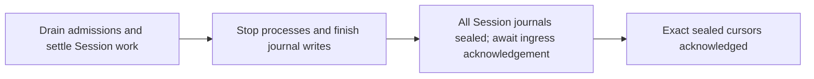
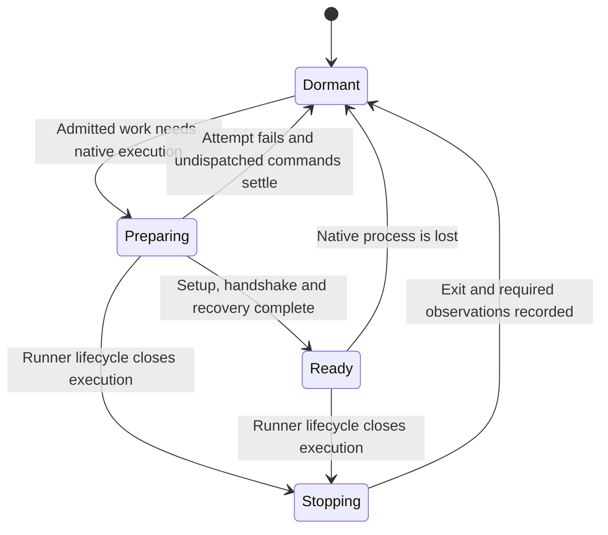
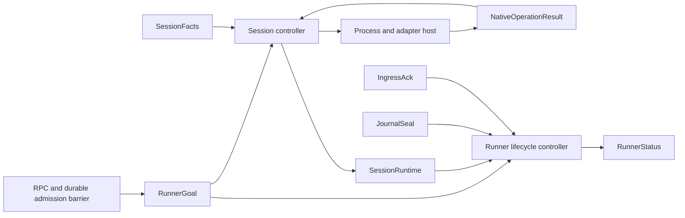

# Runner lifecycle state and ownership

Status: proposed design, 2026-10-27. The operator selected an outer lifecycle machine,
separate setup and execution state, and reconciliation loops; implementation has not started.
The [implementation plan](runner_lifecycle.md) splits the work. The existing
[runner-owned lifecycle contract](../docs/runner_delivery_and_harness_design.md#runner-owned-harness-lifecycle)
remains authoritative for admission, interruption, recovery and quiescence.

## Problem and current owners

The runner owns durable Sessions independently of their native processes. Its current lifecycle
is spread across flags, operation channels, journal facts and several goroutines. Source inspected
at `bf8043f425`: [Session](../runner/session.go), [Runner](../runner/runner.go),
[shared Codex process](../runner/codex_server.go) and [SessionStore](../runner/store.go).
This is a refactoring proposal; the flag count alone does not demonstrate a failing race.

| Current state                                            | Meaning                                                                      | Current writers                                             |
| -------------------------------------------------------- | ---------------------------------------------------------------------------- | ----------------------------------------------------------- |
| `ready`                                                  | Native conversation can receive commands                                     | Startup completion, journal event application, process exit |
| `activating`                                             | A shared preparation attempt is running                                      | `activate` and its asynchronous completion                  |
| `resuming`                                               | This preparation resumes a previously used native conversation               | `startHarness`                                              |
| `stopping`                                               | The runner deliberately stopped the harness                                  | Startup failure, Session halt, Codex startup failure        |
| `sealing`                                                | Ordinary execution is closed in preparation for a seal, or a seal was loaded | Construction, halt, incarnation reopening                   |
| `tearingDown`                                            | Attribute an interruption to teardown unless an explicit interrupt caused it | Halt and incarnation reopening                              |
| `reconciling`                                            | A native reconciliation is in flight and blocks dispatch                     | `reconcilePending`                                          |
| `quiescing`, `quiesceDone`                               | Runner drain activity and completion                                         | `Quiesce` and drain completion                              |
| Lameduck marker, journal seals, ingress acknowledgements | Durable admission closure and archive progress for an incarnation            | SessionStore, Journal, ingress transport                    |

For example, dispatch combines readiness, adapter presence, pending/in-flight reconciliation and
the sealing gate. Shutdown spans `halt`, `stopProcess`, shared-process shutdown, reconciliation and
`sealJournal`. Recovery reopens journal state and resets Session flags. A mutex protects individual
updates, but transition ownership and the legal combinations remain implicit.

## Boundaries

Preserve the existing Runner RPCs, journal vocabulary, Session identities and storage. No new
service, transport, public lifecycle control, database schema or managed configuration is selected.
Keep native process identity separate from Session identity: Claude owns a process per active
Session, while multiple Codex Sessions share an app-server. The executor retains its own process
supervision; this work does not redesign it.

Completed one-shot setup is never rerun by harness restart. Terminals/background processes remain
outside autosuspend busy accounting. Resume notices, idle process reclamation, placement and RAM
suspension are separate work. This design adds neither polling nor a new manual UI acceptance gate.

## State model

Use a small runner lifecycle machine with subordinate state for Session execution, setup,
reconciliation and durable sealing. Independent facts stay independent; a single enum must not
enumerate every product of those dimensions.

### Runner lifecycle and durable sealing

| Mode        | Authority and progress                                                                              |
| ----------- | --------------------------------------------------------------------------------------------------- |
| `Running`   | Admit authorized work and prepare Sessions lazily                                                   |
| `Quiescing` | Refuse new ordinary work; drain, settle, stop, reconcile and seal; wait for History acknowledgement |
| `Closing`   | Refuse new work and release runtime resources after orderly cleanup                                 |
| `Closed`    | Native processes, workers and journals are closed; release state ownership last                     |

Accepting Quiesce persists the existing incarnation-scoped lameduck marker before reporting
acceptance. Its admission barrier also serializes the idle-token precondition against admissions.
An already admitted command ID remains readable/retryable under the existing deduplication rules.
Exact-turn interrupts retain their separate guarded admission and dispatch rules while the journal
and native attachment can still accept them.

Quiesce progress is derived from owned operations and durable facts:

`SEALING` above names internal work, not a new wire enum. Publish existing `DRAINING` until drain
work (including running scripts) has completed and every journal is sealed, existing `FLUSHING`
until every exact sealed cursor is acknowledged, then
`QUIESCED`. Keep three things distinct: the intent to seal, the durable journal seal, and History's
acknowledgement. Never replace these with one cached `sealed` boolean.

An ordinary Close does not invent an incarnation seal or wait for a History acknowledgement.
If Close overlaps an accepted Quiesce, it joins the existing cleanup operations and preserves the
seal obligation. It may exit without an ingress acknowledgement, but must not report `QUIESCED`
without that acknowledgement. A failed drain retains admission closure and its concrete error;
a later Quiesce can retry unfinished work without repeating native effects or setup.

On restart, reconstruct closure/progress from the existing marker, journals and acknowledgements.
The same incarnation cannot become accepting merely because the process restarted. A new
incarnation reopens eligible journals through the existing durable reopen/adoption path before
allowing new execution. Reopening a journal does not itself start a harness.

### Session setup and execution

Setup remains the existing one-shot state: not required, running, succeeded, failed or interrupted.
It starts on Session creation after Sandbox bootstrap and may run with no native harness.
Unexpected loss records interruption; neither a retry nor harness restart silently reruns it.

Execution describes native conversation readiness:

The normal loss path records the existing process-loss and uncertain-continuation evidence.
The outer gate prevents activation after Quiesce even when execution is `Dormant`.
Failure cursors remain outcome evidence, separate from a phase that can later prepare again.

| Setup                  | Execution | Meaning                                                                  |
| ---------------------- | --------- | ------------------------------------------------------------------------ |
| Running                | Dormant   | Session start script runs before any input needs a harness               |
| Running                | Preparing | Admitted input waits for the existing setup operation                    |
| Succeeded/not required | Preparing | Start/attach, create or resume the conversation, recover native evidence |
| Succeeded/not required | Ready     | Native conversation is prepared; an active turn is not required          |
| Failed/interrupted     | Dormant   | Record failure and settle affected work; do not rerun the script         |

Internal `Preparing` is narrower than today's public `PREPARING` summary. Keep the public summary's
existing setup/pending-work interpretation during this refactor; changing display vocabulary is
separate. Public diagnostics remain informational and never authorize execution.

A preparation operation owns its cancellation, completion, identity and immutable resume metadata.
Concurrent sends share it. A prepared attachment carries the native adapter and process incarnation;
a stopping Session retains the attachment needed to finish targeted controls and exit observations.
The lifecycle owner validates completion identity before applying readiness or clearing an attachment.
A late completion cannot make a stopping or successor Session ready. Its real journal/native
evidence is still retained, and any process it created remains owned until cleanup completes.

Session readiness does not imply a dedicated OS process. The shared Codex process owner publishes
its own state and exit to every attached Session; a running app-server does not make every native
conversation ready. It stops once after all its hosted Sessions have halted.

### Work and reconciliation

Keep active-turn identity, pending commands, dispatch evidence and native reconciliation work
separate from execution phase. A ready but idle Session is not busy merely because it has a process.
Derive autosuspend blockers from the same work facts used by existing busy accounting: active turns,
pending commands, setup, preparation, Sandbox bootstrap and admissions. Preserve heartbeat and
Lease publication cadence.

Two operations use the word reconciliation:

- Lifecycle reconciliation chooses the next action toward the runner's mode from current facts.
- Native reconciliation inspects harness evidence to resolve prior execution/continuation. It cannot
  infer that retrying a tool effect is safe merely because a request or process failed.

Native reconciliation has a queue and at most one owned in-flight operation per Session. A queue
can be empty while inspection is running, so queue length cannot replace `reconciling` on its own.
Preserve the ordering barrier that publishes a turn's terminal event before its reconciliation
becomes eligible. Commands wait for queued and in-flight inspection to settle; eligible controls
retain exact-turn guards and cannot accidentally reach a successor turn.

Live native inspection can require an RPC reply on stdout. The stdout reader remains independent
and routes replies while inspection runs. During orderly halt, settle inspection requiring that
live attachment before stopping its process where possible. If the process is lost first, preserve
the adapter's supported recovery/unknown reporting and never turn missing evidence into success or
blind replay. Journal sealing waits for all required resulting observations to be committed.

## Transition and effect ownership

| Owner                        | State it may change                                               | Inputs                                                                                   |
| ---------------------------- | ----------------------------------------------------------------- | ---------------------------------------------------------------------------------------- |
| Runner lifecycle owner       | Mode, admission barrier, drain operation                          | Quiesce, Close, admissions finishing, Session/process completion, ingress progress       |
| Session execution owner      | Execution phase, preparation/stop operation, attachment           | Admitted work, setup/bootstrap completion, preparation result, process exit, runner mode |
| Session work owner           | Reconciliation queue/in-flight operation and dispatch eligibility | Committed turn/command observations, native inspection result, execution changes         |
| Journal/SessionStore/ingress | Existing durable records and acknowledgements                     | Serialized journal/store operations and authenticated ingress replies                    |

Ownership is logical. Evaluate COSI against extending the existing Session work loop and Runner
drain coordination before selecting controller infrastructure. Explicit transition methods remain
the incremental boundary for runtime-independent changes.
Callbacks deliver observations to those owners rather than directly assigning lifecycle flags.
Journal commits remain authoritative and are not deferred through a lossy notification channel.

### Controller runtime candidate: COSI

**Planned trial; operator, 2026-10-27.** Try
[COSI Runtime](https://github.com/cosi-project/runtime) on one bounded shutdown path and compare it
with the existing Go loops before building custom controller infrastructure. Adoption is open.
COSI declares controller inputs/outputs, enforces output ownership and supports resource-change
notifications and finalizers. Its
[in-memory state](https://pkg.go.dev/github.com/cosi-project/runtime/pkg/state/impl/inmem)
can host the trial inside the runner without Kubernetes or another state service.

Prototype runner intent and Session shutdown progress as resources with distinct controller-owned
outputs. Keep process/adapter handles outside resource specs and report their completions back as
observed state. Evaluate finalizers for cleanup dependencies. Reconstruct ephemeral resources from
existing journal/store facts after restart; the journal remains authoritative for commands, seals
and uncertain native effects. Resource ownership/finalizers do not replace the atomic admission,
exact-turn write or exact seal-acknowledgement boundaries.

#### Proposed resource and controller mapping

Run one in-memory COSI runtime per Runner. Use existing Session IDs and incarnation/operation
identities as resource keys. The lifecycle enums live in resource specs; COSI's own metadata
teardown phase describes resource cleanup, not native conversation readiness.

| Resource                | Sole publisher              | Contents                                                                             |
| ----------------------- | --------------------------- | ------------------------------------------------------------------------------------ |
| `RunnerGoal`            | RPC/admission boundary      | Accepted running/quiescing/closing intent and incarnation identity                   |
| `SessionFacts`          | Journal/setup projection    | Setup outcome, active-turn summary, pending-work watermark and failure evidence      |
| `SessionRuntime`        | Session controller          | Execution phase, attached process incarnation and current preparation/stop operation |
| `NativeOperationResult` | Process/adapter host        | Result of an identified start, stop or native inspection operation                   |
| `JournalSeal`           | Journal projection          | Actual sealed incarnation and cursor                                                 |
| `IngressAck`            | Ingress transport           | History's acknowledged cursor and seal                                               |
| `RunnerStatus`          | Runner lifecycle controller | Draining/flushing/quiesced, busy reasons and idle transition                         |

Sandbox bootstrap completion is an analogous singleton input. `SessionFacts` summarizes committed
work; command payloads, dispatch evidence and full history stay in the journal. Publishers bridge
existing sources into COSI, with one writer per resource; changing a projection is not a second
command admission or an independent source of truth.

The Runner lifecycle controller watches the goal, Session progress, bootstrap, process completion
and archive facts, then publishes aggregate status. Try one registered Session `QController`
keyed by Session ID, rather than registering a controller for every Session. It prepares/halts
Sessions using the goal, setup/journal facts and operation results; different Sessions can progress
concurrently. Whether native inspection needs its own controller or remains owned by Session work
scheduling is an evaluation question, not a prerequisite for the shutdown trial.

Process handles, adapters, cancellation and stdout readers remain in the process/adapter host.
Controllers claim identified operations there and return instead of blocking on handshake or
inspection. The host publishes results that wake the appropriate Session. Reconciliation of the
same claimed operation rejoins it; it does not start another process or repeat a native command.
Validate attachment/operation identity before applying a result. After restart, the in-memory
registry cannot prove an old effect absent: recover from journal/native evidence first.

For Quiesce, the mapping must preserve this sequence:

1. The synchronous admission boundary checks the idle token, persists closure and publishes
   `RunnerGoal=Quiescing`. It remains authoritative while resource projections catch up.
2. Session controllers prevent new preparation, let running setup finish, halt turns and settle
   required native inspection; bootstrap also finishes before drain completes.
3. The process owner stops Claude processes individually and the shared Codex server once all its
   hosted Sessions have halted. Completion observations advance Session progress.
4. Each journal seals after its final writes. Once drain has completed and all seals are observed,
   the Runner controller publishes `FLUSHING`.
5. Ingress publishes acknowledgement of the exact sealed incarnation/cursor. Only after every
   required acknowledgement does the Runner controller publish `QUIESCED`.

Try finalizers on temporary runtime/attachment resources to express cleanup obligations. A
finalizer prevents losing an attachment before its native work is stopped; it is removed only
after the corresponding observed cleanup completes. It never authorizes deleting the durable
Session, native conversation or workspace, and does not substitute for checking seal/ack facts.
Keep the COSI runtime and ingress/reply workers alive until required cleanup completes.

Durable admission and exact-turn interruption keep their existing synchronous atomic boundaries;
neither waits for a Session controller or authorizes execution from a lagging resource snapshot.
Native effect execution also remains guarded by durable dispatch/recovery evidence. The first
prototype implements only goal -> Session cleanup -> seal -> acknowledgement, keeping existing
startup and normal command scheduling behind those boundaries.

Compare whether COSI reduces custom scheduling/ownership bookkeeping while preserving asynchronous
native I/O, shutdown ordering and recovery. Controller retries must reread durable operation
evidence rather than repeat a possibly completed native effect. Record integration cost, including
Bazel dependencies and the runtime's logger interface, alongside the behavioral results. The
[trial plan](runner_lifecycle.md#runner_cosi_trial--evaluate-cosi-on-a-bounded-shutdown-path)
defines the artifact and checks. It informs the implementation mechanism, not the public lifecycle
contract or permission to replace the whole runner.

### Effect scheduling

Each loop reads and claims the next operation under its state lock, runs blocking effects outside
that lock, then applies completion through the owner after checking operation/attachment identity.
At most one preparation, halt or native inspection owns its corresponding operation. Do not hold
state locks across process startup, scripts, journal waits, History/network I/O or native RPCs.

Use existing change notifications/coalesced wakeups to reread facts after input, completion, exit,
acknowledgement or lifecycle requests. A notification is a hint, not the only copy of a command or
completion: pending facts remain queued/recorded until consumed. Subscribe/check revisions under
the owning synchronization so an update between inspection and sleep cannot be lost. Progress
does not depend on periodic polling. Existing operation deadlines and retry policy remain explicit.

Do not route synchronous admission through a worker blocked on preparation. Keep the durable
admission boundary and exact-turn native-write serialization. Once admitted, work belongs to the
runner despite caller disconnect. Uncertain dispatch/creation is reconciled against existing durable
evidence before any retry. Closed admission, deliberate process exit, teardown interruption and
actual journal sealing remain distinct observations even if one shutdown operation owns them.

## Replacing the flags

| Current representation                         | Proposed owner/representation                                                        |
| ---------------------------------------------- | ------------------------------------------------------------------------------------ |
| `ready`, `activating` plus activation channels | Execution phase and one preparation operation                                        |
| `resuming`                                     | Immutable metadata of that preparation attempt                                       |
| `stopping`, `tearingDown`                      | Explicit stop reason and operation, preserving their different exit/turn attribution |
| `sealing`                                      | Outer seal intent plus Session shutdown progress; actual seal stays in the Journal   |
| `reconciling` plus queue                       | Pending queue plus an owned in-flight inspection                                     |
| `quiescing`, `quiesceDone`                     | Outer lifecycle mode plus one drain operation and its completion/error               |

A stop reason distinguishes runner close, Sandbox quiesce and startup-failure cleanup. It must
preserve today's `StoppedByRunner`, `EndedByTeardown`, explicit-interrupt attribution and failure
events; replacing flags must not change them implicitly. Check every writer/read during each
conversion, remove the old representation atomically for that concern, and derive status from
the new owner rather than keeping a second set of mutable compatibility flags.

## Acceptance

The [implementation plan](runner_lifecycle.md#acceptance-and-validation) assigns checks to each
change. Preserve admission before readiness, exact-target interruption, one-shot setup, native
uncertainty, shared Codex process ownership, durable reopen and exact seal acknowledgement.
Exercise both harnesses in existing automated fixtures and retain race detection. A new manual
staging UI run is not required; the operator waived repeating it on 2026-10-27.

As implementation lands, move the implemented contract into the runner's component documentation
and remove the corresponding proposal/plan sections. Do not present this proposal as deployed
behavior or grow a second lifecycle authority beside the existing owner.
