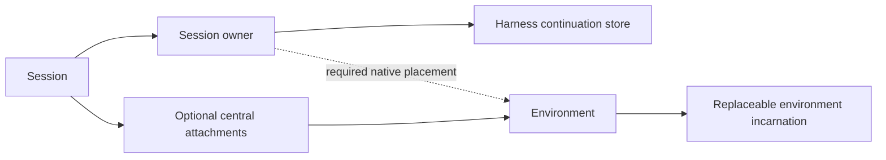

# Sessions & environments

> Working design and discussion record. Implemented contracts live in the
> [Dispatcher SPEC](../runner_gateway/dispatcher/SPEC.md), the
> [central sampler SPEC](../central_sampler/SPEC.md) and the [Runtime SPEC](../env/runtime/SPEC.md);
> this document holds the selected direction and unresolved decisions. Discussion entries are
> historical: later decisions and corrections supersede earlier suggestions. The shorter
> [Session/runtime model brief](session_runtime_model.md) remains useful context.

## Decision status

**Selected model direction:** public, unscoped Session UUIDs distinct from harness-native IDs; one
required environment for current native Sessions; central Sessions eventually able to have zero or
more environment attachments; Dispatcher PostgreSQL establishes logical Session existence without
waiting for its owner; History remains separately stored; app archive is not Session deletion; and
authorized unattended inbox notices can wake an environment. Record attachment transitions in
History eventually.

**Implemented baseline:** Dispatcher PostgreSQL is the live Session authority for typed
`SessionPlacement` (`environment_hosted` or `central_sampler_v1` with one fixed
`executor_environment`), with `CreateSession`/`GetSession`/`ListSessions`, Session-ID-addressed
commands, and Session rows retained with `required_environment=DELETED` after their required
Environment is deleted ([Dispatcher SPEC](../runner_gateway/dispatcher/SPEC.md#session-binding)).
Do not add a second competing writable directory. The baseline does not provide environment-free
central Sessions, optional attachments, a central principal, native harness-store and native-ID
mapping, inbox retention after Environment deletion, durable command-receipt reads after cleanup,
or explicit Session deletion.

**Still require design:** central Sessions with no required environment, optional attachment
semantics and authorization, the central principal and its authority, notification/wake behavior,
lifetime and retention after environment loss, and cross-store deletion and History semantics. The
explicit [central Session environment-independence task](task_dag.md#central-session-environment-independence)
tracks these prerequisites and the later data-preserving migration.

Decisions still needed include the Session/environment principal and privilege relationship;
attachment authorization, revision and History publication; inbox and History behavior after
Environment deletion; explicit Session-deletion and command-receipt retention; and which component
wakes a suspended environment under which authorization. A Session's principal is an
Agentplane `Identity` ([Sessions, identities and environments](#sessions-identities-and-environments));
identities may share a Kubernetes account and none is auto-provisioned. Today Sessions still pin the
Sandbox's own ServiceAccount; the
[identity plan](identity_and_kubernetes_accounts.md#where-the-migration-stands) states what is true
now and what changes at the cutover.

<a id="central-session-environment-independence"></a>

## Central Session without a required executor environment

**Later work; not part of Central sampler V1.** V1 stores the sampler conversation centrally but
requires one exact executor environment in `SessionSpec.placement.central_sampler_v1`. That
environment remains required for V1 placement and execution admission. Its Sandbox identity is
still used by current notification and wake paths. On Environment deletion, Dispatcher now retains
the Session row with `required_environment=DELETED`; this does not add an alternate executor, allow
environment-free admission or make the central Session independent of that required Environment.
The executor is not an optional attachment. The later task is linked from the
[task DAG](task_dag.md#central-session-environment-independence).

Before removing this requirement, settle the central Session's principal and create/read/send
authority independently of an attached environment; define Dispatcher and sampler admission when
there is no executor target; and decide whether the selected 0..N attachment direction will ship now
or in a separate step. Attachment names, per-operation authorization, exact UID fences and
attach/detach history must be explicit. Define what inbox subscriptions, pending messages and
unattended notifications do with no attachment and how an authorized wake targets a later exact
environment. Resolve Session and inbox lifetime/retention after an environment is removed. History
reads must remain available without a live environment or directory lookup.

This is a coordinated wire and storage cutover across Dispatcher, sampler, app/CLI, Notification,
History and environment callers. Old `SessionSpec` encodings and old Sandbox/runtime binaries are
not a supported compatibility tier. Migrations must preserve central Session IDs, provider
conversation, commands, cursors, effect evidence, inbox data and retained History; preserve legacy
harness provenance when exact placement is absent instead of fabricating an environment. Do not
requeue accepted work, replay an uncertain provider/executor effect, or turn missing History into a
success claim. Keep placement and data migration separate from any later authorization change.

**Exit:** a reviewed contract and migration plan for opening and addressing a central Session with
zero environments, optional attachment semantics and authorization, inbox/wake behavior, lifetime
and retention, and History access. Automated acceptance proves migrated central and History records
remain readable, an environment-free Session admits and continues only allowed work, exact attached
environment fences reject replacements, and uncertain effects are never replayed. No implementation
starts before the principal/auth and lifetime decisions are resolved.

A Session has one globally unique public ID. A resolver finds its responsible owner; that owner locates the harness continuation. Environment bindings describe where work can run.

**Operator direction, 2026-11-04:** callers that want to interact with a Session should address the
Session itself, without being bound to an environment or having to provide one. The Session owner
or Dispatcher resolves any placement an operation needs. Environment lifecycle and execution remain
environment-scoped, and a native harness can still require a particular environment internally;
neither changes the caller's Session identity. Preserve authorization, retained provenance and
exact-incarnation fencing when resolving or using an attachment.

<a id="proposal"></a>

## Two relationships, one Session

Identify each Session by a globally unique UUID. Resolve that ID to the **Session owner** responsible for its commands and continuation. The owner tracks the selected harness and its durable state. Represent an environment-hosted native harness with exactly one required environment in its placement. A centrally hosted Session can have zero or more separately managed environment attachments.

### Who manages the Session

A logical component scope: the Environment Runtime within an exact environment, or a central sampler scope. It accepts commands and knows the Session’s harness and continuation reference; it is not the harness process itself.

### Where central work may happen

A named, optional relationship to an exact environment identity. A central Session may have zero or more; an attachment does not itself imply a live connection or grant authority.

### A harness constraint

A native harness placement names one required environment and a specific harness state store. The running process is replaceable; the environment is not a detachable attachment.

**Key distinction.** A central Session can continue talking without an environment; one tool call can fail without ending it. A native Claude Session can be retained while its environment is suspended, but its harness cannot run elsewhere merely because the API has a Session ID.

Use _Session owner_, _native harness placement_ and _central environment attachment_ as domain concepts; the chosen Dispatcher PostgreSQL direction does not by itself require new Kubernetes CRDs, COSI resources, or network services. A normalized read-only view may show both environment relationships, but their write APIs and semantics differ.

<a id="objects"></a>

## What exists, and what points where

**Terminology correction:** the earlier draft used “Session home” for several different things. Here, **Session owner** is the responsible component scope; **harness placement** identifies the backend and any required environment; **continuation reference** identifies the durable store and native Session; and a **running harness process** is replaceable. None of these is the public Session UUID.



The dashed arrow represents the native harness placement’s required environment. The attachment path is for centrally hosted Sessions; it is not a second writable copy of the native placement.

| Concept                    | What it is                                                                                                                                                                                              | Lifetime and ownership                                                                                                                                                             |
| -------------------------- | ------------------------------------------------------------------------------------------------------------------------------------------------------------------------------------------------------- | ---------------------------------------------------------------------------------------------------------------------------------------------------------------------------------- |
| Session                    | Globally unique public UUID, its logical principal, selected harness backend, and lifecycle.                                                                                                            | Managed by its assigned Session owner. Its identity survives host-process restarts; continuation after data loss depends on retained harness state.                                |
| Session owner              | The logical component responsible for backend admission, execution and the mapping to a harness and its continuation; found by resolving the Session UUID. The Dispatcher owns the logical reservation. | The scope is an exact environment’s Runtime or a central sampler scope. It is not an individual process or a storage path.                                                         |
| Harness placement          | The selected environment and harness state store, including which kind of harness manages it. The Session owner also retains the native Session ID once known.                                          | Multiple Sessions can share a harness store and running app-server; a store is not a process. Store identity, path and process identity have different lifetimes.                  |
| Running harness            | A transient process: e.g. one Claude process, a shared Codex app-server, or the central sampler’s JavaScript host.                                                                                      | It can serve one or many Sessions. Process death does not itself delete the Session or prove work did not happen. Environment Runtime is the managing component, not this process. |
| Continuation store         | State required to resume the actual harness. The Session owner locates it through a durable store reference and native conversation ID, which may be exposed to authorized callers.                     | May contain several Sessions; its concurrency and recovery rules are backend-specific. A transcript alone is not a replacement.                                                    |
| Environment                | A logical execution target with a stable UID, workspace/resources and an execution contract.                                                                                                            | Pod/VM and Runtime instances can change while the same environment persists. Same name with a new UID is a new environment.                                                        |
| Central attachment         | A Session-local, named reference to an environment and requested capabilities, separately managed by a centrally hosted Session.                                                                        | Desired attachments can be persisted with the Session; availability and connections are observed state. Native placement is not duplicated as an attachment.                       |
| Execution session / handle | A backend connection, process ID, file handle or output cursor inside an environment.                                                                                                                   | Scoped to the relevant environment incarnation and executor lifetime. Never a durable Session address.                                                                             |
| History                    | Retained evidence and conversation projections, with attributed source events.                                                                                                                          | Separate from continuation. Retention and authorization after environment deletion need an explicit policy.                                                                        |

Current grounding: [durable state and running hosts](https://github.com/agentydragon/ducktape/blob/d1aeff8ca2/agentplane/plans/session_runtime_model.md#durable-state-and-running-hosts) · [Execution sessions](https://github.com/agentydragon/ducktape/blob/d1aeff8ca2/agentplane/env/runtime/execution/SPEC.md#sessions-and-effects).

<a id="cases"></a>

## One model, different constraints

The relationships are the same vocabulary; the supported operations are not necessarily the same.

### Claude runs where it acts

**Owner and placement** Environment Runtime in exact environment `E1` manages the Session; the selected backend is Claude. Its continuation reference names the relevant Claude state and native Session ID when known.

**Environment** `E1` is an inherent part of native harness placement, not an attachment that can be detached or retargeted. Additional environments for native Sessions are not planned now.

**Runtime** One Claude process for this Session under the current adapter; startup is lazy. State needed to resume remains in the designated native store.

**If E1 goes away** During suspension the Session is unavailable but retained. After deletion, continuation requires independently retained/restorable native state; History alone is insufficient.

### Codex shares a host, not a Session

**Owner and placement** Two Sessions are managed by Environment Runtime in `E1` and have separate public IDs and continuation mappings.

**Host and store** One app-server and its Codex home can serve multiple threads. An app-server incarnation and a store are not public Session identities.

**Control** Interrupting a turn targets one Session and turn. Restarting the shared server affects its hosted Sessions without silently replaying any of their work.

**Environment** Each Session’s native placement names `E1`. Separate per-Session cwd and instructions do not make E1 an isolation boundary between them.

### A central Session can use zero, one, or many environments

**Owner and placement** A central sampler scope manages Session `S` and its continuation. Its public UUID remains addressable without any environment.

**Bindings** Initially none. Later `dev → E1` and `test → E2` are added; each tool invocation names its target.

**If E1 suspends or is deleted** `dev` becomes unavailable or gone; `test`, the central Session, and provider conversation remain. The agent can handle the failed operation.

**Important gap** Today's sampler binds one fixed Sandbox UID and requires an initial ready executor. Zero/multiple environments and post-deletion central dispatch are proposed work, not current capability.

Current behavior: [native Sessions](https://github.com/agentydragon/ducktape/blob/d1aeff8ca2/agentplane/env/runtime/docs/session_protocol.md#sessions) · [central sampler contract](https://github.com/agentydragon/ducktape/blob/d1aeff8ca2/agentplane/central_sampler/SPEC.md).

<a id="address"></a>

## Identify globally; resolve placement

Selected direction: callers name a Session by one globally unique, unscoped public UUID. A durable Session directory resolves it to the current Session owner and placement. Dispatcher PostgreSQL owns that directory and live Session records, separate from History’s database; the directory does not require a separate Deployment. Whether placement generations are needed and their precise representation remain implementation questions.

Every Session-targeted command requires a Dispatcher Session record; the record establishes the
Session to address but is not itself permission to send or wake. When deletion races accepted work,
fail commands proven not to have left Dispatcher, report unresolved in-flight outcomes as unknown,
and never redirect work to a replacement environment
([Dispatcher SPEC](../runner_gateway/dispatcher/SPEC.md#possible-command-forwarding-and-deletion-outcomes)).
Command-receipt outcome reads after cleanup remain unresolved.

```text
public address:  session_id = UUID

resolve(session_id) → {
  owner: environment_harness_host { environment_uid }
       | central_sampler          { scope_id },
  placement_generation,
  state: reserving | assigned | unavailable | retired
}

// Native Session record, maintained by that owner:
SessionRecord { session_id, environment_uid = E,
                harness_store = { kind: codex, store_id: X },
                native_session_id = 12345  // once known
}

// Central Session record, if it keys continuation by the public ID:
SessionRecord { session_id, continuation_key = session_id }
```

For a native Session, resolve `S` to the Environment Runtime in environment `E`. The owner’s Session record identifies the harness backend, its actual state store and (once known) native conversation ID. A directory could return an authorized diagnostic view of those facts, but routing to E does not require every client to provide a filesystem path or native ID. For central Sessions, route to the logical sampler scope and use the public ID if that is its durable key.

**Symmetry:** environment UID and native store reference are both placement/continuation facts. Neither is part of the public Session identity. The environment identifies the owner scope to reach; the store reference and native ID tell that owner which harness continuation to resume. Process identity and a connection endpoint are more transient still.

**Gap to the target:** `CreateSession` still requires an exact environment, including for a
central Session, and there is no placement generation. Existing native Runtime IDs also allow
non-UUID strings, so preserving existing identities needs a deliberate transition or alias policy.

- **One placement authority:** the directory is the source of truth for UUID → assigned Session owner and placement generation. That owner is the authority for harness/store/native mapping. Do not let two independently writable records each claim they select the current owner.
- **Durable reservation:** register the client-chosen UUID and immutable creation request in Dispatcher under a unique constraint. An exact retry resumes/reconciles the same logical reservation; conflicting reuse fails. An owner reservation, if needed, and native creation are distinct from that Dispatcher receipt and may occur later.
- **No invented atomicity:** directory and Session-owner writes may not share a transaction. Persist a recoverable pending reservation, use idempotent owner requests, and resolve uncertain outcomes from durable evidence; never create another native Session merely because a reply was lost.
- **Stale routes fail closed:** carry the exact placement generation and environment UID to the receiver. Cache only with a freshness/fencing protocol; an old owner must reject requests after a completed handoff. A generation checked only against stale local state is not a fence: require a proven lease, authoritative check, or backend-enforced fence, and fail closed when uncertain. On directory unavailability, fail or queue explicitly rather than guessing another owner.
- **Stable identity, explicit moves:** a supported relocation can update placement without changing the UUID, but only after authorization, continuation-store transfer/adoption, old-owner fencing, and an atomic compare-and-swap of placement. This proposal does not assert that existing native harnesses support relocation.
- **Lookup is not permission:** resolving a UUID does not authorize sending input, reading history, waking an environment or executing tools. Avoid leaking placement/store details to unauthorized callers.

The tradeoff is an additional availability and consistency dependency for global resolution. The directory need not be on every hot-path operation if a cached route is demonstrably current and the receiver enforces the placement fence. Session routing and environment-execution routing remain distinct responsibilities.

<a id="attachments"></a>

## Make the difference structural

A native harness's environment and specific harness state store are part of where and how it runs and resumes. A central sampler's environments are optional execution targets. Model those as different variants, rather than one editable list plus scattered backend-specific guards.

```text
SessionSpec {
  session_id: UUID
  harness_placement: oneof {
    environment_hosted {
      environment_uid: E        // required; exactly one
      harness_store: {
        kind: CODEX_APP_SERVER | CLAUDE_CLI
        store_ref: X            // selected durable harness-state store
      }
    }
    central_sampler {
      sampler_scope: C
      attachments: [ ... ]      // 0..N; managed separately
    }
  }
}

// Owner-managed Session record, updated as native creation proceeds:
NativeSession { native_session_id?, creation_state }
```

### Placement, not an attachment

The native harness has exactly one environment and a chosen harness state store. Persist the store selection before starting native creation. No attach, detach, or ordinary edit can silently replace them. A future native multi-environment design is possible but not currently planned.

### Explicit optional attachments

A central Session is independent of any one environment. It may start with none and add or remove named targets; support for more than one is a nearer-term possibility than for native Sessions, not a claim of existing support.

Session and Environment listing and pagination must follow this model; the
[app listing follow-up](../app/TODO.md#session-and-environment-listings) is tracked with
[`SESSION_HISTORY_PRESENTATION`](task_dag.md#session_history_presentation--represent-sessions-without-a-required-sandbox).

A store reference identifies the particular harness state location (for example a Codex or Claude configuration directory) within the exact environment. It may resolve to a path, but should be stable across ordinary process restarts; it is not a PID or a socket. The Session owner uses the harness kind and store reference to locate or start the right harness. Do not assume every store supports concurrent writers or that one app-server per store is already a proven universal rule.

**Two identities, even if their values happen to match:** the public Session UUID is Agentplane’s stable, globally unscoped identity; the harness-native Session ID identifies the conversation within its harness and store. The owner keeps the durable mapping between them. The native ID may be allocated by the harness and may not be known when the public Session is created. The native Session ID is therefore part of the durable Session-to-harness continuation mapping once known. It need not be in the immutable creation request: a harness may choose it during startup. It can be absent before native creation, or unresolved if creation may have happened but the result was lost. If importing an existing native Session, the caller can supply a scoped native reference subject to authorization and conflict checks. A known ID must be durably associated with the public UUID before reporting native creation as resolved; expose uncertain creation when the mapping cannot be proved.

**Current adapters are different:** Claude currently generates a UUID in the adapter and passes it via `--session-id` on first launch; Codex obtains its thread ID from the `thread/start` response; the [upstream app-server request schema](https://github.com/openai/codex/blob/main/codex-rs/app-server-protocol/schema/json/v2/ThreadStartParams.json) has no field for choosing that ID. Runtime records the resulting native ID after the handshake. Selecting a stable explicit store reference and handling the unknown-result boundary are proposed contract work, not a claim that the current implementation already guarantees them.

Do not create a second persisted “required attachment” mirroring the environment in native placement. For a common UI or read API, derive a read-only relationship such as `{ environment: E, relationship: native_placement }` alongside central attachment views. It must not make the native environment appear detachable.

**Structure removes invalid representations, not all validation.** The owner validates the placement variant, nonempty exact environment UID and applicable harness-store selection when reserving the Session. A single domain operation enforces immutable native placement across every write path; the receiving Runtime rechecks exact UID and authority. A protobuf `oneof` alone does not enforce required fields, immutability, authorization, or distributed fencing.

| Operation          | Environment-hosted native Session                                                                                                                     | Central sampler Session                                                                       |
| ------------------ | ----------------------------------------------------------------------------------------------------------------------------------------------------- | --------------------------------------------------------------------------------------------- |
| Create             | Require one exact environment and select a specific harness state store; durably bind placement. A harness-assigned native ID can be populated later. | Reserve independently of an environment; initial attachments are optional.                    |
| Attach / detach    | Not supported for now. An attempt returns an explicit unsupported or failed-precondition result.                                                      | Explicit, authorized change of a named attachment, subject to implementation capabilities.    |
| Change environment | Not a generic spec edit. A future migration would need explicit semantics for native state, authorization and fencing.                                | Attach/detach changes optional targets; never silently retarget an old UID or in-flight work. |
| Suspend / resume   | The same logical environment can stop and later get a new Runtime incarnation; the required placement stays the same UID.                             | An attachment may become unavailable while the central Session continues.                     |

**For central attachments:** use stable Session-local attachment IDs, target UIDs and revisions; reusing a name after detach creates a new attachment identity. Desired attachment state is distinct from reachability and a live connection. Operations capture attachment ID, revision and target fences, and explicit detachment prevents new calls without claiming an in-flight effect was undone.

**Future note: native harness sandboxing and monitoring.** Today the configured native harnesses are given broad command execution within their environment: Claude uses `bypassPermissions`, while Codex uses `approval_policy: never` and `danger-full-access`. Those settings do not erase the environment's actual OS, container/VM, network, credential or resource boundaries. Harness-specific sandboxing, command filtering, approvals and monitoring may later constrain that access. We are not designing or selecting that policy here; revisit how to represent and enforce it per harness without pretending the Session owner intercepts every native side effect.

Current native settings: [Claude adapter](https://github.com/agentydragon/ducktape/blob/d1aeff8ca2/agentplane/env/runtime/claude/adapter.go) · [Codex adapter](https://github.com/agentydragon/ducktape/blob/d1aeff8ca2/agentplane/env/runtime/codex/adapter.go).

<a id="lifecycle"></a>

## Do not collapse independent state machines

| State                         | Owned by                                   | Meaning                                                                                                                                                                                                                    |
| ----------------------------- | ------------------------------------------ | -------------------------------------------------------------------------------------------------------------------------------------------------------------------------------------------------------------------------- |
| Session existence             | Dispatcher Session record                  | A durable logical reservation, not a running process or successful setup. Environment deletion retains the Session row and exact placement; app archive does not end one. Explicit Session deletion remains unimplemented. |
| Harness observation           | Session owner's harness controller         | Dormant, preparing, ready/running, unavailable or failed, with backend-specific details. A host can serve multiple Sessions.                                                                                               |
| Environment desired lifecycle | Environment owner/controller               | Run, suspend/quiesce or delete the exact environment. This is independent of a central Session's desired lifecycle.                                                                                                        |
| Environment observation       | Session owner, informed by the environment | Availability and current incarnation for native placement or the required executor of central sampler V1. Future central attachments are not part of V1. It is not a second authority for environment state.               |
| Execution operation           | Executor plus Session journal/receipt      | Not dispatched, dispatched/unknown, or proved outcome. Process/output handles belong to an executor lifetime, not to the long-lived binding.                                                                               |

### Native harness

Environment Runtime closes Session admission for that incarnation, stops the harness and settles the existing native/Execution fences, then seals and delivers the journal. Reopening a verified successor permits later work under the existing rules. A queued Dispatcher receipt is not Runtime admission.

### Central sampler

The current central V1 Session retains its logical Dispatcher record when its required executor
Environment is deleted, but V1 has no alternate or optional target. Report the required Environment
as deleted and fail closed; do not infer that provider-only work remains available or use another
Environment. The proposed environment-independent central model may later permit that capability.

**Deletion:** environment deletion makes its exact UID unavailable permanently; Dispatcher retains
the Session's logical identity but not native continuation or a new central execution target.
Continuing a native Session requires its actual preserved store and a supported recovery path.
Existing History and its authorization are a separate policy question.

**Central Session lifetime direction:** no automatic end or cleanup is planned; the Session persists
independently of attachments and app archive. A future explicit delete operation is a low-priority TODO; treatment of continuation, work, notices
and retained History is not specified now.

<a id="authority"></a>

## Binding is not permission

### Session access grouping and tags

Inbox tags currently live on the Sandbox and authorize sends to its Sessions; separate history tags
and a retained Sandbox record were proposed for history-read grants but are not implemented. Once
Sessions can exist independently of Environments, revisit what the groups label and who owns them,
rather than assuming an attached Sandbox supplies Session access. Review no attachment, shared or
changing attachments, deleted Environments, retained History and inboxes, identity loss, revocation
and migration under [`SESSION_ACCESS_GROUPING_DESIGN`](task_dag.md#session_access_grouping_design--access-groups-across-independent-sessions-and-environments).
Keep send, history read, inbox read/ack and Environment authority distinct. The current Sandbox-based
send rules remain enforced until a reviewed replacement is implemented.

### Authorize each boundary

Check who may create or manage the Session, attach the environment, send commands, wake it, and invoke each environment capability. Recheck live policy and exact target identity before a side effect. A Session address, alias or history reference grants none of these rights.

### Do not upgrade privileges

Record the effective execution principal separately from the requester and broker. An attachment does not copy the environment's credentials into the sampler or silently switch to the host's service account. Delegation must be explicit and bounded by the approved contract.

### Expose honest context

Describe the binding's capabilities, paths, resource constraints and availability to the agent. Notify it when relevant bindings or incarnations change. Distinguish immutable Session instructions from environment-specific context; do not silently rewrite a previously frozen native prompt.

### One environment, shared risk

Multiple Sessions can use the same environment. They may share filesystem, processes, credentials and resource limits. Separate Sessions or different cwd values do not imply isolation from one another.

For a native harness, built-in local tools operate with the environment's actual workload authority. For a central harness, executor tools reach the exact environment through the Gateway and act with that environment's SVID-verified Identity, which must be the Session's; with no environment, the sampler calls Agentplane services as a delegating actor for the Session's Identity ([`CENTRAL_SESSION_ACTING_DESIGN`](task_dag.md#central_session_acting_design--a-central-session-acting-as-its-identity)). ServiceAccount- and Sandbox-scoped policy stays in force until the identity cutover replaces it.

<a id="principals"></a>

Session command, interrupt and history-read authorization must also be reconsidered for Sessions
without an Environment. The older Sandbox-only orchestration rule is not a complete contract;
[`SESSION_ACCESS_GROUPING_DESIGN`](task_dag.md#session_access_grouping_design--access-groups-across-independent-sessions-and-environments)
and [`DELIVERY_DESTINATION_AUTHORITY_DESIGN`](task_dag.md#delivery_destination_authority_design--assign-session-send-authority-and-internal-fences)
track the open target and authority choices.

## Sessions, identities and environments

A Session's principal is one Agentplane `Identity` (operator, 2026-11-05 and 2026-11-10); the model,
its three credential forms and the code it replaces are in the
[identity plan](identity_and_kubernetes_accounts.md#target-one-identity-three-credential-forms), and
what is true today versus the goal is its
[migration status](identity_and_kubernetes_accounts.md#where-the-migration-stands). A Kubernetes
ServiceAccount is only an account an Identity may act as toward the Kubernetes API. The Session-side
decisions are
[`SESSION_IDENTITY_CONTRACT`](task_dag.md#session_identity_contract--session-identity-and-shared-environment-admission)
and the nodes it gates.

**Operator requirement, 2026-11-04:** Sessions using the same Environment must have the same
verified identity. Native placement and central attachment must enforce that invariant against the
identity the workload's SVID resolves to, including concurrent admission and identity changes. A
Session ID, directory, nominal grant or caller-supplied identity name is not isolation or proof of
identity.

The durable principal is the Identity's namespace and name; a same-name replacement is the same
named principal with a new UID. Authenticate and record the current UID for provenance and fence old
credentials, observations and already accepted operations; the name alone is not proof. Name-keyed
bindings follow a replacement, so restrict who may create or recreate the Identity, write a
`WorkloadCredential` naming it and bind policy to it.

```text
Session S1 ── Identity P ── Environment E1
Session S2 ── Identity P ── Environment E1
Session S1 ── Identity P ── Environment E2  // central attachment
Session S3 ── Identity Q ── Environment E3
// S3 cannot attach E1 while Q != P.
```

### Why the restriction fits today's isolation boundary

Native harnesses can run broad commands in their environment. Co-resident Sessions can communicate through files or processes and can reach ambient egress access and credentials available there. A shared environment is therefore a shared trust domain under the current configuration, even with separate Session IDs, working directories, or action-level policies. Using different identities as labels while routing both agents through the same unrestricted environment would not establish meaningful privilege separation. Explicit agent-to-agent channels are appropriate for trust boundaries; same-environment Sessions can bypass those channels.

Equality is an _admission rule_, not a complete authorization design or an isolation guarantee. Independently authorize who may create a Session as P, operate it, attach E, execute or wake E, and read retained history. Do not permit a caller to select an arbitrary privileged Identity merely by naming it. If a Session has narrower restrictions than P while it has unrestricted access to E, it may still obtain E’s ambient P authority; enforce meaningful narrower privilege with a separate environment or a real isolation mechanism.

### Where a Session's identity comes from

Today `SessionSpec` has no identity: `CreateSession` derives the execution principal from the placed
Sandbox's own ServiceAccount and pins its UID. That per-Sandbox account exists so `PolicyBinding`s
can attach permission sets to one agent. In the goal the permission handle is
the Identity: `CreateSession` names it (`SERVICES_IDENTITY_PRINCIPAL`), Dispatcher holds the
Session-to-Identity binding, and the reference is neither a credential nor authority to act as it.
A central Session keeps its Identity with zero Environments; the sampler acts for it as a delegating
actor ([`CENTRAL_SESSION_ACTING_DESIGN`](task_dag.md#central_session_acting_design--a-central-session-acting-as-its-identity)),
never by holding the agent's key, and its own ServiceAccount never becomes the agent's.

**Changing permissions is different from changing identity.** Policy readers converge on a changed
binding without replacing the running workload; revocation is not globally instantaneous, and
existing connections and already obtained information have their own behavior.

**Shared-Identity tradeoff:** several Sessions and environments may act as one Identity, and grants
to it combine additively across all of them, so a grant intended for one applies to every other. A
separate Identity is the way to keep per-agent permission granularity. An agent that needs more can
request an approved, expiring grant on its Identity
([`AGENT_PERMISSION_REQUESTS`](task_dag.md#agent_permission_requests--an-action-type-and-approval-view-for-permission-requests)):
Agentplane Actions, scoped egress credential substitution, or use of a Kubernetes account, which the
egress proxy impersonates ([egress SPEC](../egress/SPEC.md#decision)). External accounts such as a
GitHub bot stay shared rather than becoming a unique account per Session.

### Session-scoped identities and native creation order

A Session may name an authorized existing Identity, including its Environment's, without owning it
or changing its grants, and Session cleanup never deletes such an Identity. Identities that exist only for one Session
are still wanted from the app (operator, 2026-11-10): "create a Session with a fresh identity just
for it". Who creates one, how its lifetime and cleanup follow the Session, and whether it ever needs
a Kubernetes account are open under
[`SESSION_IDENTITY_PROVISIONING_DESIGN`](task_dag.md#session_identity_provisioning_design--session-scoped-identities).
It needs no Kubernetes object for Agentplane calls: egress and services authenticate the SVID's
Identity, and a central Session is acted for under Dispatcher's binding.

Native placement names an existing exact Environment UID, and central sampler V1 one fixed executor
Environment. A Session bringing its Identity to a new Environment can create the Environment unbound
and bind it before start, since `Sandbox.spec.identity` changes only while nothing runs and each
start gets a fresh `WorkloadCredential`; SVID mTLS authenticates Environment Runtime control and
egress alike, so a running incarnation never changes identity. The sequence, who may bind, and
recovery of abandoned or concurrently claimed Environments are
[`ENVIRONMENT_IDENTITY_BINDING_DESIGN`](task_dag.md#environment_identity_binding_design--environment-identity-binding-and-session-creation-order).
Using an already bound Environment needs neither.

### Changing an environment's or a Session's identity

An environment's identity may change while it is stopped and no Session of another Identity is
placed on or attached to it; the workspace carries over
([identity plan](identity_and_kubernetes_accounts.md#changing-an-environments-identity)). A
Session's own identity reassignment is not supported: Dispatcher, the sampler and the retained
Runtime record treat the execution principal as immutable, and History pins writer and principal
associations. If reassignment becomes a feature, define how the Session and its attached
environments change together, fence old work and credentials, and record identity provenance for
History; never replay uncertain effects.

**Open cases:** which Identity owns a Session when the creator is a human or another agent; who
grants acting as it; historical access once it is gone; and what is allowed when policies are
revoked or an environment is replaced. Deleting an Identity is not guaranteed durable revocation of a
declaratively managed one.

<a id="failures"></a>

## Preserve what is known, and what is not

| Event                                                 | Required outcome                                                                                                                                                                 | Do not infer                                                                                   |
| ----------------------------------------------------- | -------------------------------------------------------------------------------------------------------------------------------------------------------------------------------- | ---------------------------------------------------------------------------------------------- |
| Environment unavailable before dispatch               | Refuse with a typed, catchable pre-dispatch result; optionally wake only if separately authorized.                                                                               | That the Session failed or the operation ran.                                                  |
| Connection lost after dispatch                        | Return retained partial output and cursor when available; mark remote outcome unknown; reconcile from evidence.                                                                  | That the process exited, the operation failed, or it is safe to replay.                        |
| Binding detached during a call                        | Prevent new calls on that binding revision. Report the in-flight result if observed; cancellation or cleanup is best effort and has explicit status.                             | That detachment rolls back effects or proves remote work stopped.                              |
| Same environment, new incarnation                     | Adopt only verified exact-UID successor under policy; invalidate old executor sessions/handles and notify the Session before new work.                                           | That old handles identify processes in the successor or unknown prior effects can be replayed. |
| Executor restarts inside same environment incarnation | Detect the separate executor generation/lifetime; abandon or reconcile its handles. An environment UID alone is insufficient.                                                    | That matching environment incarnation proves native process continuity.                        |
| Session owner or JS host fails                        | Resume only from durable continuation and proven effects; expose lost in-memory cells/handles and blocked uncertain work. Other Sessions sharing that host may also be affected. | That a replacement host restores arbitrary memory or authorizes replay.                        |
| Native create outcome is lost                         | Inspect durable/native evidence or proven idempotency; retain an unresolved state if identity cannot be established.                                                             | That no native Session exists and that creating another is harmless.                           |

**Safety boundary:** an environment UID, a successful cancellation request, a disconnected socket, a journal cursor, and a COSI status are each useful facts. None alone proves that an external effect did not happen. Never automatically replay an uncertain mutation.

<a id="ownership"></a>

## Keep authority at the boundary that can enforce it

Session-facing and environment-facing responsibilities may eventually warrant different binary
and deployment boundaries. The current Runner Gateway combines SessionDispatcher and
EnvironmentService; the Sandbox Controller runs separately. Alternatives to review include keeping
the combined process, splitting Session dispatch from Environment management/routing, combining
some Environment responsibilities with Sandbox Controller, and other groupings. This is an open
topology decision, not a selected split or merge; service contracts and ownership do not follow
automatically from which code shares a process. The
[delivery ownership and topology task](task_dag.md#dispatcher_persistence_model_design--choose-delivery-ownership-and-service-topology)
owns the review.

| Owner                           | Owns                                                                                                                                                                                                      | Does not own                                                                                           |
| ------------------------------- | --------------------------------------------------------------------------------------------------------------------------------------------------------------------------------------------------------- | ------------------------------------------------------------------------------------------------------ |
| Session owner                   | Harness continuation, native execution and relevant observations; coordinates with Dispatcher Session admission, placement and desired attachments. Placement changes require an explicit fenced handoff. | Another environment's process lifecycle or permission policy. A stored binding is not a durable grant. |
| Session Dispatcher / directory  | Caller-facing admission, live Session records and desired attachments, durable queue/receipts where offered, and authoritative lookup from Session UUID to assigned owner and placement generation.       | Harness state, environment connection ownership, or proof that the model saw an admitted input.        |
| Environment Gateway             | Authorized routing to an exact environment and verified current endpoint/incarnation.                                                                                                                     | Session continuation, changing a binding's desired target, or turning identity into authorization.     |
| Environment Runtime / Execution | Local process and filesystem effects, execution lifetimes, native fences, environment-local harness hosting and quiesce.                                                                                  | A central Session's conversation lifecycle or other environments' state.                               |
| History                         | Retained source evidence and derived conversation views, with actor and environment attribution.                                                                                                          | Harness continuation, scheduling, or a claim that its projection is a replayable harness store.        |

The Dispatcher’s live Session record is the working authority for UUID-to-owner placement, generation and desired attachments. The harness owner manages execution and the continuation reference; specify exactly which principal, reservation, native-ID and idempotency facts belong at each boundary. Define the handoff between these authorities explicitly rather than maintaining competing writable owner mappings. Persist only the observations needed for recovery and audit with their owner. In the environment Runtime, use COSI resources for desired and observed reconciliation state where they fit; keep the Session journal's transaction and cursor with its journal unless a separately justified storage design replaces it. A COSI watch is a wakeup, not a durable effect log or external process fence.

<a id="storage"></a>

## Live control state and retained history

A Session can be usable while its environment or harness is stopped. App-level archive state is separate from whether the backend Session exists; History can outlive both the backend record and its environment PVC.

| Information            | Proposed lifetime and authority                                                                                                                                                                | Examples                                                                                                                                                  |
| ---------------------- | ---------------------------------------------------------------------------------------------------------------------------------------------------------------------------------------------- | --------------------------------------------------------------------------------------------------------------------------------------------------------- |
| Live Session control   | One authoritative, durable owner while the Session remains usable, including suspension and temporary unavailability. A lookup resolves its UUID to that owner.                                | Placement and generation, principal, native store and native ID when known, central desired attachments, admission and recovery facts.                    |
| History and provenance | Retained independently of the live object and environment, subject to history retention and read policy. Historical snapshots describe what was true; they do not authorize or route commands. | Conversation and receipts; public ID; harness and Session configuration; time-qualified environment UID, name and namespace; relevant attachment history. |
| Harness continuation   | The harness’s actual store, with a separate lifetime and recovery contract. History alone does not imply resumption is possible.                                                               | Codex or Claude state on an environment PVC; the central sampler’s own durable state.                                                                     |
| Observations           | Derived or ephemeral unless explicitly needed for recovery. Reconcile from durable intent and evidence.                                                                                        | Current process readiness, endpoint and reachability; local COSI status.                                                                                  |

### Where should live control live?

### Dispatcher PostgreSQL control records

Use the Dispatcher’s existing PostgreSQL database for the Session directory and live Session records, including desired attachments. Transactions and constraints can support unique IDs, revisions, admission and queues. The Dispatcher and harness owners must still define who can change each fact and how they reconcile; this does not make the Dispatcher the harness process owner.

### Kubernetes control objects

Represent usable Sessions and perhaps attachments as API objects with controllers and watches. This fits declarative reconciliation and lets native Sessions remain while their environment exists. It adds API and etcd load, RBAC and controller lifecycle concerns; central Sessions need a cluster scope and remain dependent on the API. Garbage-collect live objects when their controlling lifetime ends rather than retaining one per historical Session forever; app archive alone does not establish that lifetime has ended.

### Hybrid

Keep a durable service-owned directory and central attachment state in PostgreSQL, with environment-local desired and observed state in COSI; optionally project a bounded set into Kubernetes when operators or controllers need it. Each fact has one writable authority, with explicit projection and recovery rules. A Kubernetes mirror is not automatically necessary.

### Separate control and history databases

Use Dispatcher PostgreSQL for the live directory and Session control records; use the environment-local COSI store for native reconciliation and the existing History database for retained views. Keeping History's database separate is the current working direction; the later Session-data review below will reconsider that boundary. Avoid a Kubernetes object merely to mirror control state.

**Boundary:** the Dispatcher record is authoritative for live admission, placement and desired attachment state; History retains independently stored evidence and provenance for historical reads. Shared Session UUIDs correlate them without granting either service write access to the other’s database. The detailed ownership of native continuation and attachment reconciliation remains to be specified. Different logical records and services do not require a decision about whether to merge tables, databases, or services later; each would be a separate design choice.

**Consistency:** there is no transaction across the databases. A live Session or command receipt can exist before History has received it. Normal journal export and the existing environment-seal barrier provide the History handoff for managed Sandbox deletion; app archive does not trigger a new cross-database protocol. Decide how History learns enough metadata about reservations with no exported snapshot, and how the UI represents delayed History. Cleanup of a Dispatcher record must not claim that History has recorded facts that were never exported.

### Session-keyed data and storage boundaries

The operator asked to reconsider how Session-keyed state is divided now that Agentplane has a
globally addressed Session and must retain its placement. Today Dispatcher stores openings and
commands, History ingests Session logs and owns retained projections, Notification stores inboxes
and subscriptions, the central sampler retains its conversation and execution state, and the
environment Runtime owns native Session records, journals and harness continuation data. Command
admission and History ingress are distinct ends with different contracts; their data need not share
an owner merely because they name the same Session.

Compare the current modular databases and APIs with moving selected Session state from Environment
Runtime into Dispatcher or another owner, a single database with linked Session-keyed tables, and
other groupings of services and databases. A shared database could offer transactions and foreign
keys where writes actually share a transaction, but neither requires nor proves a shared service or
shared write authority. Conversely, separate stores need explicit handoff and failure recovery.
For each alternative, map canonical records and writers, ingress and command flows, placement and
availability, authorization, scaling and failure domains, native store constraints, migrations and
delete/retention behavior. Preserve journal and native-effect recovery; a retained transcript alone
does not make a native harness resumable. This is a later design question, not a selected move or
database consolidation. The [task DAG](task_dag.md#session_data_ownership_design--review-session-data-services-and-databases)
tracks it independently of the current native-first implementation.

**Database and queue are mandatory:** do not build a second stateless command-admission mode.
Direct Runtime proxy and Environment Service operations keep their own contracts; not every
operation must be queued. Whether callers need an explicit immediate-or-fail option is a separate
decision.

**Existing footprint:** the Gateway’s Dispatcher already requires PostgreSQL for its queue; the central sampler and History each have their own PostgreSQL databases. These are distinct ownership boundaries, not a single shared database or an existing global Session registry. Native runtime COSI state and the harness store remain environment-local.

`SESSION_AND_INBOX_LIFETIME` remains for Notification inboxes, subscriptions, History handoff,
operator access and explicit Session deletion. Retaining a Dispatcher row does not itself keep an
inbox or harness state alive.

The current direction is Dispatcher-owned Session existence and placement first; a future Session
CRD remains a possible declarative interface or reviewed authority change under
[`DECLARATIVE_SESSIONS_DESIGN`](task_dag.md#declarative_sessions_design--long-running-sessions-and-managed-subscriptions-through-flux),
not a competing writable authority now.

### App archive and environment deletion are different

### App archive

The app stores each Thread’s name and archive flag in its own database. Its archive operation checks for unfinished work; an idle harness can still be running. Archiving is app-level organization, not a Dispatcher deletion, environment deletion, History flush, or proof that the backend Session can no longer accept commands. Unarchive changes app metadata; it cannot by itself restore a deleted harness store.

### Environment deletion

Dispatcher retains the Session row with its exact placement
([deletion fence](../runner_gateway/dispatcher/SPEC.md#deletion-admission-fence)); this does not
retain inboxes or make central V1 environment-independent. Kubernetes deletion and a Dispatcher
transaction are separate; preserve evidence required by each owner's contract.

Existing managed Sandbox teardown quiesces the runtime, waits for History ingress to acknowledge the Session seals, and only then releases its finalizer and state PVC. Dispatcher cleanup should use that established lifecycle rather than inventing an app-archive handoff. The Environment Service issues the UID-fenced deletion; the Sandbox controller manages the actual finalizer. Forced deletion or bypassed finalization can lose unexported data and needs an honest outcome, not a claim that History is complete.

Environment loss leaves the native Session record addressable, but its harness continuation is
unavailable unless the actual store is retained and a supported recovery path exists. The Session
row and the Notification inbox have separate cleanup owners, so inbox/subscription behavior remains
a gap against the selected lifetime direction.

### Decision: Session and inbox lifetimes after environment deletion

The operator asked to resolve Dispatcher Session-record lifetime and Notification inbox lifetime
together. The Notification worker [checks the stored Sandbox name and UID and its owner](../notification_service/worker/destination.go), then [retires an inbox and cancels its subscriptions](../notification_service/internal/store/claims.go)
after confirming a missing or replaced destination, independently of Dispatcher's retained Session
row. An inbox can therefore still retire when its environment disappears.

The selected policy is an independent Session lifetime: deleting a native Session's required
Environment leaves its Session addressable while the native harness is unavailable. History remains
in its separate store and follows its own retention and read policy. Dispatcher already retains the
Session row; the selected inbox/subscription retention is not implemented. Do not silently bind a replacement or claim native continuation
without its actual state and a separately authorized recovery path.
The intended inbox behavior is to keep subscriptions active and collect authorized events and
messages while delivery is unavailable, but current Notification cleanup still retires stale
destinations. Sustained collection efficiency can be revisited if costs warrant it. Central V1 still
requires its exact executor Environment; retained identity is not environment-independent execution.
Explicit Session deletion, deletion of inbox contents and History, and subscription behavior after
explicit deletion remain separate work. Suspension, an unavailable Runtime, and a deleted or
replaced Sandbox are distinct observations; none proves an in-flight effect failed.

Decide which component owns and observes each transition, how Dispatcher and Notification converge
without a cross-database transaction, and how retries, deletion races, exact-UID fencing,
authorization and History handoff work. The operator's direction for a retained Session whose
principal has disappeared (today the Sandbox-owned ServiceAccount, in the goal its `Identity`) is
human-operator-only read and administration, through an operator-authenticated entry point such as
the app using explicitly privileged service credentials. The named-principal model allows an
authorized same-name replacement to act as that principal; other workloads are not authorized by the
original principal's disappearance.
Current UID-pinned access remains in force until the coordinated cutover. Backend maintenance retains
narrowly authorized service operations. Preserve retained messages and History unless their own reviewed policy permits cleanup.
App archive remains separate. Complete forgetting in Dispatcher **when an explicit Session deletion
is implemented** remains the selected identity policy; callers must not deliberately reuse UUIDs,
but Dispatcher has no permanent UUID marker. The separate command-receipt retention question is
deferred, with no period selected.

Track the decision and its scoped implementation gate in [the task DAG](task_dag.md#session_and_inbox_lifetime--decide-session-and-inbox-lifetimes).

**What exists now:** History already retains the associated Sandbox namespace, name and (when known) immutable UID, and its projected `Attached` snapshot includes `SessionSpec` (harness, cwd, model, reasoning effort and instructions). The projection can update model and effort, so it is not necessarily an immutable creation-time spec. This is not a complete Sandbox specification or a record of multiple attachment changes; exact provenance, retention and archive semantics still need design. History is asynchronously fed, so a live reservation does not by itself prove an archival snapshot is durable.

Current sources: [History Service](https://github.com/agentydragon/ducktape/blob/d1aeff8ca2/agentplane/history_service/README.md) · [History summary](https://github.com/agentydragon/ducktape/blob/d1aeff8ca2/agentplane/history_service/history_service.proto) · [SessionSpec and Attached](https://github.com/agentydragon/ducktape/blob/d1aeff8ca2/agentplane/proto/session.proto) · [lifecycle projection](https://github.com/agentydragon/ducktape/blob/d1aeff8ca2/agentplane/history_service/projection/lifecycle.go) · [Gateway and Dispatcher](https://github.com/agentydragon/ducktape/blob/d1aeff8ca2/agentplane/runner_gateway/README.md) · [central sampler](https://github.com/agentydragon/ducktape/blob/d1aeff8ca2/agentplane/central_sampler/README.md) · [app Thread archive](https://github.com/agentydragon/ducktape/blob/d1aeff8ca2/agentplane/app/README.md) · [Sandbox deletion and sealing](https://github.com/agentydragon/ducktape/blob/d1aeff8ca2/agentplane/sandbox_controller/SPEC.md) · [required Gateway database URL](https://github.com/agentydragon/ducktape/blob/d1aeff8ca2/agentplane/runner_gateway/config.go) · [prior optional-queue proposal in the task DAG](https://github.com/agentydragon/ducktape/blob/d1aeff8ca2/agentplane/plans/task_dag.md#dispatcher_persistence_model_design--choose-the-queues-role-always-on-or-optional-in-one-service).

<a id="opening"></a>

## One CreateSession contract

Give callers the same operation for creating a logical Session on either backend. Choose placement explicitly; let the selected owner prepare, reuse or start its harness as needed.

`CreateSession`, `GetSession` and `ListSessions` are implemented for both placements; the
[placement contract](../runner_gateway/dispatcher/SPEC.md#sessionspec-placement-cutover) defines
the Dispatcher commit, idempotent retry, minimal `Session` projection and owner-materialization
states. Materialization is placement-owner progress, not harness readiness, a model turn or History
projection.

**Open: unconfirmed native openings.** An unconfirmed native owner admission holds dependent queued
commands as `session_opening_unconfirmed`
([outcome contract](../runner_gateway/dispatcher/SPEC.md#native-opening-outcomes-and-dependent-commands));
nothing resolves that hold automatically. Whether an authorized caller or operator can resolve it
from durable owner evidence remains open in
[`SESSION_RUNTIME_MODEL_DESIGN`](task_dag.md#session_runtime_model_design--sessions-harness-placement-and-execution-attachments).

### Owner unavailability

The Dispatcher commit establishes logical existence without waiting for the owner, wake, History or
native creation; the native temporary/rejected/unknown materialization outcomes are in the
[outcome contract](../runner_gateway/dispatcher/SPEC.md#native-opening-outcomes-and-dependent-commands).
Unavailable owners and suspended environments are wait and retry conditions; wake an environment
only under an authorized policy, which must support eligible unattended inbox notices. A rejected
configuration is corrected by a new Session UUID; a future edit-and-retry operation is a separate
design. Retained rejected Sessions may leave unused records, indefinitely for central Sessions under
the current lifetime direction.

**Setup and environment wake are explicit policy questions:** the operator suspects today's
Session `setup_script` belongs to the Environment instead. Decide its owner, possible attachment or
workspace scope, explicit authority, readiness/failure and no-replay behavior under
[`SESSION_ENVIRONMENT_SETUP_DESIGN`](task_dag.md#session_environment_setup_design--choose-where-setup-belongs).
A zero-Environment Session cannot run an Environment script; do not silently select a target or
implicitly repeat setup on later attachments. Opening must not require wake for acknowledgement;
wake ownership and optional eager wake remain open. Native and central setup do not necessarily run
at the same time today.

Where callers need progress, expose it through the existing get/watch mechanisms or an equivalent, with clear Dispatcher-accepted versus owner-accepted meaning; do not require a separate visible phase merely because an implementation has one. Show harness/setup readiness separately only where callers need it; avoid inventing a mandatory separate “start harness” API. A future explicit prepare/warm operation can be added if there is a real use case. Before removing the central Sandbox requirement, choose its independent execution principal, prompt context and optional attachment/setup semantics.

### Environment deletion and explicit Session deletion

Explicit Session deletion is not implemented. The selected identity policy is that callers use
globally unique Session UUIDs and do not deliberately reuse them; Dispatcher has no permanent UUID
marker or cross-database uniqueness check after a future explicit deletion. History remains a
separate store with its own retention and can reject conflicting attribution, but it is not a
Session-ID lifetime registry. Inboxes are not preserved and command receipts have no durable read
after Environment cleanup. Their lifetime,
authorization and reconciliation remain open under `SESSION_AND_INBOX_LIFETIME` and
`SESSION_DELETION_FENCE`.
Do not infer that a missing Dispatcher record means historical evidence was deleted.

<a id="wake"></a>

## Should sending wake an environment?

Unattended inbox notices must be capable of waking an environment. Where that automation belongs, and whether ordinary human sends also wake it, remain open; explicit resume remains independently available and authorized.

### How it works today

The Dispatcher durably queues native openings and commands. Queued work can trigger an automatic wake when `wakeOnSend` and the effective caller’s policy or automatic-wake broker grant permit it. The lifecycle manager checks the exact environment and caller identities, distinguishes operator-requested stops, fences wake generations, and shares a wake budget; an accepted wake request does not mean readiness. Disabled or denied wake leaves work queued. Central sampler openings and inputs bypass execution-environment readiness and automatic wake, though their current opening still requires an executor reference.

Consumers depend on this behavior: the app allows sending to eligible dormant Sessions, Actions document the wake-on-send behavior, and Notification Service accepts inbox messages while the recipient is suspended; the notice normally waits unless authorized wake-on-send causes delivery. The retained inbox entry and the Session notice are distinct.

### Candidate for ordinary human sends: explicit resume and clear rejection

1. **Logical opening.** If the Dispatcher record is sufficient, allow an authorized logical Session reservation for an existing suspended environment without starting it. Environment-dependent validation or setup remains deferred and must be reported honestly.
1. **Work requiring that environment.** For a known suspended native environment, return a typed result such as `ENVIRONMENT_SUSPENDED` with its exact UID and sufficient authorized context to resume. A rejected request must be proven not accepted or dispatched; do not leave it queued for surprise execution after a later resume.
1. **Explicit resume.** A caller with resume authority requests `ResumeEnvironment`, observes readiness, and submits the command. An app or orchestration layer may offer a one-click resume-and-send flow, but the authorization and UI should make that lifecycle action clear. A resume response acknowledges desired state, not readiness.
1. **Central Session.** Provider-only work can continue without an environment. A tool call targeting a suspended attachment gets a typed target-unavailable result; it must not implicitly wake or retarget a different environment. A caller with the right authority may resume that exact attachment’s environment.

**Races and uncertain outcomes:** readiness can change between checking, durable admission and delivery. Specify the admission boundary and fencing so a definite pre-admission rejection proves nothing ran. If an accepted command later encounters suspension, define whether it remains queued or terminates only when non-admission is proven; surface an unknown outcome when delivery may already have happened. Retry the same command ID only under the existing idempotency and no-replay contract. Do not promise that a Kubernetes read and a PostgreSQL insert are atomic.

### Required: unattended inbox notice can wake

Notification Service already persists a notice’s stable command ID, submits it to Dispatcher, and lets Dispatcher own the delivery wait. When the target’s current wake-on-send policy and authorization allow it, queued notice delivery can trigger a wake. Preserve the capability for an inbox notice to wake its recipient without a human or the app; do not require every inbox message to wake unconditionally. The existing inbox entry, notice, Dispatcher receipt, wake request and agent acknowledgement are separate facts.

### A · Keep Dispatcher wake

Keep the existing path: Notification submits a durable notice; Dispatcher queues it and requests authorized wake. This reuses the existing retry, policy and handoff machinery. Decide independently whether ordinary human sends use the same behavior or receive an explicit-resume result.

### B · Notification orchestrates resume

Notification retains the notice, explicitly requests an authorized wake and submits when appropriate. This keeps the policy at the event source, but moves responsibility for wake retries, readiness and the Dispatcher handoff into Notification. It needs an appropriate service authorization and must preserve existing delivery guarantees.

**Revised assessment:** the wanted unattended workflow is a concrete reason for automatic wake. Retaining the existing Dispatcher path may be simpler than moving orchestration and its failure handling into another service; compare both against the actual desired policy before removing anything. Do not assume the existing explicit-resume API grants Notification authority or bypass its distinct broker policy.

In either design, preserve durable notice identity, exact target UID, environment owner’s wake policy, caller and service attribution, requested-stop behavior, wake fencing and bounded retries. A committed inbox message must survive a denied, unavailable or ambiguous wake; reconcile uncertain wake and delivery from evidence without replaying uncertain effects. Coalesce repeated notices where appropriate. Define how a notice for a central Session relates to its optional environment attachments rather than waking one by assumption.

### Human-facing resume and send

The integration app can offer the existing convenience by orchestrating explicit Environment Service and Dispatcher operations. If a click promises that work will survive browser or app restarts, the app can persist its own pending send in its existing database and resume it with a worker; a browser-only flow is simpler if that durability is not promised. This is a proposed app feature, not current behavior.

1. The user sends input to the app. If the app promises durable acceptance, persist the text, exact Session and environment UID, caller/authorization context, and stable command ID before acknowledging that promise. Protect message contents as user data.
1. Using explicitly authorized credentials, the app requests resume for that exact environment and observes readiness. Reconcile an uncertain resume response against current state rather than blindly repeating a possibly applied mutation; a resume acknowledgement is not readiness.
1. Submit the same command ID and payload to Dispatcher, preserving per-Session order. If the response is lost, query Dispatcher’s receipt and follow its documented idempotency and unknown-outcome rules. Persist the result so a restart or replica handoff continues from evidence, not an assumed failure.
1. Show the difference between app-queued, resuming, Dispatcher-accepted and eventual outcome. Once Dispatcher admission is established, Dispatcher remains authoritative for delivery; the app’s queue is an orchestration record, not a second writer to Dispatcher tables.

There is no transaction across app and Dispatcher databases. A durable app queue requires explicit handoff, multi-replica ownership, cancellation, authorization rechecks, retention and ambiguous-result recovery. This is real additional state, so choose it only if the product needs sends to survive disconnection; do not equate an app receipt with Dispatcher acceptance. The app’s operator resume privilege must not silently become a general right for arbitrary Session senders to resume environments. An app-only flow also does not automatically cover Actions or unattended inbox notices.

### Tradeoffs and alternatives

### Explicit human resume

The app or caller requests resume and handles readiness before sending. This can make a human lifecycle choice visible, but does not remove the need for independently authorized unattended notice wakes.

### Keep Dispatcher wake

Sending to an idle-suspended Session and delivering an unattended inbox notice can each be a durable operation. This retains wake grants, requested-stop handling, identity rechecks, budgets, retry and ambiguous wake outcomes; the desired notice behavior gives that machinery a concrete purpose.

Durable queueing and automatic wake are independent choices. Even without automatic wake, the Dispatcher may need durable receipts, idempotency, ordering and retries for commands accepted while a running environment briefly becomes unavailable. Whether to reject only _known suspended_ environments or also queue while they are starting or transiently disconnected is a separate contract decision. A durable inbox can accept a message while wake is denied or unavailable; when configured and authorized, unattended notice delivery must be capable of waking the recipient. Decide which component schedules it.

**Migration if selected:** inventory callers and UI controls, update Actions and inbox/notice contracts, decide how existing queued work and wake-on-send settings are handled, and remove obsolete wake-only grants, fields and status only after their consumers and rolling versions have moved. Keep explicit-resume authorization, UID fencing, race handling and any independently needed rate limits. Audit defaults and policies rather than silently granting resume to senders.

Current behavior: [Dispatcher queue and wake](https://github.com/agentydragon/ducktape/blob/d1aeff8ca2/agentplane/runner_gateway/dispatcher/README.md) · [environment lifecycle manager](https://github.com/agentydragon/ducktape/blob/d1aeff8ca2/agentplane/runner_gateway/environments/lifecycle/README.md) · [inbox and notice behavior](https://github.com/agentydragon/ducktape/blob/d1aeff8ca2/agentplane/notification_service/docs/api.md) · [app send and explicit resume](https://github.com/agentydragon/ducktape/blob/d1aeff8ca2/agentplane/app/README.md).

<a id="api"></a>

## What a caller would do

Illustrative domain API, not chosen protobuf names or a promise of current support. All mutation calls carry caller-generated request IDs; retries bind the same ID to the same request.

```text
// Central: the Session is useful without an environment.
S = createSession(placement = centralScope, sessionId = uuid, harness = sampler)
submitInput(S, commandId, "Reason about this plan")

attachEnvironment(S, name = "dev", target = envUID1,
                  expectedSessionRevision = r, requestId = attachId)
attachEnvironment(S, name = "test", target = envUID2, ...)
exec(S, binding = "dev", bindingRevision = r1,
     expectedEnvironmentIncarnation = i1, operationId = op1, command = "...")

// Native: the harness placement requires the selected environment.
N = createSession(placement = nativeEnvironment(envUID1), sessionId = uuid,
                  harness = claude, cwd = "/workspace/project")
submitInput(N, commandId, "Inspect the project")
// N requires envUID1 in its native placement; attach/detach is unsupported.
```

| Operation      | What success acknowledges                                                                                     | What it does not promise                                                                                                            |
| -------------- | ------------------------------------------------------------------------------------------------------------- | ----------------------------------------------------------------------------------------------------------------------------------- |
| Create/reserve | The Dispatcher durably accepted the logical Session identity, placement and immutable creation contract.      | Backend materialization, harness process, setup, executor readiness or model work. Report backend progress separately where needed. |
| Attach/detach  | The Dispatcher committed the desired binding revision or removal and its authorization decision at that time. | Target is live, future access remains authorized, or in-flight work was undone.                                                     |
| Submit input   | Exactly which boundary durably admitted the command, keyed by command ID.                                     | The harness consumed it or the model saw it; report those only with their own evidence.                                             |
| Execute        | Result or the precise admission/unknown state for the bound target and incarnation.                           | Automatic replay on disconnect or successful cancellation of unobserved effects.                                                    |

<a id="migration"></a>

## Get there without a flag day

This is an illustrative progression, not a blanket dependency chain. The authoritative
[task DAG](task_dag.md#13-delivery-boundaries-apis-and-harness-identity) records independent
decisions, implementation outcomes and conditional dependencies. In particular, broader identity
provisioning and service/database regrouping do not gate the initial zero-Environment Session;
attachment History delivery does not gate the initial attachment UI.

**1. Decide and document the object contract.**

Review global UUIDs, the agreed `CreateSession` reservation contract, authoritative Session-to-owner
resolution, required versus optional bindings, central authorization scope, and deletion semantics.
Map existing native and central implementations to the same concepts without implying that the
future zero-Environment path has shipped.

**2. Resolve Session UUIDs to an authoritative placement.**

The Dispatcher Session directory, typed native/central placement and Session-ID command routing
are implemented. Remaining: a placement generation, routing central Sessions to a stable sampler
scope rather than a fixed executor environment, and a review of the separate database-independent
integration-tier idea on its own merits. Preserve native UID checks, same-ID idempotency, caller
authority, queued-versus-owner admission, and existing Sessions. Do not guess an owner from a mutable
name.

**3. Remove the central Session's fixed environment dependency.**

Let central reservation and command delivery work when there is no environment. Separate optional setup/working-directory behavior from Session creation and define how an initial executor is chosen when setup requires one. Preserve current prompt freezing and explicit policy checks.

**4. Add explicit optional bindings.**

Begin with one named binding, then support multiple when the underlying tool surface can target each correctly. Persist desired changes in the Dispatcher Session record and reconcile them with the Session owner; expose observed status; require explicit target and exact fences. Add detach and per-binding failures without silently changing targets.

**5. Propagate through tools and presentation.**

Teach agents, CLI and UI to inspect/select bindings and observe changes. Keep native-local behavior truthful, define environment instructions and credentials, and avoid presenting unsupported remote capabilities.

**6. Revisit remaining placement and cleanup.**

Only after the contracts work, assess whether to regroup services, expose a separate binding resource, migrate native stores, or retire redundant names/fields. Those are consequences to evaluate, not prerequisites.

**Data and rollout.** Preserve existing Session IDs, native stores, history, effective principals and idempotency across any selected transition. Do not use a fresh-state cutover or delete retained Session/history data. The later environment-independent central change also requires migrations preserving central and History data, and must not replay uncertain effects.

**Acceptance examples:** two Sessions in the same environment can reference the same Codex store with distinct native IDs; an unknown native-create result is not replayed; native Session survives ordinary Runtime restart; a shared Codex host can stop without losing Session identities; a central Session can be created and accept provider-only work with zero environments; adding two exact bindings routes each call correctly; deleting one environment does not delete the central Session; an in-flight unknown effect is not replayed; a same-name replacement Environment is not adopted; unauthorized attach/wake/execute is refused; native placement cannot be detached or changed through attachment or generic edit APIs.

<a id="decisions"></a>

## Decisions this proposal asks for

**Highest-value decisions before implementation:** choose the authority relationship between Sessions, environments and their `Identity`, including Session-scoped Identity lifetime. Also specify the Dispatcher/backend handoff and unattended wake policy. The operator has selected Dispatcher-owned logical reservation, ongoing central Session lifetime, and eventual History recording of attachment transitions; implementation details remain below.

**Priority A · Who can own and use a central Session with no environment?** Today the Dispatcher derives the Session execution principal from a Sandbox-owned ServiceAccount and History scopes normal reads to the retained execution principal. A central Session with zero environments needs a durable principal independent of any attached environment, its `Identity` named at `CreateSession`, plus explicit create, read, send and attachment authorization. Recommend retaining the real initiating principal separately from the sampler’s service identity and checking environment-specific permissions at each attachment and operation; settle who may name or create that Identity and its lifetime before claiming zero-environment support.

**Agreed · What Dispatcher reserves.** The Dispatcher’s committed Session row establishes logical existence, including when the environment Runtime or central sampler is unavailable. Its placement and request are authoritative; the owner creates runtime/continuation state on demand and retains the native ID where appropriate. Report a later materialization rejection separately; correct a rejected creation request by opening a new Session for the first implementation. Decide how a lost native ID is recovered without replay. No cross-database atomicity or mandatory wake is implied.

**Agreed · Attachment transitions in History.** Recording every attachment transition is a correctness requirement, but not high priority. Today History retains one Sandbox association, insufficient for a central Session with zero or many environments. Design durable, time-qualified provenance and historical read authority. If the History view is deferred, identify the temporary coverage gap and avoid claiming complete provenance; consider capturing transition evidence at mutation time because missed changes may not be reconstructible later.

**Agreed · Central Sessions persist.** There is no automatic Session end or garbage collection. App archive is presentation; deleting an attached environment does not delete the central Session. **Low-priority TODO:** consider a future explicit delete operation and its treatment of in-flight work, notices, continuation, History and identity reuse.

**Priority E · Which events can wake?** Unattended inbox notices must be capable of authorized wake; the existing Notification → Dispatcher path already supports it. Recommend keeping that path initially unless a concrete ownership or simplification case supports moving it. Decide whether human sends and central attachment tool calls may also cause wake, and how requested stops, policy and no-replay behavior apply.

**1 · Dispatcher Session database and History boundary** Working direction: persist globally addressed live Session records and desired attachments in Dispatcher PostgreSQL; keep History in its separate database. Decide the precise ownership split with harness owners, the cross-database publication and managed-deletion cleanup, availability, idempotency retention and read behavior during propagation. The combined Gateway requires the Dispatcher database and keeps queue-backed admission; do not add the previously proposed database-free / queue-off mode. Future table, database or service consolidation is a separate decision.

**Wake policy · Where should automatic wake live?** Required capability: unattended inbox notices can wake an eligible environment. Compare keeping the existing Dispatcher wake path with Notification-owned explicit wake orchestration; also decide ordinary human-send behavior, accepted-work races and queueing for starting/disconnected targets. Preserve policy and authority in either design.

**CreateSession · What does creation promise?** Agreed: the Dispatcher row creates the logical
Session for both placements without waiting for owner availability; harness startup and native
creation may happen later with the owner. Decide setup timing, optional wake, failure classification
and any readiness/warmup API without requiring an executor for a central Session that does not use
one.

**2 · Are central attachments durable by default?** I recommend durable desired attachments when explicitly added; reachability and active streams stay ephemeral. Ad hoc one-call environment access could remain a separate explicit capability rather than silently creating a lasting attachment. Native placement is a separate required relationship.

**3 · What is the default target?** I recommend explicit attachment selection for central environment tools, with an optional explicit per-Session default. Native-local tools naturally use the required placement environment. Never auto-select an available replacement.

**4 · What survives native environment deletion?** I recommend that historical evidence can remain if its retention and read policy permit it, but native continuation is unavailable unless its actual store and a supported recovery path are retained. Decide whether and how native continuation stores can be archived or transferred; don't infer it from a transcript.

**5 · How much attachment authority is delegated?** Decide the central Session's security scope, who may attach, which capabilities/principal can be selected, and whether revoked policy stops or only prevents new operations. Keep caller identity, broker identity and effective principal distinct.

**6 · What does an agent learn as environments change?** Decide how environment descriptions and skills reach the model, how changes are announced, and which instructions are frozen for native harnesses. A new binding cannot retroactively alter an immutable prompt.

<a id="session-address-inventory"></a>

## Session address inventory and follow-up work

Remaining Session-addressing follow-ups by surface. Implemented Session-ID addressing (Dispatcher
reads, app and CLI command delivery, inbox diagnostics, subscriptions, `AGENTPLANE_SESSION_ID`) is
documented in the [Dispatcher SPEC](../runner_gateway/dispatcher/SPEC.md),
[Notification API](../notification_service/docs/api.md) and [agent CLI](../docs/agent_cli.md).
A Session ID is the public address; an exact environment UID remains meaningful for native
placement, queued-work and execution fencing, authorization, and historical provenance. Selecting
an environment when creating a native Session is placement, not a compound Session address.

| Surface and current behavior                                                                                                                                                                                                                                                                                                                                                                                                                           | Follow-up and owning task                                                                                                                                                                                                                                                                                 |
| ------------------------------------------------------------------------------------------------------------------------------------------------------------------------------------------------------------------------------------------------------------------------------------------------------------------------------------------------------------------------------------------------------------------------------------------------------ | --------------------------------------------------------------------------------------------------------------------------------------------------------------------------------------------------------------------------------------------------------------------------------------------------------- |
| [Dispatcher](../runner_gateway/dispatcher/api/session/session_dispatcher.proto) addresses Sessions by ID with typed `SessionPlacement`; cleanup retains the Session row and fences the deleted UID.                                                                                                                                                                                                                                                    | Remaining [command authority](task_dag.md#delivery_destination_contract--send-commands-to-a-session-id) and durable command-receipt reads after cleanup.                                                                                                                                                  |
| [App command delivery](../app/frontend/threads/command_delivery.ts) submits new commands by Session ID; the [Session CLI](../cli/sessions.go) likewise uses Session ID for send and interrupt. Previously retained browser commands keep their original Sandbox target.                                                                                                                                                                                | Preserve the original fence of saved or accepted work and no-replay recovery; remaining broker and authority work is in [Session-ID command addressing](task_dag.md#delivery_destination_contract--send-commands-to-a-session-id).                                                                        |
| [Session Actions](../action_service/session_delegation/contract/inputs.go), their [executor](../action_service/session_delegation/executor.go), and [orchestration](../action_service/orchestration_v1/sessions.go) carry a target environment for opening and Session commands.                                                                                                                                                                       | Review command schema and grant scope in [Session-ID command addressing](task_dag.md#delivery_destination_contract--send-commands-to-a-session-id); retain creation placement and delegated actor/effective-caller checks.                                                                                |
| Notification message sends, delivery, inbox reads, acknowledgement and retirement address a Session ID with exact-Sandbox-UID send and delivery fences.                                                                                                                                                                                                                                                                                                | [Central Sessions without Environments](task_dag.md#central_session_notifications--inboxes-for-sessions-without-environments) need separate identity and lifetime work; preserve exact UID fences, unread messages, idempotency and authorized unattended wake.                                           |
| [Central sampler opening](../central_sampler/api/sampler.proto) embeds a required executor destination and incarnation; central Session storage is separate for conversation/continuation.                                                                                                                                                                                                                                                             | Session ID remains the Session address; move executor choice to optional attachment/setup under [Session/environment design](task_dag.md#session_runtime_model_design--sessions-harness-placement-and-execution-attachments). Identity and 0..N attachment behavior remain open, not a mechanical rename. |
| [History reads](../history_service/api/history/history_service.proto) already address a Session by ID; [ingress](../history_service/ingress/ingress.go) binds writer, principal and Sandbox provenance, and [FindSessions](../history_service/internal/reads/summaries.go) filters by Sandbox. [Thread views](../app/frontend/threads/client.ts) currently require a Sandbox, while [groups](../app/frontend/threads/thread_groups.ts) organize by it. | Keep ID-keyed reads and useful environment filters. Adapt writer authority, optional/multiple provenance and UI in [History and presentation](task_dag.md#session_history_presentation--represent-sessions-without-a-required-sandbox), including eventual attachment transition history.                 |
| [Gateway environment routing](../runner_gateway/gateway/sandboxes.go), [Runtime control](../env/runtime/control/environment_runtime.proto), execution, managed deletion and quiesce are environment-scoped; [system-test Agent](../system_tests/driver/agent.py) and fixtures also carry Session destinations.                                                                                                                                         | Keep exact environment/workload fences for calls to a particular Runtime and environment operations. Update test helpers and assertions with their corresponding address changes; do not replace a safety fence with a UUID-only lookup.                                                                  |

The older [delivery design](../docs/runner_delivery_and_harness_design.md#destination-checks-and-authority)
contains useful authority analysis, but its caller-supplied `(Sandbox UID, Session ID)` destination
has been superseded. Session ownership, History and Notification changes must preserve the required
records and service boundaries.

<a id="discussion"></a>

## Discussion log

This chronology preserves operator choices, reversals and unresolved questions. Current
contracts and implementation status are above; detailed proposals and acceptance gates
remain in the linked plans.

**2026-11-02 · Session identity, placement and continuation.** The operator challenged a
Sandbox-scoped public address and suggested globally unique Session UUIDs, resolved to a
responsible owner and private harness store/native ID. The assistant's earlier
home-scoped recommendation was withdrawn. This is a selected address direction, not
approval of a directory migration or a new owner service. The Codex app-server assigns
the native thread ID in `thread/start` (the upstream
[schema](https://github.com/openai/codex/blob/main/codex-rs/app-server-protocol/schema/json/v2/ThreadStartParams.json)
cannot select one), so a lost create response needs durable mapping and evidence-based
recovery. Native Sessions require one environment; central Sessions may eventually have
zero or more optional attachments. Remote native execution and store concurrency remain
unproven.

**2026-11-02 · Live control, retained history and owner availability.** The operator
preferred Dispatcher PostgreSQL for live Session state and a separate History database.
App archive is not backend Session cleanup; the assistant withdrew its proposed archive
handoff. Central Sessions should persist indefinitely for now, with explicit deletion a
low-priority option. Recording attachment transitions in History was desired eventually,
but was a lower-priority correctness improvement. A Dispatcher commit establishes
logical existence even when its Runtime or sampler owner is unavailable; owner
materialization and errors remain separate. A rejected
immutable create can remain visible; corrected configuration needs a new UUID, and
uncertain native effects must not be replayed.

**2026-11-02 · Queue, admission and wake.** With required Dispatcher PostgreSQL, there
is no supported databaseless/queueless mode; immediate-or-fail remains a separate
option. Queue acceptance, owner admission, harness readiness and effects are distinct.
The operator challenged an explicit-resume-only policy, then required that
authorized unattended inbox notices be able to wake an environment. App-owned
resume-and-send was discussed; moving wake orchestration into
Notification was another option. Neither settled wake ownership, caller authorization,
ordinary human-send behavior or cross-database recovery. Existing behavior remains until
a reviewed replacement.

**2026-11-02 · Identity risk; ownership undecided.** Co-resident Sessions share ambient
environment access, so Session IDs or directories alone do not isolate privilege. The
operator said per-Sandbox ServiceAccounts provide individual PolicyBinding subjects;
changing policy bindings can avoid replacing a Pod, but changing its ServiceAccount
cannot. Shared ServiceAccounts combine additive grants, so they change per-Sandbox
permission granularity. External identity, SCIM/OIDC and controller-provisioning
patterns were explored as building blocks, not selected providers or an identity
service.

**2026-11-03 · Address, deletion and authority.** The operator confirmed Session UUID as
the public address and Dispatcher as the live Session database. Session-targeted
commands require a Dispatcher record, including for privileged callers. Explicit Session
deletion means Dispatcher forgets the row; callers must not reuse its globally unique
UUID. No permanent marker, retention period or cross-database uniqueness check was
selected, so an old retry cannot be recognized after forgetting and retained History may
still reject a conflicting writer. On Environment deletion, known-unforwarded work
fails, uncertain in-flight work remains unknown, and accepted work never redirects to a
replacement. The first cutover preserves direct/delegated caller checks, scoped
App/Notification/orchestration trust and separately authorized wake, including unattended
notices. Inbox, receipt, History cleanup and queued-grant revocation remain open.

**2026-11-04 · Environment identity and service ownership.** Sessions sharing an
Environment must use one verified identity because they share ambient access. The
operator favored one fixed ServiceAccount name per Sandbox; an authorized same-name
replacement may act as that named principal while the account remains configured, but its
new UID must fence old work and credentials. Privileged human inspection after account
disappearance does not transfer workload authority. Putting identity in `SessionSpec` was
only a candidate and grants no authority by itself. Environment-independent Session APIs
were reaffirmed; process and
deployment grouping and moving Runtime data between services remained options, not
decisions.

**2026-11-05 · Workload identity direction; object shapes remain proposed.** The
operator selected SPIFFE workload certificates for Gateway and egress authentication and
Agentplane-owned identities, with no auto-provisioned ServiceAccount per identity. The
operator proposed a shared low-privilege default account available to agents, plus
separate, possibly temporary accounts on request. Two identities may use one account.
Grants attach through separate objects, not account fields, so Flux and runtime writers
can share it. The operator chose separate Agentplane-binding and Kubernetes-grant kinds;
the plan proposes a managed-account object only for accounts Agentplane creates. The
2026-11-04 SA-first direction remains until cutover. Provisioning details,
impersonation versus TokenRequest and rollout implementation remain open in the
[identity plan](identity_and_kubernetes_accounts.md). The operator accepted one
incompatible cutover with downtime, not a staged migration.

**2026-11-10 · One identity source; Session-scoped identities stay wanted.** The
operator made the Agentplane `Identity` the single agent identity, reached by SVIDs,
the MCP edge's OAuth tokens, and Kubernetes authentication toward the Kubernetes API
alone, so agent identity is not tied to the API server. A Session's principal is
therefore an Identity, not a ServiceAccount. Identities that exist only for one
Session remain wanted from the app; their provisioning is open.

**Still open:** directory availability and stale-route fencing; the boundary with
harness owners; command-receipt, inbox and History cleanup/provenance; cross-store
recovery and transition from existing non-UUID native IDs; whether Sessions move or
expose native/store references; and authority for central Sessions without an
Environment. Preserve exact UID fences and retained evidence.

**Maintenance rule:** amend this log when discussion changes the model. Keep approved
decisions, working proposals, reversals and unresolved questions distinct, and update
the main proposal too.

<a id="sources"></a>

## Sources and boundaries

Pinned source snapshots used by the original investigation:

- [Existing Session, harness placement and execution attachment design](https://github.com/agentydragon/ducktape/blob/d1aeff8ca2/agentplane/plans/session_runtime_model.md) — scenarios, capabilities, instruction delivery, failure questions.
- [Session/runtime design task](https://github.com/agentydragon/ducktape/blob/d1aeff8ca2/agentplane/plans/task_dag.md#session_runtime_model_design--sessions-harness-placement-and-execution-attachments) and [native identity decision](https://github.com/agentydragon/ducktape/blob/d1aeff8ca2/agentplane/plans/task_dag.md#harness_identity_design--decide-private-session-to-store-and-native-mapping) — current scope and remaining native mapping decisions.
- [Central sampler specification](https://github.com/agentydragon/ducktape/blob/d1aeff8ca2/agentplane/central_sampler/SPEC.md) — current fixed target, lazy executor acquisition, incarnation and recovery limits.
- [Native Session protocol](https://github.com/agentydragon/ducktape/blob/d1aeff8ca2/agentplane/env/runtime/docs/session_protocol.md) · [Environment Runtime](https://github.com/agentydragon/ducktape/blob/d1aeff8ca2/agentplane/env/runtime/SPEC.md) · [Execution specification](https://github.com/agentydragon/ducktape/blob/d1aeff8ca2/agentplane/env/runtime/execution/SPEC.md).
- [Dispatcher contract](https://github.com/agentydragon/ducktape/blob/d1aeff8ca2/agentplane/runner_gateway/dispatcher/README.md) · [multiagent authority and Session access direction](https://github.com/agentydragon/ducktape/blob/d1aeff8ca2/agentplane/plans/multiagent_communication.md).
