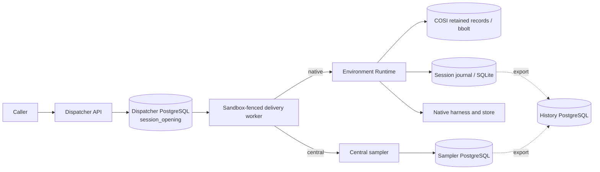

# Session opening and recovery: current boundaries

Source inventory originally checked against `devel` `b7e59c22e9` on 2026-11-02, with key outcome
claims refreshed on 2026-11-04. It describes implementation boundaries, not the proposed future contract. The desired model and unresolved
decisions are in [Sessions and environments](session_environment_model.md); the corresponding
[task DAG decision](task_dag.md#session_runtime_model_design--sessions-harness-placement-and-execution-attachments)
tracks the work. The uncertain native reservation write identified below is addressed by a separate fix linked below. Recheck the linked code when using this inventory after changes land.
The subsequent SessionSpec placement cutover supersedes this inventory's wire-field mapping; see the
[current Dispatcher contract](../runner_gateway/dispatcher/SPEC.md#sessionspec-placement-cutover).

These are independent stores and commits. A Dispatcher receipt is neither a Runtime record nor a
sampler commit; none alone proves a native harness started or History received an event.

## Dispatcher admission and delivery

- [`OpenSession`](../runner_gateway/dispatcher/api.go) requires a Session ID, Sandbox name and UID,
  verifies the current Sandbox UID and selects/validates a runtime. It authenticates the caller:
  an ordinary caller must match the Sandbox execution ServiceAccount identity; a privileged caller
  has an open-before-ready path. The actor and execution identities are distinct facts. The API
  cannot currently open a central Session without naming an existing Sandbox.
- [`openSession`](../runner_gateway/dispatcher/store.go) serializes by Session ID in a PostgreSQL
  transaction. Its `session_opening` row stores target Sandbox name/UID, spec, setup script,
  execution and creator identity, attribution and delivery state. A repeat with the same target,
  spec and setup returns the existing row; a conflicting target or request is rejected. Caller
  access is checked separately. The successful response describes that opening; its state may still
  be queued. The row is not yet the proposed independent, cross-backend Session directory.
- The [delivery worker](../runner_gateway/dispatcher/delivery.go) obtains a Sandbox ownership
  fence, verifies or binds the recorded execution identity, changes a queued opening to delivering,
  calls the selected backend and settles the row. The result `RUNNER_ADMITTED` means the backend
  accepted this opening; it does not mean setup, a native thread, or a first turn finished. Aborted,
  unavailable and deadline failures can return it to the queue with a reason/backoff. For native
  openings, proven validation/conflict rejection becomes failed; other unproven errors become unknown
  and hold dependent work. See the [current outcome contract](../runner_gateway/dispatcher/SPEC.md#native-opening-outcomes-and-dependent-commands).
  A lost worker can leave an in-flight outcome uncertain.
- A successor [recovers under its ownership fence](../runner_gateway/dispatcher/store.go). Retryable
  admissions retain the same IDs and depend on backend admission idempotency; an unconfirmed native
  opening remains held under the outcome contract above. Retrying admission is not permission to repeat
  a native effect whose outcome is unknown. Settlement itself is retried on storage errors.
- [Sandbox deletion cleanup](../runner_gateway/dispatcher/terminal.go) deletes the associated
  opening rows and dispatch rows after emitting applicable terminal dispatch evidence. A Session
  opening is therefore not an indefinitely retained global name registry. The central sampler's
  separate data can outlive this Dispatcher row.

## Native environment Runtime

The [Dispatcher routing adapter](../runner_gateway/dispatcher/central_runner.go) routes Claude and
Codex to the native Runtime. [`ProxyRunner`](../runner_gateway/dispatcher/runner_client.go) forwards
the opening through the Gateway. [`Runtime.OpenSession`](../env/runtime/session_admission.go)
validates the spec, workspace, lifecycle/admission authority and optional execution principal; it
serializes creation locally. A new record contains the initial configuration, setup bytes, a newly
generated event-source ID and execution principal in the environment-local persisted COSI
[`SessionRecords`](../env/runtime/retained/resources.go). An existing record is checked for setup,
principal and, after reconstruction, spec compatibility; an identical retry can return its attached
snapshot. See the actual code for the precise nil-principal and setup matching rules.

[`Manager.ReserveFresh` and `Wait`](../env/runtime/session/manager.go) coordinate the retained write
with COSI-owned reconstruction and wait for an owner-ready observation. Loading opens a per-Session
SQLite journal using the retained event-source ID, reconstructs Session state, publishes a live
reconcile snapshot, and, for recovered Sessions, reconciles retained work. This is distinct from
starting the harness: demand drives preparation in the [Session controller](../env/runtime/session/controller.go).
[Native handshake](../env/runtime/session/native.go) records the harness-returned native Session ID
and emits the harness-started observation. A public Session ID is not that native ID.

**Gap at the inventoried revision:** an underlying COSI store write can commit and then report an error before the in-memory
collection reflects it. Admission at that revision could consequently see an absent Session on retry
and create a different event-source ID. The [separate Runtime fix](https://github.com/agentydragon/ducktape/pull/14026)
addresses the injected failure model with fail-closed recovery. The Dispatcher retry protocol
alone cannot fix it. Separately, a successful native creation whose native ID is lost before its
mapping is durable needs evidence-based reconciliation; do not infer that retrying native creation
is safe from the fact that the public opening ID is stable.

## Central sampler

[`RoutingRunner.OpenSession`](../runner_gateway/dispatcher/central_runner.go) passes the public ID,
spec, exact Sandbox identity and expected current incarnation, setup and execution principal to the
configured sampler. The sampler authenticates the service caller and
[`OpenSession`](../central_sampler/service.go) requires a canonical UUID, executor identity,
incarnation, supported spec and model. Thus current central admission is bound to an executor even
though the conversation is stored centrally.

[`Store.OpenSession`](../central_sampler/store.go) takes a per-ID PostgreSQL advisory transaction
lock. It stores the original request for idempotency, checks the existing service-caller UID and
request on retry, and rejects conflicting configuration. On first admission it inserts the sampler
conversation and Session, creates an event-source ID and appends initial events in the _same sampler
transaction_. It freezes effective platform instructions using the executor identity at first
admission. Setup may be scheduled after that transaction; an opening response is not evidence that
setup finished. The sampler transaction is separate from the Dispatcher's opening transaction.

The sampler uses a PostgreSQL conversation lease and generation for work ownership. Uncertain
provider or executor effects are not made safe merely by an idempotent opening: the
[sampler recovery implementation](../central_sampler/store.go) records and blocks unresolved
effects, with explicit recovery after evidence is inspected; interrupted setup is not automatically
replayed. Its [History exporter](../central_sampler/exporter.go) independently advances a retained
checkpoint as History acknowledges events.

## Boundaries the future design must specify

1. **Single authority for logical existence and placement.** Specify the Dispatcher row, immutable
   opening request, revisions and backend ownership; do not keep two independently writable location
   maps. Define what clients can observe before backend materialization and after its failure.
2. **Idempotent handoff and unknown outcomes.** Define retry/conflict keys and exact durable evidence
   at both sides, including database commit uncertainty, native ID loss, and deletion during creation.
   Keep retries of admission distinct from replay of setup, model calls or tools.
3. **Identity and authority.** Decide caller, Session principal and execution-environment relationships;
   preserve UID and privilege checks while making any changes. Central authority with no executor
   cannot simply reuse today's executor-derived policy.
4. **Lifetimes and retained evidence.** Define environment deletion fencing, central persistence,
   History publication and eventual attachment-transition history without assuming atomic commits
   across Dispatcher, backend and History databases. Preserve historical records even when the live
   row is removed.
5. **Wake and readiness.** Specify authorization and ownership of unattended wake, and distinguish
   accepted logical Session, backend admission, setup and actual harness readiness. Do not present
   queue acceptance as proof that an external effect occurred.
