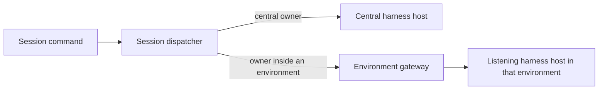

# Sessions, harness placement and execution attachments

Operator-requested future design, 2026-10-28 PDT; discussion directions updated 2026-10-30 PDT.
This is a long-term north star. The directions below constrain a future design; concrete object
types, storage, protocols and implementation scheduling remain open.
Prefer the harness outside the execution environment when capabilities are otherwise equal: agent
commands then have less opportunity to interfere with harness code/state, tool authority can be
explicitly mediated, and colocation does not become an unavoidable lifetime constraint. The boundary
still depends on actual tool routing and access; placement alone does not establish isolation.

Agentplane has largely represented a harness and its Session state as living inside a Sandbox.
The experimental [central sampler](../x/central_sampler/README.md) hosts them outside execution
Sandboxes; its Session data should survive their deletion. In that mode a Sandbox supplies tools,
rather than defining the conversation's lifetime. It still requires a running executor for the first
open and fixes the binding to one Sandbox incarnation; those are v1 constraints, not a required
ontology for every future harness.

## Cases the model must represent

- A Sandbox exists first, and an official Claude Code or Codex CLI runs there with its native
  state. Keeping the ability to wrap third-party harnesses is independently useful.
- A central Session exists first and can run with zero execution environments, using external tools.
- A central Session has 0..N execution environments and can attach one later, detach it, or lose it
  through deletion while retaining conversation identity and continuation data.
- A harness's capabilities constrain which relationships and lifecycle changes it supports.
  Claude Code naturally runs in the environment it acts in. Disabling built-in tools or adding
  remote tools may adapt it, but does not make independent execution placement its native contract.
- A native harness has a required local environment and may support additional environments. Do not
  impose a universal singleton merely because a particular backend requires one local target.
- One sandbox-hosted Codex app-server serves N Sessions and uses an exec-server in a separate container.
- An environment can be a managed Pod or VM, or eventually an enrolled external machine such as a
  laptop reached through a locally running binary. An enrolled machine need not host an agent loop.

Neither Sandbox-before-Session nor Session-before-Sandbox is a universal requirement. Independent
placement should be representable without requiring it of every backend. Preserve meaningful
backend differences rather than exposing operations a harness cannot perform.

## Durable state and running hosts

Distinguish a running harness host from its durable state. A Codex state store may contain multiple
native sessions; a running app-server can hydrate that state and run some of those sessions. The
process, stored data and Sessions have different lifetimes. Define ownership/fencing according to
the backend's actual storage/concurrency constraints rather than assuming one process per Session.

Keep three concerns distinct: state needed to continue the harness, retained evidence of what the
harness reported or did, and the conversation presented to participants. History's conversation
view is already a lossy projection, not sufficient state to resume a rollout. Central-sampler
evidence is lower-level than observations derived from native app-server JSON; neither level is a
universal user conversation format.

The related [agent-authored conversation decision](task_dag.md#agent_authored_conversations_design--conversations-agents-act-on-through-tools)
explores threads with participants and `send_message`/`edit_message` tools, including MCP clients
whose harness binaries Agentplane does not control. Such threads could become the primary UI,
with reasoning/tool calls and harness evidence in a debug view. Adding them alongside current
projected threads is a migration candidate. History ownership/renaming and OTel/Langfuse as an
evidence destination remain open; preserve the ability to record harness traces.

## Role boundaries and routing

The working role names are environment agent, execution service, harness host, environment gateway
and Session dispatcher. These do not decide binary or Deployment boundaries. Separate processes
may help place harnesses and execution in different containers/cgroups; several roles can still
share a binary.

The intended routing distinction is:

Keep harness-specific protocol adaptation distinct from environment routing. Whether the glue lives
in a harness-host process, in the gateway or alongside another service remains open. Dispatcher
resolves Session ownership and admits/delivers commands. Environment Gateway provides environment
access without assuming every Session lives there. Their current colocation is not an inherent
dependency.

Prefer central ownership of the loop when it supplies the needed capabilities: Agentplane can
control its code and environment relationships. Sandbox-hosted Codex remains a supported adapter
that central sampling may replace for a workflow, not a permanently privileged architectural role.
Preserve native Claude support independently; provider access constraints are backend-specific.

## Environment relationships and authority

Unify execution/provisioning logic used by Action boxes and runner Sandboxes where their contracts
match, including Pod/VM backends and eventual external enrollment. Keep the platform/Kubernetes
identity explicit. Agent-created environments should default to the caller's ServiceAccount, as
Action boxes do today. The proposed simple starting point for Agentplane-level child Sessions is
also the launcher's ServiceAccount; richer delegation remains open. Sharing an environment between
Sessions of the same account is an intended use, as multiple Sessions already share one Sandbox.

An attachment is a relationship, not necessarily a separately persisted entity. Session-local
names or small integer handles plus an environment name may suffice. Record only the relationship
state the protocol needs, without choosing a new resource or storage owner prematurely.

Distinguish logical environment identity, its workload instance/topology, and runtime generations:
container A in Pod X with an attached disk differs from the restarted container in that same Pod
with the same disk. Old process handles must not silently acquire the identity of new processes.

Environments should offer agent-facing descriptions/instructions: what the machine is for, useful
paths, available capabilities and resource constraints (for example, processes exceeding a memory
budget will be killed). Define how that context changes on attach/detach and which target owns cwd.

Skills are desired but their delivery is unresolved. Decide whether/how skills work with zero
execution environments and which need a filesystem. Distinguish instruction content, file assets
and executable requirements, including how to materialize them into an environment or harness
filesystem when needed.

## Tool access, disconnects and recovery

Expose environment discovery, creation and access as programmatic capabilities; an illustrative
shape is `const env = await environments.createEnvironment({...}); text(await env.exec({...}));`.
Existing targets, including a native harness's inherent environment, should also be discoverable
and addressable through tools. Lazy acquisition means the agent program requests a connection
when it needs one, without requiring a reachable executor to start the central loop/JS runtime.

Remote access should behave like ordinary asynchronous network I/O: failure of one environment
call is catchable and does not inherently stop the agent loop. When following a process fails,
return output observed so far together with the follower connection failure; do not imply that
the process exited or that no effects occurred. Preserve unknown mutation outcomes without
automatically replaying them.

The desired JavaScript interface rejects with an `Error` carrying structured fields such as
`observed_output`, the observation cursor, remote outcome and `cause`, alongside `message`.
Agent code should be able to read `error.observed_output.text` directly. The current pinned host
rejects delegated calls with a primitive string; JSON-encoded failure details are a transport
constraint, not the target agent interface. When changing the host or delegate adapter, normalize
that boundary centrally and preserve the original cause/evidence. This does not require replacing
the host before shipping independently useful recovery fixes.

Define the reconnection protocol before relying on it: what connection/session identity survives,
how it relates to environment and executor generations, and whether existing processes/handles can
be rediscovered. A retained process inventory may be useful, but is not yet required; agents can
also inspect process state with ordinary commands. A new connection alone proves neither process
loss nor continuity.

Current Code Mode cells have separate lexical globals; `store()`/`load()` retain values only in the
live host. The future API should make environment references usable across code executions. Decide
between named references, stored serializable handles and persistent bindings; an environment
reference need not be a live socket. Do not claim host-memory values survive host loss.

Desired host-loss behavior: tell the agent which JS state/cells were lost and let it continue or
recover with a fresh runtime. Abandon uncertain in-flight work with retained evidence and a
model-visible notice rather than permanently blocking the conversation. Do not replay uncertain
effects or mistake this for restoration of arbitrary JavaScript execution state. This is future
behavior, not a claim that today's operator-driven recovery already does it automatically.

## Tool surfaces and execution implementations

Use shared execution semantics behind direct tools, Actions, nested JS calls and provider-native
programmatic tool calling. Actions should be callable directly from code; a provider with suitable
programmatic calling need not be given another Agentplane code tool. Compare capabilities such as
state, cancellation, long waits, notifications and multimodal results before treating runtimes as
interchangeable. Preserve existing Action authorization and outcomes rather than adding a parallel
execution owner.

An Agentplane-owned Code Mode executor and execution server are possible future implementations.
Owning the JS host would also let Agentplane design its agent-facing APIs as ordinary libraries:
structured errors and results, environment references across cells, direct Action calls, and
explicit cancellation, waiting and state lifetimes. Translate transport quirks at the adapter
boundary. Evaluate host ownership against concrete workflow ergonomics as well as the cost of
Codex WebSocket/gRPC adaptation; no implementation choice is selected here. Preserve sandbox-hosted
app-server plus separate execution-container operation.

## Resource visibility and placement

Independently useful follow-up: expose requested resources, limits and observed usage for an
environment and its containers/VM resource groups, including shared budgets. Revisit the current
iteratively chosen reservations using measurements; no replacement values are selected here.
Consider moving direct-executing Claude out of the container protecting the Codex app-server and
into an execution/workload resource domain. Whether it shares Codex's executor container is open:
moving Claude and its children together does not separate their resource fate from each other.

## Partial remote support is not a placement contract

The operator reports that few harnesses offer complete separation today, citing OpenClaw's
historical support: some features execute remotely while many still assume the gateway's local
filesystem/process environment.

The dated [OpenClaw execution-model record](../../cluster/docs/operations/2026_02_24_openclaw_execution_model.md)
provides a concrete example: node mode forwarded shell commands while built-in file tools stayed
on the gateway; the integration shared a workspace volume to keep them consistent. Docker sandbox
mode had different routing, so this is evidence about that integration, not every OpenClaw mode
or release. A shared mount can restore consistency while weakening the intended state boundary.

Assess each backend across shell, filesystem/patch/image tools, instruction discovery, skills and
MCP, hooks, cwd/path resolution, persistence and recovery. Record unsupported or gateway-local paths
explicitly. Do not label a backend fully remote merely because it forwards shell commands, or force
an incomplete adapter to impersonate a capability-complete external harness. Preserve colocated
CLI operation when that is the supported way to retain its useful behavior.

## Questions for review

Refine Session identity/continuation authority, durable harness stores, running harness hosts and
execution-environment relationships into concrete contracts. These roles do not by themselves
choose object types, services, databases or Kubernetes resources.

Decide which lifetimes are coupled for each backend and how creation, attach/detach, suspend,
deletion and recovery appear in the API and UI, preserving the 0..N central case. Separate
retained history from continuation needed to resume a harness, and state what each backend can keep
or recover after its environment disappears. Preserve existing Session identities and native state.

Define attachment authorization and capability discovery, incarnation fencing, in-flight tool
cancellation and uncertain effects. Attribute sampling to the Session and execution to the actual
environment used. Specify how cwd, filesystem instructions, credentials and tool availability
change with attachments; detachment must not silently redirect commands to the sampler host.

The versioned [Codex environment API evidence](sampling_outside_sandboxes.md#codex-supports-the-split-upstream)
already describes experimental `environment/add`, per-thread environments and turn overrides.
Use it as input; it does not establish arbitrary detach/rebind or environment-free operation.

Exit: reviewed terms, ownership/lifetime rules, API examples for the cases above, and a
transition proposal preserving existing identities, history and native state. Implementation work
follows a reviewed choice. This design authorizes no deployment or migration.
