# Agentplane task DAG

This is the dispatch map for **unfinished** work. Detailed contracts belong in component plans;
completed work belongs in component docs, not done nodes here. Maintenance rules are in
[AGENTS.md](../AGENTS.md#task-dag-maintenance). Deliberately deferred candidates and conditional
hardening live in the [freezer](task_freezer.md), not the execution graph.

## Current state and scheduling

Audit metadata consumers (`sandbox`, `harness`, `model`, `cwd`, summary/activity fields) before
deleting useful UI projections. Squash Alembic only once the app schema settles.

States: **in flight** means reported work is underway; **decision** needs a reviewed outcome;
**blocked** names prerequisites; **candidate** is dispatchable when selected, not a priority claim.
A **capstone** closes an integrated contract, not another implementation. Solid arrows below are
prerequisites; dashed arrows explicitly label scheduling holds or conditional choices. All service
contracts remain multi-replica unless a reviewed temporary restriction says otherwise.

## 1. Session schema and identity follow-up

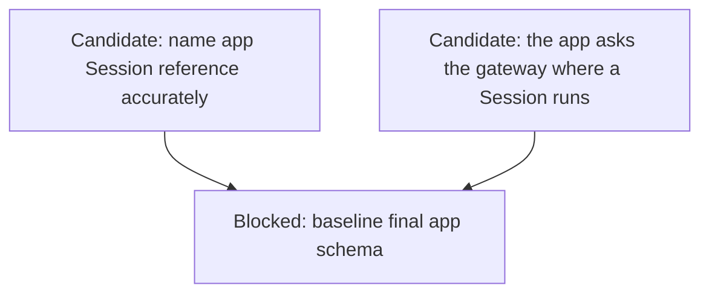

### `APP_SESSION_SCHEMA_RENAME` — name the app Session reference accurately

**Candidate.** Rename `EventLog`/`event_log` with their foreign keys, queries and
references. Preserve public IDs and app projection/operator metadata; do not rename
service archive tables or runner storage. Coordinate a safe schema rollout. Metadata
consumer audits remain scoped cleanup, not permission to discard useful UI projections.

### `APP_SESSION_SANDBOX_DROP` — the app asks the gateway where a Session runs

**Candidate; operator, 2026-10-11 PDT: the app should not keep this in its own database.**
`event_log.sandbox` (and the `event_log_sandbox_session_id_key` constraint) is the app's own copy of
the Runner Gateway's Session ↔ Sandbox routing; the bridge, `api.py` and the Thread list's Sandbox
grouping read it. Give the gateway a batch read of each Session's Sandbox, switch those readers to
it, then drop the column. Stops for the operator before the drop. Independent of
`APP_SESSION_SCHEMA_RENAME`; whichever lands second rebases.

### `APP_ALEMBIC_SQUASH` — consolidate the final app schema

**Blocked on final schema naming/cleanup.** Baseline only the settled schema,
verify fresh and migrated databases and their deployed stamps before pruning old revisions.
Retain the data-preserving rollback procedure. No Action Service or other database squash implied.

## 2. Service-owned command admission and later notification presentation

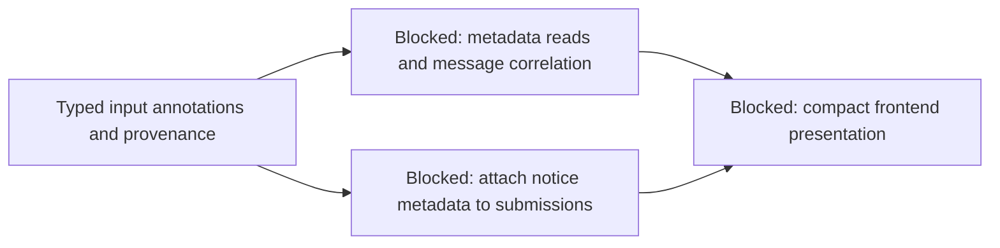

Details: [command admission](../sandbox_service/API.md#sessions-and-commands); later
[notification presentation and input metadata](notification_presentation.md).

### `NOTIFICATION_COMMAND_OUTCOME_DESIGN` — notice delivery without reading conversation history

**Unscheduled; operator, 2026-10-11 PDT: not a priority, needs more thought.** The Notification
Service scans a Session's raw history from the History Service for its own command's admission and
`harness_user_message_confirmed`, and stores one `EventEntry` per notice (`Notice.runner_entry`):
the one service besides the History Service fold that derives state from Session events. The Runner
Gateway's command records can say the runner admitted a command, but not that the harness executed
it or that the message reached the model's context; today that needs the history. Decide where that
outcome is recorded before the Notification Service stops reading history.

### `SESSION_INPUT_METADATA` — later typed annotations on input commands

Extend the service envelope with typed
metadata and restricted trusted producer provenance. Notification-specific authorization and producer
integration belong here, not in the generic command-admission PR. Metadata never enters runner commands;
notification attachments are invalid on controls. No untyped extension dictionary.

### `SESSION_INPUT_METADATA_READ` — authorized annotation reads

**Blocked on typed input metadata.** Expose metadata by session/command identity and join existing
`origin_command_ids` in projections. Include pending/failed inputs, replay and retained historical
annotations without requiring a live notification inbox. Keep canonical runner Events unchanged.

### `NOTIFICATION_NOTICE_METADATA` — producer integration

**Blocked on typed input metadata.** Attach notice identity/range metadata using existing delivery
command IDs. Preserve receipt reconciliation and explicit inbox acknowledgement. Verify the backend
path without the app; use automated integration coverage rather than requiring a provider outage.

### `NOTIFICATION_PRESENTATION` — compact notification rendering

**Blocked on producer and metadata read integration.** Compact authenticated notification-only
inputs, expand full text and render mixed human/notice messages normally with annotations. Missing
metadata falls back to text. Include visual coverage and one bounded real-notice check; no inbox
acknowledgement on render and no text-prefix provenance heuristic. Runners remain unaware.

### Subscription authorization before broader sources

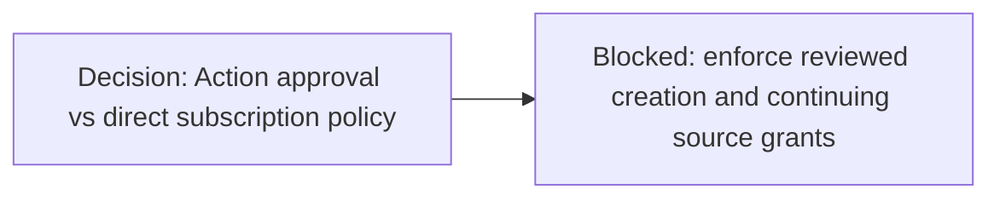

### `SUBSCRIPTION_AUTHORIZATION_DESIGN` — auto-allow and operator-approved subscriptions

**Decision.** Compare an Action-backed subscribe operation using existing auto-allow/operator
approval with authorization inside Notification Service; do not preselect another policy engine.
Review which callers may subscribe to which sources, targets, fields/filters, destinations and
lifetimes, and who can approve/delegate that access. Subscription creation approval is distinct
from continuing source access and from ownership of the destination inbox. Define renewal, scope
expansion, policy changes/revocation and what happens to already-retained entries.

Use Kubernetes as a concrete design case: namespace/resource/UID scope, object/status/event/log
content, name reuse and whether grants delegate the caller's existing read authority or explicitly
allow additional observation. A privileged watcher must not expose arbitrary cluster data merely
because the agent owns an inbox. Review argument examples that auto-allow narrow approved scopes,
require operator approval for additional scopes, and reject requests nobody can delegate. See the
[subscription authorization design](notifications.md#subscription-authorization-and-action-approval).
This is independent of selecting a messaging transport or fixing existing GitHub delivery gaps.

### `SUBSCRIPTION_AUTHORIZATION` — creation gate and continuing enforcement

**Blocked on the authorization decision.** If Actions is selected, implement its subscribe operation
and reviewed policy bindings; otherwise implement the chosen direct policy path. Keep Notification
Service the subscription/delivery authority in either case. Carry verified caller/decision scope
across the service boundary rather than substituting the executor's broad identity. Enforce the
same access contract on direct APIs, renewals and updates; no approval bypass by another endpoint.

Test auto-allow, pending approval, denial, restricted destinations, scope escalation and expiry/
revocation with controlled identities. No entry may be delivered beyond the reviewed source scope;
approval is not permission to wake a Sandbox or execute source content. Future Kubernetes sources
must depend on this contract/enforcement when promoted from the freezer. Ordinary authorized
subscription reads/cancellation and existing GitHub gap recovery need not wait for a broad redesign.

### GitHub notice reliability after missed updates

The operator reports that GitHub updates may sometimes be missed. This is a concrete reliability
concern, not proof that GitHub webhook delivery itself is at fault. Diagnose webhook receipt,
matching, inbox persistence and notice dispatch separately. Do not reopen waived broad provider
outage/refresh exercises; test the specific recovery contract with controlled missing webhooks.

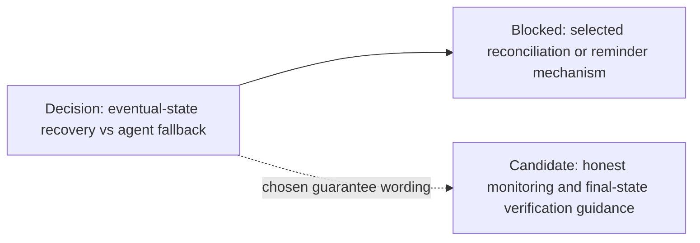

### `GITHUB_NOTICE_RELIABILITY_DESIGN` — delivery guarantee and fallback

**Decision.** Review the gap and choose the guarantee needed for PR shepherding: eventual awareness
of current head/check/review/merge state, or historical delivery of each event. Compare bounded
service-side reconciliation using existing durable shared GitHub refresh state with explicit agent
fallback checks, optionally scheduled reminders. Recommend the smallest reliable path with a stated
staleness bound/cost. A webhook subscription is not proof no changes occurred when it stays silent.
Snapshot polling cannot reconstruct all intermediate events, and a cron reminder alone is not
recovery if no active agent checks state. Detailed alternatives and questions are in the
[notification plan](notifications.md#missed-github-updates-and-shepherding-reliability).

### `GITHUB_NOTIFICATION_RECOVERY` — implement the reviewed recovery contract

**Blocked on the reliability decision.** If service reconciliation is selected, periodically compare
eligible shared subjects with authoritative GitHub state and durably emit deduplicated observations
for uncovered relevant changes. Reuse refresh leases, backoff and access checks; bound API load.
Distinguish observed state from a received webhook; do not fabricate delivery IDs or promise replay
of events the API cannot recover. If agent fallback is selected instead, provide its actual bounded
check/reminder mechanism and explicit limitations rather than just advising agents to remember.
Add `CRON_NOTIFICATIONS` as a prerequisite only if that reviewed implementation actually needs it;
a service refresh deadline need not introduce a general scheduler. Backend workers stay in-process.

Test a suppressed webhook, duplicate webhook/reconciliation races, changed head/check state and
restart/checkpoint recovery with a controlled GitHub peer. Observe one eventual update for the
promised scope, honest access/backoff state and no false claim of complete history. No live GitHub
outage or exhaustive historical event matrix is required.

### `GITHUB_SHEPHERD_GUIDANCE` — explain monitoring limits and completion checks

**Candidate for immediate baseline clarification; final wording follows the decision.** Treat
notifications as prompts to inspect authoritative current PR state, not evidence that the latest
head passed or that silence means no progress. Document the chosen fallback deadline/ownership and
how an agent notices unreliable monitoring. If reminders are chosen, state who runs them and that
notices do not start a stopped harness. Guidance accompanies the selected reliability behavior;
it must not advertise a polling/reminder guarantee before that mechanism exists.

## 3. Multiagent decisions before implementations

These are operator-reviewable decisions, not permission to implement every possibility. Drafts can
be developed together, but publish a coherent shared identity/authority vocabulary before downstream
APIs. Do not equate creating a resource, reading history, sending a message or receiving/acking it.

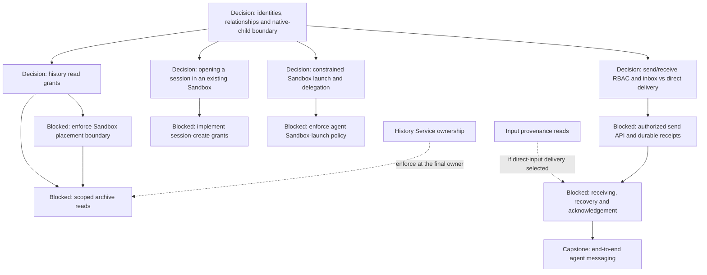

### `MULTIAGENT_MODEL` — shared identity and authority vocabulary

**Decision; no runtime work implied.** Present concrete API examples for independent agents,
Sandboxes and Sessions, with creator, manager and parent/provenance represented separately. Ask
the operator to choose addressing/ownership and delegation semantics. No permission inheritance
from an organizational edge or preset. Review how native harness children could later be ingested:
linked execution in the same Sandbox trust boundary versus independently provisioned Sandboxes,
addressability, observability and which controls must remain unavailable. Native integration itself
stays frozen; this decision must allow explicit exclusion rather than require its implementation.

### `THREAD_READ_POLICY_DESIGN` — scoped history read policy

**Decision; draft in parallel with the shared model.** Review compartments versus exact-session
grants, who classifies/reclassifies histories and grants/revokes access, and caller replacement
semantics. Neither grant model isolates Sessions sharing a Sandbox (see the
[isolation boundary](../docs/thread_layering.md#sandbox-isolation-boundary)). Defaults expose
no existing histories to workloads. Select raw read/list/follow scope; read does not imply
send/create, and no folded-read API is required for v1. Decide how revocation
applies to live feeds, discovery and linked evidence. Do not block this on a messaging transport.

### `SANDBOX_COMPARTMENT_BOUNDARY` — enforce Sandbox placement boundary

**Blocked on the reviewed scoped-read policy.**
The Sandbox is the security isolation boundary: co-resident Sessions share filesystem, credentials,
and ServiceAccount authority, regardless of archive-read classifications. Enforce compatible
placement for any proposed scoped-read policy at Open, adoption and replacement, rejecting
placements whose claimed isolation depends on separating co-resident Sessions. Test shared
filesystem/SA cases and denied placements. Keep VM isolation a separate capability, not a
fictional fix for shared credentials inside one VM. See the
[Sandbox boundary](../docs/thread_layering.md#sandbox-isolation-boundary).

### `THREAD_READ_POLICY` — authorized retained-history access

**Blocked on reviewed read policy and compartment enforcement.** Enforce at
the owning backend across list, raw/native evidence, direct reads and feeds, including reconnect
and revocation. Keep app-only UI folds separate. Test allowed/denied histories, two principals,
deleted Sandboxes and revocation with deterministic service tests plus a bounded deployed auth check.

### `AGENT_MESSAGING_DESIGN` — send and receive contract

**Decision.** Present examples of sender authentication, recipient discovery/opt-in, send grants,
recipient read/ack grants and administration. Compare Notification Service inbox delivery with
direct session input and an existing messaging channel; recommend the smallest fit. Define
accepted, delivered, handled and acknowledged separately; decide offline behavior, retention,
batching, abuse limits and mailbox ownership after Sandbox deletion. Reading a transcript does not
authorize sending or acking.

Output includes the selected owner/API and explicit conditional prerequisites: a direct-input
implementation reuses durable `SubmitCommand` and separately reviewed provenance reads; a notification source reuses
inboxes without treating admission as acknowledgement. Neither branch is selected in this DAG.
Before dispatch, add the chosen branch's edges; do not require implementing both. New Sandbox
Service or app tables require their task-specific contract review. Pure Notification Service work need not
wait for unrelated archive schema once its contract is reviewed.

### `AGENT_MESSAGE_INGRESS` — authorized send and acceptance

**Blocked on messaging decision and its selected prerequisites.** Implement bounded payloads,
server-authenticated sender provenance, per-recipient send policy, idempotent message IDs and honest
acceptance receipts in the chosen authority. Test denied pairs, spoofing and retry/conflict behavior.

### `AGENT_MESSAGE_RECEPTION` — delivery, recovery and acknowledgement

**Blocked on ingress contract/implementation.** Implement selected recipient read/delivery/ack
operations, batching and recovery of unread work. Test revoked/deleted recipients, ordinary offline
catch-up and duplicate delivery without leaking payloads. Do not start/resume a harness implicitly.

### `AGENT_MESSAGING` — integrated messaging capstone

**Blocked on ingress and reception.** Demonstrate an authorized pair exchanging a message through
the selected API, with correct provenance and distinct receipt/ack states. Security-negative and
multi-replica retry cases belong in automated tests; no real provider outage requirement.

### `THREAD_CREATE_POLICY` — authorize session creation separately

**Decision.** Review caller scope to open in an existing Sandbox, accepted defaults, quotas,
creator visibility and revocation. Use the service-reserved Session identity, not a caller-invented
public UUID. Opening in an existing Sandbox grants no isolation from its other Sessions; require a
separate Sandbox when incompatible trust or credentials are needed. Decide whether launch-and-open
is a composition of separate grants, never an implicit read/send/launch permission. This contract
need not choose a durable offline command queue.

### `THREAD_CREATE_AUTHORIZATION` — implement session-create grants

**Blocked on create policy.** Enforce scope/defaults and idempotent Open
lookup at the service boundary; test forbidden targets/overrides and a lost creation reply.

### `AGENT_LAUNCH_POLICY_DESIGN` — Sandbox launch and delegation policy

**Decision.** Review which callers can use which templates and resource budgets, mounts, images,
secrets, egress and Kubernetes/Action grants; presets are defaults, not authority. A new Sandbox is
required for an independent isolation boundary; adding a Session within one is not. Define manager,
lifetime, parent termination, quota/fanout and revocation without automatic privilege inheritance.
Choose policy ownership and audit records before adding tables. State separately whether the
operation also opens a session; if so, depend on `THREAD_CREATE_AUTHORIZATION` for that composition.

### `AGENT_SANDBOX_LAUNCH` — constrained agent-requested launch

**Blocked on launch policy and idempotent create.** Enforce the reviewed
effective spec and delegation server-side. Test allowed and forbidden launch parameters and
concurrent retries. Reuse Sandbox Service creation, not harness-native agent tools. Launch alone
does not grant history read, messaging, credentials or execution of another principal's Actions.

## 4. VM environment phases

The [KubeVirt plan](kubevirt_environments.md) contains completed prototype evidence and the detailed
provider design. Split implementation rather than making “VM support” one indivisible task. This is
an unranked candidate lane, not authorization for local Bazel in current containers. The
[runner control stream](../docs/runner_control.md) settles the dial-out contract VM control networking
builds on; changing connection direction does not move command durability or remove the runner
journal.

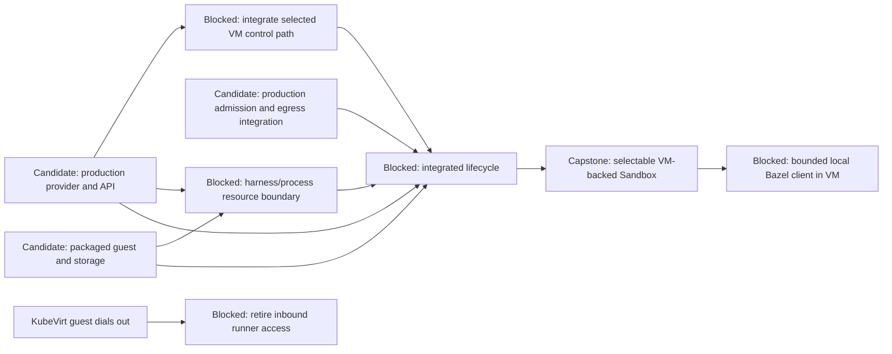

### `RUNNER_INBOUND_RETIRE` — remove inbound runner access

**Blocked on `KUBEVIRT_GUEST_CONTROL`.** Remove
`Attach` command submission, the pull ingester, the runner control port and its network policy.
With no inbound route left, the `runner_connection` table goes (a drop migration the operator
merges) together with the routing check on its operations in `SubmitCommand`. Capability
negotiation goes on both sides: `ControlOperation`, the runner's `CAPABILITIES`,
`Hello`/`Welcome.capabilities`, `ConnectionStore.record_operations`/`read_operations` and every
`control_routed` or inbound branch in the gateway. The legacy
caller-chosen runner Session ID path goes too, as does the client's fallback to the service when a
Sandbox has no control Service (the `CLEANUP` tombstone in `sandbox_service/client.py`), as do the
runner SPEC's and Sandbox Service README's notes on the unauthenticated inbound listener.

Also inbound-only, so deleted here: teardown's inbound seal branch and `_stop_legacy` for runner
images without `Seal`; `SubmitCommandRequest.follow` with the client's `command(after_cursor=...)`
and the app's `last_cursor` lookup for it, read only by the relay; the `runner_grpc_channel_options`
setting and `Environment` field; and the runner's own gRPC server, its `--listen` flag and the
`Runner` service RPCs the channel duplicates. The Sandbox Service README, which still describes
the relay as its foundation, is rewritten for the channel.

### `VM_CONTROL_NETWORKING` — integrate the reviewed connection direction

**Blocked on the VM provider.** Wire
VM control reachability/authentication to the chosen path. An outbound control stream may remove guest
control-port exposure and endpoint discovery; retain the independently needed outbound API/credential
proxy path. State which guest ports, endpoint discovery and network policies the chosen path
replaces. Image packaging and process-isolation work need not wait for this decision. Verify the
selected path on the actual VM network, not just a host-loopback transport test.

### `VM_IMAGE` — packaged guest and state storage

**Candidate.** Publish a digest-pinned guest with runner/harness versions, blank-disk setup and
retained state/workspace bounds. Check startup with both harnesses, without ad hoc downloads or
real credentials baked into the image. Reuse the proven prototype, not another platform evaluation.

### `VM_PROVIDER` — production provider API and lifecycle intent

**Candidate.** Integrate typed environment kinds, templates/destinations, inventory, reconciliation,
RBAC and UI. Container behavior remains intact. Review the changed service contracts and schema
rollout as part of this work.

### `VM_EGRESS` — integrate production admission and proxy path

**Candidate.** Implement the selected launcher-injection/proxy route on the production stack.
Verify proxy-only credentials, routing, token replacement and denied cross-environment access;
check failure scope for the new admission configuration. Do not repeat the entire completed
prototype matrix or require simultaneous cluster-wide disasters.

### `VM_PROCESS_ISOLATION` — protect control from harness processes

**Blocked on image/provider.** Enforce aggregate memory/process/disk budgets and process-control
boundaries. Test representative tool/harness termination and bounded exhaustion to establish which
runner/control state survives and what needs durable recovery. This directly addresses agents
accidentally killing their own harness; guest or container packaging alone is not that guarantee.

### `VM_LIFECYCLE` — integrated lifecycle verification

**Blocked on provider, image, selected control networking, egress and isolation.** Exercise both harnesses through real service
routes with retained-state stop/start and a representative replacement; confirm identity, replay and
cleanup. Automated tests cover restart/concurrency branches. Additional live faults need a concrete
unresolved platform risk, not a Cartesian product of every component crash and lifecycle operation.

### `SANDBOX_VM_ISOLATION` — VM integration capstone

**Blocked on integrated lifecycle.** Publish the selectable VM environment and measured isolation
limits, with no implied existing-Sandbox conversion or live migration. Component evidence, not
absence of every imaginable failure, establishes the delivered contract.

### `LOCAL_BAZEL` — bounded local client in a VM

**Blocked on VM capstone.** Wire Bazelisk, storage and authenticated RBE/cache/BES; set CPU/memory/disk
budgets and cleanup. Run a representative build/test with the client inside the VM and actions
remote; check cancellation/cleanup while the harness stays responsive. Installed tools and working
hosted builds do not authorize local Bazel in agent containers.

## 5. Independent UI and narrowly scoped service work

These candidates need no multiagent or VM decision. Any implementation that turns out to require
app/Sandbox Service database changes requires its own migration safety review.

## 6. Existing access and lifecycle follow-ups

These are bounded existing work, not dependencies on the broader multiagent model. Confirm current
source/deployment state with the relevant owner when dispatching; old acceptance notes are not live
observations. New database work follows the task-specific review and rollout requirements.

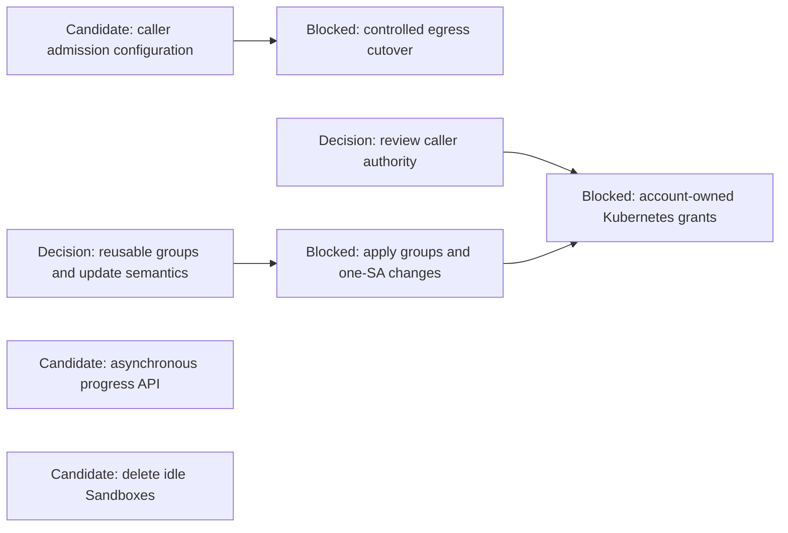

### `PC_EGRESS_CREDENTIALS` — label public-coder's Action Service caller

**Candidate; verify remaining configuration.** Admit the intended OpenClaw account to the dedicated
Action Service using its configured namespace and policy bindings. A label alone is not an execution
grant. Coordinate with the owner of the currently disabled/controlled workload before rollout.

### `PC_EGRESS` — public-coder-agent egress migration

**Blocked on caller admission and a controlled deployment.** Compare effective allowed/denied routes,
credential substitution and Action policy against the existing proxy, then do a reversible cutover.
Remove only unused OpenClaw-specific wiring; retain shared Iron/Haku consumers. Do not turn this
into an outage matrix. Source: [public-coder wiring](../../cluster/cdk8s/public_coder/proxy.py).

### `CLAUDE_AI_SA` — review the external caller's actual authority

**Decision.** Review the claude.ai account's Connection and arbitrary-shell Sandbox privileges,
Kubernetes scope and egress/Action grants. Record intended authority in generated configuration,
not ad hoc grants. Test an allowed and denied operation; do not add privileges as part of this review.

### `KUBERNETES_RBAC_POLICIES` — reusable groups and update semantics

**Decision.** Replace the hundreds of per-namespace grant selections in some Sandbox presets
and their creation dialog with a named, subject-free Kubernetes grant group. Compare snapshot
expansion (acceptable) with live updates to existing bound SAs (preferred); keep a one-SA runtime
grant operation, which may use the same group mechanism. Decide ownership, namespace expansion,
role-edit/revocation behavior and inspection. The launch catalog is not already a live policy.
See the [RBAC grant-group plan](kubernetes_rbac_groups.md) for the current behavior, prior art,
trade-offs and acceptance cases. The preferred live design is an Agentplane-owned,
subject-free group CR and per-Sandbox assignment CR, reconciled by a separate small controller
image/ServiceAccount with narrowly reviewed binding-write and named-role `bind` authority;
final CRD schemas, migration and RBAC grants still require review. Snapshot expansion remains
an acceptable simpler fallback.

### `KUBERNETES_RBAC_POLICY_BINDINGS` — apply groups and one-SA changes

**Blocked on the reviewed policy shape.** Implement compact group selection and durable assignment,
expanded Kubernetes bindings, a one-SA runtime change and inspection. Reconcile changed group
membership for existing SAs if live semantics are chosen; otherwise make snapshots explicit and
support deliberate updates. Retain managed binding conflict/cleanup safeguards and verify
add/remove, overlaps and restart. See the [plan](kubernetes_rbac_groups.md).

### `MANAGED_SA_RBAC` — grants for accounts without a Sandbox

**Blocked on reviewed policy/ownership model and reusable group binding.** Extend the chosen
group assignment and one-SA runtime model to accounts without a Sandbox, including
owner/reconciliation/expiry when no Sandbox can own the binding. Do not fight GitOps over objects.
Existing grant views can ship first; add this grant kind when it exists. Keep ordinary authorization
and cleanup tests; no dependency on a new external-credential broker. See the
[RBAC grant-group plan](kubernetes_rbac_groups.md).

### `SANDBOX_RBAC` — bounded deployed grant checks

**Candidate; security-relevant remaining check.** Inspect the concrete managed-Sandbox grant path
and verify intended versus unrelated scope, including Role edits and credential-use boundaries,
without recording credentials. Use [agent RBAC](../../cluster/docs/agent_rbac.md) and existing tests;
only unresolved deployed wiring needs a live check, not a repeat of every already-covered operation.

### `NOTIFICATION_INGRESS_BOUNDARY` — bounded public-route security check

**Candidate; security-relevant deployment check, not a provider failure drill.** Existing tests
cover invalid signatures. Close the remaining route-wiring uncertainty with an unsigned webhook
request and a private-API request through the public hostname: both must be refused, without
creating subscriptions or inbox entries. Record the result once; no exhaustive provider matrix.

### `BINDING_SUBJECT_ARITY` — singular subject shape

**Candidate.** Align the
binding kinds on one explicit subject before adding multi-subject use. Preserve owner/replacement
and authorization semantics; this cleanup does not authorize broader grants.

### `BOOTSTRAP_PROGRESS_CONTRACT` — asynchronous start/status

**Candidate.** Add authorized start/progress/result semantics without
holding an Open RPC through a long script. Keep successful bootstrap as the Open precondition
unless the operator reviews a change. Separate Sandbox initialization from per-session setup.

### `SANDBOX_IDLE_EXPIRY` — delete Sandboxes nobody uses

**Candidate.** Draft [#7859](https://github.com/agentydragon/ducktape/pull/7859)
expires idle Sandboxes (`TODO(sandbox-lifetime)` in `action_service/sandbox/inventory.py`). Deleting
one goes through [teardown](../sandbox_service/API.md#teardown), which waits until history is
archived through the seal (the ingress acknowledgement).

## 7. History Service extraction and delta settlement

Target and the reasoning behind this order: [History Service plan](history_service.md).
Decided by the operator on 2026-10-10 PDT: the History Service takes over the existing
`sandbox_service` database; the fold's projection is rebuilt from the raw log, not copied; Electric
replicates the history database; `session_event` keeps its name.

Each implementation node is one deployment, in this order: a server capability with no callers, then
the caller switch, then deleting the old path in a later release after bounded checks on both
environments. Testing goes first, staging after its checks pass. Retained data is deleted only by a
node that says so. There is no dual write of the raw log: there is one copy of its tables, and each
node switches which service reads or writes it. Only the fold double-runs.

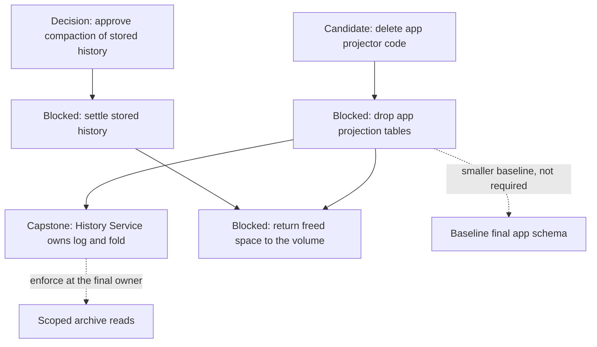

### `APP_PROJECTOR_RETIRE` — delete the app projector

**Candidate; Thread fold move lane.** Testing and staging read Threads from the History Service
fold (`thread_reads`). Once staging's fold has caught up, compare materialized Threads (entities
and bodies) with the app's on a bounded sample of Sessions; then remove the app projector, its
leases' code, the `thread_reads` switch and the app's Electric deployment. Retained tables stay.

### `APP_PROJECTION_RETIRE` — drop the app projection

**Blocked on projector retirement.** An explicit deletion PR for the app projection tables and
leases. The data is derived and rebuildable from the raw log.

### `HISTORY_SERVICE_OWNERSHIP` — capstone

**Blocked on projection retirement.** The History Service is
the only owner of the raw log and fold; the app is a facade over it. Each service's README states
what unrelated agents can still do while it is down or rolling.

### `SESSION_EVENT_COMPACTION_PLAN` — approve settling stored history

**Decision.** A reviewed plan for a resumable one-off Job that settles stored Sessions with the same
code: the Sessions it touches and what is lost. It deletes stored history, so it needs the
operator's explicit approval.

### `SESSION_EVENT_COMPACTION` — settle stored history

**Blocked on the approved plan.** Run the Job in testing, then staging, stopping and resuming
cleanly. Backups keep the old rows until their retention expires.

### `HISTORY_REPACK` — return freed space

**Blocked on compaction and the app projection drop.** `pg_repack` (or `VACUUM FULL` in a window)
on the log and projection tables; deleted rows otherwise stay as reusable space inside Postgres.

## 8. Sessions that outlive their Sandbox

Not scheduled (operator, 2026-10-10 PDT: co-plan, not now). A Session and its history are durable;
its Sandbox is one incarnation that can be deleted, with a new one provisioned later to revive the
Session on a runner. Today a Session lives exactly as long as its Sandbox's runner volume
(suspension removes the Pod and keeps the volume). The event log alone is not a native resume image;
the operator's direction (2026-10-10 PDT) is a state volume holding the harness files and runner
state that survives the Sandbox and is attached to the next one. Section 7 is written so it does not
preclude this: the History Service keys by Session, a Session records each Sandbox incarnation, and
a teardown seal closes an incarnation, not the Session.

A related direction (operator, 2026-10-11 PDT; later, with more planning, not scheduled): Sessions
living in a long-running, often-suspended Sandbox whose runner image upgrades between incarnations.
Runner dial-out, the ingress and per-incarnation seals make it more reachable; `POD_INCARNATION` is
one shape it could take.

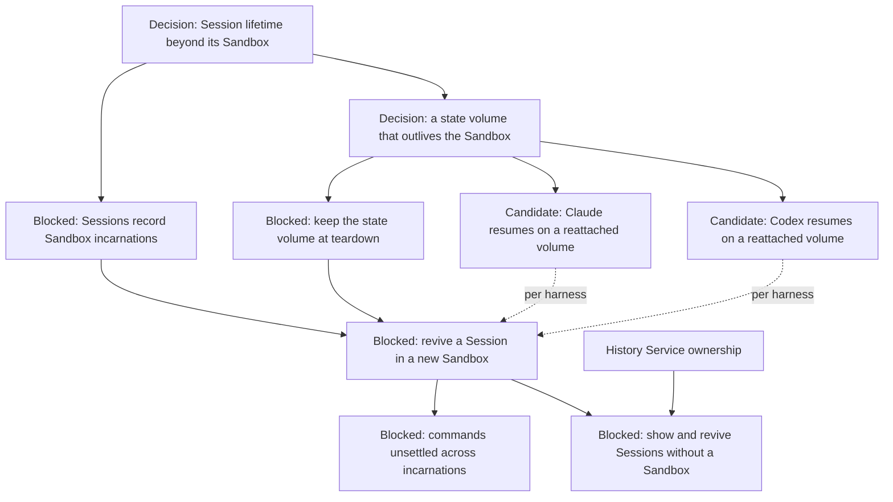

### `DURABLE_SESSION_LIFECYCLE` — Session lifetime beyond its Sandbox

**Decision.** Replaces the frozen `THREAD_OUTLIVES_SANDBOX`. Decide: what a revived Session gets
back (native harness state only, or also its workspace files); which launch configuration a new
incarnation uses (the Session's frozen one, or a current template, which also decides whether an
image upgrade happens on revival); who may revive and how (an explicit API call, never implicitly
on a read or a notification). Sessions that shared a Sandbox revive together (one state volume per
Sandbox, `SESSION_STATE_VOLUME_DESIGN`).

### `SESSION_STATE_VOLUME_DESIGN` — a state volume that outlives the Sandbox

**Decision; direction set by the operator, 2026-10-10 PDT.** Replaces the frozen
`THREAD_PORTABLE_STATE`. A persistent volume holds the native harness files and the runner's state,
separate from the workspace, is kept when the Sandbox is deleted, and is attached to the next
incarnation, whose runner continues the same journal. Decided: one volume per Sandbox, so the
Sessions that shared a Sandbox revive together in its successor. Decide: whether the runner's state
goes on it or only the harness files;
whether the workspace survives too (operator neutral; default: it does, kept with the state volume,
because a revived conversation refers to files the agent made and its cwd must exist); storage class, since `local-path` pins a volume to one node and
so pins revival there; who deletes a retained volume (an explicit Session deletion) and its quota;
and refusing to attach to an incompatible harness or runner version rather than attempting it.

### `CLAUDE_PORTABLE_STATE` — Claude evidence

**Candidate after the volume design.** Attach a retained volume to a new Sandbox (new Pod, possibly
a newer image) and resume, checking continuation and prompt-cache cost. The frozen
`RUNNER_IMAGE_UPGRADE_PROOF` is the same experiment on one Sandbox. Independent of Codex.

### `CODEX_PORTABLE_STATE` — Codex evidence

**Candidate after the volume design.** The same for Codex; neither harness waits for the other.

### `SESSION_INCARNATIONS` — a Session records its Sandboxes over time

**Blocked on the lifecycle decision.** The Runner Gateway's Session
registry holds a sequence of Sandbox incarnations, at most one live; the locator ↔ Sandbox binding
becomes per incarnation. Each incarnation's runner announces its `sandbox_uid` on ingress, from which the
History Service records it, and its seal ends that incarnation, not the Session. On the retained volume the runner journal and its
cursors simply continue; the next incarnation journals that it resumed after a seal.

### `STATE_VOLUME_RETENTION` — keep the state volume at teardown

**Blocked on the volume design.** Provision the state volume separately from
the Sandbox's other storage; at teardown, after the seal commits, delete the Sandbox and keep the
volume, bound to the deleted Sandbox's identity so that its successor receives it. Test that a Sandbox
deletion never deletes a retained volume and that an explicit Session deletion does.

### `SESSION_REVIVE` — revive a Session in a new Sandbox

**Blocked on incarnations, retained volumes and per-harness evidence.** Provision a new Sandbox
from the decided launch configuration with the retained volume attached, and resume the harness as a new
incarnation of the same Session and history. Ships per harness as its evidence lands. Test revival
after deletion, a refused incompatible volume, and concurrent revive requests.

### `THREAD_SUCCESSOR_DELIVERY` — commands unsettled across incarnations

**Blocked on revival.** A command whose admission was ambiguous when an incarnation ended is not
replayed into the next one; it stays unknown and is shown as such. Moved from the freezer.

### `HOSTED_THREAD_SURFACES` — show and revive Sessions without a Sandbox

**Blocked on revival and History Service ownership.** The app lists Sessions whose Sandbox is gone,
reads their history from the History Service, and offers an explicit revive. Moved from the freezer.

## 9. Ownership and naming cleanup

Cleanups that leave one database per service and names that say what things are. Each node is one
deployment; edges are the known order. Staging data follows
[staging data preservation](../docs/staging_data_preservation.md): Session identities and history
are irreplaceable, and a node that deletes a column or row stops for the operator.

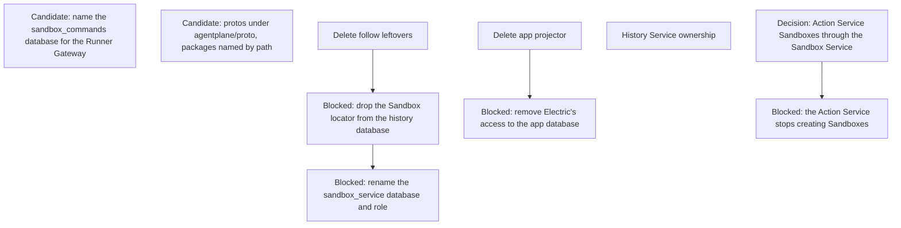

### `HISTORY_SANDBOX_LOCATOR_DROP` — rows name only their Session and writer

**Blocked on the follow path's retirement**, because the followers address Sessions by Sandbox and
`runner_session_id`. Under the ingress, a Session arrives under its client-minted public ID, which
is also the runner's, and its row names the writer that pushed it. The Sandbox locator columns
(`sandbox_namespace`, `sandbox_name`, `sandbox_uid`) and `runner_session_id` then only describe
rows the followers wrote, and `source_id` is never set. Rewrite feed snapshots stored under a
runner session ID under the public ID, then drop those columns with `ux_history_runner_locator`.
Stops for the operator.

### `HISTORY_DATABASE_RENAME` — name the database for its owner

**Blocked on the column drop.** Rename the `sandbox_service` database and role
(and the `postgres-sandbox-service` Secret) for the History Service, resolving the `TODO` in
`cluster/cdk8s/agentplane/database.py`. Rename in place (`ALTER DATABASE`/`ALTER ROLE ... RENAME`)
and have the CNPG `Database` and managed role adopt the new names; recreating the database under a
new name would copy the log. Verify the History Service and Electric reconnect with no data movement.
The migrate env `AGENTPLANE_SANDBOX_SERVICE_DATABASE_URL` (pinned in
`cluster/cdk8s/agentplane/test_sandbox_service.py`) and the `storage/migrate.py` and
`cluster/cdk8s/agentplane/history_service.py` docstrings take the new name.

### `SANDBOX_DATABASE_RENAME` — name the Runner Gateway's database for it

**Candidate.** `sandbox_commands` holds the Runner Gateway's Session registry and command
admission; the Sandbox Service has no database. Rename it and its role and Secret for the gateway
in place, as `HISTORY_DATABASE_RENAME` does, and point the Runner Gateway, its migration init
container and `commands_database_url` at the new names. Its migrate image
`agentplane-sandbox-commands-migrate`, env `AGENTPLANE_SANDBOX_SERVICE_COMMANDS_DATABASE_URL` and
`database.py`'s comment on `sandbox_commands` follow.

### `ACTION_SANDBOX_DESIGN` — Action Service Sandboxes through the Sandbox Service

**Decision; operator, 2026-10-11 PDT (in favor, not confidently).** The Action Service's
`sandbox__*` Actions (`action_service/sandbox/`) create, exec into and delete agent-sandbox
`Sandbox` objects with their own inventory and labels, a second provisioner beside the Sandbox
Service. Those boxes share some pieces with agent Sandboxes and not others: they may run as the
static ServiceAccount the caller already came with, so need no per-Sandbox ServiceAccount, egress
binding or runner. Design what the Sandbox Service's API offers them (a Sandbox kind, or options on
`CreateSandbox`), how the caller's identity carries over, and who runs `exec`.

### `ACTION_SANDBOX_PROVISIONING` — the Action Service stops creating Sandboxes

**Blocked on the design.** The Action Service's Sandbox Actions call the Sandbox Service; their own
inventory and the Action Service's RBAC on `Sandbox` objects go, as does `TODO(sandbox-lifetime)`
once the Sandbox Service's lifetime handling covers them (`SANDBOX_IDLE_EXPIRY`).

### `APP_ELECTRIC_RETIRE` — Electric no longer reads the app database

**Blocked on app projector retirement.** Drop the publication and replication slot on the `app`
database and the `electric` role's grants there, and give the remaining Electric deployment the
plain name if it carries a history-specific one.

### `PROTO_DIRECTORY` — protocols in one place

**Candidate; operator direction, 2026-10-10 and 2026-10-11 PDT.** Protobuf messages and gRPC
services that cross components live in `agentplane/proto/<name>.proto` (google3's `proto/`
convention), each with the package `agentplane.proto.<name>`: its path from the ducktape root, no
version suffix. `runner.proto`, `runner_ingress.proto`, `runner_control.proto`, `runner_gateway.proto`,
`sandbox_service.proto` and the shared `command.proto`, `event.proto` and `event_log.proto` are there.
Move the last one with its generated-code imports: `history_service/protocol.proto`. A
gRPC service's full name includes its package, so each move is a clean cutover with no second name
served: `agentplane/AGENTS.md` § Deployed state is disposable accepts old pods failing during the
roll.

## 10. Legacy burn-down

Dead code, finished gates, compatibility shims and stale names found by the 2026-10-10 PDT audit of
devel. A gate counts as legacy once its rollout is finished on both testing and staging or nothing
reads it; mid-rollout gates (read cutover, delta settlement) stay with their own
nodes above. Lane named per node; leftovers of in-flight work belong to the lane already changing
that code. Upstream-gated tombstones with a verifiable condition in code (`keepingOffset` in
`thread_store.tsx`, the jsdom pragma in `markdown.test.tsx`) need no node.

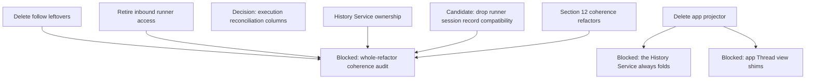

### `RUNNER_SESSION_RECORD_SHIMS` — drop runner session record compatibility

**Candidate; Legacy burn-down lane.** The runner's `SessionRecord` reads
`session.json` written by older images: `context_budget_resolved` (False only for records from before
budget resolution, 2026-10-10 PDT) re-resolves the budget at Open, and `instructions` and
`event_source_id` have defaults that fill records predating them. The operator deleted every
Sandbox created before then (2026-10-11 PDT), so delete the flag and its Open branch, make both
fields required, and have `from_spec` set `event_source_id` explicitly.

### `APP_THREAD_VIEW_CLEANUP` — app Thread view shims

**Blocked on app projector retirement; Thread fold move lane.** The frontend reads `requested_value` with a `.default(null)` because the app's own fold (epoch `v1`)
still holds Command rows written before the field existed, and `thread_reads: APP` serves them;
once that switch is gone, only the History Service fold (rebuilt in `history-v1`, every row
carrying the field) is read and the default can go. Code only.

### `HISTORY_FOLD_ALWAYS_ON` — the History Service always folds

**Blocked on app projector retirement; Legacy burn-down lane.** Both environments set `fold_shadow`
and read Threads from the History Service fold, yet the setting defaults to off. After
`APP_PROJECTOR_RETIRE` deletes `thread_reads`, delete `Settings.fold_shadow` and
`Environment.fold_shadow`, and rename `fold_shadow.py`/`FoldShadow` and their "shadow" comments for
what the fold is. A fold that stops on an unexpected error is only logged, by design, so raw reads
keep serving ([Thread view sync](../docs/thread_view_sync.md)); give that state a signal an operator
sees (a metric or a status the read API reports) without ending the process. Narrow
`FoldShadow._advance`'s per-Session catch of `LookupError`, `ValueError`, `ConnectionError` and
`OSError` to what that signal covers, and drop `FOLD_EPOCH`'s comment contrasting it with the app's.

### `ACTION_EXECUTION_AUDIT_TRIM` — execution reconciliation columns

**Decision; drops columns, so the operator decides.** `ExecutionRow.reconciled_by` and
`reconciliation_source` in `action_service/db.py` are written but read only by a test, and
`ReconciliationSource` has one member. Either expose `reconciled_by` in the execution view, or
drop both columns and the enum.

### `REFACTOR_COHERENCE_AUDIT` — the refactor reads as one design

**Blocked on the cutover's retirements, the split and the section 12 refactors**, which remove the
transitional pieces the other nodes name. Sweep devel for unused modules, functions, settings, proto
fields, tables and columns; one name per concept across code, settings, manifests, protos and docs
(Sandbox Service, Runner Gateway, History Service, ingress, control; Session for the raw stream,
Thread for its projection; no "hub", "follow" or "shadow" left); READMEs, `SPEC.md` files and
`docs/` describing the code as it is, without cutover narration; no compatibility branch,
optional-with-fallback setting or `CLEANUP` tombstone whose condition is met; the system diagram in
`agentplane/README.md` showing exactly the deployed services and the traffic between them in
`cluster/cdk8s/agentplane`. Known now: the cutover guards in
`cluster/cdk8s/agentplane/test_sandbox_service.py` (a "removed stays removed" assertion, and a test
defined after `__main__`); the test-only `PostgresListener.wait_until_disconnected`;
`runner/observation.py` probes the oneof with `getattr`; two `ClaudeHarness` classes
(`native/claude/facade.py`, `harness_tests`); `//agentplane/capture:live_capture` is a hand-run
probe not named `demo_`; egress and app test support each build a throwaway CA;
`sandbox_service/models.py` holds only errors, `provisioning.py` makes its logger in a function, and
`{session_id}` cwd templating runs twice in the gateway; operator routes are `/operator/v1/` in
notifications but `/v1/operator/` in actions; `cluster/cdk8s/agentplane/kubevirt_experiment` is an
experiment outside `x/`; `app/threads/models.py` cites a task DAG anchor from code. Findings are fixed in PRs of their own; this node leaves with the last of
them.

## 11. Runner ingress and control split

Target and decisions: [History Service plan](history_service.md#target). The runner keeps dialing
out, but to two endpoints its Sandbox names: an **ingress** it pushes its journal's Events to, and
a **control endpoint** (the Runner Gateway) whose stream it holds for commands, receipts and lifecycle
requests. The History Service is the ingress when history is kept. The contract is
[runner control stream § Event ingress](../docs/runner_control.md#event-ingress); it replaces following the
runner through the Sandbox Service. Section 7's store, fold and database
nodes and section 9 are unaffected.

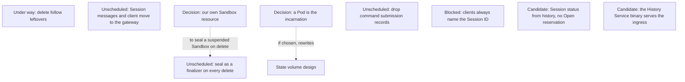

### `SESSION_ID_MINT_RETIRE` — clients always name the Session ID

**Blocked on the deployed app sending `session_id` on every create.** `CreateSessionRequest.session_id` becomes required. The Runner Gateway stops
minting IDs and handing the runner an `r-` locator (the `CLEANUP` tombstones in `grpc_api.py`'s
`CreateSession` and `session_registry.py`), and the app stops sending the ID again as
`idempotency_key` for older Sandbox Services. The gateway's `session.runner_session_id` then always
equals the Session ID; drop it and its place in `ux_session_runner_locator` (stops for the operator).

### `HISTORY_INGRESS_SAME_BINARY` — the History Service binary serves the ingress

**Candidate; operator, 2026-10-11 PDT.** The ingress runs as its own binary, image, settings class
and Deployment (`history_service/ingress_main.py`, `:ingress_image`, `IngressSettings`,
`agentplane-history-ingress`); the operator wants it served by the History Service's own binary.
Open: whether they also share one Deployment, or keep separate Deployments of the one image (the
ingress takes untrusted input). Runners created since 2026-10-11 dial `agentplane-history-ingress`
by that Service name, fixed at creation, so the Service keeps its name and selects whichever Pods
serve the ingress.

### `LOOKUP_SESSION_RETIRE` — Session status from history, no Open reservation

**Candidate.** After a reload the browser keeps only the Session ID, so it asks `LookupSession`
whether the runner started it, and the Runner Gateway keeps an Open reservation (spec frozen per
key) for a retried create. The History Service's index records which Sessions a runner announced
on ingress, so the browser reads that instead. `LookupSession`, its journal scan over the inbound
API, the Open reservation and the Open key go, with the gateway `session` columns `open_key`,
`open_request`, `launch_spec`, `caller_namespace`, `caller_name` and `ux_session_open_key` (stops for
the operator before the drop).

### `FOLLOW_PATH_RETIRE` — delete follow leftovers

**Under way.** Nothing follows Sessions or holds Sandboxes any more: the History Service's
ingester, `FollowSession`, `WatchSessions` and its change feed, the retention holds and teardown's
path for a runner that pushes nothing are gone. Left: `SessionSummary`'s Sandbox fields (the history
columns the follower filled are dropped by `HISTORY_SANDBOX_LOCATOR_DROP`); `protocol.v1.Follow`
once nothing sends `Open.follow`; `Store.read`; `SessionFeedState.ended` with its merge in
`record_feed_state` (the fold derives the end from a stopped harness); and
`register_attached_sessions` in `sandbox_service/testing`.

### `GATEWAY_CLIENT_SPLIT` — Session messages and client move to the gateway

**Unscheduled.** `RunnerGateway` still uses the Session and command messages in the Sandbox
Service's proto package, and one `SandboxServiceClient` serves both services. Move those messages
into the gateway's proto and give the gateway its own client. `FrozenLaunch` leaves the public
Sandbox Service proto for a gateway-private message, `sandbox_service/wire.py` splits between
gateway and client, the client's `Runner` handle is renamed, its `command_admission_timeout_s`
stops being nullable, and the Notification Service's `SandboxServiceSettings` splits too.

### `AGENTPLANE_SANDBOX_RESOURCE` — our own Sandbox resource

**Decision; later.** An Agentplane custom resource whose spec is the recipe (template, grants,
egress, session defaults, bootstrap command, runner endpoints) and the desired runner (image,
running or stopped), with incarnations in its status. Recommendation: back it with an upstream
Sandbox first and keep owning Pod and PVCs directly as the fallback; clients key off our resource
either way. Replaces the annotations on the upstream Sandbox and the imperative-only
`CreateSandbox`. If the Sandbox Service becomes a real controller or operator for it, rename
the service to say so (operator, 2026-10-11 PDT).

### `POD_INCARNATION` — a Pod is the incarnation

**Decision; later.** A Sandbox is its agent's volumes, with or without a running runner; an
incarnation is a Pod. Changing the runner image is stop, replace the Pod, start, and needs no seal
since the volume stays. If chosen, section 8's state volume and incarnation nodes are rewritten
around it: keeping the volume means keeping the Sandbox.

### `SEAL_FINALIZER` — seal as a finalizer on every delete

**Unscheduled; operator, 2026-10-11 PDT: not worth the effort for now.** Every Sandbox carries a seal
finalizer, so any deletion (`kubectl`, `DeleteSandbox`) seals before its volume goes. It replaces
the controller loop's seal from the replica holding the runner, the `teardown` annotation and the
suspended-only delete guard. Deletion is one-way: a hold can delay it, never cancel it.

Upstream agent-sandbox v0.5.5 does nothing for a Sandbox whose `deletionTimestamp` is set
(`SandboxReconciler.Reconcile` returns before reconciling its Pod, PVCs or Service): it neither
starts nor stops the Pod. So a Sandbox running when deletion begins keeps its runner and seals over
control as now; a suspended one never runs again, and sealing it means reading the journal head off
the volume with a Job, or our own resource (`AGENTPLANE_SANDBOX_RESOURCE`). The Pod and PVCs carry
controller owner references with `blockOwnerDeletion`, so only background propagation (the
`kubectl` and `DeleteSandbox` default) keeps them until the finalizer clears: foreground
propagation garbage-collects them while the finalizer still holds the Sandbox, and namespace
deletion removes them directly. Those two paths lose the unsealed tail.

The considered way to seal a suspended one without our own resource: the finalizer starts a Job on
the Sandbox's volume, under the Sandbox's own ServiceAccount and egress sidecar (the ingress binds a
Session to its first writer), that pushes the unacknowledged tail and seals. The volume is
ReadWriteOnce, so the Job starts only once every container of the old Pod is gone.

### `COMMAND_RECORDS_RETIRE` — drop command submission records

**Unscheduled; operator, 2026-10-10 PDT: keep them for now; 2026-10-11 PDT: keeping each
`admission` entry is fine for now, since commands are few next to model output; consider trimming it
later.** The runner journal already holds
every admission, idempotent on `command_id`. Retiring the Runner Gateway's submission records would make it
stateless, with `GetCommand`, `ListCommands` and the command status UI reading receipts from
history instead.

## 12. Coherence refactors

Refactors found by reading devel (2026-10-11 PDT) against the quality bar and
[gRPC services](../docs/grpc_services.md). Each lands as its own PR; all of them feed
`REFACTOR_COHERENCE_AUDIT`.

```mermaid
flowchart TD
    GATEWAY_CLIENT_SPLIT[Session messages and client move to the gateway]
    RUNNER_INBOUND_RETIRE[Retire inbound runner access]
    APP_PROJECTOR_RETIRE[Delete app projector]
    subgraph COHERENCE_REFACTORS[Coherence refactors]
        RUNNER_GATEWAY_AUDIENCE[Candidate: the Runner Gateway's own token audience]
        SERVICE_SETTINGS_BASE[Candidate: one config-file settings base]
        SERVICE_PROCESS_MODULE[Blocked: one service process module]
        GRPC_HEALTH_PROBES[Blocked: probes use gRPC health]
        REQUIRED_SERVICE_WIRING[Candidate: no footgun defaults on service wiring]
        SERVICE_DOCS_GATEWAY[Candidate: docs give the Runner Gateway its jobs]
        GATEWAY_NAME_SWEEP[Candidate: code says Runner Gateway for the gateway]
        SERVICE_DOCS_NARRATION_TRIM[Candidate: no changelogs in service docs]
        AGENTPLANE_LABEL_DOMAIN[Candidate: one annotation domain]
        WATCH_FRESHNESS_DEDUPE[Candidate: one watch freshness]
        POSTGRES_WAKEUPS_SHARED[Candidate: one PostgreSQL wakeup class]
        GATEWAY_SANDBOX_READS[Candidate: the gateway reads Sandboxes read-only]
        SANDBOX_DEAD_CODE[Candidate: delete KubernetesBindings.run]
        RUNNER_ERRORS_REHOME[Blocked: errors beside the client that raises them]
        HISTORY_LIST_SUMMARIES_RETIRE[Candidate: delete ListSessionSummaries]
        HISTORY_FEED_STATE_TRIM[Candidate: feed state without the Sandbox proto]
        HISTORY_GRPC_CONFORM[Candidate: the History Service follows grpc_services.md]
        THREAD_FOLD_SINGLE_OWNER[Blocked: the fold has one owner]
        SETTLE_DELTAS_ALWAYS_ON[Delta settlement always on]
        INDEX_DOCS[Candidate: indexing README points at the deployment]
        APP_SERVICE_NAMES[Blocked: app names the right services]
        APP_TEST_CLIENT_MOVE[Candidate: app test client out of production]
        KUBEVIRT_GUEST_CONTROL[Candidate: KubeVirt guest dials out]
        RUNNER_CORE_SPLIT[Blocked: runner core out of the inbound servicer]
        RUNNER_HARNESS_ENUM[Candidate: Harness enum beside its owner]
        NATIVE_PROCESS_DEDUP[Candidate: one native process wrapper]
        EGRESS_DECISIONS_CLIENT[Candidate: egress decisions client beside the server]
        EGRESS_RULES_API_TIDY[Candidate: egress rules API tidy]
        LLM_INGRESS_MODEL_CONFIG_CONTRACT[Candidate: structural absent model config]
        ACTION_SETTINGS_SINGLE_MODEL[Candidate: one Action Service settings model]
        ACTION_PROTOCOLS_CONCRETE[Candidate: concrete types for Action protocols]
        ACTION_OAUTH_REFERENCE_TYPE[Candidate: typed OAuth token reference]
        NOTIFICATION_GITHUB_PACKAGE[Candidate: one GitHub source package]
        CDK8S_SERVICE_CONSTRUCT[Candidate: one cdk8s service construct]
        CDK8S_RUNNER_ENDPOINT_HELPER[Candidate: one runner-facing endpoint helper]
        GRPC_CHANNEL_OPTIONS_CONSTANT[Candidate: one gRPC channel options constant]
        CDK8S_RUNNER_TEMPLATE_MOVE[Candidate: runner Pod objects out of the app]
        CDK8S_CALLER_WIRING[Candidate: one callers shape]
        TEST_SUPPORT_REHOME[Candidate: test support beside its service]
        TESTING_FAILURE_JOURNAL[Candidate: one failed-journal fixture]
    end
    GATEWAY_CLIENT_SPLIT --> RUNNER_ERRORS_REHOME
    KUBEVIRT_GUEST_CONTROL --> RUNNER_INBOUND_RETIRE
    RUNNER_INBOUND_RETIRE --> RUNNER_CORE_SPLIT
    APP_PROJECTOR_RETIRE --> THREAD_FOLD_SINGLE_OWNER
    APP_PROJECTOR_RETIRE --> APP_SERVICE_NAMES
    COHERENCE_REFACTORS --> REFACTOR_COHERENCE_AUDIT[Whole-refactor coherence audit]
```

### `RUNNER_GATEWAY_AUDIENCE` — the Runner Gateway's own token audience

**Candidate.** The gateway accepts the Sandbox Service's audience (`runner_gateway/settings.py:26`,
`cluster/cdk8s/agentplane/chart.py:73`), and the combined client sends one token to both, so a token
for one service is accepted by the other. Give the gateway `agentplane-runner-gateway` with its own
token mount on each caller, drop both settings' literal audience defaults, and use
`WORKLOAD_TOKEN_AUDIENCE` for the literal in `notifications.py`. Pairs with `GATEWAY_CLIENT_SPLIT`.

### `SERVICE_SETTINGS_BASE` — one config-file settings base

**Candidate.** `settings_customise_sources` is pasted into nine `Settings` classes and has drifted:
four refuse a missing config file, the rest silently start on defaults. Move
`homeassistant/provisioner/yaml_settings.py:YamlFileSettings` to `util/`, keep its missing-file
check, subclass it in every service, and drop the no-op `__init__(self, **values)` overrides.

### `SERVICE_PROCESS_MODULE` — one service process module

**Blocked on #9973 and #9977**, after which `grpc_process.py` holds no gRPC code. Rename it for what
it does, and have every main use its `kubernetes_configuration` (re-inlined in six mains),
`background` (hand-rolled for the History Service fold task) and one `kubernetes_asyncio` log-level
line; the History Service's two "ports must differ" checks go with it.

### `GRPC_HEALTH_PROBES` — probes use gRPC health

**Blocked on #9977**, which serves `grpc.health.v1` but keeps HTTP `/healthz` on 8081. Point the
cdk8s probes at gRPC health and delete the `_HEALTH` ports and `health_port` settings, unless #9977
schedules it itself.

### `REQUIRED_SERVICE_WIRING` — no footgun defaults on service wiring

**Candidate.** Both services' `Resources` default timeouts that copy the Settings defaults, and the
gateway's defaults `sealer_accounts=frozenset()` and its channel options; only test builders rely on
them (`sandbox_service/grpc_api.py:40`, `runner_gateway/grpc_api.py:77`). Make them required, as
`launch_spec(sandbox_namespace=)` and `SandboxInventory.suspend`/`resume(uid=)` whose `None`
branches only tests take.

### `SERVICE_DOCS_GATEWAY` — docs give the Runner Gateway its jobs

**Candidate.** `docs/service_boundaries.md` (with its diagram and cutover gates),
`agentplane/AGENTS.md`, the README service list, `thread_layering.md`, `scoped_session_reads.md`,
`runner_gateway/README.md`, the Notification Service README, `docs/api.md` and its generator
docstring still give the gateway's registry, access and relay to the Sandbox Service.
`workload_auth/README.md` says no destination reads the Pod, which `resolve_peer` does. The README
diagram misses deployed edges (app to egress admin, notifications to GitHub and its webhook route,
the Action Service's external egress and command Sandboxes); its Databases paragraph follows #9836
and #9839.

### `GATEWAY_NAME_SWEEP` — code says Runner Gateway for the gateway

**Candidate.** Module docstrings, `proto/runner_control.proto`, the EndpointSlice
`managed-by: agentplane-sandbox-service` (`runner_gateway/connection_records.py`), the agent prompt
in `session_lifecycle.py`, and the runner's `control.py`, `main.py` flag help, `SPEC.md` and README
say "Sandbox Service" for the gateway; History Service docstrings say it writes and migrates the
history store. Also the stale `sealer_accounts` comment, the `serve_channel` test helper, and the
`CLEANUP` in `sandbox_service/teardown.py` that cites this plan.

### `SERVICE_DOCS_NARRATION_TRIM` — no changelogs in service docs

**Candidate.** The Action Service README narrates about nine migrations and a file-backed adapter
that no longer exists; Notification `docs/api.md` keeps cutover instructions; the runner README
keeps schema-change narration; the egress README counts its watched kinds three ways and names the
rendered manifests, not `cluster/cdk8s/agentplane/egress.py`. Describe the code as it is.

### `AGENTPLANE_LABEL_DOMAIN` — one annotation domain

**Candidate.** Runner connection records annotate under `agentplane.ducktape.dev/*`, everything else
under `agentplane.allegedly.works/*`, which is typed out by hand in `kubernetes_views.py`,
`kubernetes_bindings.py` and ten cdk8s RBAC rules beside `crd_group.GROUP`. Use one domain from one
constant; Agentplane state is disposable.

### `WATCH_FRESHNESS_DEDUPE` — one watch freshness

**Candidate.** Only the Action Service uses `kubernetes_watch.Freshness`; `app/live.py` (without the
clock-went-backwards guard) and egress `policy.py`/`admin.py` reimplement it. Both use `Freshness`.

### `POSTGRES_WAKEUPS_SHARED` — one PostgreSQL wakeup class

**Candidate.** `SummaryChanges`, `HistoryChanges` and `notification_service.Wakeups` are one payload-free listen-and-wake class with different channel
names, and `app/changes.Changes` is its waiter set. One `agentplane/postgres/` class plus a
`notify(session, channel)`, used by every site that outlives `FOLLOW_PATH_RETIRE`.

### `GATEWAY_SANDBOX_READS` — the gateway reads Sandboxes read-only

**Candidate.** The gateway builds the Sandbox Service's mutating `SandboxInventory` but only reads
it, and alone uses `sandbox_service/destinations.py`, against service_boundaries.md § callers. Split
a read-only Sandbox reader, move `destinations.py` into `runner_gateway/`, write the incarnation
check (four copies) once, and drop the second `RunnerEndpoint` class name.

### `SANDBOX_DEAD_CODE` — delete `KubernetesBindings.run`

**Candidate.** Nothing calls it (`sandbox_service/kubernetes_bindings.py:295`); grant bindings
reconcile through `Provisioning.reconcile_once`.

### `RUNNER_ERRORS_REHOME` — errors beside the client that raises them

**Blocked on `GATEWAY_CLIENT_SPLIT`.** `agentplane.runner.errors` is now every service's "session
refused" vocabulary: the gateway, the Sandbox Service client and the app's Thread-identity conflicts
raise it. Move it beside the gateway client, per grpc_services.md, and give the app's `bridge.py`
its own error type.

### `HISTORY_LIST_SUMMARIES_RETIRE` — delete `ListSessionSummaries`

**Candidate.** No production caller since #9827, and its Sandbox filter never matches ingress-only
Sessions. Delete the RPC and its messages, `SessionSummaryPageToken`, the client method,
`SummaryReader.list_page` with `_token`/`_after`, their tests and the README paragraph.

### `HISTORY_FEED_STATE_TRIM` — feed state without the Sandbox proto

**Candidate.** `SessionFeedState.sealed` is typed `sandbox_service.Sealed`, the History Service's
only reason to import that proto; `runner.Sealed` has the same `uint64 cursor = 1`, so the retype is
wire-compatible with stored rows. Delete the test-only `Store.checkpoint` too.

### `HISTORY_GRPC_CONFORM` — the History Service follows grpc_services.md

**Candidate.** The servicer's error mapper is `reader`, not `errors(context)`, and both `Watch*`
RPCs stream outside it, so their faults escape unmapped. The client's
`watch_session_summaries(timeout_s=)` puts a deadline on a long-lived stream; delete it and the
app's `history_service_watch_timeout_s`.

### `THREAD_FOLD_SINGLE_OWNER` — the fold has one owner

**Blocked on `APP_PROJECTOR_RETIRE`.** With only the History Service running the fold,
`HistoryProjector` takes its `Store` instead of two single-implementation callables and drops its
`grpc.RpcError` catch, the app's `HistoryWatch` calls the client directly, app-era wording goes,
`EventLogStore.open` raises an app error instead of `EventReplicationError`, and `thread_fold` moves
under `history_service/`.

### `SETTLE_DELTAS_ALWAYS_ON` — delta settlement always on

**In progress (delta settlement rollout).** Both environments set `settle_deltas`, yet
`IngressSettings.settle_deltas` and `Store(settle_deltas=False)` default off, so a new writer
silently stops settling. Settlement becomes unconditional: delete the setting,
`Environment.settle_deltas` and the `Store` flag (the ingester's copy goes with
`FOLLOW_PATH_RETIRE`). `SESSION_EVENT_COMPACTION` does not wait for this.

### `INDEX_DOCS` — indexing README points at the deployment

**Candidate.** `agentplane/indexing/README.md` ships a hypothetical Deployment and "initial version"
phrasing; point at `cluster/cdk8s/agentplane_index/workers.py` instead, and make
`Maintenance.embedding_timeout_seconds` required.

### `APP_SERVICE_NAMES` — the app names the right services

**Blocked on `APP_PROJECTOR_RETIRE`**, which rewrites the same files. The app says Sandbox Service
for the gateway's command records (`bridge.py`, `api.py`, a settings description), answers every
`ConnectionError` with "Sandbox Service unavailable", and calls the stored cursor a follow cursor.
`threads/ingestion.py`'s `Ingester` then only discovers Sessions; rename it for that.

### `APP_TEST_CLIENT_MOVE` — app test client out of production

**Candidate.** `agentplane/app/client.py` is `testonly` and imported only by
`agentplane/acceptance`; move it to `app/testing/` or `acceptance/`.

### `KUBEVIRT_GUEST_CONTROL` — KubeVirt guest dials out

**Candidate.** `runner/guest_config.py`, live through the `agentplane-runner-vm` entry point and
`cluster/cdk8s/agentplane/kubevirt_experiment`, pins an inbound `listen` with no control or ingress
target, so `RUNNER_INBOUND_RETIRE` would strand it. Give `GuestConfig` both targets; retiring the
experiment instead also orphans the VM-only `RunnerConfig` fields and `cgroups.py`.

### `RUNNER_CORE_SPLIT` — runner core out of the inbound servicer

**Blocked on `RUNNER_INBOUND_RETIRE`, or lands inside it.** `Runner`, the `OpenError` hierarchy,
`build_attached`, `follow_journal` and `finish_command` live in the Attach servicer
`runner/service.py`; move them to their own module. The control and ingress clients share one
lost-stream error and backoff, `IngressPusher` stops borrowing `ControlTiming`, and the unpassed
`channel_options` parameters go.

### `RUNNER_HARNESS_ENUM` — `Harness` enum beside its owner

**Candidate.** `runner/harness.py`'s `Harness` is imported by the app, acceptance and cdk8s, while
the runner keeps `SessionRecord.harness: str`. Type the record with it, or move it to its owner.

### `NATIVE_PROCESS_DEDUP` — one native process wrapper

**Candidate.** `native/process.py` (sync, used only by capture), `native/async_process.py` (used
only by test code, not `testonly`) and `runner/harness_process.py` wrap one process, with the 64 MiB
line limit kept aligned by comment. Move capture onto `AsyncNativeProcess`, delete the sync wrapper,
and make `async_process` test-only.

### `EGRESS_DECISIONS_CLIENT` — egress decisions client beside the server

**Candidate.** `app/decisions.py` mirrors egress `Outcome`/`Decision` and holds the client for the
egress `/decisions` route. Move model and client into `agentplane/egress/`, drop the never-set
`DecisionRecord.path`, and say at the model which written-but-unread columns operators query.

### `EGRESS_RULES_API_TIDY` — egress rules API tidy

**Candidate.** `rules_api.py` keeps a test-only staging `HOST` and polls `server.started` with a
sleep; the central proxy serves aiohttp `admin.py` beside a FastAPI app with hand-built dict JSON.
Move the host into the tests, wait on the condition, and serve both listeners on one stack.

### `LLM_INGRESS_MODEL_CONFIG_CONTRACT` — structural absent model config

**Candidate.** `llm_ingress/app.py` answers an absent model config with a 404 whose `detail` text
`runner/model_config.py` string-matches. Carry the absent state structurally (204, or 200 with a
nullable body).

### `ACTION_SETTINGS_SINGLE_MODEL` — one Action Service settings model

**Candidate.** `ActionServiceDeploymentSettings` re-declares part of `Settings`, which defaults
`policy_namespace` and `caller_service_account_namespaces` to `agentplane-staging`. Author
`Settings` through `SettingsFile` as the other services do, drop the Deployment model, make both
namespaces required, and move `token_audience` from the CLI into the file.

### `ACTION_PROTOCOLS_CONCRETE` — concrete types for Action protocols

**Candidate.** `AccessTokenProvider`, `ExternalGrantAuthority` (also a footgun `| None = None`),
`DecisionProvider` and `ExecutionLease` each have one production implementation, and
`OperatorAuthenticator` is a union of two. Name the concrete types or unions.

### `ACTION_OAUTH_REFERENCE_TYPE` — typed OAuth token reference

**Candidate.** `ActionsOAuthProxy._reference` returns an indexed `tuple[UUID, str, str]` and its
callers catch `Exception`, so a bug looks like a revoked token (`action_service/oauth.py:282`). A
dataclass, and catches narrowed to the JWT, `ValueError` and `KeyError` failures.

### `NOTIFICATION_GITHUB_PACKAGE` — one GitHub source package

**Candidate.** `github_state.py` at the package root beside `sources/github{,_client,_models}.py`
becomes `sources/github/{source,client,models,state}.py`, and the Actions source's hard-coded
`timeout=5` becomes a `request_timeout_s` setting like the other backends'.

### `CDK8S_SERVICE_CONSTRUCT` — one cdk8s service construct

**Candidate.** Seven constructs in `cluster/cdk8s/agentplane/` hand-write one Deployment skeleton
(ServiceAccount, security context, probes, Service, PDB, projected-token `JsonPatch`), and the CNPG
egress rule is spelled eight times. One construct, and `database.py` exports `egress(namespace)`.

### `CDK8S_RUNNER_ENDPOINT_HELPER` — one runner-facing endpoint helper

**Candidate.** `HistoryIngress` and `RunnerGateway._add_runner_control_egress` each build the same
EgressCredential, EgressPolicy and proxy NetworkPolicy; build them once.

### `GRPC_CHANNEL_OPTIONS_CONSTANT` — one gRPC channel options constant

**Candidate.** Both environments set every channel-options field to
`LARGE_EVENT_GRPC_CHANNEL_OPTIONS`, and `notifications.py` and `history_service.py` read the app's
copies. Use the constant (or the clients' default) instead of `Environment` and app-config plumbing.

### `CDK8S_RUNNER_TEMPLATE_MOVE` — runner Pod objects out of the app

**Candidate.** `cluster/cdk8s/agentplane/app.py` owns the runner `SandboxTemplate`, ServiceAccount,
NetworkPolicy and `RUNNER_IMAGE`, and three files spell the `agentplane-runner` label. Move them
beside `sandbox_pod.py` with one `runner_pods(namespace)`.

### `CDK8S_CALLER_WIRING` — one callers shape

**Candidate.** `RunnerGateway` takes a `callers` map, `SandboxService` and `HistoryService` take
single callers and hard-code notifications, and `Notifications` admits the app and egress by literal
labels. One `callers` shape everywhere, assembled in `chart.py`.

### `TEST_SUPPORT_REHOME` — test support beside its service

**Candidate.** `sandbox_service/testing/history.py`, `fixtures.py` and `delta_spans.py` build
History Service schemas and serve its tests, and `sandbox_service/test_inventory.py` tests the
gateway's `launch_spec`. Move them to `history_service/testing` and `runner_gateway/`.

### `TESTING_FAILURE_JOURNAL` — one failed-journal fixture

**Candidate.** `notification_service/conftest.py` (which swallows the error detail) and
`app/test_bridge.py` each copy a failed native journal. One fixture in `agentplane/runner/testing`,
where the runner-specific `agentplane/testing/failure_journal.py` belongs, and trim that package's
visibility list.

## Scope and retirement of stale gates

- Notifications keep workers in the HTTP service. Retention, worker extraction, idle-polling
  optimization and new-source wiring are frozen with triggers, not hidden release prerequisites.
- Broad provider-matrix exploration is frozen; ordinary auth/signature denial regression coverage
  belongs with the implementation, not an unbounded production checklist.
- Native subsessions and runner durability/thin-adapter redesign remain frozen. Neither the runner
  channel nor multiagent design unfreezes the broader runner-state redesign.
- Existing security boundaries, data-preserving migration checks and representative deployment
  integration checks remain requirements. The freezer is not a waiver for a known data-loss or
  unauthorized-access bug; promote one when evidence makes it concrete.
