# Agentplane task DAG

This is the dispatch map for **unfinished** work. Detailed contracts belong in component plans;
completed work belongs in component docs, not done nodes here. Maintenance rules are in
[AGENTS.md](../AGENTS.md#task-dag-maintenance). Deliberately deferred candidates and conditional
hardening live in the [freezer](task_freezer.md), not the execution graph.

## Current state and scheduling

Audit metadata consumers (`sandbox`, `harness`, `model`, `cwd`, summary/activity fields) before
deleting useful UI projections. Squash Alembic only once the app schema settles.

States: **in flight** means reported work is underway; **decision** needs a reviewed outcome;
**blocked** names prerequisites; **candidate** is dispatchable when selected, not a priority claim.
A **capstone** closes an integrated contract, not another implementation. Solid arrows below are
prerequisites; dashed arrows explicitly label scheduling holds or conditional choices. All service
contracts remain multi-replica unless a reviewed temporary restriction says otherwise.

## 1. Session schema and identity follow-up

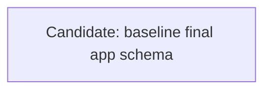

### `APP_ALEMBIC_SQUASH` — consolidate the final app schema

**Candidate.** Baseline only the settled schema,
verify fresh and migrated databases and their deployed stamps before pruning old revisions.
Retain the data-preserving rollback procedure. No Action Service or other database squash implied.

## 2. Service-owned command admission and later notification presentation

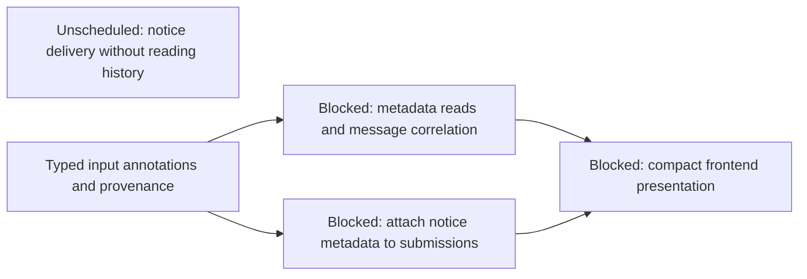

Details: [command admission](../runner_gateway/API.md#sessions-and-commands); later
[notification presentation and input metadata](notification_presentation.md).

### `NOTIFICATION_COMMAND_OUTCOME_DESIGN` — notice delivery without reading conversation history

**Unscheduled; operator, 2026-10-11 PDT: not a priority, needs more thought.** The Notification
Service scans a Session's raw history from the History Service for its own command's admission and
`harness_user_message_confirmed`, and stores one `EventEntry` per notice (`Notice.runner_entry`):
the one service besides the History Service fold that derives state from Session events. A command's
`CommandAdmitted` entry says the runner admitted it, but not that the harness executed it or that
the message reached the model's context; today that needs the history. Decide where that
outcome is recorded before the Notification Service stops reading history.

### `SESSION_INPUT_METADATA` — later typed annotations on input commands

**Unscheduled; operator's lean, 2026-10-12 PDT.**
Typed metadata and restricted trusted producer provenance on input commands, so a notice the
Notification Service sends is not rendered as a user message. The lean: the Runner Gateway stamps
verified provenance on the runner Command, and the runner echoes it into the Event that journals
the input, so it reaches history with the input itself; the gateway keeps no command records.
The field rides `SubmitCommand` as it addresses a Session's Sandbox through `SessionDestination`
(#10129) and is delivered through the replica holding the runner stream. The harness never sees it. Notification-specific authorization
belongs here, not in the generic command-admission path; attachments are invalid on controls. No
untyped extension dictionary.

### `SESSION_INPUT_METADATA_READ` — authorized annotation reads

**Blocked on typed input metadata.** Carry the echoed metadata into the Thread fold, joined to
the message by `origin_command_ids`, including pending and failed inputs and replay, without
requiring a live notification inbox.

### `NOTIFICATION_NOTICE_METADATA` — producer integration

**Blocked on typed input metadata.** Attach notice identity/range metadata using existing delivery
command IDs. Preserve receipt reconciliation and explicit inbox acknowledgement. Verify the backend
path without the app; use automated integration coverage rather than requiring a provider outage.

### `NOTIFICATION_PRESENTATION` — compact notification rendering

**Blocked on producer and metadata read integration.** Compact authenticated notification-only
inputs, expand full text and render mixed human/notice messages normally with annotations. Missing
metadata falls back to text. Include visual coverage and one bounded real-notice check; no inbox
acknowledgement on render and no text-prefix provenance heuristic.

### Subscription authorization before broader sources

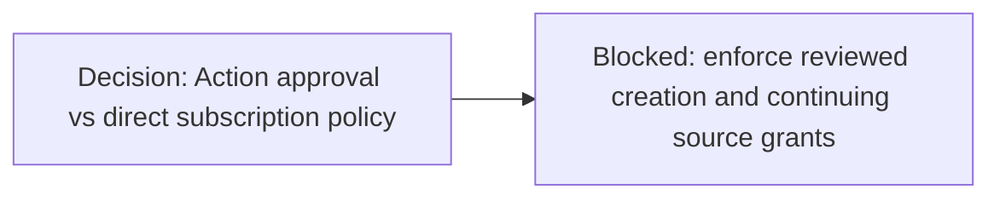

### `SUBSCRIPTION_AUTHORIZATION_DESIGN` — auto-allow and operator-approved subscriptions

**Decision.** Compare an Action-backed subscribe operation using existing auto-allow/operator
approval with authorization inside Notification Service; do not preselect another policy engine.
Review which callers may subscribe to which sources, targets, fields/filters, destinations and
lifetimes, and who can approve/delegate that access. Subscription creation approval is distinct
from continuing source access and from ownership of the destination inbox. Define renewal, scope
expansion, policy changes/revocation and what happens to already-retained entries.

Use Kubernetes as a concrete design case: namespace/resource/UID scope, object/status/event/log
content, name reuse and whether grants delegate the caller's existing read authority or explicitly
allow additional observation. A privileged watcher must not expose arbitrary cluster data merely
because the agent owns an inbox. Review argument examples that auto-allow narrow approved scopes,
require operator approval for additional scopes, and reject requests nobody can delegate. See the
[subscription authorization design](notifications.md#subscription-authorization-and-action-approval).
This is independent of selecting a messaging transport or fixing existing GitHub delivery gaps.

### `SUBSCRIPTION_AUTHORIZATION` — creation gate and continuing enforcement

**Blocked on the authorization decision.** If Actions is selected, implement its subscribe operation
and reviewed policy bindings; otherwise implement the chosen direct policy path. Keep Notification
Service the subscription/delivery authority in either case. Carry verified caller/decision scope
across the service boundary rather than substituting the executor's broad identity. Enforce the
same access contract on direct APIs, renewals and updates; no approval bypass by another endpoint.

Test auto-allow, pending approval, denial, restricted destinations, scope escalation and expiry/
revocation with controlled identities. No entry may be delivered beyond the reviewed source scope;
approval is not permission to wake a Sandbox or execute source content. Future Kubernetes sources
must depend on this contract/enforcement when promoted from the freezer. Ordinary authorized
subscription reads/cancellation and existing GitHub gap recovery need not wait for a broad redesign.

### GitHub notice reliability after missed updates

The operator reports that GitHub updates may sometimes be missed. This is a concrete reliability
concern, not proof that GitHub webhook delivery itself is at fault. Diagnose webhook receipt,
matching, inbox persistence and notice dispatch separately. Do not reopen waived broad provider
outage/refresh exercises; test the specific recovery contract with controlled missing webhooks.

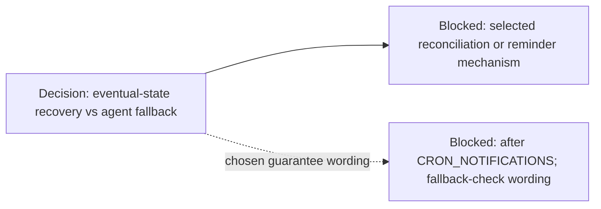

### `GITHUB_NOTICE_RELIABILITY_DESIGN` — delivery guarantee and fallback

**Decision.** Review the gap and choose the guarantee needed for PR shepherding: eventual awareness
of current head/check/review/merge state, or historical delivery of each event. Compare bounded
service-side reconciliation using existing durable shared GitHub refresh state with explicit agent
fallback checks, optionally scheduled reminders. Recommend the smallest reliable path with a stated
staleness bound/cost. A webhook subscription is not proof no changes occurred when it stays silent.
Snapshot polling cannot reconstruct all intermediate events, and a cron reminder alone is not
recovery if no active agent checks state. Detailed alternatives and questions are in the
[notification plan](notifications.md#missed-github-updates-and-shepherding-reliability).

### `GITHUB_NOTIFICATION_RECOVERY` — implement the reviewed recovery contract

**Blocked on the reliability decision.** If service reconciliation is selected, periodically compare
eligible shared subjects with authoritative GitHub state and durably emit deduplicated observations
for uncovered relevant changes. Reuse refresh leases, backoff and access checks; bound API load.
Distinguish observed state from a received webhook; do not fabricate delivery IDs or promise replay
of events the API cannot recover. If agent fallback is selected instead, provide its actual bounded
check/reminder mechanism and explicit limitations rather than just advising agents to remember.
Add `CRON_NOTIFICATIONS` as a prerequisite only if that reviewed implementation actually needs it;
a service refresh deadline need not introduce a general scheduler. Backend workers stay in-process.

Test a suppressed webhook, duplicate webhook/reconciliation races, changed head/check state and
restart/checkpoint recovery with a controlled GitHub peer. Observe one eventual update for the
promised scope, honest access/backoff state and no false claim of complete history. No live GitHub
outage or exhaustive historical event matrix is required.

### `GITHUB_SHEPHERD_GUIDANCE` — explain monitoring limits and completion checks

**Sequenced after `CRON_NOTIFICATIONS`; final wording also follows the decision.** Agents are
asked not just to subscribe to GitHub while waiting (e.g. for CI) but to back the subscription with
a fallback check after N minutes, in case the webhook never delivers. Treat notifications as prompts
to inspect authoritative current PR state, not evidence that the latest head passed or that silence
means no progress. Document the chosen fallback deadline/ownership and how an agent notices
unreliable monitoring. State who runs reminders and that notices do not start a stopped harness.
Guidance accompanies the selected reliability behavior; it must not advertise a polling/reminder
guarantee before that mechanism exists.

## 3. Multiagent decisions before implementations

These are operator-reviewable decisions, not permission to implement every possibility. Drafts can
be developed together, but publish a coherent shared identity/authority vocabulary before downstream
APIs. Do not equate creating a resource, reading history, sending a message or receiving/acking it.

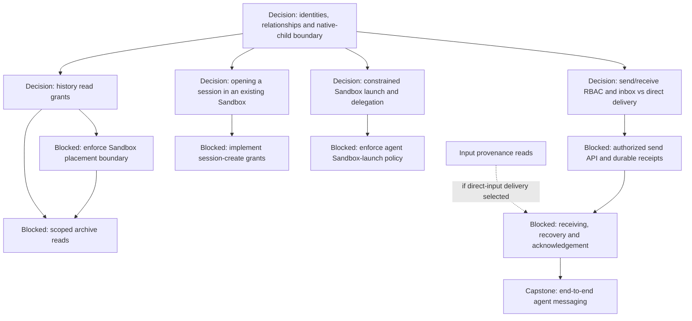

### `MULTIAGENT_MODEL` — shared identity and authority vocabulary

**Decision; no runtime work implied.** Present concrete API examples for independent agents,
Sandboxes and Sessions, with creator, manager and parent/provenance represented separately. Ask
the operator to choose addressing/ownership and delegation semantics. No permission inheritance
from an organizational edge or preset. Review how native harness children could later be ingested:
linked execution in the same Sandbox trust boundary versus independently provisioned Sandboxes,
addressability, observability and which controls must remain unavailable. Native integration itself
stays frozen; this decision must allow explicit exclusion rather than require its implementation.

### `THREAD_READ_POLICY_DESIGN` — scoped history read policy

**Decision; draft in parallel with the shared model.** Review compartments versus exact-session
grants, who classifies/reclassifies histories and grants/revokes access, and caller replacement
semantics. Neither grant model isolates Sessions sharing a Sandbox (see the
[isolation boundary](../docs/thread_layering.md#sandbox-isolation-boundary)). Defaults expose
no existing histories to workloads. Select raw read/list/follow scope; read does not imply
send/create, and no folded-read API is required for v1. Decide how revocation
applies to live feeds, discovery and linked evidence. Do not block this on a messaging transport.

### `SANDBOX_COMPARTMENT_BOUNDARY` — enforce Sandbox placement boundary

**Blocked on the reviewed scoped-read policy.**
The Sandbox is the security isolation boundary: co-resident Sessions share filesystem, credentials,
and ServiceAccount authority, regardless of archive-read classifications. Enforce compatible
placement for any proposed scoped-read policy at Open, adoption and replacement, rejecting
placements whose claimed isolation depends on separating co-resident Sessions. Test shared
filesystem/SA cases and denied placements. Keep VM isolation a separate capability, not a
fictional fix for shared credentials inside one VM. See the
[Sandbox boundary](../docs/thread_layering.md#sandbox-isolation-boundary).

### `THREAD_READ_POLICY` — authorized retained-history access

**Blocked on reviewed read policy and compartment enforcement.** Enforce at
the owning backend across list, raw/native evidence, direct reads and feeds, including reconnect
and revocation. Keep app-only UI folds separate. Test allowed/denied histories, two principals,
deleted Sandboxes and revocation with deterministic service tests plus a bounded deployed auth check.

### `AGENT_MESSAGING_DESIGN` — send and receive contract

**Decision.** Present examples of sender authentication, recipient discovery/opt-in, send grants,
recipient read/ack grants and administration. Compare Notification Service inbox delivery with
direct session input and an existing messaging channel; recommend the smallest fit. Define
accepted, delivered, handled and acknowledged separately; decide offline behavior, retention,
batching, abuse limits and mailbox ownership after Sandbox deletion. Reading a transcript does not
authorize sending or acking.

Output includes the selected owner/API and explicit conditional prerequisites: a direct-input
implementation reuses durable `SubmitCommand` and separately reviewed provenance reads; a notification source reuses
inboxes without treating admission as acknowledgement. Neither branch is selected in this DAG.
Before dispatch, add the chosen branch's edges; do not require implementing both. New Sandbox
Service or app tables require their task-specific contract review. Pure Notification Service work need not
wait for unrelated archive schema once its contract is reviewed.

### `AGENT_MESSAGE_INGRESS` — authorized send and acceptance

**Blocked on messaging decision and its selected prerequisites.** Implement bounded payloads,
server-authenticated sender provenance, per-recipient send policy, idempotent message IDs and honest
acceptance receipts in the chosen authority. Test denied pairs, spoofing and retry/conflict behavior.

### `AGENT_MESSAGE_RECEPTION` — delivery, recovery and acknowledgement

**Blocked on ingress contract/implementation.** Implement selected recipient read/delivery/ack
operations, batching and recovery of unread work. Test revoked/deleted recipients, ordinary offline
catch-up and duplicate delivery without leaking payloads. Do not start/resume a harness implicitly
unless `DISPATCHER_WAKE_ON_SEND` lets that kind of sender wake a Sandbox.

### `AGENT_MESSAGING` — integrated messaging capstone

**Blocked on ingress and reception.** Demonstrate an authorized pair exchanging a message through
the selected API, with correct provenance and distinct receipt/ack states. Security-negative and
multi-replica retry cases belong in automated tests; no real provider outage requirement.

Control design: [ADR](../docs/adr_sandbox_session_control.md).

### `THREAD_CREATE_POLICY` — authorize session creation separately

**Decision.** Review caller scope to open in an existing Sandbox, accepted defaults, quotas,
creator visibility and revocation. Use the service-reserved Session identity, not a caller-invented
public UUID. Opening in an existing Sandbox grants no isolation from its other Sessions; require a
separate Sandbox when incompatible trust or credentials are needed. Decide whether launch-and-open
is a composition of separate grants, never an implicit read/send/launch permission. This contract
need not choose a durable offline command queue; `DISPATCHER_CORE` owns that.

### `THREAD_CREATE_AUTHORIZATION` — implement session-create grants

**Blocked on create policy.** Enforce scope/defaults and idempotent Open
lookup at the service boundary; test forbidden targets/overrides and a lost creation reply.

### `AGENT_LAUNCH_POLICY_DESIGN` — Sandbox launch and delegation policy

**Decision.** Review which callers can use which templates and resource budgets, mounts, images,
secrets, egress and Kubernetes/Action grants; presets are defaults, not authority. A new Sandbox is
required for an independent isolation boundary; adding a Session within one is not. Define manager,
lifetime, parent termination, quota/fanout and revocation without automatic privilege inheritance.
Choose policy ownership and audit records before adding tables. State separately whether the
operation also opens a session; if so, depend on `THREAD_CREATE_AUTHORIZATION` for that composition.

### `AGENT_SANDBOX_LAUNCH` — constrained agent-requested launch

**Blocked on launch policy and idempotent create.** Enforce the reviewed
effective spec and delegation server-side. Test allowed and forbidden launch parameters and
concurrent retries. Reuse the app's create path (`SANDBOX_WRITE_HELPER`'s shared create), not harness-native agent tools. Launch alone
does not grant history read, messaging, credentials or execution of another principal's Actions.

## 4. VM environment phases

The [VM Sandboxes design](../docs/vm_sandboxes.md) holds the provider constraints, and the
[KubeVirt plan](kubevirt_environments.md) the live gates no node below names. Split implementation rather than making “VM support” one indivisible task. This is
an unranked candidate lane, not authorization for local Bazel in current containers. The
[runner control stream](../docs/runner_control.md) settles the dial-out contract VM control networking
builds on; changing connection direction does not move command durability or remove the runner
journal.

Direction for stateful VMs (operator, 2026-10-12 PDT; not scheduled): our own Sandbox resource
(`AGENTPLANE_SANDBOX_RESOURCE`, `kind: pod | vm`) carries both kinds, and both keep their
state on one filesystem PVC per Sandbox that Agentplane owns (section 7). Pods mount it as a volume,
KubeVirt guests through virtiofs, so a Session can move between kinds, until `STATE_VOLUME_BLOCK`
moves both to block storage.

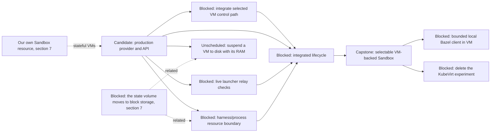

### `VM_CONTROL_NETWORKING` — integrate the reviewed connection direction

**Blocked on the VM provider.** Wire
VM control reachability/authentication to the chosen path. An outbound control stream may remove guest
control-port exposure and endpoint discovery; retain the independently needed outbound API/credential
proxy path. State which guest ports, endpoint discovery and network policies the chosen path
replaces. Image packaging and process-isolation work need not wait for this decision. Verify the
selected path on the actual VM network, not just a host-loopback transport test.
The experiment's guest already dials out, but `runtime_acceptance` no longer runs Sessions, setup probes
or recovery on it: those phases called the runner over a port-forward. They return driven through a
Runner Gateway.

### `VM_PROVIDER` — production provider API and lifecycle intent

**Candidate.** The Sandbox Controller makes a `VirtualMachine` from a `SandboxTemplate`'s `vm`
(`agentplane/sandbox_controller/SPEC.md` § VMs), the Runner Gateway accepts its virt-launcher Pod, and
`agentplane-testing` has the `runner-vm` template (`cluster/cdk8s/agentplane/runner_vm.py`). Left:
boot a Sandbox on `runner-vm` and open a Session on it. Re-type what is
worth keeping from draft #8843 (`vm_view` status mapping, DataVolume validation, halted image
replacement), then close it unmerged; it cannot be rebased.

### `VM_EGRESS` — check the launcher relay live

**Blocked on the VM provider.** `agentplane-testing` deploys the launcher relay policy
(`cluster/cdk8s/agentplane/launcher_relay.py`), which copies a runner Pod's egress sidecar, routes and
tokens into the virt-launcher of a VM controlled by one of our Sandboxes. Once the provider creates
such a VM, check on it: no token reaches the guest; the proxy and each platform route answer the
guest at `10.0.2.1`; the relay is ready, which needs the VM's masquerade interface to list ports so
kubelet's probe on 3129 is not forwarded to the guest; the runner fence admits the launcher and
another Sandbox's guest cannot reach it; a forged launcher is refused. Do not repeat the entire
completed prototype matrix or require simultaneous cluster-wide disasters.

### `VM_PROCESS_ISOLATION` — protect control from harness processes

**Blocked on the provider.** Enforce aggregate memory/process/disk budgets and process-control
boundaries. Test representative tool/harness termination and bounded exhaustion to establish which
runner/control state survives and what needs durable recovery. This directly addresses agents
accidentally killing their own harness; guest or container packaging alone is not that guarantee.

Direction (operator, 2026-10-12 PDT): separate the runner and the harness by what each can see,
not by uid, since every file on the virtiofs state PVC is `107:107` anyway (`STATE_VOLUME_BLOCK` would
end that constraint; revisit the uid choice then). In VMs the runner runs
as guest root under systemd and starts the harness with `systemd-run` as uid 107, in a scope with
`InaccessiblePaths=/state/runner`, write access only to `/state/harness` and the workspace,
`ProtectProc=invisible`, `NoNewPrivileges`, no capabilities, `MemoryMax` and `TasksMax`; the
runner's slice reserves memory. Pods keep today's single container; the strong version there
(runner and harness in separate containers of one pod with no shared process namespace, the harness
mounting only its subpath, started through a launcher on a unix socket in an `emptyDir`) waits
until pods hit the problem. Disk exhaustion is not covered and waits on #4717.

### `VM_LIFECYCLE` — integrated lifecycle verification

**Blocked on provider, selected control networking, egress and isolation.** Boot the published
guest (`agentplane-runner-vm-image.yml`) and exercise both harnesses through real service
routes with retained-state stop/start and a representative replacement; confirm identity, replay and
cleanup. Automated tests cover restart/concurrency branches. Additional live faults need a concrete
unresolved platform risk, not a Cartesian product of every component crash and lifecycle operation.

### `SANDBOX_VM_ISOLATION` — VM integration capstone

**Blocked on integrated lifecycle.** Publish the selectable VM environment and measured isolation
limits, with no implied existing-Sandbox conversion or live migration. Component evidence, not
absence of every imaginable failure, establishes the delivered contract.

### `KUBEVIRT_EXPERIMENT_RETIRE` — delete the KubeVirt experiment

**Blocked on the VM capstone.** Once the production provider covers it, move anything still needed
(the acceptance driver, if it becomes the VM lifecycle test) into production code, then delete
`cluster/cdk8s/agentplane/kubevirt_experiment/`, its launcher policy (production's is
`launcher_relay.py`) and the manifests it generates.

### `VM_RAM_SUSPEND` — suspend a VM to disk with its RAM

**Unscheduled; operator, 2026-10-13 PDT: nice to have.** A stopped VM Sandbox resumes with the memory
it had, not a cold boot, so a quick resume loses no in-memory state. Find what KubeVirt offers (a
memory dump or a snapshot with memory) and whether it works with the state volume (virtiofs today, block under `STATE_VOLUME_BLOCK`). The
[VM Sandboxes design](../docs/vm_sandboxes.md#guest-and-storage) records that a VM supports neither
RAM suspension nor live migration today. Check what a resumed guest must redo: the runner's control stream and
projected tokens (the relay reopens them per request, so rotation alone needs no restart), and the
clock. Settle first what "seal before suspend" means when the harness keeps running across the suspend
(`QUIESCE_WITHOUT_POLLING` assumes the Pod sequence). Where storage or the guest cannot carry it, stop/start from the state PVC stays the
lifecycle.

Control design: [ADR](../docs/adr_sandbox_session_control.md).

### `LOCAL_BAZEL` — bounded local client in a VM

**Blocked on VM capstone.** Wire Bazelisk, storage and authenticated RBE/cache/BES; set CPU/memory/disk
budgets and cleanup. Run a representative build/test with the client inside the VM and actions
remote; check cancellation/cleanup while the harness stays responsive. Installed tools and working
hosted builds do not authorize local Bazel in agent containers.

## 5. Independent UI and narrowly scoped service work

These candidates need no multiagent or VM decision. Any implementation that turns out to require
app/Sandbox Service database changes requires its own migration safety review.

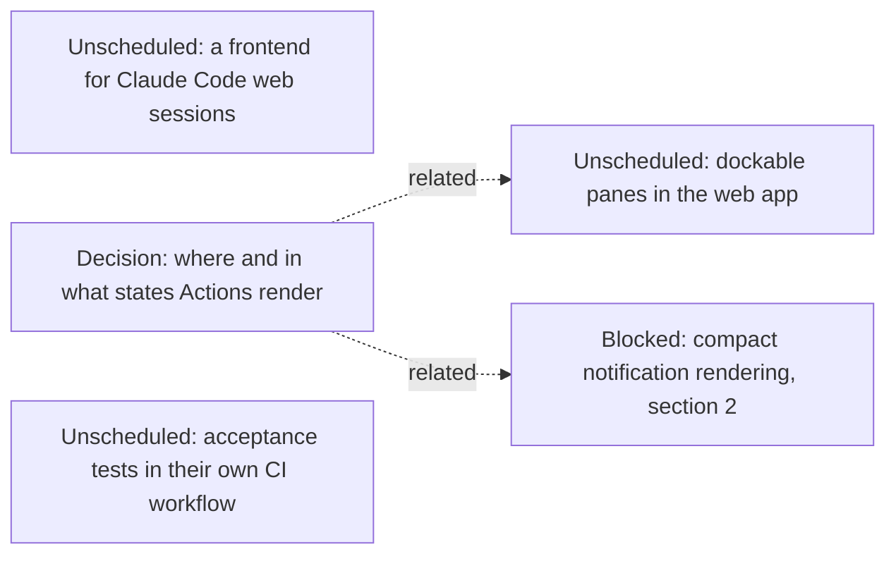

### `ACTION_SURFACES_DESIGN` — where and in what states Actions render

**Decision; operator, 2026-10-13 PDT: rethink it, since it is a patchwork and possibly redundant.**
Decide every place an Action is shown and in which states, then reduce the code to that. Surfaces
found in `app/frontend/actions/` and the service worker: the sidebar rows (collapsed and expanded,
with Approve/Deny only where `canApproveInline` allows), the top "Actions waiting" strip (a count),
the Actions page queue and the detail view (`PendingActionCard`, the full `ActionCall`, with a raw
and a pretty toggle), history, the policy view, and the Web Push notification (formatters in a
registry separate from the React one). Several of them choose independently what to render, whether
to offer a decision, and how tall to let the card grow. Settle which surfaces exist, what each is
for (a glance, a quick decision, full review, a record), and which states each has, so that one
rule decides inline approval and height and each Action type is described once.
Direction (operator, 2026-10-13 PDT): whether a card offers its decision buttons is not a per-kind
allowlist (`QUICK_APPROVALS`); the Action type's own TypeScript implementation decides for each
invocation from its content (for example a read-only call against a listed resource). Also give
each representation and visual element one fixed name and use it everywhere (code, UI copy, docs),
since "quick approve" could mean the buttons on a card or Approve/Deny on a desktop notification.
Proposed vocabulary, to settle with the design: **compact card** (the glance form in the sidebar
and the strip), **full card** (the detail view with the whole `ActionCall`), **card decision
buttons** (Approve/Deny on a compact card), **notification buttons** (Approve/Deny on a Web Push
notification), **attention strip** (the top "Actions waiting" count). `NOTIFICATION_PRESENTATION` (section 2) renders notices on the same surfaces and uses the same card
names. The compact-card
fixes under way (decision buttons on collapsed cards, a height cap, more Actions allowed inline)
land first and need not wait for this.

### `DOCKABLE_PANES` — dockable panes in the web app

**Unscheduled; operator, 2026-10-13 PDT.** Let the operator arrange the app's panes (thread browser,
Actions queue, several threads at once, Action detail) by dragging them into a layout of their own,
with split resizing, a layout that persists, and one selected pane at a time on a phone. Open spike
[#9721](https://github.com/agentydragon/ducktape/pull/9721) builds this as an experimental
`/#/mosaic` shell on `react-mosaic-component`, split-only without tabs, beside the classic routes;
it is stale and is the starting point. Settle whether docking replaces the classic routes or stays
an alternative, and fold the Action tiles into the surfaces `ACTION_SURFACES_DESIGN` settles.

### `CLAUDE_CODE_WEB_BRIDGE` — Claude Code web sessions in Agentplane

**Unscheduled; operator, 2026-10-12 PDT: low priority, not to build now.** Make Agentplane's
frontend a custom frontend for Claude Code web sessions: show their conversations and send them
messages, by shimming the web interface's control protocol. Builds on the viewer and syncer under
`devinfra/` and the reverse-engineering in `agentydragon/gaffer-private`.

### `ISOLATED_ACCEPTANCE_CI` — acceptance tests in their own CI workflow

**Unscheduled; operator, 2026-10-12 PDT: eventually.** Today the deployed vertical tests under
`agentplane/acceptance/` run by hand against the stateful `agentplane-testing` environment, and CI
never runs them. Move them into their own CI workflow that runs in isolation, so the cluster no
longer carries a stateful environment for them. Options named: an isolated part of the operator's
cluster, GitHub's runners, or BuildBuddy's; and the cheap-experiments LiteLLM key or a new key
provisioned for CI. Constraint: an agent can still run, inspect and step through the tests itself.
Open: where they run. The k3s-on-RBE spike (`agentplane/x/k3s_rbe_spike`) shows a real kubelet runs in a
BuildBuddy action, but with no ClusterIP Services, no KubeVirt and no Cilium, so tests that need
those stay elsewhere. envtest covers only API-server behavior, not Pods, harnesses or LLM calls, so
it does not replace these tests.

## 6. Existing access and lifecycle follow-ups

These are bounded existing work, not dependencies on the broader multiagent model. Confirm current
source/deployment state with the relevant owner when dispatching; old acceptance notes are not live
observations. New database work follows the task-specific review and rollout requirements.

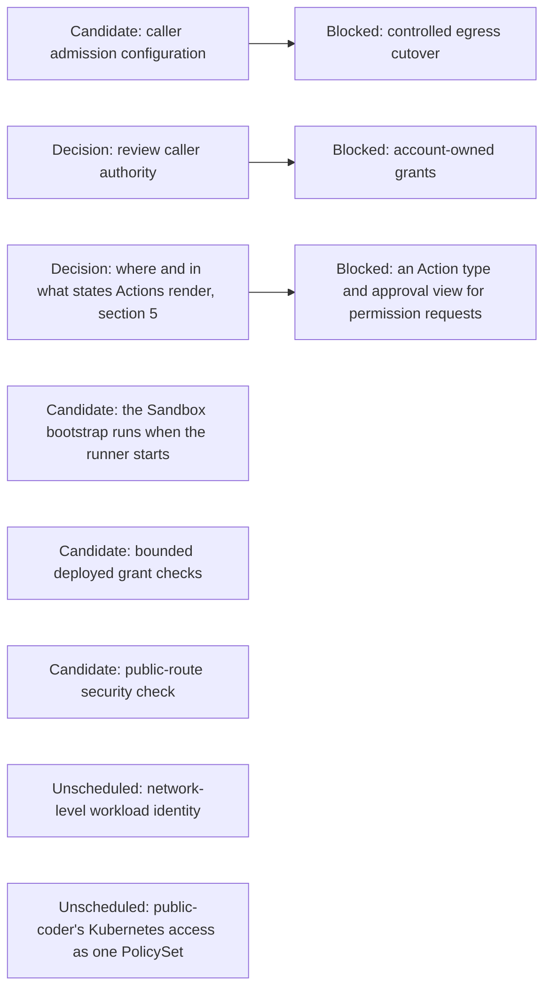

### `PC_EGRESS_CREDENTIALS` — label public-coder's Action Service caller

**Candidate; verify remaining configuration.** Admit the intended OpenClaw account to the dedicated
Action Service using its configured namespace and policy bindings. A label alone is not an execution
grant. Coordinate with the owner of the currently disabled/controlled workload before rollout.

### `PC_EGRESS` — public-coder-agent egress migration

**Blocked on caller admission and a controlled deployment.** Compare effective allowed/denied routes,
credential substitution and Action policy against the existing proxy, then do a reversible cutover.
Remove only unused OpenClaw-specific wiring; retain shared Iron/Haku consumers. Do not turn this
into an outage matrix. Source: [public-coder wiring](../../cluster/cdk8s/public_coder/proxy.py).

### `PC_KUBERNETES_POLICY_SET` — public-coder's Kubernetes access as one PolicySet

**Unscheduled; operator, 2026-10-12 PDT: wants it eventually.** Move public-coder-agent's whole set
of RoleBindings and ClusterRoleBindings (logs, pods, node and cluster-metadata reads, VolSync status
and the rest, in `cluster/cdk8s/public_coder/app.py` and its entries in
`cluster/cdk8s/agent_access_profiles.py`) under one `PolicySet` of Kubernetes rules with a Flux-owned
`PolicyBinding`. Open: `PolicyBinding` subjects are ServiceAccounts only, while some of these
grants name the `haku:access-profile:public-coder` Group, so either the binding learns Group
subjects or those grants move to the agent's ServiceAccount.

### `CLAUDE_AI_SA` — review the external caller's actual authority

**Decision.** Review the claude.ai account's Connection and arbitrary-shell Sandbox privileges,
Kubernetes scope and egress/Action grants. Record intended authority in generated configuration,
not ad hoc grants. Test an allowed and denied operation; do not add privileges as part of this review.

### `AGENT_PERMISSION_REQUESTS` — an Action type and approval view for permission requests

**Blocked on `ACTION_SURFACES_DESIGN`; operator, 2026-10-13 PDT:
eventually.** A specific Action type for the request instead of the Kubernetes MCP escape hatch, and
an approval view that shows the operator the account, the sets and the duration rather than a blob of
Kubernetes YAML. It shares with the app's sandbox-page grants the one path that writes a `PolicyBinding` for
the operator (`EgressAccess.grant`), so an approved request creates the same kind of binding. How
the request renders is the Action surfaces' decision: the approval view is one Action type described
once there.

### `MANAGED_SA_RBAC` — grants for accounts without a Sandbox

**Blocked on the caller review.** The claude.ai caller gets a
Flux-owned `PolicyBinding` of the sets `CLAUDE_AI_SA` approves, of any rule type, replacing its
static per-namespace grants in `agent_access_profiles.py`. Static Group subjects (Haku OIDC;
public-coder until `PC_KUBERNETES_POLICY_SET`) stay Flux bindings. Test an allowed and a denied request. Static caller accounts' bindings, this one among them, are Flux-owned, never Sandbox-owned.

### `SANDBOX_RBAC` — bounded deployed grant checks

**Candidate; security-relevant.** Inspect the managed-Sandbox grant path as `PolicySet`s leave it
and verify intended versus unrelated scope, including Role edits and credential-use boundaries,
without recording credentials. Use [agent RBAC](../../cluster/docs/agent_rbac.md) and existing tests;
only unresolved deployed wiring needs a live check, not a repeat of every already-covered operation.

### `NOTIFICATION_INGRESS_BOUNDARY` — bounded public-route security check

**Candidate; security-relevant deployment check, not a provider failure drill.** Existing tests
cover invalid signatures. Close the remaining route-wiring uncertainty with an unsigned webhook
request and a private-API request through the public hostname: both must be refused, without
creating subscriptions or inbox entries. Record the result once; no exhaustive provider matrix.

### `NETWORK_WORKLOAD_IDENTITY` — network-level workload identity

**Unscheduled; operator, 2026-10-12 PDT: consider later.** Sandboxes and other workloads prove
their identity to Agentplane services at the network layer, with Cilium mutual authentication
(SPIFFE/SPIRE) or a service mesh, instead of a projected token plus an egress proxy hop; services
authorize by SPIFFE ID or workload label. Costs: SPIRE or a mesh to install, Cilium mutual
authentication still in beta, and a second authentication scheme in every service beside projected
tokens.

### `BOOTSTRAP_PROGRESS_CONTRACT` — the Sandbox bootstrap runs when the runner starts

**Candidate; operator, 2026-10-13 PDT: run the Sandbox's bootstrap before any Session opens, not
inside the first one.** Per-Session setup is already asynchronous: the Session opens at once and
its setup output and outcome reach history as `SetupStarted`/`SetupOutput`/`SetupFinished` Events.
The Sandbox bootstrap (the launch file's, once per Sandbox) starts when the runner starts, but
nothing shows its output or progress, and an `OpenSession` that meets it still running waits for it,
which the Runner Gateway's `open_session` (`runner_gateway/session_lifecycle.py`) holds until the
script exits. Expose its progress and result. A successful bootstrap stays the precondition of
opening a Session: an `OpenSession` that meets a bootstrap still running is refused with a retryable
code, and one that meets a failed or interrupted bootstrap is refused for good (use a new Sandbox). A failed or interrupted bootstrap
is a Sandbox state of its own, `BootstrapFailed` (operator, 2026-10-13 PDT): terminal, never retried,
shown as the reason on `Bootstrapped` and `Ready`. A Sandbox is not suspendable until its bootstrap has either succeeded or failed (operator,
2026-10-13 PDT), so a suspend never interrupts it; likewise a suspend waits for every Session's setup to
complete (operator, 2026-10-13 PDT). Deletion is still always allowed. While a Sandbox is quiescing
it accepts no resume command (operator, 2026-10-13 PDT). The result reaches the Sandbox's
conditions as a runner fact on the connection Lease (`RUNNER_FACTS_ON_LEASE`), is republished at each
connect because it lasts the Sandbox's lifetime, and is part of `Ready`. `BootstrapFailed` is
terminal.

Control design: [ADR](../docs/adr_sandbox_session_control.md).

## 7. Our own Sandbox resource: Sessions that outlive their Pod

Not scheduled. A Session and its history are durable. The operator's direction (2026-10-12 PDT):
the way a Session outlives its runner is our own Sandbox resource, which holds the state PVC and
stays in place with no Pod or VM scheduled. A Sandbox is its state, running or not; an
**incarnation** is one Pod or VM. Stopping, replacing the image and starting again keeps the
Sandbox, so keeping the state means keeping the Sandbox, and deleting the Sandbox is the only thing
that deletes it. The same resource carries the VM kind, so section 4's stateful VMs build on these
nodes instead of a parallel track. Today a Session lives as long as its `Sandbox`
(suspension removes the Pod and keeps the state PVC, which goes with the `Sandbox`). The History Service keys by Session, so it can record each incarnation, and a seal closes
an incarnation, not the Session.

A related direction (operator, 2026-10-11 PDT; later, not scheduled): Sessions living in a
long-running, often-suspended Sandbox whose runner image upgrades between incarnations.

```mermaid
flowchart TD
    DURABLE_SESSION_LIFECYCLE[Decision: Session lifetime and revival]
    STATE_VOLUME_BLOCK[Blocked: the state volume moves to block storage]
    NODE_LOCAL_BLOCK_STORAGE[Unscheduled: node-local block volumes on every node]
    WORKSPACE_VOLUME[Blocked: a workspace volume tracked apart from the state PVC]
    SANDBOX_SPEC_EDIT[Unscheduled: edit a suspended Sandbox's template or kind]
    WORKSPACE_NODE_PORTABILITY[Unscheduled: move a workspace between nodes]
    SANDBOX_ARCHIVE[Unscheduled: a suspended Sandbox archived to object storage]
    AGENTPLANE_SANDBOX_RESOURCE[In progress: our own Sandbox resource]
    SESSION_INCARNATIONS[Blocked: Sessions record incarnations]
    SESSION_REVIVE[Blocked: start a stopped Sandbox again]
    AGENT_RESUME_NOTICE[Unscheduled: tell agents when their Sandbox was suspended and resumed]
    SESSION_INCARNATIONS -. related .-> AGENT_RESUME_NOTICE
    SESSION_REVIVE -. related .-> AGENT_RESUME_NOTICE
    SANDBOX_IDLE_EXPIRY -. related .-> AGENT_RESUME_NOTICE
    RUNNER_BUSY_TRACKING -. related .-> AGENT_RESUME_NOTICE
    BOOTSTRAP_PROGRESS_CONTRACT[Candidate: the Sandbox bootstrap runs when the runner starts, section 6] -. related .-> AGENT_RESUME_NOTICE
    INCARNATION_UID_REQUIRED[Blocked: the runner rejects a Welcome without the incarnation UID]
    RUNNER_FACTS_ON_LEASE[Candidate: the runner publishes stage, idle and boot facts on the connection Lease]
    RUNNER_BUSY_TRACKING[Unscheduled: the runner counts terminals and background processes as busy]
    QUIESCE_LEGACY_SHAPE_REMOVAL[Blocked: the controller stops reading the blocking Quiesce shape]
    QUIESCE_WITHOUT_POLLING[Blocked: the controller is told when a seal finishes]
    SESSION_ACTIVITY_STREAM[Blocked: the notification service delivers on a Session's idle time]
    DISPATCHER_CORE[Candidate: deploy the Session Dispatcher, then the facts that settle its commands]
    SANDBOX_SHARED_CODE_MOVE[Candidate: what outlives the Sandbox Service leaves its package]
    SANDBOX_WRITE_HELPER[Candidate: one shared library writes a Sandbox's spec]
    APP_SANDBOX_WRITES[Blocked: the app creates, deletes, suspends and resumes Sandboxes itself]
    SANDBOX_SERVICE_REMOVE[Blocked: remove the Sandbox Service]
    DISPATCHER_SESSION_CREATE[Blocked: dispatched Session creation]
    PROXY_START_METHODS_DISPATCHER_ONLY[Blocked: only the Dispatcher may start or continue work through the proxy]
    DISPATCHER_WAKE_ON_SEND[Blocked: a send wakes a suspended Sandbox]
    APP_SENDS_VIA_DISPATCHER[Blocked: the app sends through the Session Dispatcher]
    NOTIFICATIONS_VIA_DISPATCHER[Blocked: notifications send through the Session Dispatcher]
    RUNNER_PROXY_SENDER_RESTRICT[Blocked: only system callers send to the runner directly]
    RESUME_CREDENTIALS_VALID[Blocked: grants and tokens still valid after a long suspension]
    SUSPENDED_COMPOSER[Blocked: the composer stays enabled while a Session is suspended]
    THREAD_SUCCESSOR_DELIVERY[Blocked: commands unsettled across incarnations]
    HOSTED_THREAD_SURFACES[Blocked: show and revive stopped Sessions]
    VM_PROVIDER[VM provider, section 4]
    DURABLE_SESSION_LIFECYCLE --> SESSION_INCARNATIONS
    NODE_LOCAL_BLOCK_STORAGE --> STATE_VOLUME_BLOCK
    NODE_LOCAL_BLOCK_STORAGE --> WORKSPACE_VOLUME
    AGENTPLANE_SANDBOX_RESOURCE --> WORKSPACE_VOLUME
    WORKSPACE_VOLUME --> WORKSPACE_NODE_PORTABILITY
    WORKSPACE_VOLUME --> SANDBOX_ARCHIVE
    WORKSPACE_NODE_PORTABILITY -. related .-> SANDBOX_ARCHIVE
    SANDBOX_SPEC_EDIT -. related .-> WORKSPACE_VOLUME
    VM_PROVIDER -. related .-> SANDBOX_SPEC_EDIT
    APP_SESSION_DEFAULTS[Candidate: the app sends complete Session specs, section 12] -. keeps the preset label true .-> SANDBOX_SPEC_EDIT
    RUNNER_JOURNAL_TRIM[Unscheduled: runners stop keeping what the ingress committed, section 10] -. keeps what a revival reads back .-> SESSION_INCARNATIONS
    STATE_VOLUME_BLOCK -. related .-> WORKSPACE_VOLUME
    AGENTPLANE_SANDBOX_RESOURCE --> SESSION_INCARNATIONS
    AGENTPLANE_SANDBOX_RESOURCE -. stateful VMs .-> VM_PROVIDER
    SESSION_INCARNATIONS --> SESSION_REVIVE
    SESSION_INCARNATIONS --> SANDBOX_IDLE_EXPIRY[Blocked: idle runner Sandboxes suspend]
    HS_ACCEPTS_CONTINUATION[Candidate: the History Service accepts a continuation past a seal] -- HS image pinned --> ATTACHED_INCARNATION_UID
    ATTACHED_INCARNATION_UID[Blocked: Attached carries the incarnation UID] -- runner image and VM wheel pinned --> RUNNER_SEAL_PER_INCARNATION
    HS_ACCEPTS_CONTINUATION -- HS image pinned --> RUNNER_SEAL_PER_INCARNATION[Blocked: the runner keys its seal to the incarnation and reopens]
    RUNNER_SEAL_PER_INCARNATION --> SANDBOX_IDLE_EXPIRY
    HS_ACCEPTS_CONTINUATION -. related .-> SESSION_INCARNATIONS
    SANDBOX_IDLE_EXPIRY -. resumed by .-> SESSION_REVIVE
    HOSTED_THREAD_SURFACES --> SUSPENDED_COMPOSER
    MULTIAGENT_MODEL[Decision: identities and authority vocabulary, section 3] -. who may send and wake .-> DISPATCHER_CORE
    AGENT_MESSAGING_DESIGN[Decision: send and receive contract, section 3] -. offline behavior .-> DISPATCHER_CORE
    RUNNER_FACTS_ON_LEASE --> QUIESCE_WITHOUT_POLLING
    RUNNER_FACTS_ON_LEASE --> SANDBOX_IDLE_EXPIRY
    QUIESCE_WITHOUT_POLLING --> SANDBOX_IDLE_EXPIRY
    RUNNER_FACTS_ON_LEASE -. carries the boot result .-> BOOTSTRAP_PROGRESS_CONTRACT
    DISPATCHER_CORE --> DISPATCHER_SESSION_CREATE
    DISPATCHER_SESSION_CREATE --> PROXY_START_METHODS_DISPATCHER_ONLY
    APP_SENDS_VIA_DISPATCHER --> PROXY_START_METHODS_DISPATCHER_ONLY
    GATEWAY_WRAPPER_RETIRE[Blocked: callers use the proxy; RunnerGateway goes, section 12] --> PROXY_START_METHODS_DISPATCHER_ONLY
    BOOTSTRAP_PROGRESS_CONTRACT -. Ready may then include the bootstrap .-> DISPATCHER_SESSION_CREATE
    DISPATCHER_CORE --> DISPATCHER_WAKE_ON_SEND
    SANDBOX_WRITE_HELPER --> DISPATCHER_WAKE_ON_SEND
    SANDBOX_WRITE_HELPER --> APP_SANDBOX_WRITES
    SANDBOX_SHARED_CODE_MOVE --> SANDBOX_SERVICE_REMOVE
    SANDBOX_SHARED_CODE_MOVE -. land first, then the helper is written once .-> SANDBOX_WRITE_HELPER
    APP_SANDBOX_WRITES --> SANDBOX_SERVICE_REMOVE
    DISPATCHER_CORE --> DISPATCHER_DEPLOY[Blocked: the Session Dispatcher is deployed]
    DISPATCHER_DEPLOY --> APP_SENDS_VIA_DISPATCHER
    DISPATCHER_DEPLOY --> NOTIFICATIONS_VIA_DISPATCHER
    SESSION_REVIVE --> DISPATCHER_WAKE_ON_SEND
    APP_SENDS_VIA_DISPATCHER --> RUNNER_PROXY_SENDER_RESTRICT
    NOTIFICATIONS_VIA_DISPATCHER --> RUNNER_PROXY_SENDER_RESTRICT
    NOTIFICATIONS_VIA_DISPATCHER --> SESSION_ACTIVITY_STREAM
    DISPATCHER_WAKE_ON_SEND --> SUSPENDED_COMPOSER
    APP_SENDS_VIA_DISPATCHER --> SUSPENDED_COMPOSER
    DISPATCHER_CORE -. shares delivery semantics .-> THREAD_SUCCESSOR_DELIVERY
    SESSION_REVIVE --> RESUME_CREDENTIALS_VALID
    QUIESCE_WITHOUT_POLLING -. seal before a RAM suspend is its own question .-> VM_RAM_SUSPEND[Unscheduled: suspend a VM to disk with its RAM, section 4]
    SESSION_REVIVE --> THREAD_SUCCESSOR_DELIVERY
    SESSION_REVIVE --> HOSTED_THREAD_SURFACES
    K3S_LIFECYCLE_SUITE[Candidate: k3s lifecycle integration suite]
    BOOTSTRAP_PROGRESS_CONTRACT[Candidate: the Sandbox bootstrap runs when the runner starts, section 6] -. Ready implies bootstrapped .-> K3S_LIFECYCLE_SUITE
    QUIESCE_WITHOUT_POLLING -. quiesce assertions .-> K3S_LIFECYCLE_SUITE
```

### `DURABLE_SESSION_LIFECYCLE` — Session lifetime and revival

**Decision.** Decide: who may revive. A revived Session gets back its native harness state, and its workspace if
the workspace volume still exists (`WORKSPACE_VOLUME`). Each incarnation
uses the Sandbox's template as it is at that start (`AGENTPLANE_SANDBOX_RESOURCE`), so revival
picks up template and image updates. Sessions that share a Sandbox revive together,
since they share its state PVC. Direction (operator, 2026-10-11 PDT): a new user message or a
notification resumes a stopped Sandbox, never a read. Both reach the Runner Gateway as commands, so
one hook covers them: the gateway finds the Sandbox in its Session registry, sets the Sandbox
resource's desired state to running and holds the command until the new incarnation's runner
connects. A command held only while the sender waits is lost if the sender goes away;
`DISPATCHER_WAKE_ON_SEND` is the durable version, and it wakes the Sandbox by patching the Sandbox CR with the shared wake helper (`SANDBOX_WRITE_HELPER`) rather than through the gateway. Resuming by Session ID works while the Sandbox exists, stopped or not. Open: what the user sees while it starts.

### `K3S_LIFECYCLE_SUITE` — a k3s lifecycle integration suite

**Candidate; operator, 2026-10-13 PDT: smaller k3s-based tests of the Sandbox lifecycle.** One
shared k3s environment fixture on a BuildBuddy action, one test per
flow, no LLM: create, bootstrap, suspend, resume, quiesce and delete, about 15 minutes on RBE. Create,
bootstrap, suspend, resume and delete have landed (`agentplane/x/k3s_env`). Left: the quiesce
assertions, which wait for `QUIESCE_WITHOUT_POLLING`, and the assertion that `Ready` implies a
finished bootstrap, for `BOOTSTRAP_PROGRESS_CONTRACT`. The disposable-environment lane owns the
fixture. Tests that need ClusterIP Services, KubeVirt or Cilium stay elsewhere
(`ISOLATED_ACCEPTANCE_CI`).

### `STATE_VOLUME_BLOCK` — the state volume moves to block storage

**Blocked on `NODE_LOCAL_BLOCK_STORAGE`; operator, 2026-10-13 PDT: the state volume need not be
virtiofs, so switch both kinds to block storage once the cluster has it.** One PVC per Sandbox holds
the runner's state and the harness's native files, not the workspace; each incarnation's runner
continues the same journal on it. Today the Sandbox Controller creates it from the template's
`stateVolume`, mounted as a volume in pods and through virtiofs in VMs (`agentplane/runner/vm.nix`),
in separate `/state/runner` and `/state/harness` directories (`VM_PROCESS_ISOLATION`). Block storage
would let a VM mount it as a disk with its own filesystem instead, which would end the virtiofs
`107:107` constraint on who can write it (the uid choice in `vm.nix` and the pods' `107:107` exist
for it; check what else relies on it before changing). Check that a Session can still move between
kinds on it. The runner versions and migrates the contents and the controller has no version gate
(`SANDBOX_IMAGE_REPLACE`). The workspace is `WORKSPACE_VOLUME`'s.

Control design: [ADR](../docs/adr_sandbox_session_control.md).

### `NODE_LOCAL_BLOCK_STORAGE` — node-local block volumes on every node

**Unscheduled; operator, 2026-10-13 PDT.** The cluster has no provisioner on every node that makes
block volumes (a PVC with `volumeMode: Block`, or a filesystem PVC on a block device), so a VM
cannot get a fast workspace that way. Install one that is node-local, since replicated filesystems
were slow in the operator's experience, and capacity-enforcing, which is #4717
(<https://github.com/agentydragon/ducktape/issues/4717>): `local-path` enforces no PVC size, and inside a
guest `df` shows the node's whole disk. OpenEBS LVM already serves `llm-models` on one node.
Node-local pins a volume, and so every incarnation, to its node; moving it is
`WORKSPACE_NODE_PORTABILITY`.

### `WORKSPACE_VOLUME` — a workspace volume tracked apart from the state PVC

**Blocked on `NODE_LOCAL_BLOCK_STORAGE` and the Sandbox resource; operator, 2026-10-13 PDT.** Today,
read from the code and not run: a pod's workspaces sit under `/state/workspaces` on the state PVC; a
VM's workspace is a VM-local blank disk (a DataVolume) that survives stop and start, because stopping
keeps the VM and its disks, and is deleted with the VM, that is, when the Sandbox is deleted or its
template switches from VM to Pod. The pod's `/state/workspaces` content is not visible in a VM, whose
disk mounts over that path. Track the workspace as its own volume in the Sandbox, apart from the state
PVC, for both kinds, and when it is gone (dropped, or never made) resume reconciles by creating a
fresh one, so losing a workspace never loses the runner's state. Workspaces can be large (tens of GB
of build caches), so this is where the block storage matters. Pods and VMs use the same block storage
(`STATE_VOLUME_BLOCK`), so a Sandbox switching between them keeps both volumes and needs no
compatibility rules or conversion (operator, 2026-10-13 PDT).

Control design: [ADR](../docs/adr_sandbox_session_control.md).

### `SANDBOX_SPEC_EDIT` — edit a suspended Sandbox's template or kind

**Unscheduled; operator, 2026-10-13 PDT.** Let the operator change a Sandbox's template, including a
switch between VM and Pod, from the app, only while the Sandbox is suspended. Each incarnation
already reads the template as it is then (`SANDBOX_IMAGE_REPLACE`), and no spec is replaced
automatically; this is the explicit, operator-driven edit. Needs `WORKSPACE_VOLUME`,
so a kind switch keeps the workspace, and `VM_PROVIDER` for the VM side. The preset the app records
on a Sandbox as a label (`APP_SESSION_DEFAULTS`) must stay true after the edit.

Control design: [ADR](../docs/adr_sandbox_session_control.md).

### `WORKSPACE_NODE_PORTABILITY` — move a workspace between nodes

**Unscheduled; operator, 2026-10-13 PDT: even later.** A reasonably fast, node-portable workspace, or
node portability by copying: volsync from node to node, through S3 on SeaweedFS or directly, while the
Sandbox is suspended. Node-local volumes stay the default; this only moves them.

### `SANDBOX_ARCHIVE` — a suspended Sandbox archived to object storage

**Unscheduled; operator, 2026-10-13 PDT: a thought that volsync suggests, not a plan.** Resource
affordances for a Sandbox that still exists but whose volumes sit in restic or S3, so it must be
rehydrated before it can start, freeing the node's disk meanwhile. Sandbox status would say that it
is archived and where, and resuming one rehydrates first. Related to `WORKSPACE_NODE_PORTABILITY`,
which shares the copy mechanism. Needs `WORKSPACE_VOLUME`; the runner's state PVC would archive the
same way.

Control design: [ADR](../docs/adr_sandbox_session_control.md).

### `AGENTPLANE_SANDBOX_RESOURCE` — our own Sandbox resource

**In progress; operator, 2026-10-12 PDT: the shared base of this section and stateful VMs.** Our
`Sandbox` and `SandboxTemplate` and the Sandbox Controller (`agentplane/sandbox_controller/SPEC.md`)
reconcile a pod Sandbox into its state PVC and Pods. Sandboxes are created as ours, and
what is left is the nodes below. The Sandbox Service goes away (`SANDBOX_SERVICE_REMOVE`; operator, 2026-10-13 PDT): requesters, the app and
the Dispatcher, write a Sandbox's spec through the Kubernetes API as the operator who asked, and the
controller writes status and validates the spec. The controller stays separate from the Runner Gateway, so
the provisioning permissions stay off the runner-facing service. Layers that act on CRs, the controller's
idle timer included, do not edit the spec (`docs/adr_sandbox_session_control.md`). Action Service boxes keep a catalog of their own ([ADR](../docs/adr_action_sandboxes.md)).

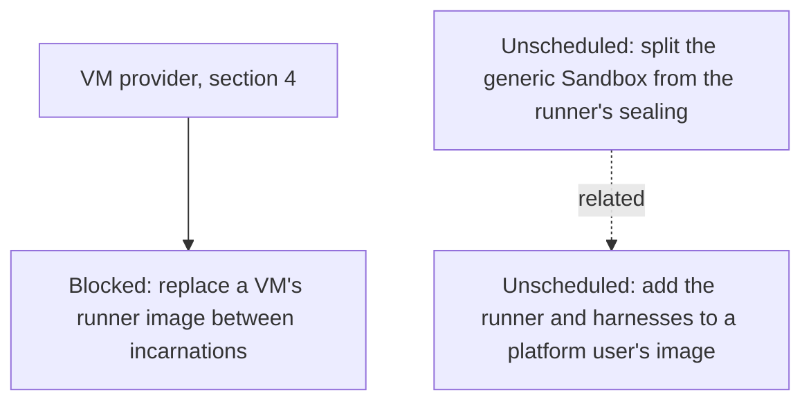

### `SANDBOX_IMAGE_REPLACE` — replace a VM's runner image between incarnations

**Blocked on `VM_PROVIDER`; the operator's "pause, replace the image, resume" (2026-10-12 PDT).**
Pods already behave so: each incarnation reads its `SandboxTemplate` as it starts, and a running Pod
never changes (`agentplane/sandbox_controller/SPEC.md` § Incarnations), so a new image in the
template, or a Sandbox switched to another template, applies at the next resume on the same state
PVC. Left is the same for VMs once our Sandbox has them: the controller rewrites a VM's containerDisk
only while `runStrategy: Halted`, keeping its state PVC. The state PVC's contents belong to the
runner (operator, 2026-10-12 08:41 PDT): it versions and migrates them, or reports that it cannot,
and the controller has no version gate. So of #8843's `ReplaceVmImage` (replaced live in
the 2026-10-03 run) the Halted-only rewrite carries over,
and the exact `VmTemplate.state_schema_version` match does not.

Control design: [ADR](../docs/adr_sandbox_session_control.md).

### `SANDBOX_GENERIC_SPLIT` — separate the generic Sandbox from the runner's sealing

**Unscheduled; operator, 2026-10-13 PDT: a later TODO.** Our `Sandbox` resource binds two concerns
together. One is what Agent Sandbox did, plus VM support: a template, a Pod or VM per incarnation,
and a state volume that stays. The other is specific to our runner running inside: sealing a
Session's journal before the incarnation goes. Separated,
the first could be reused without the runner. Decide where the line falls (resource, controller or package) and what each side owns. A
layered pair, a Sandbox and a runner that runs inside one, is the direction the control design
(`docs/adr_sandbox_session_control.md`) points to: seal, runner connectivity and idle suspension
are the runner-aware layer, and the Session Dispatcher sits outside both.

Control design: [ADR](../docs/adr_sandbox_session_control.md).

### `SANDBOX_RUNNER_LAYERING` — add the runner and harnesses to a platform user's image

**Unscheduled; operator, 2026-10-13 PDT: very low priority unless easy.** Separate the runner's
concerns (its version and binary, and the harness binaries) from the tools in the image, so a
platform user supplies a Pod image or VM image or definition with no runner or harnesses and the
runner side layers them in. Then they need not bump build versions or layer the runner themselves.
Related to `SANDBOX_GENERIC_SPLIT`: that node separates the resource, this one separates the image.
Options the operator named, none chosen: mount a separate volume that carries the runner, Claude and
Codex into a Pod image that has none of them; or take a user root filesystem and run it under
Firecracker with the runner as init.

### `SANDBOX_IDLE_EXPIRY` — idle runner Sandboxes suspend

**Blocked on `SESSION_INCARNATIONS`, `RUNNER_SEAL_PER_INCARNATION`, `RUNNER_FACTS_ON_LEASE` and `QUIESCE_WITHOUT_POLLING`; operator,
2026-10-11 and 2026-10-13 PDT.** An idle runner Sandbox suspends: it is sealed,
then the Pod or VM goes, freeing memory and compute, and the Sandbox, its ServiceAccount, bindings
and state PVC stay, so `SESSION_REVIVE` resumes it on the same PVC. Nothing deletes a Sandbox on
idleness or any timer (operator, 2026-10-13 PDT): only the operator deletes one, through
[teardown](../sandbox_service/API.md#teardown) and the seal. What a resume gets back of the
workspace depends on `WORKSPACE_VOLUME`. Idle is a Sandbox-level fact: every Session in the Sandbox
is idle. The control design (`docs/adr_sandbox_session_control.md`) puts the policy in the Sandbox
controller: `spec.idleSuspendAfter`, a timer the controller measures from the `idleSince`
fact the runner publishes (`RUNNER_FACTS_ON_LEASE`), so it needs no History Service and
survives a controller restart. Busy covers a delivery under way, the bootstrap, a turn, a command and a setup script. A background or
durable process or an attached terminal does not count (operator, 2026-10-14), so a suspend ends them (`RUNNER_BUSY_TRACKING`). The controller's idle timer does not edit the spec: it
writes `status.suspendedBy: Idle` with the `spec.wakeGeneration` it suspended at, and the shared wake helper
(`SANDBOX_WRITE_HELPER`) sets `running = true` and bumps `wakeGeneration` for both causes (operator, 2026-10-14: the shape stays). The
controller publishes the effective mode once in status, and every reader of `spec.running` (controller
reconcile and `vm.go`, `sandbox_resource.py`, the shared phase derivation of `SANDBOX_WRITE_HELPER`, the app's delete path,
the app's `sandbox_has_ready_pod`) reads that. Automatic suspension is
`Quiesce` with `if_idle_since`: the runner refuses it on a token mismatch or when busy (`ABORTED`, as
for a Sandbox already in lameduck; `FAILED_PRECONDITION` is terminal), and there is
no ingress-health gate. Suspension waits for the Sandbox bootstrap and every
Session's setup (running setups are a runner fact; the Sandbox is `Ready` False with reason `SuspendPending`); deletion does not wait. A Sandbox that is quiescing refuses resume. Action Service boxes are `ACTION_BOX_IDLE_REAPER`'s, which
only ever deletes.

Control design: [ADR](../docs/adr_sandbox_session_control.md).

### `SESSION_INCARNATIONS` — a Session records its incarnations

**Blocked on the lifecycle decision and the resource.** The Sandbox resource's status lists its
incarnations, at most one live; each incarnation's runner announces its Pod or VM UID on ingress,
from which the History Service records it, and its seal ends that incarnation, not the Session. On
the kept volume the runner journal and its cursors simply continue; the next incarnation journals
that it resumed after a seal.

The reopening of a sealed journal is `HS_ACCEPTS_CONTINUATION`, `ATTACHED_INCARNATION_UID` and `RUNNER_SEAL_PER_INCARNATION`.

Control design: [ADR](../docs/adr_sandbox_session_control.md).

### `HS_ACCEPTS_CONTINUATION` — the History Service accepts a continuation past a seal

**Candidate; operator, 2026-10-13 PDT: a seal belongs to the incarnation that sealed it.** A resumed
Sandbox cannot run any Session today, and `SANDBOX_IDLE_EXPIRY` waits on this chain. The History Service
stores the seal in the Session's feed state with the incarnation UID that sealed it, and `Push` accepts a
push whose UID differs from the seal's when `last_cursor` equals the seal's cursor, then replaces the
seal. `Attached` gains an optional incarnation UID (the field `SESSION_INCARNATIONS` needs anyway); a
frame without it behaves as today, so this node is the reader and ships first. A seal already stored
has no UID and counts as an earlier incarnation's, so Sandboxes suspended today can resume. The rows
and the acknowledgement it writes follow the ADR's section "Reopening a sealed journal".

Gate: the History Service image with this change is pinned before `ATTACHED_INCARNATION_UID` or
`RUNNER_SEAL_PER_INCARNATION` ships (image before config).

Control design: [ADR](../docs/adr_sandbox_session_control.md).

### `ATTACHED_INCARNATION_UID` — `Attached` carries the incarnation UID

**Blocked on `HS_ACCEPTS_CONTINUATION` pinned.** The runner sends its incarnation UID in `Attached`
(the Pod or VM UID it announces today on the connection). Nothing else changes: the ingress still sees
a sealed Session as sealed. Gate: the runner image and the VM guest's runner wheel (`nix/artifact-pins.json`,
pinned separately) carry the UID before `RUNNER_SEAL_PER_INCARNATION` ships, so a reopen never reaches
the ingress without one.

### `RUNNER_SEAL_PER_INCARNATION` — the runner keys its seal to the incarnation and reopens

**Blocked on `HS_ACCEPTS_CONTINUATION` and `ATTACHED_INCARNATION_UID`, both pinned.** The runner's journal
`Seal` row and its per-Session acknowledgement file record the incarnation UID that sealed. A runner under
a different UID treats the seal as ended, reopens the journal and appends an entry recording the resume,
so `ensure_running` and `IngressPusher.track` accept the Session again. Seals on disk without a UID
count as an earlier incarnation's. The lameduck marker keeps its own incarnation key. Test a suspend and
resume on the same state volume with a Session that has history, an unacknowledged tail at the seal, and
a seal written before the UID existed.

Control design: [ADR](../docs/adr_sandbox_session_control.md).

### `SESSION_REVIVE` — start a stopped Sandbox again

**Blocked on incarnations.** The controller schedules a new Pod or VM
for a stopped Sandbox, set running by the wake helper (`SANDBOX_WRITE_HELPER`: the Dispatcher's wake, `DISPATCHER_WAKE_ON_SEND`, or the app for an operator), from its
template as it is now, possibly on a new image, and resume each harness as
a new incarnation of the same Session and history. Incarnation N+1 is created only after N has fully
terminated, and the runner treats an interrupted Session setup as resumable. Test
revival after a long stop, a refused incompatible state PVC, and concurrent revive requests.

Control design: [ADR](../docs/adr_sandbox_session_control.md).

### `AGENT_RESUME_NOTICE` — tell agents when their Sandbox was suspended and resumed

**Unscheduled; operator, 2026-10-13 PDT: it would be good.** An agent whose Sandbox was suspended and
resumed learns nothing of it: its tool processes are gone, a terminal or background process it started
no longer runs, and whether its workspace survived depends on where it lived (the state PVC is kept; a
VM-local disk is not, until `VM_RAM_SUSPEND`). Tell the agent when a new incarnation of its Sandbox
started, how long it was down, what was kept (state PVC, workspace) and what was lost (processes,
terminals). The runner knows the incarnation change; what survives is a fact of the Sandbox's kind and
volumes, and a suspend ends background processes and terminals, which do not count as busy
(`RUNNER_BUSY_TRACKING`). Open: whether the notice is a runner
platform instruction added at harness start, an event the History Service folds into the Session, or a
message through the Dispatcher; and the wording agents act on. Test a suspend and resume with a
background process, a terminal and workspace files, and a crash restart (no suspend) that reads
differently.

Related: `SESSION_INCARNATIONS`, `SESSION_REVIVE`, `SANDBOX_IDLE_EXPIRY`, `BOOTSTRAP_PROGRESS_CONTRACT`
(section 6).

### `INCARNATION_UID_REQUIRED` — the runner rejects a `Welcome` without the incarnation UID

**Blocked on the gateway image that sends the UID pinned in
every environment, and in the VM guest's runner wheel pin.** Removes the missing-UID tolerance: a
`Welcome` without a UID ends the stream, and the `None` path in the runner store's incarnation
adoption (marked by its `CLEANUP` tombstone) goes. Pin ordering is not relied on before this; afterwards a
runner too old to know the field cannot meet a gateway that no longer sends it.

### `RUNNER_FACTS_ON_LEASE` — the runner publishes stage, idle and boot facts on the connection Lease

**In progress; the gateway writes what a runner sends, the runner sends its quiesce stage and bootstrap result, and the controller reader is the Sandbox controller lane's.** The one
transport several nodes share: the runner reports facts on the control stream, as optional `facts` on the `Heartbeat` message
shared by `RunnerFrame.heartbeat` and `ServiceFrame.heartbeat`, sent on change and on the first `Heartbeat` after
connect; what is left is moving them to a runner-only `RunnerHeartbeat` on `RunnerFrame.heartbeat`
(wire-compatible: same field numbers), and the gateway
replica holding the connection writes them as annotations on the Sandbox-owned connection Lease,
stamped with the incarnation UID, clearing them when a different incarnation connects. Facts: the
seal stage (draining, flushing, sealed), when the Sandbox last went idle (`idleSince`, set only
while no delivery, bootstrap, turn, command or setup script is busy; there is no `busy`
fact) for `SANDBOX_IDLE_EXPIRY`, and the bootstrap result (`BOOTSTRAP_PROGRESS_CONTRACT`), and the Sessions whose setup is still running, which
holds a suspend back (`Ready` False with reason `SuspendPending`, `SANDBOX_IDLE_EXPIRY`). The
gateway writes stage transitions to the Lease at once and coalesces only `idleSince` into the
regular 15-second renewal write, so it adds no etcd writes. The runner republishes its facts on
reconnect so a gateway rollout loses nothing. A first-connection
annotation, persisted, tells `NeverRan` (a Sandbox whose runner has not connected yet) from a runner
that is down. Order: the controller reads the annotations before the gateway starts writing them.

### `RUNNER_BUSY_TRACKING` — the runner counts terminals and background processes as busy

**Unscheduled; operator, 2026-10-14: not now, an open TODO that may be looked at later.** The runner
publishes `idle_since` (`RunnerFacts`), busy while a delivery is under way, the bootstrap runs, or any
Session has a turn, an unfinished command or a setup script. A background or durable process or an
attached terminal or console does not make the Sandbox busy, so an idle suspend ends them. The runner
does not supervise these, so who would report them (the harness adapters, the VM console) is open.
Test an attached terminal that detaches, a background process that outlives a turn, and a runner
restart. `AGENT_RESUME_NOTICE` tells the agent what a suspend ended.

### `QUIESCE_LEGACY_SHAPE_REMOVAL` — the controller stops reading the blocking `Quiesce` shape

**Blocked on the runner's non-blocking `Quiesce` pinned in every environment, the VM guest's wheel
included.** Deletes the controller's legacy-shape read and the tombstone marking it.

### `QUIESCE_WITHOUT_POLLING` — a runner that never progresses is backed off, not hammered

**Blocked on `RUNNER_FACTS_ON_LEASE` pinned in every environment (done in testing and staging).** The
controller already calls once and reacts to the Lease stage events, re-issuing the idempotent call
only at a one-minute deadline. What is left: while the ingress is down the controller backs off
instead of retrying per Sandbox, and a live test (a Sandbox with a Session whose flush is held
back) covers a gateway rollout mid-seal, a runner restart mid-seal and a lost event. Neither could
be exercised on `agentplane-testing` without a held-back flush.

### `SESSION_ACTIVITY_STREAM` — the notification service delivers on a Session's idle time

**Blocked on `NOTIFICATIONS_VIA_DISPATCHER`.** The History Service folds `idle_since` into
`SessionSummary` (the turn and harness events that start and end idleness), and the app shows it.
What is left is the second listener: the notification service reads the Session's summary after each
`WatchSessionSummaries` notice and picks its own moment, so it delivers after a minute of idleness,
at most ten minutes after the first pending entry, through `NOTIFICATIONS_VIA_DISPATCHER`. Its
`NoticeDebounceSettings` quiet window stays about inbox entry times until then. `idle_since` is
display and delivery timing: suspension reads the runner's busy facts (`RUNNER_FACTS_ON_LEASE`) and
never this field. Per-Session idle times stay out of Kubernetes.

Control design: [ADR](../docs/adr_sandbox_session_control.md).

### `SANDBOX_SHARED_CODE_MOVE` — what outlives the Sandbox Service leaves its package

**Candidate; a pure move with no behavior change.** Everything shared now lives in
`agentplane/sandboxes/` and `agentplane/proto/sandboxes.proto`. What is left under
`agentplane/sandbox_service/` is the Service itself and what serves only it: `provisioning.py`
(its `Provisioning.egress` is read by the `GrantEgress` and `RevokeEgress` handlers, so it moves with
the CLEANUP that removes them, or goes with the Service) and the test fakes that stand up the gRPC
Service (`testing/backend`, `grpc_service`, `connected_runner`, `kubernetes`), which the gateway and
app tests use until `SANDBOX_SERVICE_REMOVE` replaces them with the Kubernetes-backed fakes. When
`GrantEgress` and `RevokeEgress` are gone, this node ends with whatever importers still name
`agentplane.sandbox_service`; then `SANDBOX_WRITE_HELPER` and the removal start from a package that
holds only the Service, and the removal is a deletion.

### `SANDBOX_WRITE_HELPER` — one shared library writes a Sandbox's spec

**Candidate; operator, 2026-10-13 PDT: the Sandbox Service goes away and requesters write the spec.** A shared
library for the two requesters, the app and the Dispatcher: the UID- and resourceVersion-guarded
`spec.running` patch; the `wakeGeneration` bump; an advisory, retryable refusal while the Sandbox is
quiescing (the controller enforces it) and of deleting a running Sandbox; create validation, the default
policy sets on create and idempotent create (today `sandbox_service/provisioning.py` and `inventory.py`);
and the phase derivation (today
`sandbox_service/kubernetes_views.py`) as shared code. Cost: RBAC cannot narrow a patch to two fields, so
the app and the Dispatcher can each write any field of any Sandbox, which no Service RPC allowed. The
Dispatcher writes only `spec.running` and `spec.wakeGeneration`, by convention of the helper and not by
enforcement; admission policy is undecided and the cost is accepted.

### `APP_SANDBOX_WRITES` — the app creates, deletes, suspends and resumes Sandboxes itself

**Blocked on `SANDBOX_WRITE_HELPER`.** The app does what it asks of the Sandbox Service through the
Kubernetes API as the operator who asked, as it already does for `PolicyBinding`s: create, delete, suspend,
resume, and it edits permissions (egress grants, policy views, templates) and reads the inventory with the
derived phase. The VM serial console
(`sandbox_service/console.py`) moves into the app (operator, 2026-10-13 PDT) through the KubeVirt console
subresource. The app's Role gains `sandboxes` `create/patch/delete`, `sandboxtemplates` `list` and
`virtualmachineinstances/console` `get` (it already has `policysets` and `pods`).

### `SANDBOX_SERVICE_REMOVE` — remove the Sandbox Service

**Blocked until the image of `APP_SANDBOX_WRITES`, the app image that writes `PolicyBinding`s itself, and the
Notification Service image that reads the Sandbox CR are pinned on staging.** Remove the Deployment, Role and TokenReview,
the protos and client, `StreamConsole`, the grant RPCs (`GrantEgress`, `RevokeEgress`, their messages,
servicer, client methods, `sandbox_service/egress.py` and the `egresscredentials`/`policybindings` rules of
the Role, each marked by a `CLEANUP` tombstone), the Notification Service's `sandbox_service` setting (its
`CLEANUP` tombstone in `notification_service/settings.py`, the key in its manifest, the `sandboxes` token
and its egress rule) and the Notification Service's place among the Service's callers (the
`notification_service/docs/api.md` and `sandbox_service/README.md` sentences that name it), and update the README
services diagram (12 to 11 services). Code and manifests go together here, after the pin.

### `DISPATCHER_CORE` — the Session Dispatcher delivers to running Sandboxes

**Candidate.** The service is in `session_dispatcher/` (README there) with its image, built and tested, and not
deployed; it moves no sender and wakes nothing. What remains, in order:

1. **Deploy it, after the image is pinned.** Deployment (one replica, `Recreate`), Service, database on the shared
   CNPG cluster with the migration init container, Role with `get/list/watch` on `sandboxes`, its account in the
   gateway's `caller_accounts`, the Flux image automation, and the README services diagram.
2. **`HARNESS_CONFIRMED` has no writer.** A command stays `RUNNER_ADMITTED` until a fact says it reached the model's
   context; decide which fact (the runner's journal, read from the Lease or the History Service) and settle `submit_input`
   rows on it.
3. **Replicas shard Sandboxes by a per-Sandbox Lease** so each has one active owner; until then there is one active
   replica.
4. **Authorization names which senders may send** (any `caller_accounts` entry may today); the sender kinds that may
   wake are `DISPATCHER_WAKE_ON_SEND`'s.
5. **A command whose reply was lost across an incarnation boundary** is redelivered to the next incarnation
   (`THREAD_SUCCESSOR_DELIVERY`).
6. **Poison commands** get no special handling yet.

Control design: [ADR](../docs/adr_sandbox_session_control.md).

### `DISPATCHER_DEPLOY` — the Session Dispatcher is deployed

**Blocked on `DISPATCHER_CORE` merged and its image, and its migration image, pinned.** The service is
built and tested but ships no manifests, so no sender can call it. The cdk8s generators add its
Deployment, its CNPG database and migration job, a Role with `get/list/watch` on `sandboxes`
(`patch` joins it with `DISPATCHER_WAKE_ON_SEND`), the gateway's `caller_accounts` entry that lets the
Dispatcher call the `Runner` proxy, the network policies both ways, and the Flux wiring; the README's
services-and-traffic diagram marks it deployed. Image before config: no manifest, flag or required setting
lands before the image that accepts it is pinned. Test that a Sandbox that becomes `Ready` receives a
queued command through the deployed pair in `agentplane-testing`, and that a Dispatcher restart loses no
queued command.

Control design: [ADR](../docs/adr_sandbox_session_control.md).

### `DISPATCHER_SESSION_CREATE` — dispatched Session creation

**Blocked on `DISPATCHER_CORE`.** `OpenSession` with a client-minted Session ID is stored
durably and made idempotent by the ID: a retry returns the same record, and the same ID in another
Sandbox is refused. `ALREADY_EXISTS` from the runner's `OpenSession` counts as opened once
`ListSessions` confirms the Session. The service waits for the Sandbox to be ready and calls the runner's
idempotent `OpenSession`. It needs the Sandbox's name, never an address; when a caller omits the
Sandbox it looks the Session up in the History Service, and until the runner has pushed anything
its own record is authoritative.

### `DISPATCHER_WAKE_ON_SEND` — a send wakes a suspended Sandbox

**Blocked on `DISPATCHER_CORE`, `SESSION_REVIVE` and `SANDBOX_WRITE_HELPER`.** A message for a suspended Sandbox's
Session resumes the Sandbox by patching the Sandbox CR with the shared wake helper, then delivers once `Ready` holds for the new
incarnation, keying every attempt to the incarnation UID; a delivery refused by a sealing runner
with `ABORTED` (the gateway flattens runner codes it does not list to `FAILED_PRECONDITION`, so it forwards this one) is redelivered after the resume. Which senders may wake: a user message and
a notification, not an agent's message unless `AGENT_MESSAGE_RECEPTION` decides so. `InterruptTurn` and
`StopRunnerSession` never wake a Sandbox; they are no-ops on a suspended one. Also here:
rate limits and per-sender quotas, since a resume starts a Pod or VM and every harness; resuming
only the Sessions that have pending work; a bounded wait with a visible reason when the volume's
node is down or full; and `spec.wakeOnSend: false`, which holds a Sandbox suspended (sends queue
and do not wake it) and doubles as the feature gate. Deletion beats everything. Test a message
to a suspended Sandbox, one arriving while it seals, a failed revival and a resume storm.

### `APP_SENDS_VIA_DISPATCHER` — the app sends through the Session Dispatcher

**Blocked on `DISPATCHER_DEPLOY`.** The composer and the app's other command sends call the Session
Dispatcher instead of `SubmitCommand`, showing its delivery states. The command-progress lights
(`CommandProgress`: saved in browser, runner accepted, effect confirmed) gain a dispatch stage
between the browser and the runner: queued in the Dispatcher (operator, 2026-10-13 PDT). It reads
the Dispatcher's delivery states, and for a Session whose Sandbox is waking
(`DISPATCHER_WAKE_ON_SEND`) says so; `SUSPENDED_COMPOSER` is the composer side of the same wait.
Visual scenarios name each stage's command after the state it shows. Parallel with
`NOTIFICATIONS_VIA_DISPATCHER`; reader before writer, so the Session Dispatcher lands and is read before any
sender moves.

### `NOTIFICATIONS_VIA_DISPATCHER` — notifications send through the Session Dispatcher

**Blocked on `DISPATCHER_DEPLOY`; operator, 2026-10-13 PDT.** The Notification Service sends its
notices through the Session Dispatcher, and keeps choosing when to deliver from its own quiet window or
from `SESSION_ACTIVITY_STREAM`. Parallel with `APP_SENDS_VIA_DISPATCHER`.

### `RUNNER_PROXY_SENDER_RESTRICT` — only system callers send to the runner directly

**Blocked on `APP_SENDS_VIA_DISPATCHER` and `NOTIFICATIONS_VIA_DISPATCHER`.** A policy edit at the gateway's
per-method authorization: the command RPCs and `OpenSession` are open to the Session Dispatcher, the
controller's seal call, operator diagnostics and acceptance tests, and to no other caller.
`ListSessions` stays open to readers. Agent-to-agent messaging joins through its own nodes.

### `RESUME_CREDENTIALS_VALID` — grants and tokens still valid after a long suspension

**Blocked on `SESSION_REVIVE`.** A Sandbox that resumes hours or days later must come up with egress
grants, `PolicyBinding`s and projected tokens still valid, or it looks broken. Check each
expiring thing the Sandbox holds, and make a resume refresh or refuse with a reason, never come up
half-granted. Grants made from the app can carry an `expiresAt`.

### `SUSPENDED_COMPOSER` — the composer stays enabled while a Session is suspended

**Blocked on `DISPATCHER_WAKE_ON_SEND`, `APP_SENDS_VIA_DISPATCHER` and `HOSTED_THREAD_SURFACES`.** A suspended
Session in the app has an enabled composer; sending queues the message and shows that the Sandbox
is starting and the message waits.

Control design: [ADR](../docs/adr_sandbox_session_control.md).

### `THREAD_SUCCESSOR_DELIVERY` — commands unsettled across incarnations

**Blocked on revival.** A command whose admission was ambiguous when an incarnation ended is
redelivered to the next one, which resolves the ambiguity (the runner deduplicates on the command
ID). It is `unknown` only when the Sandbox was deleted. Moved from the freezer.

Control design: [ADR](../docs/adr_sandbox_session_control.md).

### `HOSTED_THREAD_SURFACES` — show and revive stopped Sessions

**Blocked on revival.** The app lists Sessions whose Sandbox has no
running incarnation, reads their history from the History Service, and offers an explicit revive,.
Moved from the freezer.

## 8. Ownership and naming cleanup

Cleanups that leave one database per service and names that say what things are. Each node is one
deployment; edges are the known order. Staging data follows
[staging data preservation](../docs/staging_data_preservation.md): Session identities and history
are irreplaceable, and a node that deletes a column or row stops for the operator.

### `HISTORY_DATABASE_RENAME` — name the database for its owner

**Candidate.** Rename the `sandbox_service` database and role
(and the `postgres-sandbox-service` Secret) for the History Service. Rename in place (`ALTER DATABASE`/`ALTER ROLE ... RENAME`)
and have the CNPG `Database` and managed role adopt the new names; recreating the database under a
new name would copy the log. Verify the History Service and Electric reconnect with no data movement.
The `storage/migrate.py` and `cluster/cdk8s/agentplane/history_service.py` docstrings take the
new name.

### `SANDBOX_DATABASE_RENAME` — name the Runner Gateway's database for it

**Unscheduled; operator, 2026-10-11 PDT: keep the name for now, not urgent.** `sandbox_commands` holds the Runner Gateway's Session registry and command
admission; the Sandbox Service has no database. Rename it and its role and Secret for the gateway
in place, as `HISTORY_DATABASE_RENAME` does, and point the Runner Gateway, its migration init
container and `commands_database_url` at the new names. `database.py`'s comment on
`sandbox_commands` follows.

### `ACTION_BOX_IDLE_REAPER` — delete Action boxes nobody uses

**Unscheduled; operator, 2026-10-11 PDT.** A small controller deletes Action box Pods with no
`exec` for a configured time. The Action Service stamps a last-exec time on the box at each `exec`;
a plain Pod delete is enough, since boxes have no seal. It takes over `TODO(sandbox-lifetime)` in
`action_service/sandbox/inventory.py`; draft [#7859](https://github.com/agentydragon/ducktape/pull/7859)
expired agent-sandbox boxes the same way.

### `ACTION_BOX_RENAME` — Action boxes stop being called sandboxes

**Unscheduled; operator, 2026-10-11 PDT: a later TODO.** Rename what calls an Action Service box a
sandbox, so it no longer reads as a Session Sandbox: the `sandbox__*` Actions,
`action_service/sandbox/`, the `agentplane-sandbox` templates and labels, and
`cluster/cdk8s/agentplane/command_sandbox.py`. The `sandbox__*` tool names are what agents and
external Connections call, so renaming them is a wire change.

## 9. Legacy burn-down

Dead code, finished gates, compatibility shims and stale names found by the 2026-10-10 PDT audit of
devel. A gate counts as legacy once its rollout is finished on both testing and staging or nothing
reads it; the delta settlement flag stays (operator, 2026-10-13 PDT). Lane named per
node; leftovers of in-flight work belong to the lane already changing that code. Upstream-gated
tombstones with a verifiable condition in code (`keepingOffset` in
`thread_store.tsx`, the jsdom pragma in `markdown.test.tsx`) need no node.

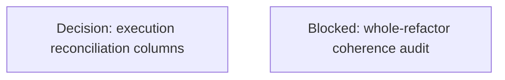

### `ACTION_EXECUTION_AUDIT_TRIM` — execution reconciliation columns

**Decision; drops columns, so the operator decides.** `ExecutionRow.reconciled_by` and
`reconciliation_source` in `action_service/db.py` are written but read only by a test, and
`ReconciliationSource` has one member. Either expose `reconciled_by` in the execution view, or
drop both columns and the enum.

### `REFACTOR_COHERENCE_AUDIT` — the refactor reads as one design

**Blocked on the cutover's retirements and the split**, which remove the
transitional pieces the other nodes name. Sweep devel for unused modules, functions, settings, proto
fields, tables and columns; one name per concept across code, settings, manifests, protos and docs
(Runner Gateway, History Service, ingress, control; Session for the raw stream,
Thread for its projection; no "hub", "follow" or "shadow" left); READMEs, `SPEC.md` files and
`docs/` describing the code as it is, without cutover narration; no compatibility branch,
optional-with-fallback setting or `CLEANUP` tombstone whose condition is met; the system diagram in
`agentplane/README.md` showing exactly the deployed services and the traffic between them in
`cluster/cdk8s/agentplane`. Known now: the test-only `PostgresListener.wait_until_disconnected`
(`connected` turns false before the termination callback runs, so its tests cannot wait on
`connected` instead); egress and app test support each build a throwaway CA;
`cluster/cdk8s/agentplane/kubevirt_experiment` is an experiment outside `x/`. Findings are fixed in
PRs of their own; this node leaves with the last of them.

## 10. Runner ingress and control split

Target and decisions: [History Service plan](history_service.md#target). The runner keeps dialing
out, but to two endpoints its Sandbox names: an **ingress** it pushes its journal's Events to, and
a **control endpoint** (the Runner Gateway) whose stream it holds for commands, receipts and lifecycle
requests. The History Service is the ingress when history is kept. The contract is
[runner control stream § Event ingress](../docs/runner_control.md#event-ingress); it replaces following the
runner through the Sandbox Service.

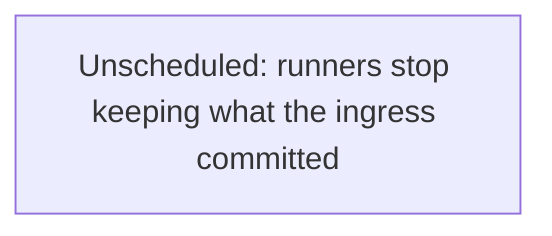

### `RUNNER_JOURNAL_TRIM` — runners stop keeping what the ingress committed

**Unscheduled; the operator's direction, 2026-10-12 PDT: later.** A runner could stop persisting
journal entries its ingress has already acknowledged, behind a flag, with full persistence kept
selectable; the freezer's
[`RUNNER_JOURNAL_SETTLEMENT`](task_freezer.md#runner_journal_settlement--settle-deltas-in-the-runner-journal-too) is the same idea at the delta level. Not designed: what the runner still needs locally (cursors, seal state, entries a
resumed harness or a lost push reads back) once acknowledged entries are gone, including what a revived incarnation reads back
(`SESSION_INCARNATIONS`).

## 11. Coherence refactors

No refactor is open here.

## 12. The Runner Gateway serves the runner's own service

Target and decisions: [History Service plan](history_service.md#decided-operator-2026-10-10-pdt)
(Runner Gateway shape, Session specs). Today `RunnerGateway` wraps every `Runner` call with a
Session registry, spec assembly, readiness checks and seals; these nodes move each job to its owner
until the gateway is the `Connect` listener plus a proxy of `Runner` with per-method authorization.

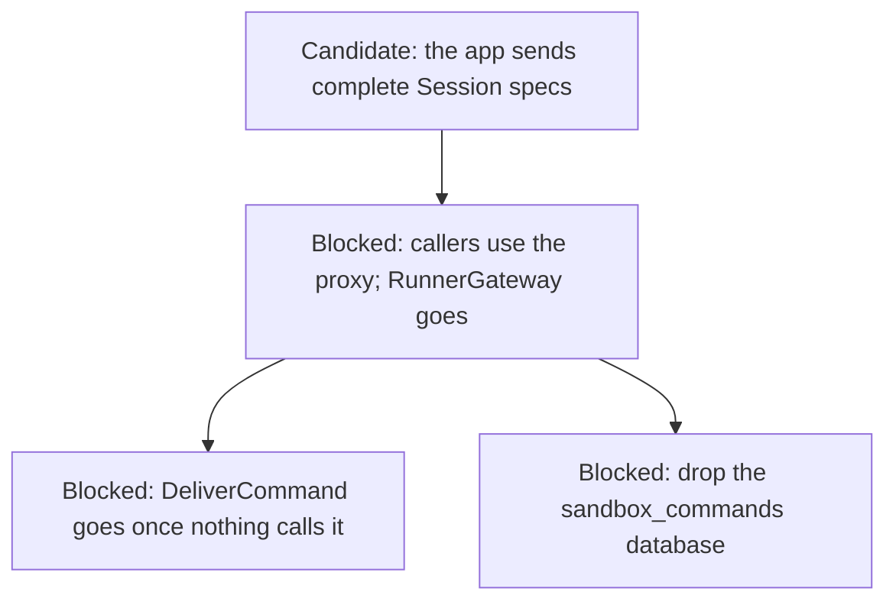

### `APP_SESSION_DEFAULTS` — the app sends complete Session specs

**Candidate; a for-now choice.** The app records which preset a
Sandbox was made from on the Sandbox (a label) and fills a complete `SessionSpec` and setup script
from it. `session_defaults` leaves `SandboxBinding` and our Sandbox's spec (`CreateSandboxRequest` goes with `SANDBOX_SERVICE_REMOVE`),
and `CreateSessionRequest` loses its field mask.

### `PROXY_START_METHODS_DISPATCHER_ONLY` — only the Dispatcher starts or continues work through the proxy

**Blocked on `DISPATCHER_SESSION_CREATE`, `APP_SENDS_VIA_DISPATCHER` and `GATEWAY_WRAPPER_RETIRE`.** Today
the gateway's runner proxy (`runner_gateway/runner_proxy.py`) lets every configured caller account call
every runner method except `Quiesce` and `Seal`, and the gateway wrapper calls `OpenSession` too. The
bound on a suspend waiting for setups (`SuspendPending`, `SANDBOX_IDLE_EXPIRY`) holds only if nothing
but the Dispatcher can open a Session or send work, so the proxy's per-method policy authorizes
`OpenSession` and the other start-or-continue-work methods (`SubmitInput`, `ResumeSession`,
`ChangeModel` and `ChangeReasoningEffort`, which start a stopped harness; operator, 2026-10-13 PDT) for
the Dispatcher's account alone. `InterruptTurn`, `StopRunnerSession` and the reads stay open to the callers
that have them. Order: every other caller has moved to the Dispatcher, then the policy narrows.

### `RUNNER_COMMAND_RPCS` — `DeliverCommand` goes once nothing calls it

**Blocked on `GATEWAY_WRAPPER_RETIRE`; operator, 2026-10-13 PDT: one RPC per command rather than one
taking a union.** The runner serves `SubmitInput`, `ChangeModel`, `ChangeReasoningEffort`,
`InterruptTurn` and `StopRunnerSession` beside `DeliverCommand`, and the proxy admits every method of
`Runner` (it builds its method set from the service descriptor). The only caller left of
`DeliverCommand` is the Runner Gateway's `SubmitCommand` path, which goes with
`GATEWAY_WRAPPER_RETIRE` and needs no split. Then `DeliverCommand`, `Command` as a request type and
`DeliverCommandRequest`/`DeliverCommandResponse` are deleted from `runner_control.proto` once no
pinned caller image sends it (the VM guest's runner wheel is a reader of the new RPCs, not a caller).
The journal's `CommandAdmitted` event keeps storing the `Command` message, so stored history needs no
migration and `Command` stays as that event's field type.

### `GATEWAY_WRAPPER_RETIRE` — callers use the proxy; `RunnerGateway` goes

**Blocked on the nodes above.** The app and the Notification Service
call `Runner` through the proxy and ask the History Service where a Session runs. Delete the
`RunnerGateway` service and proto, its client, `session_registry.py`, `destinations.py`,
`session_lifecycle.py` and `wire.py`. This makes
`GATEWAY_CLIENT_SPLIT` and `SANDBOX_DATABASE_RENAME` moot; delete them here.

### `GATEWAY_DATABASE_DROP` — drop the `sandbox_commands` database

**Blocked on `GATEWAY_WRAPPER_RETIRE`; a data drop, merged by the operator.** Drop the database,
its role, Secret and migration init container once the History Service holds every Session's
Sandbox.

## Scope and retirement of stale gates

- Notifications keep workers in the HTTP service. Retention, worker extraction, idle-polling
  optimization and new-source wiring are frozen with triggers, not hidden release prerequisites.
- Broad provider-matrix exploration is frozen; ordinary auth/signature denial regression coverage
  belongs with the implementation, not an unbounded production checklist.
- Native subsessions and runner durability/thin-adapter redesign remain frozen. Neither the runner
  channel nor multiagent design unfreezes the broader runner-state redesign.
- Existing security boundaries, data-preserving migration checks and representative deployment
  integration checks remain requirements. The freezer is not a waiver for a known data-loss or
  unauthorized-access bug; promote one when evidence makes it concrete.
