# Agentplane task DAG

This is the dispatch map for **unfinished** work. Detailed contracts belong in component plans;
completed work belongs in component docs, not done nodes here. Maintenance rules are in
[AGENTS.md](../AGENTS.md#task-dag-maintenance). Deliberately deferred candidates and conditional
hardening live in the [freezer](task_freezer.md), not the execution graph.

## Current state and scheduling

Audit metadata consumers (`sandbox`, `harness`, `model`, `cwd`, summary/activity fields) before
deleting useful UI projections. Squash Alembic only once the app schema settles.

States: **in flight** means reported work is underway; **decision** needs a reviewed outcome;
**blocked** names prerequisites; **candidate** is dispatchable when selected, not a priority claim.
A **capstone** closes an integrated contract, not another implementation. Solid arrows below are
prerequisites; dashed arrows explicitly label scheduling holds or conditional choices. All service
contracts remain multi-replica unless a reviewed temporary restriction says otherwise.

Dispatch assignments (Rai authorized; Codex reported, 2026-10-15 UTC):

| Worker                        | Assigned work and remaining gates                                                   |
| ----------------------------- | ----------------------------------------------------------------------------------- |
| `suspended_session_inventory` | Finish the protobuf-field and deployment-only CLI/config audit.                     |
| Coordinator                   | Integrate notes cleanup, burn down merged tasks and review rollout and CI evidence. |

Operator priority (2026-10-15 UTC): usable VM Sandboxes in staging and a consistent implementation
without obsolete code, shims or settings. A booted VM or connected runner alone is not the complete
user experience. Finish reported bugs and red PR checks first. The next dispatch order is
verified runner compatibility cleanup, then `K3S_STARTUP_COST`. The per-Sandbox wake-on-message policy and suspended composer are implemented
and deployed. The lifecycle coverage audit found the requested eventual outcomes already covered;
see the [suite coverage](../x/k3s_env/README.md#lifecycle-coverage).
Audit assignment does not waive any image, embedded VM wheel, live-runner or retained-data gate.

These are assignments, not claims that gated work has started. Independent config changes can
proceed while behavior PRs are under review. Publish drafts as soon as a branch has reviewable work,
with remaining gates in the body; Rai merges each PR by hand.

## 1. Session schema and identity follow-up

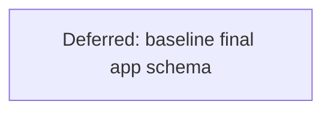

### `APP_ALEMBIC_SQUASH` — consolidate the final app schema

**Deferred by the operator; not dispatchable until selected.** Baseline only the settled schema,
verify fresh and migrated databases and their deployed stamps before pruning old revisions.
Retain the data-preserving rollback procedure. No Action Service or other database squash implied.

## 2. Service-owned command admission and later notification presentation

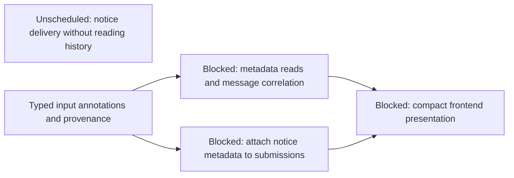

Details: [command admission](../runner_gateway/API.md#sessions-and-commands); later
[notification presentation and input metadata](notification_presentation.md).

### `NOTIFICATION_COMMAND_OUTCOME_DESIGN` — notice delivery without reading conversation history

**Unscheduled; operator, 2026-10-11 PDT: not a priority, needs more thought.** The Notification
Service scans a Session's raw history from the History Service for its own command's admission and
`harness_user_message_confirmed`, and stores one `EventEntry` per notice (`Notice.runner_entry`):
the one service besides the History Service fold that derives state from Session events. A command's
`CommandAdmitted` entry says the runner admitted it, but not that the harness executed it or that
the message reached the model's context; today that needs the history. Decide where that
outcome is recorded before the Notification Service stops reading history.

### `SESSION_INPUT_METADATA` — later typed annotations on input commands

**Unscheduled; operator's lean, 2026-10-12 PDT.**
Typed metadata and restricted trusted producer provenance on input commands, so a notice the
Notification Service sends is not rendered as a user message. The lean: the Runner Gateway stamps
verified provenance on the runner Command, and the runner echoes it into the Event that journals
the input, so it reaches history with the input itself; the gateway keeps no command records.
The field rides `SubmitCommand` as it addresses a Session's Sandbox through `SessionDestination`
(#10129) and is delivered through the replica holding the runner stream. The harness never sees it. Notification-specific authorization
belongs here, not in the generic command-admission path; attachments are invalid on controls. No
untyped extension dictionary.

### `SESSION_INPUT_METADATA_READ` — authorized annotation reads

**Blocked on typed input metadata.** Carry the echoed metadata into the Thread fold, joined to
the message by `origin_command_ids`, including pending and failed inputs and replay, without
requiring a live notification inbox.

### `NOTIFICATION_NOTICE_METADATA` — producer integration

**Blocked on typed input metadata.** Attach notice identity/range metadata using existing delivery
command IDs. Preserve receipt reconciliation and explicit inbox acknowledgement. Verify the backend
path without the app; use automated integration coverage rather than requiring a provider outage.

### `NOTIFICATION_PRESENTATION` — compact notification rendering

**Blocked on producer and metadata read integration.** Compact authenticated notification-only
inputs, expand full text and render mixed human/notice messages normally with annotations. Missing
metadata falls back to text. Include visual coverage and one bounded real-notice check; no inbox
acknowledgement on render and no text-prefix provenance heuristic.

### Subscription authorization before broader sources

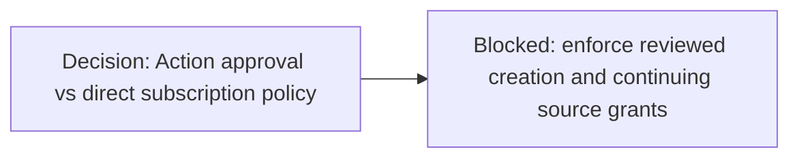

### `SUBSCRIPTION_AUTHORIZATION_DESIGN` — auto-allow and operator-approved subscriptions

**Decision.** Compare an Action-backed subscribe operation using existing auto-allow/operator
approval with authorization inside Notification Service; do not preselect another policy engine.
Review which callers may subscribe to which sources, targets, fields/filters, destinations and
lifetimes, and who can approve/delegate that access. Subscription creation approval is distinct
from continuing source access and from ownership of the destination inbox. Define renewal, scope
expansion, policy changes/revocation and what happens to already-retained entries.

Use Kubernetes as a concrete design case: namespace/resource/UID scope, object/status/event/log
content, name reuse and whether grants delegate the caller's existing read authority or explicitly
allow additional observation. A privileged watcher must not expose arbitrary cluster data merely
because the agent owns an inbox. Review argument examples that auto-allow narrow approved scopes,
require operator approval for additional scopes, and reject requests nobody can delegate. See the
[subscription authorization design](notifications.md#subscription-authorization-and-action-approval).
This is independent of selecting a messaging transport or fixing existing GitHub delivery gaps.

### `SUBSCRIPTION_AUTHORIZATION` — creation gate and continuing enforcement

**Blocked on the authorization decision.** If Actions is selected, implement its subscribe operation
and reviewed policy bindings; otherwise implement the chosen direct policy path. Keep Notification
Service the subscription/delivery authority in either case. Carry verified caller/decision scope
across the service boundary rather than substituting the executor's broad identity. Enforce the
same access contract on direct APIs, renewals and updates; no approval bypass by another endpoint.

Test auto-allow, pending approval, denial, restricted destinations, scope escalation and expiry/
revocation with controlled identities. No entry may be delivered beyond the reviewed source scope;
approval is not permission to wake a Sandbox or execute source content. Future Kubernetes sources
must depend on this contract/enforcement when promoted from the freezer. Ordinary authorized
subscription reads/cancellation and existing GitHub gap recovery need not wait for a broad redesign.

### GitHub notice reliability after missed updates

The operator reports that GitHub updates may sometimes be missed. This is a concrete reliability
concern, not proof that GitHub webhook delivery itself is at fault. Diagnose webhook receipt,
matching, inbox persistence and notice dispatch separately. Do not reopen waived broad provider
outage/refresh exercises; test the specific recovery contract with controlled missing webhooks.

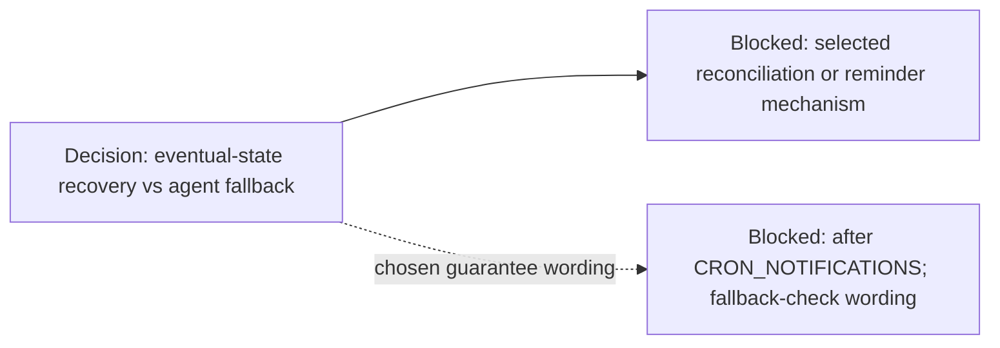

### `GITHUB_NOTICE_RELIABILITY_DESIGN` — delivery guarantee and fallback

**Decision.** Review the gap and choose the guarantee needed for PR shepherding: eventual awareness
of current head/check/review/merge state, or historical delivery of each event. Compare bounded
service-side reconciliation using existing durable shared GitHub refresh state with explicit agent
fallback checks, optionally scheduled reminders. Recommend the smallest reliable path with a stated
staleness bound/cost. A webhook subscription is not proof no changes occurred when it stays silent.
Snapshot polling cannot reconstruct all intermediate events, and a cron reminder alone is not
recovery if no active agent checks state. Detailed alternatives and questions are in the
[notification plan](notifications.md#missed-github-updates-and-shepherding-reliability).

### `GITHUB_NOTIFICATION_RECOVERY` — implement the reviewed recovery contract

**Blocked on the reliability decision.** If service reconciliation is selected, periodically compare
eligible shared subjects with authoritative GitHub state and durably emit deduplicated observations
for uncovered relevant changes. Reuse refresh leases, backoff and access checks; bound API load.
Distinguish observed state from a received webhook; do not fabricate delivery IDs or promise replay
of events the API cannot recover. If agent fallback is selected instead, provide its actual bounded
check/reminder mechanism and explicit limitations rather than just advising agents to remember.
Add `CRON_NOTIFICATIONS` as a prerequisite only if that reviewed implementation actually needs it;
a service refresh deadline need not introduce a general scheduler. Backend workers stay in-process.

Test a suppressed webhook, duplicate webhook/reconciliation races, changed head/check state and
restart/checkpoint recovery with a controlled GitHub peer. Observe one eventual update for the
promised scope, honest access/backoff state and no false claim of complete history. No live GitHub
outage or exhaustive historical event matrix is required.

### `GITHUB_SHEPHERD_GUIDANCE` — explain monitoring limits and completion checks

**Sequenced after `CRON_NOTIFICATIONS`; final wording also follows the decision.** Agents are
asked not just to subscribe to GitHub while waiting (e.g. for CI) but to back the subscription with
a fallback check after N minutes, in case the webhook never delivers. Treat notifications as prompts
to inspect authoritative current PR state, not evidence that the latest head passed or that silence
means no progress. Document the chosen fallback deadline/ownership and how an agent notices
unreliable monitoring. State who runs reminders and that notices do not start a stopped harness.
Guidance accompanies the selected reliability behavior; it must not advertise a polling/reminder
guarantee before that mechanism exists.

## 3. Multiagent decisions before implementations

These are operator-reviewable decisions, not permission to implement every possibility. Drafts can
be developed together, but publish a coherent shared identity/authority vocabulary before downstream
APIs. Do not equate creating a resource, reading history, sending a message or receiving/acking it.

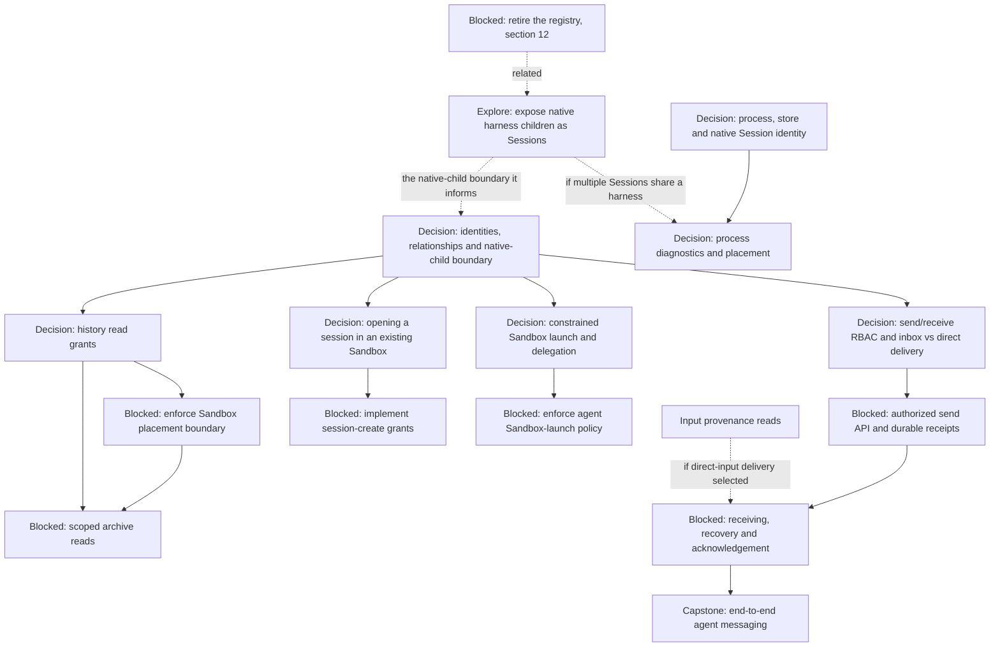

### `MULTIAGENT_MODEL` — shared identity and authority vocabulary

**Decision; no runtime work implied.** Present concrete API examples for independent agents,
Sandboxes and Sessions, with creator, manager and parent/provenance represented separately. Ask
the operator to choose addressing/ownership and delegation semantics. No permission inheritance
from an organizational edge or preset. Review how native harness children could later be ingested:
linked execution in the same Sandbox trust boundary versus independently provisioned Sandboxes,
addressability, observability and which controls must remain unavailable. Native integration itself
stays frozen; this decision must allow explicit exclusion rather than require its implementation.

### `THREAD_READ_POLICY_DESIGN` — scoped history read policy

**Decision; draft in parallel with the shared model.** Review compartments versus exact-session
grants, who classifies/reclassifies histories and grants/revokes access, and caller replacement
semantics. Neither grant model isolates Sessions sharing a Sandbox (see the
[isolation boundary](../docs/thread_layering.md#sandbox-isolation-boundary)). Defaults expose
no existing histories to workloads. Select raw read/list/follow scope; read does not imply
send/create, and no folded-read API is required for v1. Decide how revocation
applies to live feeds, discovery and linked evidence. Do not block this on a messaging transport.

### `SANDBOX_COMPARTMENT_BOUNDARY` — enforce Sandbox placement boundary

**Blocked on the reviewed scoped-read policy.**
The Sandbox is the security isolation boundary: co-resident Sessions share filesystem, credentials,
and ServiceAccount authority, regardless of archive-read classifications. Enforce compatible
placement for any proposed scoped-read policy at Open, adoption and replacement, rejecting
placements whose claimed isolation depends on separating co-resident Sessions. Test shared
filesystem/SA cases and denied placements. Keep VM isolation a separate capability, not a
fictional fix for shared credentials inside one VM. See the
[Sandbox boundary](../docs/thread_layering.md#sandbox-isolation-boundary).

### `THREAD_READ_POLICY` — authorized retained-history access

**Blocked on reviewed read policy and compartment enforcement.** Enforce at
the owning backend across list, raw/native evidence, direct reads and feeds, including reconnect
and revocation. Keep app-only UI folds separate. Test allowed/denied histories, two principals,
deleted Sandboxes and revocation with deterministic service tests plus a bounded deployed auth check.

### `AGENT_MESSAGING_DESIGN` — send and receive contract

**Decision.** Present examples of sender authentication, recipient discovery/opt-in, send grants,
recipient read/ack grants and administration. Compare Notification Service inbox delivery with
direct session input and an existing messaging channel; recommend the smallest fit. Define
accepted, delivered, handled and acknowledged separately; decide offline behavior, retention,
batching, abuse limits and mailbox ownership after Sandbox deletion. Reading a transcript does not
authorize sending or acking.

Output includes the selected owner/API and explicit conditional prerequisites: a direct-input
implementation reuses durable `SubmitCommand` and separately reviewed provenance reads; a notification source reuses
inboxes without treating admission as acknowledgement. Neither branch is selected in this DAG.
Before dispatch, add the chosen branch's edges; do not require implementing both. New Sandbox
Service or app tables require their task-specific contract review. Pure Notification Service work need not
wait for unrelated archive schema once its contract is reviewed.

### `AGENT_MESSAGE_INGRESS` — authorized send and acceptance

**Blocked on messaging decision and its selected prerequisites.** Implement bounded payloads,
server-authenticated sender provenance, per-recipient send policy, idempotent message IDs and honest
acceptance receipts in the chosen authority. Test denied pairs, spoofing and retry/conflict behavior.

### `AGENT_MESSAGE_RECEPTION` — delivery, recovery and acknowledgement

**Blocked on ingress contract/implementation.** Implement selected recipient read/delivery/ack
operations, batching and recovery of unread work. Test revoked/deleted recipients, ordinary offline
catch-up and duplicate delivery without leaking payloads. Do not start/resume a harness implicitly
unless the reviewed caller allowlist and per-Sandbox wake policy allow that sender to wake it.

### `AGENT_MESSAGING` — integrated messaging capstone

**Blocked on ingress and reception.** Demonstrate an authorized pair exchanging a message through
the selected API, with correct provenance and distinct receipt/ack states. Security-negative and
multi-replica retry cases belong in automated tests; no real provider outage requirement.

Control design: [ADR](../docs/adr_sandbox_session_control.md).

### `THREAD_CREATE_POLICY` — authorize session creation separately

**Decision.** Review caller scope to open in an existing Sandbox, accepted defaults, quotas,
creator visibility and revocation. Use the service-reserved Session identity, not a caller-invented
public UUID. Opening in an existing Sandbox grants no isolation from its other Sessions; require a
separate Sandbox when incompatible trust or credentials are needed. Decide whether launch-and-open
is a composition of separate grants, never an implicit read/send/launch permission. This contract
reuse the existing Session Dispatcher durable command queue.

### `THREAD_CREATE_AUTHORIZATION` — implement session-create grants

**Blocked on create policy.** Enforce scope/defaults and idempotent Open
lookup at the service boundary; test forbidden targets/overrides and a lost creation reply.

### `AGENT_LAUNCH_POLICY_DESIGN` — Sandbox launch and delegation policy

**Decision.** Review which callers can use which templates and resource budgets, mounts, images,
secrets, egress and Kubernetes/Action grants; presets are defaults, not authority. A new Sandbox is
required for an independent isolation boundary; adding a Session within one is not. Define manager,
lifetime, parent termination, quota/fanout and revocation without automatic privilege inheritance.
Choose policy ownership and audit records before adding tables. State separately whether the
operation also opens a session; if so, depend on `THREAD_CREATE_AUTHORIZATION` for that composition.

### `AGENT_SANDBOX_LAUNCH` — constrained agent-requested launch

**Blocked on launch policy and idempotent create.** Enforce the reviewed
effective spec and delegation server-side. Test allowed and forbidden launch parameters and
concurrent retries. Reuse the app's create path (the shared Sandbox inventory), not harness-native agent tools. Launch alone
does not grant history read, messaging, credentials or execution of another principal's Actions.

### `RUNNER_HARNESS_OBJECTS_DESIGN` — decide process diagnostics and placement policy

**Conditional design decision; operator, 2026-10-15 PDT.** Evaluate exposing process incarnations as
diagnostic objects with hosted Sessions and status, while the Session API owns public lifecycle
(and a store API exists only if its public need is selected).
Use the merged Codex multi-thread test and Claude's separate-store single-root characterization
alongside `HARNESS_IDENTITY_DESIGN` and `NATIVE_SUBAGENT_EXPOSURE`; do
not assume one Agentplane Session is one process, one persisted store, or one native conversation, or
that every discovered child is independently controllable.

Compare diagnostic process objects with retaining Session-only projections. Process placement
and allocation remain internal, without a public create-Session-on-process API or refusal. Specify
which options and status belong to the process incarnation, persisted store and public Session;
include concurrency, cancellation and failure/restart behavior.
Compare two coherent alternatives: one fixed harness type and persisted store per Runner, with the
process lifecycle coupled to that Runner; or multiple processes and stores per Runner, each
potentially serving multiple Sessions without an arbitrary same-type restriction. Do not retain the
hybrid of one process at a time switching among per-Session stores: it retains store routing while
also forbidding mixed harnesses. A fixed store resolves Session-to-store ambiguity but raises shared
store isolation and concurrency questions and sacrifices mixed Codex/Claude Sessions in one
Sandbox/Runner. Once support for N>1 processes/stores exists, a same-type-only rule adds little
architectural simplification; resource limits and proven harness capabilities still constrain actual
use. Restricting to one later is easier than adding multi-harness identities and routing later; treat
that as a modest migration-flexibility advantage, not a decision.
Use measured interactive-multiplexing and native-child evidence; read-only/discoverable children do
not prove independent interactive control. Stopping one Session in a multiplexed design must not
kill a process still serving other Sessions.
Deliver a recommendation and proposed API shape for review; implementation and migration/retirement
nodes follow only if selected. This does not unfreeze the broader runner durability redesign or
authorize native-subagent implementation.

### `NATIVE_SUBAGENT_EXPOSURE` — evaluate native harness children as Agentplane Sessions

**Explore/plan; operator, 2026-10-15 UTC: no implementation implied.** Now that a Session is one the
runner _declares_ over the [event ingress](../docs/runner_control.md#event-ingress) — the runner pushes
roots and discovered children alike and the History Service index is the record of which exist —
re-test whether Claude Code and Codex can use their own native subagent affordances, and what it takes
to expose those children as Sessions, including **read-only ones an operator can open but cannot send
into**. Deliverable: a written verdict on whether discovery removes the blocker that made
[`NATIVE_SUBAGENT_THREADS`](task_freezer.md#native_subagent_threads--as-linked-agentplane-threads)
deferred, the child states worth projecting, and the control surface that must stay unavailable. Feed
the answer to `MULTIAGENT_MODEL`'s native-child boundary; it does not preempt it.

Two things this must settle rather than assume: the characterization matrix in
[Native discovery](native_session_discovery.md) is still mostly unmeasured (S5-S11 planned), and a
discovered child has no Sandbox, so read-only addressability depends on `THREAD_READ_POLICY_DESIGN`
and `THREAD_CREATE_POLICY` — a child is not "just another Session" for authorization purposes.

**Also in scope: retire the remnants of the dictated model.** The refactor moved Session declaration to
the runner, but the old shape is still load-bearing: `GATEWAY_SESSION_REGISTRY_RETIRE` records that
`session_registry.py` and its rows survive because Gateway `ResumeSession` still reads them, and that
production Dispatcher-opened Sessions are therefore refused by the app's direct-resume path. Treat that
registry and any caller still asking something other than the runner which Sessions exist as this
evaluation's cleanup list — find them as part of the exploration, not as a separate dispatch, and record
each as its own node or as an exit criterion here.

## 4. VM environment phases

The [VM Sandboxes design](../docs/vm_sandboxes.md) holds the provider constraints, and the
[KubeVirt plan](kubevirt_environments.md) the live gates no node below names. Split implementation rather than making “VM support” one indivisible task. This is
an unranked candidate lane, not authorization for local Bazel in current containers. The
[runner control stream](../docs/runner_control.md) settles the dial-out contract VM control networking
builds on; changing connection direction does not move command durability or remove the runner
journal.

Stateful VM contract: our own Sandbox resource
(`kind: pod | vm`) carries both kinds, and both keep their
state on one filesystem PVC per Sandbox that Agentplane owns (section 7). Pods mount it as a volume,
KubeVirt guests through virtiofs. Workspace portability is a separate constraint: retained layouts
must be compatible with the next workload. `STATE_VOLUME_BLOCK` may change state attachment later;
a block StorageClass does not itself make Pod and VM layouts interchangeable. See
[storage layouts](../docs/sandbox_storage.md).

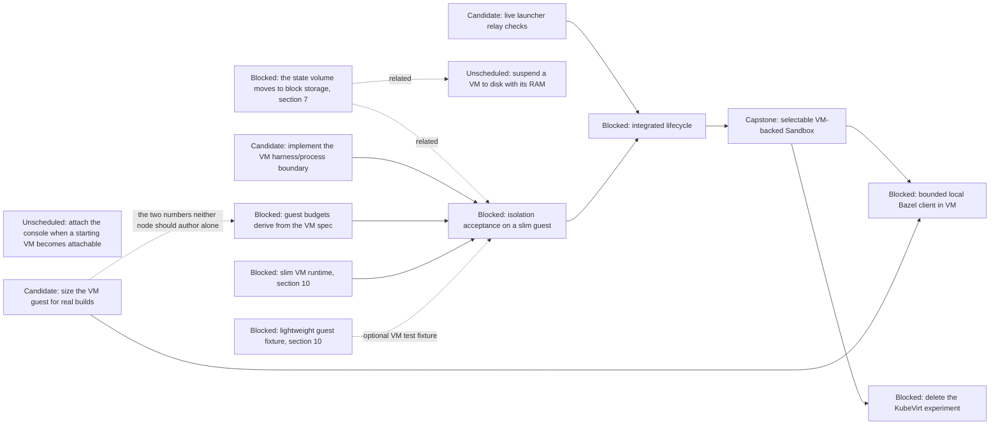

### `VM_EGRESS` — check the launcher relay live

**Candidate.** `agentplane-testing` deploys the launcher relay policy
(`cluster/cdk8s/agentplane/launcher_relay.py`), which copies a runner Pod's egress sidecar, routes and
tokens into the virt-launcher of a VM controlled by one of our Sandboxes. Production VM creation
and outbound control are implemented. Verify the remaining security boundaries: no token reaches
the guest; the proxy and each platform route answer the
guest at `10.0.2.1`; the relay is ready, which needs the VM's masquerade interface to list ports so
kubelet's probe on 3129 is not forwarded to the guest; the runner fence admits the launcher and
another Sandbox's guest cannot reach it; a forged launcher is refused. Do not repeat the entire
completed prototype matrix or require simultaneous cluster-wide disasters.

### `VM_PROCESS_BOUNDARY_IMPL` — implement the VM harness/process boundary

**Candidate; can proceed before VM image slimming.** The guest already configures runner and harness
cgroup budgets (`runner/vm.nix`, `runner/cgroups.py`). Implement the process-visibility and control
boundaries below with focused checks that do not need the final guest image. This directly addresses
agents accidentally killing their own harness; guest or container packaging alone is not that guarantee.

Direction (operator, 2026-10-12 PDT): separate the runner and the harness by what each can see,
not by uid, since every file on the virtiofs state PVC is `107:107` anyway (`STATE_VOLUME_BLOCK` would
end that constraint; revisit the uid choice then). In VMs the runner runs
as guest root under systemd and starts the harness with `systemd-run` as uid 107, in a scope with
`InaccessiblePaths=/state/runner`, write access only to `/state/harness` and the workspace,
`ProtectProc=invisible`, `NoNewPrivileges`, no capabilities, `MemoryMax` and `TasksMax`; the
runner's slice reserves memory. Pods keep today's single container; the strong version there
(runner and harness in separate containers of one pod with no shared process namespace, the harness
mounting only its subpath, started through a launcher on a unix socket in an `emptyDir`) waits
until pods hit the problem. Disk exhaustion is not covered and waits on #4717.

### `VM_PROCESS_ISOLATION` — accept isolation on the lightweight VM guest

**Blocked on `VM_PROCESS_BOUNDARY_IMPL`, `VM_GUEST_BUDGET_DERIVE` and `RUNNER_LAYERING_VM`; operator,
2026-10-15 PDT.** Run the representative tool/harness termination and bounded exhaustion checks after
the lightweight VM guest can boot the runner and harnesses with the tools-heavy image separate. Use the
production process-visibility, filesystem, cgroup and capability settings in that guest; a smaller test
image must not strip the isolation behavior being accepted. `K3S_VM_IMAGE` can supply an automated VM
fixture once it exists, but the k3s test environment is not a prerequisite to accepting the slim
production guest. Verify the existing limits before adding mechanisms, and establish which runner/control
state survives and what needs durable recovery. This is the expensive VM acceptance gate, not a hold on
image-independent design or code.

### `VM_LIFECYCLE` — integrated lifecycle verification

**Blocked on the remaining egress and isolation checks.** Basic VM creation, Session execution,
retained-state suspend/resume and replacement are covered by the [acceptance suite](../acceptance/README.md).
Combine that coverage with the remaining security/isolation results; do not repeat completed live
runs just to assemble a capstone. Additional live faults need a concrete unresolved platform risk,
not a Cartesian product of every component crash and lifecycle operation.

### `SANDBOX_VM_ISOLATION` — VM integration capstone

**Blocked on integrated lifecycle.** Publish the selectable VM environment and measured isolation
limits, with no implied existing-Sandbox conversion or live migration. Component evidence, not
absence of every imaginable failure, establishes the delivered contract.

### `KUBEVIRT_EXPERIMENT_RETIRE` — delete the KubeVirt experiment

**Blocked on the VM capstone.** Once the production provider covers it, move anything still needed
(the acceptance driver, if it becomes the VM lifecycle test) into production code, then delete
`cluster/cdk8s/agentplane/kubevirt_experiment/`, its launcher policy (production's is
`launcher_relay.py`) and the manifests it generates. Review stale draft #8843 for any still-useful
status mapping or validation before closing it unmerged; production VM creation and halted image
replacement already exist, so they are not prerequisites to implement again.

### `VM_RAM_SUSPEND` — suspend a VM to disk with its RAM

**Unscheduled; operator, 2026-10-13 PDT: nice to have.** A stopped VM Sandbox resumes with the memory
it had, not a cold boot, so a quick resume loses no in-memory state. Find what KubeVirt offers (a
memory dump or a snapshot with memory) and whether it works with the state volume (virtiofs today, block under `STATE_VOLUME_BLOCK`). The
[VM Sandboxes design](../docs/vm_sandboxes.md#guest-and-storage) records that a VM supports neither
RAM suspension nor live migration today. Check what a resumed guest must redo: the runner's control stream and
projected tokens (the relay reopens them per request, so rotation alone needs no restart), and the
clock. Settle first what "seal before suspend" means when the harness keeps running across the suspend
(the current quiesce stops harnesses and seals journals). Where storage or the guest cannot carry it, stop/start from the state PVC stays the
lifecycle.

### `VM_CONSOLE_DEFERRED_ATTACH` — attach after VM startup makes the console available

**Unscheduled; lower priority, operator report 2026-10-15 PDT.** During VM startup the console tab
can show `Kubernetes answered 400` and remain disconnected. Treat a not-yet-attachable VM as waiting
and attach when its lifecycle signals readiness, without reopening the tab. Distinguish startup
from authorization failure, deleted VM, and another attached client; clean up on tab exit and never
open competing connections. Keep the existing read-only/no-replay contract. Test the unavailable
→ attachable transition and cancellation; do not add a periodic polling loop or bigger timeout.

Control design: [ADR](../docs/adr_sandbox_session_control.md).

### `LOCAL_BAZEL` — bounded local client in a VM

**Blocked on VM capstone.** Wire Bazelisk, storage and authenticated RBE/cache/BES; set CPU/memory/disk
budgets and cleanup. Run a representative build/test with the client inside the VM and actions
remote; check cancellation/cleanup while the harness stays responsive. Installed tools and working
hosted builds do not authorize local Bazel in agent containers. `VM_GUEST_MEMORY` is a second
prerequisite: no client budget inside the guest is workable until the guest has RAM to budget.

### `VM_GUEST_MEMORY` — size the VM guest for real builds

**Candidate; operator, 2026-10-15 UTC: 8 GiB requested, and one VM per OVH node is acceptable.** Raise
`runner-vm`'s guest RAM from 1536Mi (`cluster/cdk8s/agentplane/runner_vm.py`, still 1536Mi with
`cores: 1` as of 2026-10-15) so a `bbr`/Bazelisk client inside the guest has room to compile.
Acceptance is not "the template says 8 GiB": a Sandbox booted on the new template reports the larger
`MemTotal` in the guest, and a representative `bbr build` and `bbr test` complete in it without the guest
OOM killer firing.

Know where the ceiling is before choosing the number. A guest of `N` costs the launcher Pod roughly
`N + 240Mi` (guest RAM plus QEMU, disk helpers and the relay), so an 8 GiB guest needs about 8.25 Gi
free on a `kubevirt.io/schedulable` node — the 8-core hosts fit one each, the largest host about five.
Measure current free memory rather than trusting that; the operator accepts one VM per 8-core host.
Staging carries **no** `ResourceQuota` or `LimitRange` (`TestingNamespaceResourceLimits` is testing-only,
by design), so nothing refuses an oversized guest here — an unschedulable one just sits `Pending` on
`Insufficient memory` rather than failing fast, which is also why testing's 4Gi container max and quota
have to move with the template or the change fails there instead. The guest sees ~10% less than the
domain is given (1536Mi yields 1383Mi). `cores: 1` is a separate deliberate choice: 8 GiB on one vCPU is
memory-heavy and compute-starved, and `docs/vm_sandboxes.md` records a 1 vCPU guest reading a workspace
disk at a fraction of the rate a build would like.

### `VM_GUEST_BUDGET_DERIVE` — derive the guest's cgroup budgets from the VM's memory

**Blocked on `VM_GUEST_MEMORY`; pair with `VM_PROCESS_ISOLATION`, which owns the boundary and already
cites these files.** Two places set guest budgets as literals while guest RAM is a third number, and
nothing connects them:

- the unit in `agentplane/runner/vm.nix`: `MemoryHigh = "6G"`, `MemoryMax = "7G"`, `CPUQuota = "700%"`,
  `TasksMax = 1024`;
- the delegated groups in `agentplane/runner/cgroups.py`: aggregate `memory.max` 4 GiB with
  `cpu.max` 400000/100000 (4 cores) and `pids.max` 768, per-process 3 GiB / 3 cores / 512.

On this 1536Mi / 1 vCPU guest the unit is live — read `memory.max` 7516192768 and
`cpu.max` 700000 100000 on `agentplane-runner.service`, about 4.5x the whole VM, with
`memory.current` 1085681664 of it already used — so `VM_PROCESS_ISOLATION`'s "verify the existing limits"
step will find that the aggregate group cannot reach its declared 4 GiB and the CPU shares are meaningless
against one core. (The `workloads/` group itself is not readable from inside as the agent user; the 4 GiB
figure is from the source, not observed. Reading it is part of this node.)

Make the guest's own size the input: at boot or in the runner binary, read `MemTotal`/`memory.max` and
the online CPU count, subtract a stated reserve for the guest kernel, journald and virtiofsd, and write
the rest. `runner_vm.py` then carries one number and every budget follows it. Keep the reserve explicit
and testable rather than a magic fraction, and fail loudly if the derived value would leave the runner
less than it needs — the dangerous state is a cap so close to guest RAM that the first over-committed
harness hits the **global** OOM instead of being killed as an identifiable subtree, which is exactly what
`docs/vm_sandboxes.md`'s "Resource boundary" section says these groups exist to prevent. Exit evidence:
one image booted at two guest sizes reports budgets that track it, and a harness that exhausts memory
dies inside its own subtree with the runner still answering RPCs.

## 5. Independent UI and narrowly scoped service work

These candidates need no multiagent or VM decision. Any implementation that turns out to require
app/Sandbox Service database changes requires its own migration safety review.

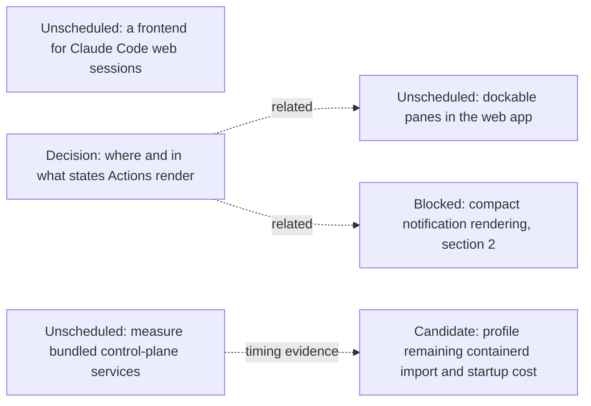

### `ACTION_SURFACES_DESIGN` — where and in what states Actions render

**Decision; operator, 2026-10-13 PDT: rethink it, since it is a patchwork and possibly redundant.**
Decide every place an Action is shown and in which states, then reduce the code to that. Surfaces
found in `app/frontend/actions/` and the service worker: the sidebar rows (collapsed and expanded,
with Approve/Deny only where `canApproveInline` allows), the top "Actions waiting" strip (a count),
the Actions page queue and the detail view (`PendingActionCard`, the full `ActionCall`, with a raw
and a pretty toggle), history, the policy view, and the Web Push notification (formatters in a
registry separate from the React one). Several of them choose independently what to render, whether
to offer a decision, and how tall to let the card grow. Settle which surfaces exist, what each is
for (a glance, a quick decision, full review, a record), and which states each has, so that one
rule decides inline approval and height and each Action type is described once.
Direction (operator, 2026-10-13 PDT): whether a card offers its decision buttons is not a per-kind
allowlist (`QUICK_APPROVALS`); the Action type's own TypeScript implementation decides for each
invocation from its content (for example a read-only call against a listed resource). Also give
each representation and visual element one fixed name and use it everywhere (code, UI copy, docs),
since "quick approve" could mean the buttons on a card or Approve/Deny on a desktop notification.
Proposed vocabulary, to settle with the design: **compact card** (the glance form in the sidebar
and the strip), **full card** (the detail view with the whole `ActionCall`), **card decision
buttons** (Approve/Deny on a compact card), **notification buttons** (Approve/Deny on a Web Push
notification), **attention strip** (the top "Actions waiting" count). `NOTIFICATION_PRESENTATION` (section 2) renders notices on the same surfaces and uses the same card
names. The compact-card
fixes under way (decision buttons on collapsed cards, a height cap, more Actions allowed inline)
land first and need not wait for this.

### `DOCKABLE_PANES` — dockable panes in the web app

**Unscheduled; operator, 2026-10-13 PDT.** Let the operator arrange the app's panes (thread browser,
Actions queue, several threads at once, Action detail) by dragging them into a layout of their own,
with split resizing, a layout that persists, and one selected pane at a time on a phone. Open spike
[#9721](https://github.com/agentydragon/ducktape/pull/9721) builds this as an experimental
`/#/mosaic` shell on `react-mosaic-component`, split-only without tabs, beside the classic routes;
it is stale and is the starting point. Settle whether docking replaces the classic routes or stays
an alternative, and fold the Action tiles into the surfaces `ACTION_SURFACES_DESIGN` settles.

### `CLAUDE_CODE_WEB_BRIDGE` — Claude Code web sessions in Agentplane

**Unscheduled; operator, 2026-10-12 PDT: low priority, not to build now.** Make Agentplane's
frontend a custom frontend for Claude Code web sessions: show their conversations and send them
messages, by shimming the web interface's control protocol. Builds on the viewer and syncer under
`devinfra/` and the reverse-engineering in `agentydragon/gaffer-private`.

### `K3S_STARTUP_COST` — reduce remaining isolated-cluster startup cost

**Candidate; no worker assigned.** Profile remaining containerd import/unpack and deployment
readiness costs, then remove the measured bottleneck using existing Bazel/OCI rules where possible.
The shared Python interpreter layers and matched lifecycle comparison are implemented; evidence
belongs in [the k3s fixture measurements](../x/k3s_env/README.md#lifecycle-measurements).
Preserve assertions and timeouts. The expensive lifecycle workflow stays **manual-only**;
automatic triggers require a separate reviewed change. Language rewrites require Rai's decision.

**Rewrite candidate, operator note, 2026-10-15 PDT:** consider Runner Gateway in Go for
consistency with existing Go components. Its gRPC/protobuf boundaries and generated bindings
make it a promising bounded candidate. First measure its image/startup contribution and
inventory the full contract: stream ownership and forwarding, authentication, Sandbox identity
fencing, cancellation/deadlines and remaining registry persistence. Compare a Go rewrite with
Python packaging improvements; protocol generation alone does not preserve those semantics.
This records a candidate, not authorization to rewrite it. Account for planned wrapper/registry
retirements so a rewrite need not recreate obsolete surfaces.

### `K3S_BUNDLED_SERVICES_SPIKE` — measure a less isolated control plane in real k3s

**Unscheduled spike; operator, 2026-10-15 PDT.** Evaluate running Agentplane control-plane
services together in one Pod to reduce integration-test startup time. Keep real k3s, RBAC
objects, service APIs, databases, controllers and separately managed Sandbox workloads;
exercise the existing end-to-end lifecycle scenarios. Preserve each service's intended
Kubernetes identity and permissions using separate credentials rather than the Pod's union
of service permissions. Explicitly assess how to provide those credentials: a Pod has one
ServiceAccount, so bundling must not silently bypass authorization coverage.

Compare the normal deployment layout with the bundled layout on equivalent inputs and
scenarios. Measure image import/unpack, startup/readiness and total test time separately;
bundling alone does not remove image bytes or process initialization. Record implementation
complexity and coverage lost through shared networking, scheduling, restart and failure
boundaries, including NetworkPolicy isolation. Deliver a measured recommendation to adopt
or discard the reduced mode, with normal-layout coverage retained for those boundaries.
Keep the expensive workflow manual-only; this spike does not authorize a production topology
change, removal of existing coverage or a language rewrite. Keep one documented invocation path
per supported test tier.

### `TESTING_ENVIRONMENT_RETIRE` — retire the stateful testing deployment once coverage replaces it

**Decision: review coverage gaps before any retirement implementation.** Pod lifecycle/Dispatcher tests on
bare k3s do not cover KubeVirt, Cilium, external identity or real service routing. Assign those checks
to an isolated tier or retain their bounded live environment before removing `agentplane-testing`.
Prepare a separate operator-reviewed retirement/data-disposition PR: remove obsolete Flux/deployments,
databases, credentials, RBAC, DNS/network rules and stateful acceptance recipes only after the new
paths are usable by agents and CI. Preserve staging and user-authored data; this node does not authorize
immediate deletion of the testing namespace or its volumes.

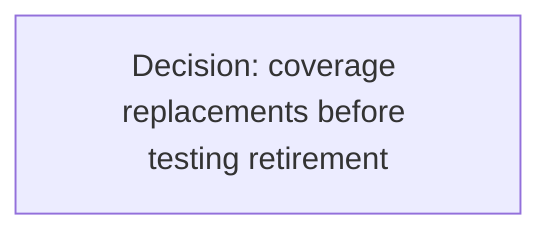

## 6. Existing access and lifecycle follow-ups

These are bounded existing work, not dependencies on the broader multiagent model. Confirm current
source/deployment state with the relevant owner when dispatching; old acceptance notes are not live
observations. New database work follows the task-specific review and rollout requirements.

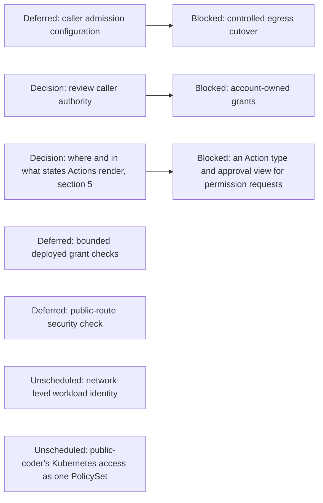

### `PC_EGRESS_CREDENTIALS` — label public-coder's Action Service caller

**Deferred by the operator; not dispatchable until selected.** Admit the intended OpenClaw account to the dedicated
Action Service using its configured namespace and policy bindings. A label alone is not an execution
grant. Coordinate with the owner of the currently disabled/controlled workload before rollout.

### `PC_EGRESS` — public-coder-agent egress migration

**Blocked on caller admission and a controlled deployment.** Compare effective allowed/denied routes,
credential substitution and Action policy against the existing proxy, then do a reversible cutover.
Remove only unused OpenClaw-specific wiring; retain shared Iron/Haku consumers. Do not turn this
into an outage matrix. Source: [public-coder wiring](../../cluster/cdk8s/public_coder/proxy.py).

### `PC_KUBERNETES_POLICY_SET` — public-coder's Kubernetes access as one PolicySet

**Unscheduled; operator, 2026-10-12 PDT: wants it eventually.** Move public-coder-agent's whole set
of RoleBindings and ClusterRoleBindings (logs, pods, node and cluster-metadata reads, VolSync status
and the rest, in `cluster/cdk8s/public_coder/app.py` and its entries in
`cluster/cdk8s/agent_access_profiles.py`) under one `PolicySet` of Kubernetes rules with a Flux-owned
`PolicyBinding`. Open: `PolicyBinding` subjects are ServiceAccounts only, while some of these
grants name the `haku:access-profile:public-coder` Group, so either the binding learns Group
subjects or those grants move to the agent's ServiceAccount.

### `CLAUDE_AI_SA` — review the external caller's actual authority

**Decision.** Review the claude.ai account's Connection and arbitrary-shell Sandbox privileges,
Kubernetes scope and egress/Action grants. Record intended authority in generated configuration,
not ad hoc grants. Test an allowed and denied operation; do not add privileges as part of this review.

### `AGENT_PERMISSION_REQUESTS` — an Action type and approval view for permission requests

**Blocked on `ACTION_SURFACES_DESIGN`; operator, 2026-10-13 PDT:
eventually.** A specific Action type for the request instead of the retired Kubernetes MCP grants
escape hatch, with an approval view that shows the operator the account, the sets and the duration
rather than a blob of Kubernetes YAML. It shares with the app's sandbox-page grants the one path
that writes a `PolicyBinding` for the operator (`EgressAccess.grant`), so an approved request creates
the same kind of binding. How the request renders is the Action surfaces' decision: the approval
view is one Action type described once there.

### `MANAGED_SA_RBAC` — grants for accounts without a Sandbox

**Blocked on the caller review.** The claude.ai caller gets a
Flux-owned `PolicyBinding` of the sets `CLAUDE_AI_SA` approves, of any rule type, replacing its
static per-namespace grants in `agent_access_profiles.py`. Static Group subjects (Haku OIDC;
public-coder until `PC_KUBERNETES_POLICY_SET`) stay Flux bindings. Test an allowed and a denied request. Static caller accounts' bindings, this one among them, are Flux-owned, never Sandbox-owned.

### `SANDBOX_RBAC` — bounded deployed grant checks

**Deferred by the operator; not dispatchable until selected.** Inspect the managed-Sandbox grant path as `PolicySet`s leave it
and verify intended versus unrelated scope, including Role edits and credential-use boundaries,
without recording credentials. Use [agent RBAC](../../cluster/docs/agent_rbac.md) and existing tests;
only unresolved deployed wiring needs a live check, not a repeat of every already-covered operation.

### `NOTIFICATION_INGRESS_BOUNDARY` — bounded public-route security check

**Deferred by the operator; not dispatchable until selected.** Existing tests
cover invalid signatures. Close the remaining route-wiring uncertainty with an unsigned webhook
request and a private-API request through the public hostname: both must be refused, without
creating subscriptions or inbox entries. Record the result once; no exhaustive provider matrix.

### `NETWORK_WORKLOAD_IDENTITY` — network-level workload identity

**Unscheduled; operator, 2026-10-12 PDT: consider later.** Sandboxes and other workloads prove
their identity to Agentplane services at the network layer, with Cilium mutual authentication
(SPIFFE/SPIRE) or a service mesh, instead of a projected token plus an egress proxy hop; services
authorize by SPIFFE ID or workload label. Costs: SPIRE or a mesh to install, Cilium mutual
authentication still in beta, and a second authentication scheme in every service beside projected
tokens.

## 7. Our own Sandbox resource: Sessions that outlive their Pod

A Session and its history are durable. The operator's direction (2026-10-12 PDT):
the way a Session outlives its runner is our own Sandbox resource, which holds the state PVC and
stays in place with no Pod or VM scheduled. A Sandbox is its state, running or not; an
**incarnation** is one Pod or VM. Stopping, replacing the image and starting again keeps the
Sandbox, so keeping the state means keeping the Sandbox, and deleting the Sandbox is the only thing
that deletes it. The same resource carries the VM kind, so section 4's stateful VMs build on these
nodes instead of a parallel track. Today a Session lives as long as its `Sandbox`
(suspension removes the Pod and keeps the state PVC, which goes with the `Sandbox`). The History Service keys by Session, so it can record each incarnation, and a seal closes
an incarnation, not the Session.

A related direction (operator, 2026-10-11 PDT; later, not scheduled): Sessions living in a
long-running, often-suspended Sandbox whose runner image upgrades between incarnations.

```mermaid
flowchart TD
    STATE_VOLUME_BLOCK[Blocked: the state volume moves to block storage]
    NODE_LOCAL_BLOCK_STORAGE[Unscheduled: node-local block volumes on every node]
    VOLUME_LAYOUT_CONVERSION[Unscheduled: explicit offline volume conversion, much later]
    SANDBOX_SPEC_EDIT[Unscheduled: edit a suspended Sandbox's template or kind]
    WORKSPACE_NODE_PORTABILITY[Unscheduled: move a workspace between nodes]
    SANDBOX_ARCHIVE[Unscheduled: a suspended Sandbox archived to object storage]
    AGENT_RESUME_NOTICE[Unscheduled: tell agents when their Sandbox was suspended and resumed]
    SANDBOX_IDLE_EXPIRY[Candidate: suspend idle Sandboxes] -. related .-> AGENT_RESUME_NOTICE
    RUNNER_BUSY_TRACKING -. related .-> AGENT_RESUME_NOTICE
    RUNNER_BUSY_TRACKING[Unscheduled: the runner counts terminals and background processes as busy]
    SESSION_ACTIVITY_STREAM[Unscheduled: the notification service delivers on a Session's idle time]
    PROXY_START_METHODS_DISPATCHER_ONLY[Blocked: only the Dispatcher may start or continue work through the proxy]
    RESUME_CREDENTIALS_VALID[Decision: optional grants versus resume prerequisites]
    NODE_LOCAL_BLOCK_STORAGE --> STATE_VOLUME_BLOCK
    VOLUME_LAYOUT_CONVERSION -. future incompatible edits only .-> SANDBOX_SPEC_EDIT
    WORKSPACE_NODE_PORTABILITY -. related .-> SANDBOX_ARCHIVE
    GATEWAY_WRAPPER_RETIRE[Blocked: callers use the proxy; RunnerGateway goes, section 12] --> PROXY_START_METHODS_DISPATCHER_ONLY
    VM_RAM_SUSPEND[Unscheduled: suspend a VM to disk with its RAM, section 4]
    DISPATCHER_HARNESS_CONFIRMATION[Decision: settle harness-confirmed inputs]
    DISPATCHER_SEND_AUTHORIZATION_GENERALIZE[Deferred: scoped sender grants beyond v0 service trust]
    APP_NATIVE_RESUME_SURFACE[Approved: retain explicit resume UI; clarify wake-off affordance] --> APP_NATIVE_RESUME_CONTRACT[Decision: durable explicit resume]
    APP_NATIVE_RESUME_CONTRACT --> APP_NATIVE_RESUME_CUTOVER[Blocked: migrate direct native resume]
    APP_NATIVE_RESUME_CUTOVER --> PROXY_START_METHODS_DISPATCHER_ONLY
    APP_NATIVE_RESUME_CUTOVER --> GATEWAY_WRAPPER_RETIRE
    STATE_VOLUME_BLOCK --> STATE_VOLUME_VIRTIOFS_RETIRE[Blocked: retire the superseded state attachment]
    SANDBOX_IDLE_EXPIRY --> IDLE_SUSPEND_UI_DRIVE[Operator: drive auto-suspend and send-to-resume in staging]
    VM_RAM_SUSPEND -. the same experience, resuming with memory kept .-> IDLE_SUSPEND_UI_DRIVE
```

### `STATE_VOLUME_BLOCK` — the state volume moves to block storage

**Blocked on `NODE_LOCAL_BLOCK_STORAGE`.** Replace the VM's virtiofs
state attachment with a declared disk layout once suitable node-local storage exists. The state
PVC holds journals and native harness persistence under `/state/sessions`, separately from the
workspace. A disk would remove virtiofs's `107:107` ownership constraint; check all callers before
changing the guest and Pod UIDs. A Pod filesystem mount and a VM disk are not interchangeable just
because the provisioner supports block storage. Specify supported attachments and reject
incompatible kind changes; conversion is deferred, not a prerequisite for fresh provisioning.
Use an explicit incompatible cutoff for existing Sandboxes, in a separate data-drop PR; the
operator accepted dropping them rather than requiring migration. Gate guest behavior on the VM image and its embedded runner wheel, then activate templates.

### `NODE_LOCAL_BLOCK_STORAGE` — node-local block volumes on every node

**Unscheduled; operator, 2026-10-13 PDT.** Extend capacity-enforcing node-local provisioning to
all cluster nodes, tracked by [#4717](https://github.com/agentydragon/ducktape/issues/4717).
`cluster/cdk8s/openebs_lvm/storage.py` already declares Proxmox filesystem and raw-block classes;
that is not coverage of every node. `local-path` does not enforce PVC capacity. Verify capacity,
node affinity and both required volume modes. A node-local volume remains pinned to its node;
moving it is `WORKSPACE_NODE_PORTABILITY`. This provisioner work does not gate Sandbox ownership
or the explicit layout contract for workspace PVCs.

### `STATE_VOLUME_VIRTIOFS_RETIRE` — delete the superseded state attachment

**Blocked on `STATE_VOLUME_BLOCK` acceptance/activation and old workloads gone.** Remove VM state
virtiofs mounts, guest ownership/UID workarounds used only by them, old template paths and tests/docs.
Keep unrelated virtiofs uses where live callers still need them. Verify Pod/VM state persistence on
the selected explicit layouts before retiring the path; data drops stay in a separate cutoff PR.

### `VOLUME_LAYOUT_CONVERSION` — explicit offline volume conversion

**Unscheduled, much later; operator, 2026-10-13 PDT.** Conversion is an accepted future option,
not work for #10440 or a gate on its rollout. Until implemented, incompatible layout changes are
rejected. When scheduled, design a stopped-Sandbox operation with an explicit destination layout,
verified data/metadata preservation, crash-safe binding switch and separately authorized source
cleanup. See [storage layouts](../docs/sandbox_storage.md#formatting-and-conversion). Do not build
a generic conversion framework now.

### `SANDBOX_SPEC_EDIT` — edit a suspended Sandbox's template or kind

**Unscheduled; operator, 2026-10-13 PDT.** Let the operator change a Sandbox's template, including a
switch between VM and Pod, from the app, only while the Sandbox is suspended. Each incarnation
already reads the current template ([controller contract](../sandbox_controller/SPEC.md#vms)); no
spec is replaced automatically; this is the explicit, operator-driven edit. Use the deployed
[workspace layout contract](../docs/sandbox_storage.md) so a compatible kind switch keeps the
workspace. Validate the
retained state and workspace layouts before replacing a workload. Reject incompatible edits;
`VOLUME_LAYOUT_CONVERSION` is a separate, much later task and does not block compatible edits. The
preset the app records on a Sandbox as a label must stay true after the edit.

Control design: [ADR](../docs/adr_sandbox_session_control.md).

### `WORKSPACE_NODE_PORTABILITY` — move a workspace between nodes

**Unscheduled; operator, 2026-10-13 PDT: even later.** A reasonably fast, node-portable workspace, or
node portability by copying: volsync from node to node, through S3 on SeaweedFS or directly, while the
Sandbox is suspended. Node-local volumes stay the default; this only moves them.

### `SANDBOX_ARCHIVE` — a suspended Sandbox archived to object storage

**Unscheduled; operator, 2026-10-13 PDT: a thought that volsync suggests, not a plan.** Resource
affordances for a Sandbox that still exists but whose volumes sit in restic or S3, so it must be
rehydrated before it can start, freeing the node's disk meanwhile. Sandbox status would say that it
is archived and where, and resuming one rehydrates first. Related to `WORKSPACE_NODE_PORTABILITY`,
which shares the copy mechanism. Preserve the declared workspace layout and retained identity;
the runner's state PVC would archive the same way.

Control design: [ADR](../docs/adr_sandbox_session_control.md).

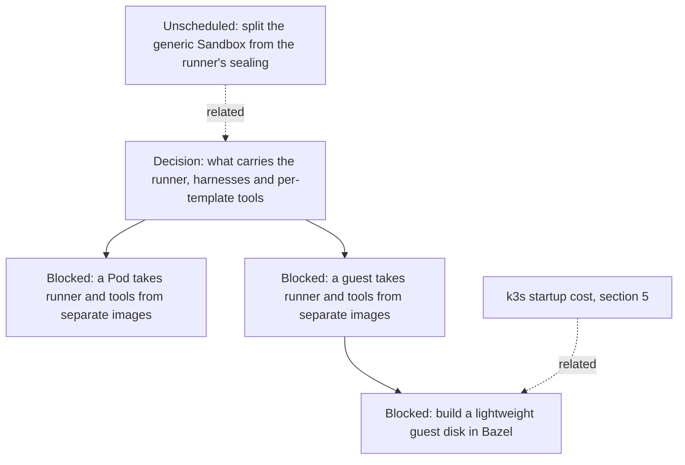

### `SANDBOX_GENERIC_SPLIT` — separate the generic Sandbox from the runner's sealing

**Unscheduled; operator, 2026-10-13 PDT: a later TODO.** Our `Sandbox` resource binds two concerns
together. One is what Agent Sandbox did, plus VM support: a template, a Pod or VM per incarnation,
and a state volume that stays. The other is specific to our runner running inside: sealing a
Session's journal before the incarnation goes. Separated,
the first could be reused without the runner. Decide where the line falls (resource, controller or package) and what each side owns. A
layered pair, a Sandbox and a runner that runs inside one, is the direction the control design
(`docs/adr_sandbox_session_control.md`) points to: seal, runner connectivity and idle suspension
are the runner-aware layer, and the Session Dispatcher sits outside both.

Control design: [ADR](../docs/adr_sandbox_session_control.md).

### `RUNNER_IMAGE_LAYERING_DESIGN` — what carries the runner, the harnesses and the tools

**Decision; operator, 2026-10-13 and 2026-10-15 PDT.** Supersedes `SANDBOX_RUNNER_LAYERING`, which the
operator marked "very low priority unless easy" on 2026-10-13; the 2026-10-15 framing names the property
wanted, so re-rank this node rather than inheriting that ranking. Today one artifact carries everything,
so bumping the runner or a template's installed tools rebuilds and republishes the whole VM:
`agentplane/runner/container-disk.nix` bakes the runner and both harnesses into the NixOS qcow2 that
KubeVirt boots, and `agentplane/runner/image.nix` does the same for the Pod from a wheel pinned in
`nix/artifact-pins.json`. Separate the concerns so a platform user supplies an image or definition with
no runner and no harnesses and the runner side layers them in, and nobody bumps build versions to move a
runner. State which of these the design must satisfy, in order:

- **Independent updates.** Runner and per-template tools move without rebuilding what they sit in.
- **The thing Pods genuinely cannot give** (operator, 2026-10-15): a workload may use a lot of RAM inside
  itself, as a Bazel build does, without starving the host node. A VM reserves its guest RAM, so what the
  guest does stays inside it; a Pod's burst is bounded by what the node has left. Say plainly whether
  layering is meant to reach for that property or whether it stays a VM-only one, because it decides how
  far to go.
- **Additive.** New runtime types are added beside the existing ones, not swapped in, so a runtime can be
  tried without retiring the one that works.

Related to `SANDBOX_GENERIC_SPLIT`: that separates the resource, this separates the image.

**Options worth costing, none chosen.** The operator named the first two; the rest are the field.

- **Extra read-only filesystem image per stage.** Attach the runner and the tools as their own images or
  disks; the base carries neither. Exactly the decoupling asked for, and Claude Code web already does it:
  on its Firecracker guest `/opt/claude-code` and `/opt/env-runner` are separate squashfs disks
  (`/dev/vdb`, `/dev/vdc`) mounted read-only beside a `/dev/vda` root —
  [web container spec](../../devinfra/claude/web_env/docs/container_spec.md).
- **Two-stage guest.** A lean stage 1 boots and runs the runner and mounts a stage 2 filesystem; the
  runner jails a forked child into stage 2 and execs Claude or Codex there. Runner lifetime becomes
  independent of the tool tree, at the cost of a pivot or chroot boundary and the work of trusting a
  mounted image.
- **Stay on KubeVirt, split the disks.** A `containerDisk` is already an OCI image carrying a disk, and
  `runner_vm.py` already attaches `config` and `trust` as separate volumes, so a three-disk guest (root /
  runner and harnesses / tools) needs no new mechanism — only the split. Halted image replacement already
  exists, which is the update path.
- **Kubernetes image volumes.** `imageVolumes` mounts an OCI image's filesystem into a Pod volume; the
  cluster is v1.35, where the feature is GA. This is the direct answer to "this container should mount
  these 2 images", and beats an init-container copy on every incarnation. Check it against the CRI and
  storage class actually in use before relying on it.
- **Init container into a shared volume.** Today's portable form: copy the runner and harnesses from image
  X into an `emptyDir`. Works everywhere; pays copy time and disk each start.
- **Firecracker instead of KubeVirt.** The runtime the operator raised as acceptable if it helps: fast
  boot, small guest, squashfs-friendly, and the shape Claude Code web chose. The cost is a second VMM
  stack beside KubeVirt with no cluster scheduler for it. The RE under `devinfra/claude/web_env/re/` —
  including `process_api/src/firecracker_init.rs` — documents what that guest's init actually does and is
  the closest worked example we hold.

The disk split and Firecracker are not alternatives to each other: splitting disks is additive on the
runtime we have, and Firecracker is a new runtime added beside it.

### `RUNNER_LAYERING_POD` — a Pod takes the runner, harnesses and tools from separate images

**Blocked on the layering decision; pursuable independently of the VM half; operator, 2026-10-15 PDT.**
Give the Pod the same decoupling: the container runs the runner from image X, the harnesses come from X,
and the binaries the agent runs come from a per-template image Y. Options are in the decision node; image
volumes and the init-container copy are the two to try first. Exit evidence: bumping the runner pin
publishes one image, and a Sandbox on the unchanged tools image starts on it.

This does **not** deliver the RAM-headroom property by itself — a Pod still lives inside the node's
allocatable. If the decision makes that property the priority, this node is convenience only and the VM
half carries the requirement.

### `RUNNER_LAYERING_VM` — a guest takes the runner, harnesses and tools from separate images

**Blocked on the layering decision; pursuable independently of the Pod half; operator, 2026-10-15 PDT.**
Split the guest so a runner bump or a template's tool list does not rebuild and repush the whole VM. The
two-stage shape the operator named — lean stage 1 booting the runner and mounting a stage 2 filesystem,
with the runner jailing a forked child into stage 2 to exec Claude/Codex — is one option, with the
squashfs-disk and split-`containerDisk` shapes in the decision node beside it. KubeVirt is not assumed and
Firecracker stays open; what must not change is that the state volume and its ownership rules survive
(`STATE_VOLUME_BLOCK`, and the `107:107` virtiofs constraint). Halted containerDisk replacement already
works, so the update path exists; today it moves a whole guest image, and after this it can move one disk.
The in-guest budgets (`VM_GUEST_BUDGET_DERIVE`) are the other half of the same story — stage 1 owns the
reserve, stage 2 gets the rest.
Deliver a lean bootable guest: a bare root filesystem with the runner and harnesses available from
their chosen layer, and the tools-heavy environment separate. The layering decision still owns exact
disk placement. `VM_PROCESS_ISOLATION` acceptance waits for this slim runtime; the boundary
implementation can proceed independently.

### `K3S_VM_IMAGE` — build a lightweight guest disk in Bazel for the k3s integration test

**Blocked on the VM split; operator, 2026-10-15 PDT.** The k3s spike cannot exercise a VM Sandbox at all:
`agentplane/x/k3s_env/render.py` drops `("SandboxTemplate", "runner-vm")` because the template needs
KubeVirt, and serves schemaless stub `VirtualMachine` kinds only so the controller's cache resolves. So
the VM path has no integration coverage in the disposable environment, and pulling the real guest is
unattractive because `agentplane/runner/container-disk.nix` builds it from a NixOS qcow2 — the heavy
artifact the spike exists to avoid, and one that cannot carry the code under test.

Make the test build a guest disk itself, so it runs the runner **from the tree under test** rather than a
published image. The Pod-side pattern already exists there: `//agentplane/x/k3s_env:runner_image` is
`debian_trixie_slim` plus a `pkg_tar` of the Bazel-pinned Codex and Claude binaries, built with no registry
credential, and the spike's own note records that the Nix-built image is the full-toolbox one. Something of
that shape as an image the test boots — with KubeVirt installed in the spike, or the VM path exercised
against the host's KVM — is the deliverable, not a bigger image. Retain the production guest's
process-isolation configuration if this fixture exercises `VM_PROCESS_ISOLATION`: a lightweight test
must not omit the boundary being accepted.

Worth stating in the design, because it argues past the spike: a Bazel-built guest is worth more than the
test. Once a guest root filesystem is an `oci_image` target, `RUNNER_LAYERING_VM` needs no Nix to build a
candidate runtime, CI can build a guest without Attic, and a runtime experiment becomes an additive target
rather than a second release pipeline. Check `K3S_STARTUP_COST` before adding image weight to that
environment.

### `SANDBOX_IDLE_EXPIRY` — the controller suspends an idle Sandbox

**Candidate; later than cleanup in the operator priority.** The effective-mode reader and
nonblocking Quiesce writer are deployed. Controller retry and runner outage coverage are complete. An idle runner
Sandbox suspends: it is sealed, then the Pod or VM goes, freeing memory and compute, and the Sandbox, its
ServiceAccount, bindings and state PVC stay, so a later resume uses the same PVC. Nothing deletes a
Sandbox on idleness or any timer (operator, 2026-10-13 PDT): only the operator deletes one, through
[the Sandbox lifecycle API](../sandboxes/README.md) and the seal. What a resume gets back of the
workspace follows the declared [storage layout](../docs/sandbox_storage.md). Idle is a Sandbox-level fact: every Session in the Sandbox
is idle. The control design (`docs/adr_sandbox_session_control.md`) puts the policy in the Sandbox
controller: `spec.idleSuspendAfter`, a timer the controller measures from the `idleSince`
fact the runner publishes (the connection Lease facts), so it needs no History Service and
survives a controller restart. Busy covers a delivery under way, the bootstrap, a turn, a command and a setup script. A background or
durable process or an attached terminal does not count (operator, 2026-10-14), so a suspend ends them (`RUNNER_BUSY_TRACKING`). The controller's idle timer does not edit the spec: it
writes `status.suspendedBy: Idle` with the `spec.wakeGeneration` it suspended at. Automatic suspension is
`Quiesce` with `if_idle_since`: the runner refuses it on a token mismatch or when busy (`ABORTED`, as
for a Sandbox already in lameduck; `FAILED_PRECONDITION` is terminal), and there is
no ingress-health gate. Suspension waits for the Sandbox bootstrap and every
Session's setup (running setups are a runner fact; the Sandbox is `Ready` False with reason `SuspendPending`); deletion does not wait. A Sandbox that is quiescing refuses resume. Action Service boxes are `ACTION_BOX_IDLE_REAPER`'s, which
only ever deletes.

Control design: [ADR](../docs/adr_sandbox_session_control.md).

### `IDLE_SUSPEND_UI_DRIVE` — drive auto-suspend and send-to-resume in staging

**Operator, 2026-10-15 UTC: assigned to the operator, not dispatchable to a worker.** A human drives the
whole loop through the staging web app on a real Session and reports what the UI actually does: the
Sandbox goes idle, suspends on its own, and a message typed into the composer reaches that stopped
Session and brings it back end to end. The idle trigger is `SANDBOX_IDLE_EXPIRY`; the suspended composer
and per-Sandbox wake-on-message policy are recorded as implemented and deployed, so this is acceptance of
the pair **as experienced**, not a re-run of their unit coverage or the composer's own rollout checks.

Worth recording during the drive, because automated coverage does not produce it: how long the idle wait
looks from the UI, what the Session and Sandbox render while suspended, whether the default-off wake
policy is legible (queued versus "resume it yourself"), what the user is told afterward and what survived,
and any point where the only way forward is `kubectl`. Log a deployment-specific gap as a node rather than
fixing it mid-drive. Cover a VM Sandbox as well as a Pod one: a VM keeps its state PVC across stop/start
and loses guest-local disks, so it is where a resume that looks successful can still lose something the
user expected back.

Related: [lifecycle coverage](../x/k3s_env/README.md#lifecycle-coverage), and `VM_RAM_SUSPEND` for the
"resume with the memory it had" version of the same experience.

### `AGENT_RESUME_NOTICE` — tell agents when their Sandbox was suspended and resumed

**Unscheduled; operator, 2026-10-13 PDT: it would be good.** An agent whose Sandbox was suspended and
resumed learns nothing of it: its tool processes are gone, a terminal or background process it started
no longer runs, and whether its workspace survived depends on where it lived (the state PVC is kept; a
VM-local disk is not, until `VM_RAM_SUSPEND`). Tell the agent when a new incarnation of its Sandbox
started, how long it was down, what was kept (state PVC, workspace) and what was lost (processes,
terminals). The runner knows the incarnation change; what survives is a fact of the Sandbox's kind and
volumes, and a suspend ends background processes and terminals, which do not count as busy
(`RUNNER_BUSY_TRACKING`). Open: whether the notice is a runner
platform instruction added at harness start, an event the History Service folds into the Session, or a
message through the Dispatcher; and the wording agents act on. Test a suspend and resume with a
background process, a terminal and workspace files, and a crash restart (no suspend) that reads
differently.

Related: [lifecycle coverage](../x/k3s_env/README.md#lifecycle-coverage), `SANDBOX_IDLE_EXPIRY`.

### `RUNNER_BUSY_TRACKING` — the runner counts terminals and background processes as busy

**Unscheduled; operator, 2026-10-14: not now, an open TODO that may be looked at later.** The runner
publishes `idle_since` (`RunnerFacts`), busy while a delivery is under way, the bootstrap runs, or any
Session has a turn, an unfinished command or a setup script. A background or durable process or an
attached terminal or console does not make the Sandbox busy, so an idle suspend ends them. The runner
does not supervise these, so who would report them (the harness adapters, the VM console) is open.
Test an attached terminal that detaches, a background process that outlives a turn, and a runner
restart. `AGENT_RESUME_NOTICE` tells the agent what a suspend ended.

### `SESSION_ACTIVITY_STREAM` — the notification service delivers on a Session's idle time

**Unscheduled.** The History Service folds `idle_since` into `SessionSummary` (the turn and harness
events that start and end idleness), and the app shows it. The notification service currently chooses
when to deliver from its existing quiet window and sends every notice through the Session Dispatcher.
What remains is a second listener: read the Session summary after each `WatchSessionSummaries` notice
and choose to deliver after a minute of idleness, at most ten minutes after the first pending entry.
`idle_since` is display and delivery timing: suspension reads the runner's busy facts (the connection
Lease facts) and never this field. Per-Session idle times stay out of Kubernetes.

Control design: [ADR](../docs/adr_sandbox_session_control.md).

### `DISPATCHER_HARNESS_CONFIRMATION` — settle admitted inputs on a canonical confirmation

**Decision, then bounded implementation.** `HARNESS_CONFIRMED` currently has no writer. Review the canonical runner/history
fact that proves an input reached the harness, consume it idempotently and settle the matching
Dispatch without reading unrelated conversation content. Preserve the distinction between durable
queue acceptance, runner admission and harness confirmation. Test duplicate/replayed facts and
restart. Notification presentation/outcome design remains separate.

### `DISPATCHER_SEND_AUTHORIZATION_GENERALIZE` — replace v0 service trust with scoped sender grants

**Deferred TODO; v0 decision does not block delivery design.** Dispatcher may specifically trust the
App and Notification service identities to act for their users, with wake permission separately
allowlisted. Do not extend that exception to agents or other services. Design destination- and
operation-scoped grants, delegated caller proof and the effect of revocation on queued work before
general senders are admitted. Consider RBAC-backed permissions, but choose the authority with the
multiagent model. Include authorization before wake and any required execution-time recheck. The
mandatory Sandbox UID fence is part of `DELIVERY_DESTINATION_CONTRACT`, independent of sender policy.

### `APP_NATIVE_RESUME_SURFACE` — retain explicit resume and distinguish the two controls

**Explicit native-resume action retained; exact wake-off affordance needs review.** The Thread page
currently shows **Resume harness** only for a Ready Sandbox with a stopped harness. It calls the
Gateway directly. A submitted input always makes Dispatcher call runner `ResumeSession` before
delivery, independent of the `wake_on_send` setting. That opt-in setting controls waking a
**suspended Sandbox**, not whether a command resumes a stopped native harness. The composer can
queue a message while the Sandbox is suspended even when wake on message is off; the queue then
waits for explicit Sandbox resume. The suspended indicator remains visible.

The operator wants an explicit button when automatic resume on send is off. Decide whether this
means a Thread-page **Resume Sandbox** affordance when `wake_on_send` is off, the existing **Resume
harness** action once the Sandbox is Ready, or both. The native button cannot itself wake a
suspended Sandbox because its current Gateway path requires a live runner. Keep explicit Sandbox
resume available and do not erase the suspended indicator or turn on wake permission implicitly.

### `APP_NATIVE_RESUME_CONTRACT` — specify durable explicit native resume

**Decision before implementation.** ADR D4 makes Dispatcher the sole starter of runner work, but
the retained explicit native-resume button still bypasses it. Specify a durable Dispatcher
operation, including caller-chosen retry ID, full destination/UID authority, authorization,
admission before any wake, lost-response retry, and observable outcome. Decide whether it applies
only to a Ready Sandbox or may also wake a suspended one; the existing Sandbox resume API is a
distinct control. Do not add a new RPC or broaden wake grants before this contract is reviewed.

### `APP_NATIVE_RESUME_CUTOVER` — migrate the app's explicit native-resume path

**Blocked on `APP_NATIVE_RESUME_CONTRACT`.** Land the reviewed Dispatcher receiver and pin it
before changing the app caller. Preserve the **Resume harness** action, retained native
identity/history, suspended-state indication and ordinary retries. If the reviewed UX also adds a
Thread-page manual Sandbox wake button, use the separately authorized Sandbox resume path; do not
label a native-harness call as Sandbox wake. Verify the new app image in testing and staging and
external/pinned callers before narrowing Gateway authorization or deleting its legacy receiver.

### `RESUME_CREDENTIALS_VALID` — grants and tokens still valid after a long suspension

**Decision; the [credential audit](../debug/resume_credentials_valid.md) is published in merged #10573.** Are app-created runtime
`PolicyBinding`s optional additive capabilities, or prerequisites for useful resume? The current
app adds independent expiring grants; Sandbox resume does not renew them. Recommend preserving
that additive model: expiry and revocation remain authoritative, with no automatic re-grant.
If required grants are desired, first define their durable identity, missing/expired status and
explicit operator re-grant flow. The audit distinguishes controller-driven expiry from exact
post-deadline denial, and projected-token renewal from grant renewal. Add implementation work only
for a reviewed contract that the code does not already satisfy; do not add an implicit Ready gate.

## 8. Ownership and naming cleanup

Cleanups that leave one database per service and names that say what things are. Each node is one
deployment; edges are the known order. Staging data follows
[staging data preservation](../docs/staging_data_preservation.md): Session identities and history
are irreplaceable, and a node that deletes a column or row stops for the operator.

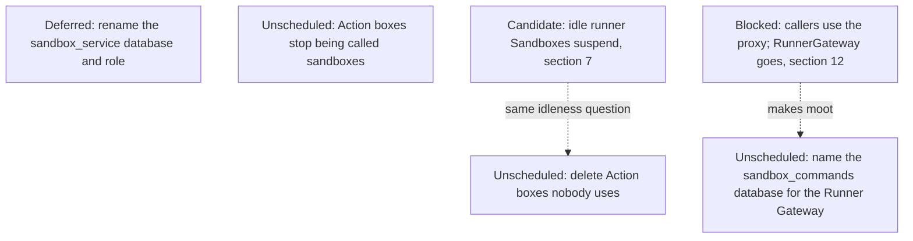

### `HISTORY_DATABASE_RENAME` — name the database for its owner

**Deferred by the operator; not dispatchable until selected.** The old Sandbox Service is gone, but
the `sandbox_service` database, role and `postgres-sandbox-service` Secret remain in use by the
History Service. This is a naming cleanup, not permission to recreate or drop the database. Rename
the database and role in place (`ALTER DATABASE`/`ALTER ROLE ... RENAME`) and have the CNPG
`Database` and managed role adopt the new names; recreating the database under a new name would copy
the log. Verify the History Service and Electric reconnect with no data movement. Update the
`storage/migrate.py` and `cluster/cdk8s/agentplane/history_service.py` docstrings.

### `SANDBOX_DATABASE_RENAME` — name the Runner Gateway's database for it

**Unscheduled; operator, 2026-10-11 PDT: keep the name for now, not urgent.** `sandbox_commands` holds the Runner Gateway's Session registry and command
admission; the Sandbox Service has no database. Rename it and its role and Secret for the gateway
in place, as `HISTORY_DATABASE_RENAME` does, and point the Runner Gateway, its migration init
container and `commands_database_url` at the new names. `database.py`'s comment on
`sandbox_commands` follows.

### `ACTION_BOX_IDLE_REAPER` — delete Action boxes nobody uses

**Unscheduled; operator, 2026-10-11 PDT.** A small controller deletes Action box Pods with no
`exec` for a configured time. The Action Service stamps a last-exec time on the box at each `exec`;
a plain Pod delete is enough, since boxes have no seal. It takes over `TODO(sandbox-lifetime)` in
`action_service/sandbox/inventory.py`; draft [#7859](https://github.com/agentydragon/ducktape/pull/7859)
expired agent-sandbox boxes the same way.

### `ACTION_BOX_RENAME` — Action boxes stop being called sandboxes

**Unscheduled; operator, 2026-10-11 PDT: a later TODO.** Rename what calls an Action Service box a
sandbox, so it no longer reads as a Session Sandbox: the `sandbox__*` Actions,
`action_service/sandbox/`, the `agentplane-sandbox` templates and labels, and
`cluster/cdk8s/agentplane/command_sandbox.py`. The `sandbox__*` tool names are what agents and
external Connections call, so renaming them is a wire change.

## 9. Legacy burn-down

Dead code, finished gates, compatibility shims and stale names found by the 2026-10-10 PDT audit of
devel. A gate counts as legacy once its rollout is finished on both testing and staging or nothing
reads it; the delta settlement flag stays (operator, 2026-10-13 PDT). Lane named per
node; leftovers of in-flight work belong to the lane already changing that code. Upstream-gated
tombstones with a verifiable condition in code (`keepingOffset` in
`thread_store.tsx`, the jsdom pragma in `markdown.test.tsx`) need no node.

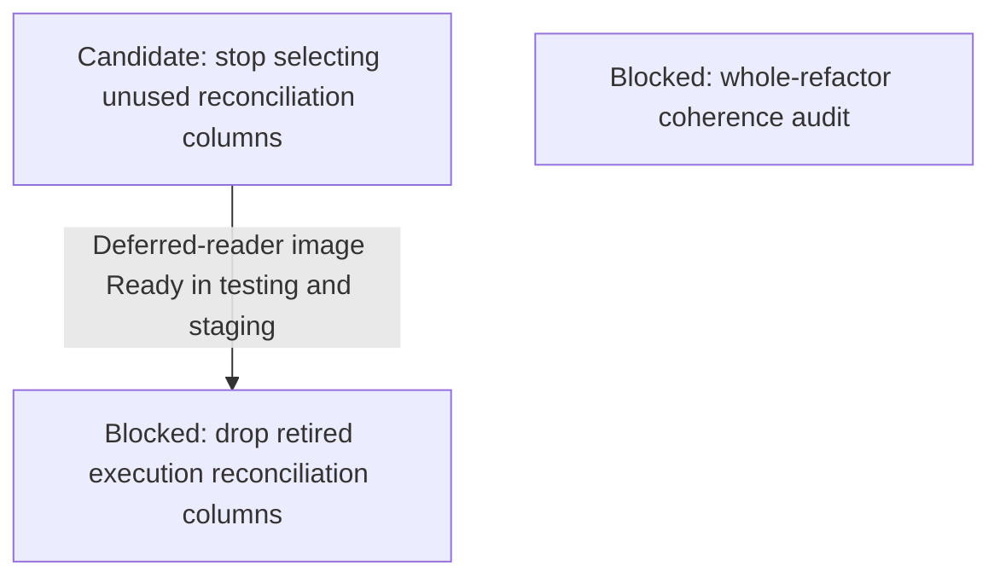

### `ACTION_EXECUTION_AUDIT_COLUMNS_READ_RETIRE` — stop selecting unused reconciliation columns

**Candidate; the writer-free Action Service image `devel-20261015233822-b8b2ba1` is Ready in testing
(1/1) and staging (2/2), 2026-10-15 UTC.** The ORM still selects both unused columns by default.
Mark them deferred while retaining their mappings, then wait for that image in both environments
before dropping them. This read-removal rollout keeps existing replicas compatible while the
migration runner still requires exact schema/model agreement.

### `ACTION_EXECUTION_AUDIT_COLUMNS_DROP` — drop retired reconciliation columns

**Blocked on** `ACTION_EXECUTION_AUDIT_COLUMNS_READ_RETIRE` reaching both testing and staging. In a
separate PR, add a new migration that drops `reconciliation_source` and `reconciled_by`, then remove
their deferred ORM mappings. Preserve `reconciled_at` and the late-completion behavior.

### `REFACTOR_COHERENCE_AUDIT` — the refactor reads as one design

**Blocked on the cutover's retirements and the split**, which remove the
transitional pieces the other nodes name. Sweep devel for unused modules, functions, settings, proto
fields, tables and columns; one name per concept across code, settings, manifests, protos and docs
(Runner Gateway, History Service, ingress, control; Session for the raw stream,
Thread for its projection; no "hub", "follow" or "shadow" left); READMEs, `SPEC.md` files and
`docs/` describing the code as it is, without cutover narration; no compatibility branch,
optional-with-fallback setting or `CLEANUP` tombstone whose condition is met; the system diagram in
`agentplane/README.md` showing exactly the deployed services and the traffic between them in
`cluster/cdk8s/agentplane`. Known now: the test-only `PostgresListener.wait_until_disconnected`
(`connected` turns false before the termination callback runs, so its tests cannot wait on
`connected` instead); egress and app test support each build a throwaway CA;
`cluster/cdk8s/agentplane/kubevirt_experiment` is an experiment outside `x/`. Findings are fixed in
PRs of their own; this node leaves with the last of them.

## 10. Runner ingress and control split

Target and decisions: [History Service plan](history_service.md#target). The runner keeps dialing
out, but to two endpoints its Sandbox names: an **ingress** it pushes its journal's Events to, and
a **control endpoint** (the Runner Gateway) whose stream it holds for commands, receipts and lifecycle
requests. The History Service is the ingress when history is kept. The contract is
[runner control stream § Event ingress](../docs/runner_control.md#event-ingress); it replaces following the
runner through the Sandbox Service.

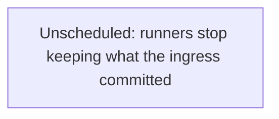

### `RUNNER_JOURNAL_TRIM` — runners stop keeping what the ingress committed

**Unscheduled; the operator's direction, 2026-10-12 PDT: later.** A runner could stop persisting
journal entries its ingress has already acknowledged, behind a flag, with full persistence kept
selectable; the freezer's
[`RUNNER_JOURNAL_SETTLEMENT`](task_freezer.md#runner_journal_settlement--settle-deltas-in-the-runner-journal-too) is the same idea at the delta level. Not designed: what the runner still needs locally (cursors, seal state, entries a
resumed harness or a lost push reads back) once acknowledged entries are gone, including what a revived incarnation reads back
(the retained incarnation history).

## 11. Coherence refactors

No refactor is open here.

## 12. The Runner Gateway serves the runner's own service

Target and decisions: [History Service plan](history_service.md#decided-operator-2026-10-10-pdt)
(Runner Gateway shape, Session specs). Today `RunnerGateway` wraps every `Runner` call with a
Session registry, spec assembly, readiness checks and seals; these nodes move each job to its owner
until the gateway is the `Connect` listener plus a proxy of `Runner` with per-method authorization.

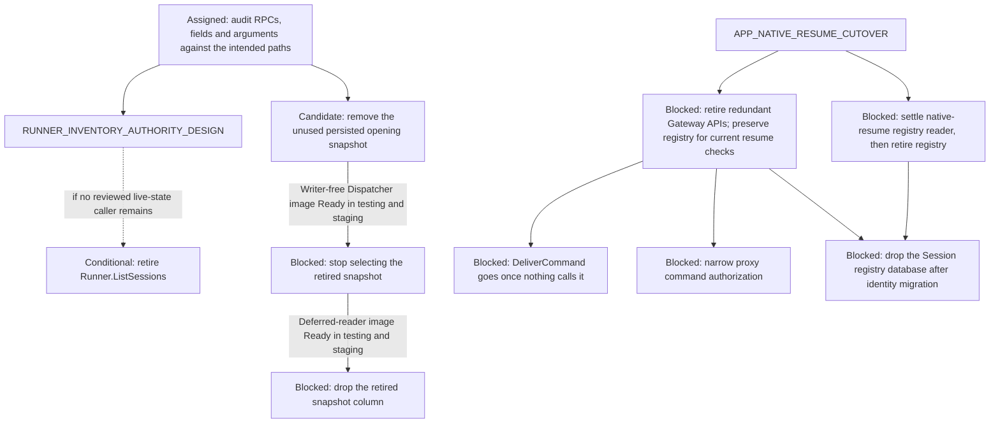

### `CONTROL_SURFACE_RETIREMENT_AUDIT` — converge RPCs, fields and arguments on the intended paths

**In flight; `suspended_session_inventory`, 2026-10-15 UTC.** The control-path inventory and
confirmed RPC caller audit are recorded in [the control-surface audit](../docs/control_surface_retirement.md);
the protobuf-field and deployment-only CLI/config review remains. Sweep Agentplane's protobuf services/messages,
HTTP routes/client helpers, CLI arguments, settings/config keys and their producers/consumers.
Start from the system overview: whenever two paths accomplish the same operation, ask why both
exist. Trace their callers, authority and failure semantics; document a concrete reason for
intentional coexistence, or identify the canonical path and the migration/removal of the other.
Different transport names alone do not justify duplicate ways to perform the same work.
Compare each with the decided owners: Dispatcher for starting/continuing Session work, History
for retained inventory/history, controller for Sandbox reconciliation, and runner proxy only for
operations that still belong at the runner. Include both `RunnerGateway.ListSessions` and
`Runner.ListSessions`; migrating a wrapper call to the proxy is not proof that the underlying RPC
should survive.

Deliver an evidence-backed inventory in component docs: surface, purpose, real callers and writers,
intended replacement, keep/migrate/delete/decision disposition, and removal prerequisites. Trace
tests, generated schemas/clients, deployment config, templates and VM wheels as well as production
code; distinguish real runtime callers from fixtures. Audit obsolete request/response fields,
duplicated command envelopes, identity/default overrides and accepted-unused flags, not just RPC
names. Do not infer that a field is dead merely because one client omits it or stale data still
contains it.

Create specific unfinished migration/retirement nodes for confirmed findings, through deletion of
old clients, receiver methods, fields, settings, BUILD targets and obsolete tests. Keep pending
contract decisions explicit. Receiver removal waits for all caller images; writer changes wait
for compatible readers, including separately pinned guest wheels. Stored-data removal is separate
and owner-approved, with authored data preserved. Batch straightforward dead-surface cleanup;
separate behavior changes and data drops. This audit does not block already-specified independent
migrations or authorize broad compatibility shims, language rewrites or speculative replacement RPCs.

### `RUNNER_LIST_SESSIONS_RETIRE` — retire live inventory only if its reviewed purposes no longer need it

**Blocked on the surface audit's disposition and migration of its remaining real callers.** The
Sandbox table uses retained History inventory. App archive safety/native resume and Notification
membership still use live runner inventory; app and Notification now reach `Runner.ListSessions`
through the per-Sandbox proxy with expected Sandbox UID and owner metadata (#10619), and their caller
plus receiver images are deployed in both environments. Test drivers also use the read to order
Quiesce assertions. The Dispatcher now relies on `OpenSession` to return the existing attachment for an
identical retry and propagates `ALREADY_EXISTS` for a conflicting spec or setup; it no longer calls
`Runner.ListSessions` for opening. History's retained harness state and namespace/name association do
not preserve authoritative live state or Sandbox UID/owner checks. App archive safety needs current
harness state; explicit native resume needs the current runner's Session and spec; Notification checks
destination membership at subscription time. Migrate remaining callers with their
live-state and identity requirements intact, then migrate tests and verify pinned caller images before
removing the runner method/messages and helpers via normal generation. The Gateway wrapper may retire
even if a narrowly justified runner live read remains; record that decision and remove this conditional
node if so.

### `DISPATCHER_OPENING_ATTACHED_RETIRE` — remove the unused opening snapshot from the API and writer

**Candidate; identified by `CONTROL_SURFACE_RETIREMENT_AUDIT`.** The Dispatcher copies the runner's
`OpenSession` snapshot into `SessionOpening` and its database row. The app's HTTP response forwards
the protobuf shape, but the pinned app image reads only opening state and reason; the frontend type
had an unused `attached` property. The only semantic consumer was the acceptance client, now moved to
History's Thread projection. Remove the response field and stop persisting the snapshot, while
keeping its database mapping until the writer-free Dispatcher image is Ready in both environments.

### `DISPATCHER_OPENING_ATTACHED_READ_RETIRE` — stop selecting the unused opening snapshot column

**Blocked on** `DISPATCHER_OPENING_ATTACHED_RETIRE` reaching both testing and staging. Defer the
mapped column while retaining it in metadata; Dispatcher reads otherwise select every mapped column.
Wait for the deferred-reader image in both environments before dropping the column, because the
migration runs before old pods drain during a rolling deployment.

### `DISPATCHER_OPENING_ATTACHED_COLUMN_DROP` — drop the unused opening snapshot column

**Blocked on** `DISPATCHER_OPENING_ATTACHED_READ_RETIRE` reaching both testing and staging. In a
separate PR, add a migration to drop `session_opening.attached` and remove the deferred mapping.
Preserve each opening's Session ID, Sandbox identity, state, reason and timestamps.

### `PROXY_START_METHODS_DISPATCHER_ONLY` — only the Dispatcher starts or continues work through the proxy

**Blocked on the Dispatcher-only app image rollout, `APP_NATIVE_RESUME_CUTOVER`,
`GATEWAY_WRAPPER_RETIRE`,
with their caller images pinned in both environments.** Today
the gateway's runner proxy (`runner_gateway/runner_proxy.py`) lets every configured caller account call
every runner method except `Quiesce` and `Seal`, and the gateway wrapper calls `OpenSession` too. The
bound on a suspend waiting for setups (`SuspendPending`, `SANDBOX_IDLE_EXPIRY`) holds only if nothing
but the Dispatcher can open a Session or send work, so the proxy's per-method policy authorizes
`OpenSession` and the other start-or-continue-work methods (`SubmitInput`, `ResumeSession`,
`ChangeModel` and `ChangeReasoningEffort`, which start a stopped harness; operator, 2026-10-13 PDT) for
the Dispatcher's account alone. `InterruptTurn`, `StopRunnerSession` and the reads stay open to the callers
that have them. Order: every other caller has moved to the Dispatcher, then the policy narrows.

### `RUNNER_COMMAND_RPCS` — `DeliverCommand` goes once nothing calls it

**Blocked on `GATEWAY_WRAPPER_RETIRE`; operator, 2026-10-13 PDT: one RPC per command rather than one
taking a union.** The runner serves `SubmitInput`, `ChangeModel`, `ChangeReasoningEffort`,
`InterruptTurn` and `StopRunnerSession` beside `DeliverCommand`, and the proxy admits every method of
`Runner` (it builds its method set from the service descriptor). The only caller left of
`DeliverCommand` is the Runner Gateway's `SubmitCommand` path, which goes with
`GATEWAY_WRAPPER_RETIRE` and needs no split. Then `DeliverCommand`, `Command` as a request type and
`DeliverCommandRequest`/`DeliverCommandResponse` are deleted from `runner_control.proto` once no
pinned caller image sends it (the VM guest's runner wheel is a reader of the new RPCs, not a caller).
The journal's `CommandAdmitted` event keeps storing the `Command` message, so stored history needs no
migration and `Command` stays as that event's field type.

### `GATEWAY_WRAPPER_RETIRE` — retire redundant live operations; retain placement registry

**Blocked on the explicit native-resume caller migration, the corresponding app image rollout and external/
pinned-caller review for the remaining Gateway methods.** #10619 moved app archive and Notification
membership reads to the per-Sandbox proxy; the `agentplane-app`, `agentplane-notifications` and
`agentplane-runner-gateway` images tagged `...-354a3e0` are Ready in testing and staging. Those reads
are complete, while the Runner `ListSessions` method remains under `RUNNER_LIST_SESSIONS_RETIRE` for
live inventory consumers. App and notification command sends go through Dispatcher. Retire Gateway
`CreateSession`, `ResumeSession` and `SubmitCommand` only after their caller gates.
`BatchGetSessionSandboxes` has no production in-repo caller; remove it with the registry API only
after external/pinned caller review. Preserve
`session_registry.py` and its database while `ResumeSession` still reads it: only Gateway
`CreateSession` writes rows, so the app's current direct-resume path refuses Dispatcher-opened
Sessions. Keep the runner control stream and proxy. Removing redundant Gateway APIs does not make
`SANDBOX_DATABASE_RENAME` moot while the registry remains.
Remove the `RunnerGatewayClient.command` helper and Notification's `command_admission_timeout_s` and
`lifecycle_timeout_s` settings with the old command/resume methods after checking pinned callers;
remove the app's `runner_gateway_lifecycle_timeout_s` only after the explicit resume caller moves.
Retire the app's unused Gateway API channel/target after pinned-client review; its token and the
separate Sandbox control target still serve live runner reads. Remove strict config keys from
manifests before deleting their settings readers.

### `GATEWAY_SESSION_REGISTRY_RETIRE` — retire registry consumers only after resume review

**Blocked on `APP_NATIVE_RESUME_CUTOVER`, wrapper callers and external/pinned clients.** The app no
longer calls `BatchGetSessionSandboxes`: it routes direct native resume using the History-backed
Sandbox name and a live runner list. `SandboxRunner.resume` still calls Gateway `ResumeSession`,
which requires a `session_registry` row for that Sandbox UID. Only Gateway `CreateSession` writes
the registry; production openings use Dispatcher, so their direct-resume path is currently refused.
Migrate the retained explicit action to the reviewed Dispatcher contract, preserving UID and owner
checks, before removing Gateway `ResumeSession` or its registry reader.
`BatchGetSessionSandboxes` has no production in-repo caller; confirm external/pinned use before
removing its method, client helper and `SessionSandbox` wire shape. Retain the registry and its data
until all live readers/writers are retired and
the separate operator-approved `GATEWAY_DATABASE_DROP`; never infer a missing UID from a same-name
Sandbox.

### `GATEWAY_DATABASE_DROP` — drop the `sandbox_commands` database

**Blocked on `GATEWAY_WRAPPER_RETIRE` and `GATEWAY_SESSION_REGISTRY_RETIRE`; a data drop, merged by the operator.** Drop the database,
its role, Secret, migration init container, old models/migrations and image publication wiring once
the History Service holds every Session's Sandbox and all pinned gateways have stopped reading or
writing this database. First remove strict config keys from manifests with an accepting receiver;
only after that rollout delete their settings readers. This remains a separate data-drop PR.

## 13. Namespace-local Kubernetes object names

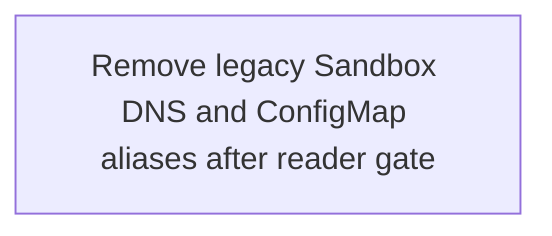

The stateless namespace-local naming cleanup is complete. Services, Deployments, ServiceAccounts,
ConfigMaps, HTTPRoutes, monitors, PodDisruptionBudgets, and remaining safe local network and RBAC
objects now use names that do not repeat their `agentplane-*` namespace. References and generated
manifests moved with them. Secret and credential names, PolicySets, database resources, Flux
Kustomization identities, token audiences, and other durable auth or data identities retain their
established names.

The rename keeps the prior DNS names as Service aliases and mirrors the runner platform-instructions,
tool-config, and VM-config ConfigMaps at their old names. Persisted Sandbox specs and already-running
Pods or VMs can retain those references after a template update; the aliases point at the current
services and config data. Runner Pod labels also keep their prior value so existing incarnations
remain covered by the network fences.

### `AGENTPLANE_LEGACY_RUNTIME_ALIASES_RETIRE` — remove old Sandbox runtime references

**Blocked on a read-only rollout inventory showing no running Sandbox Pod or VM, and no persisted
Sandbox/template spec that can still start an incarnation, references the old Service DNS or
ConfigMap names.** Do not delete or force-recreate Sandboxes to clear this gate. Once every old
incarnation and stored spec has naturally moved or gone, remove the legacy Service aliases and the
three ConfigMap mirrors together with their compatibility tests and reader permissions. Until then,
they are required runtime compatibility for user-owned Sandbox state, not unfinished canonical
naming.

## Scope and retirement of stale gates

- Notifications keep workers in the HTTP service. Retention, worker extraction, idle-polling
  optimization and new-source wiring are frozen with triggers, not hidden release prerequisites.
- Broad provider-matrix exploration is frozen; ordinary auth/signature denial regression coverage
  belongs with the implementation, not an unbounded production checklist.
- Native subsessions and runner durability/thin-adapter redesign remain frozen. Neither the runner
  channel nor multiagent design unfreezes the broader runner-state redesign.
- Existing security boundaries, data-preserving migration checks and representative deployment
  integration checks remain requirements. The freezer is not a waiver for a known data-loss or
  unauthorized-access bug; promote one when evidence makes it concrete.

## 14. Delivery boundaries, APIs and harness identity

These are operator-reviewable design and characterization tasks. They do not authorize a queue,
database, transport, identity or permission change. Detailed code paths and alternatives are in the
[delivery and harness design note](../docs/runner_delivery_and_harness_design.md).

**Approved transport direction (operator, 2026-10-15 UTC):** gRPC for internal APIs,
gRPC-Gateway for the generated HTTP/JSON facade, and an ergonomic CLI, adopted incrementally by
service and interface. Use JSON server streams for watches/waits and native gRPC for full duplex.
Facade integration, individual service migrations, and the CLI workflow contract remain separate work
items below; this direction does not authorize runtime changes.

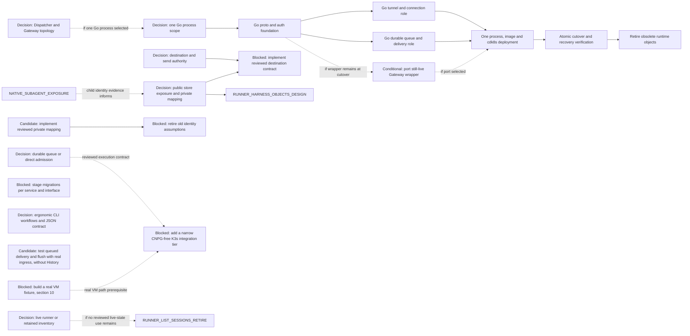

### `DISPATCHER_PERSISTENCE_MODEL_DESIGN` — choose durable queue or direct runner admission contract

**Candidate decision.** Compare the current PostgreSQL-backed queue with direct runner admission.
One evaluation goal is whether a useful Agentplane deployment can run without CNPG, potentially
with runner-local persistence; inventory every other database consumer and say which state/feature
can be omitted, moved or still requires a database.
For direct admission, require an available runner and reject while it is unavailable or suspended;
direct admission must not wake-to-deliver or wait through long VM/image startup. The durable queue is
the only mode that may retain work and own wake-to-deliver. For wake-on-send, persist the complete
destination tuple, command ID and payload before reporting durable queue acceptance or initiating
wake; retain it across caller disconnect, Dispatcher restart and the full image-pull/boot delay.
Distinguish that queue receipt from later Runner admission. A lost direct-admission reply is unknown,
not rejection: retry the same idempotency key while the runner journal is retained. Runner storage
loss is terminal for runner-owned state; there is no requirement to reconstruct it from a queue or
History, and this does not imply separately retained History was also lost. Cover per-Session ordering,
cancellation, duplicate opens, sender and replica failure, and retries. Runner-local persistence
protects work only after the runner has committed admission; it does not accept work while that runner
is absent. Inventory all database owners before making any CNPG claim: the shared cluster also serves `app`, `sandbox_commands`,
`sandbox_service`, `actions`, `egress`, `notifications` and the Dispatcher; Indexing has a separate
PostgreSQL dependency.

**Recommendation for review:** preserve the queue's durable acceptance and wake-to-deliver contract.
If a direct mode is considered, keep it a separate online-only contract with explicit idempotent
retry semantics and no implicit wake. Question: keep the queue, change its durable owner, or add a
narrower direct mode? Do not implement a direct-RPC replacement from this design task alone.

### `CNPG_FREE_K3S_INTEGRATION_TIER` — add a narrow database-independent integration tier

**Blocked on the reviewed execution-persistence contract, actual removal of execution-database
dependencies from the flows under test, and the real VM fixture.** Add a K3s integration tier for
independently usable, loosely coupled Agentplane components; it is not a full-stack parity
environment or a replacement for CNPG. Exercise only flows that can run without the removed
dependencies. The tier may omit Notifications, History, Electric, the CNPG operator and PostgreSQL,
without requiring those absent services' behavior in this suite or implying that every other service
is database-free.

Cover Pod and VM runner flows, adding test ingress where a selected flow needs it. Require a real
supported VM fixture via `K3S_VM_IMAGE`; schemaless VirtualMachine CRD stubs in the existing k3s
suite are not VM execution coverage. Keep this test target separate from runtime database removal;
scope its included flows, omitted services and remaining state owners explicitly. A direct-admission
contract, if selected, remains online-only and does not wake suspended Sandboxes; the durable-queue
mode remains the owner of wake-to-deliver.

### `RUNNER_DELIVERY_INGRESS_ACCEPTANCE` — test queued delivery and flush without History

**Candidate.** Add a focused integration target that retains PostgreSQL for the Session Dispatcher
queue but omits the History Service. The test owns a small real `RunnerIngress` endpoint, drives the
Session Dispatcher API, and waits for the runner's journal receipt at that endpoint. Correlate the
command by Session ID and command ID, exercise ingress cursor acknowledgements, and assert Quiesce
reports `QUIESCED` only after the exact sealed cursor is acknowledged. Do not replace the real runner
ingress protocol with a direct runner-control stub or require History folds, archive reads or Electric
projection. This no-History scenario is independent of the fully CNPG-free tier below: it still uses
the PostgreSQL-backed queue and does not imply that the Dispatcher database can be omitted.

### `DISPATCHER_GATEWAY_TOPOLOGY_DESIGN` — decide where delivery and runner connection roles live

**Candidate decision, independent of `DISPATCHER_PERSISTENCE_MODEL_DESIGN`.** Since current delivery
crosses both Dispatcher and Gateway in sequence, compare separate services, co-location in one
deployment/process with distinct APIs and state
ownership, and a genuinely merged service. Trace all actual interlocutors and credentials, not just
the sequential Dispatcher-to-Gateway delivery path. Compare failure domains, replica routing,
rollout, authorization, recovery and scaling with today's PostgreSQL queue retained. “Merge” must say
whether it changes API, deployment or state owner; these are independent choices.

**Concrete candidate for review:** one deployment/process serves separate Dispatcher sender API,
per-Sandbox proxy and runner Connect listeners while retaining the queue database, delivery
ownership and Gateway connection ownership as distinct state. App/Notification live reads,
controller Quiesce and runner Connect remain independent Gateway callers; runner journal ingress
still goes to History. A queue worker and connection holder can be on different replicas, so the
per-Sandbox control Service and its EndpointSlice cannot disappear from co-location alone. The
[delivery design note](../docs/runner_delivery_and_harness_design.md#delivery-service-and-persistence-alternatives)
details the credential, Kubernetes permission and failure-domain tradeoffs. Compare measured benefit
with coupled worker/stream restarts and verify cross-replica routing and recovery before choosing.
The legacy wrapper/registry retirement gates and destination authority work remain separate; this
node authorizes no deployment or service change.

### `DELIVERY_UNIFICATION_SCOPE_DECISION` — approve the language and deployment boundary

**Conditional on topology review selecting a single process.** Decide explicitly whether the target
is a full Go Dispatcher plus Gateway, a Python co-location, or a staged Gateway-only Go rewrite.
Recommend one Go service to avoid a disposable Python merged entry point and two runtime cutovers,
but a full Dispatcher port is extra scope beyond the earlier Gateway-only Go idea. The Go path below
is conditional on that approval. It retains the existing queue, wire contracts, distinct
authenticated listeners and state owners; it does not decide direct admission, destination authority,
registry retirement or a new sender policy. Record the selected Deployment/listener/Service shape and
rollback boundary so implementation nodes have a stable target.

### `DELIVERY_GO_PROTOCOL_AUTH` — generate Go APIs and shared authentication

**Depends on `DELIVERY_UNIFICATION_SCOPE_DECISION` selecting Go.** Add Go proto/gRPC generation for
Dispatcher, Gateway wrapper and Sandbox destination types alongside the existing runner/control Go
protos. Implement reusable TokenReview principal validation with separate Dispatcher, Gateway and
runner-control audiences and method allowlists; preserve the current App/Notification sender and
narrower wake lists, controller-only Quiesce, the Gateway proxy's current non-Quiesce caller
allowlist, and authenticated runner identity. Prove wrong audience, wrong Pod/ServiceAccount and
controller submission to Dispatcher are rejected. This is a
library/protocol foundation, not a deployed API or broadened grant.

The Python auth baseline is `session_dispatcher/test_grpc_api.py` and
`runner_gateway/test_grpc_api.py` for caller admission, plus `runner_gateway/test_runner_control.py`
for the authenticated Runner peer. Go tests must assert equivalent public gRPC outcomes; these
Python tests are baseline evidence, not Go parity.

### `DELIVERY_GO_GATEWAY` — port connection holder and proxy behavior

**Depends on `DELIVERY_GO_PROTOCOL_AUTH`; independently dispatchable from the queue port.** Port
`RunnerControl.Connect`, tunnel framing/heartbeats, holder epochs, connection Lease watch/write,
EndpointSlice writes and per-Sandbox proxy routing. Preserve `Runner.ListSessions`, controller
`Quiesce`, runner method policy, reconnect and stale-holder fences. A worker on another replica must
still route through `<sandbox>-control`; do not replace the EndpointSlice with an in-process pointer.
Compare behavior and failure recovery with the Python Gateway under two replicas.

Current Python RBE baselines are `runner_gateway/test_lifecycle_control.py` (a caller on one replica
reaches a runner held by another), `test_runner_control.py` (Connect identity, epochs and EndpointSlice
fencing), and `test_runner_proxy.py` (proxy auth, refusal and status). The new
`session_dispatcher/test_gateway_contract.py` additionally covers the public Dispatcher queue through
the Gateway proxy and runner tunnel. Go acceptance still needs equivalent Go tests, including the
two-replica path.

### `DELIVERY_GO_DISPATCHER` — port durable admission and queue recovery

**Depends on `DELIVERY_GO_PROTOCOL_AUTH`; independently dispatchable from the Gateway port.** Choose
a Go PostgreSQL driver and map the existing schema/transactions for `dispatch`, `session_opening`,
`sandbox_ownership` and `wake_attempt`, including NOTIFY/listener wakeups, idempotency, per-Session
ordering, queue cap, stop/cancel, watch/list/status, wake-on-accept, delivery Lease plus database
generation fence, owner crash recovery and lost-response retry with the same ID. Retain existing
database/rows and the rule that a full request is stored before acceptance or wake; do not add a
direct mode. Verify parity against a real PostgreSQL database and the current runner contract,
including queued work surviving process replacement and replacement Sandbox UID fencing.

Python RBE baselines are `session_dispatcher/test_grpc_api.py` (auth, queued receipts and same-ID
idempotency), `test_gateway_contract.py` (queue receipt distinct from later Runner admission through
Gateway), `test_startup.py` (queued work across Dispatcher restart), `test_delivery.py` (same-ID journal
resolution after a lost admission reply), and `test_ownership.py` (Lease handoff and stale-generation
fencing). The Go port still needs equivalent tests against its implementation. Keep
`agentplane/acceptance:test_dispatcher_deployed` manual for deployed replica failover; do not add it
to default CI.

### `DELIVERY_GO_LEGACY_WRAPPER` — preserve any Gateway wrapper still in use

**Conditional on wrapper callers remaining at the unified cutover; depends on the Go foundation.**
Port `RunnerGateway` wrapper methods and its `sandbox_commands` Session registry to Go without
changing the existing database schema or losing rows. Audit App native resume, tests, external and
pinned callers before deciding whether this port is required. The alternative is completing the
separately reviewed `GATEWAY_WRAPPER_RETIRE` before cutover; merely planning retirement is not enough
to omit a live interface. Neither choice forces `GATEWAY_SESSION_REGISTRY_RETIRE` or a database drop.

### `DELIVERY_GO_INTEGRATION` — one process and deployment, separate front doors

**Depends on both Go role ports and on the wrapper port if still needed.** Wire a single process and
image with distinct authenticated Dispatcher sender, Gateway API/proxy and runner `Connect`
listeners. Keep the current PostgreSQL queue and registry databases, migration init containers and
Secrets. In cdk8s, make one Deployment/ServiceAccount with reviewed union RBAC and per-listener
NetworkPolicy, while retaining `agentplane-session-dispatcher` and `agentplane-runner-gateway` as
logical Service names and existing token audiences. Both Services select the unified Pods; the
runner-control port and per-Sandbox control EndpointSlices still target the holder replica. Update
image build/publish automation, chart wiring, config producers, readiness, resource/grace settings,
and service docs. Inventory App/Notification clients, controller Quiesce target, runner egress route,
saved SandboxTemplates and pinned VM wheel; preserve their wire/endpoint contract or put an explicit
runner-image/template migration before cutover. Test a two-replica deployment shape and caller
permission matrix. No old and new writers run together in this implementation test.

### `DELIVERY_UNIFIED_CUTOVER` — switch owners without losing admitted work

**Depends on `DELIVERY_GO_INTEGRATION`; operational cutover is separately reviewed.** Recheck the
operator's prerequisite that neither service depends on History: the 2026-10-15 entrypoints,
settings, chart and runtime call paths have no History client/call/config, while runner ingress and
app/Notification History reads are separate. If this changes, remove that direct service dependency
through a reviewed node before rollout. With a brief outage allowed, stop old Dispatcher acceptance
and workers and old Gateway `Connect`, fence/expire their delivery and connection Leases, then move
both stable Services to ready unified replicas; never let old and new writers share the queue or
connection records. Remove the old Deployments in this fenced switch, not after new writers start.
Preserve all queued rows and command IDs. Verify previously accepted work
recovers, lost-response same-ID retry, runner reconnect from an existing Pod and VM, App/Notification
live reads, controller Quiesce, UID replacement, owner/holder on different replicas and failover.
Rollback to old images against unchanged schema/rows if the new path fails; do not clear databases
or claim History can reconstruct runner storage. Record exact cutover and recovery evidence.

### `DELIVERY_OLD_RUNTIME_RETIRE` — remove only superseded runtime objects

**Depends on verified cutover.** Remove obsolete Deployment definitions, single-purpose ConfigMaps,
service accounts/RBAC, network policies, projected inter-service Gateway token and image automation
entries once no running or saved client needs them. Keep the two stable public Service names as front
doors, the per-Sandbox control Services/EndpointSlices, database roles/migrations and live wrapper
interfaces while they still have callers. Legacy alias retirement, Gateway wrapper/registry cleanup
and data-drop nodes remain independently gated. Search code, BUILD, chart, image automation, docs,
CI and pinned VM artifacts for references before deleting definitions.

### `RUNNER_INVENTORY_AUTHORITY_DESIGN` — distinguish live runner state from retained inventory

**Candidate decision.** Trace every current `Runner.ListSessions` and History inventory caller. The
runner read reports records and harness/setup state known to the current runner; History reports
retained Events and folded Thread views, can lag, and can include deleted Sandboxes. App archive and
resume checks, Notification subscription membership, and test drivers use live state today for
different reasons. The Dispatcher no longer calls `ListSessions` to resolve `OpenSession` conflicts:
identical retries return the existing attachment, while conflicting specs or setup fail. Decide
whether each remaining caller requires live presence, retained identity/history or a narrower contract.

**Recommendation for review:** retain a live read wherever an approved caller still needs live state;
do not substitute History by name similarity. `RUNNER_LIST_SESSIONS_RETIRE` remains conditional on
this disposition and successful caller migration; this design does not select its removal. Retiring
the old Gateway wrapper is a separate caller/pinned-image audit, even if `Runner.ListSessions`
remains. Keep History `FindSessions` and summaries for retained app views; Notification's History
journal reads are command-outcome evidence, not inventory.

### `DELIVERY_DESTINATION_AUTHORITY_DESIGN` — assign destination validation and send permission

**Candidate authority decision; public store component reopened by operator, 2026-10-15.** Require
submissions to carry the exact Sandbox UID and Agentplane Session ID; include a persisted store ID
only if the identity review finds a real caller need to choose a store. Persist the selected complete
address, command ID and payload before reporting queued
acceptance or initiating wake, then retain it across caller/Dispatcher restart and Sandbox boot. The
durable queue receipt is distinct from later Runner admission. Queue that tuple, locate the exact
Sandbox, and let queued delivery wake only that target. The reachable runner rejects an unknown Session/store as a terminal outcome;
it must not search other Sandboxes, create a Session, or fall back to a same-name replacement. Offline
queue admission does not claim to verify live Session membership and does not need a central
Session-to-Sandbox placement registry. Keep Kubernetes UID-to-live-connection/workload routing
separate from session placement. Direct admission, if selected, remains online-only and does not wake;
the queue owns wake-to-deliver.

Still compare sender-side checks, one authoritative Dispatcher or Gateway execution boundary, and an
intentional layered model. Keep source/subscription authorization separate from destination identity,
owner/membership validation, send permission and the execution-time fence. Trace Notification
subscriptions, all command senders, Dispatcher UID checks and Gateway proxy resolution. Preserve
authentication and authorization before wake, command idempotency and outcome semantics. The exact
address representation remains open: namespace/name plus UID or UID-based Sandbox resolution, and
whether a store ID is public. UID fences identity but does not authorize a caller.
V0 may trust only App and Notification to authorize their users; general send grants and queued-work
revocation are deferred to `DISPATCHER_SEND_AUTHORIZATION_GENERALIZE`. Evaluate owner changes,
TOCTOU/replacement, unavailable or suspended runners, reader
subscriptions versus command submission, terminal unknown-target outcomes and narrow credentials.

**Recommendation for review:** implement no runtime change before the public address is selected.
Preserve existing checks until each layer's authority and denial semantics are approved; a source-read
subscription must not silently grant sending or waking. Question: which boundary rejects stale or
unauthorized destinations, what locator and authorization proof does it require, and which checks are
early feedback versus execution authority? No centralization choice is made here.

The [delivery design note](../docs/runner_delivery_and_harness_design.md#destination-checks-and-authority)
maps the current checks and candidate layered authority. Decide whether namespace/name accompanies
mandatory UID or an authoritative UID resolver supplies it. Keep the authenticated v0 service
identity separate from the caller-supplied destination and the execution-time UID/owner fence; do
not treat one as proof of the other. Set explicit denial and retry rules for replacement, unavailable
runners and unknown Sessions before implementation.

### `DELIVERY_DESTINATION_CONTRACT` — carry and enforce the reviewed destination

**Blocked on `DELIVERY_DESTINATION_AUTHORITY_DESIGN` and the public address decision in
`HARNESS_IDENTITY_DESIGN`.** After approval, migrate the app and
Notification senders and the Dispatcher request/queue/retry shape to one caller-supplied full
destination with exact Sandbox UID and public Session ID, plus store ID only if selected. Persist the exact destination, command ID
and payload before a queued receipt or wake;
do not reconstruct an expected UID from a Sandbox name. Make the chosen admission authority reject
senders outside the v0 App/Notification trust boundary; only separately allowed callers may wake.
Make the execution boundary fence the same UID and owner before forwarding. A reachable runner rejects unknown
Session/store targets terminally; unavailable runners cannot prove membership at queue acceptance.
Keep direct mode online-only with no wake and same-ID resolution after a lost reply. Validate
replacement, owner change, wrong destination, suspension, duplicate retry, runner storage
loss and staged caller/receiver rollout, including pinned images. A private runner store mapping
can evolve independently; a chosen public store component requires the matching runner support at
cutover. This node does not expose process placement or select one versus several harnesses per runner.

This implementation can make a central Session-to-Sandbox placement lookup unnecessary for command
delivery. `GATEWAY_WRAPPER_RETIRE` still needs its separate app native-resume outcome and external/
pinned-caller audit; `GATEWAY_SESSION_REGISTRY_RETIRE` still needs every registry reader/writer gone
and its caller rollout. Only then may the separate operator-approved `GATEWAY_DATABASE_DROP` proceed.
Neither the destination design nor this node deletes retained History or the Kubernetes
UID-to-connection locator.

### `SERVICE_API_TRANSPORT_MIGRATIONS` — stage service and interface migrations independently

**Blocked on a reviewed contract for each service.** Move
internal service interfaces to gRPC and expose their generated HTTP/JSON facades incrementally, one
service/interface at a time. Each migration needs its own caller inventory, authorization and
behavior-preservation review, tests, rollout and rollback plan. Do not turn the approved direction
into one repo-wide migration. No service has been selected for the first cutover.

### `AGENT_API_TOOLING_DESIGN` — preserve ergonomic, scriptable agent workflows

**Candidate; the interface direction is approved.** Design convenient CLI commands and composable
JSON interfaces for listing Action groups and Actions, inspecting Action schemas, reading the
authenticated caller's own Action status/results and waiting for completion, plus subscribing to or
cancelling GitHub PR notifications. Specify auth discovery/credential scope, stable errors and exit
codes, pagination, JSON output, streaming/reconnect, wait deadlines and cancellation semantics. Reuse
the selected facade/API code generation and client tooling rather than inventing a parallel stack.
Update runner platform instructions and other prompts alongside the reviewed CLI contract.

**Deliverable:** an approved command and JSON contract with explicit authorization, error, stream,
wait and cancellation behavior. This is design only; no CLI, prompt or API change is authorized.

### `HARNESS_IDENTITY_DESIGN` — decide public store exposure and private Session mapping

**Process boundary approved; public store component reopened (operator, 2026-10-15).** Compare
public `(Sandbox UID, Agentplane Session ID)` with an address that also exposes a persisted store ID.
Require a concrete caller need before adding that routing dimension: the runner can instead map a
public Session durably to a private store/native ID, selecting a default store by requested harness
kind. Namespace/name may locate the Sandbox, but request syntax and UID resolver are undecided.
Process allocation/routing stays internal; there is no create-Session-on-process API or refusal.
Process incarnations may be diagnostic objects, never durable addresses. Neither the number of
stores/processes per Runner, at-most-one process per store nor shared-store concurrent safety is
selected.

**Recommendation for review, not approved ID allocation:** retain client-chosen globally unique
public IDs for client-created root Sessions, bound to one Sandbox UID, immutable creation spec and
selected store (runner-private unless exposure is chosen). Reserve the
public ID durably before native creation; map it durably to the harness-chosen native ID before
reporting a completed opening. An identical retry resolves by public ID, while reuse against a
different destination/spec conflicts. A queued opening is not proof of native creation. If native
creation succeeds but its ID is lost before mapping commits, inspect native store evidence or a
proven harness idempotency mechanism; if identity cannot be proved, report unresolved creation and
do not blindly create again. Specify how the reservation, mapping and native evidence survive
Runner/process crashes. Native ID is scoped to the store and never substitutes for the public ID.

Define runner-owned store create/reuse without ID recycling, Session open/resume/stop, per-store
versus per-Session options, store retirement and explicitly authorized data deletion. Persist store harness type and exact Sandbox UID
binding; process death and Sandbox suspension do not delete data. Moving a store to another Sandbox
requires a new binding and authorization. Until proven safe, prevent concurrent writes to one store.
A reachable runner returns a terminal missing-target outcome for the public Session or any selected
public store; offline
queued acceptance cannot prove membership. Native child IDs are harness-chosen: if exposed, register
stable runner-chosen public mappings with store and parent identity before publication, and separate visibility
from independent control. Use `NATIVE_SUBAGENT_EXPOSURE` for which children to project and the merged
Claude characterization for process capability; its bounded stream-json result is not a proof that
Claude can never multiplex by another route. No one-versus-many process/store or shared-store safety
decision is made here.

Feed the reviewed process-diagnostic shape into
[`RUNNER_HARNESS_OBJECTS_DESIGN`](#runner_harness_objects_design--decide-process-diagnostics-and-placement-policy).
The public address choice precedes destination migration; private runner mapping can be implemented
independently. This decision does not block Dispatcher/Gateway Go unification planning. A unified
service may preserve today's wire first and consume the selected public address later. Neither
design node authorizes runtime changes.

### `RUNNER_STORE_SESSION_IDENTITY` — implement durable store and public Session mapping

**Requires review of the private mapping contract, not a public store-ID decision; independent of
Go unification.** Add runner-owned durable store IDs, exact Sandbox
UID binding, public Session
reservations and native-ID mappings using a new migration rather than editing landed state formats.
Implement adapter-internal process selection, restart/resume and store write fencing; a process
incarnation must not enter a durable destination. Preserve the current per-Session state and authored
native data through migration. Cover same-ID/same-spec retries, conflicting reuse, crashes before
native creation, after native creation but before mapping, and after mapping but before response.
Where the native create result cannot be reconstructed, expose unresolved creation and preserve
orphaned native data for reconciliation instead of duplicating it. Exercise Codex and Claude adapter
paths without assuming Claude multiplexing. Specify atomic caller/proto and pinned runner/VM image
rollout before changing live addresses.

### `RUNNER_IDENTITY_LEGACY_CLEANUP` — retire only obsolete identity assumptions

**Blocked on `RUNNER_STORE_SESSION_IDENTITY` rollout; public address cleanup remains with
`DELIVERY_DESTINATION_CONTRACT` and its own caller gates.** Audit running/saved SandboxTemplates, pinned runner
wheels and every caller before removing old per-Session-process assumptions and stale docs/protos.
Identify any remaining placement-registry lookups, but keep the Gateway registry's separate
native-resume and pinned-caller retirement
gates; this node does not drop its database or delete retained runner stores, native conversations or
History. Confirm exact UID/Session routing to the private store, suspended-queue retry and restart on the deployed
images before retiring old paths.
