# Agentplane task DAG

This is the dispatch map for **unfinished** work. Detailed contracts belong in component plans;
completed work belongs in component docs, not done nodes here. Maintenance rules are in
[AGENTS.md](../AGENTS.md#task-dag-maintenance). Deliberately deferred candidates and conditional
hardening live in the [freezer](task_freezer.md), not the execution graph.

## Current state and scheduling

Audit metadata consumers (`sandbox`, `harness`, `model`, `cwd`, summary/activity fields) before
deleting useful UI projections. Squash Alembic only once the app schema settles.

States: **in flight** means reported work is underway; **decision** needs a reviewed outcome;
**blocked** names prerequisites; **candidate** is dispatchable when selected, not a priority claim.
A **capstone** closes an integrated contract, not another implementation. Solid arrows below are
prerequisites; dashed arrows explicitly label scheduling holds or conditional choices. All service
contracts remain multi-replica unless a reviewed temporary restriction says otherwise.

## 1. Session schema and identity follow-up

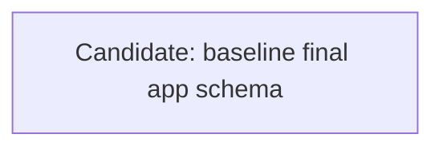

### `APP_ALEMBIC_SQUASH` — consolidate the final app schema

**Candidate.** Baseline only the settled schema,
verify fresh and migrated databases and their deployed stamps before pruning old revisions.
Retain the data-preserving rollback procedure. No Action Service or other database squash implied.

## 2. Service-owned command admission and later notification presentation

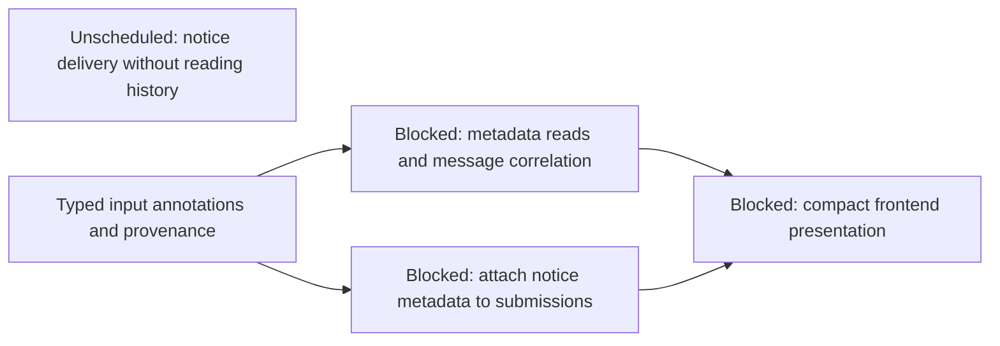

Details: [command admission](../runner_gateway/API.md#sessions-and-commands); later
[notification presentation and input metadata](notification_presentation.md).

### `NOTIFICATION_COMMAND_OUTCOME_DESIGN` — notice delivery without reading conversation history

**Unscheduled; operator, 2026-10-11 PDT: not a priority, needs more thought.** The Notification
Service scans a Session's raw history from the History Service for its own command's admission and
`harness_user_message_confirmed`, and stores one `EventEntry` per notice (`Notice.runner_entry`):
the one service besides the History Service fold that derives state from Session events. A command's
`CommandAdmitted` entry says the runner admitted it, but not that the harness executed it or that
the message reached the model's context; today that needs the history. Decide where that
outcome is recorded before the Notification Service stops reading history.

### `SESSION_INPUT_METADATA` — later typed annotations on input commands

**Unscheduled; the operator's lean (2026-10-12 PDT) replaces the plan's gateway-stored metadata.**
Typed metadata and restricted trusted producer provenance on input commands, so a notice the
Notification Service sends is not rendered as a user message. The lean: the Runner Gateway stamps
verified provenance on the runner Command, and the runner echoes it into the Event that journals
the input, so it reaches history with the input itself; the gateway keeps no command records.
The field rides `SubmitCommand` as it addresses a Session's Sandbox through `SessionDestination`
(#10129) and is delivered through the replica holding the runner stream. The harness never sees it. Notification-specific authorization
belongs here, not in the generic command-admission path; attachments are invalid on controls. No
untyped extension dictionary.

### `SESSION_INPUT_METADATA_READ` — authorized annotation reads

**Blocked on typed input metadata.** Carry the echoed metadata into the Thread fold, joined to
the message by `origin_command_ids`, including pending and failed inputs and replay, without
requiring a live notification inbox.

### `NOTIFICATION_NOTICE_METADATA` — producer integration

**Blocked on typed input metadata.** Attach notice identity/range metadata using existing delivery
command IDs. Preserve receipt reconciliation and explicit inbox acknowledgement. Verify the backend
path without the app; use automated integration coverage rather than requiring a provider outage.

### `NOTIFICATION_PRESENTATION` — compact notification rendering

**Blocked on producer and metadata read integration.** Compact authenticated notification-only
inputs, expand full text and render mixed human/notice messages normally with annotations. Missing
metadata falls back to text. Include visual coverage and one bounded real-notice check; no inbox
acknowledgement on render and no text-prefix provenance heuristic.

### Subscription authorization before broader sources

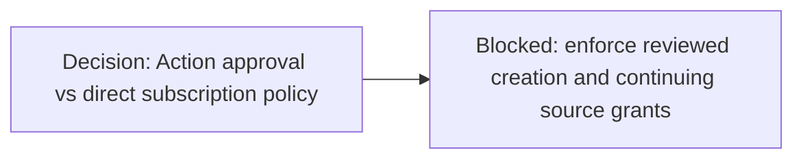

### `SUBSCRIPTION_AUTHORIZATION_DESIGN` — auto-allow and operator-approved subscriptions

**Decision.** Compare an Action-backed subscribe operation using existing auto-allow/operator
approval with authorization inside Notification Service; do not preselect another policy engine.
Review which callers may subscribe to which sources, targets, fields/filters, destinations and
lifetimes, and who can approve/delegate that access. Subscription creation approval is distinct
from continuing source access and from ownership of the destination inbox. Define renewal, scope
expansion, policy changes/revocation and what happens to already-retained entries.

Use Kubernetes as a concrete design case: namespace/resource/UID scope, object/status/event/log
content, name reuse and whether grants delegate the caller's existing read authority or explicitly
allow additional observation. A privileged watcher must not expose arbitrary cluster data merely
because the agent owns an inbox. Review argument examples that auto-allow narrow approved scopes,
require operator approval for additional scopes, and reject requests nobody can delegate. See the
[subscription authorization design](notifications.md#subscription-authorization-and-action-approval).
This is independent of selecting a messaging transport or fixing existing GitHub delivery gaps.

### `SUBSCRIPTION_AUTHORIZATION` — creation gate and continuing enforcement

**Blocked on the authorization decision.** If Actions is selected, implement its subscribe operation
and reviewed policy bindings; otherwise implement the chosen direct policy path. Keep Notification
Service the subscription/delivery authority in either case. Carry verified caller/decision scope
across the service boundary rather than substituting the executor's broad identity. Enforce the
same access contract on direct APIs, renewals and updates; no approval bypass by another endpoint.

Test auto-allow, pending approval, denial, restricted destinations, scope escalation and expiry/
revocation with controlled identities. No entry may be delivered beyond the reviewed source scope;
approval is not permission to wake a Sandbox or execute source content. Future Kubernetes sources
must depend on this contract/enforcement when promoted from the freezer. Ordinary authorized
subscription reads/cancellation and existing GitHub gap recovery need not wait for a broad redesign.

### GitHub notice reliability after missed updates

The operator reports that GitHub updates may sometimes be missed. This is a concrete reliability
concern, not proof that GitHub webhook delivery itself is at fault. Diagnose webhook receipt,
matching, inbox persistence and notice dispatch separately. Do not reopen waived broad provider
outage/refresh exercises; test the specific recovery contract with controlled missing webhooks.

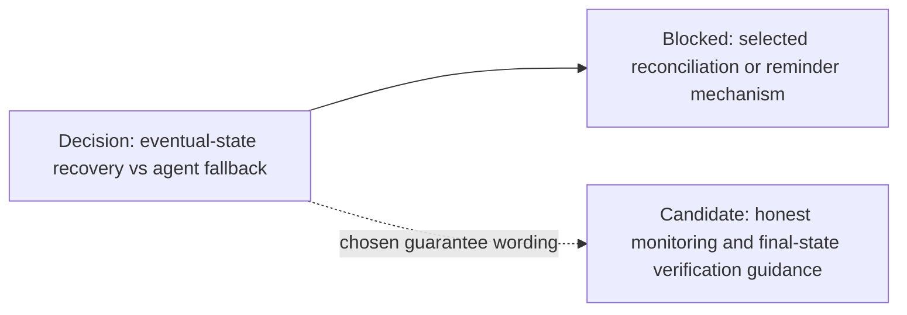

### `GITHUB_NOTICE_RELIABILITY_DESIGN` — delivery guarantee and fallback

**Decision.** Review the gap and choose the guarantee needed for PR shepherding: eventual awareness
of current head/check/review/merge state, or historical delivery of each event. Compare bounded
service-side reconciliation using existing durable shared GitHub refresh state with explicit agent
fallback checks, optionally scheduled reminders. Recommend the smallest reliable path with a stated
staleness bound/cost. A webhook subscription is not proof no changes occurred when it stays silent.
Snapshot polling cannot reconstruct all intermediate events, and a cron reminder alone is not
recovery if no active agent checks state. Detailed alternatives and questions are in the
[notification plan](notifications.md#missed-github-updates-and-shepherding-reliability).

### `GITHUB_NOTIFICATION_RECOVERY` — implement the reviewed recovery contract

**Blocked on the reliability decision.** If service reconciliation is selected, periodically compare
eligible shared subjects with authoritative GitHub state and durably emit deduplicated observations
for uncovered relevant changes. Reuse refresh leases, backoff and access checks; bound API load.
Distinguish observed state from a received webhook; do not fabricate delivery IDs or promise replay
of events the API cannot recover. If agent fallback is selected instead, provide its actual bounded
check/reminder mechanism and explicit limitations rather than just advising agents to remember.
Add `CRON_NOTIFICATIONS` as a prerequisite only if that reviewed implementation actually needs it;
a service refresh deadline need not introduce a general scheduler. Backend workers stay in-process.

Test a suppressed webhook, duplicate webhook/reconciliation races, changed head/check state and
restart/checkpoint recovery with a controlled GitHub peer. Observe one eventual update for the
promised scope, honest access/backoff state and no false claim of complete history. No live GitHub
outage or exhaustive historical event matrix is required.

### `GITHUB_SHEPHERD_GUIDANCE` — explain monitoring limits and completion checks

**Candidate for immediate baseline clarification; final wording follows the decision.** Treat
notifications as prompts to inspect authoritative current PR state, not evidence that the latest
head passed or that silence means no progress. Document the chosen fallback deadline/ownership and
how an agent notices unreliable monitoring. If reminders are chosen, state who runs them and that
notices do not start a stopped harness. Guidance accompanies the selected reliability behavior;
it must not advertise a polling/reminder guarantee before that mechanism exists.

## 3. Multiagent decisions before implementations

These are operator-reviewable decisions, not permission to implement every possibility. Drafts can
be developed together, but publish a coherent shared identity/authority vocabulary before downstream
APIs. Do not equate creating a resource, reading history, sending a message or receiving/acking it.

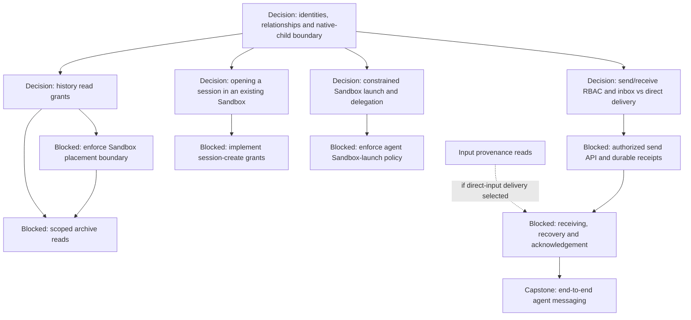

### `MULTIAGENT_MODEL` — shared identity and authority vocabulary

**Decision; no runtime work implied.** Present concrete API examples for independent agents,
Sandboxes and Sessions, with creator, manager and parent/provenance represented separately. Ask
the operator to choose addressing/ownership and delegation semantics. No permission inheritance
from an organizational edge or preset. Review how native harness children could later be ingested:
linked execution in the same Sandbox trust boundary versus independently provisioned Sandboxes,
addressability, observability and which controls must remain unavailable. Native integration itself
stays frozen; this decision must allow explicit exclusion rather than require its implementation.

### `THREAD_READ_POLICY_DESIGN` — scoped history read policy

**Decision; draft in parallel with the shared model.** Review compartments versus exact-session
grants, who classifies/reclassifies histories and grants/revokes access, and caller replacement
semantics. Neither grant model isolates Sessions sharing a Sandbox (see the
[isolation boundary](../docs/thread_layering.md#sandbox-isolation-boundary)). Defaults expose
no existing histories to workloads. Select raw read/list/follow scope; read does not imply
send/create, and no folded-read API is required for v1. Decide how revocation
applies to live feeds, discovery and linked evidence. Do not block this on a messaging transport.

### `SANDBOX_COMPARTMENT_BOUNDARY` — enforce Sandbox placement boundary

**Blocked on the reviewed scoped-read policy.**
The Sandbox is the security isolation boundary: co-resident Sessions share filesystem, credentials,
and ServiceAccount authority, regardless of archive-read classifications. Enforce compatible
placement for any proposed scoped-read policy at Open, adoption and replacement, rejecting
placements whose claimed isolation depends on separating co-resident Sessions. Test shared
filesystem/SA cases and denied placements. Keep VM isolation a separate capability, not a
fictional fix for shared credentials inside one VM. See the
[Sandbox boundary](../docs/thread_layering.md#sandbox-isolation-boundary).

### `THREAD_READ_POLICY` — authorized retained-history access

**Blocked on reviewed read policy and compartment enforcement.** Enforce at
the owning backend across list, raw/native evidence, direct reads and feeds, including reconnect
and revocation. Keep app-only UI folds separate. Test allowed/denied histories, two principals,
deleted Sandboxes and revocation with deterministic service tests plus a bounded deployed auth check.

### `AGENT_MESSAGING_DESIGN` — send and receive contract

**Decision.** Present examples of sender authentication, recipient discovery/opt-in, send grants,
recipient read/ack grants and administration. Compare Notification Service inbox delivery with
direct session input and an existing messaging channel; recommend the smallest fit. Define
accepted, delivered, handled and acknowledged separately; decide offline behavior, retention,
batching, abuse limits and mailbox ownership after Sandbox deletion. Reading a transcript does not
authorize sending or acking.

Output includes the selected owner/API and explicit conditional prerequisites: a direct-input
implementation reuses durable `SubmitCommand` and separately reviewed provenance reads; a notification source reuses
inboxes without treating admission as acknowledgement. Neither branch is selected in this DAG.
Before dispatch, add the chosen branch's edges; do not require implementing both. New Sandbox
Service or app tables require their task-specific contract review. Pure Notification Service work need not
wait for unrelated archive schema once its contract is reviewed.

### `AGENT_MESSAGE_INGRESS` — authorized send and acceptance

**Blocked on messaging decision and its selected prerequisites.** Implement bounded payloads,
server-authenticated sender provenance, per-recipient send policy, idempotent message IDs and honest
acceptance receipts in the chosen authority. Test denied pairs, spoofing and retry/conflict behavior.

### `AGENT_MESSAGE_RECEPTION` — delivery, recovery and acknowledgement

**Blocked on ingress contract/implementation.** Implement selected recipient read/delivery/ack
operations, batching and recovery of unread work. Test revoked/deleted recipients, ordinary offline
catch-up and duplicate delivery without leaking payloads. Do not start/resume a harness implicitly.

### `AGENT_MESSAGING` — integrated messaging capstone

**Blocked on ingress and reception.** Demonstrate an authorized pair exchanging a message through
the selected API, with correct provenance and distinct receipt/ack states. Security-negative and
multi-replica retry cases belong in automated tests; no real provider outage requirement.

### `THREAD_CREATE_POLICY` — authorize session creation separately

**Decision.** Review caller scope to open in an existing Sandbox, accepted defaults, quotas,
creator visibility and revocation. Use the service-reserved Session identity, not a caller-invented
public UUID. Opening in an existing Sandbox grants no isolation from its other Sessions; require a
separate Sandbox when incompatible trust or credentials are needed. Decide whether launch-and-open
is a composition of separate grants, never an implicit read/send/launch permission. This contract
need not choose a durable offline command queue.

### `THREAD_CREATE_AUTHORIZATION` — implement session-create grants

**Blocked on create policy.** Enforce scope/defaults and idempotent Open
lookup at the service boundary; test forbidden targets/overrides and a lost creation reply.

### `AGENT_LAUNCH_POLICY_DESIGN` — Sandbox launch and delegation policy

**Decision.** Review which callers can use which templates and resource budgets, mounts, images,
secrets, egress and Kubernetes/Action grants; presets are defaults, not authority. A new Sandbox is
required for an independent isolation boundary; adding a Session within one is not. Define manager,
lifetime, parent termination, quota/fanout and revocation without automatic privilege inheritance.
Choose policy ownership and audit records before adding tables. State separately whether the
operation also opens a session; if so, depend on `THREAD_CREATE_AUTHORIZATION` for that composition.

### `AGENT_SANDBOX_LAUNCH` — constrained agent-requested launch

**Blocked on launch policy and idempotent create.** Enforce the reviewed
effective spec and delegation server-side. Test allowed and forbidden launch parameters and
concurrent retries. Reuse Sandbox Service creation, not harness-native agent tools. Launch alone
does not grant history read, messaging, credentials or execution of another principal's Actions.

## 4. VM environment phases

The [KubeVirt plan](kubevirt_environments.md) contains completed prototype evidence and the detailed
provider design. Split implementation rather than making “VM support” one indivisible task. This is
an unranked candidate lane, not authorization for local Bazel in current containers. The
[runner control stream](../docs/runner_control.md) settles the dial-out contract VM control networking
builds on; changing connection direction does not move command durability or remove the runner
journal.

Direction for stateful VMs (operator, 2026-10-12 PDT; not scheduled): our own Sandbox resource
(`AGENTPLANE_SANDBOX_RESOURCE`, `kind: pod | vm`) replaces agent-sandbox's, and both kinds keep their
state on one filesystem PVC per Sandbox that Agentplane owns (section 7). Pods mount it as a volume,
KubeVirt guests through virtiofs, so a Session can move between kinds.

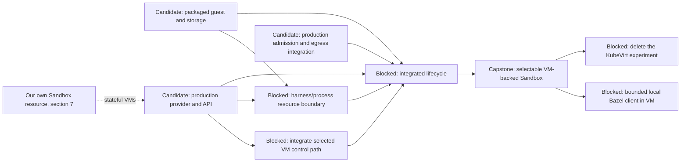

### `VM_CONTROL_NETWORKING` — integrate the reviewed connection direction

**Blocked on the VM provider.** Wire
VM control reachability/authentication to the chosen path. An outbound control stream may remove guest
control-port exposure and endpoint discovery; retain the independently needed outbound API/credential
proxy path. State which guest ports, endpoint discovery and network policies the chosen path
replaces. Image packaging and process-isolation work need not wait for this decision. Verify the
selected path on the actual VM network, not just a host-loopback transport test.
The experiment's guest already dials out, but `runtime_acceptance` no longer runs Sessions, setup probes
or recovery on it: those phases called the runner over a port-forward. They return driven through a
Runner Gateway.

### `VM_IMAGE` — packaged guest and state storage

**Candidate.** Publish a digest-pinned guest with runner/harness versions, blank-disk setup and
retained state/workspace bounds. Check startup with both harnesses, without ad hoc downloads or
real credentials baked into the image. Reuse the proven prototype, not another platform evaluation.
The state PVC reaches the guest through virtiofs (`EnableVirtioFsStorageVolumes`, on in
`cluster/cdk8s/kubevirt/app.py`; checked live 2026-10-12 with a Fedora 41 guest). KubeVirt v1.8.2
runs virtiofsd as uid/gid 107 with all capabilities dropped and no setting to change that, so every
file a guest writes lands on the PVC as `107:107`, `chown` to anything else fails, and only guest
root and a guest user whose uid and gid are both 107 can write. Checked live: a `107:107` guest user
creates, renames, `chmod`s and deletes files, and a pod running as `107:107` then edits all of it.
The guest image therefore runs the runner and harness as a `107:107` user. `agentplane-testing`'s
4Gi container limit caps a guest at about 1.7Gi: raise testing's limits or use small VMs there
(operator, 2026-10-12 PDT).

### `VM_PROVIDER` — production provider API and lifecycle intent

**Candidate.** Integrate typed environment kinds, templates/destinations, inventory, reconciliation,
RBAC and UI. Container behavior remains intact. Review the changed service contracts and schema
rollout as part of this work. For stateful VMs the kind lives on our own Sandbox resource, which
reconciles to a bare Pod or a `VirtualMachine` (suspend is deleting the Pod or `runStrategy: Halted`).
Re-type what is worth keeping from draft #8843 (`vm_view` status mapping and ownership checks, the
`VmTemplate` catalog, halted create then start, DataVolume validation, halted image replacement)
onto today's code, then close #8843 unmerged; it cannot be rebased. A Sandbox's kind comes only
from its `SandboxTemplate`, so `CreateSandbox`, its proto and the app need no change (operator,
2026-10-12 PDT).

### `VM_EGRESS` — integrate production admission and proxy path

**Candidate.** Implement the selected launcher-injection/proxy route on the production stack: a
VM's relay comes from the admission policy on virt-launcher (#8840,
`cluster/cdk8s/agentplane/kubevirt_experiment/policy.py`), not from a Pod template, so the
template-level sidecar check the Action box decision adds covers pods only. The relay's grants are
the VM ServiceAccount's egress bindings; it reads
`PolicyBinding`s only.
Verify proxy-only credentials, routing, token replacement and denied cross-environment access;
check failure scope for the new admission configuration. Do not repeat the entire completed
prototype matrix or require simultaneous cluster-wide disasters.

### `VM_PROCESS_ISOLATION` — protect control from harness processes

**Blocked on image/provider.** Enforce aggregate memory/process/disk budgets and process-control
boundaries. Test representative tool/harness termination and bounded exhaustion to establish which
runner/control state survives and what needs durable recovery. This directly addresses agents
accidentally killing their own harness; guest or container packaging alone is not that guarantee.

### `VM_LIFECYCLE` — integrated lifecycle verification

**Blocked on provider, image, selected control networking, egress and isolation.** Exercise both harnesses through real service
routes with retained-state stop/start and a representative replacement; confirm identity, replay and
cleanup. Automated tests cover restart/concurrency branches. Additional live faults need a concrete
unresolved platform risk, not a Cartesian product of every component crash and lifecycle operation.

### `SANDBOX_VM_ISOLATION` — VM integration capstone

**Blocked on integrated lifecycle.** Publish the selectable VM environment and measured isolation
limits, with no implied existing-Sandbox conversion or live migration. Component evidence, not
absence of every imaginable failure, establishes the delivered contract.

### `KUBEVIRT_EXPERIMENT_RETIRE` — delete the KubeVirt experiment

**Blocked on the VM capstone.** Once the production provider covers it, move anything still needed
(the launcher relay admission policy, the acceptance driver if it becomes the VM lifecycle test)
into production code, then delete `cluster/cdk8s/agentplane/kubevirt_experiment/` and the manifests it generates.

### `LOCAL_BAZEL` — bounded local client in a VM

**Blocked on VM capstone.** Wire Bazelisk, storage and authenticated RBE/cache/BES; set CPU/memory/disk
budgets and cleanup. Run a representative build/test with the client inside the VM and actions
remote; check cancellation/cleanup while the harness stays responsive. Installed tools and working
hosted builds do not authorize local Bazel in agent containers.

## 5. Independent UI and narrowly scoped service work

These candidates need no multiagent or VM decision. Any implementation that turns out to require
app/Sandbox Service database changes requires its own migration safety review.

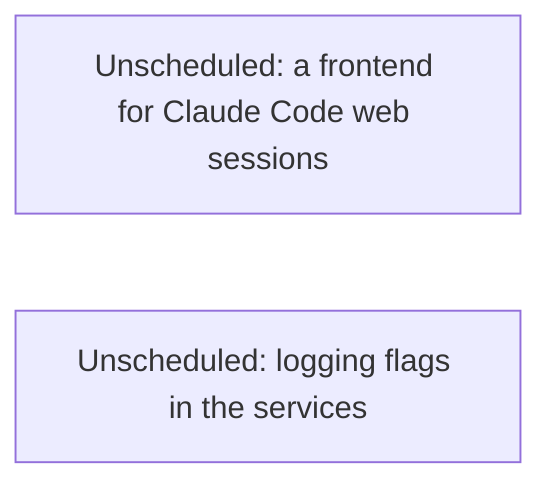

### `CLAUDE_CODE_WEB_BRIDGE` — Claude Code web sessions in Agentplane

**Unscheduled; operator, 2026-10-12 PDT: low priority, not to build now.** Make Agentplane's
frontend a custom frontend for Claude Code web sessions: show their conversations and send them
messages, by shimming the web interface's control protocol. Builds on the viewer and syncer under
`devinfra/` and the reverse-engineering in `agentydragon/gaffer-private`.

### `SERVICE_LOG_FLAGS` — logging flags in the services

**Unscheduled; operator, 2026-10-12 PDT: would welcome it.** `agentplane/service_process.py` fixes
every service at `INFO`. A setting for the level, per logger where it helps (request logging in the
app, the gRPC clients), lets a debugging session turn detail up on one Deployment without an image.

## 6. Existing access and lifecycle follow-ups

These are bounded existing work, not dependencies on the broader multiagent model. Confirm current
source/deployment state with the relevant owner when dispatching; old acceptance notes are not live
observations. New database work follows the task-specific review and rollout requirements.

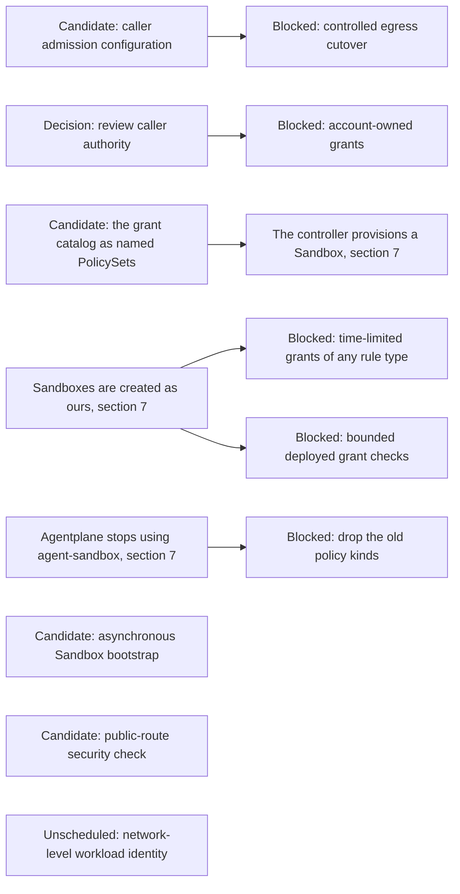

### `PC_EGRESS_CREDENTIALS` — label public-coder's Action Service caller

**Candidate; verify remaining configuration.** Admit the intended OpenClaw account to the dedicated
Action Service using its configured namespace and policy bindings. A label alone is not an execution
grant. Coordinate with the owner of the currently disabled/controlled workload before rollout.

### `PC_EGRESS` — public-coder-agent egress migration

**Blocked on caller admission and a controlled deployment.** Compare effective allowed/denied routes,
credential substitution and Action policy against the existing proxy, then do a reversible cutover.
Remove only unused OpenClaw-specific wiring; retain shared Iron/Haku consumers. Do not turn this
into an outage matrix. Source: [public-coder wiring](../../cluster/cdk8s/public_coder/proxy.py).

### `CLAUDE_AI_SA` — review the external caller's actual authority

**Decision.** Review the claude.ai account's Connection and arbitrary-shell Sandbox privileges,
Kubernetes scope and egress/Action grants. Record intended authority in generated configuration,
not ad hoc grants. Test an allowed and denied operation; do not add privileges as part of this review.

### `KUBERNETES_POLICY_SETS` — the grant catalog as named PolicySets

**Candidate.** Render the entries of the
[grant catalog](../sandbox_service/kubernetes_grants.py) as named `PolicySet`s with `kubernetes`
rules, including its per-namespace preset expansion, so a Sandbox can name them.

### `POLICY_RUNTIME_GRANTS` — time-limited grants

**Blocked on Sandboxes being created as ours.** An operator-only grant/revoke RPC with optional `expiresAt`
for sets of any rule type, and UI chips showing each binding's set, expiry and ready conditions.
One `expiresAt` serves every type: the Policy Controller deletes the binding at expiry, so no reader
handles expiry itself.

### `OLD_POLICY_KINDS_DROP` — drop the old policy kinds

**Blocked on retiring agent-sandbox, whose Sandboxes keep the old kinds until then; the operator merges it.** Delete the
`ActionPolicySet`/`ActionPolicyBinding` and `EgressPolicy`/`EgressBinding` CRDs, their readers in
the Action Service and egress proxy (with the proxy's admin `/bindings` observations), the
`EgressPolicy` that cdk8s's `add_egress_policy` renders beside each egress `PolicySet` (and the `ActionPolicySet`
`actions_staging_policies._policy_set` renders beside each Action one), the Sandbox Service's per-type binding writers and
annotations (`egress.py`, `action_policy.py`, `kubernetes_bindings.py` and their views), and the
presets' separate `egress_policies`, `action_policy_sets` and `kubernetes_grants` fields
(`app/presets.py`, after the manifests stop setting them), the KubernetesBindings reconciler, the
grant annotation and its finalizer, and the grant catalog.

### `MANAGED_SA_RBAC` — grants for accounts without a Sandbox

**Blocked on the caller review.** The claude.ai caller gets a
Flux-owned `PolicyBinding` of the sets `CLAUDE_AI_SA` approves, of any rule type, replacing its
static per-namespace grants in `agent_access_profiles.py`. Static Group subjects (Haku OIDC,
public-coder) stay Flux bindings. Test an allowed and a denied request. Static caller accounts' bindings, this one among them, are Flux-owned, never Sandbox-owned.

### `SANDBOX_RBAC` — bounded deployed grant checks

**Blocked on Sandboxes being created as ours; security-relevant.** Inspect the managed-Sandbox grant path as `PolicySet`s leave it
and verify intended versus unrelated scope, including Role edits and credential-use boundaries,
without recording credentials. Use [agent RBAC](../../cluster/docs/agent_rbac.md) and existing tests;
only unresolved deployed wiring needs a live check, not a repeat of every already-covered operation.

### `NOTIFICATION_INGRESS_BOUNDARY` — bounded public-route security check

**Candidate; security-relevant deployment check, not a provider failure drill.** Existing tests
cover invalid signatures. Close the remaining route-wiring uncertainty with an unsigned webhook
request and a private-API request through the public hostname: both must be refused, without
creating subscriptions or inbox entries. Record the result once; no exhaustive provider matrix.

### `NETWORK_WORKLOAD_IDENTITY` — network-level workload identity

**Unscheduled; operator, 2026-10-12 PDT: consider later.** Sandboxes and other workloads prove
their identity to Agentplane services at the network layer, with Cilium mutual authentication
(SPIFFE/SPIRE) or a service mesh, instead of a projected token plus an egress proxy hop; services
authorize by SPIFFE ID or workload label. Costs: SPIRE or a mesh to install, Cilium mutual
authentication still in beta, and a second authentication scheme in every service beside projected
tokens.

### `BOOTSTRAP_PROGRESS_CONTRACT` — asynchronous start/status

**Candidate.** Per-session setup is already asynchronous: the Session opens at once and its setup
output and outcome reach history as `SetupStarted`/`SetupOutput`/`SetupFinished` Events. The
Sandbox bootstrap is not. The runner runs it once and keeps its output in a durable log, but the
Runner Gateway's `open_session` (`runner_gateway/session_lifecycle.py`) sends `Initialize` and holds
the first Open until the script exits, and nothing shows its output or progress. Start it when the
Sandbox comes up and expose its progress and result, keeping successful bootstrap as the Open
precondition unless the operator reviews a change.

## 7. Our own Sandbox resource: Sessions that outlive their Pod

Not scheduled. A Session and its history are durable. The operator's direction (2026-10-12 PDT):
the way a Session outlives its runner is our own Sandbox resource, which holds the state PVC and
stays in place with no Pod or VM scheduled. A Sandbox is its state, running or not; an
**incarnation** is one Pod or VM. Stopping, replacing the image and starting again keeps the
Sandbox, so keeping the state means keeping the Sandbox, and deleting the Sandbox is the only thing
that deletes it. The same resource carries the VM kind, so section 4's stateful VMs build on these
nodes instead of a parallel track. Today a Session lives as long as its agent-sandbox `Sandbox`
(suspension removes the Pod and keeps the volume, but the PVC is owned by the `Sandbox` and goes
with it). The History Service keys by Session, so it can record each incarnation, and a seal closes
an incarnation, not the Session.

A related direction (operator, 2026-10-11 PDT; later, not scheduled): Sessions living in a
long-running, often-suspended Sandbox whose runner image upgrades between incarnations.

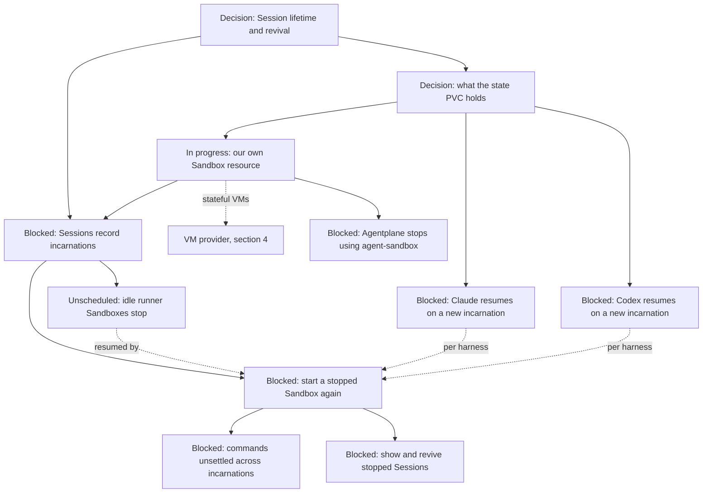

### `DURABLE_SESSION_LIFECYCLE` — Session lifetime and revival

**Decision.** Decide: what a revived Session gets
back (native harness state only, or also its workspace files); who may revive. Each incarnation
uses the Sandbox's template as it is at that start (`AGENTPLANE_SANDBOX_RESOURCE`), so revival
picks up template and image updates. Sessions that share a Sandbox revive together,
since they share its state PVC. Direction (operator, 2026-10-11 PDT): a new user message or a
notification resumes a stopped Sandbox, never a read. Both reach the Runner Gateway as commands, so
one hook covers them: the gateway finds the Sandbox in its Session registry, sets the Sandbox
resource's desired state to running and holds the command until the new incarnation's runner
connects. Resuming by Session ID works while the Sandbox exists, stopped or not. Open: what the user sees while it starts.

### `SESSION_STATE_VOLUME_DESIGN` — what the state PVC holds

**Decision; direction set by the operator, 2026-10-10 and 2026-10-12 PDT.** One filesystem PVC per Sandbox holds the native harness files and the
runner's state, separate from the workspace; each incarnation's runner continues the same journal
on it. The Sandbox Service creates and owns it, with no owner reference, mounted as a volume in pods
and through virtiofs in VMs (`VM_IMAGE`), never from agent-sandbox's `volumeClaimTemplates`,
which make the agent-sandbox `Sandbox` its controller owner. Decide: whether the runner's state
goes on it or only the harness files; for VMs, the operator's direction (2026-10-12 PDT) keeps the workspace
VM-local rather than on a PVC, so it is dropped on a switch from VM to pod, and makes it a mounted
PVC once the cluster has block storage that can move between kinds (OpenEBS or another
provisioner); still to confirm whether VM-local survives a stop and start (the reading proposed: a
disk the VM keeps until the Sandbox is deleted), since a revived conversation refers to files the
agent made; storage class, since `local-path` pins a volume to one node and so pins every incarnation
there; file ownership, since files a VM writes are `107:107` (`VM_IMAGE`), so pods run the
runner as `107:107` too and a Session moves between kinds with no `chown` (checked live); its quota (TODO, deferred by the
operator 2026-10-12: `local-path` enforces no PVC size, and inside a guest `df` shows the node's
whole disk; #4717 tracks a capacity-enforcing provisioner); and refusing an incompatible harness or
runner version rather than attempting it.

### `AGENTPLANE_SANDBOX_RESOURCE` — our own Sandbox resource

**In progress; operator, 2026-10-12 PDT: the shared base of this section and stateful VMs.** Our
`Sandbox` and `SandboxTemplate` and the Sandbox Controller (`agentplane/sandbox_controller/SPEC.md`)
reconcile a pod Sandbox into its state PVC and Pods. This node is done when the controller does
everything the Sandbox Service does around an agent-sandbox `Sandbox` today and Sandboxes are created
as ours: the nodes below. The Sandbox Service then folds into the controller, which is renamed for it
(operator, 2026-10-11 PDT), and stays separate from the Runner Gateway, so the provisioning
permissions stay off the runner-facing service. The gateway may write a Sandbox's desired running
state, which the controller validates; it gets no resume RPC on the Sandbox Service, which already
calls the gateway to seal. Action Service boxes keep a catalog of their own ([ADR](../docs/adr_action_sandboxes.md)).

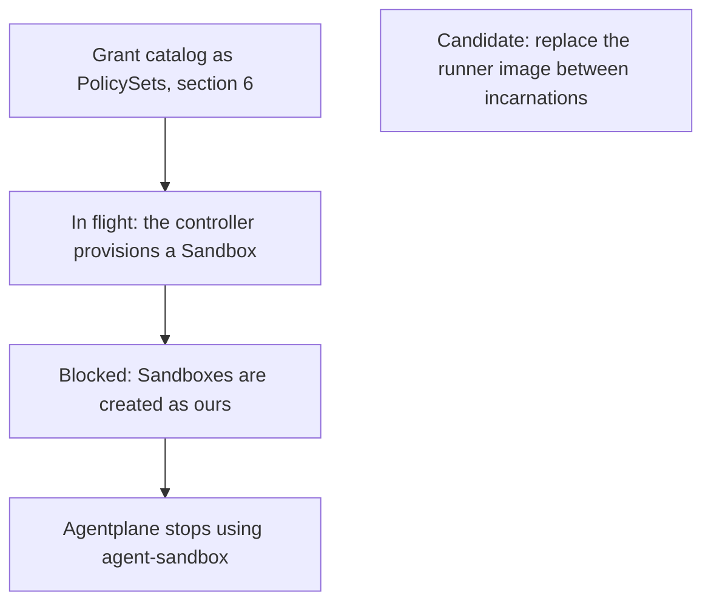

### `SANDBOX_CONTROLLER_PROVISIONING` — the controller provisions a Sandbox

**Done on testing; staging waits on the Kubernetes catalog as `PolicySet`s.** Our Sandbox carries
the whole recipe the Sandbox Service keeps as annotations on agent-sandbox's: `policySets`, session
defaults and the bootstrap command. The controller makes its ServiceAccount and one `PolicyBinding`,
which never sets `expiresAt`. Our runner template reaches the Runner Gateway and the ingress over
the egress sidecar's platform routes (`cluster/cdk8s/agentplane/platform_routes.py`), so no
runner-endpoint egress policy is bound. Runtime and time-limited grants are separate bindings
(`POLICY_RUNTIME_GRANTS`).

### `SANDBOX_IMAGE_REPLACE` — replace the runner image between incarnations

**Candidate; the operator's "pause, replace the image, resume" (2026-10-12 PDT).** For pods and VMs
alike, the controller accepts a new runner image only once the current incarnation is gone: the next
Pod runs it, and a VM gets its containerDisk rewritten while `runStrategy: Halted`. Both keep the
state PVC. The runner owns its state's versioning: it migrates forward or reports that it cannot,
and the controller gates nothing on versions. The VM half is #8843's `ReplaceVmImage` and `VmTemplate.state_schema_version`, replaced
live in [the 2026-10-03 run](../debug/kubevirt/runtime-20261003.md).

### `SANDBOX_CREATE_CUTOVER` — Sandboxes are created as ours

**In flight; the operator chose "both kinds" (2026-10-12): new Sandboxes are ours, existing
agent-sandbox ones keep working.** The Sandbox Service, the app's live view and the Runner
Gateway's destination lookup read both kinds, and our spec carries session defaults and the
bootstrap command. Left: `CreateSandbox`, suspend, resume and delete write ours on testing,
replacing the imperative-only `CreateSandbox`. That lookup refuses new Sessions and commands for a deleting Sandbox, as it does for
one in agent-sandbox teardown, while the gateway seals it. Existing staging Sandboxes stay on agent-sandbox until `AGENT_SANDBOX_RETIRE`
recreates them. The Sandbox Controller and our runner `SandboxTemplate`s exist on `agentplane-testing` only
(`Environment.own_sandboxes`) until then: the cutover
lands on testing first, and staging gets the controller and the cutover only once testing holds
(operator, 2026-10-12 PDT: testing down beats staging down). The create form and Sandbox presets
name policy sets of any rule type, one chip per set, in a new `policy_sets` preset field.

### `AGENT_SANDBOX_RETIRE` — Agentplane stops using agent-sandbox

**Blocked on our resource; decision card before the PR.** Staging Sandboxes are recreated on our
resource, not converted; until then they keep the old policy kinds, and the recreated ones get the controller's `PolicyBinding`. Then delete Agentplane's
agent-sandbox runner `SandboxTemplate`s (`cluster/cdk8s/agentplane/runner_sandbox.py`, whose
rendered spec ours now copy: build ours directly) and `Environment.own_sandboxes`, the Sandbox
Service's agent-sandbox inventory, views and watch, the gateway's `SealSandbox` RPC, the annotations it used as its record, the
`volumeClaimTemplates` state volume and the Sandbox Service's agent-sandbox RBAC. The controller
install stays for `cluster/cdk8s/agent_workspaces.py`.

### `CLAUDE_PORTABLE_STATE` — Claude evidence

**Blocked on the volume design.** Start a new incarnation (a new Pod, possibly a newer image)
on a kept state PVC and resume, checking continuation and prompt-cache cost. The frozen
`RUNNER_IMAGE_UPGRADE_PROOF` is the same experiment. Independent of Codex.

### `CODEX_PORTABLE_STATE` — Codex evidence

**Blocked on the volume design.** The same for Codex; neither harness waits for the other.

### `SANDBOX_IDLE_EXPIRY` — idle runner Sandboxes stop

**Unscheduled; needs design; operator, 2026-10-11 PDT.** An idle runner Sandbox stops its
current incarnation: the Pod or VM goes, and the Sandbox, its ServiceAccount, bindings and state
PVC stay, so nothing is sealed or lost and `SESSION_REVIVE` resumes it on the same PVC. Decide what
counts as idle (no turns or commands for a configured time, and nothing attached), and whether a
stopped Sandbox is ever deleted outright, and when; deleting goes through
[teardown](../sandbox_service/API.md#teardown) and the seal. Before our resource exists, a pod-only
version could use agent-sandbox's `operatingMode`. Action Service boxes are
`ACTION_BOX_IDLE_REAPER`'s, which only ever deletes.

### `SESSION_INCARNATIONS` — a Session records its incarnations

**Blocked on the lifecycle decision and the resource.** The Sandbox resource's status lists its
incarnations, at most one live; each incarnation's runner announces its Pod or VM UID on ingress,
from which the History Service records it, and its seal ends that incarnation, not the Session. On
the kept volume the runner journal and its cursors simply continue; the next incarnation journals
that it resumed after a seal.

### `SESSION_REVIVE` — start a stopped Sandbox again

**Blocked on incarnations and per-harness evidence.** The controller schedules a new Pod or VM
for a stopped Sandbox, set running by an explicit call or by the gateway's resume hook, from its
template as it is now, possibly on a new image, and resume each harness as
a new incarnation of the same Session and history. Ships per harness as its evidence lands. Test
revival after a long stop, a refused incompatible state PVC, and concurrent revive requests.

### `THREAD_SUCCESSOR_DELIVERY` — commands unsettled across incarnations

**Blocked on revival.** A command whose admission was ambiguous when an incarnation ended is not
replayed into the next one; it stays unknown and is shown as such. Moved from the freezer.

### `HOSTED_THREAD_SURFACES` — show and revive stopped Sessions

**Blocked on revival.** The app lists Sessions whose Sandbox has no
running incarnation, reads their history from the History Service, and offers an explicit revive.
Moved from the freezer.

## 8. Ownership and naming cleanup

Cleanups that leave one database per service and names that say what things are. Each node is one
deployment; edges are the known order. Staging data follows
[staging data preservation](../docs/staging_data_preservation.md): Session identities and history
are irreplaceable, and a node that deletes a column or row stops for the operator.

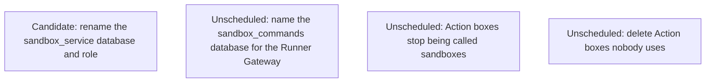

### `HISTORY_DATABASE_RENAME` — name the database for its owner

**Candidate.** Rename the `sandbox_service` database and role
(and the `postgres-sandbox-service` Secret) for the History Service. Rename in place (`ALTER DATABASE`/`ALTER ROLE ... RENAME`)
and have the CNPG `Database` and managed role adopt the new names; recreating the database under a
new name would copy the log. Verify the History Service and Electric reconnect with no data movement.
The `storage/migrate.py` and `cluster/cdk8s/agentplane/history_service.py` docstrings take the
new name.

### `SANDBOX_DATABASE_RENAME` — name the Runner Gateway's database for it

**Unscheduled; operator, 2026-10-11 PDT: keep the name for now, not urgent.** `sandbox_commands` holds the Runner Gateway's Session registry and command
admission; the Sandbox Service has no database. Rename it and its role and Secret for the gateway
in place, as `HISTORY_DATABASE_RENAME` does, and point the Runner Gateway, its migration init
container and `commands_database_url` at the new names. `database.py`'s comment on
`sandbox_commands` follows.

### `ACTION_BOX_IDLE_REAPER` — delete Action boxes nobody uses

**Unscheduled; operator, 2026-10-11 PDT.** A small controller deletes Action box Pods with no
`exec` for a configured time. The Action Service stamps a last-exec time on the box at each `exec`;
a plain Pod delete is enough, since boxes have no seal. It takes over `TODO(sandbox-lifetime)` in
`action_service/sandbox/inventory.py`; draft [#7859](https://github.com/agentydragon/ducktape/pull/7859)
expired agent-sandbox boxes the same way.

### `ACTION_BOX_RENAME` — Action boxes stop being called sandboxes

**Unscheduled; operator, 2026-10-11 PDT: a later TODO.** Rename what calls an Action Service box a
sandbox, so it no longer reads as a Session Sandbox: the `sandbox__*` Actions,
`action_service/sandbox/`, the `agentplane-sandbox` templates and labels, and
`cluster/cdk8s/agentplane/command_sandbox.py`. The `sandbox__*` tool names are what agents and
external Connections call, so renaming them is a wire change.

## 9. Legacy burn-down

Dead code, finished gates, compatibility shims and stale names found by the 2026-10-10 PDT audit of
devel. A gate counts as legacy once its rollout is finished on both testing and staging or nothing
reads it; the delta settlement flag stays with `SETTLE_DELTAS_ALWAYS_ON`. Lane named per
node; leftovers of in-flight work belong to the lane already changing that code. Upstream-gated
tombstones with a verifiable condition in code (`keepingOffset` in
`thread_store.tsx`, the jsdom pragma in `markdown.test.tsx`) need no node.

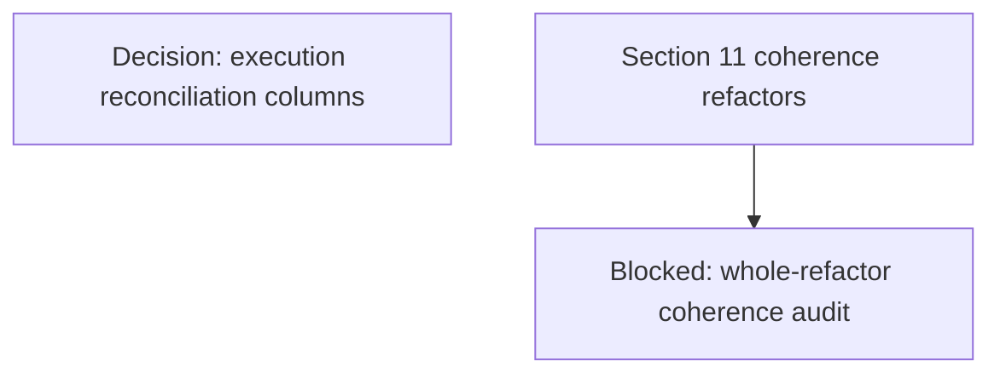

### `ACTION_EXECUTION_AUDIT_TRIM` — execution reconciliation columns

**Decision; drops columns, so the operator decides.** `ExecutionRow.reconciled_by` and
`reconciliation_source` in `action_service/db.py` are written but read only by a test, and
`ReconciliationSource` has one member. Either expose `reconciled_by` in the execution view, or
drop both columns and the enum.

### `REFACTOR_COHERENCE_AUDIT` — the refactor reads as one design

**Blocked on the cutover's retirements, the split and the section 11 refactors**, which remove the
transitional pieces the other nodes name. Sweep devel for unused modules, functions, settings, proto
fields, tables and columns; one name per concept across code, settings, manifests, protos and docs
(Sandbox Service, Runner Gateway, History Service, ingress, control; Session for the raw stream,
Thread for its projection; no "hub", "follow" or "shadow" left); READMEs, `SPEC.md` files and
`docs/` describing the code as it is, without cutover narration; no compatibility branch,
optional-with-fallback setting or `CLEANUP` tombstone whose condition is met; the system diagram in
`agentplane/README.md` showing exactly the deployed services and the traffic between them in
`cluster/cdk8s/agentplane`. Known now: the test-only `PostgresListener.wait_until_disconnected`
(`connected` turns false before the termination callback runs, so its tests cannot wait on
`connected` instead); egress and app test support each build a throwaway CA;
`cluster/cdk8s/agentplane/kubevirt_experiment` is an experiment outside `x/`. Findings are fixed in
PRs of their own; this node leaves with the last of them.

## 10. Runner ingress and control split

Target and decisions: [History Service plan](history_service.md#target). The runner keeps dialing
out, but to two endpoints its Sandbox names: an **ingress** it pushes its journal's Events to, and
a **control endpoint** (the Runner Gateway) whose stream it holds for commands, receipts and lifecycle
requests. The History Service is the ingress when history is kept. The contract is
[runner control stream § Event ingress](../docs/runner_control.md#event-ingress); it replaces following the
runner through the Sandbox Service.

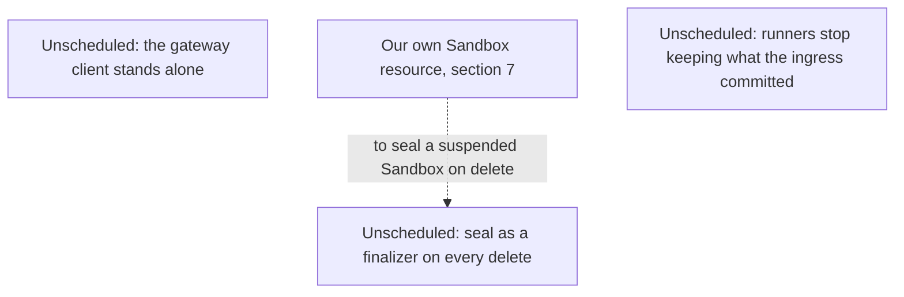

### `RUNNER_JOURNAL_TRIM` — runners stop keeping what the ingress committed

**Unscheduled; the operator's direction, 2026-10-12 PDT: later.** A runner could stop persisting
journal entries its ingress has already acknowledged, behind a flag, with full persistence kept
selectable. Not designed: what the runner still needs locally (cursors, seal state, entries a
resumed harness or a lost push reads back) once acknowledged entries are gone.

### `GATEWAY_CLIENT_SPLIT` — the gateway client stands alone

**Unscheduled.** `RunnerGatewayClient`'s `Runner` handle is renamed and its
`command_admission_timeout_s` stops being nullable.

### `SEAL_FINALIZER` — seal as a finalizer on every delete

**Unscheduled; operator, 2026-10-11 PDT: not worth the effort for now.** Every Sandbox carries a seal
finalizer, so any deletion (`kubectl`, `DeleteSandbox`) seals before its volume goes. It replaces
the controller loop's seal from the replica holding the runner, the `teardown` annotation and the
suspended-only delete guard. Deletion is one-way: a hold can delay it, never cancel it.

Upstream agent-sandbox v0.5.5 does nothing for a Sandbox whose `deletionTimestamp` is set
(`SandboxReconciler.Reconcile` returns before reconciling its Pod, PVCs or Service): it neither
starts nor stops the Pod. So a Sandbox running when deletion begins keeps its runner and seals over
control as now; a suspended one never runs again, and sealing it means reading the journal head off
the volume with a Job, or our own resource (`AGENTPLANE_SANDBOX_RESOURCE`). The Pod and PVCs carry
controller owner references with `blockOwnerDeletion`, so only background propagation (the
`kubectl` and `DeleteSandbox` default) keeps them until the finalizer clears: foreground
propagation garbage-collects them while the finalizer still holds the Sandbox, and namespace
deletion removes them directly. Those two paths lose the unsealed tail.

The considered way to seal a suspended one without our own resource: the finalizer starts a Job on
the Sandbox's volume, under the Sandbox's own ServiceAccount and egress sidecar (the ingress binds a
Session to its first writer), that pushes the unacknowledged tail and seals. The volume is
ReadWriteOnce, so the Job starts only once every container of the old Pod is gone.

## 11. Coherence refactors

Refactors found by reading devel (2026-10-11 PDT) against the quality bar and
[gRPC services](../docs/grpc_services.md). Each lands as its own PR; all of them feed
`REFACTOR_COHERENCE_AUDIT`.

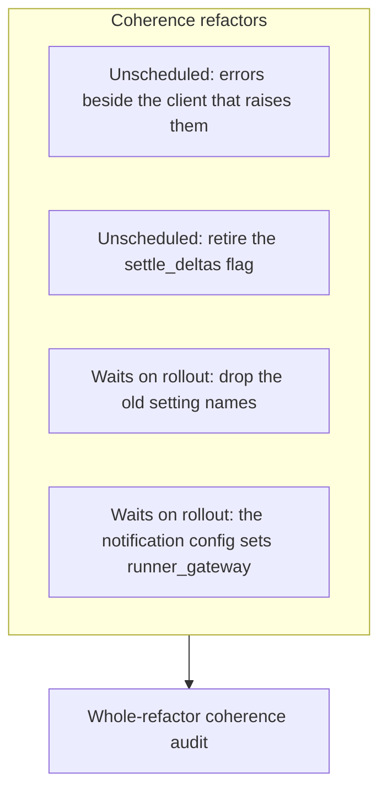

### `RUNNER_ERRORS_REHOME` — errors beside the client that raises them

**Unscheduled.** `agentplane.runner.errors` is now every service's "session refused" vocabulary:
the gateway, the status translation the Sandbox Service and Runner Gateway clients share
(`agentplane/grpc_calls.py`, which raises it for `FAILED_PRECONDITION`) and the app's
Thread-identity conflicts raise it. Move the client-side error beside that translation, per
grpc_services.md, and give the app's `bridge.py` its own error type.

### `SETTLE_DELTAS_ALWAYS_ON` — delta settlement always on

**Unscheduled; operator, 2026-10-11 PDT: keep the flag for debugging for now, may retire it later.**
Settlement is on by default; `ingress.settle_deltas` turns it off. Retiring the flag makes
settlement unconditional: delete the setting, `Environment.settle_deltas` and the `Store` flag.

### `SERVICE_SETTING_OLD_NAMES_DROP` — drop the old setting names

**Waits on rollout** of `agentplane-app`, `agentplane-runner-gateway-migrate` and
`agentplane-history-migrate` images that read `runner_gateway_control_target`,
`AGENTPLANE_RUNNER_GATEWAY_COMMANDS_DATABASE_URL` and `AGENTPLANE_HISTORY_SERVICE_DATABASE_URL`, on
both agentplane-staging and agentplane-testing. Until then cdk8s renders each old env var beside the
new one, which an image that does not read it ignores. Then delete the three `CLEANUP` entries,
`AGENTPLANE_SANDBOX_SERVICE_CONTROL_TARGET` (`cluster/cdk8s/agentplane/app.py`),
`AGENTPLANE_SANDBOX_SERVICE_COMMANDS_DATABASE_URL` (`runner_gateway.py`) and
`AGENTPLANE_SANDBOX_SERVICE_DATABASE_URL` (`history_service.py`), and regenerate. No code reads the
old names.

### `NOTIFICATION_GATEWAY_SETTINGS` — the notification config sets `runner_gateway`

**Waits on rollout** of an `agentplane-notifications` image that reads a `runner_gateway` block, on
both agentplane-staging and agentplane-testing. Until then the config keeps the Runner Gateway's
keys in `sandbox_service`, which `Settings` moves to `runner_gateway` as it loads. Then cdk8s
(`cluster/cdk8s/agentplane/notifications.py`) renders a `runner_gateway` block, regenerate, and
delete the `CLEANUP` move in `notification_service/settings.py` with its test.

## Scope and retirement of stale gates

- Notifications keep workers in the HTTP service. Retention, worker extraction, idle-polling
  optimization and new-source wiring are frozen with triggers, not hidden release prerequisites.
- Broad provider-matrix exploration is frozen; ordinary auth/signature denial regression coverage
  belongs with the implementation, not an unbounded production checklist.
- Native subsessions and runner durability/thin-adapter redesign remain frozen. Neither the runner
  channel nor multiagent design unfreezes the broader runner-state redesign.
- Existing security boundaries, data-preserving migration checks and representative deployment
  integration checks remain requirements. The freezer is not a waiver for a known data-loss or
  unauthorized-access bug; promote one when evidence makes it concrete.
