# Agentplane task DAG

This is the dispatch map for **unfinished** work. Detailed contracts belong in component plans;
completed work belongs in component docs, not done nodes here. Maintenance rules are in
[task DAG maintenance](../docs/task_dag_maintenance.md). Deliberately deferred candidates and conditional
hardening live in the [freezer](task_freezer.md), except the explicit nonblocking
intra-Sandbox hardening reminder retained here at Rai's request.

## Current state and scheduling

**Operator scheduling, 2026-10-27 PDT:** runner lifecycle implementation, the Go app port and the
central Codex spike are assigned to other agents. Do not dispatch duplicate work on those tracks.

Audit metadata consumers (`sandbox`, `harness`, `model`, `cwd`, summary/activity fields) before
deleting useful UI projections. Squash Alembic only once the app schema settles.

States: **in flight** means reported work is underway; **in review** means an unmerged PR;
**paused** means no worker is assigned; **decision** needs a reviewed outcome;
**blocked** names prerequisites; **candidate** is dispatchable when selected, not a priority claim.
**Unscheduled**, **deferred** and **parked** nodes have no owner and no priority; a deferred or parked one waits on a trigger its text names.
A **capstone** closes an integrated contract, not another implementation. Solid arrows below are
prerequisites; dashed arrows explicitly label scheduling holds or conditional choices. All service
contracts remain multi-replica unless a reviewed temporary restriction says otherwise.

### Current tracks and what they leave behind

One group per track that has work open (2026-10-24), holding its open nodes; the nodes after a group are the
cleanups due once that track finishes, each in [section 15](#15-cleanups-after-the-current-tracks) unless it names
another. Agent messaging and the test-tier split have finished; what they left is `NOTIFICATION_SERVICE_SPLIT`
(section 2) and the section 15 candidates. `REFACTOR_COHERENCE_AUDIT` sweeps what remains after all of them.

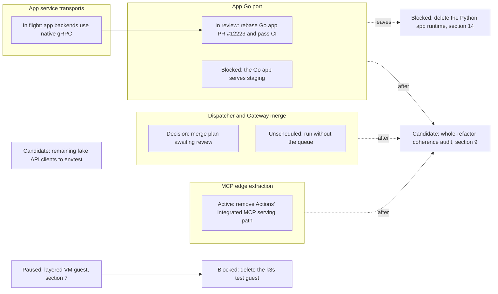

## 1. Session schema and identity follow-up

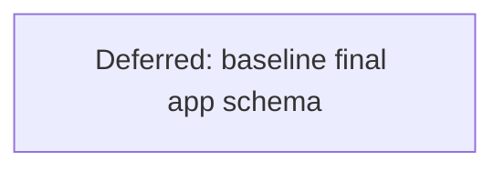

### `APP_ALEMBIC_SQUASH` — consolidate the final app schema

**Deferred by the operator; not dispatchable until selected.** Baseline only the settled schema,
verify fresh and migrated databases and their deployed stamps before pruning old revisions.
Retain the data-preserving rollback procedure. No Action Service or other database squash implied.
Moot once [`APP_GOOSE_MIGRATIONS`](#app_goose_migrations--goose-owns-the-app-schema) lands: its Goose baseline is the
consolidated schema. Delete this node then.

## 2. Service-owned command admission and later notification presentation

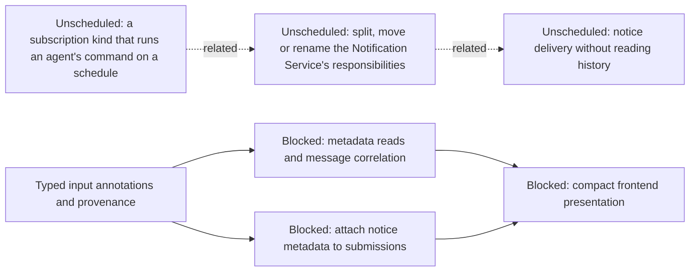

Details: [command admission](../runner_gateway/dispatcher/README.md#contract); later
[notification presentation and input metadata](notification_presentation.md).

Future ownership and wake-policy questions are recorded in the
[freezer](task_freezer.md#notification_dispatcher_ownership--review-notification-and-dispatcher-ownership):
consider moving Notification Service responsibilities into Dispatcher, and event/source-specific
auto-wake policy. Neither is selected or a prerequisite for v1 inbox messaging.

### `NOTIFICATION_COMMAND_OUTCOME_DESIGN` — notice delivery without reading conversation history

**Unscheduled; operator, 2026-10-11 PDT: not a priority, needs more thought.** The Notification
Service scans a Session's raw history from the History Service for its own command's admission and
`harness_user_message_confirmed`, and stores one `EventEntry` per notice (`Notice.runner_entry`):
the one service besides the History Service fold that derives state from Session events. A command's
`CommandAdmitted` entry says the runner admitted it, but not that the harness executed it or that
the message reached the model's context; today that needs the history. Decide where that
outcome is recorded before the Notification Service stops reading history.

### `NOTIFICATION_SERVICE_SPLIT` — split, move or rename the Notification Service's responsibilities

**Unscheduled; operator, 2026-10-17 PDT: some renaming and refactoring around this service at some
point.** The service (`agentplane/notification_service/`) has grown to several responsibilities:

- mailboxes, their high-water marks and the get API;
- listening to webhooks, currently GitHub's;
- subscriptions, by which an inbox gets messages when a listener notices something;
- direct agent-to-inbox messages;
- deciding to send a notice to a Session because its mailbox holds new unacknowledged messages,
  possibly waking it if suspended, possibly with debounce by time or count, or a check of the Session's
  history so no second notice goes out before the Session has started executing tools or reasoning
  since the last notice or acknowledgement.

Decide which stay, which move to other services, and what the remaining service is called. Inbox
messaging v1 shipped in one deployment under the current name; this node is the later restructuring.
Related: whether notice delivery belongs with the Dispatcher
([freezer](task_freezer.md#notification_dispatcher_ownership--review-notification-and-dispatcher-ownership)),
and the history-free notice outcome (`NOTIFICATION_COMMAND_OUTCOME_DESIGN`), which bears on the notice
decision's last clause.

**Operator, 2026-10-21 07:33 UTC: rethink the inbox model and its names together with the rename.**
Noticing agents is only one part of what the service does; it is more a mailbox ("email" or "mailbox")
service. The operator's sketch, explicitly not a committed shape or naming: inboxes contain messages;
a message has a sender, which is another agent or an event source such as GitHub; a message is
structured, like a GitHub webhook, or unstructured text; a subscription connects an inbox to an event
source, with its configuration (which pull requests, for example). Today's terms to reconcile with it
include entries and their event identities (`actions`, `github`, `message`), notices, sources and
`DestinationRef`. The `InboxesPerAccount` quota now counts per Sandbox incarnation, so its name goes with this rethink.

### `COMMAND_WATCH_SUBSCRIPTION_DESIGN` — a subscription kind that runs an agent's command on a schedule

**Unscheduled; operator, 2026-10-17 PDT: possibly useful as a subscription option, trigger to be decided.**
An agent registers a command and the service runs it every N seconds, or until a given time, and puts a
message in the agent's inbox when something worth noticing happens: the output changes, the command exits
nonzero, or whatever turns out to make most sense. Open: where the command runs (inside the agent's own
Sandbox, or elsewhere) and under whose identity and authority, which decides what it may reach; the
trigger semantics (output change against what baseline, nonzero exit, a failure to run at all, how a
long-running or hung command is cut off); the minimum interval, per-agent quotas and the stop condition;
what the message carries (the output, a diff or only the fact); and the subscription authorization it needs
(`SUBSCRIPTION_AUTHORIZATION_DESIGN`). Related: `NOTIFICATION_SERVICE_SPLIT`, which decides which service
owns subscriptions and sources.

### `SESSION_INPUT_METADATA` — later typed annotations on input commands

**Unscheduled; operator's lean, 2026-10-12 PDT.**
Typed metadata and restricted trusted producer provenance on input commands, so a notice the
Notification Service sends is not rendered as a user message. The field must ride the durable
Session Dispatcher path to the matching Runner input RPC; its trusted producer provenance and narrow
authorization are open design points. The harness never sees it. Keep that authorization
outside the generic command-admission path; attachments are invalid on controls. No
untyped extension dictionary.

### `SESSION_INPUT_METADATA_READ` — authorized annotation reads

**Blocked on typed input metadata.** Carry the echoed metadata into the Thread fold, joined to
the message by `origin_command_ids`, including pending and failed inputs and replay, without
requiring a live notification inbox.

### `NOTIFICATION_NOTICE_METADATA` — producer integration

**Blocked on typed input metadata.** Attach notice identity/range metadata using existing delivery
command IDs. Preserve receipt reconciliation and explicit inbox acknowledgement. Verify the backend
path without the app; use automated integration coverage rather than requiring a provider outage.

### `NOTIFICATION_PRESENTATION` — compact notification rendering

**Blocked on producer and metadata read integration.** Compact authenticated notification-only
inputs, expand full text and render mixed human/notice messages normally with annotations. Missing
metadata falls back to text. Include visual coverage and one bounded real-notice check; no inbox
acknowledgement on render and no text-prefix provenance heuristic.

### Subscription authorization before broader sources

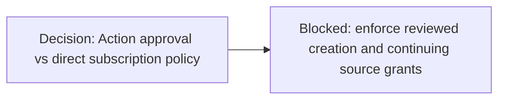

### `SUBSCRIPTION_AUTHORIZATION_DESIGN` — auto-allow and operator-approved subscriptions

**Decision.** Compare an Action-backed subscribe operation using existing auto-allow/operator
approval with authorization inside Notification Service; do not preselect another policy engine.
Review which callers may subscribe to which sources, targets, fields/filters, destinations and
lifetimes, and who can approve/delegate that access. Subscription creation approval is distinct
from continuing source access and from ownership of the destination inbox. Define renewal, scope
expansion, policy changes/revocation and what happens to already-retained entries.

Use Kubernetes as a concrete design case: namespace/resource/UID scope, object/status/event/log
content, name reuse and whether grants delegate the caller's existing read authority or explicitly
allow additional observation. A privileged watcher must not expose arbitrary cluster data merely
because the agent owns an inbox. Review argument examples that auto-allow narrow approved scopes,
require operator approval for additional scopes, and reject requests nobody can delegate.
Define immutable normalized approval arguments, stable request keys and idempotent execution/recovery;
waiting for approval must not create a subscription. Decide who administers policies, what the
approver can delegate, and whether continuing authority uses a bounded grant or standing policy.
Cancellation cannot recall retained entries. Avoid per-event approval unless explicitly required.
This is independent of selecting a messaging transport or fixing existing GitHub delivery gaps.

### `SUBSCRIPTION_AUTHORIZATION` — creation gate and continuing enforcement

**Blocked on the authorization decision.** If Actions is selected, implement its subscribe operation
and reviewed policy bindings; otherwise implement the chosen direct policy path. Keep Notification
Service the subscription/delivery authority in either case. Carry verified caller/decision scope
across the service boundary rather than substituting the executor's broad identity. Enforce the
same access contract on direct APIs, renewals and updates; no approval bypass by another endpoint.

Test auto-allow, pending approval, denial, restricted destinations, scope escalation and expiry/
revocation with controlled identities, plus one bounded deployed identity/policy check for the
selected integration. No entry may be delivered beyond the reviewed source scope;
approval is not permission to wake a Sandbox or execute source content. Future Kubernetes sources
must depend on this contract/enforcement when promoted from the freezer. Ordinary authorized
subscription reads/cancellation and existing GitHub gap recovery need not wait for a broad redesign.

### `GITHUB_MERGEABILITY_FRESHNESS` — obtain a current result after base-only changes

**Ready — remaining scope updated by Codex, 2026-10-28 UTC.** The implementation in
[PR #12343](https://github.com/agentydragon/ducktape/pull/12343) is merged and deployed. Positive
parent validation, current base labels, persisted retry/backoff and deterministic race/restart
coverage are complete; their contract is in the [API reference](../notification_service/docs/api.md).
The [live evidence](../notification_service/debug/github_mergeability_live_acceptance_20261028.md)
shows a stale REST `MERGEABLE` / old test merge at 600 seconds after a received base-only push,
while the service correctly stays `UNKNOWN` and retries. A request with `Cache-Control: no-cache`
returned the same stale result. A later diagnostic GraphQL read returned `UNKNOWN`, and a head
change followed; the subsequent conflict notice does not prove base-only recovery.

**TODO: test whether GraphQL obtains a fresh result sooner than REST.** Use controlled disposable
fixtures, advance only the base, and keep the PR head unchanged throughout polling. Compare
`mergeable`, `potentialMergeCommit` and its parents, and the actual base ref; record settling time
and request cost, including no improvement. Do not push a new head, retarget or reopen the PR, or
compute a merge locally during this comparison. The previous GraphQL read was followed by a head
change, so it did not establish whether GraphQL alone would settle. A negative remains
GitHub-reported without proof of the evaluated pair; neither elapsed time nor current-ref reads
supply that proof.

Exit: establish and validate a supported way to obtain the current result after a base-only change,
with actual refs, request cost and detection timing recorded. If no bounded mechanism is available,
bring the operator an explicit contract decision between GitHub-only observation, local conflict
calculation, or reporting prolonged uncertainty before implementing an alternative. Preserve the
shipped proof/fence/error policies. This does not reopen waived broad outage/restart drills or select
a general CI/comment/review replay mechanism.

## 3. Multiagent decisions before implementations

These are operator-reviewable decisions, not permission to implement every possibility. Drafts can
be developed together, but publish a coherent Session-access rule schema before the nodes that use it,
and the identity/authority vocabulary before create and launch policy. Do not equate creating a
resource, reading history, sending a message or receiving/acking it.

[The cross-agent plan](multiagent_communication.md#tentative-implementation-direction) tentatively
selects service-enforced Session-access `PolicySet` rules assigned through existing `PolicyBinding`s.
Resource-owning backends share evaluation code and enforce their own APIs. Native RBAC variants
remain alternatives if implementation reveals a poor fit; comparing or building them is not a gate.
SA-level caller attribution, configurable topology and live shared bundles are agreed constraints.
Replacing the authorization machinery across services is a separate deferred evaluation, not a
multiagent prerequisite. Preserve existing auth semantics; a concrete limitation must justify any
separately reviewed broader proposal.
Send and transcript-read permissions are independent in both directions. A2A is open at this
communication boundary; its harness/thread-protocol rejection has a different scope. Transport
facades are not prerequisite decisions, and content classification is outside v1. Exact schemas and
the remaining contracts below still require review before implementation.

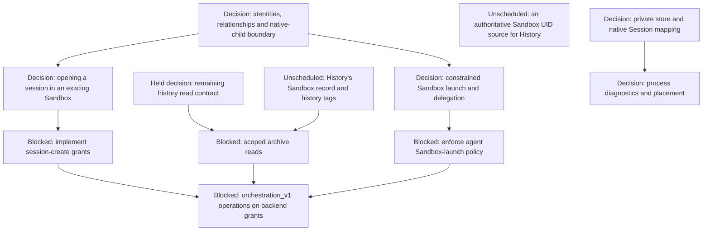

### `MULTIAGENT_MODEL` — shared identity and authority vocabulary

**Decision; no runtime work implied.** Present concrete API examples for independent agents,
Sandboxes and Sessions, with creator, manager and parent/provenance represented separately. Ask
the operator to choose remaining addressing/ownership and delegation semantics. Use the agreed
SA-level caller attribution and the [tentative Session-access rule direction](multiagent_communication.md#tentative-implementation-direction),
without choosing a mandatory topology. No permission inheritance from an organizational edge or
preset. Review how native harness children could later be ingested: linked execution in the same
Sandbox trust boundary versus independently provisioned Sandboxes, addressability, observability
and which controls must remain unavailable. Native integration itself stays frozen, and v1 excludes
native children from the messaging and access model.

This gates `THREAD_CREATE_POLICY` and `AGENT_LAUNCH_POLICY_DESIGN`. Messaging needs only the
[Session inbox access rule](../notification_service/docs/api.md#messages) and
history reads only their own rule type, so creator, manager and parent semantics do not hold them up. The app's existing auth path may remain a special case for v1. Reducing that
special handling is optional, separately reviewed follow-up work and does not gate multiagent
implementation.

### `THREAD_READ_POLICY_DESIGN` — scoped history read policy

**Decision, held by the operator for now (2026-10-17 UTC): do not raise it until the operator reopens
it. Tentative Session-access rules, Sandbox minimum, history tags and all-Sandboxes target selected.**
Reads get a rule type of their own, not the send rule's (operator, 2026-10-21 UTC), and this decision
shapes it. Finalize caller replacement semantics. Collection reads match history tags on History's
record of the Sandbox, which outlives it ([design](sandbox_tags.md)). V1 has no individual-Session
grants or computed collection selection. Presets seed launch tags; later removals persist. Reading a
Session resolves its recorded Sandbox identity, and all Sessions in that Sandbox use the same scope.
Defaults expose no existing histories to workloads. Session listing is a distinct, weaker read-type
permission, independent from send; its metadata fields are selected, and raw history read/follow
behavior remains to design. Read does not imply send/create, and no folded-read API is required for v1.
Cover discovery, linked evidence, live-feed revocation and unknown historical associations. Do not block
this on a messaging transport.

**Question for review:** should an `allSandboxes` read also reach histories with no recorded Sandbox
UID, which are operator-only today ([History README](../history_service/README.md#which-sandbox-wrote-a-session))? Those rows keep the recorded
namespace, which is all that target matches on; a history with no recorded Sandbox stays operator-only
either way.

### `THREAD_READ_POLICY` — authorized retained-history access

**Blocked on reviewed read policy, held by the operator, and on `HISTORY_SANDBOX_RECORD`, which keeps
the Sandbox UID and history tags the association needs.** Enforce the immutable Session-to-Sandbox
association and Sandbox-scoped grants through the shared rule evaluation at the owning backend across
list, raw/native evidence, direct reads and feeds, including reconnect and revocation. Keep app-only UI
folds separate. Test allowed/denied histories, two principals, deleted Sandboxes and revocation with
deterministic service tests plus a bounded deployed auth check. Cover a listing-only caller separately
from transcript/evidence reads and follows. Recheck stream authorization/freshness and stop Event
emission on observed grant loss or stale required policy state.

### `HISTORY_SANDBOX_RECORD` — History's Sandbox record and history tags

**Unscheduled; no prerequisite left, since #11835 records the Sandbox UID it keys on. It lands in the Go History Service.**
[Design](sandbox_tags.md#historys-record-of-a-sandbox). Add a set-typed `spec.historyTags` to `Sandbox`
in the same change, since History is its only reader; app presets supply a launch's initial history tags.
The Role granting History `get`, `list` and `watch` on Sandboxes lands first, then the code. History
keeps one record per Sandbox UID with namespace, name and history tags; a read-only watch writes it and
never deletes it. The History rule in [service boundaries](../docs/service_boundaries.md) and the
[History README](../history_service/README.md) change in the same PR. Test a tag edit reaching the
record, a deleted Sandbox keeping its last tags, a same-name replacement getting its own record, and a
restarted watch catching up.

### `HISTORY_SANDBOX_ASSOCIATION_SOURCE` — an authoritative Sandbox UID source for History

**Unscheduled TODO (operator, #11835).** History resolves a writer's Sandbox UID from the controller
ownerReference on its ServiceAccount ([README](../history_service/README.md#which-sandbox-wrote-a-session)).
Consider whether the Sandbox Controller can expose a cleaner authoritative association instead; keep the
ownerReference until that is reviewed. Related: a ServiceAccount recreated in place under the same Sandbox
keeps failing as a different writer, and letting the Sandbox UID take over as the pin is a separate
decision.

### `THREAD_CREATE_POLICY` — authorize session creation separately

**Decision.** Review caller scope to open in an existing Sandbox, accepted defaults, quotas,
creator visibility and revocation. Use the service-reserved Session identity, not a caller-invented
public UUID. Opening in an existing Sandbox grants no isolation from its other Sessions; require a
separate Sandbox when incompatible trust or credentials are needed. Decide whether launch-and-open
is a composition of separate grants, never an implicit read/send/launch permission. This contract
reuses the existing Session Dispatcher durable command queue.

Two choices this decision must make before `THREAD_CREATE_AUTHORIZATION`. First, which service an
agent calls to open a Session and how the Dispatcher admits it: the Dispatcher's callers are a fixed
service allowlist, so either a service holding the create grant calls it as a trusted caller, or
`DISPATCHER_SEND_AUTHORIZATION_GENERALIZE` lands first. Second, the Session identity rule: the
Dispatcher keys `OpenSession` on a caller-minted `session_id` today and
`HARNESS_IDENTITY_DESIGN` recommends keeping client-chosen globally unique public IDs, so a
service-reserved identity changes both. Neither depends on any History key or read-policy node.

**Operator inputs, 2026-10-21 UTC (not decisions):**

- Handle "where can SA X create new sessions" "similarly to the inbox-sending permission groups". As
  sends and reads each get their own rule type, session creation would be one more, with the same
  direct and `allSandboxes` targets as the
  [Session inbox access rule](../notification_service/docs/api.md#messages).
  Only enforcement differs: the Dispatcher's caller, not the Notification service.
- Creating sessions in the Sandbox the SA runs in is "a permission i'd be ok granting automatically
  (since SA is the unit of isolation)". "Own" needs no rule: a Sandbox runs as the ServiceAccount of its
  own name.
- A limit on active sessions or Sandboxes "might be shelved", since cluster limits already bound
  Sandboxes. What he cares about more is "i don't want this thing to drain my whole usage", which is a
  spend budget rather than a count. A message wakes a Sandbox and starts a turn, so it is a spend path
  too; the inbox's cap of 128 unacknowledged messages per sender bounds the queue, not spend. A budget
  would sit at LLM ingress per ServiceAccount, not in these grants.

### `THREAD_CREATE_AUTHORIZATION` — implement session-create grants

**Blocked on create policy.** Enforce scope/defaults and idempotent Open
lookup at the service boundary; test forbidden targets/overrides and a lost creation reply.

### `AGENT_LAUNCH_POLICY_DESIGN` — Sandbox launch and delegation policy

**Decision.** Review which callers can use which templates and resource budgets, mounts, images,
secrets, egress and Kubernetes/Action grants; presets are defaults, not authority. A new Sandbox is
required for an independent isolation boundary; adding a Session within one is not. Define manager,
lifetime, parent termination, quota/fanout and revocation without automatic privilege inheritance.
Choose policy ownership and audit records before adding tables. State separately whether the
operation also opens a session; if so, depend on `THREAD_CREATE_AUTHORIZATION` for that composition.

**Operator input, 2026-10-21 UTC (not a decision):** "when a SA makes a sandbox, it should be able to send
it messages, at least when it requests that (if not by default)". A hand-written rule cannot name a
Sandbox that does not exist yet, so the launch would create the grant: a PolicySet and PolicyBinding
owned by the new Sandbox, whose `session_inbox_access` rule has a UID-pinned direct target, deleted with it.
An explicit launch option keeps "launch alone does not grant messaging"; whether it is the default is
the operator's to choose. Stamping an inbox tag at launch, which presets already do, is the
alternative. Spend limits: see `THREAD_CREATE_POLICY`.

**Operator input, 2026-10-27 UTC (not a decision):** decide "how to specify what's the set of things that an agent
may allow its launched sandboxes to do": the templates, PolicySets and tags a launcher may give the workers it starts
([orchestration](mcp_orchestration.md#what-a-launcher-may-let-its-workers-do)).

### `AGENT_SANDBOX_LAUNCH` — constrained agent-requested launch

**Blocked on launch policy.** Enforce the reviewed
effective spec and delegation server-side. Test allowed and forbidden launch parameters and
concurrent retries. Reuse the app's create path (the shared Sandbox inventory), not harness-native agent tools. Launch alone
does not grant history read, messaging, credentials or execution of another principal's Actions.

### `ORCHESTRATION_V1_BACKEND_GRANTS` — `orchestration_v1` operations on backend grants

**Blocked; one operation at a time as each backend rule lands.** The
[`orchestration_v1` group](../action_service/orchestration_v1/README.md) runs every operation as the operator's act,
with the Action Service trusted by the Dispatcher and History ([ADR](../docs/adr_orchestration_v1.md)). Move each to
a grant its backend checks: Session open and commands after `THREAD_CREATE_AUTHORIZATION` and
`DISPATCHER_SEND_AUTHORIZATION_GENERALIZE`, Session reads after `THREAD_READ_POLICY`, launch after
`AGENT_SANDBOX_LAUNCH`. The executor then calls as the caller, launcher grants write the backend rule instead of an
`argument_schema` auto-approval ([target shape](mcp_orchestration.md#shape-matched-approval-is-the-v1-expedient)), and
`send_message` joins the group. Exit: the Action Service is in neither the Dispatcher's callers and wake callers nor
History's readers, and no launcher grant matches argument shapes.

### `RUNNER_HARNESS_OBJECTS_DESIGN` — decide process diagnostics and placement policy

**Placement decision remains open; lifecycle ownership approved (operator, 2026-10-17).** The runner
owns harness processes. Provisional process and Session diagnostics, including a frontend Sandbox-page
view, are selected in the [lifecycle contract](../docs/runner_delivery_and_harness_design.md#runner-owned-harness-lifecycle); their exact shape may change. No public process
kill/restart API is introduced. Decide placement/store policy separately; expose a store API only if
its public need is selected.
Use the merged Codex multi-thread test and Claude's separate-store single-root characterization
alongside `HARNESS_IDENTITY_DESIGN` and the [pinned child evidence](../native/docs/child_sessions.md); do
not assume one Agentplane Session is one process, one persisted store, or one native conversation, or
that every discovered child is independently controllable. Native delegation with root-only output is
merged; child Session projection remains
[deferred](task_freezer.md#native_subagent_threads--as-linked-agentplane-threads).

Refine process diagnostics and per-Session projections as needed for introspection. Process placement
and allocation remain internal, without a public create-Session-on-process API or refusal. Specify
which options and status belong to the process incarnation, persisted store and public Session;
include concurrency, cancellation and failure/restart behavior.
Compare two coherent alternatives: one fixed harness type and persisted store per Runner, with the
process lifecycle coupled to that Runner; or multiple processes and stores per Runner, each
potentially serving multiple Sessions without an arbitrary same-type restriction. Do not retain the
hybrid of one process at a time switching among per-Session stores: it retains store routing while
also forbidding mixed harnesses. A fixed store resolves Session-to-store ambiguity but raises shared
store isolation and concurrency questions and sacrifices mixed Codex/Claude Sessions in one
Sandbox/Runner. Once support for N>1 processes/stores exists, a same-type-only rule adds little
architectural simplification; resource limits and proven harness capabilities still constrain actual
use. Restricting to one later is easier than adding multi-harness identities and routing later; treat
that as a modest migration-flexibility advantage, not a decision.
Use measured interactive-multiplexing and native-child evidence; read-only/discoverable children do
not prove independent interactive control. Reclaiming or replacing a process must account for every
hosted Session; interrupting one turn must not affect another Session.
Codex already runs one app-server and store per Runner, and Claude one process per Session
([harness process design](../docs/runner_delivery_and_harness_design.md#harness-process-store-and-session-identity));
the recommendation covers what remains open around them.

Central Codex hosting through Sandbox exec servers, including coexistence with local modes, is
`CENTRAL_SAMPLER_V1` in section 5. It does not gate the current placement decision or separate tool
memory containment.

Deliver a recommendation and proposed API shape for review; implementation and migration/retirement
nodes follow only if selected. This does not unfreeze the broader runner durability redesign or
authorize native-subagent implementation.

## 4. VM environment phases

The [VM Sandboxes design](../docs/vm_sandboxes.md) holds the provider constraints, and the
[KubeVirt plan](kubevirt_environments.md) the unresolved platform constraints. Selectable VM-backed
Sandboxes, typed resource budgets, isolated Codex tools and the raw-block workspace are shipped;
[component evidence](../docs/vm_sandboxes.md#fresh-vm-trial-readiness) records their acceptance.
The remaining nodes do not gate the operator-authorized fresh VM trial. This is an unranked candidate
lane, not authorization for local Bazel in current containers. The
[runner control](../docs/runner_control.md) defines the private gRPC contract VM control networking
builds on; changing connection direction does not move command durability or remove the runner
journal.

Stateful VM contract: our own Sandbox resource
(`kind: pod | vm`) carries both kinds, and both keep their
state on one filesystem PVC per Sandbox that Agentplane owns (section 7). Pods mount it as a volume,
KubeVirt guests through virtiofs. Workspace portability is a separate constraint: retained layouts
must be compatible with the next workload. `STATE_VOLUME_BLOCK` may change state attachment later;
a block StorageClass does not itself make Pod and VM layouts interchangeable. See
[storage layouts](../docs/sandbox_storage.md).

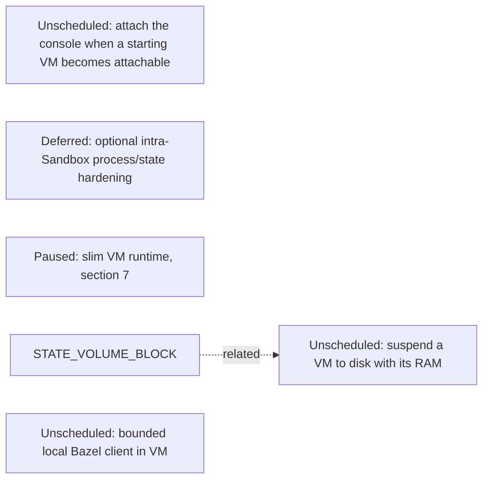

### `VM_INTRA_SANDBOX_HARDENING` — optional process and state hardening inside one Sandbox

**Deferred; nonblocking.** The accepted boundary is the Sandbox, so co-resident Sessions share its
filesystem, credentials and process trust domain. The VM Runner runs as guest root, native harnesses
run as uid/gid 107, and virtiofs presents `/state` files as 107:107; the Runner does not create a
separate mount or PID namespace for each Session. The existing per-harness cgroup groups a native
harness with its tool children for resource limits and teardown, not as a security boundary. Do not
require Runner-private storage, sibling Session stores, or harness/tool process views to be isolated
inside one Sandbox. Revisit Runner-state privacy and tool-child-versus-harness hardening separately
only if a concrete product requirement or incident warrants it. This node does not
gate VM resource acceptance or lifecycle work.

### `VM_RAM_SUSPEND` — suspend a VM to disk with its RAM

**Unscheduled; operator, 2026-10-13 PDT: nice to have.** A stopped VM Sandbox resumes with the memory
it had, not a cold boot, so a quick resume loses no in-memory state. Find what KubeVirt offers (a
memory dump or a snapshot with memory) and whether it works with the state volume (virtiofs today, block under `STATE_VOLUME_BLOCK`). The
[VM Sandboxes design](../docs/vm_sandboxes.md#guest-and-storage) records that a VM supports neither
RAM suspension nor live migration today. Check what a resumed guest must redo: the runner's control stream and
projected tokens (the relay reopens them per request, so rotation alone needs no restart), and the
clock. Settle first what "seal before suspend" means when the harness keeps running across the suspend
(the current quiesce stops harnesses and seals journals). Where storage or the guest cannot carry it, stop/start from the state PVC stays the
lifecycle.

### `VM_CONSOLE_DEFERRED_ATTACH` — attach after VM startup makes the console available

**Unscheduled; lower priority, operator report 2026-10-15 PDT.** During VM startup the console tab
can show `Kubernetes answered 400` and remain disconnected. Treat a not-yet-attachable VM as waiting
and attach when its lifecycle signals readiness, without reopening the tab. Distinguish startup
from authorization failure, deleted VM, and another attached client; clean up on tab exit and never
open competing connections. Keep the existing read-only/no-replay contract. Test the unavailable
→ attachable transition and cancellation; do not add a periodic polling loop or bigger timeout.

Control design: [ADR](../docs/adr_sandbox_session_control.md).

### `LOCAL_BAZEL` — bounded local client in a VM

**Unscheduled.** The deployed template already provides 8 GiB, one vCPU and explicit byte
budgets. Wire Bazelisk, storage and authenticated RBE/cache/BES; bound the client's CPU/memory/disk
usage and cleanup. Inspect actual launcher requests/limits, namespace usage and eligible-node
capacity, including KubeVirt overhead. Run a representative build/test with the client inside the
VM and actions remote, without guest OOM; check cancellation/cleanup while the harness stays
responsive. Record useful sizing evidence in VM documentation. Installed tools and working hosted
builds do not authorize local Bazel in agent containers. Further guest slimming is independent of
this acceptance.

## 5. Independent UI and narrowly scoped service work

These candidates need no multiagent or VM decision. Any implementation that turns out to require
app/Sandbox Service database changes requires its own migration safety review.

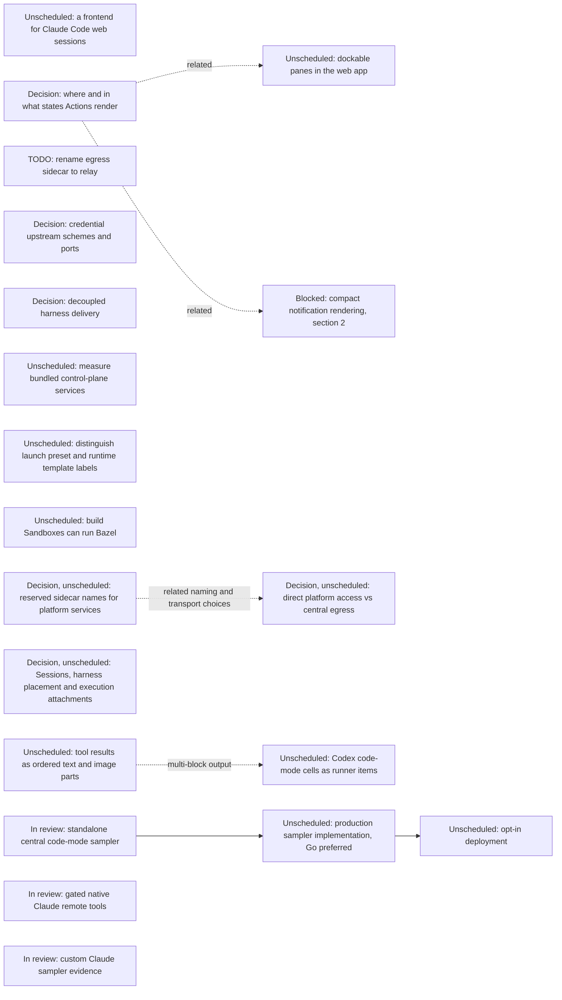

### `SESSION_RUNTIME_MODEL_DESIGN` — Sessions, harness placement and execution attachments

**Decision, unscheduled; operator requested future design work, 2026-10-28 PDT.**
[Design brief](session_runtime_model.md). Represent both Sandbox-local harnesses/state and independently
persistent harnesses whose Sandboxes supply execution. Preserve harness-specific constraints: Claude
Code naturally runs in the environment it acts in; a shared vocabulary must not pretend every
backend supports independent placement or executor replacement.

Recommendation for review: distinguish Session identity/continuation authority, harness placement
and execution attachments without choosing their storage or forcing a global creation order. Prefer
external placement when capabilities are otherwise equal, for isolation and independent lifetimes.
Characterize complete per-feature placement; OpenClaw's historical partial remote support is a
counterexample to equating remote shell forwarding with a fully separated harness.
Support the design cases of Sandbox-first native CLI use, Session-first central use, no Sandbox
(external MCP tools only), and later attachment/detachment. Central Session data must survive
execution-Sandbox deletion. Decide cardinality, capabilities, lifecycle, authority and attribution;
reuse the existing versioned Codex environment API evidence without claiming unsupported modes work.
Exit: reviewed vocabulary, lifecycle/API examples and a data-preserving transition proposal covering
these cases. This is not a prerequisite for the fixed-binding sampler in PR #12225 and authorizes
no implementation, deployment or native-state migration.

### `STRUCTURED_TOOL_OUTPUT` — tool results as ordered text and image parts

**Unscheduled; operator, 2026-10-21 07:11 UTC: "fidelity improvements like images for Claude let's put on task
dag".** Tool results become ordered parts (text, image) in the harness-neutral vocabulary instead of one string.
Today `event.proto` carries `ToolResult.output`, `ToolOutputDelta.text` and `RecoveredContent.output` as strings,
the Claude adapter's `resultText()` (`runner/claude/protocol.go`) joins text blocks and drops images, and the
History fold's `FieldOutput` is one text field that deltas append to. Scope: the proto, both runner adapters, the
History fold with its storage and reads, the app API, the frontend tool cards, and the fold, span and visual
fixtures. Archived event logs and History rows hold `output` strings and sealed archives cannot be rewritten; the
default under "deployed state is disposable" is to drop that data in its own data-deletion PR, which is the
operator's call. Exit: an image a Claude tool returns renders in its tool card.

### `CODEX_CODE_MODE_CELLS` — Codex code-mode cells as runner items

**Unscheduled; operator, 2026-10-21 07:11 UTC: "It would be nice if we could get the code mode also out of codex
app server for fidelity but I'm guessing that might not be trivial".** Surface Codex code-mode `exec` cells (the
script and what it emitted) as runner items. Codex app-server has no `ThreadItem` for them, in 0.157.0 or on
`openai/codex` main at `c7234c11` (2026-10-21), and core emits the call output only to hooks, so the runner sees
only the nested `commandExecution`. Needs upstream support, or reading the rollout or the native frames. Multi-block
cell output likely needs `STRUCTURED_TOOL_OUTPUT`.

### `CENTRAL_SAMPLER_V1` — independent central code-mode runner

**In review; [PR #12225](https://github.com/agentydragon/ducktape/pull/12225); operator approved implementation,
2026-10-27.** Root `/root` integrates branch `x/central-runtime-v1-20261027`.
The independent executor companion fixture extraction and standalone sampler correctness fixes
landed in [PR #12288](https://github.com/agentydragon/ducktape/pull/12288) and
[PR #12292](https://github.com/agentydragon/ducktape/pull/12292). Both are incorporated from `devel`;
this PR retains the central service integration and central-only shared runtime extensions.
The placement decision is accepted: a shared independent sampler with its own PostgreSQL
continuation, per-Session supervised JS host, fixed Sandbox/incarnation executor via the pinned
Codex exec-server protocol, Dispatcher direct command routing and existing History ingress.
Wrapped Codex/Claude retain local execution and sampling. Required v1 capabilities are compaction,
model-facing wait, stdin and interrupts. Remote AGENTS.md discovery and executor replacement are
deferred; neither gates v1. OpenAI-shaped Responses API/code mode is the selected provider scope.

Exit: reviewable experimental `x/` service with authenticated API, fixed-binding Gateway relay,
durable commands/context/evidence, History export with lost-ack reconciliation, failure semantics,
native-mode regression and integration tests, optional UI selection and documented resource limits.
One-shot executor setup and the scripted-model k3s scenario through Dispatcher, Gateway, the bound
executor and retained/folded History have passed. The shared Langfuse fixture refactor landed separately on `devel` first in [PR #12228](https://github.com/agentydragon/ducktape/pull/12228).
No deployment or data migration is authorized here. [Accepted design](sampling_outside_sandboxes.md#accepted-central-sampler-v1)
and [service contract](../x/central_sampler/SPEC.md). Earlier spike findings remain in
[Codex placement evidence](../debug/central_codex_sampling.md) and
[Postgres sampler evidence](../debug/postgres_codex_spike.md).
[V1 validation](../debug/central_sampler_v1.md) records the passing combined execution/History test,
native regressions and remaining deployment-specific limits.

### `CENTRAL_SAMPLER_PRODUCTION_IMPL` — deployable sampler implementation

**In flight; Codex, operator requested 2026-10-28; in [PR #12225](https://github.com/agentydragon/ducktape/pull/12225).** Rewrite the
sampler service, provider/tool loop, persistence and History exporter in Go. The original Python
prototype supplies the contracts and acceptance evidence; the pinned upstream JS host remains a
separate supervised process. Carry forward its authenticated
API, PostgreSQL continuation and leases, uncertain-effect handling, supervised JS hosts,
compaction/wait/stdin/interrupts, Gateway relay and History outbox semantics. Reuse the wire fixtures
and acceptance scenarios to validate the replacement. Exit: reviewed implementation with equivalent
acceptance coverage, including recovery, fencing and native harness coexistence.

### `CENTRAL_SAMPLER_DEPLOYMENT` — opt-in runtime deployment

**Unscheduled; technically after `CENTRAL_SAMPLER_PRODUCTION_IMPL`; requires operator selection.** Deploy an
isolated database, sampler workload, delegated per-host resource boundary, audience/token and
allowlists, configured provider route, History ingress network path and optional app offering.
Preserve existing native Session identities, history, state and wrapped harness operation. Validate
the deployed cgroup delegation and trusted Session attribution; scripted wire fixtures alone do not
establish live endpoint/model compaction support. No default switch, native data conversion or
executor replacement implied. Exit: bounded new-Session acceptance and data-preserving rollback.

### `CLAUDE_REMOTE_EXECUTION_SPIKE` — gated native Claude remote tools

**In review; [PR #12210](https://github.com/agentydragon/ducktape/pull/12210), 2026-10-27.** The question
is the specifically gated native remote-tools feature, its locally settable versus account gates,
transport and instruction/read-state behavior. Generic filesystem MCP feasibility is already known
and is not the acceptance outcome. Preserve exact binary versions and captures proving whether a
remote read makes root/nested `CLAUDE.md` appear in the next model request; file access alone does
not establish that. Exit: reproducible native-feature evidence or blocker and recommendation.
Independent of the Codex v1 implementation; no live account changes or runtime cutover authorized.

### `CLAUDE_CUSTOM_SAMPLER` — custom Claude loop and shared code-mode compatibility

**In review; [PR #12211](https://github.com/agentydragon/ducktape/pull/12211), 2026-10-27.** Record
scripted custom sampler evidence and CLIProxyAPI/CLI-shaped compatibility limits. A future Claude
backend could use the same central code-mode runtime with suitable prompting and tool contracts;
that is a later decision, not established by wire cloaking. Preserve wrapped official harnesses as
an independent transitional backend. History must retain backend-specific evidence and expose a
purpose-specific common display fold without inventing details absent from a harness JSON API.

### `SANDBOX_FORM_TERMINOLOGY` — distinguish launch presets from runtime templates

**Unscheduled; operator, 2026-10-17 PDT: the new Sandbox form's “Preset” and “Sandbox template”
labels are confusing.** Distinguish the multi-field choice as a “Launch preset” and the Pod/VM
shape as a “Runtime template” (or use equally clear wording). Update the helper text to match; keep
API model and field names unchanged.

Exit: the form's labels and descriptions clearly distinguish those concepts on desktop and phone.

### `PLATFORM_SERVICE_NAMES_DESIGN` — stable sidecar names for platform services

**Decision, unscheduled; operator idea, 2026-10-16 PDT.** Evaluate reserved names such as
`gateway-control.agentplane`, `history-ingress.agentplane`, `notifications.agentplane` and
`actions.agentplane` that map to deployment-configured service endpoints. Decide where the mapping
lives alongside `PLATFORM_SERVICE_ROUTING_DESIGN`; stable names need not select a central or local route.
Cover platform services an agent can access, including discovery of their APIs and effective access;
distinguish runner-internal interfaces from agent-facing interfaces. Keep namespace, cluster domain
and ports out of client configuration. Decide whether these are proxy-only authorities or resolvable
names usable by direct HTTP/gRPC clients; account for proxy exclusions, Pod/VM networking,
TLS authority if applicable, and the
overlap of `gateway.agentplane` with Kubernetes Service/namespace DNS shorthand.

Use exact deployment-owned mappings, coupled to endpoint, audience/token projection and
network-policy wiring; `cluster/cdk8s/agentplane/platform_routes.py` owns today's direct routes.
Preserve independent backend authorization and audience-specific identity. Naming alone grants no
access; any change to a service's egress-policy or credential requirements belongs to the routing
decision below, not an incidental alias change.
Unknown reserved names and unavailable routes fail closed without ordinary
DNS/public-egress fallback. No general wildcard-to-cluster-service rewrite is implied.

Exit: a reviewed naming and transport contract with concrete Gateway-control, History-ingress,
Notifications and Actions client examples, plus a bounded implementation/acceptance scope covering
routing, service discovery, effective access, injected identity, denials and supported Pod/VM clients.
This node authorizes design work; runtime changes wait for
the transport decision. No prerequisites on the other section 5 candidates.

### `EGRESS_CREDENTIAL_TRANSPORT_DESIGN` — credential upstream schemes and ports

**Decision; operator requested the audit/proposal, 2026-10-19.** Review the source inventory and
alternatives in [the component proposal](../egress/plans/credential_transport.md). Select where
substituted credentials may travel: external HTTPS/port restrictions and explicit internal
HTTP/h2c exceptions. Keep private-address permission separate from plaintext permission.

Exit: a reviewed transport-grant model and exception set, with bounded implementation/rollout
acceptance. This node authorizes design only; it does not change enforcement or select a platform
routing topology. `PLATFORM_SERVICE_ROUTING_DESIGN` remains a separate decision.

### `PLATFORM_SERVICE_ROUTING_DESIGN` — direct platform access versus central egress

**Decision, unscheduled; operator discussion, 2026-10-16 PDT.** Compare routing agent-accessible
Agentplane services through the central egress proxy with direct local-relay routes or direct
authenticated clients. Include Actions and Notifications as well as runner Gateway control and
History ingress. Gateway/ingress previously used central egress; existing proxy coverage includes
interactive plaintext bidirectional gRPC with metadata substitution. Protocol alone does not require
their current special routes. Naming and API discovery can be designed independently; settle the
combined transport contract before implementation.

The central proxy keeps real substituted credentials outside the Sandbox/Pod/VM and outside what
its ServiceAccount can access, records request/decision evidence, and applies Agentplane egress
policy. Agentplane's own services instead authenticate the agent as itself: distinguish that workload
identity from delegated external credentials the agent must never possess. Backend authorization
remains required on every route.

Arguments for direct platform access: these services are naturally agent-facing, their caller's own
identity may be acceptable for the agent to hold, and required runner control/history delivery would
not depend on central-proxy availability or egress-policy readiness. A local relay could attach
identity without requiring `Bearer <placeholder>`; weigh that small convenience against an asymmetric
client contract that hides authentication. Stable reserved names help prompts and instructions under
either routing choice.

Costs of direct relay routes: another route/configuration surface to distribute and update across
Pod and VM runners, and another place that attaches workload authentication to requests. The minimal
relay already authenticates its hop to central egress, but per-service forwarding expands its role.
Compare generated startup configuration with mounted ConfigMaps or another existing distribution
mechanism; specify update/reload behavior, rollout scope and failure behavior. Central routing
consolidates policy, substitution and decision logging, but adds those dependencies to platform calls.
Decide what request/decision visibility and access controls direct routes need and who owns them.

Direct routes also widen the destinations the workload can reach directly: Pod network policy cannot
distinguish the relay from its agent container, so allowing the relay to reach a backend also permits
the agent to attempt that connection. Backend token validation still gates access. Weigh the marginal
exposure against the central path: a stolen token could also be presented through central egress
where the caller's host/method/path policy admits the request and no substitution replaces it.
Direct access bypasses that egress gate and its decision logging; it does not itself grant the
backend identity or authority. Assess this separately from whether the agent may hold its own token.

Evaluate making central egress optional for deployments that need neither external credential
substitution nor Agentplane egress filtering: external networking may be independently disabled, or
the operator may accept unrestricted access and agent-held credentials. State which functions and
diagnostics are absent in that mode and how platform identity, authorization and discovery still work.
Absence of the proxy alone does not disable external networking.

Exit: a reviewed routing/dependency and identity contract, including whether central egress is optional,
configuration lifecycle, and concrete client examples coordinated with `PLATFORM_SERVICE_NAMES_DESIGN`.
Define bounded acceptance for actual runner control and History push/reconnect, agent calls to Actions
and Notifications, authorization denials and the selected proxy-unavailable/absent behavior. No runtime
change or removal of existing policy checks is selected by this node.

### `ACTION_SURFACES_DESIGN` — where and in what states Actions render

**Decision; operator, 2026-10-13 PDT: rethink it, since it is a patchwork and possibly redundant.**
Decide every place an Action is shown and in which states, then reduce the code to that. Surfaces
found in `app/frontend/actions/` and the service worker: the sidebar rows (collapsed and expanded,
with card decision buttons only where the Action type's `offersCardDecisionButtons` says so), the top "Actions waiting" strip (a count),
the Actions page queue and the detail view (`PendingActionCard`, the full `ActionCall`, with a raw
and a pretty toggle), history, the policy view, and the Web Push notification (formatters in a
registry separate from the React one). Several of them choose independently what to render, whether
to offer a decision, and how tall to let the card grow. Settle which surfaces exist, what each is
for (a glance, a quick decision, full review, a record), and which states each has, so that one
rule decides inline approval and height and each Action type is described once.
Landed: whether a card offers its decision buttons is decided by the Action type's own
`offersCardDecisionButtons(args)` for each invocation, from its content (for example a read-only call
against a listed resource), not by a per-kind allowlist. The names **compact card** (the glance form in
the sidebar and the strip), **card decision buttons** (Approve/Deny on a compact card) and **attention
strip** (the top "Actions waiting" count) are already used in code and tests. Still to settle with the
design: **full card** (the detail view with the whole `ActionCall`) and **notification buttons**
(Approve/Deny on a Web Push notification), then use every name everywhere (UI copy, docs), since "quick
approve" could mean the buttons on a card or on a desktop notification. `NOTIFICATION_PRESENTATION` (section 2) renders notices on the same surfaces and uses the same card
names.
Known inconsistency, left as is (operator, 2026-10-24: acceptable for now, handling still to be
thought through): notification buttons ignore `offersCardDecisionButtons`. The service worker offers
Approve/Deny whenever exactly one Action waits, whatever its arguments, so a notification can approve
a call (a long shell script, a large file push) that the app offers only on the full card.

### `DOCKABLE_PANES` — dockable panes in the web app

**Unscheduled; operator, 2026-10-13 PDT.** Let the operator arrange the app's panes (thread browser,
Actions queue, several threads at once, Action detail) by dragging them into a layout of their own,
with split resizing, a layout that persists, and one selected pane at a time on a phone. Open spike
[#9721](https://github.com/agentydragon/ducktape/pull/9721) builds this as an experimental
`/#/mosaic` shell on `react-mosaic-component`, split-only without tabs, beside the classic routes;
it is stale and is the starting point. Settle whether docking replaces the classic routes or stays
an alternative, and fold the Action tiles into the surfaces `ACTION_SURFACES_DESIGN` settles.

### `CLAUDE_CODE_WEB_BRIDGE` — Claude Code web sessions in Agentplane

**Unscheduled; operator, 2026-10-12 PDT: low priority, not to build now.** Make Agentplane's
frontend a custom frontend for Claude Code web sessions: show their conversations and send them
messages, by shimming the web interface's control protocol. Builds on the viewer and syncer under
`devinfra/` and the reverse-engineering in `agentydragon/gaffer-private`.

### K3s startup experiment constraints

The independent candidates below were requested by the operator on 2026-10-16 PDT; none waits
for the others. Use equivalent source/scenarios and report transfer, import/unpack, process
readiness and total test time separately in
[the k3s stack timings](../system_tests/k3s/debug/stack_timings.md).
Preserve assertions and timeouts. Language rewrites require Rai's decision;
rank them by unique image bytes removed and startup time on the dependency chain. Remaining
Python services still need the shared interpreter.

Keep the fixture declarative: supply images and manifests, let Kubernetes reconcile, wait
for readiness, then test. Startup dependency ordering belongs to Kubernetes; do not add
PostgreSQL-first sequencing or a custom parallel import/unpack scheduler to the test harness.

### `EGRESS_RELAY_RENAME` — rename the egress sidecar to relay

**TODO; operator request, 2026-10-16.** Rename the egress sidecar to "relay" across code,
configuration, image names and docs. Update all consumers atomically.

### `RUNNER_HARNESS_DELIVERY_DESIGN` — choose how runners obtain harness binaries

**Decision; operator, 2026-10-16 PDT: investigate for k3s test latency.** Decide how a runner obtains
a needed harness independently of its image: digest-pinned downloads from an independent
Agentplane service or directly from OpenAI/Anthropic distribution endpoints, or separately pinned
harness OCI images made available through mounts or an init container copying into a shared volume.
Operator preference: eventual delivery should decouple harnesses from the runner image; the
narrower test images are an interim optimization. Decide delivery and service/cache ownership. Any serving service must
respect the backend dependency rule; the integration app cannot own this path.
Whatever delivers Codex must keep the version the model-catalog generator pins at least as new as the runner's
([ingress README](../llm_ingress/README.md#codex-model-catalog)).

The [image-split comparison](https://github.com/agentydragon/ducktape/blob/7fd9f16f7d/agentplane/x/k3s_env/README.md#harness-specific-runner-comparison-2026-10-16)
measures removal of unused harness payload; it does not measure runtime delivery of a needed harness.
Its profiles and inventories are in [#10813](https://github.com/agentydragon/ducktape/pull/10813); the image split itself landed in #10812.

Exit: a measured recommendation and explicit operator choice. Compare equivalent scenarios and
pins, separating image build/upload, action-input transfer, containerd import/unpack, harness
fetch/cache hits and first usable Session. Include cold runs: moving bytes from an image to a
service may only move the same transfer later, and fetching upstream still costs network and
extraction time. Specify version/digest verification, atomic installation, concurrent requests,
cache scope, unavailable-artifact behavior and allowed egress for any runtime-delivery proposal.
No new artifact service or runtime-download implementation is selected by this node.

### `K3S_BUNDLED_SERVICES_SPIKE` — measure a less isolated control plane in real k3s

**Unscheduled spike; operator, 2026-10-15 PDT.** Evaluate running Agentplane control-plane
services together in one Pod to reduce integration-test startup time. Keep real k3s, RBAC
objects, service APIs, databases, controllers and separately managed Sandbox workloads;
exercise the existing end-to-end lifecycle scenarios. Preserve each service's intended
Kubernetes identity and permissions using separate credentials rather than the Pod's union
of service permissions. Explicitly assess how to provide those credentials: a Pod has one
ServiceAccount, so bundling must not silently bypass authorization coverage.

Compare the normal deployment layout with the bundled layout on equivalent inputs and
scenarios. Measure image import/unpack, startup/readiness and total test time separately;
bundling alone does not remove image bytes or process initialization. Record implementation
complexity and coverage lost through shared networking, scheduling, restart and failure
boundaries, including NetworkPolicy isolation. Deliver a measured recommendation to adopt
or discard the reduced mode, with normal-layout coverage retained for those boundaries.
Keep the expensive workflow manual-only; this spike does not authorize a production topology
change, removal of existing coverage or a language rewrite. Keep one documented invocation path
per supported test tier.

### `BUILD_BOX_BAZEL` — build Sandboxes can run Bazel

**Unscheduled; held by the [BuildBuddy auth policy](../docs/buildbuddy_remote_auth.md): no local Bazel client in an agent container until agents have VM-backed environments, which is `LOCAL_BAZEL`'s outcome.** Not the same outcome as `LOCAL_BAZEL`: build Sandboxes are Pods today, so a candidate route is letting Action-service Sandboxes be VM-backed (operator, 2026-10-18), after which `LOCAL_BAZEL`'s client would serve them. A build Sandbox cannot run Bazel here: the repo's configuration uses `remote.buildbuddy.io`,
whose gRPC dial ignores the box's HTTP proxy and times out, and it needs credentials. `agentplane/` has no
`go.mod`, so a plain `go build` is not available either. Options: a local-only Bazel configuration for boxes,
or a BuildBuddy route through the box's egress (the Go egress for boxes exists). The key can stay in the
egress proxy as a header substitution, as the staging `claude-ai` Sandboxes' `BUILDBUDDY_POLICY` already does for
`bazel --config=rbe`; whether boxes get that binding is the operator's call.

## 6. Existing access and lifecycle follow-ups

### Egress implementation follow-ups

Unscheduled, each its own change: upstream connection reuse, idle tunnel timeouts, and metrics.

These are bounded existing work, not dependencies on the broader multiagent model. Confirm current
source/deployment state with the relevant owner when dispatching; old acceptance notes are not live
observations. New database work follows the task-specific review and rollout requirements.

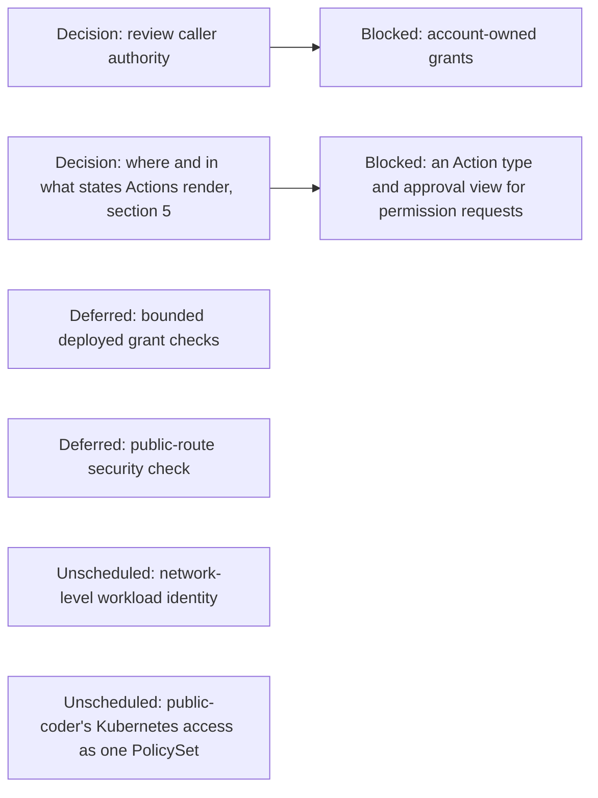

### `PC_KUBERNETES_POLICY_SET` — public-coder's Kubernetes access as one PolicySet

**Unscheduled; operator, 2026-10-12 PDT: wants it eventually.** Move public-coder-agent's whole set
of RoleBindings and ClusterRoleBindings (logs, pods, node and cluster-metadata reads, VolSync status
and the rest, in `cluster/cdk8s/public_coder/app.py` and its entries in
`cluster/cdk8s/agent_access_profiles.py`) under one `PolicySet` of Kubernetes rules with a Flux-owned
`PolicyBinding`. Open: `PolicyBinding` subjects are ServiceAccounts only, while some of these
grants name the `haku:access-profile:public-coder` Group, so either the binding learns Group
subjects or those grants move to the agent's ServiceAccount.

### `CLAUDE_AI_SA` — review the external caller's actual authority

**Decision.** Review the claude.ai account's Connection and arbitrary-shell Sandbox privileges,
Kubernetes scope and egress/Action grants. Record intended authority in generated configuration,
not ad hoc grants. Test an allowed and denied operation; do not add privileges as part of this review.

### `AGENT_PERMISSION_REQUESTS` — an Action type and approval view for permission requests

**Blocked on `ACTION_SURFACES_DESIGN`; operator, 2026-10-13 PDT:
eventually.** A specific Action type for the request instead of the retired Kubernetes MCP grants
escape hatch, with an approval view that shows the operator the account, the sets and the duration
rather than a blob of Kubernetes YAML. It shares with the app's sandbox-page grants the one path
that writes a `PolicyBinding` for the operator (`EgressAccess.grant`), so an approved request creates
the same kind of binding. How the request renders is the Action surfaces' decision: the approval
view is one Action type described once there.

### `MANAGED_SA_RBAC` — grants for accounts without a Sandbox

**Blocked on the caller review.** The claude.ai caller gets a
Flux-owned `PolicyBinding` of the sets `CLAUDE_AI_SA` approves, of any rule type, replacing its
remaining static per-namespace grants in `agent_access_profiles.py` (`STATIC_GRANTS["claude-ai"]`; the
acceptance-testing RBAC already moved to a `PolicyBinding` in #10522). Static Group subjects (Haku OIDC;
public-coder until `PC_KUBERNETES_POLICY_SET`) stay Flux bindings. Test an allowed and a denied request. Static caller accounts' bindings, this one among them, are Flux-owned, never Sandbox-owned.

### `SANDBOX_RBAC` — bounded deployed grant checks

**Deferred by the operator; not dispatchable until selected.** Inspect the managed-Sandbox grant path as `PolicySet`s leave it
and verify intended versus unrelated scope, including Role edits and credential-use boundaries,
without recording credentials. Use [agent RBAC](../../cluster/docs/agent_rbac.md) and existing tests;
only unresolved deployed wiring needs a live check, not a repeat of every already-covered operation.
What no acceptance test covers yet, to check with the affected accounts' own credentials and not a production
account: two Sandboxes sharing a set and a third with a one-off grant, adding and removing a namespace in the
set, widening and narrowing a referenced Role, and revoking the one-off and the shared binding independently;
deleting a Sandbox, recreating a ServiceAccount of the same name and restarting the controller; and a grant
that fails partway, which shows in the binding's `KubernetesReady` condition while the rest still applies.

### `NOTIFICATION_INGRESS_BOUNDARY` — bounded public-route security check

**Deferred by the operator; not dispatchable until selected.** Existing tests
cover invalid signatures. Close the remaining route-wiring uncertainty with an unsigned webhook
request and a private-API request through the public hostname: both must be refused, without
creating subscriptions or inbox entries. Record the result once; no exhaustive provider matrix.

### `NETWORK_WORKLOAD_IDENTITY` — network-level workload identity

**Unscheduled; operator, 2026-10-12 PDT: consider later.** Sandboxes and other workloads prove
their identity to Agentplane services at the network layer, with Cilium mutual authentication
(SPIFFE/SPIRE) or a service mesh, instead of a projected token plus an egress proxy hop; services
authorize by SPIFFE ID or workload label. Costs: SPIRE or a mesh to install, Cilium mutual
authentication still in beta, and a second authentication scheme in every service beside projected
tokens.

## 7. Our own Sandbox resource: Sessions that outlive their Pod

A Session and its history are durable. The operator's direction (2026-10-12 PDT):
the way a Session outlives its runner is our own Sandbox resource, which holds the state PVC and
stays in place with no Pod or VM scheduled. A Sandbox is its state, running or not; an
**incarnation** is one Pod or VM. Stopping, replacing the image and starting again keeps the
Sandbox, so keeping the state means keeping the Sandbox, and deleting the Sandbox is the only thing
that deletes it. The same resource carries the VM kind, so section 4's stateful VMs build on these
nodes instead of a parallel track. Today a Session lives as long as its `Sandbox`
(suspension removes the Pod and keeps the state PVC, which goes with the `Sandbox`). The History Service keys by Session, so it can record each incarnation, and a seal closes
an incarnation, not the Session.

A related direction (operator, 2026-10-11 PDT; later, not scheduled): Sessions living in a
long-running, often-suspended Sandbox whose runner image upgrades between incarnations.

```mermaid
flowchart TD
    DECLARATIVE_SESSIONS_DESIGN[Decision, unscheduled: Flux-managed Sessions and subscriptions]
    SUBSCRIPTION_AUTHORIZATION_DESIGN[Subscription authorization decision, section 2] -. related authority design .-> DECLARATIVE_SESSIONS_DESIGN
    STATE_VOLUME_BLOCK[Deferred: block storage for Pod and VM state and workspace]
    NODE_LOCAL_BLOCK_STORAGE[Unscheduled: node-local block volumes on every node]
    VOLUME_LAYOUT_CONVERSION[Unscheduled: explicit offline volume conversion, much later]
    SANDBOX_SPEC_EDIT[Unscheduled: edit a suspended Sandbox's template or kind]
    WORKSPACE_NODE_PORTABILITY[Unscheduled: move a workspace between nodes]
    SANDBOX_AUTODISKFUL[Decision, unscheduled: auto-diskful storage for Sandboxes]
    SANDBOX_ARCHIVE[Unscheduled: a suspended Sandbox archived to object storage]
    AGENT_RESUME_NOTICE[Unscheduled: tell agents when their Sandbox was suspended and resumed]
    RUNNER_BUSY_TRACKING -. related .-> AGENT_RESUME_NOTICE
    RUNNER_BUSY_TRACKING[Unscheduled: the runner counts terminals and background processes as busy]
    SESSION_ACTIVITY_STREAM[Unscheduled: the notification service delivers on a Session's idle time]
    PROXY_START_METHODS_DISPATCHER_ONLY[Candidate: narrow proxy command authorization, section 12]
    RESUME_CREDENTIALS_VALID[Decision: optional grants versus resume prerequisites]
    VOLUME_LAYOUT_CONVERSION -. future incompatible edits only .-> SANDBOX_SPEC_EDIT
    WORKSPACE_NODE_PORTABILITY -. related .-> SANDBOX_ARCHIVE
    VM_RAM_SUSPEND[Unscheduled: suspend a VM to disk with its RAM, section 4]
    DISPATCHER_HARNESS_CONFIRMATION[Decision: settle harness-confirmed inputs]
    DISPATCHER_SEND_AUTHORIZATION_GENERALIZE[Deferred: scoped sender grants beyond v0 service trust]
    STATE_VOLUME_BLOCK --> STATE_VOLUME_VIRTIOFS_RETIRE[Deferred: retire the superseded state attachment]
    IDLE_SUSPEND_UI_DRIVE[Operator: remaining VM idle-suspend/send-to-wake UI drive]
    VM_RAM_SUSPEND -. the same experience, resuming with memory kept .-> IDLE_SUSPEND_UI_DRIVE
```

### `DECLARATIVE_SESSIONS_DESIGN` — long-running Sessions and managed subscriptions through Flux

**Decision, unscheduled; operator idea, 2026-10-16 PDT.** Support a long-running Agentplane
Session declared through Flux, with managed subscriptions such as “keep this Session subscribed
to these GitHub notifications” or “keep it listening to a webhook at this URL.” Creation and
ongoing reconciliation must work without starting the Session from the UI or keeping the
integration app available. Long-running describes durable managed intent; decide separately
whether the harness stays running or suspends and wakes on authorized events.

Review a `Session` CRD, potentially with declarative subscription resources or references. Compare
coexistence with service-owned Session records against replacing the relevant database authority;
first inventory the current runner, Dispatcher, History and app responsibilities rather than
assuming one database owns Sessions. Recommend evaluating Kubernetes-owned desired state with
existing services retaining execution/history and Notification Service retaining subscription/inbox
ownership. The operator must choose the resource boundaries and source of truth; no CRD or database
replacement is selected by this task.

Define stable identity and idempotent create/adopt/reconcile behavior, ownership of UI/API-created
Sessions, spec edits and drift, restart recovery, deletion/suspension and retention of authored
history. Specify how managed subscriptions are restored, updated and removed without duplication,
and whether a webhook URL means provisioning an authenticated inbound endpoint or subscribing to
an existing source. Reuse the subscription-authorization decision in section 2; declaring a resource
must not implicitly grant source access, destination control or wake authority. Identify any actual
implementation prerequisites after choosing the design, including wake policy if required.

**Exit:** reviewed desired-state/runtime ownership and lifecycle contract, one illustrative Flux
manifest for a Session with GitHub/webhook subscriptions, and independently finishable follow-up
nodes with focused reconciliation/restart, duplicate-prevention and authorization acceptance.
Recording this idea does not schedule implementation.

### `STATE_VOLUME_BLOCK` — block storage for Pod and VM state and workspace

**Deferred; operator, 2026-10-25 PDT: eventual endpoint, todos for later.** Both execution kinds
eventually use block-backed state and workspace storage, including replacing the VM state
virtiofs attachment. Select PVC modes and Pod mount/format ownership explicitly; preserve
journals, native harness homes, permissions, suspension and kind-compatibility checks. Virtio
remains the VM disk transport. This is independent of all-node local provisioning and does not
gate the selected VM workspace cutover. Details: [deferred endpoint](vm_block_storage.md#deferred-endpoint).

### `NODE_LOCAL_BLOCK_STORAGE` — node-local block volumes on every node

**Unscheduled; operator, 2026-10-13 PDT.** Extend capacity-enforcing node-local provisioning to
all cluster nodes, tracked by [#4717](https://github.com/agentydragon/ducktape/issues/4717).
`cluster/cdk8s/openebs_lvm/storage.py` already declares Proxmox filesystem and raw-block classes;
that is not coverage of every node. `local-path` does not enforce PVC capacity. Verify capacity,
node affinity and both required volume modes. A node-local volume remains pinned to its node;
moving it is `WORKSPACE_NODE_PORTABILITY`. This provisioner work does not gate Sandbox ownership
or the explicit layout contract for workspace PVCs.

### `STATE_VOLUME_VIRTIOFS_RETIRE` — delete the superseded state attachment

**Deferred with `STATE_VOLUME_BLOCK`; revisit after its acceptance/activation and old workloads are gone.** Remove VM state
virtiofs mounts, guest ownership/UID workarounds used only by them, old template paths and tests/docs.
Keep unrelated virtiofs uses where live callers still need them. Verify Pod/VM state persistence on
the selected explicit layouts before retiring the path; data drops stay in a separate cutoff PR.

### `VOLUME_LAYOUT_CONVERSION` — explicit offline volume conversion

**Unscheduled, much later; operator, 2026-10-13 PDT.** The 2026-10-25 VM block-storage cutover
uses an accepted Sandbox reset and needs no converter. General conversion remains a future option,
not work for #10440 or a gate on its rollout. Until implemented, incompatible layout changes are
rejected. When scheduled, design a stopped-Sandbox operation with an explicit destination layout,
verified data/metadata preservation, crash-safe binding switch and separately authorized source
cleanup. See [storage layouts](../docs/sandbox_storage.md#formatting-and-conversion). Do not build
a generic conversion framework now.

### `SANDBOX_SPEC_EDIT` — edit a suspended Sandbox's template or kind

**Unscheduled; operator, 2026-10-13 PDT.** Let the operator change a Sandbox's template, including a
switch between VM and Pod, from the app, only while the Sandbox is suspended. Each incarnation
already reads the current template ([controller contract](../sandbox_controller/SPEC.md#vms)); no
spec is replaced automatically; this is the explicit, operator-driven edit. Use the deployed
[workspace layout contract](../docs/sandbox_storage.md) so a compatible kind switch keeps the
workspace. Validate the
retained state and workspace layouts before replacing a workload. Reject incompatible edits;
`VOLUME_LAYOUT_CONVERSION` is a separate, much later task and does not block compatible edits. The
preset the app records on a Sandbox as a label must stay true after the edit.

Control design: [ADR](../docs/adr_sandbox_session_control.md).

### `WORKSPACE_NODE_PORTABILITY` — move a workspace between nodes

**Unscheduled for remaining node-local workspaces; operator, 2026-10-13 PDT: even later.**
Fresh VM Sandboxes use [replicated Piraeus storage](../docs/vm_sandboxes.md#guest-and-storage). For other
node-local volumes, consider portability by copying through VolSync, object storage or directly
while the Sandbox is suspended. This broader copy-based path does not gate replicated VM storage.

### `SANDBOX_AUTODISKFUL` — consider auto-diskful storage for Sandboxes

**Decision, unscheduled; operator, 2026-10-26 PDT.** Evaluate replicated Piraeus auto-diskful
storage for Pod Sandboxes, covering both retained state and workspace volumes. Fresh VM Sandboxes
already use `piraeus-ssd-2-autodiskful`; Pod Sandboxes still use strict-local HDD claims.
On 2026-10-26, both volumes pinned `public-coder-ducktape-2` to `ovh-ns102453`, where memory
requests prevented resume until a stateless GitLab replica was moved elsewhere.

Compare keeping strict-local placement against auto-diskful attachment within the OVH zone;
recommend whether the scheduling flexibility justifies replication capacity and I/O costs.
Include runner filesystem requirements and preservation of existing retained data in the decision:
changing a template does not migrate existing PVCs. This is an evaluation, not an approved storage
cutover or a prerequisite for the separate copy-based portability task.

**Exit:** reviewed recommendation for Pod state and workspace storage, with any migration and
activation work recorded as follow-up nodes if selected.

### `SANDBOX_ARCHIVE` — a suspended Sandbox archived to object storage

**Unscheduled; operator, 2026-10-13 PDT: a thought that volsync suggests, not a plan.** Resource
affordances for a Sandbox that still exists but whose volumes sit in restic or S3, so it must be
rehydrated before it can start, freeing the node's disk meanwhile. Sandbox status would say that it
is archived and where, and resuming one rehydrates first. Related to `WORKSPACE_NODE_PORTABILITY`,
which shares the copy mechanism. Preserve the declared workspace layout and retained identity;
the runner's state PVC would archive the same way.

Control design: [ADR](../docs/adr_sandbox_session_control.md).

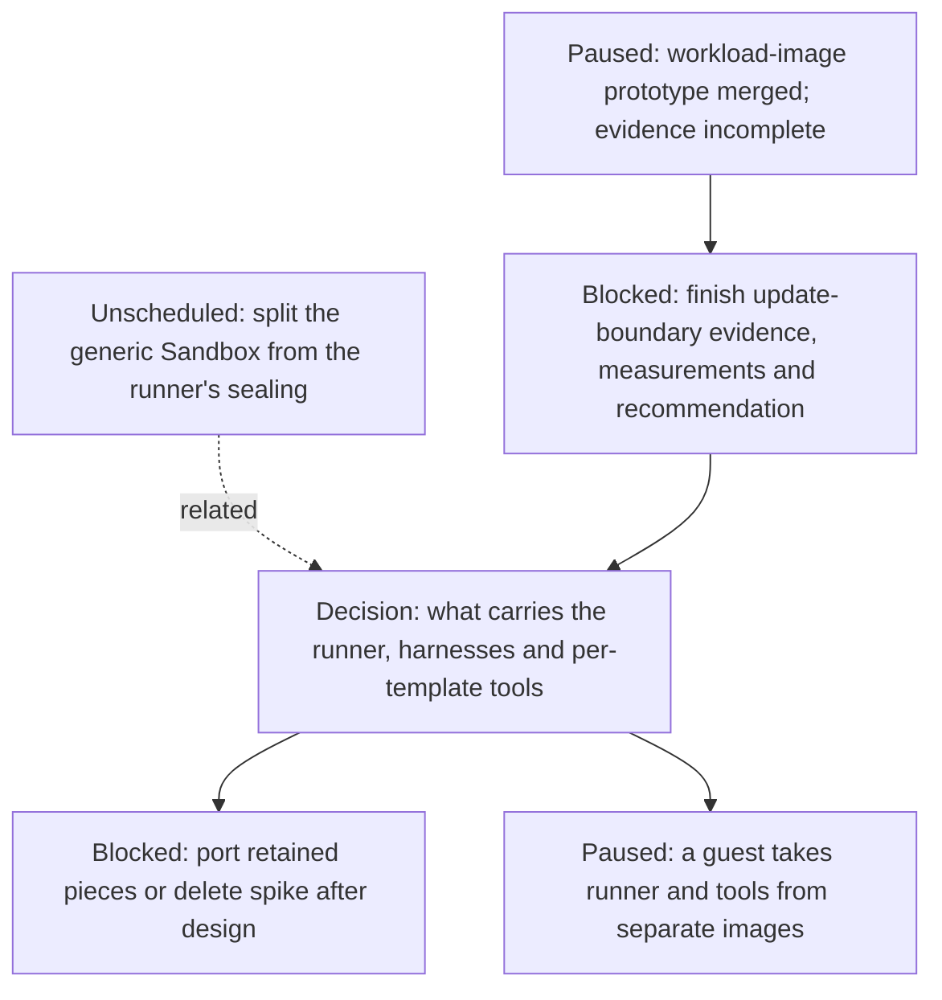

### `SANDBOX_GENERIC_SPLIT` — separate the generic Sandbox from the runner's sealing

**Unscheduled; operator, 2026-10-13 PDT: a later TODO.** Our `Sandbox` resource binds two concerns
together. One is what Agent Sandbox did, plus VM support: a template, a Pod or VM per incarnation,
and a state volume that stays. The other is specific to our runner running inside: sealing a
Session's journal before the incarnation goes. Separated,
the first could be reused without the runner. Decide where the line falls (resource, controller or package) and what each side owns. A
layered pair, a Sandbox and a runner that runs inside one, is the direction the control design
(`docs/adr_sandbox_session_control.md`) points to: seal, runner connectivity and idle suspension
are the runner-aware layer, and the Session Dispatcher sits outside both.

Control design: [ADR](../docs/adr_sandbox_session_control.md).

### `RUNNER_IMAGE_LAYERING_DESIGN` — what carries the runner, the harnesses and the tools

**Decision; operator, 2026-10-13 and 2026-10-15 PDT.** The 2026-10-15 framing names the property wanted: independent updates and RAM headroom. Today one artifact still carries the harnesses and tools:
`agentplane/runner/container-disk.nix` bakes both harnesses and the tools into the NixOS qcow2 that
KubeVirt boots, and `agentplane/runner/image.nix` bakes them into the Pod image. The runner and
`agentplane` command are already split out onto the Bazel-built `//agentplane/runner:disk_image`, a read-only disk
the VM attaches and an image the Pod mounts, so a runner bump no longer republishes either; bumping a
harness or a template's installed tools still rebuilds the whole artifact. Separate the concerns so a platform user supplies an image or definition with
no runner and no harnesses and the runner side layers them in, and nobody bumps build versions to move a
runner. State which of these the design must satisfy, in order:

- **Independent updates.** Runner and per-template tools move without rebuilding what they sit in.
- **The thing Pods genuinely cannot give** (operator, 2026-10-15): a workload may use a lot of RAM inside
  itself, as a Bazel build does, without starving the host node. A VM reserves its guest RAM, so what the
  guest does stays inside it; a Pod's burst is bounded by what the node has left. Say plainly whether
  layering is meant to reach for that property or whether it stays a VM-only one, because it decides how
  far to go.
- **Additive.** New runtime types are added beside the existing ones, not swapped in, so a runtime can be
  tried without retiring the one that works.

Related to `SANDBOX_GENERIC_SPLIT`: that separates the resource, this separates the image.

**Options worth costing, none chosen.** The operator named the first two; the rest are the field.

- **Extra read-only filesystem image per stage.** Attach the runner and the tools as their own images or
  disks; the base carries neither. Exactly the decoupling asked for, and Claude Code web already does it:
  on its Firecracker guest `/opt/claude-code` and `/opt/env-runner` are separate squashfs disks
  (`/dev/vdb`, `/dev/vdc`) mounted read-only beside a `/dev/vda` root —
  [web container spec](../../devinfra/claude/web_env/docs/container_spec.md).
- **Two-stage guest.** A lean stage 1 boots and runs the runner and mounts a stage 2 filesystem; the
  runner jails a forked child into stage 2 and execs Claude or Codex there. Runner lifetime becomes
  independent of the tool tree, at the cost of a pivot or chroot boundary and the work of trusting a
  mounted image.
- **Stay on KubeVirt, split the disks.** A `containerDisk` is already an OCI image carrying a disk, and
  `runner_vm.py` already attaches `config` and `trust` as separate volumes, so a three-disk guest (root /
  runner and harnesses / tools) needs no new mechanism — only the split. Halted image replacement already
  exists, which is the update path.
- **Kubernetes image volumes.** An `image` volume mounts an OCI image's filesystem into a Pod. The
  API server is v1.35.1, where `ImageVolume` is beta and on by default (GA in 1.36), and every node
  reports containerd 2.3.x. This is the direct answer to "this container should mount these 2 images",
  and beats an init-container copy on every incarnation. The runner already runs from such a mount in
  production Pods; whether the harnesses can is open.
- **Init container into a shared volume.** Today's portable form: copy the runner and harnesses from image
  X into an `emptyDir`. Works everywhere; pays copy time and disk each start.
- **Firecracker instead of KubeVirt.** The runtime the operator raised as acceptable if it helps: fast
  boot, small guest, squashfs-friendly, and the shape Claude Code web chose. The cost is a second VMM
  stack beside KubeVirt with no cluster scheduler for it. The RE under `devinfra/claude/web_env/re/` —
  including `process_api/src/firecracker_init.rs` — documents what that guest's init actually does and is
  the closest worked example we hold.

The disk split and Firecracker are not alternatives to each other: splitting disks is additive on the
runtime we have, and Firecracker is a new runtime added beside it.

### `RUNNER_LAYERING_SPIKE` — minimal guest, harness and tools-layer evidence

**Prototype merged (#10741, #10744, #10789); operator-requested 2026-10-16. The remaining compatibility
evidence is paused.** The merged experiment proves a Codex text turn, shell call through a separate Bash
tools OCI layer, native resume after killing the harness, runner survival and private-state separation
in the RBE test; a local Firecracker guest boots the digest-pinned ELF kernel and mounts separate
read-only tools and harness SquashFS drives. #10789 added `workload-tool` in its own OCI tar
layer and changed the mocked Codex shell call to run it before the harness exit, confirmed its
workspace write survives resume, then asked the resumed harness to execute the same workload tool.
The sparse-root scenario passed in RBE; the marker remained readable from the persistent workspace
after the harness was killed and resumed, and the resumed Codex process emitted the tool's output
again. Production VM layout selection and implementation remain open.
The guest's Bash and pinned Codex `--version` probes pass; the same probe records a Claude 2.1.252
SIGABRT in the uid-107 mount-namespace child, while the exact binary succeeds on the full host and
in the guest chroot as root without that namespace. The UID and namespace effects still need to be
separated. Measured artifacts are a 1.9 MB base initramfs, 7.2 MB tools SquashFS, and 168.9 MB
harness SquashFS (the source Bash OCI layer tar is 22.3 MB). A disposable K3s `v1.33.4+k3s1` Pod
with ImageVolume enabled was accepted by the API but containerd `v2.0.5-k3s2` failed container
spec creation (`failed to mkdir ""`), before Bash ran; no Pod image-volume execution is established.
This is evidence about that tested stack, not a universal claim about image volumes. Full coding
work, Nix-root compatibility, true cache-cold preparation and guest-only boot latency remain
unproven; no runtime upgrade or further experiment is currently assigned.

Candidate layout to carry into the design review: keep stage-one init and runner control outside the
tools root; mount the per-template tools image read-only; give the workspace and harness homes
explicit writable mounts, use tmpfs for `/tmp`, and provide only the required `/proc` and `/dev/null`
paths to the child. Reuse that filesystem contract in Pods by mounting the same tools image beside
the runner image, with workspace and persistent session state on separate volumes. The guest's
distinct mounts work in the local probe; the tested K3s runtime did not create a Pod with an image
volume, and Claude's child-context abort remains unexplained. Further intra-Sandbox hardening is
not required by the production contract.

The spike exits when those update boundaries and startup measurements are documented alongside a
bounded compatibility contract and a production DAG proposal. After the design decision, either
port only the accepted artifacts and tests to their production owners or remove the spike-only
package, kernel pin, and child fence; do not leave the experiment as an implicit supported runtime.

### `RUNNER_LAYERING_VM` — a guest takes the runner, harnesses and tools from separate images

**Paused (no worker since the runner disk landed, 2026-10-20); operator chose to split the disks on KubeVirt first (2026-10-20 PDT); Firecracker and a runtime-class abstraction stay later, and whether harnesses become a separate disk stays open in `RUNNER_IMAGE_LAYERING_DESIGN`.**
Split the guest so a runner bump or a template's tool list does not rebuild and repush the whole VM. The
two-stage shape the operator named — lean stage 1 booting the runner and mounting a stage 2 filesystem,
with the runner jailing a forked child into stage 2 to exec Claude/Codex — is one option, with the
squashfs-disk and split-`containerDisk` shapes in the decision node beside it. KubeVirt is not assumed and
Firecracker stays open; what must not change is that the state volume and its ownership rules survive
(`STATE_VOLUME_BLOCK`, and the `107:107` virtiofs constraint). Halted containerDisk replacement already
works, so the update path exists. Landed: the runner and CLI are published as their own `containerDisk`
(`//agentplane/runner:disk_image`), the `runner-vm` template attaches it as a second read-only disk, and the guest
mounts it at `/run/agentplane/runner`, runs the runner from it and no longer carries the runner or CLI
(a Sandbox on `agentplane-testing` booted this way). Remaining: the tools disk is not split yet.
Preserve the shipped typed guest resource policy when splitting layers: stage 1 owns the OS
reserve and service caps, and native workloads and the executor keep their separate budgets.
Deliver a lean bootable guest: a bare root filesystem with the runner and harnesses available from
their chosen layer, and the tools-heavy environment separate. The layering decision still owns exact
disk placement. This work does not gate resource acceptance on the existing guest. The k3s test guest
(`agentplane/system_tests/k3s/guest`)
shows a guest root filesystem can be an `oci_image` target: a candidate runtime then needs no Nix or Attic
and is an additive target rather than a second release pipeline.

### `IDLE_SUSPEND_UI_DRIVE` — finish the VM staging UI drive

**Partially accepted by the operator (2026-10-17 PDT); remaining VM drive belongs to the operator.**
The operator test-drove the five-minute idle suspension and message-to-wake successfully with Codex;
see [UI acceptance](../docs/runner_delivery_and_harness_design.md#runner-owned-harness-lifecycle).
Do not repeat that accepted path as a rollout gate. The report does not identify a VM test.

The remaining check is the same experience through the staging web app with a VM Sandbox: idle
suspension, composer message, wake and delivery, and preservation of the expected context/workspace.
Record only observed gaps and what survived; VM-local disks and processes are lost on suspension,
while retained state/workspace volumes survive. No claim of a completed VM UI drive follows from
the automated Pod/VM lifecycle coverage.

Related: [lifecycle coverage](../system_tests/k3s/README.md#sandbox-lifecycle-coverage), and `VM_RAM_SUSPEND` for
resuming with memory retained.

### `AGENT_RESUME_NOTICE` — tell agents when their Sandbox was suspended and resumed

**Unscheduled; operator, 2026-10-13 PDT: it would be good.** An agent whose Sandbox was suspended and
resumed learns nothing of it: its tool processes are gone, a terminal or background process it started
no longer runs, and whether its workspace survived depends on where it lived (the state PVC is kept; a
VM-local disk is not, until `VM_RAM_SUSPEND`). Tell the agent when a new incarnation of its Sandbox
started, how long it was down, what was kept (state PVC, workspace) and what was lost (processes,
terminals). The runner knows the incarnation change; what survives is a fact of the Sandbox's kind and
volumes, and a suspend ends background processes and terminals, which do not count as busy
(`RUNNER_BUSY_TRACKING`). Open: whether the notice is a runner
platform instruction added at harness start, an event the History Service folds into the Session, or a
message through the Dispatcher; and the wording agents act on. Test a suspend and resume with a
background process, a terminal and workspace files, and a crash restart (no suspend) that reads
differently.

Related: [lifecycle coverage](../system_tests/k3s/README.md#sandbox-lifecycle-coverage).

### `RUNNER_BUSY_TRACKING` — the runner counts terminals and background processes as busy

**Unscheduled; operator, 2026-10-14: not now, an open TODO that may be looked at later.** The runner
publishes `idle_since` (`RunnerFacts`), busy while a delivery is under way, the bootstrap runs, or any
Session has a turn, an unfinished command or a setup script. A background or durable process or an
attached terminal or console does not make the Sandbox busy, so an idle suspend ends them. The runner
does not supervise these, so who would report them (the harness adapters, the VM console) is open.
Test an attached terminal that detaches, a background process that outlives a turn, and a runner
restart. `AGENT_RESUME_NOTICE` tells the agent what a suspend ended.

### `SESSION_ACTIVITY_STREAM` — the notification service delivers on a Session's idle time

**Unscheduled.** The History Service folds `idle_since` into `SessionSummary` (the turn and harness
events that start and end idleness), and the app shows it. The notification service currently chooses
when to deliver from its existing quiet window and sends every notice through the Session Dispatcher.
What remains is a second listener: read the Session summary after each `WatchSessionSummaries` notice
and choose to deliver after a minute of idleness, at most ten minutes after the first pending entry.
`idle_since` is display and delivery timing: suspension reads the runner's busy facts (the connection
Lease facts) and never this field. Per-Session idle times stay out of Kubernetes.

Control design: [ADR](../docs/adr_sandbox_session_control.md).

### `DISPATCHER_HARNESS_CONFIRMATION` — settle admitted inputs on a canonical confirmation

**Decision, then bounded implementation.** `HARNESS_CONFIRMED` currently has no writer. Review the canonical runner/history
fact that proves an input reached the harness, consume it idempotently and settle the matching
Dispatch without reading unrelated conversation content. Preserve the distinction between durable
queue acceptance, runner admission and harness confirmation. Test duplicate/replayed facts and
restart. Notification presentation/outcome design remains separate.

### `DISPATCHER_SEND_AUTHORIZATION_GENERALIZE` — replace v0 service trust with scoped sender grants

**Deferred TODO; v0 decision does not block delivery design.** Dispatcher may specifically trust the
App and Notification service identities to act for their users, with wake permission separately
allowlisted. Do not extend that exception to agents or other services, except the one the operator accepted on
2026-10-26: the [`orchestration_v1` group's executor](../action_service/orchestration_v1/README.md), which acts only on Action Decisions,
until `ORCHESTRATION_V1_BACKEND_GRANTS` gives each of its operations a caller grant. Design destination- and
operation-scoped grants, delegated caller proof and the effect of revocation on queued work before
general senders are admitted. Consider RBAC-backed permissions, but choose the authority with the
multiagent model; the operator prefers verb-over-target rules to shape-matched auto-approval and expects Session
commands to be RBAC-checked in the Runner Gateway (2026-10-27,
[orchestration](mcp_orchestration.md#shape-matched-approval-is-the-v1-expedient)). Include authorization before wake and any required execution-time recheck. The
mandatory Sandbox UID fence is part of `DELIVERY_DESTINATION_CONTRACT`, independent of sender policy.

### `RESUME_CREDENTIALS_VALID` — grants and tokens still valid after a long suspension

**Decision; the [credential audit](../debug/resume_credentials_valid.md) is published in merged #10573.** Are app-created runtime
`PolicyBinding`s optional additive capabilities, or prerequisites for useful resume? The current
app adds independent expiring grants; Sandbox resume does not renew them. Recommend preserving
that additive model: expiry and revocation remain authoritative, with no automatic re-grant.
If required grants are desired, first define their durable identity, missing/expired status and
explicit operator re-grant flow. The audit distinguishes controller-driven expiry from exact
post-deadline denial, and projected-token renewal from grant renewal. Add implementation work only
for a reviewed contract that the code does not already satisfy; do not add an implicit Ready gate.

## 8. Ownership and naming cleanup

Cleanups that leave one database per service and names that say what things are. Each node is one
deployment; edges are the known order. Staging data follows
[staging data preservation](../docs/staging_data_preservation.md): Session identities and history
are irreplaceable, and a node that deletes a column or row stops for the operator.

```mermaid
flowchart TD
    HISTORY_DATABASE_RENAME[Deferred: rename the sandbox_service database and role]
    ACTION_BOX_RENAME[Unscheduled: Action boxes stop being called sandboxes]
    ACTION_BOX_IDLE_REAPER[Unscheduled: delete Action boxes nobody uses]
    RUNNER_RENAME[Decision, unscheduled: a better name than runner]
    RUNNER_IMAGES_RENAME[Unscheduled: tools images stop being called runner]
    HISTORY_SERVICE_RENAME[Decision, unscheduled: History as a transcript service]
    SERVICE_SETTINGS_RETHINK[Decision, unscheduled: how Agentplane services are configured]
```

### `RUNNER_RENAME` — a better name than "runner"

**Decision, then rename; unscheduled, low priority (operator, 2026-10-17 UTC: "for later").** The operator
finds "runner" a poor name for the process that supervises a Sandbox's Sessions and harnesses.
Candidates: "sandbox manager", "environment manager" (Claude Code web's term) and "supervisor". Choose the
name first; the rename follows as its own change. It would reach the `Runner` and runner-state protos
and services (`runner.proto`, `runner_state.proto`, `runner_service.proto`, `runner_ingress.proto`), token audiences, the
Gateway's runner proxy and control tunnel, images and the `agentplane/runner` package, Leases and
Services named for it, and docs. Audiences and wire names are a coordinated wire change, not a find and
replace.

### `RUNNER_IMAGES_RENAME` — tools images stop being called runner

**Unscheduled; operator, 2026-10-20 05:48 UTC: "rename those images and stuff named after \"runner\" since
they no longer even contain it".** The Pod tools images (`runner`, `runner-ducktape`), the VM guest
(`runner-vm`) and what is named for them no longer carry the runner or the `agentplane` command: those
come from the runner-disk image. Name each for what it holds (harnesses, tools), including their Nix
flake outputs, `agentplane/runner/{image,container-disk,vm}.nix`, the `agentplane-runner-{image,ducktape-image,vm-image}`
workflows, the `ducktape-ci/runner*` image repositories with their Flux image policies and pins, the
`runner` and `runner-vm` SandboxTemplates, and docs. The runner-disk image keeps its name. This is separate
from `RUNNER_RENAME`, which names the process; do not hold either for the other. Renamed template and
image names reach live Sandboxes and Flux pins, so land it as an image-before-config sequence.

Scope note (2026-10-26): the generic `runner` Pod tools image and its SandboxTemplate are gone; a
deployment names its own Pod execution environment (`cluster/cdk8s/agentplane/staging.py`'s
`POD_TEMPLATE`, `runner-ducktape`), and the k3s fixture names its own `runner`. What remains here is
renaming staging's image and the VM guest for what they hold, plus the k3s fixture's Bazel-built runner
image reference.

### `HISTORY_SERVICE_RENAME` — History as a transcript service

**Decision, unscheduled (operator, 2026-10-20 04:05 UTC: "consider maybe").** Consider renaming the
History Service to a transcript service "or something like that", and history tags to transcript
tags with it ([tags](sandbox_tags.md#tags)). Deciding before `HISTORY_SANDBOX_RECORD` lands lets the
Sandbox field take its final name with no CRD rename. A service rename reaches its protos, token
audiences, images, the `agentplane/history_service` package and docs, and `HISTORY_DATABASE_RENAME`
would take the new name.

### `HISTORY_DATABASE_RENAME` — name the database for its owner

**Deferred by the operator; not dispatchable until selected.** The old Sandbox Service is gone, but
the `sandbox_service` database, role and `postgres-sandbox-service` Secret remain in use by the
History Service. This is a naming cleanup, not permission to recreate or drop the database. Rename
the database and role in place (`ALTER DATABASE`/`ALTER ROLE ... RENAME`) and have the CNPG
`Database` and managed role adopt the new names; recreating the database under a new name would copy
the log. Verify the History Service and Electric reconnect with no data movement. Update the
`history_service/migrations/migrations.go` and `cluster/cdk8s/agentplane/history_service.py` docstrings.

### `ACTION_BOX_IDLE_REAPER` — delete Action boxes nobody uses

**Unscheduled; operator, 2026-10-11 PDT.** A small controller deletes Action box Pods with no
`exec` for a configured time. The Action Service stamps a last-exec time on the box at each `exec`;
a plain Pod delete is enough, since boxes have no seal. It takes over `TODO(sandbox-lifetime)` in
`action_service/sandbox/inventory.go`; draft [#7859](https://github.com/agentydragon/ducktape/pull/7859)
expired agent-sandbox boxes the same way.

### `ACTION_BOX_RENAME` — Action boxes stop being called sandboxes

**Unscheduled; operator, 2026-10-11 PDT: a later TODO.** Rename what calls an Action Service box a
sandbox, so it no longer reads as a Session Sandbox: the `sandbox__*` Actions,
`action_service/sandbox/`, the `agentplane-sandbox` templates and labels, and
`cluster/cdk8s/agentplane/command_sandbox.py`. The `sandbox__*` tool names are what agents and
external Connections call, so renaming them is a wire change.

### `SERVICE_SETTINGS_RETHINK` — how Agentplane services are configured

**Decision, then changes; unscheduled (operator, 2026-10-20 UTC: keep the egress sidecar on YAML "for now" and
"leave a to-do to rethink how the configuration of this whole thing should work").** Today each Go service
reads environment variables, plus a YAML file where it has settings env cannot carry, through Viper; the
egress sidecar reads one strict `yaml.v3` file; each service's Python `Settings` schema renders both. The
operator asked whether services need both files and environment variables ("Do we need both files and
env vars", 2026-10-20 UTC). Moving the sidecar to Viper would also need its audience and route maps
to become lists of records, since Viper lowercases map keys. Settle the approach for all services
first; changes follow as their own nodes.

## 9. Legacy burn-down

Dead code, finished gates, compatibility shims and stale names found by the 2026-10-10 PDT audit of
devel. A gate counts as legacy once its rollout is finished on staging or nothing
reads it; the delta settlement flag stays (operator, 2026-10-13 PDT). Lane named per
node; leftovers of in-flight work belong to the lane already changing that code. Upstream-gated
tombstones with a verifiable condition in code (`keepingOffset` in
`electric_sync.tsx`, the jsdom pragma in `markdown.test.tsx`) need no node.

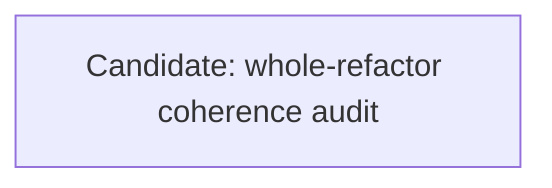

### `REFACTOR_COHERENCE_AUDIT` — the refactor reads as one design

**Candidate.** Sweep devel for unused modules, functions, settings, proto
fields, tables and columns; one name per concept across code, settings, manifests, protos and docs
(Runner Gateway, History Service, ingress, control; Session for the raw stream,
Thread for its projection; no "hub", "follow" or "shadow" left); READMEs, `SPEC.md` files and
`docs/` describing the code as it is, without cutover narration; no compatibility branch,
optional-with-fallback setting or `CLEANUP` tombstone whose condition is met; the system diagram in
`agentplane/README.md` showing exactly the deployed services and the traffic between them in
`cluster/cdk8s/agentplane`. Known now: the test-only `PostgresListener.wait_until_disconnected`
(`connected` turns false before the termination callback runs, so its tests cannot wait on
`connected` instead); egress and app test support each build a throwaway CA; `docs/operator_federation.md` says "Event & Notification Hub"; `cluster/cdk8s/agentplane/test_sandbox_service.py` is named for the retired Sandbox Service. Findings are fixed in
PRs of their own; this node leaves with the last of them.

## 10. Runner ingress and control split

The runner dials out to two endpoints its Sandbox names: an ingress it pushes its journal's Events to (the History
Service when history is kept) and the Runner Gateway control endpoint. Contract:
[runner control § Event ingress](../docs/runner_control.md#event-ingress).

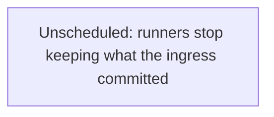

### `RUNNER_JOURNAL_TRIM` — runners stop keeping what the ingress committed

**Unscheduled; the operator's direction, 2026-10-12 PDT: later.** A runner could stop persisting
journal entries its ingress has already acknowledged, behind a flag, with full persistence kept
selectable; the freezer's
[`RUNNER_JOURNAL_SETTLEMENT`](task_freezer.md#runner_journal_settlement--settle-deltas-in-the-runner-journal-too) is the same idea at the delta level. Not designed: what the runner still needs locally (cursors, seal state, entries a
resumed harness or a lost push reads back) once acknowledged entries are gone, including what a revived incarnation reads back
(the retained incarnation history).

## 11. History reads and follows

The History Service's [`FollowSession`](../history_service/README.md#read-and-follow-one-session)
reads raw entries from a cursor, the tail or a number of matching observations back, with a kind
filter and optional live follow. The browser follows Threads through Electric
([thread sync](thread_sync/README.md)). Remaining consumers and decisions:

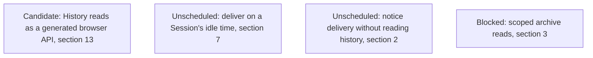

[`history_read_follow.md`](history_read_follow.md) records how orchestration builds on the API and
which other consumers may move to it. Automatic titles remain deferred under
[`THREAD_TITLE_GENERATION`](task_freezer.md#thread_title_generation).

## 12. The Runner Gateway serves the runner's own service

The Gateway observes state and proxies the runner's
`Runner` service with per-method authorization; commands use Dispatcher and typed Runner RPCs.

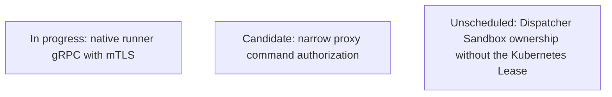

The [service-boundary contract](../docs/service_boundaries.md) and [Runner Gateway README](../runner_gateway/README.md)
describe the current proxy. Live `Runner.ListSessions` remains part of the app and Notification
service caller contract. The separate destination-authority decision
`DELIVERY_DESTINATION_AUTHORITY_DESIGN` (section 13) remains open.

### `RUNNER_CONTROL_TRANSPORT_DESIGN` — native runner gRPC with mTLS

**Selected; implementation in progress, operator, 2026-10-28 PDT.** The Gateway dials each runner's
native gRPC server using mTLS. Remove the custom reverse tunnel and transport selection. cert-manager
issues leaf certificates and trust-manager distributes roots. Public Gateway caller authorization,
runner journals and History push retain their contracts.

The Gateway retains per-Sandbox observation ownership and the control route; direct dialing does
not choose Dispatcher queue ownership. The [transport contract](../docs/runner_control.md)
defines credential/incarnation binding and epochs.

Exit: runtime and integration coverage, stale credential and epoch rejection, lost-reply admission
reconciliation, bounded executor relay, generated Pod/VM deployment wiring, and a reviewable
coordinated cutover/rollback procedure that preserves runner state.

### `PROXY_START_METHODS_DISPATCHER_ONLY` — only the Dispatcher starts or continues work through the proxy

**Candidate; the [lifecycle contract](../docs/runner_delivery_and_harness_design.md#runner-owned-harness-lifecycle) is implemented and `ResumeSession` is gone from the proxy.** The runner proxy
(`runner_gateway/gateway/proxy.go`) currently lets configured caller accounts invoke allowed Runner
methods, except `Quiesce` (controller only). Review per-method policy for `OpenSession`,
`SubmitInput`, model/effort changes and `InterruptTurn` against the Dispatcher-only command boundary.
Manual app resume changes Sandbox lifecycle state through Kubernetes; native state recovery belongs
to the Runner. Read-only diagnostics do not grant command or wake authority. This node does not
select generalized send grants or broaden caller permissions.

The proposed [merge into one service](dispatcher_gateway_merge.md) removes the command methods from the
caller-visible proxy in its third step, which would finish this node.

### `DISPATCHER_OWNERSHIP_IN_POSTGRES` — Dispatcher Sandbox ownership without the Kubernetes Lease

**Unscheduled; operator, 2026-10-19 PDT: a potential future change, not a decision.** Each Dispatcher
replica takes a per-Sandbox `dispatcher-<uid>` Lease (`runner_gateway/dispatcher/ownership.go`). The Lease
gives one replica exclusive ownership and detects a dead owner through its 30 s expiry. The Postgres
`sandbox_ownership` row is only a compare-and-swap fence on a generation number and has no expiry, so it
stops stale writers but cannot choose a live owner. Only the Dispatcher uses the Lease, plus the failover
probe in the Dispatcher acceptance test. The Gateway's separate `<sandbox>-runner` connection Lease stays,
and the Sandbox controller watches it.

Move ownership entirely into Postgres: an `expires_at` heartbeat on the same row, or a session-level
advisory lock that frees itself when the connection drops. Write the comparison first (failover time,
behavior under a Postgres outage, the shared Lease RBAC rule in `runner_gateway_workload.py`); the Lease
has no recorded comparison against doing this in Postgres.

[Dispatcher and Gateway as one service](dispatcher_gateway_merge.md) retires the `dispatcher-<uid>` Lease
instead, by making the replica that holds a Sandbox's runner connection the owner; the operator chose that on
2026-10-20 07:34 UTC, so this node's question is superseded. The node finishes with that plan's holder-owned
delivery step once the operator approves the whole design.

## Scope and retirement of stale gates

- Notifications keep workers in the HTTP service. Retention, worker extraction, idle-polling
  optimization and new-source wiring are frozen with triggers, not hidden release prerequisites.
- Broad provider-matrix exploration is frozen; ordinary auth/signature denial regression coverage
  belongs with the implementation, not an unbounded production checklist.
- Native subsessions and runner durability/thin-adapter redesign remain frozen. Neither the runner
  channel nor multiagent design unfreezes the broader runner-state redesign.
- Existing security boundaries, data-preserving migration checks and representative deployment
  integration checks remain requirements. The freezer is not a waiver for a known data-loss or
  unauthorized-access bug; promote one when evidence makes it concrete.

## 13. Delivery boundaries, APIs and harness identity

This section holds the unfinished delivery-acceptance cleanup, destination and harness-identity design and
implementation, and API and test-tier work.
Decision nodes do not authorize runtime changes. Detailed code paths and alternatives are in the
[delivery and harness design note](../docs/runner_delivery_and_harness_design.md).

**Approved transport direction (operator, 2026-10-15 UTC):** gRPC for internal APIs,
gRPC-Gateway for the generated HTTP/JSON facade, and an ergonomic CLI, adopted incrementally by
service and interface. Use JSON server streams for watches/waits and native gRPC for full duplex.
Individual service migrations and the CLI rollout remain separate work items below, and the
HTTP/JSON facade is built per service inside each migration; this direction authorizes no runtime change
beyond the transport track nodes the operator dispatched.

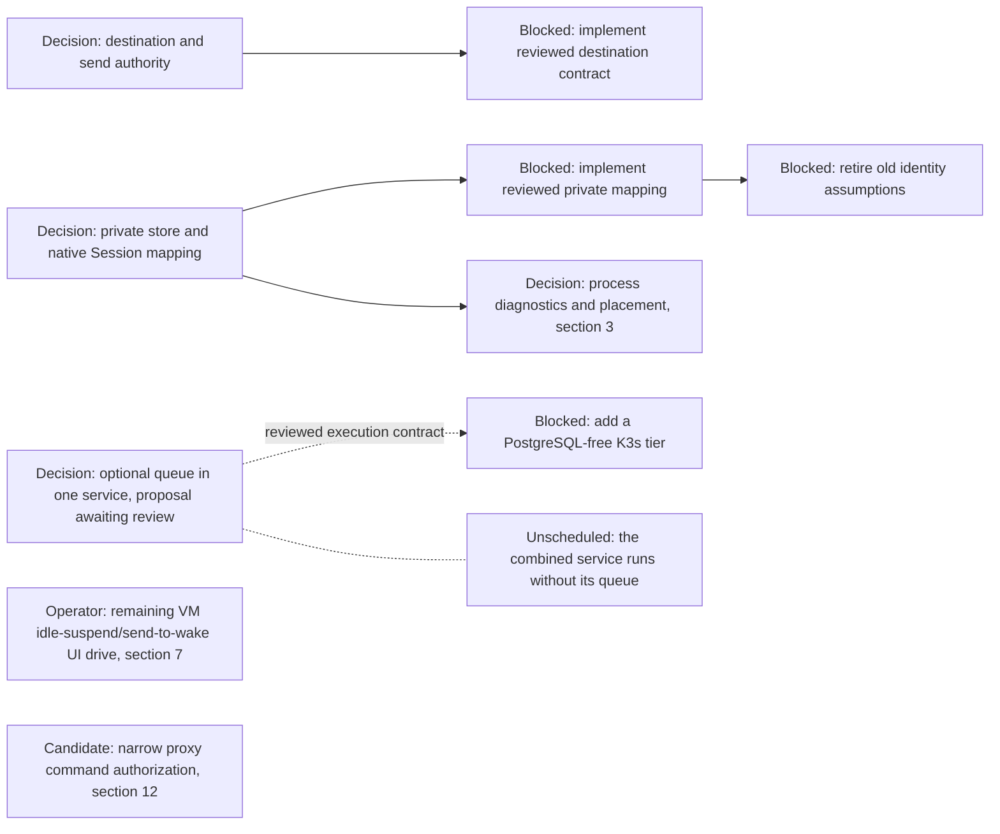

### `DISPATCHER_PERSISTENCE_MODEL_DESIGN` — choose the queue's role: always on, or optional in one service

**Candidate decision; proposal written, awaiting operator review.** Alternatives: keep the PostgreSQL queue as
the only mode, add a separate online-only direct-admission contract, or merge the Dispatcher and the Gateway's proxy
into one gRPC service whose queue is optional. The operator proposed the last (2026-10-20 07:13 UTC), and
[Dispatcher and Gateway as one service](dispatcher_gateway_merge.md) recommends it: queue on stores, delivers and
is the only mode that wakes; queue off delivers at once or refuses with the queue's own reasons. The plan covers
every command state in both modes, per-Session ordering, cancellation, duplicate opens, sender and replica failure,
retries and the database inventory, which shows queue off removes the Gateway's database and not CNPG. The
operator chose that the replica holding a Sandbox's runner connection owns its delivery, retiring the
`dispatcher-<uid>` Lease (2026-10-20 07:34 UTC); the rest awaits review.

No implementation starts, and no implementation nodes other than `DISPATCHER_QUEUE_OPTIONAL` (which the operator
asked for) are added, before the operator approves. On approval
`DISPATCHER_OWNERSHIP_IN_POSTGRES` and `PROXY_START_METHODS_DISPATCHER_ONLY` finish with the plan's steps;
`DELIVERY_DESTINATION_AUTHORITY_DESIGN` stays independent of it.

### `DISPATCHER_QUEUE_OPTIONAL` — the combined service runs without its queue

**Unscheduled; operator, 2026-10-21 06:21 UTC: "maybe we can just prioritize this low and revisit it if I ever
actually want this stateless mode".** Comes
after the merge steps in [the plan](dispatcher_gateway_merge.md#order-of-work); operator, 2026-10-21 06:06 UTC: "No
queue -> refuse whatever we cannot immediately confirm as having reached the runner". Make the PostgreSQL queue of the combined
Dispatcher and Gateway service optional. With the queue off, the service accepts a command only once the runner
holding the Sandbox's connection has confirmed receiving it, and refuses everything else (no connected runner, a
suspended Sandbox, a delivery it cannot confirm) with the queue's own reasons; nothing is stored, and wake-on-send
needs the queue. Image first: the database URL becomes optional and the immediate path lands; then a manifest
renders the service without the queue database, Secret and migrator Job, and the K3s fixture drops the
Gateway's PostgreSQL. Exit: tests of both modes over the same command states, and a queue-off deployment refusing
a send to a suspended Sandbox. Each command request carries a caller-declared flag, deliver now or fail versus may queue, accepted in both modes
(operator, 06:28 UTC), so the same request no longer means different things silently. With the queue on, deliver now
or fail refuses instead of queuing and may queue queues. With the queue off, both deliver now when the runner can
take the command; one that would need the queue is refused, and for a may-queue request the error says the queue
is required and off.

### `CNPG_FREE_K3S_INTEGRATION_TIER` — add a narrow database-independent integration tier

**Blocked on the reviewed execution-persistence contract and actual removal of execution-database
dependencies from the flows under test.** Add a K3s integration tier for
independently usable, loosely coupled Agentplane components; it is not a full-stack parity
environment or a replacement for CNPG. Exercise only flows that can run without the removed
dependencies. The tier may omit Notifications, History, Electric, the CNPG operator and PostgreSQL,
without requiring those absent services' behavior in this suite or implying that every other service
is database-free.

Cover Pod and VM runner flows, adding test ingress where a selected flow needs it; VM flows use the
k3s stack's VM rendering (KubeVirt under emulation, the Bazel-built test guest). Keep this test target separate from runtime database removal;
scope its included flows, omitted services and remaining state owners explicitly. A direct-admission
contract, if selected, remains online-only and does not wake suspended Sandboxes; the durable-queue
mode remains the owner of wake-to-deliver.

The existing `agentplane/system_tests/k3s` suite already runs without the CNPG operator, Cilium or cert-manager (and KubeVirt outside its VM rendering),
against one plain PostgreSQL Deployment and the Runner Gateway; this node is about removing the PostgreSQL dependency
itself. Direct admission and new sender grants remain separate decisions.

### `DELIVERY_DESTINATION_AUTHORITY_DESIGN` — assign destination validation and send permission

**Candidate authority decision; public destination approved by operator, 2026-10-15.** Require
submissions to carry the exact `(Sandbox UID, Agentplane Session ID)`; store/native/process mapping
is runner-private and no public store field is needed. Persist the complete address, command ID and
payload before reporting queued
acceptance or initiating wake, then retain it across caller/Dispatcher restart and Sandbox boot. The
durable queue receipt is distinct from later Runner admission. Queue that tuple, locate the exact
Sandbox, and let queued delivery wake only that target. The reachable runner rejects an unknown
Session as a terminal outcome;
it must not search other Sandboxes, create a Session, or fall back to a same-name replacement. Offline
queue admission does not claim to verify live Session membership and does not need a central
Session-to-Sandbox placement registry. Keep Kubernetes UID-to-live-connection/workload routing
separate from session placement. Direct admission, if selected, remains online-only and does not wake;
the queue owns wake-to-deliver.

Still compare sender-side checks, one authoritative Dispatcher or Gateway execution boundary, and an
intentional layered model. Keep source/subscription authorization separate from destination identity,
owner/membership validation, send permission and the execution-time fence. Trace Notification
subscriptions, all command senders, Dispatcher UID checks and Gateway proxy resolution. Preserve
authentication and authorization before wake, command idempotency and outcome semantics. The exact
locator representation remains open: namespace/name plus UID or UID-based Sandbox resolution.
UID fences identity but does not authorize a caller.
V0 may trust only App and Notification to authorize their users; general send grants and queued-work
revocation are deferred to `DISPATCHER_SEND_AUTHORIZATION_GENERALIZE`. Evaluate owner changes,
TOCTOU/replacement, unavailable or suspended runners, reader
subscriptions versus command submission, terminal unknown-target outcomes and narrow credentials.

**Recommendation for review:** implement no runtime change before the destination authority and
locator are selected. Preserve existing checks until each layer's authority and denial semantics are approved; a source-read
subscription must not silently grant sending or waking. Question: which boundary rejects stale or
unauthorized destinations, what locator and authorization proof does it require, and which checks are
early feedback versus execution authority? No centralization choice is made here.

The [delivery design note](../docs/runner_delivery_and_harness_design.md#destination-checks-and-authority)
maps the current checks and candidate layered authority. Decide whether namespace/name accompanies
mandatory UID or an authoritative UID resolver supplies it. Keep the authenticated v0 service
identity separate from the caller-supplied destination and the execution-time UID/owner fence; do
not treat one as proof of the other. Set explicit denial and retry rules for replacement, unavailable
runners and unknown Sessions before implementation.

### `DELIVERY_DESTINATION_CONTRACT` — carry and enforce the reviewed destination

**Blocked on `DELIVERY_DESTINATION_AUTHORITY_DESIGN`; the public destination is approved.** After
the authority and locator are reviewed, migrate the app and Notification senders and the Dispatcher
request/queue/retry shape to one caller-supplied full
destination with exact Sandbox UID and public Session ID. Persist the exact destination, command ID
and payload before a queued receipt or wake;
do not reconstruct an expected UID from a Sandbox name. Make the chosen admission authority reject
senders outside the v0 App/Notification trust boundary; only separately allowed callers may wake.
Make the execution boundary fence the same UID and owner before forwarding. A reachable runner
rejects unknown Session targets terminally; unavailable runners cannot prove membership at queue acceptance.
Keep direct mode online-only with no wake and same-ID resolution after a lost reply. Validate
replacement, owner change, wrong destination, suspension, duplicate retry, runner storage
loss and staged caller/receiver rollout, including pinned images. A private runner store mapping
can evolve independently. This node does not expose process placement or select one versus several
harnesses per runner.

This implementation can make a central Session-to-Sandbox placement lookup unnecessary for command
delivery. Neither the destination design nor this node deletes retained History or the Kubernetes
UID-to-connection locator.

### Service API transport tracks

One track per service. Tracks are independent except where an edge is drawn, and graph position
claims no priority. Each migration keeps its own caller inventory, authorization and
behavior-preservation review, tests, rollout and rollback plan; none is a repo-wide migration. The
contract is [HTTP/JSON facades](../docs/grpc_services.md#httpjson-facades); what is still open is in
[generated HTTP facades](grpc_http_facade.md). The order of the ports belongs to the Go rewrite.

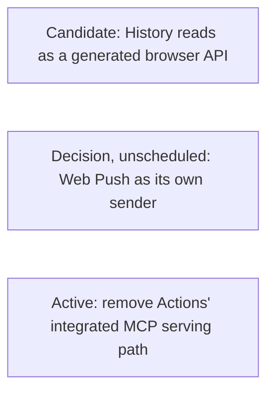

### `HISTORY_READS_FACADE` — History reads as a generated browser API

**Candidate.** Annotate the browser's History
reads and replace the app's mirror models (`app/threads/view/content.py`,
`app/threads/events/debug.py`) with the generic proxy. `WatchSessionSummaries` says only that something
changed; a browser-facing watch could use `FollowSession` (section 11). Decide on purpose whether the app's Thread
check on `thread_observations` (404 for a Session no Thread links) is kept or dropped.

### `ACTION_MCP_EDGE_SPLIT` — remove the retired Action Service serving path

**Active (Codex).** The standalone edge serves external MCP/OAuth and ConnectionService; Actions
keeps upstream MCP linkage and CIMD. This source change removes Actions' integrated runtime and
API registrations while retaining false-only/no-op settings for the old image's generated keys.

Remaining work: after the new image is observed running, remove the compatibility keys from
generated manifests, deploy that config, then remove the parser fields in a later image. Preserve
all database rows and schemas in this change; any later migration needs a separate verified
ownership and retention plan. Detailed sequence and constraints:
[MCP edge extraction](mcp_edge_extraction.md#remaining-work). The current token audience is
`agentplane-egress`; a dedicated audience is a separate change. Actions retains its upstream CIMD
endpoint and the app retains upstream OAuth callbacks.

### `WEB_PUSH_SERVICE` — Web Push as its own sender

**Decision, unscheduled (operator, 2026-10-20 07:41 UTC: "eventually we might want to think about moving it out. It
just so happens that right now agentplane only sends web push notifications about actions that need approval. But I
can foresee wanting to send other web pushes").** Web Push delivery (operator subscriptions, VAPID settings, the sender)
lives in the Action Service because an Action awaiting approval is the only message today. It does not belong to the
Notification Service, which serves agent Session inboxes, a different system. If other messages come, a Web Push
sender of its own would own the subscriptions and take messages from their producers. The sender touches only its
own tables and the request event stream, so the move is clean. This remains a separate decision;
the MCP edge extraction leaves Web Push in Actions.

### `HARNESS_IDENTITY_DESIGN` — decide private Session-to-store and native mapping

**Public destination and process boundary approved (operator, 2026-10-15).** The public address is
`(Sandbox UID, Agentplane Session ID)` with no store field. The runner maps a public Session durably
to its private store/native ID; selecting a default store by requested harness kind remains a
candidate policy. Namespace/name may locate the Sandbox, but request syntax and UID resolver are
undecided.
Process allocation/routing stays internal; there is no create-Session-on-process API or refusal.
Process incarnations may be diagnostic objects, never durable addresses. Neither the number of
stores/processes per Runner, at-most-one process per store nor shared-store concurrent safety is
selected.

**Recommendation for review, not approved ID allocation:** retain client-chosen globally unique
public IDs for client-created root Sessions, bound to one Sandbox UID, immutable creation spec and
runner-private selected store. Reserve the public ID durably before native creation; map it durably
to the harness-chosen native ID before
reporting a completed opening. An identical retry resolves by public ID, while reuse against a
different destination/spec conflicts. A queued opening is not proof of native creation. If native
creation succeeds but its ID is lost before mapping commits, inspect native store evidence or a
proven harness idempotency mechanism; if identity cannot be proved, report unresolved creation and
do not blindly create again. Specify how the reservation, mapping and native evidence survive
Runner/process crashes. Native ID is scoped to the store and never substitutes for the public ID.

Define runner-owned store create/reuse without ID recycling, Session reservation and internal
resume, per-store versus per-Session options, store retirement and explicitly authorized data deletion.
Persist store harness type and exact Sandbox UID
binding; process death and Sandbox suspension do not delete data. Moving a store to another Sandbox
requires a new binding and authorization. Until proven safe, prevent concurrent writes to one store.
A reachable runner returns a terminal missing-target outcome for the public Session; offline
queued acceptance cannot prove membership. Native child IDs are harness-chosen: if exposed, register
stable runner-chosen public mappings with store and parent identity before publication, and separate visibility
from independent control. Child projection remains [deferred](native_session_discovery.md); use the
[merged child characterization](../native/docs/child_sessions.md) for process capability. The operator's private remote-control RE finding
reports outbound HTTP session-start polling with one Claude process launched per Session speaking
RemoteIO, characterized as essentially the existing stream-json stdio protocol. This is an
attributed finding, not a runtime process-count test or proof that Claude can never multiplex by another
route. Use one Claude process per root Session and Codex's demonstrated shared app-server as current
adapter baselines, without exposing process routing or imposing one process per store. No
one-versus-many store or shared-store safety decision is made here.

Feed the reviewed process-diagnostic shape into
[`RUNNER_HARNESS_OBJECTS_DESIGN`](#runner_harness_objects_design--decide-process-diagnostics-and-placement-policy).
The approved public address lets destination migration proceed once its authority and locator are
reviewed; private runner mapping can be implemented independently. Neither design node authorizes runtime changes.

### `RUNNER_STORE_SESSION_IDENTITY` — implement durable store and public Session mapping

**Blocked on review of the private mapping contract (`HARNESS_IDENTITY_DESIGN`).** Extend the
existing durable public Session reservations and persisted native IDs with runner-owned durable
store IDs and exact Sandbox UID binding. Use a new migration rather than editing landed state formats.
Implement adapter-internal process selection, restart/resume and store write fencing; a process
incarnation must not enter a durable destination. Preserve the current per-Session state and authored
native data through migration. Cover same-ID/same-spec retries, conflicting reuse, crashes before
native creation, after native creation but before mapping, and after mapping but before response.
Where the native create result cannot be reconstructed, expose unresolved creation and preserve
orphaned native data for reconciliation instead of duplicating it. Exercise Codex and Claude adapter
paths without assuming Claude multiplexing. Specify atomic caller/proto and pinned runner/VM image
rollout before changing live addresses.

### `RUNNER_IDENTITY_LEGACY_CLEANUP` — retire only obsolete identity assumptions

**Blocked on `RUNNER_STORE_SESSION_IDENTITY` rollout; public address cleanup remains with
`DELIVERY_DESTINATION_CONTRACT` and its own caller gates.** Audit running/saved SandboxTemplates, pinned runner
wheels and every caller before removing old per-Session-process assumptions and stale docs/protos.
Do not delete retained runner stores, native conversations or History. Confirm exact UID/Session
routing to the private store, suspended-queue retry and restart on the deployed images before retiring
old paths.

## 14. App Go port

[#12223](https://github.com/agentydragon/ducktape/pull/12223) supersedes [#11821](https://github.com/agentydragon/ducktape/pull/11821) as the current Go app port. It replaces the Python runtime in `//agentplane/app:image` with a Go server: Huma's typed routes generate the frontend's OpenAPI client, while SSE, auth and telemetry stay in `net/http` handlers. The manifests keep their shape, so merging it cuts staging over through image automation. The schema stays with the Python/Alembic `agentplane-app-migrate` init container until `APP_GOOSE_MIGRATIONS`.

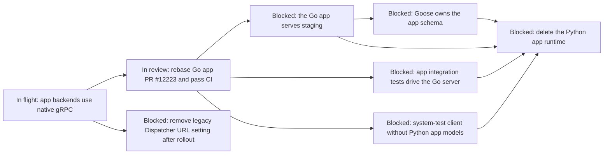

### `APP_HTTP_GRPC_BOUNDARY` — app service backends use native gRPC

**In flight: Python app transport prerequisite (Codex; reported 2026-10-27; Actions, Connection and Session Dispatcher).** Keep the app's browser API as the BFF while calling Action Service, Connection Service and Session Dispatcher through their native gRPC APIs. Preserve the generated ProtoJSON and NDJSON browser contracts with explicit typed routes and narrow shared transport helpers; remove their generic service HTTP relays. Retain the public MCP OAuth callback's plain HTTP route and the direct service HTTP contracts available to external agent and automation callers. No full HTTP transcoder or gRPC-Web surface is part of this change.

Exit: focused `bbr test` coverage proves route-to-RPC mapping, request-bound operator bearer metadata, bounded watch startup, stream cancellation on browser/session shutdown, and the existing browser response contract for all three services. Keep the direct Actions CLI path on generated gRPC. Merge this Python prerequisite before the Go app cutover in `APP_GO_PORT_CATCHUP`; catch-up implementation and review can proceed in parallel.

### `APP_DISPATCHER_HTTP_SETTING_CLEANUP` — remove the retired Dispatcher URL setting

**Blocked on `APP_HTTP_GRPC_BOUNDARY` rollout.** The Python gRPC app no longer reads
`session_dispatcher_http_url`, but `cluster/cdk8s/agentplane/app.py` still supplies it and the Python
`Settings` schema accepts it for compatibility. After the Python gRPC image is deployed, remove the
argument from the manifest; then remove the optional field from `Settings`. Its dated `CLEANUP`
tombstone names this last-reader gate. Keep this cleanup independent of the Go port catch-up.

Exit: neither the manifest nor the app settings schema contains `session_dispatcher_http_url`, and the
tombstone is removed.

### `APP_GO_PORT_CATCHUP` — rebase the Go app port and pass CI

**In review: #12223 (Rai via Codex).** Its earlier audit against devel found the frontend configuration, removed title generation, UUID route matching, changed frontend call sites and logging style that needed catch-up; those fixes are now on the current PR. The separate Python gRPC boundary prerequisite above must merge before Go cutover. Catch-up can proceed while that prerequisite is reviewed; then rebase #12223 onto current devel, reconcile any resulting contract changes and run bazel-ci.

Exit: bazel-ci is green on the rebased head, including the k3s system tests that deploy `//agentplane/app:image` (the Go server) and exercise it through `app/testing/client.py`.

### `APP_GO_CUTOVER` — the Go app serves staging

**Blocked on `APP_GO_PORT_CATCHUP`.** Merging #12223 is the cutover: image automation publishes the Go
`agentplane-app` image and the unchanged Deployment rolls to it. Alembic still owns the schema, so the database is
untouched. Under the rollout rule it merges once the covering k3s system tests pass at its head, and the PR states the
rollback: revert it, and the next devel build publishes the Python image again. Check after rollout: the app Pod is
Ready on staging's rendered configuration, and a logged-in browser loads the Sandbox list and a Thread. Until
`APP_GO_TEST_RETARGET` lands, the app's browser and Electric integration tests still exercise the Python app.

### `APP_GO_TEST_RETARGET` — app integration tests drive the Go server

**Blocked on `APP_GO_PORT_CATCHUP`; runs alongside the cutover.** Every test under `agentplane/app/` that uses the app
`conftest.py` builds the Python app in process, so none covers the Go runtime. Retarget the ones that exercise real
History, Electric, Gateway or PostgreSQL (`test_thread_browser`, `test_thread_window_browser`, `test_thread_sync`,
`test_thread_debug`, `test_electric*`, `test_action_stream`, `test_native_facades`, `test_notifications_stream`,
`test_history_gateway`, `test_bridge`, `test_shutdown`) to start the Go binary as a process, as `gateway_process` does
for the Gateway. Port each remaining unit test's behavior to a Go test or drop it as Python-internal. One PR per test
file or fixture group, each saying what it ported, retargeted or dropped. Exit: no app test imports the Python runtime.

### `APP_SYSTEM_TEST_CLIENT` — system tests stop importing the Python app's API models

**Blocked on `APP_GO_PORT_CATCHUP`.** `app/testing/client.py`, which the k3s system tests use, decodes responses into
the Python app's models (`SandboxView`, `ThreadView`, `ThreadPage`, `NewSession`, `SandboxesSnapshot`, …), and some
tests import `CallerGrantView`, `ActionPolicyView` and `electric`'s `SubsetRequest` directly. Give the client models
generated from, or checked against, the Go server's `/openapi.json`. The settings schema cdk8s renders `app-config`
from (`settings.py`, `presets.py`, `model_catalog.py`, `action_federation_settings.py`, `oidc.OIDCSettings`) stays,
as `action_service/settings.py` did after the Action port.

### `APP_GOOSE_MIGRATIONS` — Goose owns the app schema

**Blocked on `APP_GO_CUTOVER`; a PR of its own.** #12223 already carries `app/go/migrations`: an idempotent Goose
baseline that adopts a database stamped at the Alembic head, refuses unknown or partial schemas, and on a fresh
database writes the Alembic stamp too, so the Python image stays a working rollback. The Go tests already migrate
with it. Publish a Go migrator under the `agentplane-app-migrate` image name the init container already runs, so no
manifest changes, and delete the Alembic history, `database_migrate.py` and the Python migration image in the same
change; Python tests still alive then set up their schema through the Goose migrator. Rolling back to the Python
image stays possible until the first Goose migration after the baseline. Exit: on staging the init container runs
Goose, `agentplane_app_goose_version` holds the baseline and `alembic_version_app` is unchanged.

### `APP_PYTHON_RETIRE` — delete the Python app runtime

**Blocked on `APP_GO_CUTOVER`, `APP_GO_TEST_RETARGET`, `APP_SYSTEM_TEST_CLIENT` and `APP_GOOSE_MIGRATIONS`.** Delete
the Python serving modules and their tests (`api.py`, `live.py`, `electric.py`, `threads/`, `auth_routes.py`,
`operator_sessions.py`, `database*.py`, `main.py`, …) and the `conftest.py` fixtures only they use; keep the settings
schema `APP_SYSTEM_TEST_CLIENT` names. In the same change delete shared Python modules whose last live caller was the
app, checking each: `sandboxes/inventory.py`, `postgres/wakeups.py`, `history_service/client.py`,
`egress/decisions_client.py`, `sandboxes/egress_views.py`, `kubernetes_watch.py`, `sse.py`, `changes.py`. Update
`app/README.md`, `app/AGENTS.md` and `HISTORY_READS_FACADE`'s module names. A later, separate Goose migration drops
`alembic_version_app` once no deployable image can roll back to Python.

## 15. Cleanups after the current tracks

Dead code, transitional pieces and test leftovers each current track reports it will leave behind (census of the
lanes, 2026-10-21). Removals that a track's own plan already lists stay there: the compatibility
settings and separately gated schema cleanup in [MCP edge extraction](mcp_edge_extraction.md#remaining-work). The overview's graph is in
[Current tracks](#current-tracks-and-what-they-leave-behind). Fakes kept to inject faults the real API server cannot
produce are named at the fake and are not cleanups.

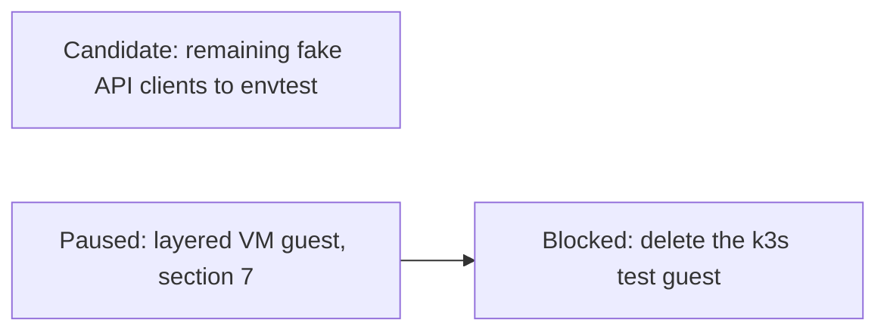

### `FAKE_CLIENTS_TO_ENVTEST` — the remaining fake API clients move to envtest

**Candidate; any time (standing rule: Go tests that talk only to Go code use envtest).** These still build fake
Kubernetes clients for state envtest can hold:

Go `clientfake` or `kubernetes/fake`: `notification_service/api/fixture_test.go` (Sandboxes, inbox tags,
`recreateSandbox`), `notification_service/main_test.go`, `runner_gateway/gateway/records_test.go`,
`runner_gateway/dispatcher/sandbox_kubernetes_test.go`, `sandboxes/sandboxreader/reader_test.go`.

One PR per file. Exit: each reads from `testing/kubeapiserver`, or keeps only a fault it injects, named at the fake.

### `K3S_TEST_GUEST_RETIRE` — delete the k3s test guest

**Blocked on `RUNNER_LAYERING_VM`.** The system tests' `_vm` targets boot a Bazel-built test guest under `system_tests/k3s/guest`, a
second implementation of `runner/vm.nix`'s guest boot contract (disks by serial, workspace format,
harness and tool paths). The two guests share the static runner/slice units and native supervision backend. Delete it once the production guest is Bazel-built and boots in seconds under
emulation, and point the k3s VM scenarios at that guest.
