# Agentplane task DAG

This is the dispatch map for **unfinished** work. Detailed contracts belong in component plans;
completed work belongs in component docs, not done nodes here. Maintenance rules are in
[AGENTS.md](../AGENTS.md#task-dag-maintenance). Deliberately deferred candidates and conditional
hardening live in the [freezer](task_freezer.md), except the explicit nonblocking
intra-Sandbox hardening reminder retained here at Rai's request.

## Current state and scheduling

Audit metadata consumers (`sandbox`, `harness`, `model`, `cwd`, summary/activity fields) before
deleting useful UI projections. Squash Alembic only once the app schema settles.

States: **in flight** means reported work is underway; **in review** means an unmerged PR;
**paused** means no worker is assigned; **decision** needs a reviewed outcome;
**blocked** names prerequisites; **candidate** is dispatchable when selected, not a priority claim.
**Unscheduled**, **deferred** and **parked** nodes have no owner and no priority; a deferred or parked one waits on a trigger its text names.
A **capstone** closes an integrated contract, not another implementation. Solid arrows below are
prerequisites; dashed arrows explicitly label scheduling holds or conditional choices. All service
contracts remain multi-replica unless a reviewed temporary restriction says otherwise.

## 1. Session schema and identity follow-up

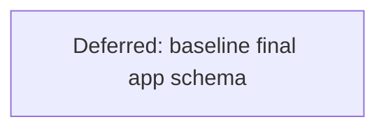

### `APP_ALEMBIC_SQUASH` — consolidate the final app schema

**Deferred by the operator; not dispatchable until selected.** Baseline only the settled schema,
verify fresh and migrated databases and their deployed stamps before pruning old revisions.
Retain the data-preserving rollback procedure. No Action Service or other database squash implied.

## 2. Service-owned command admission and later notification presentation

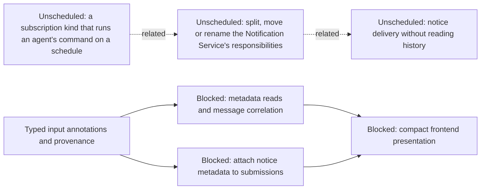

Details: [command admission](../session_dispatcher/README.md#contract); later
[notification presentation and input metadata](notification_presentation.md).

Future ownership and wake-policy questions are recorded in the
[freezer](task_freezer.md#notification_dispatcher_ownership--review-notification-and-dispatcher-ownership):
consider moving Notification Service responsibilities into Dispatcher, and event/source-specific
auto-wake policy. Neither is selected or a prerequisite for v1 inbox messaging.

### `NOTIFICATION_COMMAND_OUTCOME_DESIGN` — notice delivery without reading conversation history

**Unscheduled; operator, 2026-10-11 PDT: not a priority, needs more thought.** The Notification
Service scans a Session's raw history from the History Service for its own command's admission and
`harness_user_message_confirmed`, and stores one `EventEntry` per notice (`Notice.runner_entry`):
the one service besides the History Service fold that derives state from Session events. A command's
`CommandAdmitted` entry says the runner admitted it, but not that the harness executed it or that
the message reached the model's context; today that needs the history. Decide where that
outcome is recorded before the Notification Service stops reading history.

### `NOTIFICATION_SERVICE_SPLIT` — split, move or rename the Notification Service's responsibilities

**Unscheduled; operator, 2026-10-17 PDT: some renaming and refactoring around this service at some
point.** The service (`agentplane/notification_service/`) has grown to several responsibilities:

- mailboxes, their high-water marks and the get API;
- listening to webhooks, currently GitHub's;
- subscriptions, by which an inbox gets messages when a listener notices something;
- direct agent-to-inbox messages;
- deciding to send a notice to a Session because its mailbox holds new unacknowledged messages,
  possibly waking it if suspended, possibly with debounce by time or count, or a check of the Session's
  history so no second notice goes out before the Session has started executing tools or reasoning
  since the last notice or acknowledgement.

Decide which stay, which move to other services, and what the remaining service is called. The inbox
messaging nodes of section 3 (`AGENT_MESSAGING_DESIGN` and the nodes it feeds) record the service name as
open and keep v1 in one deployment; this node is the later restructuring, not a prerequisite for them.
Related: whether notice delivery belongs with the Dispatcher
([freezer](task_freezer.md#notification_dispatcher_ownership--review-notification-and-dispatcher-ownership)),
and the history-free notice outcome (`NOTIFICATION_COMMAND_OUTCOME_DESIGN`), which bears on the notice
decision's last clause.

### `COMMAND_WATCH_SUBSCRIPTION_DESIGN` — a subscription kind that runs an agent's command on a schedule

**Unscheduled; operator, 2026-10-17 PDT: possibly useful as a subscription option, trigger to be decided.**
An agent registers a command and the service runs it every N seconds, or until a given time, and puts a
message in the agent's inbox when something worth noticing happens: the output changes, the command exits
nonzero, or whatever turns out to make most sense. Open: where the command runs (inside the agent's own
Sandbox, or elsewhere) and under whose identity and authority, which decides what it may reach; the
trigger semantics (output change against what baseline, nonzero exit, a failure to run at all, how a
long-running or hung command is cut off); the minimum interval, per-agent quotas and the stop condition;
what the message carries (the output, a diff or only the fact); and the subscription authorization it needs
(`SUBSCRIPTION_AUTHORIZATION_DESIGN`). Related: `NOTIFICATION_SERVICE_SPLIT`, which decides which service
owns subscriptions and sources.

### `SESSION_INPUT_METADATA` — later typed annotations on input commands

**Unscheduled; operator's lean, 2026-10-12 PDT.**
Typed metadata and restricted trusted producer provenance on input commands, so a notice the
Notification Service sends is not rendered as a user message. The field must ride the durable
Session Dispatcher path to the matching Runner input RPC; its trusted producer provenance and narrow
authorization are open design points. The harness never sees it. Keep that authorization
outside the generic command-admission path; attachments are invalid on controls. No
untyped extension dictionary.

### `SESSION_INPUT_METADATA_READ` — authorized annotation reads

**Blocked on typed input metadata.** Carry the echoed metadata into the Thread fold, joined to
the message by `origin_command_ids`, including pending and failed inputs and replay, without
requiring a live notification inbox.

### `NOTIFICATION_NOTICE_METADATA` — producer integration

**Blocked on typed input metadata.** Attach notice identity/range metadata using existing delivery
command IDs. Preserve receipt reconciliation and explicit inbox acknowledgement. Verify the backend
path without the app; use automated integration coverage rather than requiring a provider outage.

### `NOTIFICATION_PRESENTATION` — compact notification rendering

**Blocked on producer and metadata read integration.** Compact authenticated notification-only
inputs, expand full text and render mixed human/notice messages normally with annotations. Missing
metadata falls back to text. Include visual coverage and one bounded real-notice check; no inbox
acknowledgement on render and no text-prefix provenance heuristic.

### Subscription authorization before broader sources

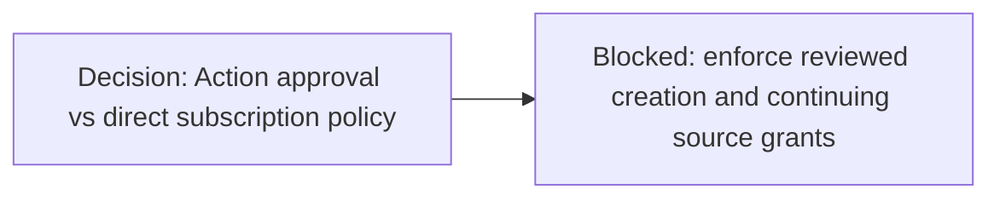

### `SUBSCRIPTION_AUTHORIZATION_DESIGN` — auto-allow and operator-approved subscriptions

**Decision.** Compare an Action-backed subscribe operation using existing auto-allow/operator
approval with authorization inside Notification Service; do not preselect another policy engine.
Review which callers may subscribe to which sources, targets, fields/filters, destinations and
lifetimes, and who can approve/delegate that access. Subscription creation approval is distinct
from continuing source access and from ownership of the destination inbox. Define renewal, scope
expansion, policy changes/revocation and what happens to already-retained entries.

Use Kubernetes as a concrete design case: namespace/resource/UID scope, object/status/event/log
content, name reuse and whether grants delegate the caller's existing read authority or explicitly
allow additional observation. A privileged watcher must not expose arbitrary cluster data merely
because the agent owns an inbox. Review argument examples that auto-allow narrow approved scopes,
require operator approval for additional scopes, and reject requests nobody can delegate. See the
[subscription authorization design](notifications.md#subscription-authorization-and-action-approval).
This is independent of selecting a messaging transport or fixing existing GitHub delivery gaps.

### `SUBSCRIPTION_AUTHORIZATION` — creation gate and continuing enforcement

**Blocked on the authorization decision.** If Actions is selected, implement its subscribe operation
and reviewed policy bindings; otherwise implement the chosen direct policy path. Keep Notification
Service the subscription/delivery authority in either case. Carry verified caller/decision scope
across the service boundary rather than substituting the executor's broad identity. Enforce the
same access contract on direct APIs, renewals and updates; no approval bypass by another endpoint.

Test auto-allow, pending approval, denial, restricted destinations, scope escalation and expiry/
revocation with controlled identities. No entry may be delivered beyond the reviewed source scope;
approval is not permission to wake a Sandbox or execute source content. Future Kubernetes sources
must depend on this contract/enforcement when promoted from the freezer. Ordinary authorized
subscription reads/cancellation and existing GitHub gap recovery need not wait for a broad redesign.

### GitHub notice reliability after missed updates

The operator reports that GitHub updates may sometimes be missed. This is a concrete reliability
concern, not proof that GitHub webhook delivery itself is at fault. Diagnose webhook receipt,
matching, inbox persistence and notice dispatch separately. Do not reopen waived broad provider
outage/refresh exercises; test the specific recovery contract with controlled missing webhooks.

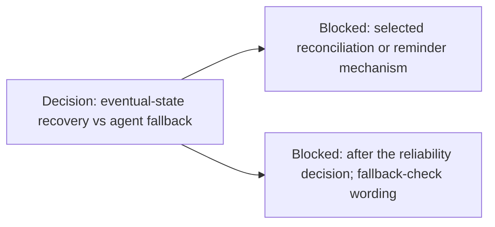

### `GITHUB_NOTICE_RELIABILITY_DESIGN` — delivery guarantee and fallback

**Decision.** Review the gap and choose the guarantee needed for PR shepherding: eventual awareness
of current head/check/review/merge state, or historical delivery of each event. Compare bounded
service-side reconciliation using existing durable shared GitHub refresh state with explicit agent
fallback checks, optionally scheduled reminders. Recommend the smallest reliable path with a stated
staleness bound/cost. A webhook subscription is not proof no changes occurred when it stays silent.
Snapshot polling cannot reconstruct all intermediate events, and a cron reminder alone is not
recovery if no active agent checks state. Detailed alternatives and questions are in the
[notification plan](notifications.md#missed-github-updates-and-shepherding-reliability).

### `GITHUB_NOTIFICATION_RECOVERY` — implement the reviewed recovery contract

**Blocked on the reliability decision.** If service reconciliation is selected, periodically compare
eligible shared subjects with authoritative GitHub state and durably emit deduplicated observations
for uncovered relevant changes. Reuse refresh leases, backoff and access checks; bound API load.
Distinguish observed state from a received webhook; do not fabricate delivery IDs or promise replay
of events the API cannot recover. If agent fallback is selected instead, provide its actual bounded
check/reminder mechanism and explicit limitations rather than just advising agents to remember.
Add `CRON_NOTIFICATIONS` as a prerequisite only if that reviewed implementation actually needs it;
a service refresh deadline need not introduce a general scheduler. Backend workers stay in-process.

Test a suppressed webhook, duplicate webhook/reconciliation races, changed head/check state and
restart/checkpoint recovery with a controlled GitHub peer. Observe one eventual update for the
promised scope, honest access/backoff state and no false claim of complete history. No live GitHub
outage or exhaustive historical event matrix is required.

### `GITHUB_SHEPHERD_GUIDANCE` — explain monitoring limits and completion checks

**Blocked on `GITHUB_NOTICE_RELIABILITY_DESIGN`; if agent reminders are chosen it also needs the frozen [`CRON_NOTIFICATIONS`](task_freezer.md#cron_notifications--scheduled-notifications-for-agents), which would first have to be promoted.** Agents are
asked not just to subscribe to GitHub while waiting (e.g. for CI) but to back the subscription with
a fallback check after N minutes, in case the webhook never delivers. Treat notifications as prompts
to inspect authoritative current PR state, not evidence that the latest head passed or that silence
means no progress. Document the chosen fallback deadline/ownership and how an agent notices
unreliable monitoring. State who runs reminders and that notices do not start a stopped harness.
Guidance accompanies the selected reliability behavior; it must not advertise a polling/reminder
guarantee before that mechanism exists.

## 3. Multiagent decisions before implementations

These are operator-reviewable decisions, not permission to implement every possibility. Drafts can
be developed together, but publish a coherent Session-access rule schema before the nodes that use it,
and the identity/authority vocabulary before create and launch policy. Do not equate creating a
resource, reading history, sending a message or receiving/acking it.

[The cross-agent plan](multiagent_communication.md#tentative-implementation-direction) tentatively
selects service-enforced Session-access `PolicySet` rules assigned through existing `PolicyBinding`s.
Resource-owning backends share evaluation code and enforce their own APIs. Native RBAC variants
remain alternatives if implementation reveals a poor fit; comparing or building them is not a gate.
SA-level caller attribution, configurable topology and live shared bundles are agreed constraints.
Replacing the authorization machinery across services is a separate deferred evaluation, not a
multiagent prerequisite. Preserve existing auth semantics; a concrete limitation must justify any
separately reviewed broader proposal.
Send and transcript-read permissions are independent in both directions. A2A is open at this
communication boundary; its harness/thread-protocol rejection has a different scope. Transport
facades are not prerequisite decisions, and content classification is outside v1. Exact schemas and
the remaining contracts below still require review before implementation.

```mermaid
flowchart TD
    MULTIAGENT_MODEL[Decision: identities, relationships and native-child boundary]
    SESSION_ACCESS_RULES_DESIGN[Decision: Session-access rule and membership schema]
    SESSION_ACCESS_RULES[Blocked: shared Session-access rules]
    THREAD_READ_POLICY_DESIGN[Decision: remaining history read contract]
    HISTORY_ACCESS_AFTER_DELETION[Decision: who reads a deleted Sandbox's history]
    THREAD_READ_POLICY[Blocked: scoped archive reads]
    HISTORY_SESSION_KEY_DESIGN[Decision: record the Sandbox UID in History, and key Sessions by it]
    HISTORY_SANDBOX_UID[Blocked: History records and checks the Sandbox UID]
    APP_THREAD_SANDBOX_UID[Blocked: the app stores each Thread's Sandbox UID]
    HISTORY_SESSION_REKEY[Blocked: key History by Sandbox UID and Session ID]
    AGENT_MESSAGING_DESIGN[Decision: remaining inbox messaging and permission contracts]
    AGENT_MESSAGE_INGRESS[Blocked: authorized send API and durable receipts]
    AGENT_MESSAGE_RECEPTION[Blocked: receiving, recovery and acknowledgement]
    AGENT_MESSAGING[Capstone: end-to-end agent messaging]
    THREAD_CREATE_POLICY[Decision: opening a session in an existing Sandbox]
    THREAD_CREATE_AUTHORIZATION[Blocked: implement session-create grants]
    AGENT_LAUNCH_POLICY_DESIGN[Decision: constrained Sandbox launch and delegation]
    AGENT_SANDBOX_LAUNCH[Blocked: enforce agent Sandbox-launch policy]
    MULTIAGENT_MODEL --> THREAD_CREATE_POLICY
    MULTIAGENT_MODEL --> AGENT_LAUNCH_POLICY_DESIGN
    SESSION_ACCESS_RULES_DESIGN --> SESSION_ACCESS_RULES
    SESSION_ACCESS_RULES_DESIGN --> THREAD_READ_POLICY_DESIGN
    SESSION_ACCESS_RULES_DESIGN --> AGENT_MESSAGING_DESIGN
    THREAD_READ_POLICY_DESIGN --> THREAD_READ_POLICY
    HISTORY_ACCESS_AFTER_DELETION --> THREAD_READ_POLICY
    HISTORY_ACCESS_AFTER_DELETION -. may change membership storage .-> SESSION_ACCESS_RULES
    SESSION_ACCESS_RULES --> THREAD_READ_POLICY
    HISTORY_SESSION_KEY_DESIGN --> HISTORY_SANDBOX_UID
    HISTORY_SESSION_KEY_DESIGN -. read API shape .-> THREAD_READ_POLICY
    HISTORY_SESSION_KEY_DESIGN -. only if re-keyed .-> APP_THREAD_SANDBOX_UID
    HISTORY_SANDBOX_UID --> THREAD_READ_POLICY
    HISTORY_SANDBOX_UID -. tightens the pair check .-> AGENT_MESSAGE_INGRESS
    HISTORY_SANDBOX_UID --> APP_THREAD_SANDBOX_UID
    APP_THREAD_SANDBOX_UID --> HISTORY_SESSION_REKEY
    SESSION_ACCESS_RULES --> AGENT_MESSAGE_INGRESS
    AGENT_MESSAGING_DESIGN --> AGENT_MESSAGE_INGRESS
    AGENT_MESSAGE_INGRESS --> AGENT_MESSAGE_RECEPTION
    NOTIFICATION_SERVICE_SPLIT[Unscheduled: split, move or rename the Notification Service's responsibilities, section 2] -. related .-> AGENT_MESSAGING_DESIGN
    NOTIFICATION_SERVICE_SPLIT -. related .-> AGENT_MESSAGE_INGRESS
    NOTIFICATION_SERVICE_SPLIT -. related .-> AGENT_MESSAGE_RECEPTION
    AGENT_MESSAGE_RECEPTION --> AGENT_MESSAGING
    THREAD_CREATE_POLICY --> THREAD_CREATE_AUTHORIZATION
    AGENT_LAUNCH_POLICY_DESIGN --> AGENT_SANDBOX_LAUNCH
    RUNNER_HARNESS_OBJECTS_DESIGN[Decision: process diagnostics and placement]
    HARNESS_IDENTITY_DESIGN[Decision: private store and native Session mapping]
    HARNESS_IDENTITY_DESIGN --> RUNNER_HARNESS_OBJECTS_DESIGN
```

### `MULTIAGENT_MODEL` — shared identity and authority vocabulary

**Decision; no runtime work implied.** Present concrete API examples for independent agents,
Sandboxes and Sessions, with creator, manager and parent/provenance represented separately. Ask
the operator to choose remaining addressing/ownership and delegation semantics. Use the agreed
SA-level caller attribution and the [tentative Session-access rule direction](multiagent_communication.md#tentative-implementation-direction),
without choosing a mandatory topology. No permission inheritance from an organizational edge or
preset. Review how native harness children could later be ingested: linked execution in the same
Sandbox trust boundary versus independently provisioned Sandboxes, addressability, observability
and which controls must remain unavailable. Native integration itself stays frozen, and v1 excludes
native children from the messaging and access model.

This gates `THREAD_CREATE_POLICY` and `AGENT_LAUNCH_POLICY_DESIGN`. Messaging and history reads
need only the rule schema in `SESSION_ACCESS_RULES_DESIGN`, so creator, manager and parent semantics
do not hold them up. The app's existing auth path may remain a special case for v1. Reducing that
special handling is optional, separately reviewed follow-up work and does not gate multiagent
implementation.

### `SESSION_ACCESS_RULES_DESIGN` — Session-access rule and membership schema

**Decision; the wildcard question is settled and the concrete schema remains for review. Gates
`SESSION_ACCESS_RULES`, `THREAD_READ_POLICY_DESIGN` and `AGENT_MESSAGING_DESIGN`.** Draft the concrete
rule/member-reference schema for review, including administrative RBAC and freshness
settings under the agreed [policy propagation contract](multiagent_communication.md#policy-propagation-and-freshness),
without requiring an auth-engine migration. Prefer Kubernetes resources for grants and explicit
collection membership, with separate CRs for individual Sandbox-to-collection enrollments so Flux
and the app can own different memberships independently. Support name-based Sandbox references that
follow recreation and UID-pinned references for a single instance; app launches default to UID
pinning, while GitOps-managed named Sandboxes may use name-based membership. Other storage remains
allowed if concrete implementation friction warrants it. Storage is separate from the selected
service-enforced evaluator direction.

Membership CR writes use ordinary Kubernetes RBAC, initially granted to operator/GitOps and trusted
provisioning. Read/send grants confer no membership administration; explicit administrative grants
remain possible without introducing agent categories. V1 requires no new collection-specific agent
enrollment-delegation mechanism. Finalize the concrete RBAC and provisioning checks within this boundary.

Include OAuth-bound static SAs as subjects by namespace/name for permitted sends and reads. OAuth
callers reach the backends from an Action box whose egress substitutes the SA's projected
token ([agreed route](multiagent_communication.md#oauth-callers)); no OAuth admission path is added to
other backends. V1 recipients are Sandbox-hosted Sessions; external inboxes are deferred, and
Connection representation/storage changes are outside this work.

**Wildcard target agreed (operator, 2026-10-17 UTC):** v1 includes an `allSandboxes` target beside direct
Sandboxes and explicit collections, for permissions like "send messages to any Sandbox" and "read from any
Session"; a Session's scope is its Sandbox, so both are one target form. It matches every Sandbox in the
namespace of the PolicySet holding the rule, never the whole cluster: a Sandbox Controller reconciles one
namespace (`--namespace`), and a Sandbox in another namespace needs a direct target. It covers Sandboxes
created later and needs no membership data, and History matches it on the recorded namespace, so a reader
of every history is unaffected by `HISTORY_ACCESS_AFTER_DELETION`. Operations stay independent (read-any
does not imply send-any) and only whoever writes PolicySets can grant it. The namespace match is the
design's reading of "the controller's scope"; the schema draft confirms or replaces it.

### `SESSION_ACCESS_RULES` — shared Session-access rule support

**Blocked on the reviewed schema in `SESSION_ACCESS_RULES_DESIGN`.** Extend PolicySet schemas with the
tentative Session-access rule family and implement shared rule-reading/evaluation code for API owners.
Reuse existing SA authentication and PolicyBindings. Match independently grantable listing,
transcript-read and Session-inbox append operations against direct Sandbox targets, current
explicit collection memberships represented by separate enrollment CRs and an all-Sandboxes target.
Honor both name-based and UID-pinned Sandbox member references without changing recorded Session
associations when a Sandbox name is reused.
Implement independent watched policy views, initial-sync and configurable freshness checks, and
asynchronous revocation under the agreed contract; no global replica acknowledgement is required.
Preserve live bundle updates, existing binding lifecycle and additive overlapping grants. Cover mixed
static/runtime SAs, allowed/denied operations and targets, empty collections, membership removal,
overlap, initial sync, stale watches, independently advancing replicas and both reference modes
across Sandbox recreation. Backend enforcement and retained-history semantics remain in their
respective nodes.

### `THREAD_READ_POLICY_DESIGN` — scoped history read policy

**Decision; tentative Session-access rules, Sandbox minimum, explicit collections and all-Sandboxes target selected.**
Finalize read-specific grant administration within the agreed membership RBAC boundary and caller
replacement semantics. Access to retained histories after Sandbox deletion is
`HISTORY_ACCESS_AFTER_DELETION`. V1 has no
individual-Session grants or computed collection selection. Presets
may seed authorized launch enrollment; subsequent removals persist. Reading a Session resolves its
recorded Sandbox identity, and all Sessions in that Sandbox use the same scope. Defaults expose
no existing histories to workloads. Session listing is a distinct, weaker read-type permission,
independent from send; its metadata fields are selected, and raw history read/follow behavior remains to design. Read does not
imply send/create, and no folded-read API is required for v1. Cover discovery, linked evidence, live-feed
revocation and unknown historical associations. Do not block this on a messaging transport.

### `HISTORY_ACCESS_AFTER_DELETION` — who reads a Sandbox's history once it is deleted

**Decision; the operator is weighing it and asked not to rush (2026-10-17 UTC).** Retained history stays
readable after its Sandbox is deleted, and History already records the Sandbox that wrote each Session. A
direct Sandbox grant needs only that record, as does an `allSandboxes` grant, so both keep working. Only a collection grant needs membership at read time, and membership lives in Kubernetes CRs that
go away or dangle with the Sandbox. The operator wants agents to read old history, dislikes Kubernetes
references to Sandboxes that no longer exist, does not want to keep heavy Sandbox resources only for
history, does not want membership split awkwardly between History and Kubernetes, does not want Kubernetes
to be a historical log, and finds a collection grant that stops covering deleted members annoying.

Alternatives:

- **Live-only memberships.** UID-pinned membership CRs carry an ownerReference to their Sandbox, so
  Kubernetes removes them with it; GitOps name-based memberships stay Flux's. Collection grants cover only
  live members, and old history is reached by direct or all-Sandboxes grants.
- **Reduced Sandbox kept.** Suspend the Sandbox and drop its workspace PVC, keeping the object and the small
  harness data directory, so memberships stay valid. Deletion becomes archiving: a new lifecycle state and
  a Sandbox, ServiceAccount, PolicyBinding and PVC per dead Sandbox, to protect transcripts History already
  stores.
- **Memberships in a database.** One owner (History or Notifications) with an API, administrative
  authorization and audit; no dangling references. Membership writes leave Kubernetes RBAC and GitOps, so
  Flux and the app no longer own different memberships through CRs.
- **Kubernetes CRs plus a database record.** The CRs stay authoritative while the Sandbox exists, and a
  record of its collections, written at deletion or kept from History's last push, serves reads afterwards.
  Two places for one fact, one a cache of the other, and History needs read access to membership CRs.

**Recommendation:** decide it when `THREAD_READ_POLICY` is next in line, because nothing else waits on it:
sending and live reads need no retained membership, and direct grants work after deletion under every
alternative. **Questions for review:** which alternative? Should an `allSandboxes` read also reach histories
with no recorded Sandbox UID, which are operator-only today (`HISTORY_SESSION_KEY_DESIGN`)? Those rows keep
the recorded namespace, which is all that target matches on; a history with no recorded Sandbox stays
operator-only either way.

### `THREAD_READ_POLICY` — authorized retained-history access

**Blocked on reviewed read policy, on `HISTORY_ACCESS_AFTER_DELETION` and on `HISTORY_SANDBOX_UID`,
which records the Sandbox UID the association needs.** Enforce the immutable Session-to-Sandbox association and
Sandbox-scoped grants through shared Session-access rules at the owning backend across list,
raw/native evidence, direct reads and feeds, including reconnect and revocation. Keep app-only UI
folds separate. Test allowed/denied histories, two principals,
deleted Sandboxes and revocation with deterministic service tests plus a bounded deployed auth check.
Cover a listing-only caller separately from transcript/evidence reads and follows. Recheck stream
authorization/freshness and stop Event emission on observed grant loss or stale required policy state.

### `HISTORY_SESSION_KEY_DESIGN` — record the Sandbox UID in History, and key Sessions by it

**Decision; the operator is considering it (2026-10-17 UTC).** History records only the namespace and
name of the Sandbox that wrote a Session, inferred from the writer ServiceAccount's name, and no UID
([README](../history_service/README.md#which-sandbox-wrote-a-session)). Scoped reads and UID-pinned
addressing need the UID. The Dispatcher (`Dispatch.sandbox_uid`), the Runner Gateway's connection index and
Notifications (`DestinationRef.uid`) already identify a Sandbox by it, which makes it the canonical key.

Recording works as follows. The controller owns each Sandbox's ServiceAccount, so its controller
ownerReference carries the Sandbox UID. At bind History reads the writer ServiceAccount's ownerReference,
after a namespaced Role granting `get` on `serviceaccounts` lands. A nullable `session_history.sandbox_uid`
and a `SandboxRef.uid` hold it. A live Sandbox's rows fill when its runner reconnects. Rows of Sandboxes
deleted before this stay NULL, which the read policy treats as an unknown association (operator-only). Every
push resolves the pusher's Sandbox UID, cached by ServiceAccount UID (never reused), and is refused with
`PERMISSION_DENIED` when it differs from the recorded one.

Alternatives for the Session key:

- **Keep the Session ID as the key.** The UID is a recorded, checked column. The Session ID stays unique
  everywhere, and nothing else changes.
- **Key by `(sandbox_uid, session_id)`** (the operator's proposal, for consistency with the Dispatcher
  and runner address). A push can then never reach another Sandbox's rows, the first-writer binding
  only has to refuse a ServiceAccount recreated in place, and a scoped read is a lookup inside one Sandbox's keys.
  It touches 11 of the 12 History tables (`thread_entity` alone has five indexes), the four Electric-synced
  tables and the app's shape predicates, 7 of the 9 RPCs and their callers (the app and Notifications), and
  the app's `Thread` row. It reverses the 2026-10-10 decision to read by public Session ID, and
  `HARNESS_IDENTITY_DESIGN`'s recommendation that public IDs stay globally unique becomes unique per
  Sandbox UID. Rows of deleted Sandboxes cannot take a NOT NULL key, so they are dropped in a separate drop
  PR or stay outside the key.

**Recommendation:** record and check the UID first, since both alternatives need it. Decide the re-key
once recorded values exist, because it is the largest change and nothing else depends on it.
**Questions for review:** key by `(sandbox_uid, session_id)` or keep the Session ID as the key? If
re-keyed, drop the rows whose Sandbox is already deleted?

### `HISTORY_SANDBOX_UID` — History records and checks the Sandbox UID

**Blocked on `HISTORY_SESSION_KEY_DESIGN`; the first node to dispatch under either alternative.** In order:
the namespaced `get serviceaccounts` Role for the History Service lands first, then the code. Add the
nullable `sandbox_uid` and `SandboxRef.uid`; resolve and cache the pusher's Sandbox UID at bind, fill
a NULL value from a matching writer and compare a recorded one, refusing a mismatch. A ServiceAccount no
Sandbox owns records no UID. If the ServiceAccount read fails, the push is `UNAVAILABLE` and the
runner retries from its journal. Test a first bind, a reconnect that fills a NULL, a same-name replacement
refused, a failed read, and `FindSessions` and summaries reporting the UID. Update the
[History README](../history_service/README.md#which-sandbox-wrote-a-session), which says UIDs are not
recorded. A ServiceAccount recreated in place under the same Sandbox keeps failing as a different writer;
letting the Sandbox UID take over as the pin is a separate decision.

### `APP_THREAD_SANDBOX_UID` — the app stores each Thread's Sandbox UID

**Blocked on `HISTORY_SANDBOX_UID`; needed only if `HISTORY_SESSION_KEY_DESIGN` re-keys.** The app's `Thread`
row is keyed by the Session ID alone and holds no Sandbox. Add `sandbox_uid`, set it when the app opens the
Thread in a Sandbox it chose, and fill existing Threads from the History summary. Threads whose Sandbox was
deleted before recording stay without one. The Thread key and URLs stay the Session ID, since the app
mints those IDs.

### `HISTORY_SESSION_REKEY` — key History by Sandbox UID and Session ID

**Blocked on `APP_THREAD_SANDBOX_UID` and the review above.** One atomic change, with no compatibility
fields and no staged rollout (deployed state is disposable): `sandbox_uid` joins the key, foreign keys
and indexes of every History table that names a Session; the Electric-synced rows carry it and the app's
fixed predicates filter on it; each RPC that names a Session takes the Sandbox UID; `session_opened`
announces the pair; the app and Notifications pass the UID they hold. The ingress looks the pusher's
Sandbox UID up as part of the key. Electric shape handles reset, so verify a browser reconnects. Rows of
deleted Sandboxes follow the review's answer.

### `AGENT_MESSAGING_DESIGN` — inbox messaging and notice contract

**Decision; v1 inbox delivery selected.** Address Sandbox-hosted recipients by destination Sandbox plus
Session ID ([agreed addressing](multiagent_communication.md#peer-message-path)), authorize sends at
Sandbox granularity using the tentative shared Session-access rules, and reuse the existing
durable inbox/read/ack and batched-notice machinery. The send operation appends to a Session inbox;
its payload is separate from transcript reads and the platform-generated notice.
The sender's append grant supplies the authorization for acceptance; v1 requires no separate
recipient opt-in, allowlist or approval.
Peer sends do not require source subscriptions. Generalize the current service around inbox/messaging in one
deployment initially, with optional subscription/source integrations; leave Dispatcher separate.
Use `subscription` for source-following and `notice` for the batched inbox prompt. The service keeps
its name for now, the send API is HTTP JSON, and the [discovery fields](multiagent_communication.md#sandbox-session-discovery-and-provisioning)
are selected. Inbox read/ack retains the receiving
Sandbox's owner-SA boundary; v1 adds no delegable inbox-read or acknowledgement permissions.
The [sender-facing receipt contract](multiagent_communication.md#sender-facing-receipts) is
selected: the sender queries a message it sent for notice coverage and acknowledgement, and not found
means no record. Read receipts and notice delivery stage are not v1.
OAuth-bound SAs can be senders; v1 does not provide inboxes for externally running agents.
Distinguish accepted, noticed, admitted, handled and task-success evidence. Define retention, limits,
deduplication and offline/deleted-recipient behavior. Reading a transcript grants neither send nor ack.

V1 retains notice batching in Notifications and wake/delivery in Dispatcher. A Sandbox's existing
`spec.wakeOnSend` policy applies to any admitted message, including mixed-source notices; a suspended
Sandbox with it disabled requires an explicit resume. Retain the existing trusted service-caller/wake allowlist. Add no
per-peer or per-source wake grant in v1. Agent receive/read/ack behavior needs actual harness
validation before the selected approach is claimed effective. Moving responsibilities into
Dispatcher or adding selective event wake is future work, not a prerequisite.

### `AGENT_MESSAGE_INGRESS` — authorized send and acceptance

**Blocked on messaging decision and its selected prerequisites.** Implement a configurable inbox-service
message-body byte limit backed by a database ceiling; reject oversized messages before acceptance
without truncation and reject configurations above the ceiling. Default 32 KiB, ceiling 256 KiB.
Implement server-authenticated sender provenance, shared Session-access rule enforcement, idempotent
message IDs and honest acceptance receipts in the chosen authority. Implement the sender's receipt
query from the inbox coverage and acknowledgement cursors, visible only to the authenticated sender.
Create an inbox for a message only after confirming the named Session against the Sandbox History
recorded for it, so invented Session IDs cannot use up the recipient's inbox quota; sends to an
existing inbox skip the check. Check send permission at durable
acceptance against a fresh local policy view; observed revocation blocks new sends without retracting
accepted messages. Require no separate recipient opt-in or source subscription. Test authorized
acceptance without either, denied pairs, spoofing, retry/conflict behavior, size bounds and this
revocation boundary. Cover coverage and acknowledgement reaching a message independently, a retired
recipient inbox, and not found for another account's message, an unknown ID and a purged inbox.

### `AGENT_MESSAGE_RECEPTION` — delivery, recovery and acknowledgement

**Blocked on ingress contract/implementation.** Implement selected recipient read/delivery/ack
operations under the receiving Sandbox's owner-SA checks, batching and recovery of unread work.
Delegated inbox reading and acknowledgement remain frozen. Test owner-scoped read/ack,
recipient-access revocation, deleted recipients,
ordinary offline catch-up and duplicate delivery without leaking payloads. Accepted correspondence
survives sender send-permission revocation, subject to recipient inbox permissions and retention;
cover unread messages across that boundary. Notices use the current trusted
Notifications-to-Dispatcher path and per-Sandbox wake-on-message policy; do not require a separate
peer/source wake grant. Deletion never retargets mail to a replacement Sandbox.
Explain suspended-recipient and wake behavior to agents; support scoped destination-Sandbox CR
reads where configured, independently of send permission.

### `AGENT_MESSAGING` — integrated messaging capstone

**Blocked on ingress and reception.** Demonstrate an authorized pair exchanging a message through
the selected API, with correct provenance and distinct receipt/ack states. Security-negative and
multi-replica retry cases belong in automated tests; no real provider outage requirement.

Control design: [ADR](../docs/adr_sandbox_session_control.md).

V1 keeps explicit suspend/resume and wake-setting edits as operator controls, preserving existing
trusted backend automation. Agent lifecycle delegation is
[deferred](task_freezer.md#sandbox_lifecycle_authorization_design--delegated-lifecycle-controls),
not a messaging prerequisite; see the [agreed scope](multiagent_communication.md#batching-and-wake-behavior).

### `THREAD_CREATE_POLICY` — authorize session creation separately

**Decision.** Review caller scope to open in an existing Sandbox, accepted defaults, quotas,
creator visibility and revocation. Use the service-reserved Session identity, not a caller-invented
public UUID. Opening in an existing Sandbox grants no isolation from its other Sessions; require a
separate Sandbox when incompatible trust or credentials are needed. Decide whether launch-and-open
is a composition of separate grants, never an implicit read/send/launch permission. This contract
reuse the existing Session Dispatcher durable command queue.

### `THREAD_CREATE_AUTHORIZATION` — implement session-create grants

**Blocked on create policy.** Enforce scope/defaults and idempotent Open
lookup at the service boundary; test forbidden targets/overrides and a lost creation reply.

### `AGENT_LAUNCH_POLICY_DESIGN` — Sandbox launch and delegation policy

**Decision.** Review which callers can use which templates and resource budgets, mounts, images,
secrets, egress and Kubernetes/Action grants; presets are defaults, not authority. A new Sandbox is
required for an independent isolation boundary; adding a Session within one is not. Define manager,
lifetime, parent termination, quota/fanout and revocation without automatic privilege inheritance.
Choose policy ownership and audit records before adding tables. State separately whether the
operation also opens a session; if so, depend on `THREAD_CREATE_AUTHORIZATION` for that composition.

### `AGENT_SANDBOX_LAUNCH` — constrained agent-requested launch

**Blocked on launch policy and idempotent create.** Enforce the reviewed
effective spec and delegation server-side. Test allowed and forbidden launch parameters and
concurrent retries. Reuse the app's create path (the shared Sandbox inventory), not harness-native agent tools. Launch alone
does not grant history read, messaging, credentials or execution of another principal's Actions.

### `RUNNER_HARNESS_OBJECTS_DESIGN` — decide process diagnostics and placement policy

**Conditional design decision; operator, 2026-10-15 PDT.** Evaluate exposing process incarnations as
diagnostic objects with hosted Sessions and status, while the Session API owns public lifecycle
(and a store API exists only if its public need is selected).
Use the merged Codex multi-thread test and Claude's separate-store single-root characterization
alongside `HARNESS_IDENTITY_DESIGN` and the [pinned child evidence](../native/docs/child_sessions.md); do
not assume one Agentplane Session is one process, one persisted store, or one native conversation, or
that every discovered child is independently controllable. Native delegation with root-only output is
merged; child Session projection remains
[deferred](task_freezer.md#native_subagent_threads--as-linked-agentplane-threads).

Compare diagnostic process objects with retaining Session-only projections. Process placement
and allocation remain internal, without a public create-Session-on-process API or refusal. Specify
which options and status belong to the process incarnation, persisted store and public Session;
include concurrency, cancellation and failure/restart behavior.
Compare two coherent alternatives: one fixed harness type and persisted store per Runner, with the
process lifecycle coupled to that Runner; or multiple processes and stores per Runner, each
potentially serving multiple Sessions without an arbitrary same-type restriction. Do not retain the
hybrid of one process at a time switching among per-Session stores: it retains store routing while
also forbidding mixed harnesses. A fixed store resolves Session-to-store ambiguity but raises shared
store isolation and concurrency questions and sacrifices mixed Codex/Claude Sessions in one
Sandbox/Runner. Once support for N>1 processes/stores exists, a same-type-only rule adds little
architectural simplification; resource limits and proven harness capabilities still constrain actual
use. Restricting to one later is easier than adding multi-harness identities and routing later; treat
that as a modest migration-flexibility advantage, not a decision.
Use measured interactive-multiplexing and native-child evidence; read-only/discoverable children do
not prove independent interactive control. Stopping one Session in a multiplexed design must not
kill a process still serving other Sessions.
Deliver a recommendation and proposed API shape for review; implementation and migration/retirement
nodes follow only if selected. This does not unfreeze the broader runner durability redesign or
authorize native-subagent implementation.

## 4. VM environment phases

The [VM Sandboxes design](../docs/vm_sandboxes.md) holds the provider constraints, and the
[KubeVirt plan](kubevirt_environments.md) the live gates no node below names. Split implementation rather than making “VM support” one indivisible task. This is
an unranked candidate lane, not authorization for local Bazel in current containers. The
[runner control stream](../docs/runner_control.md) settles the dial-out contract VM control networking
builds on; changing connection direction does not move command durability or remove the runner
journal.

Stateful VM contract: our own Sandbox resource
(`kind: pod | vm`) carries both kinds, and both keep their
state on one filesystem PVC per Sandbox that Agentplane owns (section 7). Pods mount it as a volume,
KubeVirt guests through virtiofs. Workspace portability is a separate constraint: retained layouts
must be compatible with the next workload. `STATE_VOLUME_BLOCK` may change state attachment later;
a block StorageClass does not itself make Pod and VM layouts interchangeable. See
[storage layouts](../docs/sandbox_storage.md).

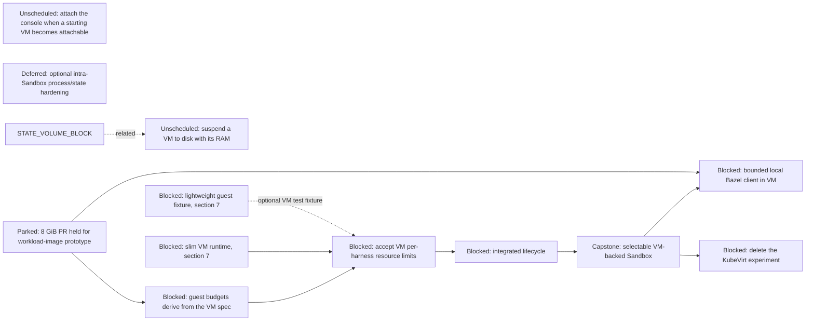

### `VM_HARNESS_RESOURCE_LIMITS` — accept per-harness resource limits on the VM guest

**Blocked on `VM_GUEST_BUDGET_DERIVE` and `RUNNER_LAYERING_VM`; `K3S_VM_IMAGE` is an optional fixture.**
The guest already places each native harness and its tool descendants in a delegated cgroup with CPU,
memory, task and workspace I/O limits. Exercise those limits on the slim guest: resource pressure must
respect the aggregate and per-harness budgets, and exhausting one harness's memory group must terminate
that harness subtree while the Runner remains available. Preserve the existing process-group cleanup and state-owner lock
behavior. The Sandbox is the security boundary; these cgroups enforce resource budgets, not
confidentiality between co-resident Sessions or between a harness and its tool children.

### `VM_INTRA_SANDBOX_HARDENING` — optional process and state hardening inside one Sandbox

**Deferred; nonblocking.** The accepted boundary is the Sandbox, so co-resident Sessions share its
filesystem, credentials and process trust domain. The VM Runner runs as guest root, native harnesses
run as uid/gid 107, and virtiofs presents `/state` files as 107:107; the Runner does not create a
separate mount or PID namespace for each Session. The existing per-harness cgroup groups a native
harness with its tool children for resource limits and teardown, not as a security boundary. Do not
require Runner-private storage, sibling Session stores, or harness/tool process views to be isolated
inside one Sandbox. Revisit Runner-state privacy and tool-child-versus-harness hardening separately
only if a concrete product requirement or incident warrants it. This node does not
gate VM resource acceptance or lifecycle work.

### `VM_LIFECYCLE` — integrated lifecycle verification

**Blocked on the resource-limit checks.** Basic VM creation, Session execution,
retained-state suspend/resume and replacement are covered by the [acceptance suite](../acceptance/README.md).
Combine that coverage with the resource-limit evidence; do not
repeat completed live runs just to assemble a capstone. Additional live faults need a concrete unresolved platform risk,
not a Cartesian product of every component crash and lifecycle operation.

### `SANDBOX_VM_ISOLATION` — VM integration capstone

**Blocked on integrated lifecycle.** Publish the selectable VM environment and measured resource
limits and cross-Sandbox security guarantees, with no implied existing-Sandbox conversion or live
migration. Component evidence, not absence of every imaginable failure, establishes the delivered contract.

### `KUBEVIRT_EXPERIMENT_RETIRE` — delete the KubeVirt experiment

**Blocked on the VM capstone.** Once the production provider covers it, move anything still needed
(the acceptance driver, if it becomes the VM lifecycle test) into production code, then delete
`cluster/cdk8s/agentplane/kubevirt_experiment/`, its launcher policy (production's is
`launcher_relay.py`) and the manifests it generates. Review stale draft #8843 for any still-useful
status mapping or validation before closing it unmerged; production VM creation and halted image
replacement already exist, so they are not prerequisites to implement again.

### `VM_RAM_SUSPEND` — suspend a VM to disk with its RAM

**Unscheduled; operator, 2026-10-13 PDT: nice to have.** A stopped VM Sandbox resumes with the memory
it had, not a cold boot, so a quick resume loses no in-memory state. Find what KubeVirt offers (a
memory dump or a snapshot with memory) and whether it works with the state volume (virtiofs today, block under `STATE_VOLUME_BLOCK`). The
[VM Sandboxes design](../docs/vm_sandboxes.md#guest-and-storage) records that a VM supports neither
RAM suspension nor live migration today. Check what a resumed guest must redo: the runner's control stream and
projected tokens (the relay reopens them per request, so rotation alone needs no restart), and the
clock. Settle first what "seal before suspend" means when the harness keeps running across the suspend
(the current quiesce stops harnesses and seals journals). Where storage or the guest cannot carry it, stop/start from the state PVC stays the
lifecycle.

### `VM_CONSOLE_DEFERRED_ATTACH` — attach after VM startup makes the console available

**Unscheduled; lower priority, operator report 2026-10-15 PDT.** During VM startup the console tab
can show `Kubernetes answered 400` and remain disconnected. Treat a not-yet-attachable VM as waiting
and attach when its lifecycle signals readiness, without reopening the tab. Distinguish startup
from authorization failure, deleted VM, and another attached client; clean up on tab exit and never
open competing connections. Keep the existing read-only/no-replay contract. Test the unavailable
→ attachable transition and cancellation; do not add a periodic polling loop or bigger timeout.

Control design: [ADR](../docs/adr_sandbox_session_control.md).

### `LOCAL_BAZEL` — bounded local client in a VM

**Blocked on VM capstone.** Wire Bazelisk, storage and authenticated RBE/cache/BES; set CPU/memory/disk
budgets and cleanup. Run a representative build/test with the client inside the VM and actions
remote; check cancellation/cleanup while the harness stays responsive. Installed tools and working
hosted builds do not authorize local Bazel in agent containers. `VM_GUEST_MEMORY` is a second
prerequisite: no client budget inside the guest is workable until the guest has RAM to budget.

### `VM_GUEST_MEMORY` — size the VM guest for real builds

**Parked by operator request, 2026-10-16: keep [#10734](https://github.com/agentydragon/ducktape/pull/10734)
unchanged and unmerged while the owner reviews the now-passing `RUNNER_LAYERING_SPIKE` workload-image
proof.**
The patch requests the approved 8 GiB, retaining one vCPU. It raises testing's aggregate memory
request quota to 16 GiB and container/Pod limit caps to 24 GiB, retaining the 28 GiB aggregate
memory limit. The patch remains unchanged; it has not established live guest acceptance.

After merge/reconciliation, inspect actual launcher requests/limits, namespace usage and node
capacity: KubeVirt adds overhead and quota-derived limits, not a fixed 240 MiB surcharge. Confirm
larger guest `MemTotal`, then run a representative `bbr build` and `bbr test` without guest OOM.
Record useful sizing evidence in VM documentation and delete this node when acceptance is complete.
One VM per OVH node is approved; CPU sizing and derived guest budgets remain separate work.

### `VM_GUEST_BUDGET_DERIVE` — derive the guest's cgroup budgets from the VM's memory

**Blocked on `VM_GUEST_MEMORY`; pair with `VM_HARNESS_RESOURCE_LIMITS`, which owns the VM cgroup
acceptance and already cites these files.** Two places set guest budgets as literals while guest RAM is a third number, and
nothing connects them:

- the unit in `agentplane/runner/vm.nix`: `MemoryHigh = "6G"`, `MemoryMax = "7G"`, `CPUQuota = "700%"`,
  `TasksMax = 1024`;
- the delegated groups in `agentplane/runner/cgroups.py`: aggregate `memory.max` 4 GiB with
  `cpu.max` 400000/100000 (4 cores) and `pids.max` 768, per-process 3 GiB / 3 cores / 512.

On this 1536Mi / 1 vCPU guest the unit is live — read `memory.max` 7516192768 and
`cpu.max` 700000 100000 on `agentplane-runner.service`, about 4.5x the whole VM, with
`memory.current` 1085681664 of it already used — so `VM_HARNESS_RESOURCE_LIMITS`' "verify the existing limits"
step will find that the aggregate group cannot reach its declared 4 GiB and the CPU shares are meaningless
against one core. (The `workloads/` group itself is not readable from inside as the agent user; the 4 GiB
figure is from the source, not observed. Reading it is part of this node.)

Make the guest's own size the input: at boot or in the runner binary, read `MemTotal`/`memory.max` and
the online CPU count, subtract a stated reserve for the guest kernel, journald and virtiofsd, and write
the rest. `runner_vm.py` then carries one number and every budget follows it. Keep the reserve explicit
and testable rather than a magic fraction, and fail loudly if the derived value would leave the runner
less than it needs — the dangerous state is a cap so close to guest RAM that the first over-committed
harness hits the **global** OOM instead of being killed as an identifiable subtree, which is exactly what
`docs/vm_sandboxes.md`'s "Resource boundary" section says these groups exist to prevent. Exit evidence:
one image booted at two guest sizes reports budgets that track it, and a harness that exhausts memory
dies inside its own subtree with the runner still answering RPCs.

## 5. Independent UI and narrowly scoped service work

These candidates need no multiagent or VM decision. Any implementation that turns out to require
app/Sandbox Service database changes requires its own migration safety review.

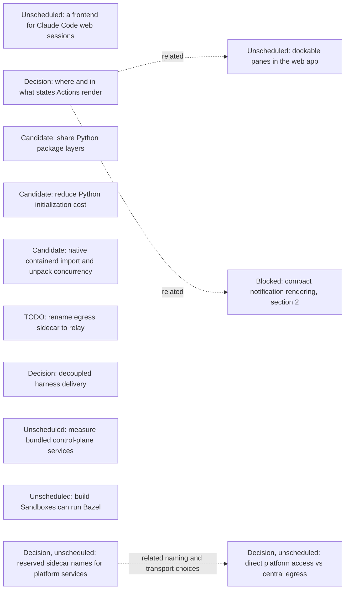

### `PLATFORM_SERVICE_NAMES_DESIGN` — stable sidecar names for platform services

**Decision, unscheduled; operator idea, 2026-10-16 PDT.** Evaluate reserved names such as
`gateway-control.agentplane`, `history-ingress.agentplane`, `notifications.agentplane` and
`actions.agentplane` that map to deployment-configured service endpoints. Decide where the mapping
lives alongside `PLATFORM_SERVICE_ROUTING_DESIGN`; stable names need not select a central or local route.
Cover platform services an agent can access, including discovery of their APIs and effective access;
distinguish runner-internal interfaces from agent-facing interfaces. Keep namespace, cluster domain
and ports out of client configuration. Decide whether these are proxy-only authorities or resolvable
names usable by direct HTTP/gRPC clients; account for proxy exclusions, Pod/VM networking,
TLS authority if applicable, and the
overlap of `gateway.agentplane` with Kubernetes Service/namespace DNS shorthand.

Use exact deployment-owned mappings, coupled to endpoint, audience/token projection and
network-policy wiring; `cluster/cdk8s/agentplane/platform_routes.py` owns today's direct routes.
Preserve independent backend authorization and audience-specific identity. Naming alone grants no
access; any change to a service's egress-policy or credential requirements belongs to the routing
decision below, not an incidental alias change.
Unknown reserved names and unavailable routes fail closed without ordinary
DNS/public-egress fallback. No general wildcard-to-cluster-service rewrite is implied.

Exit: a reviewed naming and transport contract with concrete Gateway-control, History-ingress,
Notifications and Actions client examples, plus a bounded implementation/acceptance scope covering
routing, service discovery, effective access, injected identity, denials and supported Pod/VM clients.
This node authorizes design work; runtime changes wait for
the transport decision. No prerequisites on the other section 5 candidates.

### `PLATFORM_SERVICE_ROUTING_DESIGN` — direct platform access versus central egress

**Decision, unscheduled; operator discussion, 2026-10-16 PDT.** Compare routing agent-accessible
Agentplane services through the central egress proxy with direct local-relay routes or direct
authenticated clients. Include Actions and Notifications as well as runner Gateway control and
History ingress. Gateway/ingress previously used central egress; existing proxy coverage includes
interactive plaintext bidirectional gRPC with metadata substitution. Protocol alone does not require
their current special routes. Naming and API discovery can be designed independently; settle the
combined transport contract before implementation.

The central proxy keeps real substituted credentials outside the Sandbox/Pod/VM and outside what
its ServiceAccount can access, records request/decision evidence, and applies Agentplane egress
policy. Agentplane's own services instead authenticate the agent as itself: distinguish that workload
identity from delegated external credentials the agent must never possess. Backend authorization
remains required on every route.

Arguments for direct platform access: these services are naturally agent-facing, their caller's own
identity may be acceptable for the agent to hold, and required runner control/history delivery would
not depend on central-proxy availability or egress-policy readiness. A local relay could attach
identity without requiring `Bearer <placeholder>`; weigh that small convenience against an asymmetric
client contract that hides authentication. Stable reserved names help prompts and instructions under
either routing choice.

Costs of direct relay routes: another route/configuration surface to distribute and update across
Pod and VM runners, and another place that attaches workload authentication to requests. The minimal
relay already authenticates its hop to central egress, but per-service forwarding expands its role.
Compare generated startup configuration with mounted ConfigMaps or another existing distribution
mechanism; specify update/reload behavior, rollout scope and failure behavior. Central routing
consolidates policy, substitution and decision logging, but adds those dependencies to platform calls.
Decide what request/decision visibility and access controls direct routes need and who owns them.

Direct routes also widen the destinations the workload can reach directly: Pod network policy cannot
distinguish the relay from its agent container, so allowing the relay to reach a backend also permits
the agent to attempt that connection. Backend token validation still gates access. Weigh the marginal
exposure against the central path: a stolen token could also be presented through central egress
where the caller's host/method/path policy admits the request and no substitution replaces it.
Direct access bypasses that egress gate and its decision logging; it does not itself grant the
backend identity or authority. Assess this separately from whether the agent may hold its own token.

Evaluate making central egress optional for deployments that need neither external credential
substitution nor Agentplane egress filtering: external networking may be independently disabled, or
the operator may accept unrestricted access and agent-held credentials. State which functions and
diagnostics are absent in that mode and how platform identity, authorization and discovery still work.
Absence of the proxy alone does not disable external networking.

Exit: a reviewed routing/dependency and identity contract, including whether central egress is optional,
configuration lifecycle, and concrete client examples coordinated with `PLATFORM_SERVICE_NAMES_DESIGN`.
Define bounded acceptance for actual runner control and History push/reconnect, agent calls to Actions
and Notifications, authorization denials and the selected proxy-unavailable/absent behavior. No runtime
change or removal of existing policy checks is selected by this node.

### `ACTION_SURFACES_DESIGN` — where and in what states Actions render

**Decision; operator, 2026-10-13 PDT: rethink it, since it is a patchwork and possibly redundant.**
Decide every place an Action is shown and in which states, then reduce the code to that. Surfaces
found in `app/frontend/actions/` and the service worker: the sidebar rows (collapsed and expanded,
with card decision buttons only where the Action type's `offersCardDecisionButtons` says so), the top "Actions waiting" strip (a count),
the Actions page queue and the detail view (`PendingActionCard`, the full `ActionCall`, with a raw
and a pretty toggle), history, the policy view, and the Web Push notification (formatters in a
registry separate from the React one). Several of them choose independently what to render, whether
to offer a decision, and how tall to let the card grow. Settle which surfaces exist, what each is
for (a glance, a quick decision, full review, a record), and which states each has, so that one
rule decides inline approval and height and each Action type is described once.
Landed: whether a card offers its decision buttons is decided by the Action type's own
`offersCardDecisionButtons(args)` for each invocation, from its content (for example a read-only call
against a listed resource), not by a per-kind allowlist. The names **compact card** (the glance form in
the sidebar and the strip), **card decision buttons** (Approve/Deny on a compact card) and **attention
strip** (the top "Actions waiting" count) are already used in code and tests. Still to settle with the
design: **full card** (the detail view with the whole `ActionCall`) and **notification buttons**
(Approve/Deny on a Web Push notification), then use every name everywhere (UI copy, docs), since "quick
approve" could mean the buttons on a card or on a desktop notification. `NOTIFICATION_PRESENTATION` (section 2) renders notices on the same surfaces and uses the same card
names.

### `DOCKABLE_PANES` — dockable panes in the web app

**Unscheduled; operator, 2026-10-13 PDT.** Let the operator arrange the app's panes (thread browser,
Actions queue, several threads at once, Action detail) by dragging them into a layout of their own,
with split resizing, a layout that persists, and one selected pane at a time on a phone. Open spike
[#9721](https://github.com/agentydragon/ducktape/pull/9721) builds this as an experimental
`/#/mosaic` shell on `react-mosaic-component`, split-only without tabs, beside the classic routes;
it is stale and is the starting point. Settle whether docking replaces the classic routes or stays
an alternative, and fold the Action tiles into the surfaces `ACTION_SURFACES_DESIGN` settles.

### `CLAUDE_CODE_WEB_BRIDGE` — Claude Code web sessions in Agentplane

**Unscheduled; operator, 2026-10-12 PDT: low priority, not to build now.** Make Agentplane's
frontend a custom frontend for Claude Code web sessions: show their conversations and send them
messages, by shimming the web interface's control protocol. Builds on the viewer and syncer under
`devinfra/` and the reverse-engineering in `agentydragon/gaffer-private`.

### K3s startup experiment constraints

The independent candidates below were requested by the operator on 2026-10-16 PDT; none waits
for the others. Use equivalent source/scenarios and report transfer, import/unpack, process
readiness and total test time separately in
[the k3s fixture measurements](../x/k3s_env/README.md#lifecycle-measurements).
Preserve assertions and timeouts. The expensive lifecycle workflow stays **manual-only**;
automatic triggers require a separate reviewed change. Language rewrites require Rai's decision;
rank them by unique image bytes removed and startup time on the dependency chain. Remaining
Python services still need the shared interpreter.

Keep the fixture declarative: supply images and manifests, let Kubernetes reconcile, wait
for readiness, then test. Startup dependency ordering belongs to Kubernetes; do not add
PostgreSQL-first sequencing or a custom parallel import/unpack scheduler to the test harness.

### `EGRESS_RELAY_RENAME` — rename the egress sidecar to relay

**TODO; operator request, 2026-10-16.** Rename the egress sidecar to "relay" across code,
configuration, image names and docs. Update all consumers atomically.

### `K3S_SHARED_PACKAGE_LAYERS` — share third-party Python package layers

**Candidate; no worker assigned; no prerequisites.** Use canonical package paths to share
third-party Python layers across service and migration images with existing Bazel/OCI rules
where possible. The interpreter layer is already shared. Preserve each binary's declared
dependency closure and import behavior. Exit: a matched comparison of distinct layer bytes,
import/unpack and total lifecycle time, passing affected import checks and lifecycle assertions,
and a recommendation to adopt or discard the package-layer change.

### `K3S_PYTHON_INITIALIZATION` — reduce Python process initialization cost

**Candidate; no worker assigned; no prerequisites.** Profile initialization in the remaining
Python services and compare narrower imports or precompiled bytecode against added image bytes.
The app already ships bytecode. Exit: a profile identifying the initialization work removed,
passing affected service and lifecycle coverage, and a matched comparison of process readiness
and total lifecycle time including any extra image transfer/unpack cost.

### `K3S_IMPORT_CONCURRENCY` — measure native containerd import and unpack concurrency

**Candidate; no worker assigned; no prerequisites.** Evaluate containerd's own concurrency
configuration against the current combined stream, preserving distinct-blob deduplication. Count
deferred unpacking through Pod readiness so moving work later is not reported as a saving.
The profiled tar-streaming time includes pipe backpressure; it is not a CPU-cost estimate or
the expected saving from rewriting the streamer. Exit: a matched comparison of import/unpack,
resource use and total lifecycle time with unchanged lifecycle assertions, and a recommendation
to adopt or discard the concurrency change.

### `RUNNER_HARNESS_DELIVERY_DESIGN` — choose how runners obtain harness binaries

**Decision; operator, 2026-10-16 PDT: investigate for k3s test latency.** Decide how a runner obtains
a needed harness independently of its image: digest-pinned downloads from an independent
Agentplane service or directly from OpenAI/Anthropic distribution endpoints, or separately pinned
harness OCI images made available through mounts or an init container copying into a shared volume.
Operator preference: eventual delivery should decouple harnesses from the runner image; the
narrower test images are an interim optimization. Decide delivery and service/cache ownership. Any serving service must
respect the backend dependency rule; the integration app cannot own this path.

The [image-split comparison](https://github.com/agentydragon/ducktape/blob/41c322895f/agentplane/x/k3s_env/README.md#harness-specific-runner-comparison-2026-10-16)
measures removal of unused harness payload; it does not measure runtime delivery of a needed harness.
Its profiles and inventories are merged in [#10813](https://github.com/agentydragon/ducktape/pull/10813) (`x/k3s_env/`); the image split itself landed in #10812.

Exit: a measured recommendation and explicit operator choice. Compare equivalent scenarios and
pins, separating image build/upload, action-input transfer, containerd import/unpack, harness
fetch/cache hits and first usable Session. Include cold runs: moving bytes from an image to a
service may only move the same transfer later, and fetching upstream still costs network and
extraction time. Specify version/digest verification, atomic installation, concurrent requests,
cache scope, unavailable-artifact behavior and allowed egress for any runtime-delivery proposal.
No new artifact service or runtime-download implementation is selected by this node.

### `K3S_BUNDLED_SERVICES_SPIKE` — measure a less isolated control plane in real k3s

**Unscheduled spike; operator, 2026-10-15 PDT.** Evaluate running Agentplane control-plane
services together in one Pod to reduce integration-test startup time. Keep real k3s, RBAC
objects, service APIs, databases, controllers and separately managed Sandbox workloads;
exercise the existing end-to-end lifecycle scenarios. Preserve each service's intended
Kubernetes identity and permissions using separate credentials rather than the Pod's union
of service permissions. Explicitly assess how to provide those credentials: a Pod has one
ServiceAccount, so bundling must not silently bypass authorization coverage.

Compare the normal deployment layout with the bundled layout on equivalent inputs and
scenarios. Measure image import/unpack, startup/readiness and total test time separately;
bundling alone does not remove image bytes or process initialization. Record implementation
complexity and coverage lost through shared networking, scheduling, restart and failure
boundaries, including NetworkPolicy isolation. Deliver a measured recommendation to adopt
or discard the reduced mode, with normal-layout coverage retained for those boundaries.
Keep the expensive workflow manual-only; this spike does not authorize a production topology
change, removal of existing coverage or a language rewrite. Keep one documented invocation path
per supported test tier.

### `TESTING_ENVIRONMENT_RETIRE` — retire the stateful testing deployment once coverage replaces it

**Decision: review coverage gaps before any retirement implementation.** Pod lifecycle/Dispatcher tests on
bare k3s do not cover KubeVirt, Cilium, external identity or real service routing. Assign those checks
to an isolated tier or retain their bounded live environment before removing `agentplane-testing`.
Prepare a separate operator-reviewed retirement/data-disposition PR: remove obsolete Flux/deployments,
databases, credentials, RBAC, DNS/network rules and stateful acceptance recipes only after the new
paths are usable by agents and CI. Preserve staging and user-authored data; this node does not authorize
immediate deletion of the testing namespace or its volumes.

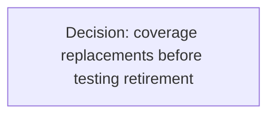

### `BUILD_BOX_BAZEL` — build Sandboxes can run Bazel

**Unscheduled.** A build Sandbox cannot run Bazel: the repo's configuration uses `remote.buildbuddy.io`,
whose gRPC dial ignores the box's HTTP proxy and times out, and it needs credentials. `agentplane/` has no
`go.mod`, so a plain `go build` is not available either. Options: a local-only Bazel configuration for boxes,
or a BuildBuddy route through the box's egress (the Go egress for boxes exists). The key can stay in the
egress proxy as a header substitution, as the staging `claude-ai` Sandboxes' `BUILDBUDDY_POLICY` already does for
`bazel --config=rbe`; whether boxes get that binding is the operator's call.

## 6. Existing access and lifecycle follow-ups

These are bounded existing work, not dependencies on the broader multiagent model. Confirm current
source/deployment state with the relevant owner when dispatching; old acceptance notes are not live
observations. New database work follows the task-specific review and rollout requirements.

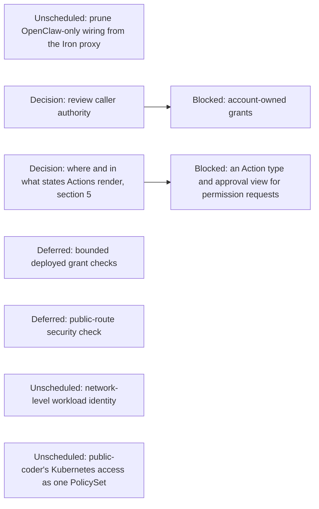

### `PC_EGRESS` — prune OpenClaw-only wiring from the Iron proxy

**Unscheduled; the cutover landed and the public-coder Pod is paused (`replicas=0`).** Remove only the
Iron proxy substitutions and credentials the KubeVirt devbox does not use (`_substitutions` and its
ExternalSecrets); retain shared Iron/Haku consumers. Confirm the first resumed run uses the Agentplane
route. Source: [public-coder wiring](../../cluster/cdk8s/public_coder/proxy.py).

### `PC_KUBERNETES_POLICY_SET` — public-coder's Kubernetes access as one PolicySet

**Unscheduled; operator, 2026-10-12 PDT: wants it eventually.** Move public-coder-agent's whole set
of RoleBindings and ClusterRoleBindings (logs, pods, node and cluster-metadata reads, VolSync status
and the rest, in `cluster/cdk8s/public_coder/app.py` and its entries in
`cluster/cdk8s/agent_access_profiles.py`) under one `PolicySet` of Kubernetes rules with a Flux-owned
`PolicyBinding`. Open: `PolicyBinding` subjects are ServiceAccounts only, while some of these
grants name the `haku:access-profile:public-coder` Group, so either the binding learns Group
subjects or those grants move to the agent's ServiceAccount.

### `CLAUDE_AI_SA` — review the external caller's actual authority

**Decision.** Review the claude.ai account's Connection and arbitrary-shell Sandbox privileges,
Kubernetes scope and egress/Action grants. Record intended authority in generated configuration,
not ad hoc grants. Test an allowed and denied operation; do not add privileges as part of this review.

### `AGENT_PERMISSION_REQUESTS` — an Action type and approval view for permission requests

**Blocked on `ACTION_SURFACES_DESIGN`; operator, 2026-10-13 PDT:
eventually.** A specific Action type for the request instead of the retired Kubernetes MCP grants
escape hatch, with an approval view that shows the operator the account, the sets and the duration
rather than a blob of Kubernetes YAML. It shares with the app's sandbox-page grants the one path
that writes a `PolicyBinding` for the operator (`EgressAccess.grant`), so an approved request creates
the same kind of binding. How the request renders is the Action surfaces' decision: the approval
view is one Action type described once there.

### `MANAGED_SA_RBAC` — grants for accounts without a Sandbox

**Blocked on the caller review.** The claude.ai caller gets a
Flux-owned `PolicyBinding` of the sets `CLAUDE_AI_SA` approves, of any rule type, replacing its
remaining static per-namespace grants in `agent_access_profiles.py` (`STATIC_GRANTS["claude-ai"]`; the
acceptance-testing RBAC already moved to a `PolicyBinding` in #10522). Static Group subjects (Haku OIDC;
public-coder until `PC_KUBERNETES_POLICY_SET`) stay Flux bindings. Test an allowed and a denied request. Static caller accounts' bindings, this one among them, are Flux-owned, never Sandbox-owned.

### `SANDBOX_RBAC` — bounded deployed grant checks

**Deferred by the operator; not dispatchable until selected.** Inspect the managed-Sandbox grant path as `PolicySet`s leave it
and verify intended versus unrelated scope, including Role edits and credential-use boundaries,
without recording credentials. Use [agent RBAC](../../cluster/docs/agent_rbac.md) and existing tests;
only unresolved deployed wiring needs a live check, not a repeat of every already-covered operation.

### `NOTIFICATION_INGRESS_BOUNDARY` — bounded public-route security check

**Deferred by the operator; not dispatchable until selected.** Existing tests
cover invalid signatures. Close the remaining route-wiring uncertainty with an unsigned webhook
request and a private-API request through the public hostname: both must be refused, without
creating subscriptions or inbox entries. Record the result once; no exhaustive provider matrix.

### `NETWORK_WORKLOAD_IDENTITY` — network-level workload identity

**Unscheduled; operator, 2026-10-12 PDT: consider later.** Sandboxes and other workloads prove
their identity to Agentplane services at the network layer, with Cilium mutual authentication
(SPIFFE/SPIRE) or a service mesh, instead of a projected token plus an egress proxy hop; services
authorize by SPIFFE ID or workload label. Costs: SPIRE or a mesh to install, Cilium mutual
authentication still in beta, and a second authentication scheme in every service beside projected
tokens.

## 7. Our own Sandbox resource: Sessions that outlive their Pod

A Session and its history are durable. The operator's direction (2026-10-12 PDT):
the way a Session outlives its runner is our own Sandbox resource, which holds the state PVC and
stays in place with no Pod or VM scheduled. A Sandbox is its state, running or not; an
**incarnation** is one Pod or VM. Stopping, replacing the image and starting again keeps the
Sandbox, so keeping the state means keeping the Sandbox, and deleting the Sandbox is the only thing
that deletes it. The same resource carries the VM kind, so section 4's stateful VMs build on these
nodes instead of a parallel track. Today a Session lives as long as its `Sandbox`
(suspension removes the Pod and keeps the state PVC, which goes with the `Sandbox`). The History Service keys by Session, so it can record each incarnation, and a seal closes
an incarnation, not the Session.

A related direction (operator, 2026-10-11 PDT; later, not scheduled): Sessions living in a
long-running, often-suspended Sandbox whose runner image upgrades between incarnations.

```mermaid
flowchart TD
    DECLARATIVE_SESSIONS_DESIGN[Decision, unscheduled: Flux-managed Sessions and subscriptions]
    SUBSCRIPTION_AUTHORIZATION_DESIGN[Subscription authorization decision, section 2] -. related authority design .-> DECLARATIVE_SESSIONS_DESIGN
    STATE_VOLUME_BLOCK[Blocked: the state volume moves to block storage]
    NODE_LOCAL_BLOCK_STORAGE[Unscheduled: node-local block volumes on every node]
    VOLUME_LAYOUT_CONVERSION[Unscheduled: explicit offline volume conversion, much later]
    SANDBOX_SPEC_EDIT[Unscheduled: edit a suspended Sandbox's template or kind]
    WORKSPACE_NODE_PORTABILITY[Unscheduled: move a workspace between nodes]
    SANDBOX_ARCHIVE[Unscheduled: a suspended Sandbox archived to object storage]
    AGENT_RESUME_NOTICE[Unscheduled: tell agents when their Sandbox was suspended and resumed]
    RUNNER_BUSY_TRACKING -. related .-> AGENT_RESUME_NOTICE
    RUNNER_BUSY_TRACKING[Unscheduled: the runner counts terminals and background processes as busy]
    SESSION_ACTIVITY_STREAM[Unscheduled: the notification service delivers on a Session's idle time]
    PROXY_START_METHODS_DISPATCHER_ONLY[Candidate: narrow proxy command authorization, section 12]
    RESUME_CREDENTIALS_VALID[Decision: optional grants versus resume prerequisites]
    NODE_LOCAL_BLOCK_STORAGE --> STATE_VOLUME_BLOCK
    VOLUME_LAYOUT_CONVERSION -. future incompatible edits only .-> SANDBOX_SPEC_EDIT
    WORKSPACE_NODE_PORTABILITY -. related .-> SANDBOX_ARCHIVE
    VM_RAM_SUSPEND[Unscheduled: suspend a VM to disk with its RAM, section 4]
    DISPATCHER_HARNESS_CONFIRMATION[Decision: settle harness-confirmed inputs]
    DISPATCHER_SEND_AUTHORIZATION_GENERALIZE[Deferred: scoped sender grants beyond v0 service trust]
    APP_NATIVE_RESUME_SURFACE[Approved: retain explicit resume UI; clarify wake-off affordance] --> APP_NATIVE_RESUME_CONTRACT[Decision: durable explicit resume]
    STATE_VOLUME_BLOCK --> STATE_VOLUME_VIRTIOFS_RETIRE[Blocked: retire the superseded state attachment]
    IDLE_SUSPEND_UI_DRIVE[Operator: drive auto-suspend and send-to-resume in staging]
    VM_RAM_SUSPEND -. the same experience, resuming with memory kept .-> IDLE_SUSPEND_UI_DRIVE
```

### `DECLARATIVE_SESSIONS_DESIGN` — long-running Sessions and managed subscriptions through Flux

**Decision, unscheduled; operator idea, 2026-10-16 PDT.** Support a long-running Agentplane
Session declared through Flux, with managed subscriptions such as “keep this Session subscribed
to these GitHub notifications” or “keep it listening to a webhook at this URL.” Creation and
ongoing reconciliation must work without starting the Session from the UI or keeping the
integration app available. Long-running describes durable managed intent; decide separately
whether the harness stays running or suspends and wakes on authorized events.

Review a `Session` CRD, potentially with declarative subscription resources or references. Compare
coexistence with service-owned Session records against replacing the relevant database authority;
first inventory the current runner, Dispatcher, History and app responsibilities rather than
assuming one database owns Sessions. Recommend evaluating Kubernetes-owned desired state with
existing services retaining execution/history and Notification Service retaining subscription/inbox
ownership. The operator must choose the resource boundaries and source of truth; no CRD or database
replacement is selected by this task.

Define stable identity and idempotent create/adopt/reconcile behavior, ownership of UI/API-created
Sessions, spec edits and drift, restart recovery, deletion/suspension and retention of authored
history. Specify how managed subscriptions are restored, updated and removed without duplication,
and whether a webhook URL means provisioning an authenticated inbound endpoint or subscribing to
an existing source. Reuse the subscription-authorization decision in section 2; declaring a resource
must not implicitly grant source access, destination control or wake authority. Identify any actual
implementation prerequisites after choosing the design, including wake policy if required.

**Exit:** reviewed desired-state/runtime ownership and lifecycle contract, one illustrative Flux
manifest for a Session with GitHub/webhook subscriptions, and independently finishable follow-up
nodes with focused reconciliation/restart, duplicate-prevention and authorization acceptance.
Recording this idea does not schedule implementation.

### `STATE_VOLUME_BLOCK` — the state volume moves to block storage

**Blocked on `NODE_LOCAL_BLOCK_STORAGE`.** Replace the VM's virtiofs
state attachment with a declared disk layout once suitable node-local storage exists. The state
PVC holds journals and native harness persistence under `/state/sessions`, separately from the
workspace. A disk would remove virtiofs's `107:107` ownership constraint; check all callers before
changing the guest and Pod UIDs. A Pod filesystem mount and a VM disk are not interchangeable just
because the provisioner supports block storage. Specify supported attachments and reject
incompatible kind changes; conversion is deferred, not a prerequisite for fresh provisioning.
Use an explicit incompatible cutoff for existing Sandboxes, in a separate data-drop PR; the
operator accepted dropping them rather than requiring migration. Gate guest behavior on the VM image and its embedded runner wheel, then activate templates.

### `NODE_LOCAL_BLOCK_STORAGE` — node-local block volumes on every node

**Unscheduled; operator, 2026-10-13 PDT.** Extend capacity-enforcing node-local provisioning to
all cluster nodes, tracked by [#4717](https://github.com/agentydragon/ducktape/issues/4717).
`cluster/cdk8s/openebs_lvm/storage.py` already declares Proxmox filesystem and raw-block classes;
that is not coverage of every node. `local-path` does not enforce PVC capacity. Verify capacity,
node affinity and both required volume modes. A node-local volume remains pinned to its node;
moving it is `WORKSPACE_NODE_PORTABILITY`. This provisioner work does not gate Sandbox ownership
or the explicit layout contract for workspace PVCs.

### `STATE_VOLUME_VIRTIOFS_RETIRE` — delete the superseded state attachment

**Blocked on `STATE_VOLUME_BLOCK` acceptance/activation and old workloads gone.** Remove VM state
virtiofs mounts, guest ownership/UID workarounds used only by them, old template paths and tests/docs.
Keep unrelated virtiofs uses where live callers still need them. Verify Pod/VM state persistence on
the selected explicit layouts before retiring the path; data drops stay in a separate cutoff PR.

### `VOLUME_LAYOUT_CONVERSION` — explicit offline volume conversion

**Unscheduled, much later; operator, 2026-10-13 PDT.** Conversion is an accepted future option,
not work for #10440 or a gate on its rollout. Until implemented, incompatible layout changes are
rejected. When scheduled, design a stopped-Sandbox operation with an explicit destination layout,
verified data/metadata preservation, crash-safe binding switch and separately authorized source
cleanup. See [storage layouts](../docs/sandbox_storage.md#formatting-and-conversion). Do not build
a generic conversion framework now.

### `SANDBOX_SPEC_EDIT` — edit a suspended Sandbox's template or kind

**Unscheduled; operator, 2026-10-13 PDT.** Let the operator change a Sandbox's template, including a
switch between VM and Pod, from the app, only while the Sandbox is suspended. Each incarnation
already reads the current template ([controller contract](../sandbox_controller/SPEC.md#vms)); no
spec is replaced automatically; this is the explicit, operator-driven edit. Use the deployed
[workspace layout contract](../docs/sandbox_storage.md) so a compatible kind switch keeps the
workspace. Validate the
retained state and workspace layouts before replacing a workload. Reject incompatible edits;
`VOLUME_LAYOUT_CONVERSION` is a separate, much later task and does not block compatible edits. The
preset the app records on a Sandbox as a label must stay true after the edit.

Control design: [ADR](../docs/adr_sandbox_session_control.md).

### `WORKSPACE_NODE_PORTABILITY` — move a workspace between nodes

**Unscheduled; operator, 2026-10-13 PDT: even later.** A reasonably fast, node-portable workspace, or
node portability by copying: volsync from node to node, through S3 on SeaweedFS or directly, while the
Sandbox is suspended. Node-local volumes stay the default; this only moves them.

### `SANDBOX_ARCHIVE` — a suspended Sandbox archived to object storage

**Unscheduled; operator, 2026-10-13 PDT: a thought that volsync suggests, not a plan.** Resource
affordances for a Sandbox that still exists but whose volumes sit in restic or S3, so it must be
rehydrated before it can start, freeing the node's disk meanwhile. Sandbox status would say that it
is archived and where, and resuming one rehydrates first. Related to `WORKSPACE_NODE_PORTABILITY`,
which shares the copy mechanism. Preserve the declared workspace layout and retained identity;
the runner's state PVC would archive the same way.

Control design: [ADR](../docs/adr_sandbox_session_control.md).

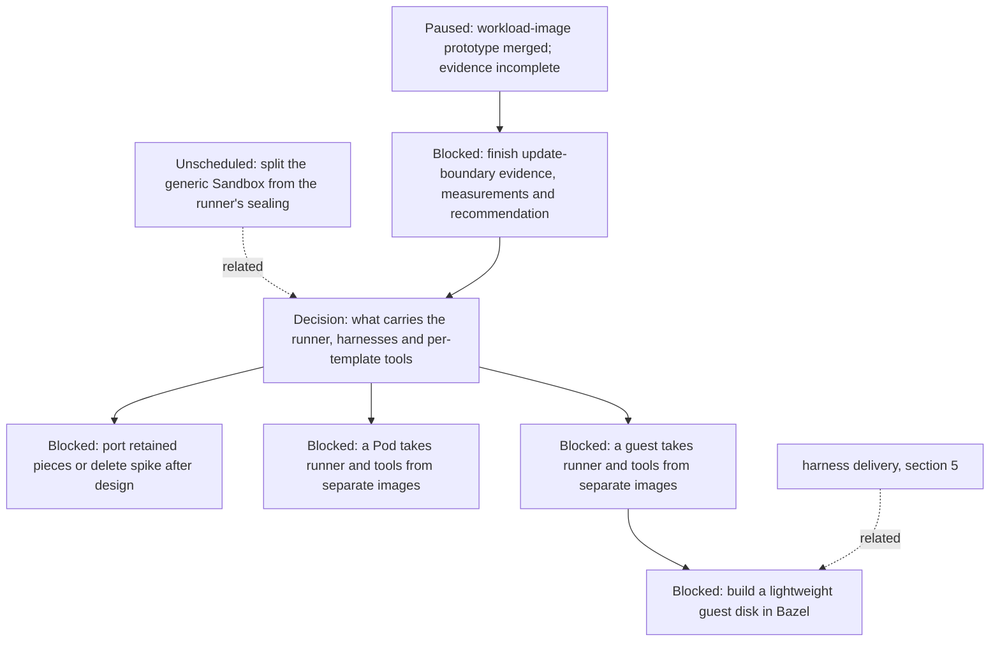

### `SANDBOX_GENERIC_SPLIT` — separate the generic Sandbox from the runner's sealing

**Unscheduled; operator, 2026-10-13 PDT: a later TODO.** Our `Sandbox` resource binds two concerns
together. One is what Agent Sandbox did, plus VM support: a template, a Pod or VM per incarnation,
and a state volume that stays. The other is specific to our runner running inside: sealing a
Session's journal before the incarnation goes. Separated,
the first could be reused without the runner. Decide where the line falls (resource, controller or package) and what each side owns. A
layered pair, a Sandbox and a runner that runs inside one, is the direction the control design
(`docs/adr_sandbox_session_control.md`) points to: seal, runner connectivity and idle suspension
are the runner-aware layer, and the Session Dispatcher sits outside both.

Control design: [ADR](../docs/adr_sandbox_session_control.md).

### `RUNNER_IMAGE_LAYERING_DESIGN` — what carries the runner, the harnesses and the tools

**Decision; operator, 2026-10-13 and 2026-10-15 PDT.** Supersedes `SANDBOX_RUNNER_LAYERING`, which the
operator marked "very low priority unless easy" on 2026-10-13; the 2026-10-15 framing names the property
wanted, so re-rank this node rather than inheriting that ranking. Today one artifact carries everything,
so bumping the runner or a template's installed tools rebuilds and republishes the whole VM:
`agentplane/runner/container-disk.nix` bakes the runner and both harnesses into the NixOS qcow2 that
KubeVirt boots, and `agentplane/runner/image.nix` does the same for the Pod from a wheel pinned in
`nix/artifact-pins.json`. Separate the concerns so a platform user supplies an image or definition with
no runner and no harnesses and the runner side layers them in, and nobody bumps build versions to move a
runner. State which of these the design must satisfy, in order:

- **Independent updates.** Runner and per-template tools move without rebuilding what they sit in.
- **The thing Pods genuinely cannot give** (operator, 2026-10-15): a workload may use a lot of RAM inside
  itself, as a Bazel build does, without starving the host node. A VM reserves its guest RAM, so what the
  guest does stays inside it; a Pod's burst is bounded by what the node has left. Say plainly whether
  layering is meant to reach for that property or whether it stays a VM-only one, because it decides how
  far to go.
- **Additive.** New runtime types are added beside the existing ones, not swapped in, so a runtime can be
  tried without retiring the one that works.

Related to `SANDBOX_GENERIC_SPLIT`: that separates the resource, this separates the image.

**Options worth costing, none chosen.** The operator named the first two; the rest are the field.

- **Extra read-only filesystem image per stage.** Attach the runner and the tools as their own images or
  disks; the base carries neither. Exactly the decoupling asked for, and Claude Code web already does it:
  on its Firecracker guest `/opt/claude-code` and `/opt/env-runner` are separate squashfs disks
  (`/dev/vdb`, `/dev/vdc`) mounted read-only beside a `/dev/vda` root —
  [web container spec](../../devinfra/claude/web_env/docs/container_spec.md).
- **Two-stage guest.** A lean stage 1 boots and runs the runner and mounts a stage 2 filesystem; the
  runner jails a forked child into stage 2 and execs Claude or Codex there. Runner lifetime becomes
  independent of the tool tree, at the cost of a pivot or chroot boundary and the work of trusting a
  mounted image.
- **Stay on KubeVirt, split the disks.** A `containerDisk` is already an OCI image carrying a disk, and
  `runner_vm.py` already attaches `config` and `trust` as separate volumes, so a three-disk guest (root /
  runner and harnesses / tools) needs no new mechanism — only the split. Halted image replacement already
  exists, which is the update path.
- **Kubernetes image volumes.** `imageVolumes` mounts an OCI image's filesystem into a Pod volume; the
  cluster is v1.35, where the feature is GA. This is the direct answer to "this container should mount
  these 2 images", and beats an init-container copy on every incarnation. Check it against the CRI and
  storage class actually in use before relying on it.
- **Init container into a shared volume.** Today's portable form: copy the runner and harnesses from image
  X into an `emptyDir`. Works everywhere; pays copy time and disk each start.
- **Firecracker instead of KubeVirt.** The runtime the operator raised as acceptable if it helps: fast
  boot, small guest, squashfs-friendly, and the shape Claude Code web chose. The cost is a second VMM
  stack beside KubeVirt with no cluster scheduler for it. The RE under `devinfra/claude/web_env/re/` —
  including `process_api/src/firecracker_init.rs` — documents what that guest's init actually does and is
  the closest worked example we hold.

The disk split and Firecracker are not alternatives to each other: splitting disks is additive on the
runtime we have, and Firecracker is a new runtime added beside it.

### `RUNNER_LAYERING_SPIKE` — minimal guest, harness and tools-layer evidence

**Prototype merged (#10741, #10744, #10789); operator-requested 2026-10-16. The remaining compatibility
evidence is paused.** The merged experiment proves a Codex text turn, shell call through a separate Bash
tools OCI layer, native resume after killing the harness, runner survival and private-state separation
in the RBE test; a local Firecracker guest boots the digest-pinned ELF kernel and mounts separate
read-only tools and harness SquashFS drives. #10789 added `workload-tool` in its own OCI tar
layer and changed the mocked Codex shell call to run it before the harness exit, confirmed its
workspace write survives resume, then asked the resumed harness to execute the same workload tool.
The focused `bbr test //agentplane/runner:test_restart --test_arg=-k
--test_arg=sparse_child_root` passed in RBE; the marker remained readable from the persistent workspace
after the harness was killed and resumed, and the resumed Codex process emitted the tool's output
again. Production VM layout selection and implementation remain open.
The guest's Bash and pinned Codex `--version` probes pass; the same probe records a Claude 2.1.252
SIGABRT in the uid-107 mount-namespace child, while the exact binary succeeds on the full host and
in the guest chroot as root without that namespace. The UID and namespace effects still need to be
separated. Measured artifacts are a 1.9 MB base initramfs, 7.2 MB tools SquashFS, and 168.9 MB
harness SquashFS (the source Bash OCI layer tar is 22.3 MB). A disposable K3s `v1.33.4+k3s1` Pod
with ImageVolume enabled was accepted by the API but containerd `v2.0.5-k3s2` failed container
spec creation (`failed to mkdir ""`), before Bash ran; no Pod image-volume execution is established.
This is evidence about that tested stack, not a universal claim about image volumes. Full coding
work, Nix-root compatibility, true cache-cold preparation and guest-only boot latency remain
unproven; no runtime upgrade or further experiment is currently assigned.

Candidate layout to carry into the design review: keep stage-one init and runner control outside the
tools root; mount the per-template tools image read-only; give the workspace and harness homes
explicit writable mounts, use tmpfs for `/tmp`, and provide only the required `/proc` and `/dev/null`
paths to the child. Reuse that filesystem contract in Pods by mounting the same tools image beside
the runner image, with workspace and persistent session state on separate volumes. The guest's
distinct mounts work in the local probe; the tested K3s runtime did not create a Pod with an image
volume, and Claude's child-context abort remains unexplained. Further intra-Sandbox hardening is
not required by the production contract.

The spike exits when those update boundaries and startup measurements are documented alongside a
bounded compatibility contract and a production DAG proposal. After the design decision, either
port only the accepted artifacts and tests to their production owners or remove the spike-only
package, kernel pin, and child fence; do not leave the experiment as an implicit supported runtime.

### `RUNNER_LAYERING_POD` — a Pod takes the runner, harnesses and tools from separate images

**Blocked on the layering decision; pursuable independently of the VM half; operator, 2026-10-15 PDT.**
Give the Pod the same decoupling: the container runs the runner from image X, the harnesses come from X,
and the binaries the agent runs come from a per-template image Y. Options are in the decision node; image
volumes and the init-container copy are the two to try first. Exit evidence: bumping the runner pin
publishes one image, and a Sandbox on the unchanged tools image starts on it.

This does **not** deliver the RAM-headroom property by itself — a Pod still lives inside the node's
allocatable. If the decision makes that property the priority, this node is convenience only and the VM
half carries the requirement.

### `RUNNER_LAYERING_VM` — a guest takes the runner, harnesses and tools from separate images

**Blocked on the layering decision; pursuable independently of the Pod half; operator, 2026-10-15 PDT.**
Split the guest so a runner bump or a template's tool list does not rebuild and repush the whole VM. The
two-stage shape the operator named — lean stage 1 booting the runner and mounting a stage 2 filesystem,
with the runner jailing a forked child into stage 2 to exec Claude/Codex — is one option, with the
squashfs-disk and split-`containerDisk` shapes in the decision node beside it. KubeVirt is not assumed and
Firecracker stays open; what must not change is that the state volume and its ownership rules survive
(`STATE_VOLUME_BLOCK`, and the `107:107` virtiofs constraint). Halted containerDisk replacement already
works, so the update path exists; today it moves a whole guest image, and after this it can move one disk.
The in-guest budgets (`VM_GUEST_BUDGET_DERIVE`) are the other half of the same story — stage 1 owns the
reserve, stage 2 gets the rest.
Deliver a lean bootable guest: a bare root filesystem with the runner and harnesses available from
their chosen layer, and the tools-heavy environment separate. The layering decision still owns exact
disk placement. `VM_HARNESS_RESOURCE_LIMITS` acceptance waits for this slim runtime; existing guest
resource controls remain in place while it is prepared.

### `K3S_VM_IMAGE` — build a lightweight guest disk in Bazel for the k3s integration test

**Blocked on the VM split; operator, 2026-10-15 PDT.** The k3s spike cannot exercise a VM Sandbox at all:
the direct K3s chart omits the `runner-vm` SandboxTemplate because the template needs
KubeVirt, and the fixture runs without KubeVirt CRDs. So the VM path has no integration coverage in
the disposable environment, and pulling the real guest is
unattractive because `agentplane/runner/container-disk.nix` builds it from a NixOS qcow2 — the heavy
artifact the spike exists to avoid, and one that cannot carry the code under test.

Make the test build a guest disk itself, so it runs the runner **from the tree under test** rather than a
published image. The Pod-side pattern already exists there: `//agentplane/x/k3s_env:runner_image` is
`debian_trixie_slim` plus the Bazel-built runner without native harnesses; `:runner_claude_image` adds
only pinned Claude for the model smoke. Neither needs a registry credential. Build the guest from the
tree under test and supply the required harness through the layering design. An image the test boots
— with KubeVirt installed in the spike, or the VM path exercised
against the host's KVM — is the deliverable, not a bigger image. Retain the production guest's
delegated cgroup resource limits if this fixture exercises `VM_HARNESS_RESOURCE_LIMITS`: a lightweight
test must not omit the limits being accepted.

Worth stating in the design, because it argues past the spike: a Bazel-built guest is worth more than the
test. Once a guest root filesystem is an `oci_image` target, `RUNNER_LAYERING_VM` needs no Nix to build a
candidate runtime, CI can build a guest without Attic, and a runtime experiment becomes an additive target
rather than a second release pipeline. Check `RUNNER_HARNESS_DELIVERY_DESIGN` and
`K3S_SHARED_PACKAGE_LAYERS` before adding image weight to that environment.

### `IDLE_SUSPEND_UI_DRIVE` — drive auto-suspend and send-to-resume in staging

**Operator, 2026-10-15 UTC: assigned to the operator, not dispatchable to a worker.** A human drives the
whole loop through the staging web app on a real Session and reports what the UI actually does: the
Sandbox goes idle, suspends on its own, and a message typed into the composer reaches that stopped
Session and brings it back end to end. The idle trigger is `spec.idleSuspendAfter`, set in the Sandboxes list; the suspended composer
and per-Sandbox wake-on-message policy are recorded as implemented and deployed, so this is acceptance of
the pair **as experienced**, not a re-run of their unit coverage or the composer's own rollout checks.

Worth recording during the drive, because automated coverage does not produce it: how long the idle wait
looks from the UI, what the Session and Sandbox render while suspended, whether the default-off wake
policy is legible (queued versus "resume it yourself"), what the user is told afterward and what survived,
and any point where the only way forward is `kubectl`. Log a deployment-specific gap as a node rather than
fixing it mid-drive. Cover a VM Sandbox as well as a Pod one: a VM keeps its state PVC across stop/start
and loses guest-local disks, so it is where a resume that looks successful can still lose something the
user expected back.

Related: [lifecycle coverage](../x/k3s_env/README.md#lifecycle-coverage), and `VM_RAM_SUSPEND` for the
"resume with the memory it had" version of the same experience.

### `AGENT_RESUME_NOTICE` — tell agents when their Sandbox was suspended and resumed

**Unscheduled; operator, 2026-10-13 PDT: it would be good.** An agent whose Sandbox was suspended and
resumed learns nothing of it: its tool processes are gone, a terminal or background process it started
no longer runs, and whether its workspace survived depends on where it lived (the state PVC is kept; a
VM-local disk is not, until `VM_RAM_SUSPEND`). Tell the agent when a new incarnation of its Sandbox
started, how long it was down, what was kept (state PVC, workspace) and what was lost (processes,
terminals). The runner knows the incarnation change; what survives is a fact of the Sandbox's kind and
volumes, and a suspend ends background processes and terminals, which do not count as busy
(`RUNNER_BUSY_TRACKING`). Open: whether the notice is a runner
platform instruction added at harness start, an event the History Service folds into the Session, or a
message through the Dispatcher; and the wording agents act on. Test a suspend and resume with a
background process, a terminal and workspace files, and a crash restart (no suspend) that reads
differently.

Related: [lifecycle coverage](../x/k3s_env/README.md#lifecycle-coverage).

### `RUNNER_BUSY_TRACKING` — the runner counts terminals and background processes as busy

**Unscheduled; operator, 2026-10-14: not now, an open TODO that may be looked at later.** The runner
publishes `idle_since` (`RunnerFacts`), busy while a delivery is under way, the bootstrap runs, or any
Session has a turn, an unfinished command or a setup script. A background or durable process or an
attached terminal or console does not make the Sandbox busy, so an idle suspend ends them. The runner
does not supervise these, so who would report them (the harness adapters, the VM console) is open.
Test an attached terminal that detaches, a background process that outlives a turn, and a runner
restart. `AGENT_RESUME_NOTICE` tells the agent what a suspend ended.

### `SESSION_ACTIVITY_STREAM` — the notification service delivers on a Session's idle time

**Unscheduled.** The History Service folds `idle_since` into `SessionSummary` (the turn and harness
events that start and end idleness), and the app shows it. The notification service currently chooses
when to deliver from its existing quiet window and sends every notice through the Session Dispatcher.
What remains is a second listener: read the Session summary after each `WatchSessionSummaries` notice
and choose to deliver after a minute of idleness, at most ten minutes after the first pending entry.
`idle_since` is display and delivery timing: suspension reads the runner's busy facts (the connection
Lease facts) and never this field. Per-Session idle times stay out of Kubernetes.

Control design: [ADR](../docs/adr_sandbox_session_control.md).

### `DISPATCHER_HARNESS_CONFIRMATION` — settle admitted inputs on a canonical confirmation

**Decision, then bounded implementation.** `HARNESS_CONFIRMED` currently has no writer. Review the canonical runner/history
fact that proves an input reached the harness, consume it idempotently and settle the matching
Dispatch without reading unrelated conversation content. Preserve the distinction between durable
queue acceptance, runner admission and harness confirmation. Test duplicate/replayed facts and
restart. Notification presentation/outcome design remains separate.

### `DISPATCHER_SEND_AUTHORIZATION_GENERALIZE` — replace v0 service trust with scoped sender grants

**Deferred TODO; v0 decision does not block delivery design.** Dispatcher may specifically trust the
App and Notification service identities to act for their users, with wake permission separately
allowlisted. Do not extend that exception to agents or other services. Design destination- and
operation-scoped grants, delegated caller proof and the effect of revocation on queued work before
general senders are admitted. Consider RBAC-backed permissions, but choose the authority with the
multiagent model. Include authorization before wake and any required execution-time recheck. The
mandatory Sandbox UID fence is part of `DELIVERY_DESTINATION_CONTRACT`, independent of sender policy.

### `APP_NATIVE_RESUME_SURFACE` — retain explicit resume and distinguish the two controls

**Explicit native-resume action retained; exact wake-off affordance needs review.** The Thread page
currently shows **Resume harness** only for a Ready Sandbox with a stopped harness. It calls the
Gateway directly. A submitted input always makes Dispatcher call runner `ResumeSession` before
delivery, independent of the `wake_on_send` setting. That opt-in setting controls waking a
**suspended Sandbox**, not whether a command resumes a stopped native harness. The composer can
queue a message while the Sandbox is suspended even when wake on message is off; the queue then
waits for explicit Sandbox resume. The suspended indicator remains visible.

The operator wants an explicit button when automatic resume on send is off. Decide whether this
means a Thread-page **Resume Sandbox** affordance when `wake_on_send` is off, the existing **Resume
harness** action once the Sandbox is Ready, or both. The native button cannot itself wake a
suspended Sandbox because its current Gateway path requires a live runner. Keep explicit Sandbox
resume available and do not erase the suspended indicator or turn on wake permission implicitly.

### `APP_NATIVE_RESUME_CONTRACT` — specify durable explicit native resume

**Separate future decision; does not block the approved direct Runner resume migration.** Its later canonicalization makes Dispatcher the sole starter
of runner work. Specify a durable Dispatcher operation, including caller-chosen retry ID, full
destination/UID authority, authorization,
admission before any wake, lost-response retry, and observable outcome. Decide whether it applies
only to a Ready Sandbox or may also wake a suspended one; the existing Sandbox resume API is a
distinct control. Do not add a new RPC or broaden wake grants before this contract is reviewed.

### `RESUME_CREDENTIALS_VALID` — grants and tokens still valid after a long suspension

**Decision; the [credential audit](../debug/resume_credentials_valid.md) is published in merged #10573.** Are app-created runtime
`PolicyBinding`s optional additive capabilities, or prerequisites for useful resume? The current
app adds independent expiring grants; Sandbox resume does not renew them. Recommend preserving
that additive model: expiry and revocation remain authoritative, with no automatic re-grant.
If required grants are desired, first define their durable identity, missing/expired status and
explicit operator re-grant flow. The audit distinguishes controller-driven expiry from exact
post-deadline denial, and projected-token renewal from grant renewal. Add implementation work only
for a reviewed contract that the code does not already satisfy; do not add an implicit Ready gate.

## 8. Ownership and naming cleanup

Cleanups that leave one database per service and names that say what things are. Each node is one
deployment; edges are the known order. Staging data follows
[staging data preservation](../docs/staging_data_preservation.md): Session identities and history
are irreplaceable, and a node that deletes a column or row stops for the operator.

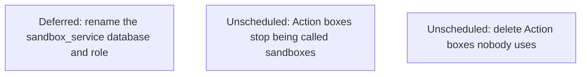

### `HISTORY_DATABASE_RENAME` — name the database for its owner

**Deferred by the operator; not dispatchable until selected.** The old Sandbox Service is gone, but
the `sandbox_service` database, role and `postgres-sandbox-service` Secret remain in use by the
History Service. This is a naming cleanup, not permission to recreate or drop the database. Rename
the database and role in place (`ALTER DATABASE`/`ALTER ROLE ... RENAME`) and have the CNPG
`Database` and managed role adopt the new names; recreating the database under a new name would copy
the log. Verify the History Service and Electric reconnect with no data movement. Update the
`storage/migrate.py` and `cluster/cdk8s/agentplane/history_service.py` docstrings.

### `ACTION_BOX_IDLE_REAPER` — delete Action boxes nobody uses

**Unscheduled; operator, 2026-10-11 PDT.** A small controller deletes Action box Pods with no
`exec` for a configured time. The Action Service stamps a last-exec time on the box at each `exec`;
a plain Pod delete is enough, since boxes have no seal. It takes over `TODO(sandbox-lifetime)` in
`action_service/sandbox/inventory.py`; draft [#7859](https://github.com/agentydragon/ducktape/pull/7859)
expired agent-sandbox boxes the same way.

### `ACTION_BOX_RENAME` — Action boxes stop being called sandboxes

**Unscheduled; operator, 2026-10-11 PDT: a later TODO.** Rename what calls an Action Service box a
sandbox, so it no longer reads as a Session Sandbox: the `sandbox__*` Actions,
`action_service/sandbox/`, the `agentplane-sandbox` templates and labels, and
`cluster/cdk8s/agentplane/command_sandbox.py`. The `sandbox__*` tool names are what agents and
external Connections call, so renaming them is a wire change.

## 9. Legacy burn-down

Dead code, finished gates, compatibility shims and stale names found by the 2026-10-10 PDT audit of
devel. A gate counts as legacy once its rollout is finished on both testing and staging or nothing
reads it; the delta settlement flag stays (operator, 2026-10-13 PDT). Lane named per
node; leftovers of in-flight work belong to the lane already changing that code. Upstream-gated
tombstones with a verifiable condition in code (`keepingOffset` in
`thread_store.tsx`, the jsdom pragma in `markdown.test.tsx`) need no node.

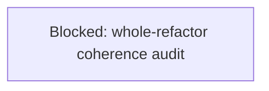

### `REFACTOR_COHERENCE_AUDIT` — the refactor reads as one design

**Blocked on `DELIVERY_OLD_RUNTIME_RETIRE`**, which removes the
remaining transitional pieces. Sweep devel for unused modules, functions, settings, proto
fields, tables and columns; one name per concept across code, settings, manifests, protos and docs
(Runner Gateway, History Service, ingress, control; Session for the raw stream,
Thread for its projection; no "hub", "follow" or "shadow" left); READMEs, `SPEC.md` files and
`docs/` describing the code as it is, without cutover narration; no compatibility branch,
optional-with-fallback setting or `CLEANUP` tombstone whose condition is met; the system diagram in
`agentplane/README.md` showing exactly the deployed services and the traffic between them in
`cluster/cdk8s/agentplane`. Known now: the test-only `PostgresListener.wait_until_disconnected`
(`connected` turns false before the termination callback runs, so its tests cannot wait on
`connected` instead); egress and app test support each build a throwaway CA;
`cluster/cdk8s/agentplane/kubevirt_experiment` is an experiment outside `x/`. Findings are fixed in
PRs of their own; this node leaves with the last of them.

## 10. Runner ingress and control split

The runner dials out to two endpoints its Sandbox names: an ingress it pushes its journal's Events to (the History
Service when history is kept) and the Runner Gateway control endpoint. Contract:
[runner control stream § Event ingress](../docs/runner_control.md#event-ingress).

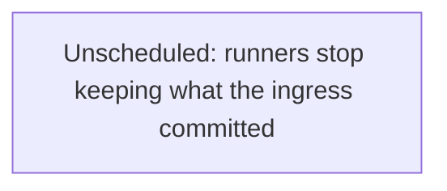

### `RUNNER_JOURNAL_TRIM` — runners stop keeping what the ingress committed

**Unscheduled; the operator's direction, 2026-10-12 PDT: later.** A runner could stop persisting
journal entries its ingress has already acknowledged, behind a flag, with full persistence kept
selectable; the freezer's
[`RUNNER_JOURNAL_SETTLEMENT`](task_freezer.md#runner_journal_settlement--settle-deltas-in-the-runner-journal-too) is the same idea at the delta level. Not designed: what the runner still needs locally (cursors, seal state, entries a
resumed harness or a lost push reads back) once acknowledged entries are gone, including what a revived incarnation reads back
(the retained incarnation history).

## 12. The Runner Gateway serves the runner's own service

The Gateway serves `Connect` and proxies the runner's
`Runner` service with per-method authorization; commands use Dispatcher and typed Runner RPCs. The
Python Session wrappers, registry runtime, and database artifacts have been retired.

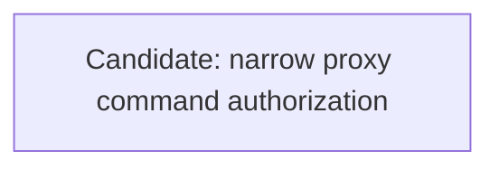

The [completed control-surface audit](../docs/control_surface_retirement.md) records protobuf,
HTTP/client, settings, deployment and guest-wheel consumers. Live `Runner.ListSessions` remains
needed by app archive/native resume and Notification membership, so its conditional retirement
node is removed. This does not remove the separate destination-authority decision `DELIVERY_DESTINATION_AUTHORITY_DESIGN` (section 13).

### `PROXY_START_METHODS_DISPATCHER_ONLY` — only the Dispatcher starts or continues work through the proxy

**Needs policy revision; preserve the explicitly approved direct app `Runner.ResumeSession` caller.**
The runner proxy (`runner_gateway/go/gateway/proxy.go`) currently lets each configured caller account
invoke the Runner methods allowed by policy, except `Quiesce` (controller only). The app and Notification
accounts and the Gateway's own account can call `OpenSession`, `SubmitInput`, `ChangeModel`,
`ChangeReasoningEffort`, `InterruptTurn` and `StopRunnerSession` directly; only `ResumeSession` from the app is
approved. Review the per-method policy
for `OpenSession` and other start-or-continue-work methods against the Dispatcher-only command
boundary and the approved app resume path. Do not revoke app resume as part of retiring the Gateway
Session wrapper.

## Scope and retirement of stale gates

- Notifications keep workers in the HTTP service. Retention, worker extraction, idle-polling
  optimization and new-source wiring are frozen with triggers, not hidden release prerequisites.
- Broad provider-matrix exploration is frozen; ordinary auth/signature denial regression coverage
  belongs with the implementation, not an unbounded production checklist.
- Native subsessions and runner durability/thin-adapter redesign remain frozen. Neither the runner
  channel nor multiagent design unfreezes the broader runner-state redesign.
- Existing security boundaries, data-preserving migration checks and representative deployment
  integration checks remain requirements. The freezer is not a waiver for a known data-loss or
  unauthorized-access bug; promote one when evidence makes it concrete.

## 13. Delivery boundaries, APIs and harness identity

This section holds the unfinished delivery-acceptance cleanup, destination and harness-identity design and
implementation, and API and test-tier work.
Decision nodes do not authorize runtime changes. Detailed code paths and alternatives are in the
[delivery and harness design note](../docs/runner_delivery_and_harness_design.md).

**Approved transport direction (operator, 2026-10-15 UTC):** gRPC for internal APIs,
gRPC-Gateway for the generated HTTP/JSON facade, and an ergonomic CLI, adopted incrementally by
service and interface. Use JSON server streams for watches/waits and native gRPC for full duplex.
Facade integration, individual service migrations, and the CLI workflow contract remain separate work
items below; this direction does not authorize runtime changes.

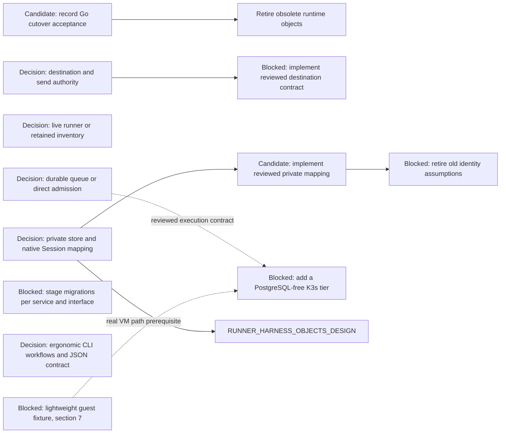

### `DISPATCHER_PERSISTENCE_MODEL_DESIGN` — choose durable queue or direct runner admission contract

**Candidate decision.** Compare the current PostgreSQL-backed queue with direct runner admission.
One evaluation goal is whether a useful Agentplane deployment can run without CNPG, potentially
with runner-local persistence; inventory every other database consumer and say which state/feature
can be omitted, moved or still requires a database.
For direct admission, require an available runner and reject while it is unavailable or suspended;
direct admission must not wake-to-deliver or wait through long VM/image startup. The durable queue is
the only mode that may retain work and own wake-to-deliver. For wake-on-send, persist the complete
destination tuple, command ID and payload before reporting durable queue acceptance or initiating
wake; retain it across caller disconnect, Dispatcher restart and the full image-pull/boot delay.
Distinguish that queue receipt from later Runner admission. A lost direct-admission reply is unknown,
not rejection: retry the same idempotency key while the runner journal is retained. Runner storage
loss is terminal for runner-owned state; there is no requirement to reconstruct it from a queue or
History, and this does not imply separately retained History was also lost. Cover per-Session ordering,
cancellation, duplicate opens, sender and replica failure, and retries. Runner-local persistence
protects work only after the runner has committed admission; it does not accept work while that runner
is absent. Inventory all database owners before making any CNPG claim: current manifests declare the
shared cluster databases `app`, `sandbox_service`, `actions`, `egress`, `notifications` and the
Dispatcher; the retired `sandbox_commands` database is not part of the current manifests. Indexing
has a separate PostgreSQL dependency.

**Recommendation for review:** preserve the queue's durable acceptance and wake-to-deliver contract.
If a direct mode is considered, keep it a separate online-only contract with explicit idempotent
retry semantics and no implicit wake. Question: keep the queue, change its durable owner, or add a
narrower direct mode? Do not implement a direct-RPC replacement from this design task alone.

### `CNPG_FREE_K3S_INTEGRATION_TIER` — add a narrow database-independent integration tier

**Blocked on the reviewed execution-persistence contract, actual removal of execution-database
dependencies from the flows under test, and the real VM fixture.** Add a K3s integration tier for
independently usable, loosely coupled Agentplane components; it is not a full-stack parity
environment or a replacement for CNPG. Exercise only flows that can run without the removed
dependencies. The tier may omit Notifications, History, Electric, the CNPG operator and PostgreSQL,
without requiring those absent services' behavior in this suite or implying that every other service
is database-free.

Cover Pod and VM runner flows, adding test ingress where a selected flow needs it. Require a real
supported VM fixture via `K3S_VM_IMAGE`; the existing k3s suite runs without KubeVirt and is not VM
execution coverage. Keep this test target separate from runtime database removal;
scope its included flows, omitted services and remaining state owners explicitly. A direct-admission
contract, if selected, remains online-only and does not wake suspended Sandboxes; the durable-queue
mode remains the owner of wake-to-deliver.

The existing `agentplane/x/k3s_env` suite already runs without the CNPG operator, KubeVirt, Cilium or cert-manager,
against one plain PostgreSQL Deployment and the Go Gateway; this node is about removing the PostgreSQL dependency
itself. Direct admission and new sender grants remain separate decisions.

### `DELIVERY_UNIFIED_CUTOVER` — record acceptance of the Go Gateway cutover

**Both environments serve the Go Gateway (testing #10787, staging #10796, listener port fix #10818); acceptance
is not recorded.** A live read at 2026-10-17 03:41 UTC found the Sandboxes of staging and testing
`RunnerConnected=True`; a VM runner's reconnect is not observed. Testing preservation and manual writer-fence gates
were waived by the operator; the waiver does not apply to staging, whose backup/restore preflight and writer fence are
not recorded as complete here. Remaining evidence: previously accepted work recovers; lost-response same-ID retry;
runner reconnect for an existing VM; App and Notification live reads; controller Quiesce; UID replacement;
owner and holder on different replicas; failover. Rollback is old images against the unchanged schema and rows
([rollout procedure](../docs/go_delivery_rollout.md)); do not clear databases or claim History can reconstruct runner
storage. Record exact evidence.

### `DELIVERY_OLD_RUNTIME_RETIRE` — remove only superseded runtime objects

**Depends on `DELIVERY_UNIFIED_CUTOVER`.** The Python Deployments, single-purpose ConfigMaps, image automation
entries and legacy deployment settings were removed by #10786, keeping the Dispatcher migration history the Goose
handoff needs. Remaining: restore `RollingUpdate` (`runner_gateway_go.py` still uses `Recreate`) after acceptance, and
remove any Gateway token projection no caller reads (the Go worker may need a Gateway-audience token for a different
connection-holder replica; check each caller). Keep both stable Service front doors, per-Sandbox
Services/EndpointSlices and the Dispatcher database. Search code, BUILD, chart, image automation, docs, CI and pinned VM
artifacts for references before deleting definitions.

### `RUNNER_INVENTORY_AUTHORITY_DESIGN` — distinguish live runner state from retained inventory

**Candidate decision.** Trace every current `Runner.ListSessions` and History inventory caller. The
runner read reports records and harness/setup state known to the current runner; History reports
retained Events and folded Thread views, can lag, and can include deleted Sandboxes. App archive and
resume checks, Notification subscription membership, and test drivers use live state today for
different reasons. The Dispatcher no longer calls `ListSessions` to resolve `OpenSession` conflicts:
identical retries return the existing attachment, while conflicting specs or setup fail. Decide
whether each remaining caller requires live presence, retained identity/history or a narrower contract.

**Recommendation for review:** retain a live read wherever an approved caller still needs live state;
do not substitute History by name similarity. App archive/native resume and Notification membership
still need the live read, so the conditional retirement node is removed. Retiring
the old Gateway wrapper is a separate caller/pinned-image audit, even if `Runner.ListSessions`
remains. Keep History `FindSessions` and summaries for retained app views; Notification's History
journal reads are command-outcome evidence, not inventory.

### `DELIVERY_DESTINATION_AUTHORITY_DESIGN` — assign destination validation and send permission

**Candidate authority decision; public destination approved by operator, 2026-10-15.** Require
submissions to carry the exact `(Sandbox UID, Agentplane Session ID)`; store/native/process mapping
is runner-private and no public store field is needed. Persist the complete address, command ID and
payload before reporting queued
acceptance or initiating wake, then retain it across caller/Dispatcher restart and Sandbox boot. The
durable queue receipt is distinct from later Runner admission. Queue that tuple, locate the exact
Sandbox, and let queued delivery wake only that target. The reachable runner rejects an unknown
Session as a terminal outcome;
it must not search other Sandboxes, create a Session, or fall back to a same-name replacement. Offline
queue admission does not claim to verify live Session membership and does not need a central
Session-to-Sandbox placement registry. Keep Kubernetes UID-to-live-connection/workload routing
separate from session placement. Direct admission, if selected, remains online-only and does not wake;
the queue owns wake-to-deliver.

Still compare sender-side checks, one authoritative Dispatcher or Gateway execution boundary, and an
intentional layered model. Keep source/subscription authorization separate from destination identity,
owner/membership validation, send permission and the execution-time fence. Trace Notification
subscriptions, all command senders, Dispatcher UID checks and Gateway proxy resolution. Preserve
authentication and authorization before wake, command idempotency and outcome semantics. The exact
locator representation remains open: namespace/name plus UID or UID-based Sandbox resolution.
UID fences identity but does not authorize a caller.
V0 may trust only App and Notification to authorize their users; general send grants and queued-work
revocation are deferred to `DISPATCHER_SEND_AUTHORIZATION_GENERALIZE`. Evaluate owner changes,
TOCTOU/replacement, unavailable or suspended runners, reader
subscriptions versus command submission, terminal unknown-target outcomes and narrow credentials.

**Recommendation for review:** implement no runtime change before the destination authority and
locator are selected. Preserve existing checks until each layer's authority and denial semantics are approved; a source-read
subscription must not silently grant sending or waking. Question: which boundary rejects stale or
unauthorized destinations, what locator and authorization proof does it require, and which checks are
early feedback versus execution authority? No centralization choice is made here.

The [delivery design note](../docs/runner_delivery_and_harness_design.md#destination-checks-and-authority)
maps the current checks and candidate layered authority. Decide whether namespace/name accompanies
mandatory UID or an authoritative UID resolver supplies it. Keep the authenticated v0 service
identity separate from the caller-supplied destination and the execution-time UID/owner fence; do
not treat one as proof of the other. Set explicit denial and retry rules for replacement, unavailable
runners and unknown Sessions before implementation.

### `DELIVERY_DESTINATION_CONTRACT` — carry and enforce the reviewed destination

**Blocked on `DELIVERY_DESTINATION_AUTHORITY_DESIGN`; the public destination is approved.** After
the authority and locator are reviewed, migrate the app and Notification senders and the Dispatcher
request/queue/retry shape to one caller-supplied full
destination with exact Sandbox UID and public Session ID. Persist the exact destination, command ID
and payload before a queued receipt or wake;
do not reconstruct an expected UID from a Sandbox name. Make the chosen admission authority reject
senders outside the v0 App/Notification trust boundary; only separately allowed callers may wake.
Make the execution boundary fence the same UID and owner before forwarding. A reachable runner
rejects unknown Session targets terminally; unavailable runners cannot prove membership at queue acceptance.
Keep direct mode online-only with no wake and same-ID resolution after a lost reply. Validate
replacement, owner change, wrong destination, suspension, duplicate retry, runner storage
loss and staged caller/receiver rollout, including pinned images. A private runner store mapping
can evolve independently. This node does not expose process placement or select one versus several
harnesses per runner.

This implementation can make a central Session-to-Sandbox placement lookup unnecessary for command
delivery. Neither the destination design nor this node deletes retained History or the Kubernetes
UID-to-connection locator.

### `SERVICE_API_TRANSPORT_MIGRATIONS` — stage service and interface migrations independently

**Blocked on a reviewed contract for each service.** Move
internal service interfaces to gRPC and expose their generated HTTP/JSON facades incrementally, one
service/interface at a time. Each migration needs its own caller inventory, authorization and
behavior-preservation review, tests, rollout and rollback plan. Do not turn the approved direction
into one repo-wide migration. No service has been selected for the first cutover.

### `AGENT_API_TOOLING_DESIGN` — preserve ergonomic, scriptable agent workflows

**Candidate; the interface direction is approved.** Design convenient CLI commands and composable
JSON interfaces for listing Action groups and Actions, inspecting Action schemas, reading the
authenticated caller's own Action status/results and waiting for completion, plus subscribing to or
cancelling GitHub PR notifications. Specify auth discovery/credential scope, stable errors and exit
codes, pagination, JSON output, streaming/reconnect, wait deadlines and cancellation semantics. Reuse
the selected facade/API code generation and client tooling rather than inventing a parallel stack.
Update runner platform instructions and other prompts alongside the reviewed CLI contract.

**Deliverable:** an approved command and JSON contract with explicit authorization, error, stream,
wait and cancellation behavior. This is design only; no CLI, prompt or API change is authorized.

### `HARNESS_IDENTITY_DESIGN` — decide private Session-to-store and native mapping

**Public destination and process boundary approved (operator, 2026-10-15).** The public address is
`(Sandbox UID, Agentplane Session ID)` with no store field. The runner maps a public Session durably
to its private store/native ID; selecting a default store by requested harness kind remains a
candidate policy. Namespace/name may locate the Sandbox, but request syntax and UID resolver are
undecided.
Process allocation/routing stays internal; there is no create-Session-on-process API or refusal.
Process incarnations may be diagnostic objects, never durable addresses. Neither the number of
stores/processes per Runner, at-most-one process per store nor shared-store concurrent safety is
selected.

**Recommendation for review, not approved ID allocation:** retain client-chosen globally unique
public IDs for client-created root Sessions, bound to one Sandbox UID, immutable creation spec and
runner-private selected store. Reserve the public ID durably before native creation; map it durably
to the harness-chosen native ID before
reporting a completed opening. An identical retry resolves by public ID, while reuse against a
different destination/spec conflicts. A queued opening is not proof of native creation. If native
creation succeeds but its ID is lost before mapping commits, inspect native store evidence or a
proven harness idempotency mechanism; if identity cannot be proved, report unresolved creation and
do not blindly create again. Specify how the reservation, mapping and native evidence survive
Runner/process crashes. Native ID is scoped to the store and never substitutes for the public ID.

Define runner-owned store create/reuse without ID recycling, Session open/resume/stop, per-store
versus per-Session options, store retirement and explicitly authorized data deletion. Persist store harness type and exact Sandbox UID
binding; process death and Sandbox suspension do not delete data. Moving a store to another Sandbox
requires a new binding and authorization. Until proven safe, prevent concurrent writes to one store.
A reachable runner returns a terminal missing-target outcome for the public Session; offline
queued acceptance cannot prove membership. Native child IDs are harness-chosen: if exposed, register
stable runner-chosen public mappings with store and parent identity before publication, and separate visibility
from independent control. Child projection remains [deferred](native_session_discovery.md); use the
[merged child characterization](../native/docs/child_sessions.md) for process capability. The operator's private remote-control RE finding
reports outbound HTTP session-start polling with one Claude process launched per Session speaking
RemoteIO, characterized as essentially the existing stream-json stdio protocol. This is an
attributed finding, not a runtime process-count test or proof that Claude can never multiplex by another
route. Use one Claude process per root Session and Codex's demonstrated shared app-server as current
adapter baselines, without exposing process routing or imposing one process per store. No
one-versus-many store or shared-store safety decision is made here.

Feed the reviewed process-diagnostic shape into
[`RUNNER_HARNESS_OBJECTS_DESIGN`](#runner_harness_objects_design--decide-process-diagnostics-and-placement-policy).
The approved public address lets destination migration proceed once its authority and locator are
reviewed; private runner mapping can be implemented independently. This decision does not block
Dispatcher/Gateway Go unification planning. A unified service may preserve today's wire first and
consume the approved public address later. Neither
design node authorizes runtime changes.

### `RUNNER_STORE_SESSION_IDENTITY` — implement durable store and public Session mapping

**Requires review of the private mapping contract; independent of
Go unification.** Add runner-owned durable store IDs, exact Sandbox
UID binding, public Session
reservations and native-ID mappings using a new migration rather than editing landed state formats.
Implement adapter-internal process selection, restart/resume and store write fencing; a process
incarnation must not enter a durable destination. Preserve the current per-Session state and authored
native data through migration. Cover same-ID/same-spec retries, conflicting reuse, crashes before
native creation, after native creation but before mapping, and after mapping but before response.
Where the native create result cannot be reconstructed, expose unresolved creation and preserve
orphaned native data for reconciliation instead of duplicating it. Exercise Codex and Claude adapter
paths without assuming Claude multiplexing. Specify atomic caller/proto and pinned runner/VM image
rollout before changing live addresses.

### `RUNNER_IDENTITY_LEGACY_CLEANUP` — retire only obsolete identity assumptions

**Blocked on `RUNNER_STORE_SESSION_IDENTITY` rollout; public address cleanup remains with
`DELIVERY_DESTINATION_CONTRACT` and its own caller gates.** Audit running/saved SandboxTemplates, pinned runner
wheels and every caller before removing old per-Session-process assumptions and stale docs/protos.
Identify any remaining placement-registry lookups, but keep the Gateway registry's separate
native-resume and pinned-caller retirement
gates; this node does not drop its database or delete retained runner stores, native conversations or
History. Confirm exact UID/Session routing to the private store, suspended-queue retry and restart on the deployed
images before retiring old paths.
