# Agentplane task DAG

This is the dispatch map for **unfinished** work. Detailed contracts belong in component plans;
completed work belongs in component docs, not done nodes here. Maintenance rules are in
[AGENTS.md](../AGENTS.md#task-dag-maintenance). Deliberately deferred candidates and conditional
hardening live in the [freezer](task_freezer.md), not the execution graph.

## Current state and scheduling

Session Event archive backfill and full-history verification are done; do not repeat them. The six
empty staging Sessions stay excluded from extra checks. Audit metadata consumers (`sandbox`,
`harness`, `model`, `cwd`, summary/activity fields) before deleting useful UI projections. Squash
Alembic only once the app schema settles.

States: **in flight** means reported work is underway; **decision** needs a reviewed outcome;
**blocked** names prerequisites; **candidate** is dispatchable when selected, not a priority claim.
A **capstone** closes an integrated contract, not another implementation. Solid arrows below are
prerequisites; dashed arrows explicitly label scheduling holds or conditional choices. All service
contracts remain multi-replica unless a reviewed temporary restriction says otherwise.

## 1. Session schema and identity follow-up

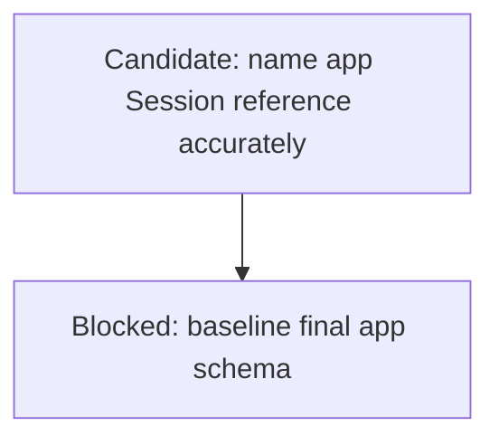

### `APP_SESSION_SCHEMA_RENAME` — name the app Session reference accurately

**Candidate.** Rename `EventLog`/`event_log` with their foreign keys, queries and
references. Preserve public IDs and app projection/operator metadata; do not rename
service archive tables or runner storage. Coordinate a safe schema rollout. Metadata
consumer audits remain scoped cleanup, not permission to discard useful UI projections.

### `APP_ALEMBIC_SQUASH` — consolidate the final app schema

**Blocked on final schema naming/cleanup.** Baseline only the settled schema,
verify fresh and migrated databases and their deployed stamps before pruning old revisions.
Retain the data-preserving rollback procedure. No Action Service or other database squash implied.

## 2. Service-owned command admission and later notification presentation

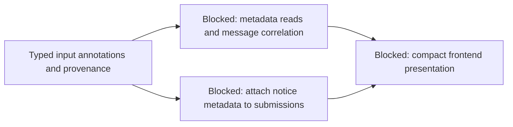

Details: [Command admission](command_admission.md); later
[notification presentation and input metadata](notification_presentation.md).

### `SESSION_INPUT_METADATA` — later typed annotations on input commands

Extend the service envelope with typed
metadata and restricted trusted producer provenance. Notification-specific authorization and producer
integration belong here, not in the generic command-admission PR. Metadata never enters runner commands;
notification attachments are invalid on controls. No untyped extension dictionary.

### `SESSION_INPUT_METADATA_READ` — authorized annotation reads

**Blocked on typed input metadata.** Expose metadata by session/command identity and join existing
`origin_command_ids` in projections. Include pending/failed inputs, replay and retained historical
annotations without requiring a live notification inbox. Keep canonical runner Events unchanged.

### `NOTIFICATION_NOTICE_METADATA` — producer integration

**Blocked on typed input metadata.** Attach notice identity/range metadata using existing delivery
command IDs. Preserve receipt reconciliation and explicit inbox acknowledgement. Verify the backend
path without the app; use automated integration coverage rather than requiring a provider outage.

### `NOTIFICATION_PRESENTATION` — compact notification rendering

**Blocked on producer and metadata read integration.** Compact authenticated notification-only
inputs, expand full text and render mixed human/notice messages normally with annotations. Missing
metadata falls back to text. Include visual coverage and one bounded real-notice check; no inbox
acknowledgement on render and no text-prefix provenance heuristic. Runners remain unaware.

### Subscription authorization before broader sources

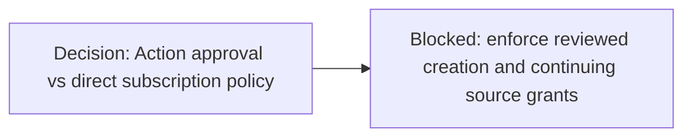

### `SUBSCRIPTION_AUTHORIZATION_DESIGN` — auto-allow and operator-approved subscriptions

**Decision.** Compare an Action-backed subscribe operation using existing auto-allow/operator
approval with authorization inside Notification Service; do not preselect another policy engine.
Review which callers may subscribe to which sources, targets, fields/filters, destinations and
lifetimes, and who can approve/delegate that access. Subscription creation approval is distinct
from continuing source access and from ownership of the destination inbox. Define renewal, scope
expansion, policy changes/revocation and what happens to already-retained entries.

Use Kubernetes as a concrete design case: namespace/resource/UID scope, object/status/event/log
content, name reuse and whether grants delegate the caller's existing read authority or explicitly
allow additional observation. A privileged watcher must not expose arbitrary cluster data merely
because the agent owns an inbox. Review argument examples that auto-allow narrow approved scopes,
require operator approval for additional scopes, and reject requests nobody can delegate. See the
[subscription authorization design](notifications.md#subscription-authorization-and-action-approval).
This is independent of selecting a messaging transport or fixing existing GitHub delivery gaps.

### `SUBSCRIPTION_AUTHORIZATION` — creation gate and continuing enforcement

**Blocked on the authorization decision.** If Actions is selected, implement its subscribe operation
and reviewed policy bindings; otherwise implement the chosen direct policy path. Keep Notification
Service the subscription/delivery authority in either case. Carry verified caller/decision scope
across the service boundary rather than substituting the executor's broad identity. Enforce the
same access contract on direct APIs, renewals and updates; no approval bypass by another endpoint.

Test auto-allow, pending approval, denial, restricted destinations, scope escalation and expiry/
revocation with controlled identities. No entry may be delivered beyond the reviewed source scope;
approval is not permission to wake a Sandbox or execute source content. Future Kubernetes sources
must depend on this contract/enforcement when promoted from the freezer. Ordinary authorized
subscription reads/cancellation and existing GitHub gap recovery need not wait for a broad redesign.

### GitHub notice reliability after missed updates

The operator reports that GitHub updates may sometimes be missed. This is a concrete reliability
concern, not proof that GitHub webhook delivery itself is at fault. Diagnose webhook receipt,
matching, inbox persistence and notice dispatch separately. Do not reopen waived broad provider
outage/refresh exercises; test the specific recovery contract with controlled missing webhooks.

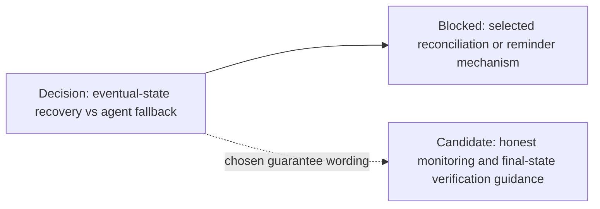

### `GITHUB_NOTICE_RELIABILITY_DESIGN` — delivery guarantee and fallback

**Decision.** Review the gap and choose the guarantee needed for PR shepherding: eventual awareness
of current head/check/review/merge state, or historical delivery of each event. Compare bounded
service-side reconciliation using existing durable shared GitHub refresh state with explicit agent
fallback checks, optionally scheduled reminders. Recommend the smallest reliable path with a stated
staleness bound/cost. A webhook subscription is not proof no changes occurred when it stays silent.
Snapshot polling cannot reconstruct all intermediate events, and a cron reminder alone is not
recovery if no active agent checks state. Detailed alternatives and questions are in the
[notification plan](notifications.md#missed-github-updates-and-shepherding-reliability).

### `GITHUB_NOTIFICATION_RECOVERY` — implement the reviewed recovery contract

**Blocked on the reliability decision.** If service reconciliation is selected, periodically compare
eligible shared subjects with authoritative GitHub state and durably emit deduplicated observations
for uncovered relevant changes. Reuse refresh leases, backoff and access checks; bound API load.
Distinguish observed state from a received webhook; do not fabricate delivery IDs or promise replay
of events the API cannot recover. If agent fallback is selected instead, provide its actual bounded
check/reminder mechanism and explicit limitations rather than just advising agents to remember.
Add `CRON_NOTIFICATIONS` as a prerequisite only if that reviewed implementation actually needs it;
a service refresh deadline need not introduce a general scheduler. Backend workers stay in-process.

Test a suppressed webhook, duplicate webhook/reconciliation races, changed head/check state and
restart/checkpoint recovery with a controlled GitHub peer. Observe one eventual update for the
promised scope, honest access/backoff state and no false claim of complete history. No live GitHub
outage or exhaustive historical event matrix is required.

### `GITHUB_SHEPHERD_GUIDANCE` — explain monitoring limits and completion checks

**Candidate for immediate baseline clarification; final wording follows the decision.** Treat
notifications as prompts to inspect authoritative current PR state, not evidence that the latest
head passed or that silence means no progress. Document the chosen fallback deadline/ownership and
how an agent notices unreliable monitoring. If reminders are chosen, state who runs them and that
notices do not start a stopped harness. Guidance accompanies the selected reliability behavior;
it must not advertise a polling/reminder guarantee before that mechanism exists.

## 3. Multiagent decisions before implementations

These are operator-reviewable decisions, not permission to implement every possibility. Drafts can
be developed together, but publish a coherent shared identity/authority vocabulary before downstream
APIs. Do not equate creating a resource, reading history, sending a message or receiving/acking it.

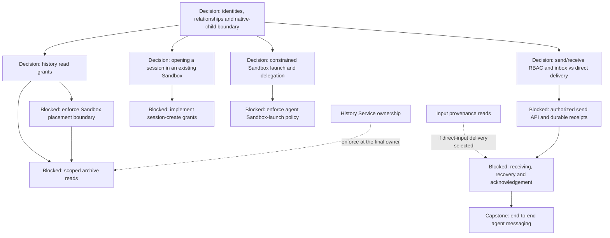

### `MULTIAGENT_MODEL` — shared identity and authority vocabulary

**Decision; no runtime work implied.** Present concrete API examples for independent agents,
Sandboxes and Sessions, with creator, manager and parent/provenance represented separately. Ask
the operator to choose addressing/ownership and delegation semantics. No permission inheritance
from an organizational edge or preset. Review how native harness children could later be ingested:
linked execution in the same Sandbox trust boundary versus independently provisioned Sandboxes,
addressability, observability and which controls must remain unavailable. Native integration itself
stays frozen; this decision must allow explicit exclusion rather than require its implementation.

### `THREAD_READ_POLICY_DESIGN` — scoped history read policy

**Decision; draft in parallel with the shared model.** Review compartments versus exact-session
grants, who classifies/reclassifies histories and grants/revokes access, and caller replacement
semantics. Neither grant model isolates Sessions sharing a Sandbox (see the
[isolation boundary](../docs/thread_layering.md#sandbox-isolation-boundary)). Defaults expose
no existing histories to workloads. Select raw read/list/follow scope; read does not imply
send/create, and no folded-read API is required for v1. Decide how revocation
applies to live feeds, discovery and linked evidence. Do not block this on a messaging transport.

### `SANDBOX_COMPARTMENT_BOUNDARY` — enforce Sandbox placement boundary

**Blocked on the reviewed scoped-read policy.**
The Sandbox is the security isolation boundary: co-resident Sessions share filesystem, credentials,
and ServiceAccount authority, regardless of archive-read classifications. Enforce compatible
placement for any proposed scoped-read policy at Open, adoption and replacement, rejecting
placements whose claimed isolation depends on separating co-resident Sessions. Test shared
filesystem/SA cases and denied placements. Keep VM isolation a separate capability, not a
fictional fix for shared credentials inside one VM. See the
[Sandbox boundary](../docs/thread_layering.md#sandbox-isolation-boundary).

### `THREAD_READ_POLICY` — authorized retained-history access

**Blocked on reviewed read policy and compartment enforcement.** Enforce at
the owning backend across list, raw/native evidence, direct reads and feeds, including reconnect
and revocation. Keep app-only UI folds separate. Test allowed/denied histories, two principals,
deleted Sandboxes and revocation with deterministic service tests plus a bounded deployed auth check.

### `AGENT_MESSAGING_DESIGN` — send and receive contract

**Decision.** Merge the former overlapping `CROSS_THREAD_DELIVERY` design here. Present examples
of sender authentication, recipient discovery/opt-in, send grants, recipient read/ack grants and
administration. Compare Notification Service inbox delivery with direct session input and an
existing messaging channel; recommend the smallest fit. Define accepted, delivered, handled and
acknowledged separately; decide offline behavior, retention, batching, abuse limits and mailbox
ownership after Sandbox deletion. Reading a transcript does not authorize sending or acking.

Output includes the selected owner/API and explicit conditional prerequisites: a direct-input
implementation reuses durable `SubmitCommand` and separately reviewed provenance reads; a notification source reuses
inboxes without treating admission as acknowledgement. Neither branch is selected in this DAG.
Before dispatch, add the chosen branch's edges; do not require implementing both. New Sandbox
Service or app tables require their task-specific contract review. Pure Notification Service work need not
wait for unrelated archive schema once its contract is reviewed.

### `AGENT_MESSAGE_INGRESS` — authorized send and acceptance

**Blocked on messaging decision and its selected prerequisites.** Implement bounded payloads,
server-authenticated sender provenance, per-recipient send policy, idempotent message IDs and honest
acceptance receipts in the chosen authority. Test denied pairs, spoofing and retry/conflict behavior.

### `AGENT_MESSAGE_RECEPTION` — delivery, recovery and acknowledgement

**Blocked on ingress contract/implementation.** Implement selected recipient read/delivery/ack
operations, batching and recovery of unread work. Test revoked/deleted recipients, ordinary offline
catch-up and duplicate delivery without leaking payloads. Do not start/resume a harness implicitly.

### `AGENT_MESSAGING` — integrated messaging capstone

**Blocked on ingress and reception.** Demonstrate an authorized pair exchanging a message through
the selected API, with correct provenance and distinct receipt/ack states. Security-negative and
multi-replica retry cases belong in automated tests; no real provider outage requirement.

### `THREAD_CREATE_POLICY` — authorize session creation separately

**Decision.** Review caller scope to open in an existing Sandbox, accepted defaults, quotas,
creator visibility and revocation. Use the service-reserved Session identity, not a caller-invented
public UUID. Opening in an existing Sandbox grants no isolation from its other Sessions; require a
separate Sandbox when incompatible trust or credentials are needed. Decide whether launch-and-open
is a composition of separate grants, never an implicit read/send/launch permission. This contract
need not choose a durable offline command queue.

### `THREAD_CREATE_AUTHORIZATION` — implement session-create grants

**Blocked on create policy.** Enforce scope/defaults and idempotent Open
lookup at the service boundary; test forbidden targets/overrides and a lost creation reply.

### `AGENT_LAUNCH_POLICY_DESIGN` — Sandbox launch and delegation policy

**Decision.** Review which callers can use which templates and resource budgets, mounts, images,
secrets, egress and Kubernetes/Action grants; presets are defaults, not authority. A new Sandbox is
required for an independent isolation boundary; adding a Session within one is not. Define manager,
lifetime, parent termination, quota/fanout and revocation without automatic privilege inheritance.
Choose policy ownership and audit records before adding tables. State separately whether the
operation also opens a session; if so, depend on `THREAD_CREATE_AUTHORIZATION` for that composition.

### `AGENT_SANDBOX_LAUNCH` — constrained agent-requested launch

**Blocked on launch policy and idempotent create.** Enforce the reviewed
effective spec and delegation server-side. Test allowed and forbidden launch parameters and
concurrent retries. Reuse Sandbox Service creation, not harness-native agent tools. Launch alone
does not grant history read, messaging, credentials or execution of another principal's Actions.

## 4. VM environment phases

The [KubeVirt plan](kubevirt_environments.md) contains completed prototype evidence and the detailed
provider design. Split implementation rather than making “VM support” one indivisible task. This is
an unranked candidate lane, not authorization for local Bazel in current containers. The
[runner channel](../docs/runner_channel.md) settles the dial-out contract VM control networking
builds on; changing connection direction does not move command durability or remove the runner
journal.

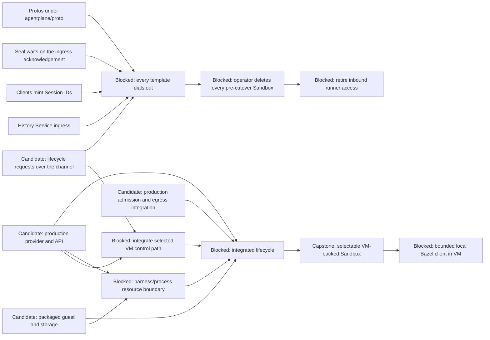

### `RUNNER_OUTBOUND_LIFECYCLE` — lifecycle requests over the channel

**Candidate; both peers answer and send the requests.** The `ListSessions`, `CreateSession` and
`ResumeSession` RPCs and teardown sealing use them ([runner channel](../docs/runner_channel.md)).
Left: `LookupSession`'s and `journal_reader`'s listings, which run on any replica and still read
the inbound API, and setting the App's and Notification Service's `control_target` in their
manifests once their images carry it. `LookupSession`'s journal scan waits on how Events travel.

### `RUNNER_OUTBOUND_ROLLOUT` — every template dials out

**Blocked on lifecycle requests and the [ingress and control split](#11-runner-ingress-and-control-split).**
Every Sandbox template starts its runner pushing Events to its ingress and holding its control
stream, and the canary template goes. The Sandbox Service sets both endpoints at creation once its
config carries `runner_control` and `runner_ingress`, and no template may then
pass `--channel-target` itself, so that config and the canary's removal land together, after the
images that read them are published. Pre-cutover Sandboxes are not upgraded: a clean cutover
(operator, 2026-10-10 PDT), with the operator stopping their one running Sandbox for it.

### `LEGACY_SANDBOX_RETIRE` — delete pre-cutover Sandboxes

**Blocked on the rollout; the operator's step.** The operator chose a clean cutover (2026-10-10
PDT) and deletes every Sandbox created before it through `DeleteSandbox`, so each runner seals its
journals and retention holds keep it until the History Service has archived them. Exit: no live
Sandbox's runner lacks the channel.

Pre-cutover Sandboxes are still archived the old way: the History Service follows them through the
Sandbox Service and holds them until the seal, which is why `FOLLOW_PATH_RETIRE` waits for this
node.

### `RUNNER_INBOUND_RETIRE` — remove inbound runner access

**Blocked on legacy Sandbox retirement.** Remove
`Attach` command submission, the pull ingester, the runner control port and its network policy.
With no inbound route left, the `runner_connection` table goes (a drop migration the operator
merges) together with the routing check on its operations in `SubmitCommand`, leaving
`Hello`/`Welcome` capabilities to negotiate only what a connection carries. The legacy caller-chosen runner Session ID
path goes too, as do the runner SPEC's and Sandbox Service README's notes on the unauthenticated
inbound listener.

### `VM_CONTROL_NETWORKING` — integrate the reviewed connection direction

**Blocked on the reviewed outbound command, spool and lifecycle capabilities and VM provider.** Wire
VM control reachability/authentication to the chosen path. An outbound channel may remove guest
control-port exposure and endpoint discovery; retain the independently needed outbound API/credential
proxy path. State which guest ports, endpoint discovery and network policies the chosen path
replaces. Image packaging and process-isolation work need not wait for this decision. Verify the
selected path on the actual VM network, not just a host-loopback transport test.

### `VM_IMAGE` — packaged guest and state storage

**Candidate.** Publish a digest-pinned guest with runner/harness versions, blank-disk setup and
retained state/workspace bounds. Check startup with both harnesses, without ad hoc downloads or
real credentials baked into the image. Reuse the proven prototype, not another platform evaluation.

### `VM_PROVIDER` — production provider API and lifecycle intent

**Candidate.** Integrate typed environment kinds, templates/destinations, inventory, reconciliation,
RBAC and UI. Container behavior remains intact. Review the changed service contracts and schema
rollout as part of this work.

### `VM_EGRESS` — integrate production admission and proxy path

**Candidate.** Implement the selected launcher-injection/proxy route on the production stack.
Verify proxy-only credentials, routing, token replacement and denied cross-environment access;
check failure scope for the new admission configuration. Do not repeat the entire completed
prototype matrix or require simultaneous cluster-wide disasters.

### `VM_PROCESS_ISOLATION` — protect control from harness processes

**Blocked on image/provider.** Enforce aggregate memory/process/disk budgets and process-control
boundaries. Test representative tool/harness termination and bounded exhaustion to establish which
runner/control state survives and what needs durable recovery. This directly addresses agents
accidentally killing their own harness; guest or container packaging alone is not that guarantee.

### `VM_LIFECYCLE` — integrated lifecycle verification

**Blocked on provider, image, selected control networking, egress and isolation.** Exercise both harnesses through real service
routes with retained-state stop/start and a representative replacement; confirm identity, replay and
cleanup. Automated tests cover restart/concurrency branches. Additional live faults need a concrete
unresolved platform risk, not a Cartesian product of every component crash and lifecycle operation.

### `SANDBOX_VM_ISOLATION` — VM integration capstone

**Blocked on integrated lifecycle.** Publish the selectable VM environment and measured isolation
limits, with no implied existing-Sandbox conversion or live migration. Component evidence, not
absence of every imaginable failure, establishes the delivered contract.

### `LOCAL_BAZEL` — bounded local client in a VM

**Blocked on VM capstone.** Wire Bazelisk, storage and authenticated RBE/cache/BES; set CPU/memory/disk
budgets and cleanup. Run a representative build/test with the client inside the VM and actions
remote; check cancellation/cleanup while the harness stays responsive. Installed tools and working
hosted builds do not authorize local Bazel in agent containers. Hosted build acceptance is complete.

## 5. Independent UI and narrowly scoped service work

These candidates need no multiagent or VM decision. Any implementation that turns out to require
app/Sandbox Service database changes requires its own migration safety review.

### `THREAD_NOTIFICATION_INDICATOR` — pending notice status in the sidebar

**Candidate.** Expose authorized pending/next-eligible notice state and distinguish queued,
delivered and acknowledged states. Reconnect against backend state; any countdown is an estimate.
Independent of compact delivered-message rendering. Never acknowledge from viewing the sidebar.

### `THREAD_BROWSE_PAGINATE` — bounded history browsing

**Candidate.** Paginate/search the Thread listing with authorized
stable cursors, independent of deferred transcript full-text search. Verify ordering, navigation and
permissions rather than making the frontend load every Thread. The paging cursors come from the History Service's
list API (`ListSessionSummaries`).

## 6. Existing access and lifecycle follow-ups

These are bounded existing work, not dependencies on the broader multiagent model. Confirm current
source/deployment state with the relevant owner when dispatching; old acceptance notes are not live
observations. New database work follows the task-specific review and rollout requirements.

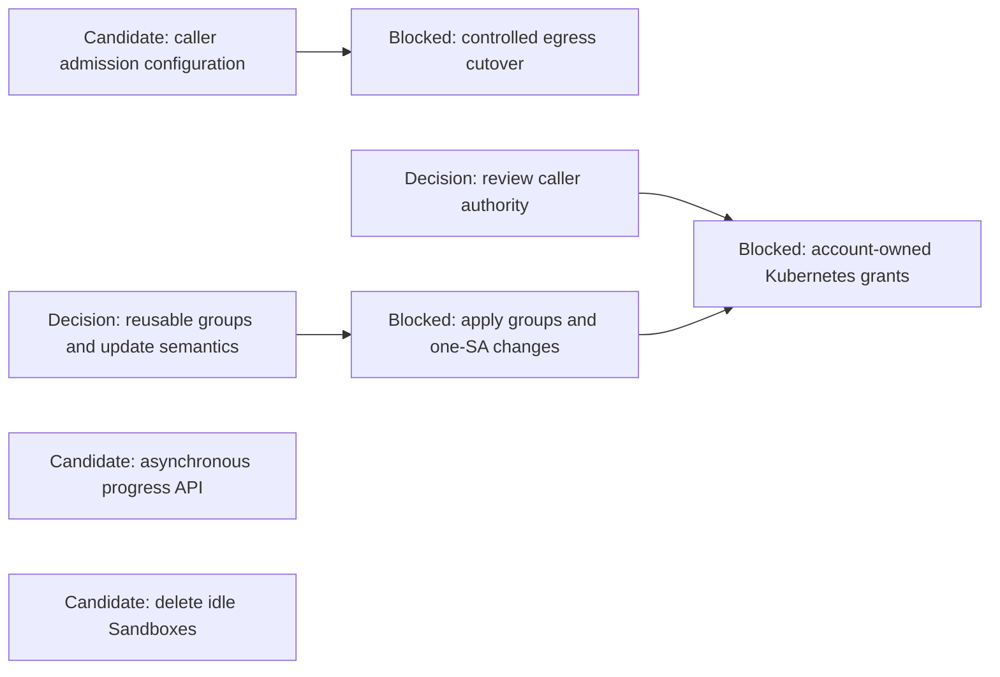

### `PC_EGRESS_CREDENTIALS` — label public-coder's Action Service caller

**Candidate; verify remaining configuration.** Admit the intended OpenClaw account to the dedicated
Action Service using its configured namespace and policy bindings. A label alone is not an execution
grant. Coordinate with the owner of the currently disabled/controlled workload before rollout.

### `PC_EGRESS` — public-coder-agent egress migration

**Blocked on caller admission and a controlled deployment.** Compare effective allowed/denied routes,
credential substitution and Action policy against the existing proxy, then do a reversible cutover.
Remove only unused OpenClaw-specific wiring; retain shared Iron/Haku consumers. Do not turn this
into an outage matrix. Source: [public-coder wiring](../../cluster/cdk8s/public_coder/proxy.py).

### `CLAUDE_AI_SA` — review the external caller's actual authority

**Decision.** Review the claude.ai account's Connection and arbitrary-shell Sandbox privileges,
Kubernetes scope and egress/Action grants. Record intended authority in generated configuration,
not ad hoc grants. Test an allowed and denied operation; do not add privileges as part of this review.

### `KUBERNETES_RBAC_POLICIES` — reusable groups and update semantics

**Decision.** Replace the hundreds of per-namespace grant selections in some Sandbox presets
and their creation dialog with a named, subject-free Kubernetes grant group. Compare snapshot
expansion (acceptable) with live updates to existing bound SAs (preferred); keep a one-SA runtime
grant operation, which may use the same group mechanism. Decide ownership, namespace expansion,
role-edit/revocation behavior and inspection. The launch catalog is not already a live policy.
See the [RBAC grant-group plan](kubernetes_rbac_groups.md) for the current behavior, prior art,
trade-offs and acceptance cases. The preferred live design is an Agentplane-owned,
subject-free group CR and per-Sandbox assignment CR, reconciled by a separate small controller
image/ServiceAccount with narrowly reviewed binding-write and named-role `bind` authority;
final CRD schemas, migration and RBAC grants still require review. Snapshot expansion remains
an acceptable simpler fallback.

### `KUBERNETES_RBAC_POLICY_BINDINGS` — apply groups and one-SA changes

**Blocked on the reviewed policy shape.** Implement compact group selection and durable assignment,
expanded Kubernetes bindings, a one-SA runtime change and inspection. Reconcile changed group
membership for existing SAs if live semantics are chosen; otherwise make snapshots explicit and
support deliberate updates. Retain managed binding conflict/cleanup safeguards and verify
add/remove, overlaps and restart. See the [plan](kubernetes_rbac_groups.md).

### `MANAGED_SA_RBAC` — grants for accounts without a Sandbox

**Blocked on reviewed policy/ownership model and reusable group binding.** Extend the chosen
group assignment and one-SA runtime model to accounts without a Sandbox, including
owner/reconciliation/expiry when no Sandbox can own the binding. Do not fight GitOps over objects.
Existing grant views can ship first; add this grant kind when it exists. Keep ordinary authorization
and cleanup tests; no dependency on a new external-credential broker. See the
[RBAC grant-group plan](kubernetes_rbac_groups.md).

### `SANDBOX_RBAC` — bounded deployed grant checks

**Candidate; security-relevant remaining check.** Inspect the concrete managed-Sandbox grant path
and verify intended versus unrelated scope, including Role edits and credential-use boundaries,
without recording credentials. Use [agent RBAC](../../cluster/docs/agent_rbac.md) and existing tests;
only unresolved deployed wiring needs a live check, not a repeat of every already-covered operation.

### `NOTIFICATION_INGRESS_BOUNDARY` — bounded public-route security check

**Candidate; security-relevant deployment check, not a provider failure drill.** Existing tests
cover invalid signatures. Close the remaining route-wiring uncertainty with an unsigned webhook
request and a private-API request through the public hostname: both must be refused, without
creating subscriptions or inbox entries. Record the result once; no exhaustive provider matrix.

### `BINDING_SUBJECT_ARITY` — singular subject shape

**Candidate.** Align the
binding kinds on one explicit subject before adding multi-subject use. Preserve owner/replacement
and authorization semantics; this cleanup does not authorize broader grants.

### `BOOTSTRAP_PROGRESS_CONTRACT` — asynchronous start/status

**Candidate.** Add authorized start/progress/result semantics without
holding an Open RPC through a long script. Keep successful bootstrap as the Open precondition
unless the operator reviews a change. Separate Sandbox initialization from per-session setup.

### `SANDBOX_IDLE_EXPIRY` — delete Sandboxes nobody uses

**Candidate.** Draft [#7859](https://github.com/agentydragon/ducktape/pull/7859)
expires idle Sandboxes (`TODO(sandbox-lifetime)` in `action_service/sandbox/inventory.py`). Deleting
one goes through [teardown](../sandbox_service/API.md#teardown), which waits until history is
archived through the seal (a retention hold today, the ingress acknowledgement after
`SEAL_ON_INGRESS_ACK`).

## 7. History Service extraction and delta settlement

Target and the reasoning behind this order: [History Service plan](history_service.md).
Decided by the operator on 2026-10-10 PDT: the History Service takes over the existing
`sandbox_service` database; the fold's projection is rebuilt from the raw log, not copied; Electric
replicates the history database; `session_event` keeps its name.

Each implementation node is one deployment, in this order: a server capability with no callers, then
the caller switch, then deleting the old path in a later release after bounded checks on both
environments. Testing goes first, staging after its checks pass. Retained data is deleted only by a
node that says so. There is no dual write of the raw log: there is one copy of its tables, and each
node switches which service reads or writes it. Only the fold double-runs.

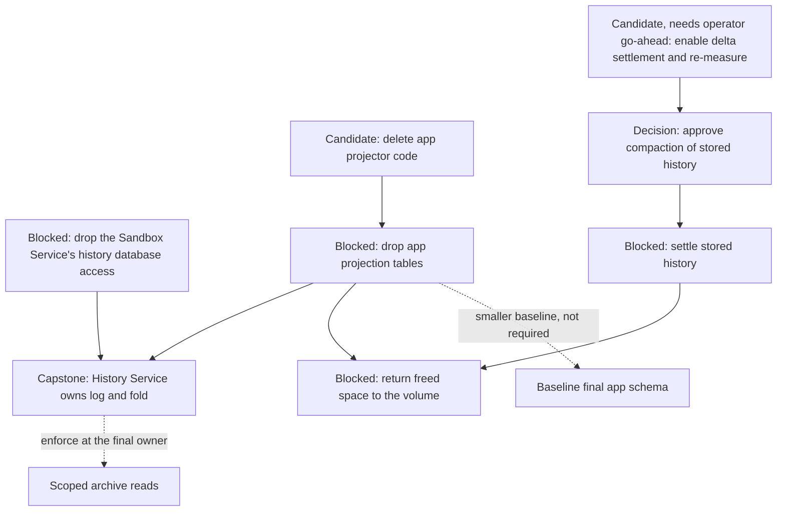

### `SANDBOX_LOCAL_HISTORY_RETIRE` — revoke the Sandbox Service's history access

**Blocked until the release that deleted the Sandbox Service's ingester serves on staging and
testing.** That release reads neither `database_url` nor `ingest_history`. Drop both manifest keys
with their settings fields (the CLEANUP tombstone in `sandbox_service/settings.py`), drop the
Sandbox Service's history database credentials, and move the history `migrate` init container to
the History Service Deployment, so the Sandbox Service can no longer reach history tables.

### `APP_PROJECTOR_RETIRE` — delete the app projector

**Candidate; Thread fold move lane.** Testing and staging read Threads from the History Service
fold (`thread_reads`). Once staging's fold has caught up, compare materialized Threads (entities
and bodies) with the app's on a bounded sample of Sessions; then remove the app projector, its
leases' code, the `thread_reads` switch and the app's Electric deployment. Retained tables stay.

### `APP_PROJECTION_RETIRE` — drop the app projection

**Blocked on projector retirement.** An explicit deletion PR for the app projection tables and
leases. The data is derived and rebuildable from the raw log.

### `HISTORY_SERVICE_OWNERSHIP` — capstone

**Blocked on projection and local-store retirement.** The History Service is
the only owner of the raw log and fold; the app is a facade over it. Each service's README states
what unrelated agents can still do while it is down or rolling.

### `SESSION_EVENT_RETENTION_ENABLE` — turn it on and measure

**Candidate; needs the operator's go-ahead.** Settlement is built behind the
History Service's `ingester.settle_deltas` ([History Service](../history_service/README.md#delta-settlement)),
and its fold skips settled ranges. The app's raw-history readers (`EventLogStore` entry and
observation pages, `ContentStore` native frames) still require contiguous cursors and must treat
settled ranges as covered first. Then enable on testing, then staging, and re-measure
`session_event` and evidence growth against the 2026-10-10 sample.

### `SESSION_EVENT_COMPACTION_PLAN` — approve settling stored history

**Decision.** A reviewed plan for a resumable one-off Job that settles stored Sessions with the same
code: the Sessions it touches and what is lost. It deletes stored history, so it needs the
operator's explicit approval.

### `SESSION_EVENT_COMPACTION` — settle stored history

**Blocked on the approved plan.** Run the Job in testing, then staging, stopping and resuming
cleanly. Backups keep the old rows until their retention expires.

### `HISTORY_REPACK` — return freed space

**Blocked on compaction and the app projection drop.** `pg_repack` (or `VACUUM FULL` in a window)
on the log and projection tables; deleted rows otherwise stay as reusable space inside Postgres.

## 8. Sessions that outlive their Sandbox

Not scheduled (operator, 2026-10-10 PDT: co-plan, not now). A Session and its history are durable;
its Sandbox is one incarnation that can be deleted, with a new one provisioned later to revive the
Session on a runner. Today a Session lives exactly as long as its Sandbox's runner volume
(suspension removes the Pod and keeps the volume). The event log alone is not a native resume image;
the operator's direction (2026-10-10 PDT) is a state volume holding the harness files and runner
state that survives the Sandbox and is attached to the next one. Section 7 is written so it does not
preclude this: the History Service keys by Session, a Session records each Sandbox incarnation, and
a teardown seal closes an incarnation, not the Session.

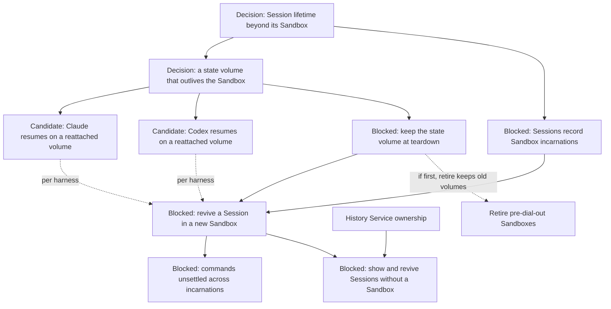

### `DURABLE_SESSION_LIFECYCLE` — Session lifetime beyond its Sandbox

**Decision.** Replaces the frozen `THREAD_OUTLIVES_SANDBOX`. Decide: what a revived Session gets
back (native harness state only, or also its workspace files); which launch configuration a new
incarnation uses (the Session's frozen one, or a current template, which also decides whether an
image upgrade happens on revival); who may revive and how (an explicit API call, never implicitly
on a read or a notification). Sessions that shared a Sandbox revive together (one state volume per
Sandbox, `SESSION_STATE_VOLUME_DESIGN`).

### `SESSION_STATE_VOLUME_DESIGN` — a state volume that outlives the Sandbox

**Decision; direction set by the operator, 2026-10-10 PDT.** Replaces the frozen
`THREAD_PORTABLE_STATE`. A persistent volume holds the native harness files and the runner's state,
separate from the workspace, is kept when the Sandbox is deleted, and is attached to the next
incarnation, whose runner continues the same journal. Decided: one volume per Sandbox, so the
Sessions that shared a Sandbox revive together in its successor. Decide: whether the runner's state
goes on it or only the harness files;
whether the workspace survives too (operator neutral; default: it does, kept with the state volume,
because a revived conversation refers to files the agent made and its cwd must exist); storage class, since `local-path` pins a volume to one node and
so pins revival there; who deletes a retained volume (an explicit Session deletion) and its quota;
and refusing to attach to an incompatible harness or runner version rather than attempting it.

### `CLAUDE_PORTABLE_STATE` — Claude evidence

**Candidate after the volume design.** Attach a retained volume to a new Sandbox (new Pod, possibly
a newer image) and resume, checking continuation and prompt-cache cost. The frozen
`RUNNER_IMAGE_UPGRADE_PROOF` is the same experiment on one Sandbox. Independent of Codex.

### `CODEX_PORTABLE_STATE` — Codex evidence

**Candidate after the volume design.** The same for Codex; neither harness waits for the other.

### `SESSION_INCARNATIONS` — a Session records its Sandboxes over time

**Blocked on the lifecycle decision.** The Sandbox Service's Session
record holds a sequence of Sandbox incarnations, at most one live; the locator ↔ Sandbox binding
becomes per incarnation. Each incarnation's runner announces its `sandbox_uid` on ingress, from which the
History Service records it, and its seal ends that incarnation, not the Session. On the retained volume the runner journal and its
cursors simply continue; the next incarnation journals that it resumed after a seal.

### `STATE_VOLUME_RETENTION` — keep the state volume at teardown

**Blocked on the volume design.** Provision the state volume separately from
the Sandbox's other storage; at teardown, after the seal commits, delete the Sandbox and keep the
volume, bound to the deleted Sandbox's identity so that its successor receives it. Test that a Sandbox
deletion never deletes a retained volume and that an explicit Session deletion does.

### `SESSION_REVIVE` — revive a Session in a new Sandbox

**Blocked on incarnations, retained volumes and per-harness evidence.** Provision a new Sandbox
from the decided launch configuration with the retained volume attached, and resume the harness as a new
incarnation of the same Session and history. Ships per harness as its evidence lands. Test revival
after deletion, a refused incompatible volume, and concurrent revive requests.

### `THREAD_SUCCESSOR_DELIVERY` — commands unsettled across incarnations

**Blocked on revival.** A command whose admission was ambiguous when an incarnation ended is not
replayed into the next one; it stays unknown and is shown as such. Moved from the freezer.

### `HOSTED_THREAD_SURFACES` — show and revive Sessions without a Sandbox

**Blocked on revival and History Service ownership.** The app lists Sessions whose Sandbox is gone,
reads their history from the History Service, and offers an explicit revive. Moved from the freezer.

## 9. Ownership and naming cleanup

Cleanups that leave one database per service and names that say what things are. Each node is one
deployment; edges are the known order. Staging data follows
[staging data preservation](../docs/staging_data_preservation.md): Session identities and history
are irreplaceable, and a node that deletes a column or row stops for the operator.

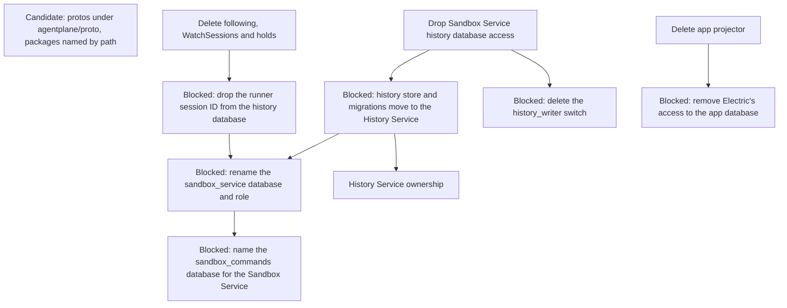

### `HISTORY_RUNNER_SESSION_ID_DROP` — rows carry only the public ID

**Blocked on the follow path's retirement**, because both follower ingesters (the Sandbox
Service's and the History Service's) follow by `runner_session_id`. Under the ingress, Sessions
arrive under their client-minted public ID, which is also the runner's. Then the column only names
feed snapshots stored before ingesters wrote them under the public ID: rewrite those snapshots
under the public ID, then drop the column with `ux_history_runner_locator`, together with the
follower-only ingestion state (`source_id`, `feed_state`). Stops for the operator.

### `HISTORY_STORE_MOVE` — the history store belongs to the History Service

**Blocked on Sandbox Service local-history retirement; unaffected by the split.** Move the remaining store, models and
Alembic migrations from `sandbox_service/session_history` into `history_service`, rename the
`agentplane-sandbox-service-history-migrate` image, and run the migration init container in the
History Service Deployment. The Sandbox Service then has no credential for the history database.
`session_history/session_changes.py`, which listens on `sandbox_commands`, moves next to the
Session registry rather than with the store, unless `FOLLOW_PATH_RETIRE` has deleted the
`WatchSessions` feed first.

### `HISTORY_WRITER_SWITCH_RETIRE` — one ingester, no switch

**Blocked on Sandbox Service local-history retirement.** Delete `Environment.history_writer`, the
History Service's `ingester.enabled` and the Sandbox Service's `ingest_history`.

### `HISTORY_DATABASE_RENAME` — name the database for its owner

**Blocked on the store move and the column drop.** Rename the `sandbox_service` database and role
(and the `postgres-sandbox-service` Secret) for the History Service, resolving the `TODO` in
`cluster/cdk8s/agentplane/database.py`. Rename in place (`ALTER DATABASE`/`ALTER ROLE ... RENAME`)
and have the CNPG `Database` and managed role adopt the new names; recreating the database under a
new name would copy the log. Verify the History Service and Electric reconnect with no data movement.

### `SANDBOX_DATABASE_RENAME` — name the Sandbox Service's database for it

**Blocked on the history database rename**, which frees the `sandbox_service` name. Rename
`sandbox_commands` and its role and Secret to `sandbox_service` in place, as that node does, and
point the Sandbox Service, its migration init container and `commands_database_url` at the new
names.

### `APP_ELECTRIC_RETIRE` — Electric no longer reads the app database

**Blocked on app projector retirement.** Drop the publication and replication slot on the `app`
database and the `electric` role's grants there, and give the remaining Electric deployment the
plain name if it carries a history-specific one.

### `PROTO_DIRECTORY` — protocols in one place

**Candidate; operator direction, 2026-10-10 and 2026-10-11 PDT.** Protobuf messages and gRPC
services that cross components live in `agentplane/proto/<name>.proto` (google3's `proto/`
convention), each with the package `agentplane.proto.<name>`: its path from the ducktape root, no
version suffix. `runner_ingress.proto` started the directory. Move the rest with their
generated-code imports: `sandbox_service/protocol.proto`, `history_service/protocol.proto`,
`runner/protocol.proto`, `runner_channel/protocol.proto` and the shared `protocol/` messages. A
gRPC service's full name includes its package, so moving a runner-facing proto (`runner`,
`runner_channel`) breaks the wire with deployed runners: those land before
`RUNNER_OUTBOUND_ROLLOUT` and ride its clean cutover. Between services that roll independently
(Sandbox Service, History Service and their clients), a renamed service is served under both
names until every client calls the new one.

## 10. Legacy burn-down

Dead code, finished gates, compatibility shims and stale names found by the 2026-10-10 PDT audit of
devel. A gate counts as legacy once its rollout is finished on both testing and staging or nothing
reads it; mid-rollout gates (shadow fold, read cutover, the Sandbox Service's `Recreate`,
`history_writer`, delta settlement) stay with their own nodes above. Lane named per node; leftovers
of in-flight work belong to the lane already changing that code. Upstream-gated tombstones with a
verifiable condition in code (`keepingOffset` in `thread_store.tsx`, the jsdom pragma in
`markdown.test.tsx`) need no node.

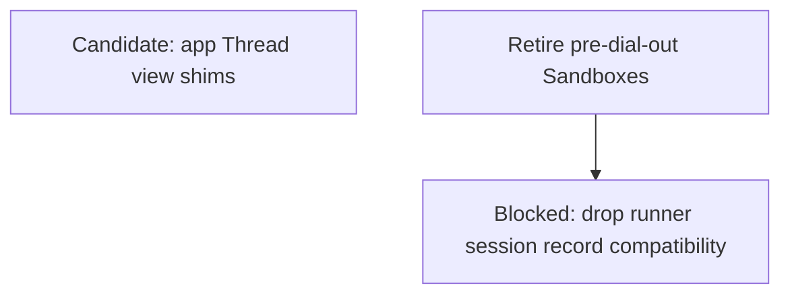

### `RUNNER_SESSION_RECORD_SHIMS` — drop runner session record compatibility

**Blocked on legacy Sandbox retirement; Legacy burn-down lane.** The runner's `SessionRecord` reads
`session.json` written by older images: `context_budget_resolved` (False only for records from before
budget resolution, 2026-10-10 PDT) re-resolves the budget at Open, and `instructions` and
`event_source_id` have defaults that fill records predating them. Staging Sandboxes created before
then still resume on these records. Once none remains, delete the flag and its Open branch, make
both fields required, and have `from_spec` set `event_source_id` explicitly.

### `APP_THREAD_VIEW_CLEANUP` — app Thread view shims

**Candidate; Thread fold move lane.** The fold's page size is `128` in both `fold_shadow.PAGE_SIZE`
(read only by tests) and `projector.py`; keep one. **Blocked on app projector retirement:** the
frontend reads `requested_value` with a `.default(null)` because the app's own fold (epoch `v1`)
still holds Command rows written before the field existed, and `thread_reads: APP` serves them;
once that switch is gone, only the History Service fold (rebuilt in `history-v1`, every row
carrying the field) is read and the default can go. Code only.

## 11. Runner ingress and control split

Target and decisions: [History Service plan](history_service.md#target). The runner keeps dialing
out, but to two endpoints its Sandbox names: an **ingress** it pushes its journal's Events to, and
a **control hub** (the Sandbox Service) whose stream it holds for commands, receipts and lifecycle
requests. The History Service is the ingress when history is kept. The contract is
[runner channel § Event ingress](../docs/runner_channel.md#event-ingress); it replaces following the
runner through the Sandbox Service. Section 7's store, fold and database
nodes and section 9 are unaffected.

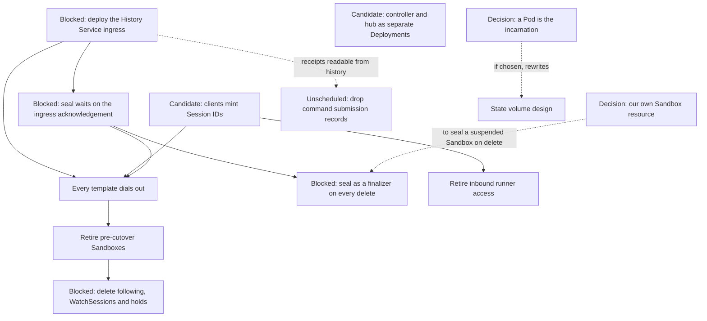

### `HISTORY_INGRESS` — History Service ingress

**Blocked until `agentplane-history-ingress` publishes.** The ingress server, its writer binding
and its image are built (`history_service/ingress.py`). Deploy it per environment as its own
Deployment, ServiceAccount and Service, apart from the read API, connecting to the history
database as a writer with `token_audience: agentplane-runner-ingress` and the Sandbox namespace
as `writer_namespaces`, and add the image to Flux image automation.

### `CLIENT_SESSION_IDS` — clients mint Session IDs

**Candidate; operator, 2026-10-10 PDT.** The client puts a fresh UUID in the
create-session control message; the runner journals it and announces the Session on ingress (`announce`), and
the History Service's index becomes the record of which Sessions exist. The hub keeps only what it
needs to route: Session to Sandbox. `CreateSession` stops minting the runner Session ID it passes
in `OpenSession` (#9858). A retried create carries the same ID, so the Open reservation and
`LookupSession`, which reconciles it by scanning the journal over the inbound API, are deleted.

### `SEAL_ON_INGRESS_ACK` — seal waits on the ingress acknowledgement

**Blocked on the ingress.** Teardown waits until the runner reports every Session's seal `flushed`,
which the runner already reports from its recorded acknowledgements, instead of on History Service
holds. A runner
that cannot report keeps the Sandbox in sealing for the operator, as today.

### `FOLLOW_PATH_RETIRE` — delete following, WatchSessions and holds

**Blocked on legacy Sandbox retirement.** Delete `FollowSession`,
`WatchSessions` and its change feed, the History Service follower ingester, and the hold API and
`retention-holds` annotation. Stops for the operator before dropping
stored registry columns.

### `SANDBOX_SERVICE_DEPLOYMENT_SPLIT` — controller and hub as separate Deployments

**Candidate; operator, 2026-10-10 PDT.** The Sandbox Service stays one service and one API owner
(lifecycle and control of Sandboxes), but runs as two Deployments with separate ServiceAccounts: a
single active controller holding the RBAC, ServiceAccount and egress grant permissions, and the
replicated runner-facing hub with only Lease and EndpointSlice writes, so a hub bug cannot reach
the controller's credentials.

### `AGENTPLANE_SANDBOX_RESOURCE` — our own Sandbox resource

**Decision; later.** An Agentplane custom resource whose spec is the recipe (template, grants,
egress, session defaults, bootstrap command, runner endpoints) and the desired runner (image,
running or stopped), with incarnations in its status. Recommendation: back it with an upstream
Sandbox first and keep owning Pod and PVCs directly as the fallback; clients key off our resource
either way. Replaces the annotations on the upstream Sandbox and the imperative-only
`CreateSandbox`.

### `POD_INCARNATION` — a Pod is the incarnation

**Decision; later.** A Sandbox is its agent's volumes, with or without a running runner; an
incarnation is a Pod. Changing the runner image is stop, replace the Pod, start, and needs no seal
since the volume stays. If chosen, section 8's state volume and incarnation nodes are rewritten
around it: keeping the volume means keeping the Sandbox.

### `SEAL_FINALIZER` — seal as a finalizer on every delete

**Blocked on the ingress acknowledgement; operator, 2026-10-10 PDT.** Every Sandbox carries a seal
finalizer, so any deletion (`kubectl`, `DeleteSandbox`) seals before its volume goes. It replaces
the controller loop's seal from the replica holding the runner, the `teardown` annotation and the
suspended-only delete guard. Deletion is one-way: a hold can delay it, never cancel it.

Upstream agent-sandbox v0.5.5 does nothing for a Sandbox whose `deletionTimestamp` is set
(`SandboxReconciler.Reconcile` returns before reconciling its Pod, PVCs or Service): it neither
starts nor stops the Pod. So a Sandbox running when deletion begins keeps its runner and seals over
control as now; a suspended one never runs again, and sealing it means reading the journal head off
the volume with a Job, or our own resource (`AGENTPLANE_SANDBOX_RESOURCE`). The Pod and PVCs carry
controller owner references with `blockOwnerDeletion`, so only background propagation (the
`kubectl` and `DeleteSandbox` default) keeps them until the finalizer clears: foreground
propagation garbage-collects them while the finalizer still holds the Sandbox, and namespace
deletion removes them directly. Those two paths lose the unsealed tail.

### `COMMAND_RECORDS_RETIRE` — drop command submission records

**Unscheduled; operator, 2026-10-10 PDT: keep them for now.** The runner journal already holds
every admission, idempotent on `command_id`. Retiring the hub's submission records would make it
stateless, with `GetCommand`, `ListCommands` and the command status UI reading receipts from
history instead.

## Scope and retirement of stale gates

- Notifications keep workers in the HTTP service. Retention, worker extraction, idle-polling
  optimization and new-source wiring are frozen with triggers, not hidden release prerequisites.
- Existing GitHub error/backoff visibility, durable refresh reuse, hosted-build authentication and
  the Ducktape preset are accepted. No live provider-outage injection or repeat staging exercise is
  pending. Remaining broad provider-matrix exploration is frozen; ordinary auth/signature denial
  regression coverage belongs with the implementation, not an unbounded production checklist.
- Native subsessions and runner durability/thin-adapter redesign remain frozen. Transport direction
  has its own decision co-sequenced with VMs; neither that nor multiagent design unfreezes the broader
  runner-state redesign.
- `CROSS_THREAD_DELIVERY` is consolidated into `AGENT_MESSAGING_DESIGN`. Do not dispatch duplicate work under
  the old name.
- Existing security boundaries, data-preserving migration checks and representative deployment
  integration checks remain requirements. The freezer is not a waiver for a known data-loss or
  unauthorized-access bug; promote one when evidence makes it concrete.
