# Agentplane task DAG

This is the dispatch map for **unfinished** work. Detailed contracts belong in component plans;
completed work belongs in component docs, not done nodes here. Maintenance rules are in
[task DAG maintenance](../docs/task_dag_maintenance.md). Deliberately deferred candidates and conditional
hardening live in the [freezer](task_freezer.md), except the explicit nonblocking
intra-Sandbox hardening reminder retained here at Rai's request.

## Current state and scheduling

### Stakeholder priorities, 2026-10-30 PDT

**Stale, 2026-11-14:** these priorities were set for a two-week sprint that ended about 2026-11-13.
They stand until the operator restates them. The work the operator released on 2026-11-14 is
listed under [Released 2026-11-14](#released-2026-11-14); releasing work is not a priority statement.

The product goal is reliable long-running agents in the operator's cluster and environments:
both agents pursuing ongoing goals and standing roles that wake for messages or events. The first
concrete autonomous workflow is a daily agent inspecting the previous 24 hours of CI latency and
opening useful fix PRs. Agentplane-level child Sessions are important; native harness children
remain useful but do not provide independently addressable Agentplane Sessions.

| Priority  | Outcome                                                                                                               | Work to select                                                                                                                                                                      |
| --------- | --------------------------------------------------------------------------------------------------------------------- | ----------------------------------------------------------------------------------------------------------------------------------------------------------------------------------- |
| P0        | Sessions remain usable through sampler rolls, crashes and JS/exec faults; tooling bugs do not make them irrecoverable | Fix concrete reliability regressions as normal use exposes them; broad sampler-roll and JS/exec disruption exercises remain waived                                                  |
| P1        | A useful daily CI agent that can create and coordinate Agentplane Sessions with its own privilege level               | `SCHEDULED_AGENT_WAKE_DESIGN` then `SCHEDULED_AGENT_WAKE`, followed by the `DAILY_CI_AGENT` milestone using the reviewed delegation tools; evaluate usability through normal use    |
| Alongside | Fewer clicks to start useful work on an existing environment                                                          | `SESSION_LAUNCH_FRICTION`; make reused environments and separate working directories easy                                                                                           |
| Next      | Measure a production fresh VM start and provide a usable Bazel client inside a VM                                     | `VM_STARTUP_LATENCY`, `LOCAL_BAZEL`; select an image or layering change only if production measurements show it addresses startup or needed resource headroom                       |
| Later     | Launching workers with different privileges, broader delegation and archive-read policy                               | `MULTIAGENT_MODEL`, `AGENT_LAUNCH_POLICY_DESIGN`, `AGENT_SANDBOX_LAUNCH`, broader create grants and held history-read work                                                          |
| Later     | Broader runtime/conversation redesign and maintenance without a current workflow need                                 | Full `SESSION_RUNTIME_MODEL_DESIGN` and `AGENT_AUTHORED_CONVERSATIONS_DESIGN` implementations, renames, broad protocol-parity research and speculative service/storage replacements |

Independent ready work may proceed alongside the main track; priority is not a new dependency edge.
Preserve existing in-flight ownership and explicit holds. Nodes not selected above, component-plan
follow-ups, inline TODOs and open PRs are not automatically next work merely because they exist.
Recheck their current state before dispatch: some old PRs overlap shipped changes. Actual failure
cases can justify pulling a narrower fix forward. The sprint dispatch below scopes the currently
authorized work; the priority list does not dispatch the other tracks.

**Component boundaries:** the [Environment Runtime](../env/runtime/SPEC.md),
[Execution service](../env/runtime/execution/SPEC.md) and their Session and native process components
have distinct responsibilities within the combined management process
([current topology](../env/README.md)). Session and Environment dispatch remain
distinct roles whose binary grouping is for later; the broader
runtime-model decision does not gate these reliability or delegation slices.

**Quality bar for every selected outcome:** sound domain models, clear ownership/lifetimes and
maintainability are acceptance criteria. Review the affected domain contract before implementing
each slice. Keep Session identity, native state, running processes, environment instances and
authority distinct; a smaller feature scope must not create duplicate ownership or hidden coupling.
Apply the relevant runtime-model directions now where a selected feature needs them, without
requiring the entire north-star redesign first. Record concrete tradeoffs rather than treating
technical debt as an automatic later cleanup.

Apply the [Agentplane principles](../docs/principles.md) throughout: resilient distributed ownership,
service-owned recovery and independently usable capabilities. A required service or constraint
needs an intrinsic execution/security reason or an explicit practical tradeoff; incidental current
colocation and implementation limitations do not make it part of the domain contract.

**Agent usability is part of completion:** an agent must discover and naturally use the workflow
from an ordinary task description, understand results/failures and recover without an operator's
step-by-step tool script. Reuse canonical APIs/CLI/tool surfaces and concise actionable results.
Use Claude/Codex spawning, messaging, waiting, result and cancellation workflows as reference
designs; do not make native-child projection or exhaustive harness parity prerequisites.

**Realistic working examples are required; operator, 2026-10-30 PDT.** Subagent/delegation,
Session spawning, environment provisioning/attachment, communication and history-reading work must
include concrete end-to-end agent workflows mapped to Agentplane's actual service contracts.
Show how an agent discovers operations and schemas, obtains valid environment/Session handles,
learns usable harness/model/cwd choices, and uses its authenticated authority. Include the separate
creation and initial-input steps, follow-up, result/history reads, waiting and relevant
failure/retry/cancellation behavior. Return structured status with its source and meaning; distinguish
service admission, harness observations and any explicitly supported agent-declared task status.

Cover an agent reusing an existing environment and an external MCP-only caller. Describe new-environment
and environment-free cases according to their actual supported capabilities. State required
configuration, permissions and approvals. During design, map each step to an implemented operation
or name the concrete addition and its owning backend. Before implementation completion, exercise
the supported examples through the real service boundaries and retain proportional evidence in
the owning component's documentation or acceptance suite. Update canonical agent-facing discovery
and guidance so an agent can follow the workflow from an ordinary assignment.

Workflow validation may expose missing backend capabilities or service boundaries that need
refactoring. Adding those features or refactors is an acceptable outcome: record the concrete gap,
owning backend and real prerequisites, then revisit scope, ordering and priorities with the
stakeholder. An example with unresolved steps remains a proposal until that work is implemented
and exercised.

The operator is reusing environments partly because fresh startup is slow. Separate directories
are acceptable for cooperating agents with shared access; that does not imply isolation between
different principals. Starting less-privileged workers can wait: the selected first spawning
scope uses the caller's ServiceAccount and may reuse its environment.

Audit metadata consumers (`sandbox`, `harness`, `model`, `cwd`, summary/activity fields) before
deleting useful UI projections.

States: **in flight** means reported work is underway; **in review** means an unmerged PR;
**paused** means no worker is assigned; **decision** needs a reviewed outcome;
**blocked** names prerequisites; **candidate** is dispatchable when selected, not a priority claim.
**Unscheduled**, **deferred** and **parked** nodes have no owner and no priority; a deferred or parked one waits on a trigger its text names.
A **capstone** closes an integrated contract, not another implementation. Solid arrows below are
prerequisites; dashed arrows explicitly label scheduling holds or conditional choices. All service
contracts remain multi-replica unless a reviewed temporary restriction says otherwise.

### Sprint scope and reliability follow-ups

**Two-week timebox; operator dispatch, 2026-10-30 PDT; remaining scope reconciled 2026-11-02 UTC.**
Reliability contracts live in the
[runtime specification](../central_sampler/SPEC.md#runtime-and-effects) and
[recovery guide](../central_sampler/docs/blocked_session_recovery.md). The
[acceptance record](../central_sampler/docs/rollout_acceptance.md)
retains the deployed exporter evidence and its limits.
The shared explicit/automatic resume authority and uncertain-outcome contract live in the
[lifecycle manager specification](../runner_gateway/environments/lifecycle/SPEC.md) and concise
[lifecycle README](../runner_gateway/environments/lifecycle/README.md).

**Operator decision, 2026-10-31 UTC:** skip the dedicated continuation/disruption exercise,
coverage audit and additional acceptance tests. The operator will evaluate reliability through
normal use. Revisit [a focused follow-up](task_freezer.md#central_sampler_reliability_followup--investigate-instability-observed-in-normal-use)
only if that use exposes continued instability. This exercise no longer gates the sprint or the
daily CI milestone; no dedicated acceptance worker is dispatched.

The [delegation contract](https://github.com/agentydragon/ducktape/pull/13229) is **approved for
implementation, operator 2026-10-31**. Backend tools and scripted workflow acceptance have landed;
routine calls use same-SA authorization and environment creation initially needs human
approval when implemented. **First release: reuse existing environments; new environment creation
and template-catalogue ownership are deferred by the operator.** Prefer existing gRPC methods and
CLI access, with Actions-first adapters allowed and explicit RPC/CLI extraction TODOs where needed. File conflicts do
not block independent PRs. Required system checks and a documented rollback precede staging changes.

The control-plane deployment target remains rolling updates with at least two replicas, with the
accepted [Electric exception](../docs/electric_single_replica.md). K3s fixtures remain single-replica; a two-replica
nested K3s roll and associated RBE kernel change are waived. Arbitrary JS-state restoration and
the broader runtime redesign remain outside this sprint.

### Dispatch order and prerequisites

Keep reliability follow-up regression-driven; it does not block other work.

P1 scheduling and the remaining caller-privilege delegation work proceed in parallel. The daily
CI product milestone needs both scheduled wake and Session creation/cooperation.

**Remaining selected work, status checked 2026-11-02 UTC.** Landed Runtime lifecycle contracts are
in the [Runtime specification](../env/runtime/SPEC.md); the native output-loss regression is pinned by
[`test_code_mode_output.py`](../native/codex/test_code_mode_output.py). The
[delegation plan](session_delegation_workflows.md) records implemented tools and scripted external
MCP/parent CLI acceptance. The [managed-guidance rollout record](../central_sampler/docs/rollout_acceptance.md#managed-platform-guidance-rollout-2026-11-02-utc)
discharges that deployment hold. Staging tool exposure is active. Natural-agent usability remains
an operator follow-up; no model exercise is dispatched. Focused regression-test additions and Bazel
runs remain authorized; broad disruption exercises remain waived. Revisit reliability work when
normal use exposes a concrete regression. First such regression, 2026-11-10: three staging rollouts in four minutes
(#15439, #15440) cost every central Session its exec-server session and wedged one on a lost
JavaScript host. Source fixes #15449 (drain logs), #15451 (drain keeps serving live work) and the
automatic settlement of host loss (#15455) merged on 2026-11-10. This records source status only;
post-rollout acceptance is not established here. Provider attempt recovery and remaining native cleanup blocks follow the
[sampler contract](../central_sampler/SPEC.md#runtime-and-effects); the executor's survival across control-plane rolls is
[`EXECUTOR_SURVIVES_CONTROL_ROLLS`](task_freezer.md#executor_survives_control_rolls--an-executor-session-outlives-a-gateway-or-sampler-roll).

| Lane          | Next reviewable outcome                                                                                            | Prerequisite / stopping point                                     |
| ------------- | ------------------------------------------------------------------------------------------------------------------ | ----------------------------------------------------------------- |
| P1 delegation | `THREAD_CREATE_AUTHORIZATION`: operator follow-up for natural-agent usability                                      | Ordinary use; no model exercise is dispatched                     |
| P1 scheduling | `SCHEDULED_AGENT_WAKE_DESIGN`: [durable-wake proposal #13552](https://github.com/agentydragon/ducktape/pull/13552) | Delivery/overlap/authority review precedes runtime implementation |

Scheduled wake and usable delegation feed the daily CI capstone. Small
`SESSION_LAUNCH_FRICTION` proposals remain alongside these tracks as capacity permits. This is a
scheduling preference, not additional dependency edges.

The original native-cleanup timeout remains unexplained; the closed
[#13442](https://github.com/agentydragon/ducktape/pull/13442) path-reconstruction workaround is not
selected. A later, separate [Runtime.Close caller-deadline failure](../env/runtime/debug/2026-11-01_runtime_close_wait_timeout.md)
also lacks causal evidence. On recurrence, capture shutdown-stage/join evidence before attributing
either failure or claiming it fixed. Passing later tests and the merged Runtime COSI improvements
do not establish either cause.

Small launch-UX work can proceed alongside these tracks. Fresh-VM latency and VM-based Bazel are
next and are independent of each other; image/layering work becomes a prerequisite only when the
chosen change actually needs it. Existing technical, authorization, data-preservation and explicit
operator-review gates remain in the owning nodes. Lower-priority maintenance stays in its sections;
its old ordering does not give it precedence over the selected tracks.

### Released 2026-11-14

The operator released these tracks on 2026-11-14; Codex workers build them, and the PR numbers are
their state at 07:40 UTC. Each row's node owns its gates; the Go reorganization behind several of them
is [section 17](#17-two-binaries-and-the-go-layout).

| Track                                    | Operator release (UTC)                                         | Node                                                                | State                                                                                                           |
| ---------------------------------------- | -------------------------------------------------------------- | ------------------------------------------------------------------- | --------------------------------------------------------------------------------------------------------------- |
| Pre-cutover leftovers                    | 01:41, "dispatch 1, 2"                                         | `REFACTOR_COHERENCE_AUDIT`                                          | Merged #16323, #16331, #16340, #16341; #16336 and #16356 closed (History keeps Sessions without a Sandbox UID)  |
| TLS on the two plaintext hops            | 01:41, same release                                            | `PRIVILEGED_BACKEND_AUTH_DESIGN`                                    | Merged #16332; #16333 and #16334 in review                                                                      |
| Any Gateway replica, no epoch            | 02:36, card "Any replica, no epoch"                            | [Section 12](#12-the-runner-gateway-serves-the-runners-own-service) | Merged #16324, #16328, #16330, #16345; #16361, #16362, #16365 in review, merged in that order across image pins |
| One service authentication mode          | 04:56, "One auth mode can fire off"                            | `PRIVILEGED_BACKEND_AUTH_DESIGN`                                    | Stages 1–2 merged; stage 3 receivers part merged, part in review                                                |
| Remove the app agent token               | 05:05, "Remove it now"                                         | `APP_AGENT_TOKEN_DECISION`                                          | Step 1 merged (#16347); step 2 in review (#16372)                                                               |
| Environment rule slices                  | 04:58, "Okay this sounds good to me (these environment rules)" | `ENVIRONMENT_LIFECYCLE_RULES`                                       | `resume` merged (#16346); `bind_session` in review (#16351)                                                     |
| Identity changes re-checked, not refused | 07:20, "okay, sounds good to me, sessions can re-check"        | `SANDBOX_IDENTITY_RECHECK`                                          | In review (#16373)                                                                                              |

Not released: the stage 3 moves of section 17, retiring `orchestration_v1` and launcher auto-grants.
Decided since: explicit resume reserves no wake budget (07:41, card "No budget for explicit resume");
its behavior PR is `EXPLICIT_RESUME_BUDGET_REMOVAL` in section 17.

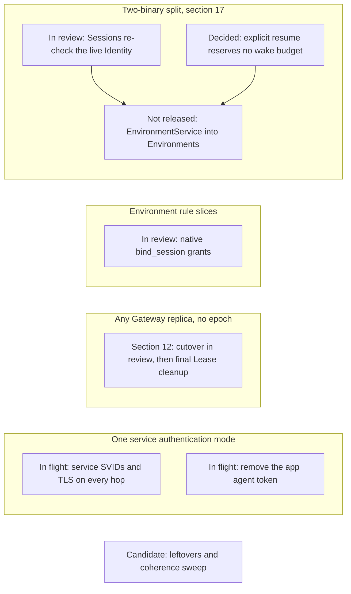

### Sandbox-free central Sessions

A central sampler Session that exists and acts with no Sandbox attached: the operator asked to track
"tasks that would be involved in the 'emancipated central sampler sessions', i.e. without required
sandbox attachment" (2026-11-14 07:43 UTC). Today `central_sampler_v1` requires exactly one executor
Sandbox: Dispatcher admission, the sampler's executor binding and History's sampler ingress all
assume one. The nodes live in sections 5, 13 and 14; this is their order.

| Step                        | Node                                                                                                                          | State                                                                                                       |
| --------------------------- | ----------------------------------------------------------------------------------------------------------------------------- | ----------------------------------------------------------------------------------------------------------- |
| Decide creation             | `CENTRAL_SESSION_CREATION_CONTRACT`                                                                                           | Drafted with the next two in [#15436](https://github.com/agentydragon/ducktape/pull/15436), awaiting review |
| Decide attachments          | `SESSION_ATTACHMENT_CONTRACT`                                                                                                 | Same PR                                                                                                     |
| Decide lifetimes            | `SESSION_AND_INBOX_LIFETIME`                                                                                                  | Same PR; row and inbox retention already implemented                                                        |
| Decide setup                | `SESSION_ENVIRONMENT_SETUP_DESIGN`                                                                                            | #15436 recommends moving `setup_script` and `cwd` to attachments                                            |
| Decide identity details     | `SESSION_IDENTITY_CONTRACT`                                                                                                   | Principal decided (an `Identity`); name, incarnation and shared-Environment rules open                      |
| Tools that need no Sandbox  | `CENTRAL_SESSION_DELEGATED_ACTING`                                                                                            | Candidate: code-mode `tools` as Agentplane Actions for the Session's Identity                               |
| Zero-Environment path       | `CENTRAL_SESSION_WITHOUT_ENVIRONMENT`                                                                                         | Blocked on the decisions above                                                                              |
| Follow-ons                  | `CENTRAL_SESSION_NOTIFICATIONS`, `SESSION_HISTORY_PRESENTATION`, `SESSION_ENV_ATTACHMENTS`, `SESSION_LIFETIME_IMPLEMENTATION` | Blocked on the zero-Environment path                                                                        |
| Code-mode host (not a gate) | `CODE_MODE_HOST_DESIGN`                                                                                                       | Open question: keep Codex's pinned JavaScript host or own a V8 host                                         |

History keeps accepting a Session with no Sandbox UID, which the zero-Environment path needs: #16336
and #16356, which would have deleted such rows and refused such writers as pre-cutover leftovers,
were closed unmerged on 2026-11-14.

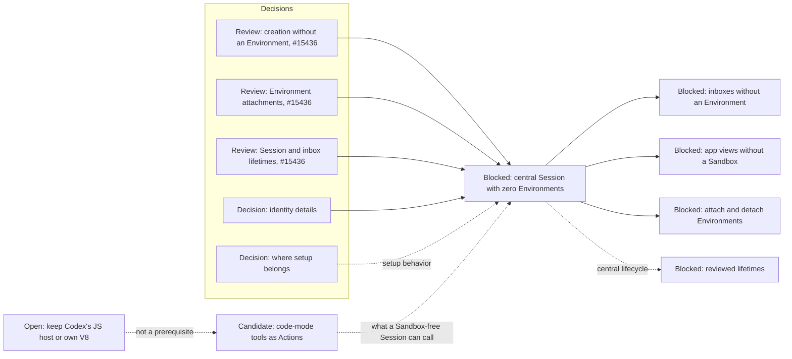

### Identity and Sessions follow-up, 2026-11-13

The workload Identity source cutover and Sandbox live acceptance are complete; source contracts
live in the owning SPECs and deployed Sandbox evidence is in the
[rollout record](../docs/sandbox_identity_cutover_2026_11_12/README.md). Session execution and
inbox ownership use recorded Identity, MCP Connections delegate their exact live Identity, and
component ServiceAccounts retain their authentication and provenance roles. Remove the completed
cutover nodes from the dispatch map. Remaining independent work is limited to the explicitly named
gates below; the standing-workload proxy decision-log observation remains open as deployment evidence,
not as a claim that rollout is currently blocked.

| Remaining lane                    | Current outcome                                                                         | Remaining boundary                                                                                                                                    |
| --------------------------------- | --------------------------------------------------------------------------------------- | ----------------------------------------------------------------------------------------------------------------------------------------------------- |
| Standing workload observation     | Identity subjects are in source                                                         | Confirm the staging proxy decision log names the expected Identity; no source work is implied.                                                        |
| Environment lifecycle authority   | Explicit Identity `resume` grants landed (#16346); `bind_session` is in review (#16351) | The rule's rollout order is in [environment policy rollout](../docs/environment_policy_rollout.md); no PolicySet uses the rule yet.                   |
| Session inbox cross-Identity send | Inbox owner and History workload reads use recorded Identity                            | Current send rule remains Sandbox/tag-targeted; target/group model and launcher-grant lifetime are unresolved under `SESSION_ACCESS_GROUPING_DESIGN`. |
| App and sub-Session entry         | The app agent token is being removed; Identity `CreateSession` remains separate         | `APP_AGENT_TOKEN_DECISION` steps 2–3 and `SESSION_SUBAGENT_DELEGATION`; neither reopens the workload cutover.                                         |
| Central code-mode tools           | Delegated sampler foundation is landed                                                  | Finish the remaining tools-as-Actions slice without reopening attribution or service identity.                                                        |

The environment-free central Session has its own track:
[Sandbox-free central Sessions](#sandbox-free-central-sessions).

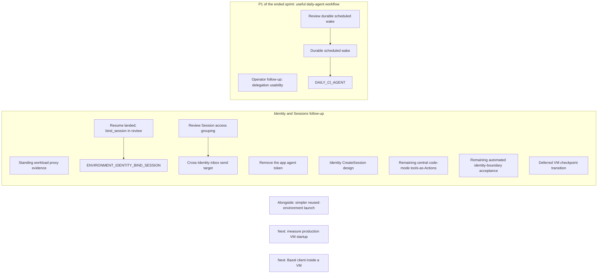

## 2. Service-owned command admission and later notification presentation

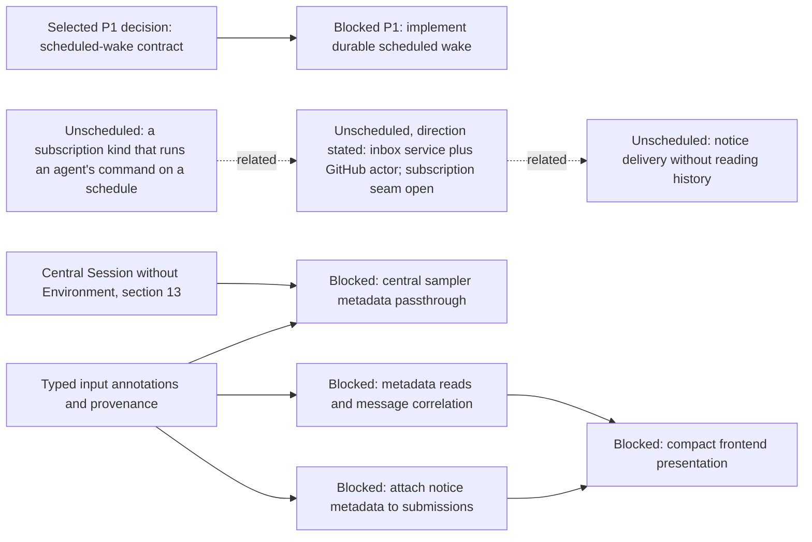

Details: [command admission](../runner_gateway/dispatcher/README.md#contract); later
[notification presentation and input metadata](notification_presentation.md).

Future ownership and wake-policy questions are recorded in the
[freezer](task_freezer.md#notification_dispatcher_ownership--review-notification-and-dispatcher-ownership):
consider moving Notification Service responsibilities into Dispatcher, and event/source-specific
auto-wake policy. Neither is selected or a prerequisite for v1 inbox messaging.

### `SCHEDULED_AGENT_WAKE_DESIGN` — choose the durable scheduled-wake contract

**In review, [#13552](https://github.com/agentydragon/ducktape/pull/13552); operator dispatch 2026-11-01 UTC.** For the daily CI-maintenance workflow,
choose the smallest sound scheduling/delivery contract: compare
an existing scheduler feeding authorized Session commands with a Notification-owned schedule.
Review cadence/timezone, missed runs, overlap, stable run identities, delivery receipts and
restart reconciliation before implementation. A timer firing is distinct from input admission,
agent consumption and task completion. Identify the scheduler principal, Session-input permission
and environment-wake behavior separately; use the reviewed lifecycle authority if it must resume
an environment. A central loop may accept scheduled input while its environment is suspended.

The capability must work without the integration app. A new Session CRD, a general webhook
framework and moving the Notification Service are not prerequisites unless the selected contract
demonstrates a need. **Exit:** a reviewed concrete daily schedule example, backend/API mapping,
authority and duplicate/overlap/restart contract. No new implementation is dispatched by this node.

### `SCHEDULED_AGENT_WAKE` — wake a standing agent on a durable schedule

**Selected P1; implementation blocked on `SCHEDULED_AGENT_WAKE_DESIGN`.** Implement the selected
restart-safe scheduling and authorized delivery contract with retained run identities and receipts.
Exercise missed/duplicate delivery, overlap and restart reconciliation proportionally. Reuse
service-owned command delivery and the chosen wake policy; no second command queue. The
`DAILY_CI_AGENT` capstone proves useful agent behavior, while this node owns reusable scheduling.

### `NOTIFICATION_COMMAND_OUTCOME_DESIGN` — notice delivery without reading conversation history

**Unscheduled; operator, 2026-10-11 PDT: not a priority, needs more thought.** The Notification
Service scans a Session's raw history from the History Service for its own command's admission and
`harness_user_message_confirmed`, and stores one `EventEntry` per notice (`Notice.runner_entry`):
the one service besides the History Service fold that derives state from Session events. A command's
`CommandAdmitted` entry says the runner admitted it, but not that the harness executed it or that
the message reached the model's context; today that needs the history. Decide where that
outcome is recorded before the Notification Service stops reading history.

### `NOTIFICATION_SERVICE_SPLIT` — split, move or rename the Notification Service's responsibilities

**Unscheduled; operator, 2026-10-17 PDT: some renaming and refactoring around this service at some
point.** The service (`agentplane/notification_service/`) has grown to several responsibilities:

- mailboxes, their high-water marks and the get API;
- listening to webhooks, currently GitHub's;
- subscriptions, by which an inbox gets messages when a listener notices something;
- direct agent-to-inbox messages;
- deciding to send a notice to a Session because its mailbox holds new unacknowledged messages,
  possibly waking it if suspended, possibly with debounce by time or count, or a check of the Session's
  history so no second notice goes out before the Session has started executing tools or reasoning
  since the last notice or acknowledgement.

Decide which stay, which move to other services, and what the remaining service is called. Inbox
messaging v1 shipped in one deployment under the current name; this node is the later restructuring.
Related: whether notice delivery belongs with the Dispatcher
([freezer](task_freezer.md#notification_dispatcher_ownership--review-notification-and-dispatcher-ownership)),
and the history-free notice outcome (`NOTIFICATION_COMMAND_OUTCOME_DESIGN`), which bears on the notice
decision's last clause.

**Operator, 2026-10-21 07:33 UTC: rethink the inbox model and its names together with the rename.**
Noticing agents is only one part of what the service does; it is more a mailbox ("email" or "mailbox")
service. The operator's sketch, explicitly not a committed shape or naming: inboxes contain messages;
a message has a sender, which is another agent or an event source such as GitHub; a message is
structured, like a GitHub webhook, or unstructured text; a subscription connects an inbox to an event
source, with its configuration (which pull requests, for example). Today's terms to reconcile with it
include entries and their event identities (`actions`, `github`, `message`), notices, sources and
`DestinationRef`. The `InboxesPerAccount` quota now counts per Sandbox incarnation, so its name goes with this rethink.

**Operator direction, 2026-11-14 01:11–01:12 UTC:** the service "might make good sense to split
into, approximately", "one service/thing that holds inboxes for agents" and "github webhook
processing as one actor that can tell this service 'i have this message and want to add it into
those inboxes'"; and "it's a little bit unclear at this point how the 'subscribe
to x from a source' seam would look; it would need to handle actions and github both". The seam is
the open design: who owns subscription records, who matches source events to subscribers, and who
appends to an inbox with what idempotency key and authority, with Action results and GitHub as the
two required sources. Today GitHub fact writes and inbox wake effects share one SQL transaction; an
actor writing through an inbox API turns that into an idempotent append. The Go plan's Notification
tracks (`notification-inbox-split` and the GitHub and inbox extractions behind it, section 17) wait
on this seam so each file moves once. **Exit:** a reviewed seam covering both sources, the resulting
component names, and the moves it implies as their own nodes.

### `COMMAND_WATCH_SUBSCRIPTION_DESIGN` — a subscription kind that runs an agent's command on a schedule

**Unscheduled; operator, 2026-10-17 PDT: possibly useful as a subscription option, trigger to be decided.**
An agent registers a command and the service runs it every N seconds, or until a given time, and puts a
message in the agent's inbox when something worth noticing happens: the output changes, the command exits
nonzero, or whatever turns out to make most sense. Open: where the command runs (inside the agent's own
Sandbox, or elsewhere) and under whose identity and authority, which decides what it may reach; the
trigger semantics (output change against what baseline, nonzero exit, a failure to run at all, how a
long-running or hung command is cut off); the minimum interval, per-agent quotas and the stop condition;
what the message carries (the output, a diff or only the fact); and the subscription authorization it needs
(`SUBSCRIPTION_AUTHORIZATION_DESIGN`). Related: `NOTIFICATION_SERVICE_SPLIT`, which decides which service
owns subscriptions and sources.

### `SESSION_INPUT_METADATA` — later typed annotations on input commands

**Unscheduled; operator's lean, 2026-10-12 PDT.**
Typed metadata and restricted trusted producer provenance on input commands, so a notice the
Notification Service sends is not rendered as a user message. The field must ride the durable
Session Dispatcher path to the Session owner. For native Sessions the Runner journals it; the
central sampler should similarly pass it through to History (operator, 2026-11-04), without needing an
Environment. Its trusted producer provenance and narrow authorization are open design points. The
harness/model never sees it. Keep that authorization outside the generic command-admission path;
attachments are invalid on controls. No untyped extension dictionary. The native path can land
independently; central support follows the applicable central Session path. See
[metadata ownership](notification_presentation.md#history-and-read-path).

### `CENTRAL_SESSION_INPUT_METADATA` — pass central Session input metadata to History

**Blocked on `SESSION_INPUT_METADATA` and `CENTRAL_SESSION_WITHOUT_ENVIRONMENT`.** The central
sampler passes authorized input metadata through to History alongside the input, with the same
provenance, command-ID correlation and retry/conflict contract as the native path. It must work
without an Environment and keep metadata out of model input. Cover authorization denial, retained
metadata after inbox expiry, duplicate/conflicting submissions and recovery. This is a separate
backend slice; native annotations and same-principal central Session creation need not wait for it.

### `SESSION_INPUT_METADATA_READ` — authorized annotation reads

**Blocked on typed input metadata.** Carry the echoed metadata into the Thread fold, joined to
the message by `origin_command_ids`, including pending and failed inputs and replay, without
requiring a live notification inbox.

### `NOTIFICATION_NOTICE_METADATA` — producer integration

**Blocked on typed input metadata.** Attach notice identity/range metadata using existing delivery
command IDs. Preserve receipt reconciliation and explicit inbox acknowledgement. Verify the backend
path without the app; use automated integration coverage rather than requiring a provider outage.

### `NOTIFICATION_PRESENTATION` — compact notification rendering

**Blocked on producer and metadata read integration.** Compact authenticated notification-only
inputs, expand full text and render mixed human/notice messages normally with annotations. Missing
metadata falls back to text. Include visual coverage and one bounded real-notice check; no inbox
acknowledgement on render and no text-prefix provenance heuristic.

### Subscription authorization before broader sources

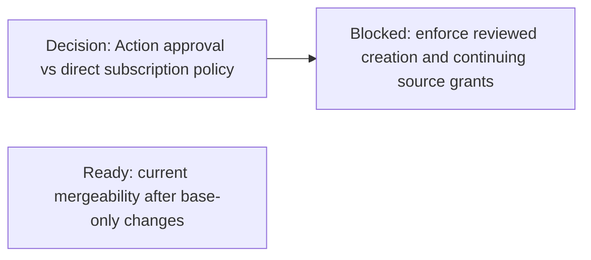

### `SUBSCRIPTION_AUTHORIZATION_DESIGN` — auto-allow and operator-approved subscriptions

**Decision.** Compare an Action-backed subscribe operation using existing auto-allow/operator
approval with authorization inside Notification Service; do not preselect another policy engine.
Review which callers may subscribe to which sources, targets, fields/filters, destinations and
lifetimes, and who can approve/delegate that access. Subscription creation approval is distinct
from continuing source access and from ownership of the destination inbox. Define renewal, scope
expansion, policy changes/revocation and what happens to already-retained entries.

Use Kubernetes as a concrete design case: namespace/resource/UID scope, object/status/event/log
content, name reuse and whether grants delegate the caller's existing read authority or explicitly
allow additional observation. A privileged watcher must not expose arbitrary cluster data merely
because the agent owns an inbox. Review argument examples that auto-allow narrow approved scopes,
require operator approval for additional scopes, and reject requests nobody can delegate.
Define immutable normalized approval arguments, stable request keys and idempotent execution/recovery;
waiting for approval must not create a subscription. Decide who administers policies, what the
approver can delegate, and whether continuing authority uses a bounded grant or standing policy.
Cancellation cannot recall retained entries. Avoid per-event approval unless explicitly required.
This is independent of selecting a messaging transport or fixing existing GitHub delivery gaps.

### `SUBSCRIPTION_AUTHORIZATION` — creation gate and continuing enforcement

**Blocked on the authorization decision.** If Actions is selected, implement its subscribe operation
and reviewed policy bindings; otherwise implement the chosen direct policy path. Keep Notification
Service the subscription/delivery authority in either case. Carry verified caller/decision scope
across the service boundary rather than substituting the executor's broad identity. Enforce the
same access contract on direct APIs, renewals and updates; no approval bypass by another endpoint.

Test auto-allow, pending approval, denial, restricted destinations, scope escalation and expiry/
revocation with controlled identities, plus one bounded deployed identity/policy check for the
selected integration. No entry may be delivered beyond the reviewed source scope;
approval is not permission to wake a Sandbox or execute source content. Future Kubernetes sources
must depend on this contract/enforcement when promoted from the freezer. Ordinary authorized
subscription reads/cancellation and existing GitHub gap recovery need not wait for a broad redesign.

### `GITHUB_MERGEABILITY_FRESHNESS` — obtain a current result after base-only changes

**Ready.** The [live evidence](../notification_service/debug/github_mergeability_live_acceptance_20261028.md)
records stale REST positives after base-only changes, while the service's
[proof and retry policies](../notification_service/docs/api.md) keep the source `UNKNOWN`.

**TODO: test whether GraphQL obtains a fresh result sooner than REST.** Use controlled disposable
fixtures, advance only the base, and keep the PR head unchanged throughout polling. Compare
`mergeable`, `potentialMergeCommit` and its parents, and the actual base ref; record settling time
and request cost, including no improvement. Do not push a new head, retarget or reopen the PR, or
compute a merge locally during this comparison. The previous GraphQL read was followed by a head
change, so it did not establish whether GraphQL alone would settle. A negative remains
GitHub-reported without proof of the evaluated pair; neither elapsed time nor current-ref reads
supply that proof.

Exit: establish and validate a supported way to obtain the current result after a base-only change,
with actual refs, request cost and detection timing recorded. If no bounded mechanism is available,
bring the operator an explicit contract decision between GitHub-only observation, local conflict
calculation, or reporting prolonged uncertainty before implementing an alternative. Preserve the
shipped proof/fence/error policies. This does not reopen waived broad outage/restart drills or select
a general CI/comment/review replay mechanism.

## 3. Multiagent decisions before implementations

The caller-privilege delegation contract is approved for implementation. Broader multiagent
possibilities below retain their own decision gates. The selected first slice is caller-privilege
Session creation; it does not wait for the complete multiagent model or
different-privilege launch policy. Broader delegation still needs its identity/authority review.
Do not equate creating a resource, reading history, sending a message or receiving/acking it.

[The cross-agent plan](multiagent_communication.md#tentative-implementation-direction) tentatively
selects service-enforced Session-access `PolicySet` rules assigned through existing `PolicyBinding`s.
Resource-owning backends share evaluation code and enforce their own APIs. Native RBAC variants
remain alternatives if implementation reveals a poor fit; comparing or building them is not a gate.
**Operator clarification, 2026-10-30 PDT:** inbox tags and history tags are the current direction
for cross-ServiceAccount sends and reads, and may be reconsidered. Their presence in implementation
or existing plans does not make them a permanent domain constraint. Use the realistic workflow
examples to evaluate the mechanism; an alternative may require backend work and replanning.
Existing authorization continues to apply until a replacement contract is selected and implemented.
Session–Environment separation also requires revisiting what these groups label and how access
survives attachment changes or Environment deletion. `SESSION_ACCESS_GROUPING_DESIGN` gates new
cross-principal grouping and the proposed Sandbox history record; the Sandbox-scoped design below
is historical direction, not a settled prerequisite. Existing send enforcement remains in force.
SA-level caller attribution, configurable topology and live shared bundles are agreed constraints.
Replacing the authorization machinery across services is a separate deferred evaluation, not a
multiagent prerequisite. Preserve existing auth semantics; a concrete limitation must justify any
separately reviewed broader proposal.
Send and transcript-read permissions are independent in both directions. A2A is open at this
communication boundary; its harness/thread-protocol rejection has a different scope. Transport
facades are not prerequisite decisions, and content classification is outside v1. Exact schemas and
the broader contracts below retain their individual review gates.

```mermaid
flowchart TD
    MULTIAGENT_MODEL[Decision: identities, relationships and native-child boundary]
    THREAD_READ_POLICY_DESIGN[Held decision: remaining history read contract]
    SESSION_ACCESS_GROUPING_DESIGN[Decision: Session access grouping, section 13]
    HISTORY_SANDBOX_RECORD[Conditional: Sandbox history record and tags]
    THREAD_READ_POLICY[Blocked: scoped archive reads]
    HISTORY_SANDBOX_ASSOCIATION_SOURCE[Unscheduled: an authoritative Sandbox UID source for History]
    PLATFORM_GUIDANCE_OWNERSHIP_DESIGN[Later decision: platform-guidance ownership and composition]
    PLATFORM_GUIDANCE_SINGLE_OWNER[Later refactor: one platform-guidance owner]
    PLATFORM_GUIDANCE_OWNERSHIP_DESIGN --> PLATFORM_GUIDANCE_SINGLE_OWNER
    SESSION_TOOL_SURFACE_CONVERGENCE_DESIGN[Direction agreed; interface review open]
    SESSION_TOOL_SURFACE_CONSOLIDATION[Blocked: retire orchestration_v1 onto the backend APIs]
    SESSION_TOOL_SURFACE_CONVERGENCE_DESIGN --> SESSION_TOOL_SURFACE_CONSOLIDATION
    ENVIRONMENT_IDENTITY_BIND_SESSION[In review: native bind_session grants, section 14] --> SESSION_TOOL_SURFACE_CONSOLIDATION
    ACTION_PROTO_CONTRACT_DESIGN[Later decision: protobuf wrapper Actions and generated schemas]
    ENVIRONMENT_SHARED_IDENTITY[Blocked: environments sharing an Identity]
    ENVIRONMENT_TEMPLATE_CATALOGUE_DESIGN[Later decision: catalogue ownership and location]
    ENVIRONMENT_MANAGEMENT[Deferred: environment catalogue and creation]
    THREAD_CREATE_AUTHORIZATION[Operator follow-up: usable caller-privilege delegation]
    AGENT_LAUNCH_POLICY_DESIGN[Decision: constrained Sandbox launch and delegation]
    AGENT_SANDBOX_LAUNCH[Blocked: enforce agent Sandbox-launch policy]
    MULTIAGENT_MODEL --> AGENT_LAUNCH_POLICY_DESIGN
    THREAD_READ_POLICY_DESIGN --> THREAD_READ_POLICY
    SESSION_ACCESS_GROUPING_DESIGN --> HISTORY_SANDBOX_RECORD
    SESSION_ACCESS_GROUPING_DESIGN --> THREAD_READ_POLICY
    ENVIRONMENT_TEMPLATE_CATALOGUE_DESIGN --> ENVIRONMENT_MANAGEMENT
    ENVIRONMENT_SHARED_IDENTITY --> ENVIRONMENT_MANAGEMENT
    SCHEDULED_AGENT_WAKE[Selected P1: durable scheduled wake]
    DAILY_CI_AGENT[Selected P1 capstone: daily CI-maintenance agent]
    SCHEDULED_AGENT_WAKE --> DAILY_CI_AGENT
    AGENT_LAUNCH_POLICY_DESIGN --> AGENT_SANDBOX_LAUNCH
    ORCHESTRATION_V1_BACKEND_GRANTS[Blocked: orchestration_v1 operations on backend grants]
    THREAD_READ_POLICY --> ORCHESTRATION_V1_BACKEND_GRANTS
    AGENT_SANDBOX_LAUNCH --> ORCHESTRATION_V1_BACKEND_GRANTS
    RUNNER_HARNESS_OBJECTS_DESIGN[Decision: process diagnostics and placement]
    HARNESS_IDENTITY_DESIGN[Decision: private store and native Session mapping]
    HARNESS_IDENTITY_DESIGN --> RUNNER_HARNESS_OBJECTS_DESIGN
```

### `MULTIAGENT_MODEL` — shared identity and authority vocabulary

**Decision; no runtime work implied.** Present concrete API examples for independent agents,
Sandboxes and Sessions, with creator, manager and parent/provenance represented separately. Ask
the operator to choose remaining addressing/ownership and delegation semantics. Use the agreed
SA-level caller attribution and the [tentative Session-access rule direction](multiagent_communication.md#tentative-implementation-direction),
without choosing a mandatory topology. No permission inheritance from an organizational edge or
preset. Review how native harness children could later be ingested: linked execution in the same
Sandbox trust boundary versus independently provisioned Sandboxes, addressability, observability
and which controls must remain unavailable. Native integration itself stays frozen, and v1 excludes
native children from the messaging and access model.

This gates broader different-privilege create/delegation and `AGENT_LAUNCH_POLICY_DESIGN`; the
approved caller-privilege delegation slice proceeds with its own contract.
Messaging needs only the
[Session inbox access rule](../notification_service/docs/api.md#messages) and
history reads only their own rule type, so creator, manager and parent semantics do not hold them up. The app's existing auth path may remain a special case for v1. Reducing that
special handling is optional, separately reviewed follow-up work and does not gate multiagent
implementation.

### `THREAD_READ_POLICY_DESIGN` — scoped history read policy

**Decision, held by the operator for now (2026-10-17 UTC): do not raise it until the operator reopens
it. Earlier Sandbox minimum, history tags and all-Sandboxes direction must be revisited with
`SESSION_ACCESS_GROUPING_DESIGN` before selection for independent Sessions.**
Reads get a rule type of their own, not the send rule's (operator, 2026-10-21 UTC), and this decision
shapes it. Finalize caller replacement semantics. Collection reads match history tags on History's
record of the Sandbox, which outlives it ([design](sandbox_tags.md)). V1 has no individual-Session
grants or computed collection selection. Presets seed launch tags; later removals persist. Reading a
Session resolves its recorded Sandbox identity, and all Sessions in that Sandbox use the same scope.
The proposed broader grant should not expose other principals' histories by default. Existing same-principal
reads are already implemented. Session listing is a distinct, weaker read-type permission, independent from send; its metadata fields are selected, and raw history read/follow
behavior remains to design. Read does not imply send/create, and no folded-read API is required for v1.
Cover discovery, linked evidence, live-feed revocation and unknown historical associations. Do not block
this on a messaging transport.

**Question for review:** should an `allSandboxes` grant also reach histories with no recorded Sandbox
UID? Those rows may retain a namespace but cannot match an exact Sandbox incarnation. Existing
same-principal reads use the retained execution principal independently of the Sandbox UID; rows
without a trustworthy principal remain limited to configured backend readers
([History README](../history_service/README.md#session-writer-and-execution-sandbox)).

### `THREAD_READ_POLICY` — authorized retained-history access

**Blocked on the held read policy and `SESSION_ACCESS_GROUPING_DESIGN`.** The proposed
`HISTORY_SANDBOX_RECORD` is required only if the reviewed access design selects it. Same-principal
retained reads already use the exact recorded execution identity. Add reviewed broader grants and
association handling through shared rule evaluation at the owning backend across
list, raw/native evidence, direct reads and feeds, including reconnect and revocation. Keep app-only UI
folds separate. Test allowed/denied histories, two principals, deleted Sandboxes and revocation with
deterministic service tests plus a bounded deployed auth check. Cover a listing-only caller separately
from transcript/evidence reads and follows. Recheck stream authorization/freshness and stop Event
emission on observed grant loss or stale required policy state.

### `HISTORY_SANDBOX_RECORD` — History's Sandbox record and history tags

**Conditional on `SESSION_ACCESS_GROUPING_DESIGN` selecting a Sandbox-scoped record.** #11835
records Sandbox UID, but does not decide access grouping for independent Sessions. The historical
[design](sandbox_tags.md#historys-record-of-a-sandbox) would add a set-typed `spec.historyTags` to `Sandbox`
in the same change, since History is its only reader; app presets supply a launch's initial history tags.
The Role granting History `get`, `list` and `watch` on Sandboxes lands first, then the code. History
keeps one record per Sandbox UID with namespace, name and history tags; a read-only watch writes it and
never deletes it. The History rule in [service boundaries](../docs/service_boundaries.md) and the
[History README](../history_service/README.md) change in the same PR. Test a tag edit reaching the
record, a deleted Sandbox keeping its last tags, a same-name replacement getting its own record, and a
restarted watch catching up.

### `HISTORY_SANDBOX_ASSOCIATION_SOURCE` — an authoritative Sandbox UID source for History

**Unscheduled TODO (operator, #11835).** History resolves a writer's Sandbox UID from the controller
ownerReference on its ServiceAccount ([README](../history_service/README.md#session-writer-and-execution-sandbox)).
Consider whether the Sandbox Controller can expose a cleaner authoritative association instead; keep the
ownerReference until that is reviewed. Related: a ServiceAccount recreated in place under the same Sandbox
keeps failing as a different writer, and letting the Sandbox UID take over as the pin is a separate
decision.

### Approved caller-privilege delegation implementation

**Approved by the operator, 2026-10-31:** [contract and realistic workflows](session_delegation_workflows.md),
tracked in [#13229](https://github.com/agentydragon/ducktape/pull/13229). Normal same-account calls
need no human approval; full template catalogue discovery is unfiltered by SA. The additive
`additional_instructions` brief preserves platform guidance and never starts a turn; callers
submit input separately. New environment creation initially needs human approval.

Prefer existing owning gRPC APIs and Agentplane CLI clients where straightforward. Actions-first
is approved for other paths, with explicit RPC/CLI extraction TODOs in the contract. The app is
never a backend dependency; `orchestration_v1` is not a prerequisite. Keep the same verified caller
and authority enforcement across all surfaces. No zero-environment child or different-privilege
worker is claimed by this slice.

The operator will evaluate natural-agent usability through normal use after activation; it is not
a separate release gate. Configuration checks remain required. Fresh
provisioning and broader authority keep their own decision gates. File conflicts alone do not
serialize independent PRs.

### `PLATFORM_GUIDANCE_OWNERSHIP_DESIGN` — decide platform-guidance ownership and composition

**Later decision; current duplication is accepted.** Design one authoritative owner/source for
platform guidance while allowing placement- and environment-specific variants. Compare ownership and
composition in the Environment Runtime's native harnesses and Central Sampler. Both paths already use
a shared renderer and template; these do not settle which services distribute or compose guidance, or how deployment-
specific content and runtime-specific needs reach each Session. Use the [Session/runtime model](session_runtime_model.md)
to compare concrete native-host and central-Sampler cases with zero, one and multiple attached
environments, including deployment-specific URLs/configuration, placement and capability-specific
guidance, and per-environment instructions.

The review outcome is an ownership and composition/distribution proposal that explains update/version
and failure semantics, and how the default platform guide remains truthful while an additive caller
brief remains separate, without requiring presets. Keep current duplication until that proposal is
reviewed; do not assume native and central runtime needs are interchangeable. This entry selects no
guidance service, new network dependency, Dispatcher ownership, or runtime-unification mechanism.
The [current guidance contract](../session_instructions/README.md) and
[managed rollout](../central_sampler/docs/rollout_acceptance.md#managed-platform-guidance-rollout-2026-11-02-utc)
remain valid during this later design; it does not block current reliability or delegation work.
Related deferred work: [consolidate agents' access to documentation and system configuration](task_freezer.md#agent_platform_information_design--consolidate-documentation-and-system-configuration-access).

### `PLATFORM_GUIDANCE_SINGLE_OWNER` — consolidate platform-guidance ownership

**Future refactor; blocked on `PLATFORM_GUIDANCE_OWNERSHIP_DESIGN` review.** Put the job of knowing
the platform instructions in one authoritative owner, then migrate Environment Runtime and Central
Sampler consumers to it. Remove independently maintained guidance configuration and selection rules
from those consumers. The existing shared renderer and template do not by themselves complete this refactor. Consumers may
cache or materialize resolved guidance; deployment-specific content, harness differences and
per-environment instructions still need truthful composition under the reviewed design.

Preserve frozen instructions for existing Sessions, additive caller instructions and harness/provider
base prompts. Exit with both native and central workflows using the common owner and the redundant
ownership removed. Owner placement and distribution remain design choices; this item does not
require a new service and does not block current reliability or delegation work.

### `SESSION_TOOL_SURFACE_CONVERGENCE_DESIGN` — review a common Agentplane tool surface

**Direction agreed, 2026-11-14 01:10 UTC.** To the proposal "Make the Dispatcher, EnvironmentService
and History APIs the one model, authorized as the caller's Identity, with the CLI and MCP tools as
thin adapters, and retire orchestration_v1", the operator answered "sounds good to me to show the
actual internal interfaces (assuming the interfaces are sane)". What remains of this decision: the
check that those interfaces are sane (gaps are fixed in the owning API, not an adapter), and how
agents create environments and child Identities once `orchestration_v1`'s direct Kubernetes writes
of Identities and launcher PolicySets go. The Go plan tracks the deletion as
`orchestration-v1-retirement` ([section 17](#17-two-binaries-and-the-go-layout)); it is not released.

**Original request, operator, 2026-11-01 UTC.** As capabilities are implemented, compare the
actual workflows and operations in [`orchestration_v1`](../action_service/orchestration_v1/README.md),
the existing Session CLI, the implemented opt-in Session MCP surface, and the
delegation/environment tools. Do not assume either tool set is a subset of the other. Map launch
and provisioning, model change, listing, history reads,
observation, control and recovery, along with workload/CLI/external-MCP usability. Compare the
operator-broker authority and approval semantics with caller-privilege enforcement; make no
implicit authority translation.

Recommend one common domain tool set where the capability and authority map supports it. Keep
unique operations until a reviewed replacement and migration are verified. The review links the
[approved delegation contract](session_delegation_workflows.md) and
[`ORCHESTRATION_V1_BACKEND_GRANTS`](#orchestration_v1_backend_grants--orchestration_v1-operations-on-backend-grants).
Exit with a capability/authority map, target contract and explicit retain/retire/replace proposal
for stakeholder review. Its implementation is tracked by `SESSION_TOOL_SURFACE_CONSOLIDATION`;
the decision does not block current receiver or tool work.

### `SESSION_TOOL_SURFACE_CONSOLIDATION` — consolidate orchestration and Session delegation

**Operator-requested follow-up, 2026-11-11; blocked on `SESSION_TOOL_SURFACE_CONVERGENCE_DESIGN`'s
remaining review and on Identity native `CreateSession` (`ENVIRONMENT_IDENTITY_BIND_SESSION`).**
Consolidate the overlapping `orchestration_v1` and `session_delegation` executors and published
Action/MCP tools under the reviewed capability and authority map. Prefer retiring the older
`orchestration_v1` group once its required workflows have replacements. Its operator-broker
Decision authority is distinct from Session delegation's backend-enforced caller authority; shared
code does not make those grants interchangeable.

Preserve or explicitly replace launch/provisioning, model and reasoning-effort changes, Session
listing, retained reads, input observation, turn waiting and cancellation. Migrate configured direct
tools, launch policies/grants, CLI guides and every caller with each retired surface. If the selected
replacement requires broader backend grants, its affected operations wait on
`ORCHESTRATION_V1_BACKEND_GRANTS` and that node's authorization prerequisites; independent shared
helpers and same-caller operations need not wait.

**Exit:** the reviewed surface serves each retained workflow with positive and denied-authority
coverage; redundant executors, contracts, policy shapes and documentation are removed, with no
production caller depending on the retired group. Split implementation into independently reviewable
PRs after the design is selected. This node records the requested consolidation, not authorization
to delete unique operations or change authority before review.

### `ACTION_PROTO_CONTRACT_DESIGN` — protobuf contracts for Action inputs and outputs

**Later decision; operator request, 2026-11-02 UTC.** Consider making Actions thin wrappers around
backend RPCs, using protobuf request and response messages as their input and output contracts and
generating the published Action/MCP schemas from those descriptors. Compare direct protobuf
contracts with generated adapters to remove parallel handwritten schemas. Review concrete examples
covering both inputs and outputs, including field presence, validation and Action-specific
approval/authorization metadata, before selecting a pattern. This does not block current resume
or delegation work.

### `THREAD_CREATE_AUTHORIZATION` — caller-privilege delegation capstone

**Operator normal-use follow-up; no merge or rollout gate and no worker dispatched.** Backend authorization,
Discovery, guidance, Action/MCP tools and retained-result reads are implemented. Scripted
external OAuth/MCP and parent-in-environment CLI workflows landed in
[#13536](https://github.com/agentydragon/ducktape/pull/13536) and
[#13541](https://github.com/agentydragon/ducktape/pull/13541); their fixtures exercise real interfaces
but prescribe the model's calls. Do not repeat that implementation or treat scripted acceptance
as unaided agent use.

Give an agent an ordinary delegation assignment and verify it discovers the target and tool
schemas, prepares its directory, opens a child, submits separate input, reads a correlated result
and uses follow-up/control operations when needed. Cover existing-environment and external-MCP
entry points; retain actionable failures and lost-reply recovery. The operator may run a prompt
later; reuse that feedback and evidence for `DAILY_CI_AGENT`.
Preserve implemented foreign-principal denial, revocation and no-privileged-fallback coverage;
broader archive and different-SA delegation are not prerequisites. Fresh provisioning remains
deferred until its catalogue and identity/approval prerequisites; it does not hold reuse.

### `DAILY_CI_AGENT` — a daily CI-maintenance agent that can delegate fixes

**Selected P1 product capstone; operator, 2026-10-30 PDT.** Configure a standing agent to wake
daily, inspect CI latency over the previous 24 hours and open justified, focused fix PRs, or record
that no fix is warranted. Include creating and coordinating a caller-privilege Agentplane Session for a
piece of work. Use existing CI analysis capabilities, source access and permission mechanisms;
this is not a new CI analytics system or a generic agent-role framework.

Completion means an end-to-end useful run from the scheduled wake, with retained run/outcome
evidence and clear operator visibility. Dedicated sampler disruption acceptance is deferred. Confirm
that an ordinary task description suffices for tool discovery and delegation; hand-scripting every
tool call does not prove agent usability. Reuse existing work/PR evidence when deciding whether to
open another fix. Set the concrete schedule, model, credentials and notification destination before
activation; activation is follow-up work after this planning review.

### `ENVIRONMENT_SHARED_IDENTITY` — environments acting as one existing Identity

**Fresh agent provisioning remains deferred.** Several environments naming one `Identity` in
`Sandbox.spec.identity` is the
[identity plan](identity_and_kubernetes_accounts.md#identity-lifetime)'s model; this node finishes
what those two leave keyed to a Sandbox's own account. Borrowing the caller's Identity is a scoped
case; define who may name or delegate one. Coordinate native Session creation and
unbound-before-start creation with `SESSION_IDENTITY_CONTRACT` and
`ENVIRONMENT_IDENTITY_BINDING_DESIGN`. Controller rendering, shared readers, gateway admission,
History association and public projections must agree on the Identity; a reader that still assumes
the account name equals the Sandbox name leaves the contract incomplete, so update every affected
consumer together. Naming an Identity creates no grant or `PolicyBinding` for it, and a shared
Identity's grants apply in every environment acting as it. A recreated Identity is the same named
principal with a new UID; authenticate the current object and fence in-flight work against stale
incarnations. Discovery follows the Sandbox-owned account relation for its bounded same-account
lookup; its list backend must move to the Identity reference while preserving the existing paged
list contract.

### `ENVIRONMENT_TEMPLATE_CATALOGUE_DESIGN` — catalogue ownership and location

**Deferred decision; operator, 2026-10-31.** The first release can reuse existing environments
without exposing creation/templates. Decide where the backend's full published configurations
live, who publishes them, how underlying Kubernetes `SandboxTemplate` objects and app/deployment
launch defaults become one coherent catalogue, and how revisions/snapshots are retained. Compare
Git/deployment-owned publication with a backend-managed catalogue; no app dependency or new
mandatory process is assumed. Full catalogue visibility and pinning approved configuration across
restarts are accepted; storage/ownership and the explicit update interface remain to review.
Revisit when selecting fresh-environment creation, not as a gate on Session delegation.

### `ENVIRONMENT_MANAGEMENT` — dedicated environment tools and creation

**Deferred by the operator, 2026-10-31; template ownership is intentionally postponed.**
When selected, implement full published template discovery and creation/status/recovery as
the caller's `Identity` with a dedicated `environments/create` Action, initially human-approved.
`EnvironmentService` already provides typed create and basic runtime-template listing RPCs, but its
template names are not the full published catalogue. This new workflow requires
`ENVIRONMENT_TEMPLATE_CATALOGUE_DESIGN` and `ENVIRONMENT_SHARED_IDENTITY`; retain the verified
Action caller UID as admission and in-flight fencing evidence, even when a same-name replacement
is the same durable principal. Do not guess an unknown legacy caller's incarnation.
Existing-environment list/get is already available through backend Discovery and does not wait for
fresh provisioning.

Keep the API/executor over neutral Sandbox domain code and make the concrete backend/process
placement part of the catalogue decision. No integration-app dependency. Implement owning gRPC
reads and CLI where straightforward; track any initially Action-only RPC/CLI extraction TODOs.
Catalogue reads are not creation permission.

Accepted future behavior: act as the caller's existing Identity and permissions without owning it or adding
grants, and pin the exact approved configuration across restarts. Materialize that snapshot or
refuse before effects. Bind creation UUID to actual caller UID and exact request, separately from
the Action key, and reconcile unknown outcomes without replay. Creation returns a Sandbox UID,
not a Session or readiness promise. Other lifecycle and different-privilege launch remain separate.

### `AGENT_LAUNCH_POLICY_DESIGN` — Sandbox launch and delegation policy

**Later decision for broader/different-privilege launch.** Review which callers can use which templates and resource budgets, mounts, images,
secrets, egress and Kubernetes/Action grants; presets are defaults, not authority. A new Sandbox is
required for an independent isolation boundary; adding a Session within one is not. Define manager,
lifetime, parent termination, quota/fanout and revocation without automatic privilege inheritance.
Choose policy ownership and audit records before adding tables. State separately whether the
operation also opens a session; if so, depend on `THREAD_CREATE_AUTHORIZATION` for that composition.

**Operator input, 2026-10-21 UTC (not a decision):** "when a SA makes a sandbox, it should be able to send
it messages, at least when it requests that (if not by default)". A hand-written rule cannot name a
Sandbox that does not exist yet, so the launch would create the grant: a PolicySet and PolicyBinding
owned by the new Sandbox, whose `session_inbox_access` rule has a UID-pinned direct target, deleted with it.
An explicit launch option keeps "launch alone does not grant messaging"; whether it is the default is
the operator's to choose. Stamping an inbox tag at launch, which presets already do, is the
alternative. Spend limits: see the [approved scope boundary](session_delegation_workflows.md#budget-and-broader-policy-boundaries).

**Operator input, 2026-10-27 UTC (not a decision):** decide "how to specify what's the set of things that an agent
may allow its launched sandboxes to do": the templates, PolicySets and tags a launcher may give the workers it starts,
and how many it may run at once. In `orchestration_v1` the operator approves every launch, so the launch card is the
bound. Nothing is inherited, which suggests a list of the launcher's own rather than a subset of its grants, so an
orchestrator without GitHub access could still start a worker holding `common-github-read`; Kubernetes RBAC's `bind`
verb has this shape, and its counterpart here would grant attaching named PolicySets.

### `AGENT_SANDBOX_LAUNCH` — constrained agent-requested launch

**Blocked on launch policy.** Enforce the reviewed
effective spec and delegation server-side. Test allowed and forbidden launch parameters and
concurrent retries. Reuse the EnvironmentService create path and shared inventory. Launch alone
does not grant history read, messaging, credentials or execution of another principal's Actions.

### `ORCHESTRATION_V1_BACKEND_GRANTS` — `orchestration_v1` operations on backend grants

**Blocked; one operation at a time as each backend rule lands.** The
[`orchestration_v1` group](../action_service/orchestration_v1/README.md) runs every operation as the operator's act,
with the Action Service trusted by the Dispatcher and History ([ADR](../docs/adr_orchestration_v1.md)). Move each to
a grant its backend checks: Session creation and commands after `THREAD_CREATE_AUTHORIZATION` and
`DISPATCHER_SEND_AUTHORIZATION_GENERALIZE`, Session reads after `THREAD_READ_POLICY`, launch after
`AGENT_SANDBOX_LAUNCH`. The executor then calls as the caller, launcher grants write the backend rule instead of an
`argument_schema` auto-approval ([target shape](../docs/adr_orchestration_v1.md#why-shape-matching-is-a-stopgap)), and
`send_message` joins the group. Exit: the Action Service is in neither the Dispatcher's callers and wake callers nor
History's readers, and no launcher grant matches argument shapes. The original grant sketch targeted
Sandboxes with a ServiceAccount subject; reconcile it with `SESSION_ACCESS_GROUPING_DESIGN` and
`DELIVERY_DESTINATION_AUTHORITY_DESIGN` before applying it to Environment-independent Sessions; the
Session permission target and principal representation remain open.

### `RUNNER_HARNESS_OBJECTS_DESIGN` — decide process diagnostics and placement policy

**Placement decision remains open; lifecycle ownership approved (operator, 2026-10-17).** The runner
owns harness processes. Provisional process and Session diagnostics, including a frontend Sandbox-page
view, are selected in the [lifecycle contract](../docs/runner_delivery_and_harness_design.md#runtime-lifecycle); their exact shape may change. No public process
kill/restart API is introduced. Decide placement/store policy separately; expose a store API only if
its public need is selected.
Use the merged Codex multi-thread test and Claude's separate-store single-root characterization
alongside `HARNESS_IDENTITY_DESIGN` and the [pinned child evidence](../native/docs/child_sessions.md); do
not assume one Agentplane Session is one process, one persisted store, or one native conversation, or
that every discovered child is independently controllable. Native delegation with root-only output is
merged; child Session projection remains
[deferred](task_freezer.md#native_subagent_threads--as-linked-agentplane-threads).

Refine process diagnostics and per-Session projections as needed for introspection. Process placement
and allocation remain internal, without a public create-Session-on-process API or refusal. Specify
which options and status belong to the process incarnation, persisted store and public Session;
include concurrency, cancellation and failure/restart behavior.
Compare two coherent alternatives: one fixed harness type and persisted store per Runner, with the
process lifecycle coupled to that Runner; or multiple processes and stores per Runner, each
potentially serving multiple Sessions without an arbitrary same-type restriction. Do not retain the
hybrid of one process at a time switching among per-Session stores: it retains store routing while
also forbidding mixed harnesses. A fixed store resolves Session-to-store ambiguity but raises shared
store isolation and concurrency questions and sacrifices mixed Codex/Claude Sessions in one
Sandbox/Runner. Once support for N>1 processes/stores exists, a same-type-only rule adds little
architectural simplification; resource limits and proven harness capabilities still constrain actual
use. Restricting to one later is easier than adding multi-harness identities and routing later; treat
that as a modest migration-flexibility advantage, not a decision.
Use measured interactive-multiplexing and native-child evidence; read-only/discoverable children do
not prove independent interactive control. Reclaiming or replacing a process must account for every
hosted Session; interrupting one turn must not affect another Session.
Codex already runs one app-server and store per Runner, and Claude one process per Session
([harness process design](../docs/runner_delivery_and_harness_design.md#harness-process-store-and-session-identity));
the recommendation covers what remains open around them.

Central Codex hosting through Sandbox exec servers is the opt-in
[central sampler](../central_sampler/README.md), which coexists with local modes. It does not gate
the current placement decision or separate tool memory containment.

Deliver a recommendation and proposed API shape for review; implementation and migration/retirement
nodes follow only if selected. This does not unfreeze the broader runner durability redesign or
authorize native-subagent implementation.

## 4. VM environment phases

The [VM Sandboxes design](../docs/vm_sandboxes.md) holds the provider constraints, and the
[KubeVirt plan](kubevirt_environments.md) the unresolved platform constraints. Selectable VM-backed
Sandboxes, typed resource budgets, isolated Codex tools and the raw-block workspace are shipped;
[component evidence](../docs/vm_sandboxes.md#fresh-vm-trial-readiness) records their acceptance.
The remaining nodes do not gate the operator-authorized fresh VM trial. This is an unranked candidate
lane, not authorization for local Bazel in current containers. The
[runner control](../docs/runner_control.md) defines the private gRPC contract VM control networking
builds on; changing connection direction does not move command durability or remove the runner
journal.

Stateful VM contract: our own Sandbox resource
(`kind: pod | vm`) carries both kinds, and both keep their
state on one filesystem PVC per Sandbox that Agentplane owns (section 7). Pods mount it as a volume,
KubeVirt guests through virtiofs. Workspace portability is a separate constraint: retained layouts
must be compatible with the next workload. `STATE_VOLUME_BLOCK` may change state attachment later;
a block StorageClass does not itself make Pod and VM layouts interchangeable. See
[storage layouts](../docs/sandbox_storage.md).

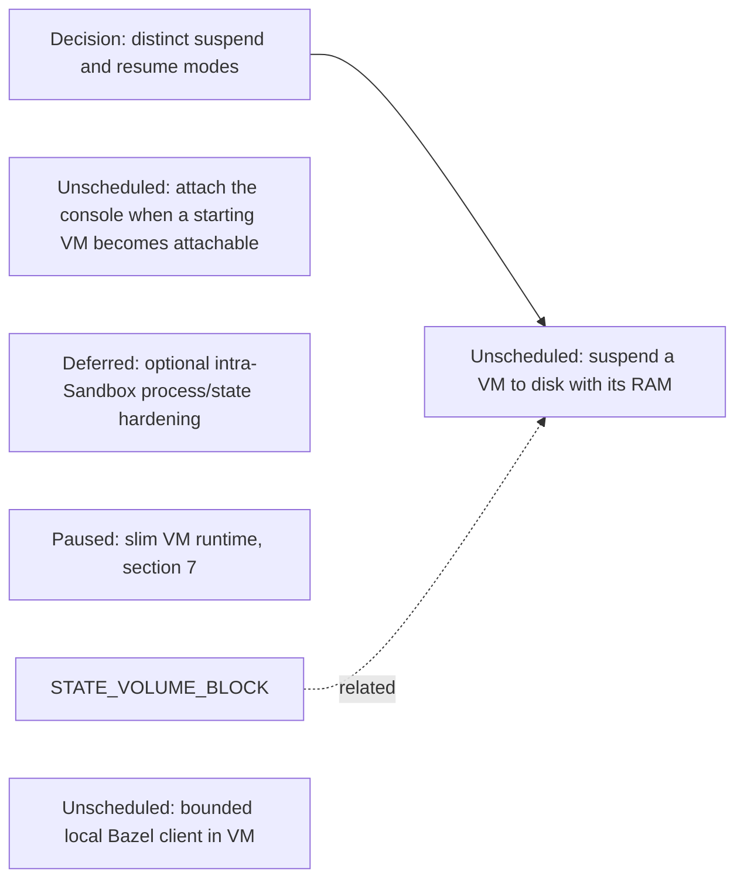

### `VM_INTRA_SANDBOX_HARDENING` — optional process and state hardening inside one Sandbox

**Deferred; nonblocking.** The accepted boundary is the Sandbox, so co-resident Sessions share its
filesystem, credentials and process trust domain. The VM Runner runs as guest root, native harnesses
run as uid/gid 107, and virtiofs presents `/state` files as 107:107; the Runner does not create a
separate mount or PID namespace for each Session. The existing per-harness cgroup groups a native
harness with its tool children for resource limits and teardown, not as a security boundary. Do not
require Runner-private storage, sibling Session stores, or harness/tool process views to be isolated
inside one Sandbox. Revisit Runner-state privacy and tool-child-versus-harness hardening separately
only if a concrete product requirement or incident warrants it. This node does not
gate VM resource acceptance or lifecycle work.

### `ENVIRONMENT_SUSPEND_MODES_DESIGN` — distinguish Environment suspend operations

**Decision; operator direction, 2026-11-04.** Design distinct suspend/resume operations for a
cold stop such as removing the Pod or VM and a memory-preserving VM suspend. Decide their API and
status, capabilities and unsupported-mode behavior, selection and authorization, idle/wake policy,
quiesce and journal boundaries, fencing, recovery and failure behavior. Specify what can be proved
about processes, terminals, memory, workspace, control connections and credentials after each mode;
never claim a resource survived or was lost without evidence. Coordinate with `VM_RAM_SUSPEND`,
`AGENT_RESUME_NOTICE` and the [control ADR](../docs/adr_sandbox_session_control.md#d3-quiescing-is-one-operation-names-say-which-stage-a-sandbox-is-in).
Existing cold-stop behavior and bounded notices about it can proceed independently. A
memory-preserving mode must not reuse the current final seal contract without resolving how the
running harness and journal resume safely.

**Exit:** reviewed cold-stop and memory-preserving examples, observable outcomes and ownership,
including failed/interrupted suspend and reconnect. This decision alone selects no VM mechanism.

### `VM_RAM_SUSPEND` — suspend a VM to disk with its RAM

**Unscheduled; blocked on `ENVIRONMENT_SUSPEND_MODES_DESIGN`; operator, 2026-10-13 PDT: nice to have.** A stopped VM Sandbox resumes with the memory
it had, not a cold boot, so a quick resume loses no in-memory state. Find what KubeVirt offers (a
memory dump or a snapshot with memory) and whether it works with the state volume (virtiofs today, block under `STATE_VOLUME_BLOCK`). The
[VM Sandboxes design](../docs/vm_sandboxes.md#guest-and-storage) records that a VM supports neither
RAM suspension nor live migration today; the opt-in [Firecracker backend](../docs/firecracker_sandboxes.md)
preserves RAM within its retained launcher Pod. Check what a resumed guest must redo: the runner's control stream and
projected tokens (the relay reopens them per request, so rotation alone needs no restart), and the
clock. Settle first what "seal before suspend" means when the harness keeps running across the suspend
(the current quiesce stops harnesses and seals journals). Where storage or the guest cannot carry it, stop/start from the state PVC stays the
lifecycle.

### `VM_CONSOLE_DEFERRED_ATTACH` — attach after VM startup makes the console available

**Unscheduled; lower priority, operator report 2026-10-15 PDT.** During VM startup the console tab
can show `Kubernetes answered 400` and remain disconnected. Treat a not-yet-attachable VM as waiting
and attach when its lifecycle signals readiness, without reopening the tab. Distinguish startup
from authorization failure, deleted VM, and another attached client; clean up on tab exit and never
open competing connections. Keep the existing read-only/no-replay contract. Test the unavailable
→ attachable transition and cancellation; do not add a periodic polling loop or bigger timeout.

Control design: [ADR](../docs/adr_sandbox_session_control.md).

### `LOCAL_BAZEL` — bounded local client in a VM

**Unscheduled.** The deployed template already provides 8 GiB, one vCPU and explicit byte
budgets. Wire Bazelisk, storage and authenticated RBE/cache/BES; bound the client's CPU/memory/disk
usage and cleanup. Inspect actual launcher requests/limits, namespace usage and eligible-node
capacity, including KubeVirt overhead. Run a representative build/test with the client inside the
VM and actions remote, without guest OOM; check cancellation/cleanup while the harness stays
responsive. Record useful sizing evidence in VM documentation. Installed tools and working hosted
builds do not authorize local Bazel in agent containers. Further guest slimming is independent of
this acceptance.

## 5. Independent UI and narrowly scoped service work

These candidates need no multiagent or VM decision. Any implementation that turns out to require
app/Sandbox Service database changes requires its own migration safety review.

```mermaid
flowchart LR
    CLAUDE_CODE_WEB_BRIDGE[Unscheduled: a frontend for Claude Code web sessions]
    SESSION_LAUNCH_FRICTION[Alongside: fewer clicks on reused environments]
    VM_STARTUP_LATENCY[Next: measure production VM startup]
    ACTION_SURFACES_DESIGN[Decision: where and in what states Actions render]
    EGRESS_RELAY_RENAME[TODO: rename egress sidecar to relay]
    EGRESS_CREDENTIAL_TRANSPORT_DESIGN[Decision: credential upstream schemes and ports]
    RUNNER_HARNESS_DELIVERY_DESIGN[Decision: decoupled harness delivery]
    K3S_BUNDLED_SERVICES_SPIKE[Unscheduled: measure bundled control-plane services]
    KUBERNETES_DECOUPLING_DESIGN[Decision, unscheduled: how far to decouple from Kubernetes]
    KUBERNETES_DECOUPLING_DESIGN -. related test-weight options .-> K3S_BUNDLED_SERVICES_SPIKE
    DOCKABLE_PANES[Unscheduled: dockable panes in the web app]
    ACTION_SURFACES_DESIGN -. related .-> DOCKABLE_PANES
    NOTIFICATION_PRESENTATION[Blocked: compact notification rendering, section 2]
    ACTION_SURFACES_DESIGN -. related .-> NOTIFICATION_PRESENTATION
    SANDBOX_FORM_TERMINOLOGY[Unscheduled: distinguish launch preset and runtime template labels]
    BUILD_BOX_BAZEL[Unscheduled: build Sandboxes can run Bazel]
    PLATFORM_SERVICE_NAMES_DESIGN[Decision, unscheduled: reserved sidecar names for platform services]
    PLATFORM_SERVICE_ROUTING_DESIGN[Decision, unscheduled: direct platform access vs central egress]
    PLATFORM_SERVICE_NAMES_DESIGN -. related naming and transport choices .-> PLATFORM_SERVICE_ROUTING_DESIGN
    SESSION_RUNTIME_MODEL_DESIGN[Decision, unscheduled: Sessions, harness placement and execution attachments]
    AGENT_PRINCIPAL_MODEL_DESIGN[Decision, unscheduled: Agentplane principals and external identities]
    AGENT_PRINCIPAL_MODEL_DESIGN -. related identity choices .-> SESSION_RUNTIME_MODEL_DESIGN
    AGENT_AUTHORED_CONVERSATIONS_DESIGN[Decision, unscheduled: conversations agents act on through tools]
    AGENT_AUTHORED_CONVERSATIONS_EXPERIMENT[Unscheduled: authored conversation CLI experiment]
    AGENT_AUTHORED_CONVERSATIONS_EXPERIMENT -. informs .-> AGENT_AUTHORED_CONVERSATIONS_DESIGN
    STRUCTURED_TOOL_OUTPUT[Unscheduled: tool results as ordered text and image parts]
    STRUCTURED_TOOL_OUTPUT -. multi-block output .-> CODEX_CODE_MODE_CELLS[Unscheduled: Codex code-mode cells as runner items]
    CENTRAL_SAMPLER_MODEL_CAPABILITIES[Unscheduled: live route check for standard-mode routes]
    CENTRAL_SAMPLER_PROMPT_COMPACTION[Unscheduled: client-side compaction prompt for routes without server compaction]
    CENTRAL_SAMPLER_BACKGROUND_COMPACTION[Unscheduled: compact a prefix while sampling continues]
    CENTRAL_SAMPLER_DYNAMIC_TOOLS[Deferred: dynamic tool definitions when needed]
    CODE_MODE_HOST_DESIGN[Decision, unscheduled: keep Codex's code-mode host or own one]
    CODE_MODE_HOST_DESIGN -. typed errors and tool namespace .-> CENTRAL_SESSION_DELEGATED_ACTING[Candidate: code-mode tools as Actions, section 14]
    SAMPLER_NOTIFICATION_JOURNAL[Candidate: investigate executor notification journal deadline]
    CLAUDE_REMOTE_EXECUTION_SPIKE[In review: gated native Claude remote tools]
    CLAUDE_CUSTOM_SAMPLER[In review: custom Claude sampler evidence]
```

### `SAMPLER_NOTIFICATION_JOURNAL` — investigate executor notification journal deadline

**Candidate; independent reliability investigation.** In the [MCP system-test failure](https://app.buildbuddy.io/invocation/47836fa6-2b1b-5387-ba70-f05ca5bc9b7e),
Dispatcher delivered a central Session's input after Sandbox resume. The sampler then stopped execution after a
notification-evidence SQL write was canceled under its five-second, stream-independent journal context; the test
waited for a subsequent model request. A [fresh rerun](https://app.buildbuddy.io/invocation/da1037be-601a-4a62-96d9-85058732becd)
passed, but did not explain the failure. The captured artifacts do not identify the SQL statement or any lock holder.

Instrument or reproduce the database wait and identify the causal boundary; fix only what the evidence supports.
Preserve the owner fence, durable notification evidence and fail-closed treatment of unrecorded or uncertain effects.
Do not lengthen the test timeout or automatically replay executor effects as a substitute for diagnosis.

### `SESSION_LAUNCH_FRICTION` — fewer clicks to start useful work

**Selected alongside P0/P1; operator, 2026-10-30 PDT.** Make creating a Session on an existing
environment with its own working directory a short path with useful defaults. Preserve explicit
harness/model/access choices without requiring users to reconstruct ordinary settings each time.
Separate this flow from provisioning a fresh environment. Review the actual click path and
candidate UX first; do not require new agent/conversation entities to improve it.

Exit: the agreed common path needs fewer decisions/clicks and creates a useful Session in the chosen
directory, with intended defaults and override behavior visible. Include the normal visual review.

### `VM_STARTUP_LATENCY` — measure production time to a useful fresh VM Session

**Next; operator, 2026-10-30 PDT.** First measure one ordinary staging `environment-vm` start using
the production NixOS guest on a KVM-schedulable node. The [prior-work audit](../debug/2026_11_01_vm_startup_latency.md)
records the boot, image, and runner-disk improvements already shipped, and why the recent Debian/QEMU
system-test timings do not measure this product path. The staging [fresh VM acceptance](../docs/vm_sandboxes.md#fresh-vm-trial-readiness)
currently records functional readiness but no durations.

Record the exact guest image digest, node, storage class, and naturally observed image/cache state.
Capture a warm follow-up on the same node/image if available; do not evict caches or discard state to
manufacture a cold start. Correlate retained Kubernetes object timestamps/events and launcher, guest,
Runner, and Session evidence across Sandbox request, PVC binding, VM/VMI scheduling and start, guest
boot, Runner Ready/bootstrap, and first safe useful Session action. If an essential phase is missing,
add only its smallest timestamp at the owning boundary. Keep test-fixture spans separate.

**Exit:** retain a phase timeline that identifies the critical path and states whether a product
bottleneck is demonstrated. If it is, propose one bounded change at the owning boundary, naming the
mechanism and preserving KVM scheduling, storage/state ownership, and Runner/bootstrap/readiness
behavior; include matched same-image validation of the affected phase and first useful work. If no
phase dominates, or a naturally cold image state was unavailable, record that limit and stop without
choosing an image/layout redesign. Keep reusable environments supported. `RUNNER_LAYERING_VM` remains
paused and is not a prerequisite; `LOCAL_BAZEL` independently proves the VM-based coding workflow.

### `AGENT_PRINCIPAL_MODEL_DESIGN` — Agentplane principals and external identities

**Decided 2026-11-05: Agentplane-owned identity, no automatic ServiceAccount; implementation in
[section 14](#14-identity-and-kubernetes-accounts-cutover).** An agent's permission subject is an Agentplane identity, not a Kubernetes
ServiceAccount, and an agent workload gets no ServiceAccount unless a binding grants it Kubernetes
access; [workload authentication](../docs/workload_authentication.md) supplies the SVIDs this needs. Kubernetes is
a downstream system with its own grant kind: `PolicyBinding` binds Agentplane rules to an identity,
a separate Kubernetes grant binds role sets to a ServiceAccount on a named apiserver, the Policy
Controller keeps those RoleBindings and creates accounts only where Agentplane must own one, and
the egress proxy acts as the account under the existing kubeconfig placeholder (operator, 2026-11-05:
separate kinds, since no rule type is meaningful on both subjects). Session work now records its
Identity principal; add no ServiceAccount-keyed contract the cutover would undo. The environment-free
central Session remains gated by its separate creation, attachment and lifetime decisions. The cutover is
one incompatible change with accepted downtime, not a staged migration (operator, 2026-11-05). The object
shapes, lifetimes, flows and open questions proposed on 2026-11-05 are in
[identities, workload authentication and Kubernetes accounts](identity_and_kubernetes_accounts.md);
they are a proposal until this node's exit. Decide
the relationships and lifetimes of identities, Sessions and environments, who may act as an
identity, whether associations can change, and how a central Session keeps its identity without
an environment. The [Session/environment model](session_environment_model.md) records the
related lifecycle discussion and selected direction. `SESSION_IDENTITY_CONTRACT` tracks the focused
identity and same-Environment admission decisions needed for Session separation; coordinate those
decisions here without requiring the wider provisioning comparison to finish first.

Today each Sandbox owns its own ServiceAccount and PolicyBinding so its permissions can be changed
independently. Sharing an SA between environments combines their additive grants. The egress proxy
substitutes the calling Pod's projected Kubernetes token and requires it to match the authenticated
Pod; substituting another account would need a new credential source or broker. Policy subjects,
workload authentication, Dispatcher, Environment Service, Actions, Notification, History and LLM
ingress also use SA identity. See [egress identity and substitution](../egress/SPEC.md#identity),
[PolicySets](../docs/adr_policy_sets.md), and [delegated authorization](../docs/delegated_authorization.md).

A central-sampler agent keeps its `Identity` with no Environment attached and as attachments
change; a missing Environment does not mean the Identity has disappeared. A Session names its
Identity at `CreateSession`, and a reference alone is no authority to act as it. The broader Session
identity lifetime and provisioning decisions remain in `SESSION_IDENTITY_CONTRACT` and
`SESSION_IDENTITY_PROVISIONING_DESIGN`, including Identities that exist for a single Session.

Compare existing identity governance and provisioning tools and their connectors with a custom
controller. Consider [SCIM](https://datatracker.ietf.org/doc/html/rfc7644) for supported user and
group provisioning, and distinguish it from OAuth/OIDC authentication and service-specific grants.
Evaluate which system is authoritative for each identity and entitlement, connector coverage,
and non-human account support; no particular identity provider or downstream application is selected.

**Recommendation for review:** evaluate a durable Agentplane principal and use verified workload
identity and explicitly authorized delegation to resolve it; retain existing SAs as adapters where
practical. Keep Session ID, principal, caller, workload and external account distinct. Preserve
individual permission granularity, and treat Sessions sharing an unrestricted environment as one
trust domain. Do not trust a caller-supplied principal, expose substituted credentials to the
workload, or assume the proxy can distinguish co-resident Sessions. Choose how revocation, account
replacement, UID fencing, queued work and historical attribution work across identity changes.

**Exit:** the 2026-11-05 principal decisions and the workload Identity source cutover are complete;
the [identity plan](identity_and_kubernetes_accounts.md) and owning SPECs carry the current
contract. The remaining text above is historical context, not an active cutover gate. Related to
`MULTIAGENT_MODEL` and `SESSION_RUNTIME_MODEL_DESIGN`, not a prerequisite for their already selected
work; no identity service or broker is selected.

### `SESSION_RUNTIME_MODEL_DESIGN` — Sessions, harness placement and execution attachments

**Decision, unscheduled; operator requested future design work, 2026-10-28 PDT.**
The newer [Session/environment model and discussion](session_environment_model.md) records selected
direction and remaining decisions; current opening and recovery behavior is in the
[Dispatcher SPEC](../runner_gateway/dispatcher/SPEC.md), [Runtime SPEC](../env/runtime/SPEC.md) and
[central sampler SPEC](../central_sampler/SPEC.md). The earlier descriptions below are context where superseded by that direction.
The [current component boundaries](session_runtime_model.md#role-boundaries-and-routing) inform this
broader object/API decision without making it a prerequisite for selected execution or delegation work.
Session/Environment dispatch roles are
distinct, but their physical merge/split is deferred. [Design brief](session_runtime_model.md).
Represent Sandbox-local native harnesses/state and central Sessions whose optional Sandboxes supply
execution in one shared domain vocabulary. A native harness's required local environment is a
capability constraint of that harness, not a universal Session attachment requirement. Keep
Session identity, durable harness stores, running hosts, placement and execution attachments distinct.
The landed [SessionSpec placement contract](../runner_gateway/dispatcher/SPEC.md#sessionspec-placement-cutover)
makes the owner variant explicit: `environment_hosted` carries the exact native environment and
harness, and `central_sampler_v1` carries one exact required executor environment. #14314 retains
the Dispatcher Session row when that required Environment is deleted, but central V1 still has no
optional attachments, environment-free admission or alternate executor. The principal and
harness-store contracts remain unresolved.
The [Dispatcher outcome contract](../runner_gateway/dispatcher/SPEC.md#native-opening-outcomes-and-dependent-commands)
also leaves unconfirmed native owner admission explicit: `UNKNOWN` outcomes hold dependent queued
commands without forwarding or waking, and those commands remain cancellable. Automatic resolution
is not provided; decide whether an authorized caller or operator can resolve the hold from durable
owner evidence, without replaying uncertain native effects or discarding their outcomes.
Preserve harness-specific constraints: Claude
Code naturally runs in the environment it acts in; a shared vocabulary must not pretend every
backend supports independent placement or executor replacement.

Use the current environment `CreateSession` as a concrete design case: it reserves a Session, while
setup and native harness or process startup may happen later, and the relationship between the RPC
result and observable harness readiness/failure needs a clearer model. Decide how Session identity
and reservation, harness placement, environment attachment, process start and status reporting fit
together for both a Session independent of environments and a harness running inside one. Specify
what each operation acknowledges and how callers observe progress or failure, without assuming every
harness supports the same placement or creation order.

Selected: distinguish Session identity/continuation authority, harness placement and execution
attachments; Dispatcher PostgreSQL owns the Session directory, with History stored separately. Prefer
external placement when capabilities are otherwise equal, for isolation and independent lifetimes.
Characterize complete per-feature placement; OpenClaw's historical partial remote support is a
counterexample to equating remote shell forwarding with a fully separated harness.
Support Sandbox-first native CLI use and Session-first central use with 0..N environments and later
attachment/detachment. Preserve central Session identity and continuation data after executor
deletion; retained Dispatcher identity alone does not make V1 environment-independent. The 2026-10-30
discussion adds durable harness stores versus running hosts, dispatcher/gateway role boundaries,
caller-SA provisioning, agent-facing environment context and unresolved skills delivery, programmatic
environment access, partial-output failures and recovery after JS host loss. Resource visibility,
rightsizing and Claude workload placement are independent follow-ups in the brief. Decide concrete
capabilities, lifecycle, authority and attribution; reuse the existing versioned Codex environment
API evidence without claiming unsupported modes work.
Operations on an existing Session should address the Session, without making callers choose or supply an
environment just to send, observe or otherwise act on it. Resolve placement at the responsible
boundary only when an operation actually needs it; environment lifecycle and execution operations
still address their environment. Preserve backend-specific native placement constraints, explicit
attachment authority and exact-incarnation fences.
Exit: reviewed vocabulary and lifecycle/API examples that represent both a CLI inside its required
environment and a central sampler with zero, one or multiple attached environments, including
shared-host/multiple-Session operation, environment loss and host restart. Include a data-preserving
transition proposal. Recording the broader model does not dispatch a worker or authorize a live migration.

### `AGENT_AUTHORED_CONVERSATIONS_EXPERIMENT` — try an authored conversation in a CLI

**Follow-up in review, 2026-11-12.** The implementation merged as
[#15896](https://github.com/agentydragon/ducktape/pull/15896), providing the
[bounded CLI experiment](authored_conversation_experiment.md): our own agent loop with Qwen through
LiteLLM's OpenAI-compatible API, a retained thread read/written through tools, separate working
context and diagnostic trace, and a same-model ordinary-chat comparison. No deployed Agentplane
service is required. The broader conversation design is not a prerequisite.

The [first Qwen run](../debug/2026_11_12_authored_conversation_cli.md) missed publications after reset
and during correction, including single repeats. A follow-up
[prompting and Luna comparison](../debug/2026_11_12_authored_conversation_prompting.md) fixed those
observed omissions with an explanatory prompt on both models. An always-required explicit-yield
variant also published and yielded in both cases on both models; Qwen's route did not demonstrate
API enforcement. Preliminary progress remains inconsistent, and the focused probes do not establish
all original win conditions or reliability.
Deterministic tests and provider access passed. No broader conversation design or History migration
is selected.

**Exit:** the spec's paired scenarios and win conditions evaluated, with artifacts and a findings
note classifying the result as promising, unpromising on the tested model, or inconclusive. A useful
negative result completes the experiment too. History replacement and existing thread-work
priorities remain separate decisions.

### `AGENT_AUTHORED_CONVERSATIONS_DESIGN` — conversations agents act on through tools

**Decision, unscheduled; operator requested for later, 2026-10-30 PDT.** Explore a conversation
that agents participate in through tools such as `send_message` and `edit_message`. Its messages
need not mirror model context items or expose each reasoning/tool step as a work log. A Session
could participate in such a thread alongside humans or other agents; a human participant is optional.
Expose conversation operations through MCP so third-party harnesses can participate without changes
to their binaries. Treat publishing a message, notifying a participant and waking an agent as
separate concerns; incoming-message delivery and harness-specific notification support need design. The object is named a Thread ([naming ADR](../docs/adr_journal_and_thread.md)).

Start by evaluating the bounded CLI experiment above before committing to the broader model. Its
local tool dispatch and storage choices are experimental, not decisions about service ownership,
MCP exposure or migration. This decision and its full exit criteria do not gate that experiment.

**Operator clarification, 2026-11-12:** authored threads are optional. Background agents can use
other tools, inputs and outputs without a user-facing conversation object; the app can expose their
relatively raw transcripts/logs. Do not make this component a prerequisite for running a Session.

Recommendation for review: distinguish the authored conversation, harness continuation state and
retained evidence of harness activity. Today's History conversation view is already a lossy
projection and cannot resume a rollout; central-sampler evidence and native app-server observations
also arrive at different levels of detail. Consider adding authored conversations and participant
relationships alongside existing projected threads, with reasoning, tool calls and raw harness
evidence accessible through a debug view. Keep the ability to retain harness evidence. Evaluate
OTel/Langfuse as a possible destination, including fidelity and retention; do not assume ordinary
telemetry replaces durable evidence or continuation state.

**TODO (operator, 2026-11-12):** Follow the
[storage representation and compression plan](storage_representations.md), including shared content
across sampler request/response logs, History's native/semantic events and projected bodies.
Co-sequence this storage work with the authored-conversation design: keep divergent harness activity
as less user-visible diagnostic logs rather than forcing it into one conversation representation,
and consider an explicit thread with the user that the agent communicates through. Decide content
ownership/references, authorization, retention and replay/continuation requirements together before
removing copies; this TODO selects neither a shared storage schema nor a trace destination.

Exit: reviewed conversation/participant/message semantics, send/edit authorization and attribution,
edit history and delivery/retry behavior, and an incremental migration/UX proposal. Decide whether
History owns the new entities and whether its name still fits, in coordination with
`HISTORY_SERVICE_RENAME`. The service owner, storage and trace destination remain open. This design
does not block current thread work or authorize implementation.

### `STRUCTURED_TOOL_OUTPUT` — tool results as ordered text and image parts

**Unscheduled; operator, 2026-10-21 07:11 UTC: "fidelity improvements like images for Claude let's put on task
dag".** Tool results become ordered parts (text, image) in the harness-neutral vocabulary instead of one string.
Today `event.proto` carries `ToolResult.output`, `ToolOutputDelta.text` and `RecoveredContent.output` as strings,
the Claude adapter's `resultText()` (`env/runtime/internal/harnesses/claude/protocol.go`) joins text blocks and drops images, and the
History fold's `THREAD_PAYLOAD_FIELD_OUTPUT` is one text field that deltas append to. Scope: the proto, both
runner adapters, the History fold with its storage and reads, the app API, the frontend tool cards, and the fold,
span and visual fixtures. Archived event logs and History rows hold `output` strings and sealed archives cannot be rewritten; the
default under "deployed state is disposable" is to drop that data in its own data-deletion PR, which is the
operator's call. Exit: an image a Claude tool returns renders in its tool card.

### `CODEX_CODE_MODE_CELLS` — Codex code-mode cells as runner items

**Unscheduled; operator, 2026-10-21 07:11 UTC: "It would be nice if we could get the code mode also out of codex
app server for fidelity but I'm guessing that might not be trivial".** Surface Codex code-mode `exec` cells (the
script and what it emitted) as runner items. Codex app-server has no `ThreadItem` for them, in 0.157.0 or on
`openai/codex` main at `c7234c11` (2026-10-21), and core emits the call output only to hooks, so the runner sees
only the nested `commandExecution`. Needs upstream support, or reading the rollout or the native frames. Multi-block
cell output likely needs `STRUCTURED_TOOL_OUTPUT`.

### `CENTRAL_SAMPLER_MODEL_CAPABILITIES` — live route check for standard-mode routes

**Unscheduled; operator requested 2026-10-29 PDT after a concrete provider rejection.** The route
`ollama/oai-chat/qwen3.8-flash-next-iq4xs-256k` returned HTTP 400 through LiteLLM:
`input[0]: unknown input item type: "additional_tools"`. Each route now declares its Responses
dialect and exec encoding; standard mode sends top-level function tools and rejects compaction
([SPEC](../central_sampler/SPEC.md)). Remaining:

- A bounded check against the reported route establishing its actual accepted wire contract; the
  standard/JSON path is covered only by deterministic fixtures.
- Compaction for standard-mode routes: `CENTRAL_SAMPLER_PROMPT_COMPACTION`.

Do not silently strip required tool behavior, retry arbitrary HTTP 400s with progressively different
payloads, or replay already dispatched effects. Independent of the [deployed Anthropic adapter](../central_sampler/docs/anthropic_acceptance.md);
no implementation or rollout is scheduled by this entry.

### `CENTRAL_SAMPLER_PROMPT_COMPACTION` — compaction by our own prompt

**Unscheduled; operator requested tracking, 2026-10-31 PDT.** Compaction today is provider-side only:
Responses compaction requires a Responses Lite route (`responses.BuildCompactionRequest` fails
otherwise), Anthropic uses server-side compaction, and `Compact` is refused for standard-dialect
Responses routes and for Anthropic routes without compaction configured, so their Sessions grow until
the context window fails. Add client-side compaction for such routes, selected per model in the route
configuration: sample the route with a summarization prompt over the current context, then replace the
context with the summary plus retained recent user turns, as Codex CLI does for providers without
remote compaction (port its prompt template and history rebuild with sync comments; Codex pin
`rust-v0.162.1`). Reuse the existing compaction intent, journaling and context-replacement path so
auto-compaction thresholds, `Compact` and restart recovery behave as for provider compaction. Exit:
deterministic tests for the request, the replacement and a failed or oversized summary; a bounded live
check on a standard-mode route that compacts and continues with a tool call; SPEC states which routes
compact how.

### `CENTRAL_SAMPLER_BACKGROUND_COMPACTION` — summarize while sampling continues

**Unscheduled; operator requested tracking, 2026-10-30 PDT.** Ordinary Anthropic compaction is
[implemented and deployed](../central_sampler/docs/anthropic_acceptance.md). [Design and acceptance](../central_sampler/plans/anthropic.md#background-compaction).
Use Anthropic on-demand compaction concurrently with ordinary turns. Persist the exact summarized
prefix and atomically replace only it, retaining the appended suffix. Separate the background
operation from the foreground pending-effect fence; reject stale results after context/ownership
changes. Exit: deterministic concurrent-turn, suffix-preservation, restart and failure-isolation
coverage, plus one bounded direct real-model continuation from the background summary. No worker
or priority is assigned, and this follow-up does not gate ordinary Anthropic compaction.

### `CENTRAL_SAMPLER_DYNAMIC_TOOLS` — change tool definitions during a Session

**Deferred; operator requested DAG tracking, 2026-10-30 PDT.** Revisit when a concrete Actions/MCP
workflow needs tools or schemas to change mid-Session. The
[fixed-tool Anthropic adapter](../central_sampler/docs/anthropic_acceptance.md) is implemented and deployed.
[Component design](../central_sampler/plans/anthropic.md#dynamic-tool-definitions) distinguishes
provider-visible inline tools from nested code-mode tools and the existing Actions-as-tools work.
Exit when selected: tool additions/removals reach model input and runtime consistently, retain the
cached prefix where supported, survive restart, and preserve execution authorization plus
thinking/compaction validity. No worker or priority is assigned.

### `CODE_MODE_HOST_DESIGN` — keep Codex's code-mode host or own one

**Decision, unscheduled; operator, 2026-11-14 07:44 UTC, on [Sandbox-free central
Sessions](#sandbox-free-central-sessions):** "which might or might not mean replacing codex's v8
isolate; not sure". Each sampler replica runs every code-mode cell in a fresh V8 isolate inside one
shared, pinned upstream Codex JavaScript host process
([SPEC](../central_sampler/SPEC.md#runtime-and-effects)). That host runs in the sampler Pod, not in a
Sandbox, and attaching it opens no executor stream, so a Session with no Environment can keep it;
`CENTRAL_SESSION_ACTING_DESIGN` records that the tools-as-Actions design does not depend on which
host runs the cells. Agent-authored JavaScript from every Identity's Sessions already shares that one
process per replica, so a Sandbox-free Session adds no new tenant to it.

Reasons to own the host, from the [runtime model](session_runtime_model.md) and
[delegation](session_delegation_workflows.md) plans: typed `delegate/response` errors (the pinned
host passes primitive strings), a `tools` namespace generated from the Action catalog, serializable
environment handles, and explicit cancellation and waits. What the pinned host provides today and an
owned one would have to keep: `notify`, `store`/`load`, yield and the host-loss recovery contract. The
Go plan's `sampler-codehost-ownership` extraction only reorganizes the sampler's code around the
current host. **Exit:** keep or replace, decided against a concrete Sandbox-free workflow that needs
the difference.

### `CLAUDE_REMOTE_EXECUTION_SPIKE` — gated native Claude remote tools

**In review; [PR #12210](https://github.com/agentydragon/ducktape/pull/12210), 2026-10-27.** The question
is the specifically gated native remote-tools feature, its locally settable versus account gates,
transport and instruction/read-state behavior. Generic filesystem MCP feasibility is already known
and is not the acceptance outcome. Preserve exact binary versions and captures proving whether a
remote read makes root/nested `CLAUDE.md` appear in the next model request; file access alone does
not establish that. Exit: reproducible native-feature evidence or blocker and recommendation.
Independent of the Codex v1 implementation; no live account changes or runtime cutover authorized.

### `CLAUDE_CUSTOM_SAMPLER` — custom Claude loop and shared code-mode compatibility

**In review; [PR #12211](https://github.com/agentydragon/ducktape/pull/12211), 2026-10-27.** Record
scripted custom sampler evidence and CLIProxyAPI/CLI-shaped compatibility limits. A future Claude
backend could use the same central code-mode runtime with suitable prompting and tool contracts;
that is a later decision, not established by wire cloaking. Preserve wrapped official harnesses as
an independent transitional backend. History must retain backend-specific evidence and expose a
purpose-specific common display fold without inventing details absent from a harness JSON API.

### `SANDBOX_FORM_TERMINOLOGY` — distinguish launch presets from runtime templates

**Unscheduled; operator, 2026-10-17 PDT: the new Sandbox form's “Preset” and “Sandbox template”
labels are confusing.** Distinguish the multi-field choice as a “Launch preset” and the Pod/VM
shape as a “Runtime template” (or use equally clear wording). Update the helper text to match; keep
API model and field names unchanged.

Exit: the form's labels and descriptions clearly distinguish those concepts on desktop and phone.

### `PLATFORM_SERVICE_NAMES_DESIGN` — stable sidecar names for platform services

**Decision, unscheduled; operator idea, 2026-10-16 PDT.** Evaluate reserved names such as
`gateway-control.agentplane`, `history-ingress.agentplane`, `notifications.agentplane` and
`actions.agentplane` that map to deployment-configured service endpoints. Decide where the mapping
lives alongside `PLATFORM_SERVICE_ROUTING_DESIGN`; stable names need not select a central or local route.
Cover platform services an agent can access, including discovery of their APIs and effective access;
distinguish runner-internal interfaces from agent-facing interfaces. Keep namespace, cluster domain
and ports out of client configuration. Decide whether these are proxy-only authorities or resolvable
names usable by direct HTTP/gRPC clients; account for proxy exclusions, Pod/VM networking,
TLS authority if applicable, and the
overlap of `gateway.agentplane` with Kubernetes Service/namespace DNS shorthand.

Use exact deployment-owned mappings, coupled to endpoint, audience/token projection and
network-policy wiring; `cluster/cdk8s/agentplane/platform_routes.py` owns today's direct routes.
Preserve independent backend authorization and audience-specific identity. Naming alone grants no
access; any change to a service's egress-policy or credential requirements belongs to the routing
decision below, not an incidental alias change.
Unknown reserved names and unavailable routes fail closed without ordinary
DNS/public-egress fallback. No general wildcard-to-cluster-service rewrite is implied.

Exit: a reviewed naming and transport contract with concrete Gateway-control, History-ingress,
Notifications and Actions client examples, plus a bounded implementation/acceptance scope covering
routing, service discovery, effective access, injected identity, denials and supported Pod/VM clients.
This node authorizes design work; runtime changes wait for
the transport decision. No prerequisites on the other section 5 candidates.

### `EGRESS_CREDENTIAL_TRANSPORT_DESIGN` — credential upstream schemes and ports

**Decision; operator requested the audit/proposal, 2026-10-19.** Review the source inventory and
alternatives in [the component proposal](../egress/plans/credential_transport.md). Select where
substituted credentials may travel: external HTTPS/port restrictions and explicit internal
HTTP/h2c exceptions. Keep private-address permission separate from plaintext permission.

Exit: a reviewed transport-grant model and exception set, with bounded implementation/rollout
acceptance. This node authorizes design only; it does not change enforcement or select a platform
routing topology. `PLATFORM_SERVICE_ROUTING_DESIGN` remains a separate decision.

### `PLATFORM_SERVICE_ROUTING_DESIGN` — direct platform access versus central egress

**Decision, unscheduled; operator discussion, 2026-10-16 PDT.** Compare routing agent-accessible
Agentplane services through the central egress proxy with direct local-relay routes or direct
authenticated clients. Include Actions and Notifications as well as runner Gateway control and
History ingress. Gateway/ingress previously used central egress; existing proxy coverage includes
interactive plaintext bidirectional gRPC with metadata substitution. Protocol alone does not require
their current special routes. Naming and API discovery can be designed independently; settle the
combined transport contract before implementation.

The central proxy keeps real substituted credentials outside the Sandbox/Pod/VM and outside what
its ServiceAccount can access, records request/decision evidence, and applies Agentplane egress
policy. Agentplane's own services instead authenticate the agent as itself: distinguish that workload
identity from delegated external credentials the agent must never possess. Backend authorization
remains required on every route.

Arguments for direct platform access: these services are naturally agent-facing, their caller's own
identity may be acceptable for the agent to hold, and required runner control/history delivery would
not depend on central-proxy availability or egress-policy readiness. A local relay could attach
identity without requiring `Bearer <placeholder>`; weigh that small convenience against an asymmetric
client contract that hides authentication. Stable reserved names help prompts and instructions under
either routing choice.

Costs of direct relay routes: another route/configuration surface to distribute and update across
Pod and VM runners, and another place that attaches workload authentication to requests. The minimal
relay already authenticates its hop to central egress, but per-service forwarding expands its role.
Compare generated startup configuration with mounted ConfigMaps or another existing distribution
mechanism; specify update/reload behavior, rollout scope and failure behavior. Central routing
consolidates policy, substitution and decision logging, but adds those dependencies to platform calls.
Decide what request/decision visibility and access controls direct routes need and who owns them.

Direct routes also widen the destinations the workload can reach directly: Pod network policy cannot
distinguish the relay from its agent container, so allowing the relay to reach a backend also permits
the agent to attempt that connection. Backend token validation still gates access. Weigh the marginal
exposure against the central path: a stolen token could also be presented through central egress
where the caller's host/method/path policy admits the request and no substitution replaces it.
Direct access bypasses that egress gate and its decision logging; it does not itself grant the
backend identity or authority. Assess this separately from whether the agent may hold its own token.

Evaluate making central egress optional for deployments that need neither external credential
substitution nor Agentplane egress filtering: external networking may be independently disabled, or
the operator may accept unrestricted access and agent-held credentials. State which functions and
diagnostics are absent in that mode and how platform identity, authorization and discovery still work.
Absence of the proxy alone does not disable external networking.

Exit: a reviewed routing/dependency and identity contract, including whether central egress is optional,
configuration lifecycle, and concrete client examples coordinated with `PLATFORM_SERVICE_NAMES_DESIGN`.
Define bounded acceptance for actual runner control and History push/reconnect, agent calls to Actions
and Notifications, authorization denials and the selected proxy-unavailable/absent behavior. No runtime
change or removal of existing policy checks is selected by this node.

### `ACTION_SURFACES_DESIGN` — where and in what states Actions render

**Decision; operator, 2026-10-13 PDT: rethink it, since it is a patchwork and possibly redundant.**
Decide every place an Action is shown and in which states, then reduce the code to that. Surfaces
found in `app/frontend/actions/` and the service worker: the sidebar rows (collapsed and expanded,
with card decision buttons only where the Action type's `offersCardDecisionButtons` says so), the top "Actions waiting" strip (a count),
the Actions page queue and the detail view (`PendingActionCard`, the full `ActionCall`, with a raw
and a pretty toggle), history, the policy view, and the Web Push notification (formatters in a
registry separate from the React one). Several of them choose independently what to render, whether
to offer a decision, and how tall to let the card grow. Settle which surfaces exist, what each is
for (a glance, a quick decision, full review, a record), and which states each has, so that one
rule decides inline approval and height and each Action type is described once.
Landed: whether a card offers its decision buttons is decided by the Action type's own
`offersCardDecisionButtons(args)` for each invocation, from its content (for example a read-only call
against a listed resource), not by a per-kind allowlist. The names **compact card** (the glance form in
the sidebar and the strip), **card decision buttons** (Approve/Deny on a compact card) and **attention
strip** (the top "Actions waiting" count) are already used in code and tests. Still to settle with the
design: **full card** (the detail view with the whole `ActionCall`) and **notification buttons**
(Approve/Deny on a Web Push notification), then use every name everywhere (UI copy, docs), since "quick
approve" could mean the buttons on a card or on a desktop notification. `NOTIFICATION_PRESENTATION` (section 2) renders notices on the same surfaces and uses the same card
names.
Known inconsistency, left as is (operator, 2026-10-24: acceptable for now, handling still to be
thought through): notification buttons ignore `offersCardDecisionButtons`. The service worker offers
Approve/Deny whenever exactly one Action waits, whatever its arguments, so a notification can approve
a call (a long shell script, a large file push) that the app offers only on the full card.

### `DOCKABLE_PANES` — dockable panes in the web app

**Unscheduled; operator, 2026-10-13 PDT.** Let the operator arrange the app's panes (thread browser,
Actions queue, several threads at once, Action detail) by dragging them into a layout of their own,
with split resizing, a layout that persists, and one selected pane at a time on a phone. Open spike
[#9721](https://github.com/agentydragon/ducktape/pull/9721) builds this as an experimental
`/#/mosaic` shell on `react-mosaic-component`, split-only without tabs, beside the classic routes;
it is stale and is the starting point. Settle whether docking replaces the classic routes or stays
an alternative, and fold the Action tiles into the surfaces `ACTION_SURFACES_DESIGN` settles.

### `CLAUDE_CODE_WEB_BRIDGE` — Claude Code web sessions in Agentplane

**Unscheduled; operator, 2026-10-12 PDT: low priority, not to build now.** Make Agentplane's
frontend a custom frontend for Claude Code web sessions: show their conversations and send them
messages, by shimming the web interface's control protocol. Builds on the viewer and syncer under
`devinfra/` and the reverse-engineering in `agentydragon/gaffer-private`.

### K3s startup experiment constraints

The independent candidates below were requested by the operator on 2026-10-16 PDT; none waits
for the others. Use equivalent source/scenarios and report transfer, import/unpack, process
readiness and total test time separately in
[the k3s stack timings](../system_tests/k3s/debug/stack_timings.md).
Preserve assertions and timeouts. Language rewrites require Rai's decision;
rank them by unique image bytes removed and startup time on the dependency chain. Remaining
Python services still need the shared interpreter.

Keep the fixture declarative: supply images and manifests, let Kubernetes reconcile, wait
for readiness, then test. Startup dependency ordering belongs to Kubernetes; do not add
PostgreSQL-first sequencing or a custom parallel import/unpack scheduler to the test harness.

### `EGRESS_RELAY_RENAME` — rename the egress sidecar to relay

**TODO; operator request, 2026-10-16.** Rename the egress sidecar to "relay" across code,
configuration, image names and docs. Update all consumers atomically.

### `RUNNER_HARNESS_DELIVERY_DESIGN` — choose how runners obtain harness binaries

**Decision; operator, 2026-10-16 PDT: investigate for k3s test latency.** Decide how a runner obtains
a needed harness independently of its image: digest-pinned downloads from an independent
Agentplane service or directly from OpenAI/Anthropic distribution endpoints, or separately pinned
harness OCI images made available through mounts or an init container copying into a shared volume.
Operator preference: eventual delivery should decouple harnesses from the runner image; the
narrower test images are an interim optimization. Decide delivery and service/cache ownership. Any serving service must
respect the backend dependency rule; the integration app cannot own this path.
Whatever delivers Codex must keep the version the model-catalog generator pins at least as new as the runner's
([ingress README](../llm_ingress/README.md#codex-model-catalog)).

The [image-split comparison](https://github.com/agentydragon/ducktape/blob/7fd9f16f7d/agentplane/x/k3s_env/README.md#harness-specific-runner-comparison-2026-10-16)
measures removal of unused harness payload; it does not measure runtime delivery of a needed harness.
Its profiles and inventories are in [#10813](https://github.com/agentydragon/ducktape/pull/10813); the image split itself landed in #10812.

Exit: a measured recommendation and explicit operator choice. Compare equivalent scenarios and
pins, separating image build/upload, action-input transfer, containerd import/unpack, harness
fetch/cache hits and first usable Session. Include cold runs: moving bytes from an image to a
service may only move the same transfer later, and fetching upstream still costs network and
extraction time. Specify version/digest verification, atomic installation, concurrent requests,
cache scope, unavailable-artifact behavior and allowed egress for any runtime-delivery proposal.
No new artifact service or runtime-download implementation is selected by this node.

### `K3S_BUNDLED_SERVICES_SPIKE` — measure a less isolated control plane in real k3s

**Unscheduled spike; operator, 2026-10-15 PDT.** Evaluate running Agentplane control-plane
services together in one Pod to reduce integration-test startup time. Keep real k3s, RBAC
objects, service APIs, databases, controllers and separately managed Sandbox workloads;
exercise the existing end-to-end lifecycle scenarios. Preserve each service's intended
Kubernetes identity and permissions using separate credentials rather than the Pod's union
of service permissions. Explicitly assess how to provide those credentials: a Pod has one
ServiceAccount, so bundling must not silently bypass authorization coverage.

Compare the normal deployment layout with the bundled layout on equivalent inputs and
scenarios. Measure image import/unpack, startup/readiness and total test time separately;
bundling alone does not remove image bytes or process initialization. Record implementation
complexity and coverage lost through shared networking, scheduling, restart and failure
boundaries, including NetworkPolicy isolation. Deliver a measured recommendation to adopt
or discard the reduced mode, with normal-layout coverage retained for those boundaries.
Keep the expensive workflow manual-only; this spike does not authorize a production topology
change, removal of existing coverage or a language rewrite. Keep one documented invocation path
per supported test tier.

### `KUBERNETES_DECOUPLING_DESIGN` — how far to decouple from Kubernetes

**Decision, unscheduled; operator request, 2026-11-14 UTC.** The operator asked for a plan on making
Agentplane more decoupleable from Kubernetes, for example for lighter integration tests, with Flux
still configuring it through something like Crossplane, and with environments that execute commands
without Kubernetes; he is unsure it is a good idea. [The plan](kubernetes_decoupling.md) inventories
the coupling and compares an API-server-only test tier (O1), removing incidental coupling behind
existing service APIs (O2), an environment backend without Kubernetes (O3) and moving the record
store ([D4](architecture_overview.md#four-directions), O4).

**Recommendation:** O2 first, O1 on the existing process fixtures, O3 as a design only if
environments off Kubernetes are wanted as a product capability, O4 only on measured remaining test
cost. **Question for review:** is the payoff lighter tests (O1 and O2), or environments off
Kubernetes as a product capability (O3), which changes the
[principles](../docs/principles.md)' Kubernetes baseline? Implementation waits on the answer;
`PRIVILEGED_BACKEND_AUTH_DESIGN` remains independently decidable. The selected Gateway replica
contract and its staged connection-Lease removal are tracked in section 12; they do not decide the
broader Kubernetes direction.

### `BUILD_BOX_BAZEL` — build Sandboxes can run Bazel

**Unscheduled; held by the [BuildBuddy auth policy](../docs/buildbuddy_remote_auth.md): no local Bazel client in an agent container until agents have VM-backed environments, which is `LOCAL_BAZEL`'s outcome.** Not the same outcome as `LOCAL_BAZEL`: build Sandboxes are Pods today, so a candidate route is letting Action-service Sandboxes be VM-backed (operator, 2026-10-18), after which `LOCAL_BAZEL`'s client would serve them. A build Sandbox cannot run Bazel here: the repo's configuration uses `remote.buildbuddy.io`,
whose gRPC dial ignores the box's HTTP proxy and times out, and it needs credentials. `agentplane/` has no
`go.mod`, so a plain `go build` is not available either. Options: a local-only Bazel configuration for boxes,
or a BuildBuddy route through the box's egress (the Go egress for boxes exists). The key can stay in the
egress proxy as a header substitution, as the staging `claude-ai` Sandboxes' `BUILDBUDDY_POLICY` already does for
`bazel --config=rbe`; whether boxes get that binding is the operator's call.

## 6. Existing access and lifecycle follow-ups

### Egress implementation follow-ups

Unscheduled, each its own change: upstream connection reuse, idle tunnel timeouts, and metrics.

These are bounded existing work, not dependencies on the broader multiagent model. Confirm current
source/deployment state with the relevant owner when dispatching; old acceptance notes are not live
observations. New database work follows the task-specific review and rollout requirements.

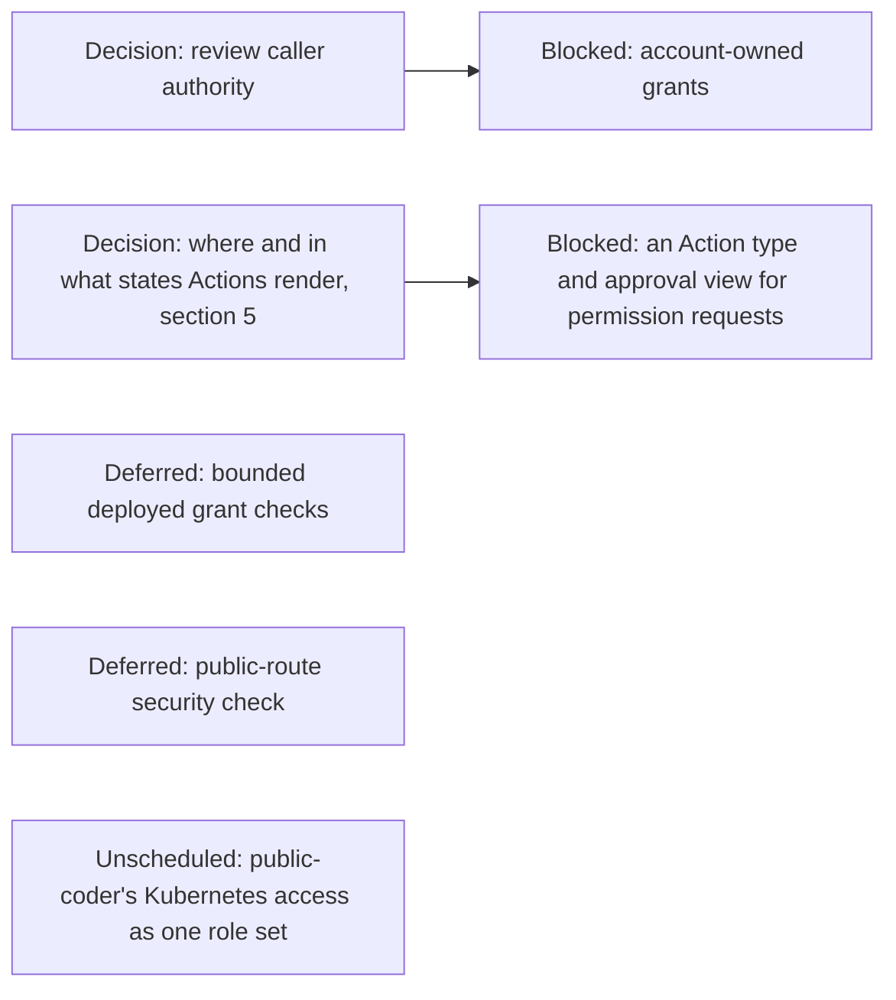

### `PC_KUBERNETES_POLICY_SET` — public-coder's Kubernetes access as one role set

**Unscheduled; operator, 2026-10-12 PDT: wants it eventually.** The grant and role-set reconciler landed in #15076. Move
public-coder-agent's whole set of RoleBindings and ClusterRoleBindings (logs, pods, node and
cluster-metadata reads, VolSync status and the rest, in `cluster/cdk8s/public_coder/app.py` and its
entries in `cluster/cdk8s/agent_access_profiles.py`) into one `KubernetesRoleSet` with a Flux-owned
`ServiceAccountGrant` on its ServiceAccount
([Policy Controller SPEC](../policy_controller/SPEC.md#serviceaccount-grants)).
A grant names a ServiceAccount only, so the grants that name the `haku:access-profile:public-coder`
Group either move to the agent's ServiceAccount or stay plain Flux RoleBindings.

### `CLAUDE_AI_SA` — review the external caller's actual authority

**Decision.** Review the claude.ai account's Connection and arbitrary-shell Sandbox privileges,
Kubernetes scope and egress/Action grants. Record intended authority in generated configuration,
not ad hoc grants. Test an allowed and denied operation; do not add privileges as part of this review.

### `AGENT_PERMISSION_REQUESTS` — an Action type and approval view for permission requests

**Blocked on `ACTION_SURFACES_DESIGN`; operator, 2026-10-13 PDT:
eventually.** A specific Action type for the request instead of the retired Kubernetes MCP grants
escape hatch, with an approval view that shows the operator the account, the sets and the duration
rather than a blob of Kubernetes YAML. It shares with the app's sandbox-page grants the one path
that writes a `PolicyBinding` for the operator (PolicyService grant, #14796), so an approved request creates
the same kind of binding. How the request renders is the Action surfaces' decision: the approval
view is one Action type described once there.

The operator also wants an agent to be able to request extra permissions without requiring a
per-Session ServiceAccount. Existing guidance uses an approved Kubernetes Action to create a
temporary PolicyBinding for the caller's current SA; approval, policy convergence and effective
access are distinct. A dedicated request should make the target SA, PolicySets, duration and shared
scope clear: every workload using that SA can acquire its grants. The same mechanism can grant an
existing EgressCredential through an egress PolicySet, including the shared GitHub bot credential.
Kubernetes access beyond the caller's own account is the identity plan's mechanism, decided
2026-11-05: an approved request creates an expiring `ServiceAccountGrant` on a shared account or a
`ManagedServiceAccount` owned by the identity, used through the proxy's impersonation source.

### `MANAGED_SA_RBAC` — grants for accounts without a Sandbox

**Blocked on the caller review** (the grant reconciler landed in #15076). The claude.ai caller's Kubernetes access
becomes a Flux-owned `ServiceAccountGrant` on its ServiceAccount, referencing the
`KubernetesRoleSet`s `CLAUDE_AI_SA` approves, replacing its remaining static per-namespace grants
in `agent_access_profiles.py` (`STATIC_GRANTS["claude-ai"]`; the acceptance-testing RBAC already
moved to a `PolicyBinding` in #10522). Its egress and Action rules stay a Flux-owned `PolicyBinding`.
Static Group subjects (Haku OIDC; public-coder until `PC_KUBERNETES_POLICY_SET`) stay Flux
RoleBindings. Test an allowed and a denied request. Static caller accounts' grants and bindings are
Flux-owned, never Sandbox-owned.

### `SANDBOX_RBAC` — bounded deployed grant checks

**Deferred by the operator; not dispatchable until selected.** Inspect the managed-Sandbox grant path as `PolicySet`s leave it
and verify intended versus unrelated scope, including Role edits and credential-use boundaries,
without recording credentials. Use [agent RBAC](../../cluster/docs/agent_rbac.md) and existing tests;
only unresolved deployed wiring needs a live check, not a repeat of every already-covered operation.
What no acceptance test covers yet, to check with the affected accounts' own credentials and not a production
account: two Sandboxes sharing a set and a third with a one-off grant, adding and removing a namespace in the
set, widening and narrowing a referenced Role, and revoking the one-off and the shared binding independently;
deleting a Sandbox, recreating a ServiceAccount of the same name and restarting the controller; and a grant
that fails partway, which shows in the binding's `KubernetesReady` condition while the rest still applies.

### `NOTIFICATION_INGRESS_BOUNDARY` — bounded public-route security check

**Deferred by the operator; not dispatchable until selected.** Existing tests
cover invalid signatures. Close the remaining route-wiring uncertainty with an unsigned webhook
request and a private-API request through the public hostname: both must be refused, without
creating subscriptions or inbox entries. Record the result once; no exhaustive provider matrix.

## 7. Our own Sandbox resource: Sessions that outlive their Pod

A Session and its history are durable. The operator's direction (2026-10-12 PDT):
the way a Session outlives its runner is our own Sandbox resource, which holds the state PVC and
stays in place with no Pod or VM scheduled. A Sandbox is its state, running or not; an
**incarnation** is one Pod or VM. Stopping, replacing the image and starting again keeps the
Sandbox, so keeping the state means keeping the Sandbox, and deleting the Sandbox is the only thing
that deletes it. The same resource carries the VM kind, so section 4's stateful VMs build on these
nodes instead of a parallel track. Today a Session lives as long as its `Sandbox`
(suspension removes the Pod and keeps the state PVC, which goes with the `Sandbox`). The History Service keys by Session, so it can record each incarnation, and a seal closes
an incarnation, not the Session.

A related direction (operator, 2026-10-11 PDT; later, not scheduled): Sessions living in a
long-running, often-suspended Sandbox whose runner image upgrades between incarnations.

```mermaid
flowchart TD
    DECLARATIVE_SESSIONS_DESIGN[Decision, unscheduled: Flux-managed Sessions and subscriptions]
    SUBSCRIPTION_AUTHORIZATION_DESIGN[Subscription authorization decision, section 2] -. related authority design .-> DECLARATIVE_SESSIONS_DESIGN
    STATE_VOLUME_BLOCK[Deferred: block storage for Pod and VM state and workspace]
    NODE_LOCAL_BLOCK_STORAGE[Unscheduled: node-local block volumes on every node]
    VOLUME_LAYOUT_CONVERSION[Unscheduled: explicit offline volume conversion, much later]
    SANDBOX_SPEC_EDIT[Unscheduled: edit a suspended Sandbox's template or kind]
    WORKSPACE_NODE_PORTABILITY[Unscheduled: move a workspace between nodes]
    SANDBOX_AUTODISKFUL[Decision, unscheduled: auto-diskful storage for Sandboxes]
    SANDBOX_ARCHIVE[Unscheduled: a suspended Sandbox archived to object storage]
    AGENT_RESUME_NOTICE[Unscheduled: tell agents when their Sandbox was suspended and resumed]
    ENVIRONMENT_READINESS_WAIT[Unscheduled: bounded CLI and Action/MCP readiness waits]
    AGENT_EXECUTOR_LOSS_NOTICE[Unscheduled: tell agents when executor restarts or kills lose their processes]
    RUNNER_BUSY_TRACKING -. related .-> AGENT_RESUME_NOTICE
    ENVIRONMENT_SUSPEND_MODES_DESIGN[Decision: distinct suspend modes, section 4] -. multi-mode notice .-> AGENT_RESUME_NOTICE
    RUNNER_BUSY_TRACKING[Unscheduled: the runner counts terminals and background processes as busy]
    SESSION_ACTIVITY_STREAM[Unscheduled: the notification service delivers on a Session's idle time]
    RESUME_CREDENTIALS_VALID[Decision: optional grants versus resume prerequisites]
    VOLUME_LAYOUT_CONVERSION -. future incompatible edits only .-> SANDBOX_SPEC_EDIT
    WORKSPACE_NODE_PORTABILITY -. related .-> SANDBOX_ARCHIVE
    VM_RAM_SUSPEND[Unscheduled: suspend a VM to disk with its RAM, section 4]
    DISPATCHER_HARNESS_CONFIRMATION[Decision: settle harness-confirmed inputs]
    DISPATCHER_SEND_AUTHORIZATION_GENERALIZE[Deferred: scoped sender grants beyond v0 service trust]
    STATE_VOLUME_BLOCK --> STATE_VOLUME_VIRTIOFS_RETIRE[Deferred: retire the superseded state attachment]
    IDLE_SUSPEND_UI_DRIVE[Operator: remaining VM idle-suspend/send-to-wake UI drive]
    VM_RAM_SUSPEND -. the same experience, resuming with memory kept .-> IDLE_SUSPEND_UI_DRIVE
```

### `DECLARATIVE_SESSIONS_DESIGN` — long-running Sessions and managed subscriptions through Flux

**Decision, unscheduled; operator idea, 2026-10-16 PDT.** Support a long-running Agentplane
Session declared through Flux, with managed subscriptions such as “keep this Session subscribed
to these GitHub notifications” or “keep it listening to a webhook at this URL.” Creation and
ongoing reconciliation must work without starting the Session from the UI or keeping the
integration app available. Long-running describes durable managed intent; decide separately
whether the harness stays running or suspends and wakes on authorized events.

The operator's current direction (2026-11-04) is to put Session existence and placement in the
Dispatcher first. A future `Session` CRD, potentially with declarative subscriptions, remains an
option, not a prerequisite or a second concurrent authority. If revisited, compare Kubernetes-owned
desired state reconciled into Dispatcher with an explicit reviewed replacement of that authority;
first inventory the current runner, Dispatcher, History and app responsibilities rather than
assuming one database owns every Session fact. Coordinate with the implemented Dispatcher Session
authority and `SESSION_AND_INBOX_LIFETIME` on identities, create/delete and recovery. Recommend evaluating Kubernetes-owned desired state with
existing services retaining execution/history and Notification Service retaining subscription/inbox
ownership. The operator must choose the resource boundaries and source of truth; no CRD or database
replacement is selected by this task.

Define stable identity and idempotent create/adopt/reconcile behavior, ownership of UI/API-created
Sessions, spec edits and drift, restart recovery, deletion/suspension and retention of authored
history. Specify how managed subscriptions are restored, updated and removed without duplication,
and whether a webhook URL means provisioning an authenticated inbound endpoint or subscribing to
an existing source. Reuse the subscription-authorization decision in section 2; declaring a resource
must not implicitly grant source access, destination control or wake authority. Identify any actual
implementation prerequisites after choosing the design, including wake policy if required.

**Exit:** reviewed desired-state/runtime ownership and lifecycle contract, one illustrative Flux
manifest for a Session with GitHub/webhook subscriptions, and independently finishable follow-up
nodes with focused reconciliation/restart, duplicate-prevention and authorization acceptance.
Recording this idea does not schedule implementation.

### `STATE_VOLUME_BLOCK` — block storage for Pod and VM state and workspace

**Deferred; operator, 2026-10-25 PDT: eventual endpoint, todos for later.** Both execution kinds
eventually use block-backed state and workspace storage, including replacing the VM state
virtiofs attachment. Select PVC modes and Pod mount/format ownership explicitly; preserve
journals, native harness homes, permissions, suspension and kind-compatibility checks. Virtio
remains the VM disk transport. This is independent of all-node local provisioning and does not
gate the selected VM workspace cutover. Details: [deferred endpoint](vm_block_storage.md#deferred-endpoint).

### `NODE_LOCAL_BLOCK_STORAGE` — node-local block volumes on every node

**Unscheduled; operator, 2026-10-13 PDT.** Extend capacity-enforcing node-local provisioning to
all cluster nodes, tracked by [#4717](https://github.com/agentydragon/ducktape/issues/4717).
`cluster/cdk8s/piraeus.py` defines strict-local SSD and HDD storage classes backed by node pools;
that does not establish usable capacity on every node or both volume modes. `local-path` does not
enforce PVC capacity. Verify capacity,
node affinity and both required volume modes. A node-local volume remains pinned to its node;
moving it is `WORKSPACE_NODE_PORTABILITY`. This provisioner work does not gate Sandbox ownership
or the explicit layout contract for workspace PVCs.

### `STATE_VOLUME_VIRTIOFS_RETIRE` — delete the superseded state attachment

**Deferred with `STATE_VOLUME_BLOCK`; revisit after its acceptance/activation and old workloads are gone.** Remove VM state
virtiofs mounts, guest ownership/UID workarounds used only by them, old template paths and tests/docs.
Keep unrelated virtiofs uses where live callers still need them. Verify Pod/VM state persistence on
the selected explicit layouts before retiring the path; data drops stay in a separate cutoff PR.

### `VOLUME_LAYOUT_CONVERSION` — explicit offline volume conversion

**Unscheduled, much later; operator, 2026-10-13 PDT.** The 2026-10-25 VM block-storage cutover
uses an accepted Sandbox reset and needs no converter. General conversion remains a future option,
not work for #10440 or a gate on its rollout. Until implemented, incompatible layout changes are
rejected. When scheduled, design a stopped-Sandbox operation with an explicit destination layout,
verified data/metadata preservation, crash-safe binding switch and separately authorized source
cleanup. See [storage layouts](../docs/sandbox_storage.md#formatting-and-conversion). Do not build
a generic conversion framework now.

### `SANDBOX_SPEC_EDIT` — edit a suspended Sandbox's template or kind

**Unscheduled; operator, 2026-10-13 PDT.** Let the operator change a Sandbox's template, including a
switch between VM and Pod, from the app, only while the Sandbox is suspended. Each incarnation
already reads the current template ([controller contract](../sandbox_controller/SPEC.md#vms)); no
spec is replaced automatically; this is the explicit, operator-driven edit. Use the deployed
[workspace layout contract](../docs/sandbox_storage.md) so a compatible kind switch keeps the
workspace. Validate the
retained state and workspace layouts before replacing a workload. Reject incompatible edits;
`VOLUME_LAYOUT_CONVERSION` is a separate, much later task and does not block compatible edits. The
preset the app records on a Sandbox as a label must stay true after the edit.

Control design: [ADR](../docs/adr_sandbox_session_control.md).

### `WORKSPACE_NODE_PORTABILITY` — move a workspace between nodes

**Unscheduled for remaining node-local workspaces; operator, 2026-10-13 PDT: even later.**
Fresh VM Sandboxes use [replicated Piraeus storage](../docs/vm_sandboxes.md#guest-and-storage). For other
node-local volumes, consider portability by copying through VolSync, object storage or directly
while the Sandbox is suspended. This broader copy-based path does not gate replicated VM storage.

### `SANDBOX_AUTODISKFUL` — consider auto-diskful storage for Sandboxes

**Decision, unscheduled; operator, 2026-10-26 PDT.** Evaluate replicated Piraeus auto-diskful
storage for Pod Sandboxes, covering both retained state and workspace volumes. Fresh VM Sandboxes
already use `piraeus-ssd-2-autodiskful`; Pod Sandboxes still use strict-local HDD claims.
On 2026-10-26, both volumes pinned `public-coder-ducktape-2` to `ovh-ns102453`, where memory
requests prevented resume until a stateless GitLab replica was moved elsewhere.

Compare keeping strict-local placement against auto-diskful attachment within the OVH zone;
recommend whether the scheduling flexibility justifies replication capacity and I/O costs.
Include runner filesystem requirements and preservation of existing retained data in the decision:
changing a template does not migrate existing PVCs. This is an evaluation, not an approved storage
cutover or a prerequisite for the separate copy-based portability task.

**Exit:** reviewed recommendation for Pod state and workspace storage, with any migration and
activation work recorded as follow-up nodes if selected.

### `SANDBOX_ARCHIVE` — a suspended Sandbox archived to object storage

**Unscheduled; operator, 2026-10-13 PDT: a thought that volsync suggests, not a plan.** Resource
affordances for a Sandbox that still exists but whose volumes sit in restic or S3, so it must be
rehydrated before it can start, freeing the node's disk meanwhile. Sandbox status would say that it
is archived and where, and resuming one rehydrates first. Related to `WORKSPACE_NODE_PORTABILITY`,
which shares the copy mechanism. Preserve the declared workspace layout and retained identity;
the runner's state PVC would archive the same way.

Control design: [ADR](../docs/adr_sandbox_session_control.md).

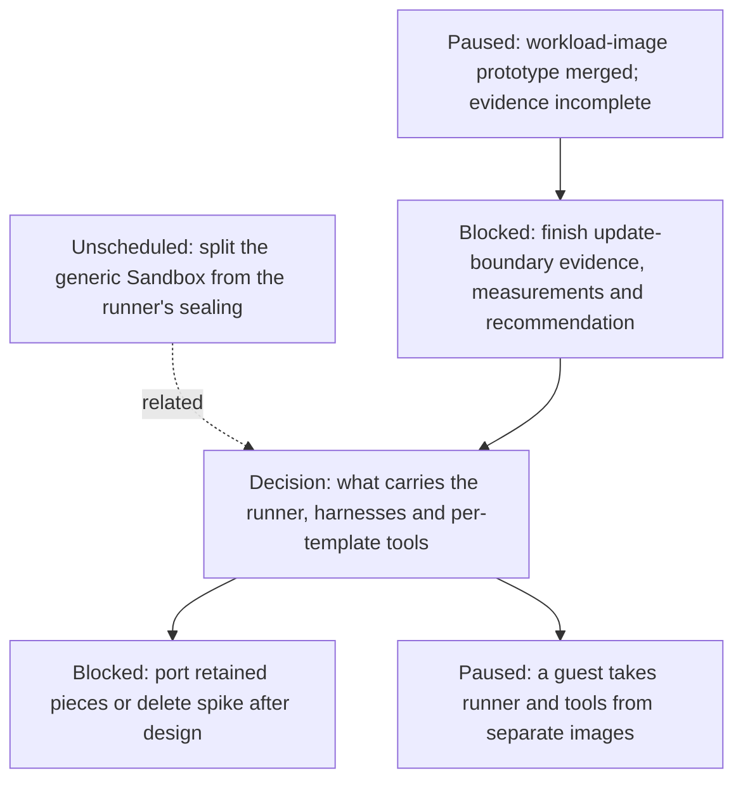

### `SANDBOX_GENERIC_SPLIT` — separate the generic Sandbox from the runner's sealing

**Unscheduled; operator, 2026-10-13 PDT: a later TODO.** Our `Sandbox` resource binds two concerns
together. One is what Agent Sandbox did, plus VM support: a template, a Pod or VM per incarnation,
and a state volume that stays. The other is specific to our runner running inside: sealing a
Session's journal before the incarnation goes. Separated,
the first could be reused without the runner. Decide where the line falls (resource, controller or package) and what each side owns. A
layered pair, a Sandbox and a runner that runs inside one, is the direction the control design
(`docs/adr_sandbox_session_control.md`) points to: seal, runner connectivity and idle suspension
are the runner-aware layer, and the Session Dispatcher sits outside both.

Control design: [ADR](../docs/adr_sandbox_session_control.md).

### `RUNNER_IMAGE_LAYERING_DESIGN` — what carries the runner, the harnesses and the tools

**Decision; operator, 2026-10-13 and 2026-10-15 PDT.** The 2026-10-15 framing names the property wanted: independent updates and RAM headroom. Today one artifact still carries the harnesses and tools:
`agentplane/env/images/container-disk.nix` bakes both harnesses and the tools into the NixOS qcow2 that
KubeVirt boots, and `agentplane/env/images/image.nix` bakes them into the Pod image. The environment
processes and `agentplane` command are packaged by the Bazel-built `//agentplane/env/images:disk_image`, a read-only disk
the VM attaches and an image the Pod mounts, so a runner bump no longer republishes either; bumping a
harness or a template's installed tools still rebuilds the whole artifact. Separate the concerns so a platform user supplies an image or definition with
no runner and no harnesses and the runner side layers them in, and nobody bumps build versions to move a
runner. State which of these the design must satisfy, in order:

- **Independent updates.** Runner and per-template tools move without rebuilding what they sit in.
- **The thing Pods genuinely cannot give** (operator, 2026-10-15): a workload may use a lot of RAM inside
  itself, as a Bazel build does, without starving the host node. A VM reserves its guest RAM, so what the
  guest does stays inside it; a Pod's burst is bounded by what the node has left. Say plainly whether
  layering is meant to reach for that property or whether it stays a VM-only one, because it decides how
  far to go.
- **Additive.** New runtime types are added beside the existing ones, not swapped in, so a runtime can be
  tried without retiring the one that works.

Related to `SANDBOX_GENERIC_SPLIT`: that separates the resource, this separates the image.

**Options worth costing, none chosen.** The operator named the first two; the rest are the field.

- **Extra read-only filesystem image per stage.** Attach the runner and the tools as their own images or
  disks; the base carries neither. Exactly the decoupling asked for, and Claude Code web already does it:
  on its Firecracker guest `/opt/claude-code` and `/opt/env-runner` are separate squashfs disks
  (`/dev/vdb`, `/dev/vdc`) mounted read-only beside a `/dev/vda` root —
  [web container spec](../../devinfra/claude/web_env/docs/container_spec.md).
- **Two-stage guest.** A lean stage 1 boots and runs the runner and mounts a stage 2 filesystem; the
  runner jails a forked child into stage 2 and execs Claude or Codex there. Runner lifetime becomes
  independent of the tool tree, at the cost of a pivot or chroot boundary and the work of trusting a
  mounted image.
- **Stay on KubeVirt, split the disks.** A `containerDisk` is already an OCI image carrying a disk, and
  `environment_vm.py` already attaches `config` and `trust` as separate volumes, so a three-disk guest (root /
  runner and harnesses / tools) needs no new mechanism — only the split. Halted image replacement already
  exists, which is the update path.
- **Kubernetes image volumes.** An `image` volume mounts an OCI image's filesystem into a Pod. The
  API server is v1.35.1, where `ImageVolume` is beta and on by default (GA in 1.36), and every node
  reports containerd 2.3.x. This is the direct answer to "this container should mount these 2 images",
  and beats an init-container copy on every incarnation. The runner already runs from such a mount in
  production Pods; whether the harnesses can is open.
- **Init container into a shared volume.** Today's portable form: copy the runner and harnesses from image
  X into an `emptyDir`. Works everywhere; pays copy time and disk each start.
- **Firecracker instead of KubeVirt.** The runtime the operator raised as acceptable if it helps: fast
  boot, small guest, squashfs-friendly, and the shape Claude Code web chose. The cost is a second VMM
  stack beside KubeVirt with no cluster scheduler for it. The RE under `devinfra/claude/web_env/re/` —
  including `process_api/src/firecracker_init.rs` — documents what that guest's init actually does and is
  the closest worked example we hold.

The disk split and Firecracker are not alternatives to each other: splitting disks is additive on the
runtime we have, and Firecracker is a new runtime added beside it.

The [Firecracker primitive spike](../debug/2026_11_02_firecracker_spike.md) has since landed in
#13957, and the opt-in environment backend in #14029; its
[contract](../docs/firecracker_sandboxes.md) and
[system-test scenario](../system_tests/scenarios/firecracker.py) define the checked same-Pod behavior.
It reuses the separate runner disk and preserves RAM within the same retained launcher Pod.
Cross-Pod recovery, native execution-session parking with durable terminal release, and staging
acceptance with Cilium enforcement remain separate work. KVM-enabled BuildBuddy execution on wyrm2 is tracked
in #14034. None of this selects a separate tools/harness disk layout.

### `RUNNER_LAYERING_SPIKE` — minimal guest, harness and tools-layer evidence

**Prototype merged (#10741, #10744, #10789); operator-requested 2026-10-16. The remaining compatibility
evidence is paused.** The merged experiment proves a Codex text turn, shell call through a separate Bash
tools OCI layer, native resume after killing the harness, runner survival and private-state separation
in the RBE test; a local Firecracker guest boots the digest-pinned ELF kernel and mounts separate
read-only tools and harness SquashFS drives. #10789 added `workload-tool` in its own OCI tar
layer and changed the mocked Codex shell call to run it before the harness exit, confirmed its
workspace write survives resume, then asked the resumed harness to execute the same workload tool.
The sparse-root scenario passed in RBE; the marker remained readable from the persistent workspace
after the harness was killed and resumed, and the resumed Codex process emitted the tool's output
again. Production VM layout selection and implementation remain open.
The guest's Bash and pinned Codex `--version` probes pass; the same probe records a Claude 2.1.252
SIGABRT in the uid-107 mount-namespace child, while the exact binary succeeds on the full host and
in the guest chroot as root without that namespace. The UID and namespace effects still need to be
separated. Measured artifacts are a 1.9 MB base initramfs, 7.2 MB tools SquashFS, and 168.9 MB
harness SquashFS (the source Bash OCI layer tar is 22.3 MB). A disposable K3s `v1.33.4+k3s1` Pod
with ImageVolume enabled was accepted by the API but containerd `v2.0.5-k3s2` failed container
spec creation (`failed to mkdir ""`), before Bash ran; no Pod image-volume execution is established.
This is evidence about that tested stack, not a universal claim about image volumes. Full coding
work, Nix-root compatibility, true cache-cold preparation and guest-only boot latency remain
unproven; no runtime upgrade or further experiment is currently assigned.

Candidate layout to carry into the design review: keep stage-one init and runner control outside the
tools root; mount the per-template tools image read-only; give the workspace and harness homes
explicit writable mounts, use tmpfs for `/tmp`, and provide only the required `/proc` and `/dev/null`
paths to the child. Reuse that filesystem contract in Pods by mounting the same tools image beside
the runner image, with workspace and persistent session state on separate volumes. The guest's
distinct mounts work in the local probe; the tested K3s runtime did not create a Pod with an image
volume, and Claude's child-context abort remains unexplained. Further intra-Sandbox hardening is
not required by the production contract.

The spike exits when those update boundaries and startup measurements are documented alongside a
bounded compatibility contract and a production DAG proposal. After the design decision, either
port only the accepted artifacts and tests to their production owners or remove the spike-only
package, kernel pin, and child fence; do not leave the experiment as an implicit supported runtime.

### `RUNNER_LAYERING_VM` — a guest takes the runner, harnesses and tools from separate images

**Paused (no worker since the runner disk landed, 2026-10-20); operator chose to split the disks on KubeVirt first (2026-10-20 PDT). The opt-in Firecracker backend landed in #14029; a runtime-class abstraction and whether harnesses become a separate disk stay open in `RUNNER_IMAGE_LAYERING_DESIGN`.**
Split the guest so a runner bump or a template's tool list does not rebuild and repush the whole VM. The
two-stage shape the operator named — lean stage 1 booting the runner and mounting a stage 2 filesystem,
with the runner jailing a forked child into stage 2 to exec Claude/Codex — is one option, with the
squashfs-disk and split-`containerDisk` shapes in the decision node beside it. KubeVirt is not assumed and
Firecracker stays open; what must not change is that the state volume and its ownership rules survive
(`STATE_VOLUME_BLOCK`, and the `107:107` virtiofs constraint). Halted containerDisk replacement already
works, so the update path exists. Landed: the environment processes and CLI are published as their own
`containerDisk` (`//agentplane/env/images:disk_image`), which the `environment-vm` template attaches as a
second read-only disk. The guest mounts it at `/run/agentplane/environment` and runs Environment Runtime
and the CLI from it, leaving the guest root disk without those binaries (a Sandbox on `agentplane-testing`
booted this way). Remaining: the tools disk is not split yet.
Preserve the shipped typed guest resource policy when splitting layers: stage 1 owns the OS
reserve and service caps, and native workloads and the executor keep their separate budgets.
Deliver a lean bootable guest: a bare root filesystem with the runner and harnesses available from
their chosen layer, and the tools-heavy environment separate. The layering decision still owns exact
disk placement. This work does not gate resource acceptance on the existing guest. The k3s test guest
(`agentplane/system_tests/vm/guest`)
shows a guest root filesystem can be an `oci_image` target: a candidate runtime then needs no Nix or Attic
and is an additive target rather than a second release pipeline.

### `IDLE_SUSPEND_UI_DRIVE` — finish the VM staging UI drive

**Partially accepted by the operator (2026-10-17 PDT); remaining VM drive belongs to the operator.**
The operator test-drove the five-minute idle suspension and message-to-wake successfully with Codex;
see [UI acceptance](../docs/runner_delivery_and_harness_design.md#rollout-and-rollback).
Do not repeat that accepted path as a rollout gate. The report does not identify a VM test.

The remaining check is the same experience through the staging web app with a VM Sandbox: idle
suspension, composer message, wake and delivery, and preservation of the expected context/workspace.
Record only observed gaps and what survived; VM-local disks and processes are lost on suspension,
while retained state/workspace volumes survive. No claim of a completed VM UI drive follows from
the automated Pod/VM lifecycle coverage.

Related: [lifecycle coverage](../system_tests/deployment/README.md#sandbox-lifecycle-coverage), and `VM_RAM_SUSPEND` for
resuming with memory retained.

### `AGENT_RESUME_NOTICE` — tell agents when their Environment was suspended and resumed

**Unscheduled; operator, 2026-10-13 PDT: it would be good.** Central sampler execution already
[reports verified incarnation changes](../central_sampler/SPEC.md#runtime-and-effects) when opening
a replacement exec-server session. Broader lifecycle notices should state the observed suspend mode,
duration, incarnation and what is known about processes, terminals, memory and workspace. Today's
cold-stop path can lose processes and terminals; a future memory-preserving VM suspend may retain
them. Do not claim either result without evidence. The `ENVIRONMENT_SUSPEND_MODES_DESIGN` review
owns the distinction and gates notices that support both modes, not a bounded notice for today's
cold-stop behavior. Account for `RUNNER_BUSY_TRACKING`, and distinguish a crash restart from an
intentional suspend. Choose the event/delivery owner and wording; test retained, lost and unknown
state as applicable to the implemented modes.

Related: [lifecycle coverage](../system_tests/deployment/README.md#sandbox-lifecycle-coverage).

### `ENVIRONMENT_READINESS_WAIT` — wait for environment readiness in client adapters

**Unscheduled; separate client follow-up.** The `EnvironmentService` watch reports current state but
does not wait for readiness. Add bounded wait behavior to CLI and Action/MCP adapters by consuming
`WatchEnvironment`; callers choose the timeout and receive a typed timeout, source-error or target
change outcome. Keep resume acceptance distinct from readiness and do not duplicate or extend the
server watch RPC. This follow-up does not block the shipped resume path.

### `AGENT_EXECUTOR_LOSS_NOTICE` — tell agents when executor restarts or kills lose their processes

**Unscheduled; operator, 2026-10-29 PDT: nice to have.** Notify affected agents when an executor
container/process restarts or an observed kill invalidates their commands, background jobs or
terminals, even if the Runner and Sandbox stay up. The Qwen CI collector thread
`68f0e6ea-d4cf-4dab-8d39-0aa479843c9a` lost processes across repeated executor-container OOMs while
its files survived; the model had to infer what happened from missing processes and transport errors.
Report the observed cause (OOM, restart, or unknown), scope and lost process handles, and what state
survived. Account for multiple Sessions sharing an executor. Choose the event/delivery owner and
deduplication semantics before implementation; do not replay uncertain commands automatically.
Exit evidence: a controlled executor restart or kill produces a notice for affected Sessions without
claiming a whole-Pod restart, lost files or a cause that was not observed. Related to
`AGENT_RESUME_NOTICE`, but not blocked on Sandbox suspend/resume work.

### `RUNNER_BUSY_TRACKING` — the runner counts terminals and background processes as busy

**Unscheduled; operator, 2026-10-14: not now, an open TODO that may be looked at later.** The runner
publishes `idle_since` (`EnvironmentRuntimeFacts`), busy while a delivery is under way, the bootstrap runs, any
Session has a turn, an unfinished command or a setup script, or an Execution connection is active.
An active Execution connection therefore blocks suspension, but detached processes and the VM
console do not have a general busy-lifetime contract. Decide which surviving background work and
attached terminals should block idle suspension and who reports them.
Test an attached terminal that detaches, a background process that outlives a turn, and a runner
restart. `AGENT_RESUME_NOTICE` tells the agent what a suspend ended.

### `SESSION_ACTIVITY_STREAM` — the notification service delivers on a Session's idle time

**Unscheduled.** The History Service folds `idle_since` into `SessionSummary` (the turn and harness
events that start and end idleness), and the app shows it. The notification service currently chooses
when to deliver from its existing quiet window and sends every notice through the Session Dispatcher.
What remains is a second listener: read the Session summary after each `WatchSessionSummaries` notice
and choose to deliver after a minute of idleness, at most ten minutes after the first pending entry.
`idle_since` is display and delivery timing: suspension reads the Sandbox Controller's current
Runtime busy facts and never this field. Per-Session idle times stay out of Kubernetes.

Control design: [ADR](../docs/adr_sandbox_session_control.md).

### `DISPATCHER_HARNESS_CONFIRMATION` — settle admitted inputs on a canonical confirmation

**Decision, then bounded implementation.** `HARNESS_CONFIRMED` currently has no writer. Review the canonical runner/history
fact that proves an input reached the harness, consume it idempotently and settle the matching
Dispatch without reading unrelated conversation content. Preserve the distinction between durable
queue acceptance, runner admission and harness confirmation. Test duplicate/replayed facts and
restart. Notification presentation/outcome design remains separate.

### `DISPATCHER_SEND_AUTHORIZATION_GENERALIZE` — replace v0 service trust with scoped sender grants

**Deferred TODO; v0 decision does not block delivery design.** Dispatcher may specifically trust the
App and Notification service identities to act for their users, with wake permission separately
allowlisted. Do not extend that exception to agents or other services, except the one the operator accepted on
2026-10-26: the [`orchestration_v1` group's executor](../action_service/orchestration_v1/README.md), which acts only on Action Decisions,
until `ORCHESTRATION_V1_BACKEND_GRANTS` gives each of its operations a caller grant. Design destination- and
operation-scoped grants, delegated caller proof and the effect of revocation on queued work before
general senders are admitted. Consider RBAC-backed permissions, but choose the authority with the
multiagent model; the operator prefers verb-over-target rules to shape-matched auto-approval and expects Session
commands to be RBAC-checked in the Runner Gateway (2026-10-27,
[orchestration ADR](../docs/adr_orchestration_v1.md#why-shape-matching-is-a-stopgap)). Include authorization before wake and any required execution-time recheck. The
resolved environment UID or placement-generation fence is part of `DELIVERY_DESTINATION_CONTRACT`, independent of sender policy.

### `RESUME_CREDENTIALS_VALID` — grants and tokens still valid after a long suspension

**Decision; the [credential audit](../debug/resume_credentials_valid.md) is published in merged #10573.** Are app-created runtime
`PolicyBinding`s optional additive capabilities, or prerequisites for useful resume? The current
app adds independent expiring grants; Sandbox resume does not renew them. Recommend preserving
that additive model: expiry and revocation remain authoritative, with no automatic re-grant.
If required grants are desired, first define their durable identity, missing/expired status and
explicit operator re-grant flow. The audit distinguishes controller-driven expiry from exact
post-deadline denial, and projected-token renewal from grant renewal. Add implementation work only
for a reviewed contract that the code does not already satisfy; do not add an implicit Ready gate.

## 8. Ownership and naming cleanup

Decisions and designs about what things are called and which service owns what. The decided
renames and ownership moves (`ACTION_BOX_RENAME`, `RUNNER_GATEWAY_RENAME`, `HISTORY_DATABASE_RENAME`) are dispatched from [Cleanups](#15-cleanups). Staging data follows
[staging data preservation](../docs/staging_data_preservation.md): Session identities and history
are irreplaceable, and a node that deletes a column or row stops for the operator.

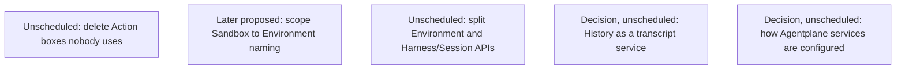

### `SANDBOX_ENVIRONMENT_RENAME_DESIGN` — review a scoped Sandbox-to-Environment rename

**Later proposed review; operator, 2026-11-01 UTC: probably rename Agentplane's execution-environment
domain from Sandbox to Environment once its model and boundaries settle.** This is exploratory; no
rename is selected. Start from the [Session/runtime model](session_runtime_model.md) and inventory
Agentplane-owned domain objects, public API/proto/CLI/UI/config names, Kubernetes resource names and
CRDs, storage and migrations, generated manifests, documentation and callers. The upstream
agent-sandbox `Sandbox` CRD remains separately owned. Action execution boxes keep their distinct
[`ACTION_BOX_RENAME`](#action_box_rename--action-boxes-stop-being-called-sandboxes) scope.

**Exit:** review a scoped vocabulary map and, if a rename is recommended, an ordered API/resource
and reference migration that preserves identities and stored data. Do not use a global text
replacement or implicitly rename upstream APIs/resources. No implementation or wire/CRD/storage
cutover is approved here; this proposal is independent of current authorization and reliability work.

### `ENVIRONMENT_RUNTIME_SERVICE_SPLIT` — separate environment and Harness/Session APIs

**Unscheduled.** Split the renamed public Environment Runtime API by
responsibility: environment identity, bootstrap, component discovery, health and environment lifecycle
actions belong to the Environment API; Harness/Session admission and operations belong to the
Harness/Session API. Plan for distinct public gRPC services, with names and method mapping selected in
the implementation design. Keep the Runtime-to-Host in-process lifecycle contract distinct. This split
does not decide whether the services use separate binaries or Deployments; that grouping remains
separate from API ownership. Update Gateway routing, authorization, tests, component specs and system
overviews with the split. Base the boundary on
[`session_runtime_model.md`](session_runtime_model.md#role-boundaries-and-routing).

### `HISTORY_SERVICE_RENAME` — History as a transcript service

**Decision, unscheduled (operator, 2026-10-20 04:05 UTC: "consider maybe").** Consider renaming the
History Service to a transcript service "or something like that", and history tags to transcript
tags with it ([tags](sandbox_tags.md#tags)). Deciding before `HISTORY_SANDBOX_RECORD` lands lets the
Sandbox field take its final name with no CRD rename. A service rename reaches its protos, token
audiences, images, the `agentplane/history_service` package and docs, and
[`HISTORY_DATABASE_RENAME`](#history_database_rename--name-the-database-for-its-owner) would take
the new name. **Name decided, operator, 2026-11-14 UTC:** the Journal service
([naming ADR](../docs/adr_journal_and_thread.md)); the rename itself stays unscheduled.

### `ACTION_BOX_IDLE_REAPER` — delete Action boxes nobody uses

**Unscheduled; operator, 2026-10-11 PDT.** A small controller deletes Action box Pods with no
`exec` for a configured time. The Action Service stamps a last-exec time on the box at each `exec`;
a plain Pod delete is enough, since boxes have no seal. It takes over `TODO(sandbox-lifetime)` in
`action_service/sandbox/inventory.go`; the closed draft [#7859](https://github.com/agentydragon/ducktape/pull/7859)
expired agent-sandbox boxes the same way. It also revokes a box's `WorkloadCredential` whose bound
Pod no longer exists, so a Pod deleted outside `dispose` or garbage collection leaves no resolvable
record. It also collects the boxes whose caller Identity is gone: they outlive the Identity with their
credentials revoked, and no caller can dispose of them since their old Identity cannot authenticate.
Boxes and Sandboxes are to converge into one object type
([`SANDBOX_BOX_CONVERGENCE`](task_freezer.md#sandbox_box_convergence--sandboxes-and-action-boxes-as-one-object-type)).

### `SERVICE_SETTINGS_RETHINK` — how Agentplane services are configured

**Decision, then changes; unscheduled (operator, 2026-10-20 UTC: keep the egress sidecar on YAML "for now" and
"leave a to-do to rethink how the configuration of this whole thing should work").** The app and Action Service
read required YAML files with strict `yaml.v3` and `mapstructure` decoding; other services retain their existing
file and runtime-input contracts, and the egress sidecar reads one strict `yaml.v3` file. Each service's Python
`Settings` schema renders its static settings. The operator asked whether services need both files and environment
variables ("Do we need both files and env vars", 2026-10-20 UTC). A generic environment layer would need to account
for Viper's lowercasing of map keys, which requires list-shaped audience and route maps for the sidecar. Settle the
approach for all services first; changes follow as their own nodes.

## 9. Legacy burn-down

Folded into [Cleanups](#15-cleanups) on 2026-11-10; the number stays so later sections keep their
anchors.

## 10. Runner ingress and control split

The runner pushes its journal's Events to the History ingress. For control, the Runner Gateway dials
the runner's private gRPC listener; the two routes are independent. Contract:
[runner control § Event ingress](../docs/runner_control.md#event-ingress).

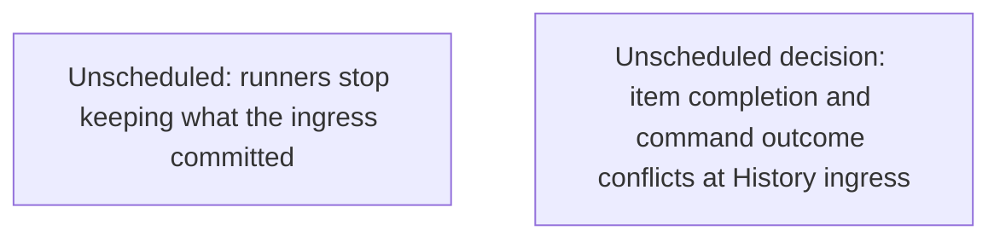

### `RUNNER_JOURNAL_TRIM` — runners stop keeping what the ingress committed

**Unscheduled; the operator's direction, 2026-10-12 PDT: later.** A runner could stop persisting
journal entries its ingress has already acknowledged, behind a flag, with full persistence kept
selectable; the freezer's
[`RUNNER_JOURNAL_SETTLEMENT`](task_freezer.md#runner_journal_settlement--settle-deltas-in-the-runner-journal-too) is the same idea at the delta level. Not designed: what the runner still needs locally (cursors, seal state, entries a
resumed harness or a lost push reads back) once acknowledged entries are gone, including what a revived incarnation reads back
(the retained incarnation history).

### `HISTORY_INGRESS_OUTCOME_DESIGN` — item completion and command outcome invariants at History ingress

**Decision, unscheduled; operator direction, 2026-11-10.** The incident's
`HarnessUserMessageConfirmed` and later `CommandFailed` name the same command. The
[Thread fold](../history_service/internal/threadfold/fold.go) narrowly tolerates that sequence for a
`SubmitInput` only when the failure reason is `session blocked by unresolved effects`; other
contradictory settlements still fail the fold. The [History append](../history_service/internal/storage/store.go)
accepts exact cursor replays and commits new cursor-valid entries without checking command outcomes,
so other contradictions can remain in raw history while that Session's Thread projection stalls.
Consider whether ingress should enforce one-time settlement invariants, and whether item completion
and command outcome need different rules; rejection is an option to review, not a selected protocol
policy.

Alternatives include refusing a contradictory outcome before commit, retaining every raw event and
folding the conflict into a visible anomaly while continuing the projection, or leaving ingress
permissive and requiring explicit recovery for an unfoldable projection. Recommendation: design item
and command rules separately, preserve raw evidence and per-Session availability, and require a
runner recovery path before selecting ingress rejection. The journal is append-only and cursor
ordered, so refusal can strand that cursor and prevent later entries, including later input
confirmation, from reaching History.

**Review question:** which repeated outcomes are exact replay versus contradiction, what item and
command transitions are valid, and where should a conflict be handled? Design the check across one
batch, earlier committed pages and concurrent Push calls; specify how existing malformed histories
remain readable and how their projections recover. **Exit:** an operator-reviewed contract with
concrete item and command examples, atomicity and concurrency boundaries, raw-history retention and
projection recovery, and a bounded runner recovery path for any rejected record. Add an
implementation node only if the decision selects a protocol change.

## 11. History reads and follows

The History Service's [`FollowSession`](../history_service/README.md#read-and-follow-one-session)
reads raw entries from a cursor, the tail or a number of matching observations back, with a kind
filter and optional live follow. The browser follows Threads through Electric
([thread sync](thread_sync/README.md)). Remaining consumers and decisions:

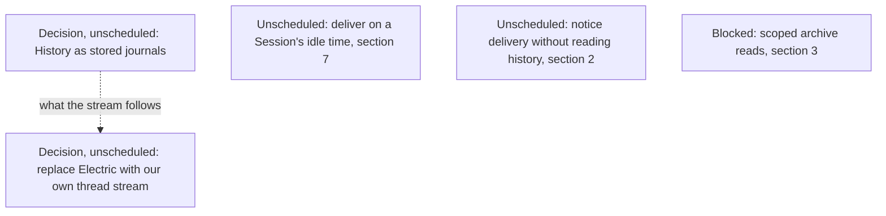

[`history_read_follow.md`](history_read_follow.md) records how orchestration builds on the API and
which other consumers may move to it. Automatic titles remain deferred under
[`THREAD_TITLE_GENERATION`](task_freezer.md#thread_title_generation--revisit-automatic-thread-titles).

### `JOURNAL_REPRESENTATION_DESIGN` — History as stored journals

**Decision, unscheduled; operator, 2026-11-14 UTC:** "journals" sounds like where History should
eventually go. Vocabulary is decided ([ADR](../docs/adr_journal_and_thread.md)): a Journal is what a
harness or process emits, and a Thread is the messaging object agents and people act on
([`AGENT_AUTHORED_CONVERSATIONS_DESIGN`](#agent_authored_conversations_design--conversations-agents-act-on-through-tools)).

Two separate problems:

- **Size.** On staging the projection tables (about 1.3 GB) outweigh the raw events (about 1.0 GB),
  and packed blocks and sampler capture keep several copies
  ([storage representations](storage_representations.md)). Removing redundant sampler response
  capture holds either way; sharing bodies between events and the projection waits on this node.
- **Coercion.** The fold approximates Claude Code, Codex, sampler and process formats in one
  materialized entity model instead of rendering each source on read.

**Recommendation:** History stores each source's Journal verbatim with its kind; the app renders a
journal view per kind at read time; the common surface keeps only what every source has (inputs,
turn boundaries, status, usage). **Question for review:** retire the fold and its tables for
per-kind rendering on read, and with what common surface?

### `THREAD_SYNC_WITHOUT_ELECTRIC` — replace Electric with our own thread stream

**Decision, unscheduled; operator, 2026-11-14 UTC:** dropping Electric and doing the sync ourselves
"might be better", "to be looked into"; it costs a separate container.

Electric replicates two History tables, `thread_entity` and `thread_payload_chunk`, per Thread and
projection epoch, through the app's authorizing [proxy](../app/internal/proxy/electric.go), for
the thread view alone ([`electric_sync.tsx`](../app/frontend/threads/electric_sync.tsx)). Every
other live browser view already follows gRPC watches through the app facade
([`watch_stream.ts`](../app/frontend/watch_stream.ts)). Its costs are:

- a single-replica `Recreate` Deployment with a 5 GiB `emptyDir` ([exception](../docs/electric_single_replica.md));
- a logical replication slot on the History database;
- the mismatches in [Electric limits](../docs/thread_sync_electric_limits.md): every follower gets
  the shape's whole live log, deltas exist only as committed rows, and compaction is re-sent to
  followers.

[Thread sync](thread_sync/README.md) already scores replacements; the moving window meets every
requirement row where Electric is short.

Coupled to [`JOURNAL_REPRESENTATION_DESIGN`](#journal_representation_design--history-as-stored-journals): if History becomes harness journal storage rendered per kind,
the synced fold tables, and Electric's job, go away, and the stream should follow journal records
instead of fold rows.

**Recommendation:** replace Electric with a History server stream reached through the existing app
watch facade, and build it once against whichever History representation is chosen rather than
first over the fold tables. **Question for review:** build the replacement now over the fold, or
after the History representation decision, over journal records?

## 12. The Runner Gateway serves the runner's own service

The Gateway proxies the runner's `Runner` service with per-method authorization; commands use
Dispatcher and typed Runner RPCs. The Sandbox Controller's authenticated passive watch binds the
Runtime workload UID before it publishes facts. The receiver contract permits any authenticated
Gateway replica to call with the bound Sandbox/incarnation/boot identity and an absent or zero
epoch; legacy nonzero call and watch epochs remain temporarily supported for that same UID. The
[runtime state observation plan](runtime_state_observation.md) records the contract and rollout.
The direct Controller reader and Lease-fact removal landed in #16324 and #16328; the receiver
binding and independent-watch compatibility landed in #16345. The remaining work is staged: pin and
validate the receiver before the independent-connection Gateway image, route caller defaults only
after that image is pinned, then remove the old route records after all callers have moved.

The [service-boundary contract](../docs/service_boundaries.md) and [Runner Gateway README](../runner_gateway/README.md)
describe the current proxy. Live `Runner.ListSessions` remains part of the app and Notification
service caller contract. The separate destination-authority decision
`DELIVERY_DESTINATION_AUTHORITY_DESIGN` (section 13) remains open.

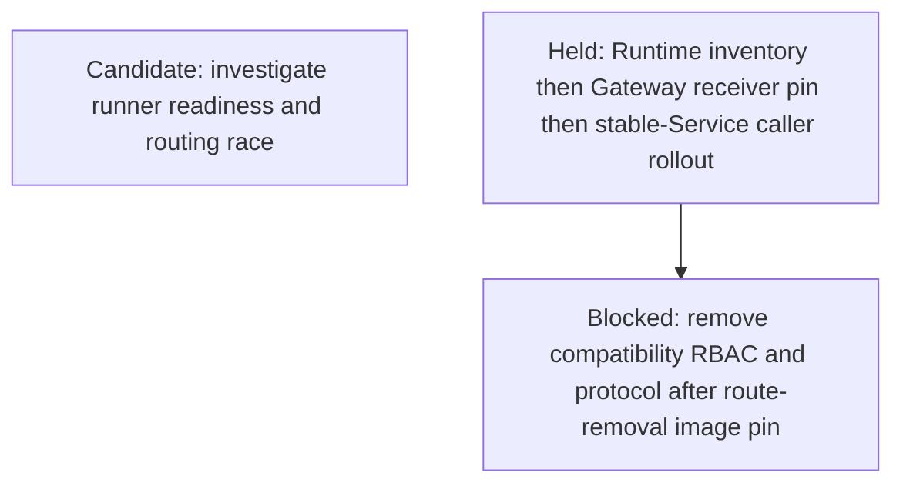

### `RUNNER_OBSERVATION_READINESS_RACE` — resolve intermittent runner readiness diagnostics

**Candidate; operator follow-up to the observed failure, 2026-11-07 UTC.** The
[Session deletion system test](../system_tests/scenarios/session_deletion.py) recreated a Sandbox
with the same name and a new UID, then `ListSessions` returned `UNAVAILABLE: another replica holds
this Sandbox's runner connection` in a fixture with only one Gateway replica
([failed invocation](https://app.buildbuddy.io/invocation/737afbc2-7595-5be8-b789-93b6c0a49c74)).
An [isolated rerun](https://app.buildbuddy.io/invocation/5075b621-94f6-4746-a991-131280be6ec8)
passed; this establishes intermittent behavior, not its cause. PR #14818 deterministically reproduced
the same `UNAVAILABLE` symptom by pausing after the first ready Lease update, then closed the
publication-before-local-installation window by installing the fenced connection first. This proves
that ordering could cause the symptom, but does not prove it caused the original same-name-replacement
failure. Readiness remains a recent observation and cannot guarantee a later call after connection
loss. The Gateway error now reports local connection availability unless Lease ownership is known.

If the system-test failure recurs, capture the Sandbox UID, runner incarnation and boot ID, Gateway
replica, Lease epoch and holder, EndpointSlice route, and local connection state at the failed poll.
PR #14851 adds a bounded retry for transient `UNAVAILABLE` in the test's read-only `ListSessions`
poll. This handles the test poll only; it does not establish that the publication race caused the
original same-name-replacement failure or prove the underlying failure is fixed. Do not retry
mutations with uncertain outcomes. Keep this investigation separate from the selected replica-ownership
contract and its follow-on implementation below.
**Exit:** either capture evidence that distinguishes the remaining failure boundary if the failure
recurs, or close the incident follow-up if ordinary use shows no recurrence. Preserve UID/incarnation/boot fencing and stale-call denial.

### `RUNNER_GATEWAY_CUTOVER_ROLLOUT` — operational holds for the prepared cutover

**In flight, 2026-11-14: independent Gateway observers, stable-Service caller routing, then route
publication removal are prepared as separate PRs in this batch.** The #16345 Runtime receiver is
included in runner-disk `devel-20261114071615-9e1f8fe` on fresh devel; live Runtime provenance still needs operator
verification before zero-epoch Gateway deployment. The [rollout plan](runtime_state_observation.md#migration-and-rollback)
lists backend-specific inventory evidence. Firecracker suspend/resume preserves its Runtime
process and cannot upgrade an older receiver; a retained old checkpoint keeps this gate closed
until the operator selects a state-preserving path.

Pin the independent-observer Gateway image before changing caller target settings. Keep legacy
Lease/epoch/EndpointSlice publication for old callers until every caller process uses the stable
Service; then deploy route-publication removal. No Runtime-dials-Gateway or legacy-wire fallback
is added. Preserve Sandbox/incarnation/boot fencing, per-method authorization, retained work and
History, and uncertain outcomes without replay. Exit: all three rollout gates verified, required
bootstrap/idle/quiesce k3s suites and deterministic two-replica/stale-call checks pass. These are
operational holds for this batch, not additional implementation tasks.

### `RUNNER_CONNECTION_LEASE_CLEANUP` — remove final connection-Lease compatibility

**Blocked on `RUNNER_GATEWAY_CUTOVER_ROLLOUT` and the route-removal Gateway/Controller image pins.**
In a later PR, remove obsolete Lease/EndpointSlice/control-Service permissions and legacy epoch
fields/tolerance after no deployed image or supported rollback needs them. Keep Controller leader
election and Dispatcher delivery Lease permissions. Exit: obsolete permissions and Runtime epoch
compatibility are gone.

## Scope and retirement of stale gates

- Notifications keep workers in the HTTP service. Retention, worker extraction, idle-polling
  optimization and new-source wiring are frozen with triggers, not hidden release prerequisites.
- Broad provider-matrix exploration is frozen; ordinary auth/signature denial regression coverage
  belongs with the implementation, not an unbounded production checklist.
- Native subsessions and runner durability/thin-adapter redesign remain frozen. Neither the runner
  channel nor multiagent design unfreezes the broader runner-state redesign.
- Existing security boundaries, data-preserving migration checks and representative deployment
  integration checks remain requirements. The freezer is not a waiver for a known data-loss or
  unauthorized-access bug; promote one when evidence makes it concrete.

## 13. Delivery boundaries, APIs and harness identity

This section holds the unfinished delivery-acceptance cleanup, destination and harness-identity design and
implementation, and API and test-tier work.
Decision nodes do not authorize runtime changes. Detailed code paths and alternatives are in the
[delivery and harness design note](../docs/runner_delivery_and_harness_design.md).

**Approved transport direction (operator, 2026-10-15 UTC):** gRPC for internal APIs,
gRPC-Gateway for the generated HTTP/JSON facade, and an ergonomic CLI, adopted incrementally by
service and interface. Use JSON server streams for watches/waits and native gRPC for full duplex.
Individual service migrations and the CLI rollout remain separate work items below, and the
HTTP/JSON facade is built per service inside each migration; this direction authorizes no runtime change
beyond the transport track nodes the operator dispatched.

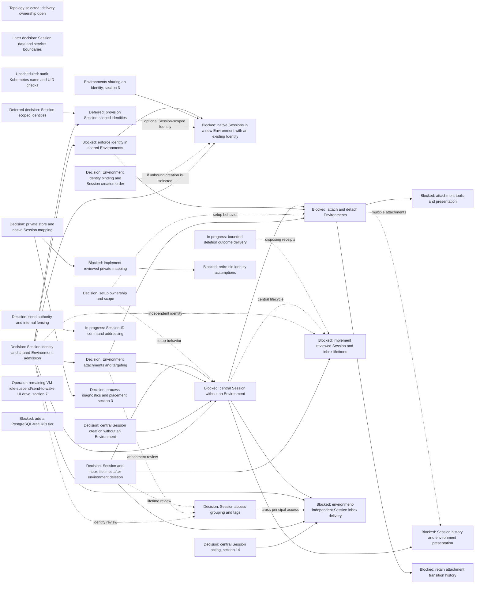

### `DISPATCHER_PERSISTENCE_MODEL_DESIGN` — choose delivery ownership and service topology

**Decision; queue and database direction selected by operator, 2026-11-02.** Dispatcher
PostgreSQL and queue-backed admission remain mandatory; the database-free / queue-off mode is no
longer a candidate. This does not require every Environment Service operation to enter the queue.
Whether to offer an explicit immediate-or-fail send within the mandatory queue contract remains open.
See the [Session/environment model](session_environment_model.md#where-should-live-control-live).

**Topology selected (operator, 2026-11-14 05:29 UTC, card "Adopt it"):** two binaries, Sessions
and Environments; the Runner Gateway disappears ([section 17](#17-two-binaries-and-the-go-layout)).
Still open for that topology, before changing existing guarantees: delivery ownership, fencing,
replica failure, ordering and recovery in the Sessions binary, including what replaces the
Dispatcher's per-Sandbox ownership Lease (`dispatcher/ownership.go`), the last Kubernetes Lease in
delivery once section 12 lands.
The former [Dispatcher/Gateway merge proposal](https://github.com/agentydragon/ducktape/blob/7e22be0335/agentplane/plans/dispatcher_gateway_merge.md) is historical for its
queue-off and holder-owned-delivery choices, not an implementation authorization. Independent
Runtime restructuring does not wait for this decision.
`DELIVERY_DESTINATION_AUTHORITY_DESIGN` remains independent.

### `SESSION_DATA_OWNERSHIP_DESIGN` — review Session data, services and databases

**Later design decision; operator requested review, 2026-11-04.** Agentplane now owns globally
addressed Session records, and Session-keyed data is spread across Dispatcher Sessions and commands,
History ingress and projections, Notification inboxes, central sampler state, and environment-local
Runtime records and journals. Inventory each fact, its authoritative writer, readers, lifetime and
recovery boundary; include the command and ingress ends separately.

Compare retaining modular services and stores, moving selected Session state from Environment
Runtime to Dispatcher or another Session owner, using one database with linked Session-keyed tables,
and other service/database groupings. Distinguish a shared PostgreSQL database from a shared service,
write ownership and transaction boundaries; none follows automatically from a common Session UUID.
The existing decision to use Dispatcher PostgreSQL and keep History separate remains the working
implementation direction until explicitly reconsidered. Evaluate isolation, availability, scale,
authorization, schema migrations, native continuation and lost/uncertain effects in each option.

Coordinate with `SESSION_AND_INBOX_LIFETIME` on the candidate independent Session create/delete
lifecycle and the treatment of inbox, History and other Session data. A shared database alone does
not settle deletion or justify deleting authored data. Do not treat this later review as a
prerequisite for unrelated safe native-first work. See the
[Session data review](session_environment_model.md#session-keyed-data-and-storage-boundaries).

**Exit:** an evidence-backed inventory and comparison, a reviewed ownership and database direction,
and appropriately scoped follow-up work. This node authorizes no service move or data migration.

### `KUBERNETES_UID_CHECK_AUDIT` — audit Kubernetes names and exact-object checks

**Unscheduled review; operator, 2026-11-04.** Inventory Agentplane checks and stored references
that require a Kubernetes object UID or reject a same-name replacement. Kubernetes RoleBindings
grant ServiceAccounts by namespace and name, and Flux similarly uses names for ordinary resource
references; an exact-object check does not automatically improve that authorization boundary.
Trace representative checks end to end across SA principals, policy and RBAC, Session/History
ownership, delegated callers, Environment/Pod/VM identity, controller ownership and deletion.

For each check state its intended identity, actual authority and replacement behavior, what breaks
if it changes, and whether Kubernetes or another enforcement point can enforce the same distinction.
Compare stable name-based references with exact-object checks backed by a concrete need: token and
caller authentication, stale-work or Environment-incarnation fences, owner/deletion preconditions,
and historical attribution. Include the consequences of SA and role-binding recreation, who may
create Pods or issue tokens under an SA, and revocation/convergence windows. Consider whether a
check is redundant, mismatched with name-based RBAC, or an essential guard; do not presume either
that UIDs are always safer or that all references should follow names.

**Exit:** a source-linked inventory with specific keep/change recommendations and independently
reviewable follow-up slices. For each chosen behavior, explain why its name or UID semantics are
correct for the real authority and lifecycle, what failure or replacement case they protect, and
why the plausible alternative is unnecessary or insufficient; identify tradeoffs and uncertainty.
Preserve current checks until their replacement contract and migration are reviewed. This audit does
not block the focused Session identity work or authorize a blanket security change.

### `SESSION_IDENTITY_CONTRACT` — Session identity and shared-Environment admission

**Decision; the identity is an Agentplane `Identity` (operator, 2026-11-05 and 2026-11-10).** A
Session's principal is one `Identity`, reached by the
[three credential forms](identity_and_kubernetes_accounts.md#target-one-identity-three-credential-forms);
a ServiceAccount is only an account an Identity may act as toward the Kubernetes API. Session
execution uses its recorded Identity; retain exact workload-incarnation and Environment fencing,
but do not reintroduce a ServiceAccount-keyed Session principal. The broader decisions below remain
open within the Identity model:

- **Name and incarnation.** The durable principal is the Identity's namespace and name; many
  Sessions may share one. A same-name replacement is the same named principal but a different
  incarnation: retain and verify Identity UIDs for authentication, attribution and fencing stale
  in-flight work, and never let a replacement inherit an accepted operation's fence or an old
  incarnation's `WorkloadCredential`.
- **Who may act as it.** Who may create a Session naming an Identity, bind it to an Environment,
  grant it PolicySets, and have the central sampler act for it (`CENTRAL_SESSION_ACTING_DESIGN`);
  who may change or revoke that. An Identity reference is not a credential or authority. The trust
  boundary includes who may create or recreate the Identity, write a `WorkloadCredential` naming it
  ([who writes](../docs/workload_authentication.md#workloadcredentials)) and bind policy to it; a UID pin in
  Dispatcher alone cannot override name-keyed bindings.
- **Existing and Session-scoped identities.** A Session may name an authorized existing Identity,
  including its Environment's; it never deletes, or implicitly grants to, one it did not create. A
  fresh Identity for a single Session is wanted (operator, 2026-11-10); its provisioning is
  `SESSION_IDENTITY_PROVISIONING_DESIGN`. Preserve the web's preset and editable PolicySet workflow
  where it creates an Environment or an explicit grant, showing when the Identity is shared; presets
  convey no authority.
- **Lifetime.** The Session's Identity is independent of Environment lifetime
  ([identity lifetime](identity_and_kubernetes_accounts.md#identity-lifetime)). Decide how
  intentional revocation differs from deletion, and whether a managed Identity is reconciled back
  into existence; deletion alone does not durably revoke a declaratively managed one.

**Required shared-Environment invariant:** Sessions using the same Environment must have the same
verified Identity. An Environment is a shared trust domain: co-resident agents can communicate and
use its ambient egress and placeholder credentials, so different Session IDs, directories or
narrower nominal grants do not isolate them. The Environment's Identity is the subject its current
incarnation's `WorkloadCredential` names, proven by its SVID; reject a Session of another Identity
on native placement and central attachment
([changing an environment's identity](identity_and_kubernetes_accounts.md#changing-an-environments-identity)).
Names identify the intended principal, not proof: authenticate the SVID, authorize the caller, fence
the actual incarnations and prevent check/admit races. An Environment's Identity changes only while
nothing runs and no Session of another Identity is placed on or attached to it; accepted work is
never silently reassigned. If the Identity disappears, identity-dependent operations fail closed
until it exists and is authorized again; a same-name replacement acts as the named principal, not
as the old incarnation. Operator-only access to a Session whose Identity is gone stays distinct from
a live Identity whose Session has no Environment.

**Rebind boundary to review:** #15445 serializes an `EnvironmentService` identity change with
Dispatcher Session admission, but a direct Kubernetes `Sandbox.spec.identity` edit bypasses that
guard. Delivery and wake reject a mismatch, which can strand an existing Session. The service
rechecks the chosen Identity's UID before patching a name-only reference; deletion and same-name
recreation after that read can make the patch name the replacement. Decide whether those outcomes
are acceptable under the existing name-based and fail-closed contract or whether direct writers and
replacement need a stronger coordination boundary. Recommendation: retain that contract until the
tradeoff is reviewed, rather than silently choosing UID-bound Sandbox references. Cover bypass,
replacement between the final read and patch, accepted work and recovery in
`SESSION_IDENTITY_ENFORCEMENT`; do not assume a Kubernetes/PostgreSQL transaction.

**Exit:** reviewed examples for a central Session with zero Environments naming an existing
Identity, two same-Identity Sessions sharing an Environment, a permission request for that Identity,
and rejection of a different Identity, covering creation, placement, delegation, cleanup and denial;
plus where a Session-scoped Identity fits, without choosing its provisioning.

### `ENVIRONMENT_IDENTITY_BINDING_DESIGN` — Environment Identity binding and Session creation order

**Decision; binding before start is the mechanism, the creation order is open.** An environment may
be created unbound and bound before it starts: `Sandbox.spec.identity` changes only while nothing
runs, and the next start gets a fresh `WorkloadCredential`
([changing an environment's identity](identity_and_kubernetes_accounts.md#changing-an-environments-identity);
the field, admission rule and controller Identity switch have landed).
Native Session placement names an existing exact Environment UID, and central V1 a fixed executor
Environment; reusing an existing Environment's Identity needs nothing below. Decide the sequence for
a Session that brings its Identity, existing or Session-scoped
(`SESSION_IDENTITY_PROVISIONING_DESIGN`), to a new Environment: create the Identity and grant first,
then create or bind the Environment and start, or persist a separate Session reservation before
binding it. The launch sequence for an Identity-bound Sandbox is already settled in the
[identity plan](identity_and_kubernetes_accounts.md#open-questions-and-tricky-bits); this node
covers native Session placement and recovery. Preserve
exact Environment UID and Identity incarnation, authorization, conflict handling, idempotency and
recovery of partial creation. Decide who may bind an unbound Environment and what happens to
abandoned, failed, deleted or concurrently claimed ones. No workload starts while a binding is
pending (`IdentityMissing`), and none with a default or unverified identity.

SVID mTLS authenticates both Environment Runtime control and Sandbox egress through the
incarnation's `WorkloadCredential`, so binding before start keeps one scheme and a running
incarnation never changes identity. Coordinate with `ENVIRONMENT_SHARED_IDENTITY`,
`SESSION_MANAGED_IDENTITY`, `SESSION_IDENTITY_ENFORCEMENT` and `SESSION_ATTACHMENT_CONTRACT`;
central zero-Environment creation need not wait for this native flow.

**Exit:** a reviewed creation and recovery sequence covering new and already-bound Environments,
existing and Session-scoped Identities, authorized concurrent claims, Identity replacement and
partial failure.

### `SESSION_IDENTITY_PROVISIONING_DESIGN` — Session-scoped identities

**Deferred decision; wanted, design not selected (operator, 2026-11-10).** From the app a user can
ask for a Session with a fresh `Identity` used only by it. Decide:

- **Creator.** Dispatcher at `CreateSession`, the app at launch, or the app's path collapsed into
  Dispatcher's ([open questions 7 and 11](identity_and_kubernetes_accounts.md#open-questions-and-tricky-bits)).
- **Lifetime and cleanup.** Whether the Identity is deleted with its Session (explicit Session
  deletion does not exist yet), retired with it, or kept while an Environment or Connection still
  names it; how a leaked one is found (the app's unreferenced filter) and removed; what a retained
  Session's History shows once it is gone.
- **Policy.** Where the launch PolicySets and later grants bind, owned by the Identity so they go
  with it.
- **Kubernetes account.** None by default: an Identity reaches the Kubernetes API only through an
  account a use rule names. Decide whether a Session-scoped Identity uses shared accounts, gets a
  temporary managed account on approval, or needs neither. Agentplane calls need no Kubernetes
  object: egress and services authenticate the SVID's Identity, and the sampler acts for a central
  Session under Dispatcher's Session-to-Identity binding (`CENTRAL_SESSION_ACTING_DESIGN`).
- **Scale.** The operator expects fewer than 10,000 Sessions in existence; one Identity and
  `PolicyBinding` each is a working assumption, not a measured limit. Measure object counts before
  claiming a control-plane cost.

Materialize no credential or policy an operation does not need, while preserving unattended work
and predictable readiness. Define creation/deletion races, recreation, intentional revocation, stale
bindings, retained audit identity and unknown outcomes.

**Exit:** a reviewed creator and lifetime policy with examples for a central Session and a native
Environment, covering authorization, failure and retry, and cleanup. It gates
`SESSION_MANAGED_IDENTITY`, not unrelated native work.

### `SESSION_MANAGED_IDENTITY` — provision Session-scoped identities

**Deferred; not required for Session/Environment separation or permission requests.** After
`SESSION_IDENTITY_CONTRACT` and `SESSION_IDENTITY_PROVISIONING_DESIGN`,
have the chosen owner durably reconcile a Session-scoped `Identity` and its owned `PolicyBinding`,
including the web preset and editable PolicySet workflow, and stamp the origin marker
`APP_IDENTITIES_UI` reads. Keep the existing-Identity path without taking ownership or adding grants.
Persist the exact Identity, desired policy and provisioning progress, and recover retries and
uncertain outcomes without adopting foreign objects or reusing an old incarnation's evidence. Do not
rely on a Kubernetes ownerReference to a PostgreSQL Session. Coordinate central-sampler delegation
and Session deletion with their contracts; fail closed where they are not implemented.

**Exit:** generated-facade create/retry/status coverage for existing and Session-scoped Identities,
permissions and denials, PolicySet changes, partial creation, UID fencing and reviewed cleanup. No
new service or binary is required by this node.

### `SESSION_NATIVE_IDENTITY_WORKFLOW` — create native Sessions in new Environments with an existing Identity

**Blocked on `SESSION_IDENTITY_CONTRACT`, `ENVIRONMENT_SHARED_IDENTITY` and
`SESSION_IDENTITY_ENFORCEMENT`.** Implement the reviewed native flow that creates a new Environment
acting as an authorized existing `Identity` across Dispatcher, Environment Service, Sandbox
Controller and app. Keep an exact Environment in the Session placement, whose SVID-verified Identity
carries workload and egress authority. An already bound Environment must match the Session's
Identity; never silently replace it or broaden grants. Reusing an already bound Environment does not
need `ENVIRONMENT_SHARED_IDENTITY`. The unbound-Environment sequence follows
`ENVIRONMENT_IDENTITY_BINDING_DESIGN`, and Session-scoped Identities are `SESSION_MANAGED_IDENTITY`.

**Exit:** end-to-end generated-facade creation, retry and status with an existing Identity, with
mismatch, concurrent binding and failure recovery coverage. Preserve preset PolicySet workflows
without treating a grant to a shared Identity as isolated to one Session.

### `SESSION_ACCESS_GROUPING_DESIGN` — access groups across independent Sessions and Environments

**Decision; coordinate with Session identity, attachment and lifetime reviews.** Inbox tags today are
Sandbox attributes used by Notification to authorize sends. History tags and a retained per-Sandbox
history record are proposed, not implemented. Reconsider whether either mechanism should instead
group Sessions, inboxes, identities or another resource, or be replaced; choose authority and storage
for membership and grants separately. Reconsider the older Sandbox-only orchestration authority for
Session commands, interrupts and reads as well as inbox/history grouping, without choosing a new
policy target prematurely; coordinate with `DELIVERY_DESTINATION_AUTHORITY_DESIGN` and
`ORCHESTRATION_V1_BACKEND_GRANTS`. Address zero, one and multiple Environment attachments,
attachment changes and Environment deletion, retained history and inboxes, identity loss and
replacement, edits and revocation. Distinguish Session access from Environment access and preserve
independent send, history read, listing, inbox read/ack and Environment privileges. Co-resident
Sessions remain in the same Environment trust domain regardless of narrower nominal grants.

Existing Sandbox-tag enforcement remains authoritative until a reviewed replacement is implemented;
never silently broaden grants or lose retained data or accepted messages in migration. A draft can
proceed alongside the identity, attachment and lifetime decisions, but the final cross-principal
contract must be consistent with them. Same-principal independent-Session work need not wait for
this wider policy design. Reopen the held History read policy only when the operator chooses.

**Exit:** reviewed access and revocation examples for a Session without an Environment, a shared
Environment, changed or deleted attachments and retained history, including migration and ownership.
The decision may retire or reshape `HISTORY_SANDBOX_RECORD` rather than require it.

### `SESSION_ENVIRONMENT_SETUP_DESIGN` — choose where setup belongs

**Decision; operator lean, 2026-11-04:** the current Session `setup_script` may belong to the
Environment instead. Compare Environment creation/bootstrap, an explicitly scoped attachment or
workspace setup operation, and any narrowly justified Session-specific setup. Do not make a
zero-Environment Session run an Environment script or silently choose an attachment. Define behavior
for zero, one and multiple Environments, later attach/detach, shared Environments, initial versus
per-Session workspaces, readiness/failure visibility and authorized callers. Existing delegation uses
Session setup to prepare a child workspace when the caller lacks direct execution; preserve that use
case through an explicitly authorized operation if the field moves or is removed.

Coordinate with `CENTRAL_SESSION_CREATION_CONTRACT`, `SESSION_ATTACHMENT_CONTRACT` and Environment
creation/bootstrap ownership. Specify script/data ownership, when and how often effects may run,
idempotency and uncertain-outcome recovery, and how existing stored/pending setup requests are handled;
never replay an uncertain external effect or discard retained scripts silently. The decision gates
changing setup semantics, not provider-only central Sessions with no setup or unrelated native work.

**Exit:** a reviewed owner/API and examples for no Environment, a later attachment, multiple targets
and a shared Environment, including caller authority, failure/retry and migration of retained work.

### `CENTRAL_SESSION_CREATION_CONTRACT` — opening a central Session without an Environment

**Decision; drafted for review in [#15436](https://github.com/agentydragon/ducktape/pull/15436)
(central-session-design, 2026-11-10): [creation contract](central_session_contract.md#1-central_session_creation_contract-opening-with-zero-environments).**
Recommended there: a new `central_sampler {}` placement variant with the Identity named in
`CreateSessionRequest`; `setup_script` and `cwd` rejected at creation and moved to attachments;
`central_sampler_v1` retired in the same cutover, each executor becoming the Session's first
attachment; central openings adopt the native opening-outcome contract. Identity callers still
cannot create a Session; child-Session authority remains under `SESSION_SUBAGENT_DELEGATION`.
Waits on the operator's answer to that section's question. Define the smallest zero-Environment creation and command contract consistent with
the chosen Session UUID and Dispatcher-owned logical reservation: central owner/placement, immutable
request and retry identity, owner unavailable or materialization rejected, and observable progress.
Decide how optional setup, cwd and Environment-dependent instructions behave without an executor;
do not silently run setup elsewhere or make an Environment a condition for provider-only work.
Map authenticated Session identity, command authorization and History ingress to the selected owner.
Coordinate setup semantics with `SESSION_ENVIRONMENT_SETUP_DESIGN`; do not make provider-only Sessions
wait for an Environment. Coordinate with `SESSION_IDENTITY_CONTRACT`; either decision can be drafted independently, but both
are prerequisites for implementing the complete zero-Environment path. Multi-attachment semantics
belong to `SESSION_ATTACHMENT_CONTRACT`, not a prerequisite for this decision.

**Exit:** reviewed API and state examples for create, retry, send and History observation while no
Environment exists, with exact acceptance and unknown-outcome boundaries.

### `SESSION_ATTACHMENT_CONTRACT` — Session-to-Environment relationships

**Decision; drafted for review in [#15436](https://github.com/agentydragon/ducktape/pull/15436)
(central-session-design, 2026-11-10): [attachment contract](central_session_contract.md#2-session_attachment_contract-environments-a-session-may-use).**
Recommended there: Dispatcher-owned desired attachments (`AttachEnvironment`/`DetachEnvironment` on
SessionDispatcher, caller-chosen attachment ID, Session-local name, exact target UID, optional cwd,
desired versus observed state, a per-Session revision and a `session_attachment_transition` table as
the History handoff source), applied by the sampler and fenced per executor call by the Gateway's
UID, incarnation and Identity checks; `bind_session` on the target is the native attach grant, detach
needs only Session write authority, attachment is not a grant, and nothing wakes an attachment
implicitly; native placement stays unattachable. Waits on the operator's answer to that section's
question. Define native required placement
versus central zero-or-more attachments; who may attach, detach, inspect, execute and wake; and
whether a default target is allowed. Decide attachment identity, exact Environment UID, revision,
desired versus observed status, operation targeting and incarnation fencing, concurrent
attach/detach, replacement, unavailable targets and in-flight effects. Enforce the shared-identity
invariant from `SESSION_IDENTITY_CONTRACT`; do not treat an attachment or source subscription as a
grant. Define an authoritative transition record and recoverable handoff for the separately tracked
History work. Reconcile any setup during attachment with `SESSION_ENVIRONMENT_SETUP_DESIGN`; avoid
implicitly running a Session script on every target. A draft may proceed alongside identity review;
implementation waits for both decisions.

**Exit:** reviewed zero, one and multiple attachment examples, including denial, race/retry and
Environment loss. Choose no service relocation or automatic reattachment by this decision alone.

### `SESSION_IDENTITY_ENFORCEMENT` — enforce one identity per shared Environment

**Blocked on `SESSION_IDENTITY_CONTRACT`.** Apply the reviewed invariant to existing native
Session admission and provide an atomic identity gate for every path that permits Session use of an
Environment. Verify the Session's Identity and the workload's, as its SVID resolves it; serialize or fence concurrent
admissions and identity changes so different identities cannot both pass. Cover direct, delegated
and privileged callers, named Identities and their incarnations, exact Environment UIDs,
revocation and already accepted work.
A privileged caller must not accidentally bypass the trust-domain rule.

**Exit:** automated coverage of matching Sessions sharing an Environment, mismatched admission,
concurrent races, Identity replacement and policy change. The central attachment endpoint does not
yet need to exist: `SESSION_ENV_ATTACHMENTS` must integrate and test this gate before shipping it.

<a id="central-session-environment-independence"></a>

### `CENTRAL_SESSION_WITHOUT_ENVIRONMENT` — central Session without an Environment

**Blocked on `SESSION_IDENTITY_CONTRACT`, `CENTRAL_SESSION_CREATION_CONTRACT`, `SESSION_ATTACHMENT_CONTRACT`,
and `SESSION_AND_INBOX_LIFETIME`.** The central principal is the Session's `Identity`, named at
`CreateSession`; Dispatcher currently derives a central Session's Identity from its executor
Sandbox, and an environment-free Session needs a different authorized creation path. An SA-keyed
principal here would undo the completed workload cutover. Whether the named Identity must exist or may be minted for the Session is
`SESSION_IDENTITY_PROVISIONING_DESIGN`. Before implementation, settle the central principal and create/read/send
authority without an Environment; Dispatcher logical admission and owner materialization when no
executor exists; whether optional zero-to-many attachments ship in this cutover or later; notification
subscription, pending inbox and authorized wake behavior without an attachment; and the remaining
inbox and History behavior when an Environment is deleted. PR #14314 already retains the Dispatcher
Session record and exact required-environment placement for current central V1; it does not provide
an alternate executor or environment-free admission. Coordinate notification semantics with
`CENTRAL_SESSION_NOTIFICATIONS` and attachment implementation with `SESSION_ENV_ATTACHMENTS`.
Then implement the reviewed zero-Environment create, resolve, command and provider-only execution
path through Dispatcher and central Sampler. Today both creation requests require a Sandbox/executor;
the sampler also binds executor identity, setup and stored configuration to it, and History's sampler
ingress requires an executor. Update the relevant producers, consumers, History ingress and retained
data in the same coherent contract cutover. A Session can be logically committed with no Environment;
it must accept only explicitly authorized work, and commit never proves owner materialization or
model/tool effects.

An Environment-dependent operation without a target must report an actionable unavailable or
unsupported outcome, not invent an Environment, reuse an old target or replay an uncertain effect.
Preserve stable IDs, frozen prompt semantics, retained native/central data, source attribution, History
ordering and existing native behavior. Migrate retained central and History data in place; never
delete and recreate it, replay provider/tool effects, or discard unconfirmed outcomes during cutover.
Exact protobuf, storage and binary boundaries follow the reviewed contract; the optional service/database
reshuffle is not a prerequisite.

**Exit:** end-to-end create, retry, send, provider-only continuation and History reads with zero
Environments; owner-unavailable, missing-target, authorization and restart/unknown-outcome coverage.
No full multi-attachment UI or broader identity-provider integration is required.

### `SESSION_ENV_ATTACHMENTS` — attach and detach Environments

**Blocked on `SESSION_ATTACHMENT_CONTRACT`, `SESSION_IDENTITY_ENFORCEMENT`, and
`CENTRAL_SESSION_WITHOUT_ENVIRONMENT`.** An attached
environment's tools act with its SVID, so attachment is sound only once that SVID resolves to
`Sandbox.spec.identity` and admission compares it with the Session's `Identity`. Implement the reviewed central Session relationship for
zero, one and multiple exact Environments, including explicit targeting, durable desired state,
status, attachment revision and identity/authorization checks. Detaching the last Environment
requires the zero-Environment path; native harness placement remains a distinct required constraint.
Preserve exact-incarnation fencing, authorized wake, independent failure of one target, and
unconfirmed effects on disconnect or detach. Do not silently retarget work to a replacement.

Durably record enough attachment-transition evidence for `SESSION_ATTACHMENT_HISTORY` to recover
later; that History delivery and full UI are independent follow-ups. Cover attach/detach retry,
concurrent changes, identity mismatch, target deletion/recreation and in-flight work.

### `SESSION_ATTACHMENT_SURFACES` — use attachments from agents, CLI and app

**Blocked on `SESSION_ENV_ATTACHMENTS`.** Expose the reviewed discovery, attach/detach, target
selection and status through the owning service's generated contracts, Agentplane tools and CLI,
and the app/frontend where relevant. A Session with no Environment remains visible and usable for
supported work; per-target failures and unsupported native attachment operations are explicit.
Preserve authentication and avoid an app-only backend dependency. Exercise an ordinary central
workflow with two Environments and a native workflow with its required placement; no attachment
must be inferred from a mutable name or made a prerequisite for Session reads.

### `SESSION_ATTACHMENT_HISTORY` — record attachment transitions in History

**Blocked on the reviewed and implemented `SESSION_ENV_ATTACHMENTS` transition source.** Deliver
time-qualified attachment and detachment evidence to History with a recoverable handoff, retaining
exact identities, actor attribution and historical read authority. History remains independently
readable if the live Session or Environment is absent. Test retries, delayed delivery, deletion and
replay without inventing cross-store atomicity. This is the operator-requested eventual correctness
work, not a prerequisite for the initial zero-Environment Session path or attachment UI.

### `SESSION_LIFETIME_IMPLEMENTATION` — implement reviewed Session and inbox lifetimes

**Blocked on `SESSION_AND_INBOX_LIFETIME`; an independent-principal implementation also needs
`SESSION_IDENTITY_CONTRACT`.** Dispatcher Session retention after required-Environment deletion is
implemented in #14314. Implement the remaining operator access after account disappearance and
coordinated inbox, History and receipt behavior at their authoritative owners. Do not silently delete
authored or unread data, invent automatic reattachment or equate app archive with Session deletion.
If explicit deletion disposes of command receipts, resolve the bounded-outcome gap in
`SESSION_DELETION_FENCE` first. A native-only safe slice need not wait for central multi-attachment
support; central lifecycle changes use the central no-Environment path. Test lost replies, deletion
races, inaccessible principals and same-name replacements.

### `CENTRAL_SESSION_NOTIFICATIONS` — inboxes for Sessions without Environments

**Blocked on `SESSION_AND_INBOX_LIFETIME`, `SESSION_IDENTITY_CONTRACT`,
`CENTRAL_SESSION_WITHOUT_ENVIRONMENT` and section 14's `CENTRAL_SESSION_ACTING_DESIGN`**, without
which nothing acts as a Session with no environment. Make subscription, inbox and notice authorization and
delivery work for a central Session with no Environment, under the reviewed identity and lifetime
contracts. `CENTRAL_SESSION_INPUT_METADATA` separately carries authorized annotations through the
sampler to History when that feature is implemented. Cross-principal grouping additionally uses `SESSION_ACCESS_GROUPING_DESIGN`; a safe
same-principal slice can proceed independently. Today the Notification worker resolves a Sandbox destination and passes its UID to
Dispatcher; do not fabricate one or silently retire a live Session's inbox because an attachment
is absent. Preserve pending messages, idempotency, source authorization, explicit acknowledgement
and unattended wake where an actual Environment must be woken. Update affected backend, app and
frontend consumers together; test no-Environment delivery, attachment loss and reconnect.

### `CNPG_FREE_K3S_INTEGRATION_TIER` — add a narrow database-independent integration tier

**Blocked on scoping flows that actually have no execution-database dependency.** Add a K3s integration tier for
independently usable, loosely coupled Agentplane components; it is not a full-stack parity
environment or a replacement for CNPG. Exercise only flows that can run without the removed
dependencies. The tier may omit Notifications, History, Electric, the CNPG operator and PostgreSQL,
without requiring those absent services' behavior in this suite or implying that every other service
is database-free.

Cover Pod and VM runner flows, adding test ingress where a selected flow needs it; VM flows use the
k3s stack's VM rendering (KubeVirt under emulation, the Bazel-built test guest). Keep this test target separate from runtime database removal;
scope its included flows, omitted services and remaining state owners explicitly. The mandatory
Dispatcher database means the tier cannot exercise Dispatcher admission without PostgreSQL; select
independently usable direct Runtime or other flows and retain their real authorization contracts.

The existing `agentplane/system_tests/k3s` suite already runs without the CNPG operator, Cilium or cert-manager (and KubeVirt outside its VM rendering),
against one plain PostgreSQL Deployment and the Runner Gateway; this node is about removing the PostgreSQL dependency
itself. New sender grants remain a separate decision.

### `DELIVERY_DESTINATION_AUTHORITY_DESIGN` — assign Session send authority and internal fences

**Decision: authorization and fencing remain open; Session ID is the selected public address.**
Compare sender-side checks, a Dispatcher or Gateway execution boundary, and intentional layered
authority. Distinguish Session read, send and wake grants, authenticated actor and effective caller,
placement validation and execution-time fences; a source subscription does not grant sending.
The Dispatcher resolves a Session ID to its authoritative placement. Persist a queued command's
resolved exact environment UID or equivalent placement generation and payload before acceptance or
wake, and fence it again at execution so replacement or a future placement change cannot redirect
already accepted work. A UID is a fence, not authority; never infer one from a same-name replacement.

The operator selected the existing native caller and wake rules for the first cutover: direct
callers match the Session's execution ServiceAccount, delegated calls use the effective caller,
and App/Notification trust and the documented orchestration exception keep their current scope.
Wake remains independently authorized, including unattended notices. General sender grants and
queued-work revocation remain in
`DISPATCHER_SEND_AUTHORIZATION_GENERALIZE`. The
[Session command authority candidate](session_send_authority.md) inventories App, CLI, Actions,
Notification, Dispatcher, Gateway and Runtime and recommends one transactional native admission
boundary, persisted exact UID, rechecks before wake and forwarding, and no replay of an uncertain
effect. The operator selected a Dispatcher Session record as a prerequisite for every
Session-targeted command, including privileged calls and interrupts. Dispatcher now enforces
that prerequisite for queued commands and interrupts; the Gateway limits direct Runtime Session mutations
to the combined Gateway/Dispatcher workload. See the [Dispatcher contract](../runner_gateway/dispatcher/SPEC.md#method-scope)
and [Gateway proxy contract](../runner_gateway/internal/gateway/SPEC.md). On deletion, fail commands known not to
have left Dispatcher, report unknown when in-flight admission or effects cannot be established, and never
redirect accepted work. `SESSION_DELETION_FENCE` tracks the remaining bounded outcome-evidence
boundary; central-Session authority remains separate. The
[older delivery note](../docs/runner_delivery_and_harness_design.md#destination-checks-and-authority)
is historical where it requires callers to provide `(Sandbox UID, Session ID)`; its authority and
fencing questions remain applicable. Exit: a reviewed authority and race contract for
`DELIVERY_DESTINATION_CONTRACT`; no new principal model is selected by this node.

### `SESSION_DELETION_FENCE` — prove and enforce the Session deletion fence

**In progress; managed receiver fence covered, bounded outcome delivery unresolved.** The authoritative receiver
barrier for ordinary managed deletion is completed exact-incarnation Runtime quiescence, after
final Session admission cutoff, journal sealing and History acknowledgement. The controller waits
for that barrier before deleting the workload. Runtime lameduck alone still admits exact-turn
interrupts. Kubernetes `deletionTimestamp`, Gateway cache observation and Dispatcher's post-absence
DB tombstone are distinct asynchronous events; no instantaneous cross-store boundary is claimed.
Gateway Session mutations use write routing, while diagnostics and controller sealing remain
available. [The routing and receiver change](https://github.com/agentydragon/ducktape/pull/14134)
includes deterministic component coverage across final quiescence and automatic wake's guarded patch.

The deployed [Session deletion suite](../system_tests/suites/test_session_deletion.py) composes
Gateway, Runtime and controller: it holds an interrupt for an observed active exact turn after
routing, completes managed quiescence, then verifies the actual receiver rejects it because its
journal is sealed. Sealed History remains unchanged, and the old UID cannot address a healthy
same-name replacement. This preserves the finalizer and exact-incarnation seal handshake. Manual
finalizer removal and foreground deletion bypass that handshake and are outside this proof.

Fail work proven unsent, expose unresolved in-flight outcomes as unknown, and never redirect or
replay uncertain effects. [Delivery accounting](https://github.com/agentydragon/ducktape/pull/14135)
now retains sticky possible-forwarding evidence across requeue and deletion; cleanup preserves
unknown outcomes and actual admission entries/cursors instead of classifying attempted work as
known-unsent. Deletion terminal events currently reach connected
`WatchDispatches` listeners through transactional PostgreSQL notifications, then receipts are
removed. They are not durable future reads. Cleanup does not snapshot already-terminal rows: a
connected watcher delayed behind an earlier invalidation can miss that outcome after cleanup.
Broadcasting every retained receipt can overflow bounded terminal subscriptions and leaves no
receipt for reconnect; close this gap with a reviewed bounded delivery design, not an unbounded
broadcast. #14314 retains the Session row and exact placement after required-Environment deletion,
but cleanup still removes command receipts after its existing terminal snapshots. The Session
retention change does not make command outcomes durable for reconnect or choose UUID reuse after a
future explicit Session deletion; callers must not deliberately reuse Session UUIDs.
The [command authority plan](session_send_authority.md#recovery-and-decisions-for-review)
keeps these outcome-evidence and authority decisions explicit.

### `DELIVERY_DESTINATION_CONTRACT` — send commands to a Session ID

**In progress.** Dispatcher submit/model/effort/interrupt requests address the Session by UUID;
Dispatcher resolves placement and retains exact UID fencing in accepted work and execution. App and CLI
commands no longer require a Sandbox destination. Incarnation-scoped Action and Notification brokers
retain an explicit UID authorization precondition; Action arguments still carry Sandbox references for
existing grants. Environment lifecycle and execution APIs continue to name their actual environment.
The deletion outcome-delivery gap is tracked separately in `SESSION_DELETION_FENCE`; the command-address
cutover preserves its current outcome contract rather than claiming that gap is fixed.

Keep command IDs, no-replay recovery, sender/receiver and wake authorization, and explicit unknown,
failed and suspended outcomes. Cover unavailable owners, same-name replacement, concurrent deletion,
conflicting retries and callers with distinct privileges. Follow the reviewed
[command authority](session_send_authority.md), including queue-acceptance versus Runtime-admission
semantics and the enforced Gateway proxy boundary. Review remaining Action-facing grant/address contracts and rollout; retain History and actual harness
stores. This does not decide central attachment policy.
[Address inventory](session_environment_model.md#session-address-inventory).

### `SESSION_AND_INBOX_LIFETIME` — decide Session and inbox lifetimes

**Decision; Dispatcher row retention (#14314) and Notification's inbox retention after a missing or
replaced Sandbox are implemented; the rest is drafted for review in
[#15436](https://github.com/agentydragon/ducktape/pull/15436) (central-session-design, 2026-11-10):
[lifetime contract](central_session_contract.md#3-session_and_inbox_lifetime-what-outlives-an-environment-and-explicit-deletion).**
Recommended there: retain inbox, subscriptions and Session row until an explicit `DeleteSession` on
SessionDispatcher, scoped first to central Sessions and native Sessions whose required Environment is
deleted (the sampler seals and exports before dropping; Notification retires the inbox on
`NOT_FOUND` and keeps entries operator-readable under existing retention; History is never deleted);
central notices deliver through `SubmitInput` with zero attachments; a Session stranded by a
same-name Identity replacement stays operator-only. Receipt retention stays with
`SESSION_DELETION_FENCE`. Waits on the operator's answer to that section's question.
[#14314](https://github.com/agentydragon/ducktape/pull/14314)
retains the Dispatcher Session row and exact placement for native and current central V1 Sessions
after the required Sandbox UID is deleted. Cleanup tombstones the deleted UID and exposes
`required_environment=DELETED` separately from materialization: `WAITING` becomes `FAILED`,
`IN_PROGRESS` becomes `UNKNOWN`, and accepted or terminal evidence remains. A replacement cannot
receive the retained Session's work. Central V1 still requires its exact executor Environment;
retaining its Session row does not provide environment-free admission or an alternate target.
Notification's worker keeps the inbox and subscriptions live while the recorded Sandbox is absent or
replaced and waits for the exact UID (`store.ObserveStale`); explicit retirement stays an API call.
Those transitions are not a cross-service transaction. The central Session lifetime direction is indefinite, and app archive is separate. The
selected Dispatcher identity policy is to forget a Session only upon a future explicit Session
deletion; that API is not implemented. The treatment of other services' data remains open.

#15444 treats every retained Session naming an Identity as a cleanup reference, including one on
the deleted Sandbox; #15445 refuses a rebind when any retained Session on that Sandbox names a
different Identity incarnation. Without a terminal Session projection or deletion API these checks
can conservatively prevent cleanup or rebinding. Settle which retained Sessions still constrain
each action and how they are retired in this lifetime decision and `SESSION_LIFETIME_IMPLEMENTATION`;
do not treat app archive as finish or discard retained History to unblock either action.

The selected remaining policy is to keep the inbox and subscriptions until explicit Session
deletion, even when a required Environment disappears, which Notification now does. Do not silently bind a
replacement or claim lost native state is recoverable. The intended inbox behavior is to keep
collecting authorized events and messages while delivery is unavailable and preserve unread contents,
but that behavior remains unimplemented. Revisit sustained collection cost only if evidence warrants
it. App archive remains separate. Explicit Session deletion is not implemented; whether it deletes
inbox contents or History remains deferred, and inbox/subscription behavior after deletion needs
design.
While a Session's recorded `Identity` is absent, the operator's direction is human-operator-only
inspection and administration through an operator-authenticated entry point, such as the app, and
explicitly privileged service credentials. Under the selected name-based principal model, an
authorized same-name replacement is the same principal; its new UID must not inherit stale
credentials or in-flight operation fences. Current implemented UID-pinned access remains until the
coordinated contract cutover.
Define the precise backend permissions and narrowly scoped service reconciliation separately.
Decide the owning signals and reconciliation, pending messages and subscriptions, History handoff,
and explicit-deletion, reattachment and same-name-replacement races. Preserve exact UID fences,
unread data, no-replay recovery and authorized unattended wake; suspension and temporary
unavailability are not Session deletion. Command-receipt retention is separately tracked in
`SESSION_DELETION_FENCE` and is deferred; do not choose a period here. Coordinate data ownership and store boundaries with
`SESSION_DATA_OWNERSHIP_DESIGN`. See the [Session and inbox lifetime discussion](session_environment_model.md#decision-session-and-inbox-lifetimes-after-environment-deletion).

**Exit:** a reviewed lifecycle and authority contract for both Session kinds, with owners and
cross-service failure behavior identified before implementing central Session inbox lifetime changes.
This decision does not block independently safe native-only addressing cleanup.

### `SESSION_HISTORY_PRESENTATION` — represent Sessions without a required Sandbox

**Zero-Environment presentation follows `CENTRAL_SESSION_WITHOUT_ENVIRONMENT`; multiple-attachment
presentation also needs `SESSION_ENV_ATTACHMENTS`.** History's direct Session reads already use
Session ID. Retain exact Environment references as provenance, filters and access-control evidence.
Adapt summary/projection, app Thread views, grouping, readiness controls and Environment-filtered
lists for central Sessions without an Environment, then for multiple attachments. Historical reads
must not depend on a live directory. `SESSION_ATTACHMENT_HISTORY` separately tracks time-qualified
attachment transitions and their recoverable handoff; its completion does not gate the first UI.
Preserve retained history, UX visibility and exact UID attribution. The
[app's listing follow-up](../app/TODO.md#session-and-environment-listings) covers bounded pagination
and archived counts under that model. [Address inventory](session_environment_model.md#session-address-inventory).

### Service API transport tracks

One track per service. Tracks are independent except where an edge is drawn, and graph position
claims no priority. Each migration keeps its own caller inventory, authorization and
behavior-preservation review, tests, rollout and rollback plan; none is a repo-wide migration. The
contract is [HTTP/JSON facades](../docs/grpc_services.md#httpjson-facades); what is still open is in
[generated HTTP facades](grpc_http_facade.md). The order of the ports belongs to the Go rewrite.

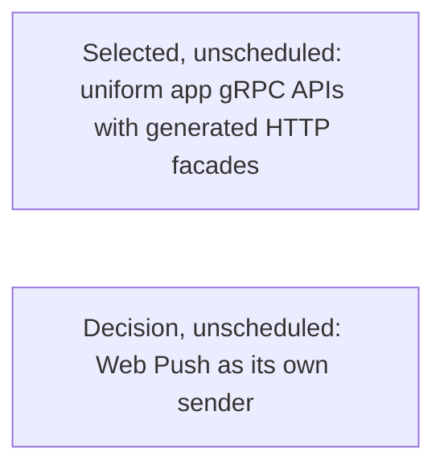

### `APP_API_GRPC_FACADE` — uniform app gRPC APIs with generated HTTP facades

**Selected by the operator, 2026-10-31; unscheduled.** Migrate the app-owned browser APIs from
handwritten HTTP contracts to protobuf-defined gRPC services with generated HTTP/JSON facades.
Generate TypeScript request/response messages and codecs from the same protos; remove the replaced
OpenAPI-derived contracts, mirrored wire types and handwritten route implementations as callers move.
UI-specific view models and adapters may remain.

Frontend configuration (#14786), system status (#14792) and Sandbox policy grant/revoke
(#14796, #14800) have moved; the Sandbox console stream remains. Inventory other remaining app-owned contracts and raw
streams before converting them. Electric synchronization remains a
protocol-specific transport for now.
Login/OAuth redirects, static assets, health probes, API documentation and OTLP telemetry are also
protocol-specific HTTP surfaces, not application RPCs to convert mechanically.

Session-opening follow-ups: replace the untyped override map with a typed contract while preserving
omitted, null and empty semantics; retire mixed-version browser compatibility only after the
replica, cached-bundle and rollback windows close; and preserve status information for non-JSON
HTTP failures without treating uncertain openings as rejected. Details are in
[generated HTTP facades](grpc_http_facade.md#open).

**Prerequisites:** no dependency on a service rename.
Before each independently reviewable migration, identify the owning service and preserve the app's
client-only boundary; backend responsibilities still in the app belong with their backend authority.
The app serves the human frontend; agents and services call owning backends through native gRPC.
For each remaining wrapper, explicitly retain, move or remove its checks according to ownership.
Historical outcome reconciliation does not require a History preflight on command submission.
Preserve authorization, CSRF at the browser proxy,
error semantics, client-chosen Session identity and unknown-outcome recovery, and stream
retry/reconnect behavior. Keep the current same-origin app proxy; direct browser access and
per-operator delegated attribution remain separate decisions.

**Exit:** scoped application RPCs use generated gRPC/HTTP contracts and generated TypeScript codecs;
replaced route/type-generation paths are removed, and remaining protocol-specific HTTP surfaces are
listed with reasons. Focused API/browser tests cover ordinary calls, authorization denials,
idempotency and ambiguous outcomes, and stream reconnects. Each migration records its rollout and
rollback; update the app's contract documentation as behavior changes.

### `WEB_PUSH_SERVICE` — Web Push as its own sender

**Decision, unscheduled (operator, 2026-10-20 07:41 UTC: "eventually we might want to think about moving it out. It
just so happens that right now agentplane only sends web push notifications about actions that need approval. But I
can foresee wanting to send other web pushes").** Web Push delivery (operator subscriptions, VAPID settings, the sender)
lives in the Action Service because an Action awaiting approval is the only message today. It does not belong to the
Notification Service, which serves agent Session inboxes, a different system. If other messages come, a Web Push
sender of its own would own the subscriptions and take messages from their producers. The sender touches only its
own tables and the request event stream, so the move is clean. This remains a separate decision;
the MCP edge extraction leaves Web Push in Actions.

### `HARNESS_IDENTITY_DESIGN` — decide private Session-to-store and native mapping

**Current destination and process boundary (operator direction updated 2026-11-02).** Dispatcher
command requests address a globally unique Session UUID and resolve placement; broker APIs may
still carry an exact Sandbox target as an authorization precondition. Opening still names an exact
Sandbox. See the [Session/environment model](session_environment_model.md). Runtime retains Session
and native identity without exposing a store field; selecting a default store by requested harness
kind remains a candidate policy.
Process allocation/routing stays internal; there is no create-Session-on-process API or refusal.
Process incarnations may be diagnostic objects, never durable addresses. Neither the number of
stores/processes per Runner, at-most-one process per store nor shared-store concurrent safety is
selected.

**Remaining native mapping decision:** use the globally unique public Session UUID with an immutable
required Sandbox placement for a native Session and a private selected harness store. Reserve the public ID durably before native creation. When native creation occurs, record the
harness-chosen native ID before reporting native creation as complete; the earlier logical opening
does not require native creation. An identical retry resolves by public ID, while reuse against a
different destination/spec conflicts. A queued opening is not proof of native creation. If native
creation succeeds but its ID is lost before mapping commits, inspect native store evidence or a
proven harness idempotency mechanism; if identity cannot be proved, report unresolved creation and
do not blindly create again. Specify how the reservation, mapping and native evidence survive
Runner/process crashes. Native ID is scoped to the store and never substitutes for the public ID.

Define runner-owned store create/reuse without ID recycling, Session reservation and internal
resume, per-store versus per-Session options, store retirement and explicitly authorized data deletion.
Persist store harness type and exact Sandbox UID
binding; process death and Sandbox suspension do not delete data. Moving a store to another Sandbox
requires a new binding and authorization. Until proven safe, prevent concurrent writes to one store.
A reachable runner returns a terminal missing-target outcome for the public Session; offline
queued acceptance cannot prove membership. Native child IDs are harness-chosen: if exposed, register
stable runner-chosen public mappings with store and parent identity before publication, and separate visibility
from independent control. Child projection remains [deferred](task_freezer.md#native_subagent_threads--as-linked-agentplane-threads); use the
[merged child characterization](../native/docs/child_sessions.md) for process capability. The operator's private remote-control RE finding
reports outbound HTTP session-start polling with one Claude process launched per Session speaking
RemoteIO, characterized as essentially the existing stream-json stdio protocol. This is an
attributed finding, not a runtime process-count test or proof that Claude can never multiplex by another
route. Use one Claude process per root Session and Codex's demonstrated shared app-server as current
adapter baselines, without exposing process routing or imposing one process per store. No
one-versus-many store or shared-store safety decision is made here.

Feed the reviewed process-diagnostic shape into
[`RUNNER_HARNESS_OBJECTS_DESIGN`](#runner_harness_objects_design--decide-process-diagnostics-and-placement-policy).
The current destination and authority contracts remain in force while their remaining questions are
reviewed; private runner mapping can be implemented independently. Neither design node authorizes runtime changes.

### `RUNNER_STORE_SESSION_IDENTITY` — implement durable store and public Session mapping

**Blocked on review of the private mapping contract (`HARNESS_IDENTITY_DESIGN`).** Extend the
existing durable public Session reservations and persisted native IDs with runner-owned durable
store IDs and exact Sandbox UID binding. Use a new migration rather than editing landed state formats.
Implement adapter-internal process selection, restart/resume and store write fencing; a process
incarnation must not enter a durable destination. Preserve the current per-Session state and authored
native data through migration. Cover same-ID/same-spec retries, conflicting reuse, crashes before
native creation, after native creation but before mapping, and after mapping but before response.
Where the native create result cannot be reconstructed, expose unresolved creation and preserve
orphaned native data for reconciliation instead of duplicating it. Exercise Codex and Claude adapter
paths without assuming Claude multiplexing. Specify atomic caller/proto and pinned runner/VM image
rollout before changing live addresses.

### `RUNNER_IDENTITY_LEGACY_CLEANUP` — retire only obsolete identity assumptions

**Blocked on `RUNNER_STORE_SESSION_IDENTITY` rollout; public address cleanup remains with
`DELIVERY_DESTINATION_CONTRACT` and its own caller gates.** Audit running/saved SandboxTemplates, pinned runner
wheels and every caller before removing old per-Session-process assumptions and stale docs/protos.
Do not delete retained runner stores, native conversations or History. Confirm exact UID/Session
routing to the private store, suspended-queue retry and restart on the deployed images before retiring
old paths.

## 14. Identity and Kubernetes accounts cutover

The source cutover and Sandbox live acceptance are complete. This section now tracks only remaining
Identity-related design, implementation or deployment evidence; actor provenance and Kubernetes
account grants remain separate from service authentication. The
[identity plan](identity_and_kubernetes_accounts.md) owns the current contract, and the accepted
Sandbox deployment is recorded in the [live evidence](../docs/sandbox_identity_cutover_2026_11_12/README.md).

The target is one identity source with three credential forms (operator decision, 2026-11-10;
[plan](identity_and_kubernetes_accounts.md#target-one-identity-three-credential-forms)):
SVIDs over mTLS, the MCP edge's OAuth tokens, and Kubernetes' own authentication toward the Kubernetes
API alone. The one agent path that misses it, the app's `agentplane-agent` TokenReview bearer, is
`APP_AGENT_TOKEN_DECISION`; component TokenReview is being replaced by service SVIDs under
`PRIVILEGED_BACKEND_AUTH_DESIGN` (operator, 2026-11-14).

**Remaining work.** The standing-workload proxy decision-log observation remains open. Explicit
environment lifecycle grants, cross-Identity inbox target semantics, the app TokenReview removal,
Identity `CreateSession`, and the central code-mode tools-as-Actions slice remain separate items.
Identity inventory reads already work; explicit lifecycle mutations remain behind the reviewed
environment-rule design. The full transition rollout is not a current blocker.

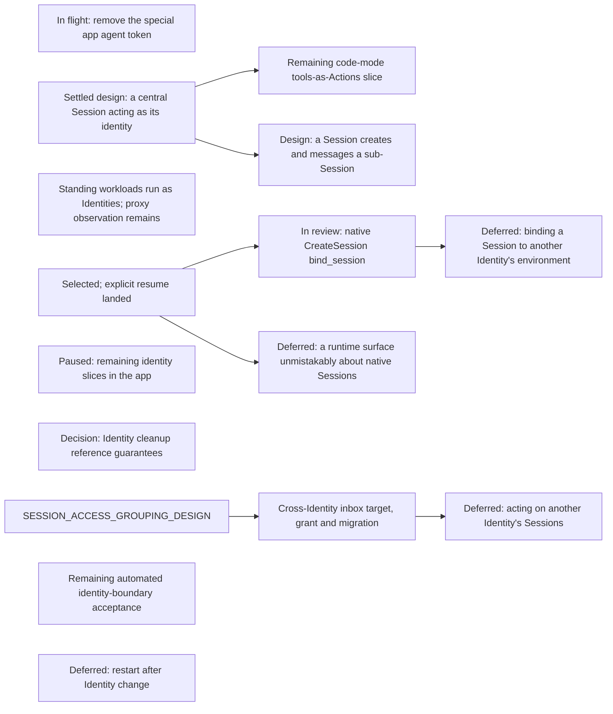

### `APP_AGENT_TOKEN_DECISION` — the app's `agentplane-agent` token under the target

**Decided (operator, 2026-11-14 05:05–05:06 UTC: "Remove it now"; "No, app should stop
accepting the special agent token").** Remove the app's public-route `agentplane-agent` TokenReview
path independently of the service-to-service stages. Manual live suites may be unable to log in to
staging until the [parked issuer token provisioning](task_freezer.md#live_smoke_operator_token--provision-a-live-test-operator-token)
is needed. Do not build that provisioning now. Operator ID-token bearers already work in the app;
a live suite may take a caller-supplied one through `AGENTPLANE_SYSTEM_TEST_TOKEN`.

Separate PRs, in this order:

1. Stop minting the special token in `system_tests/driver/cluster.py` (`AGENT_SERVICE_ACCOUNT`), live
   suites and `system_tests/x/shared_cluster/allocation.py`; update `system_tests/README.md` "Running
   live". The k3s fixtures already use short-lived test-issued OIDC tokens (#15448).
2. Remove `token_subjects` from `cluster/cdk8s/agentplane/app_settings.py` and
   `system_tests/deployment/fixture_chart.py`. After that configuration rolls out, remove the app
   settings field and `caller()`'s TokenReview path in `app/internal/auth/auth.go`.
3. Remove the `agentplane-agent` ServiceAccount and its token RBAC last, after the using images are
   pinned. Delete this node when its last piece lands.

State at 07:40 UTC: step 1 merged in [#16347](https://github.com/agentydragon/ducktape/pull/16347);
step 2's settings removal is in review in [#16372](https://github.com/agentydragon/ducktape/pull/16372).

The public route terminates TLS at the Gateway; it cannot deliver client mTLS to the app. App OIDC
remains the operator authentication mechanism. The service SVID decision separately retires backend
TokenReview too; no Agentplane receiver retains a Kubernetes bearer exception.

### `CENTRAL_SESSION_ACTING_DESIGN` — a central Session acting as its identity

**Decision; unfrozen 2026-11-10** (frozen 2026-11-09 as not needed by the cutover), because the
operator counts a central Session existing and acting with no environment among the migration's
purposes, and `CENTRAL_SESSION_NOTIFICATIONS` needs an environment-free Session to act on its own
inbox. The Identity principal and `CreateSession` field are present in source; the remaining
environment-free path is gated by its separate creation, attachment and lifetime decisions. Today
nothing acts as a central Session's identity without an environment; with one attached, tools act through that Sandbox's SVID
([plan](identity_and_kubernetes_accounts.md#central-sessions-with-no-environment)).

**Settled (operator, 2026-11-10): one design with the other delegating actors.** The sampler is a
delegating actor under the [delegated authorization contract](../docs/delegated_authorization.md),
as the Action Service already is toward Dispatcher, EnvironmentService and History and as the MCP
edge will be toward the Action Service ([plan](identity_and_kubernetes_accounts.md#mcp-edge)). It
authenticates as itself with its own ServiceAccount token and holds no agent key. The Action
Service, Notification and History trust it per method and by namespace scope, not by a static list
of names, so runtime-created Session-managed identities need no configuration. Each call's effective
caller is the `Identity` Dispatcher bound to that Session, as Actions' is its admitted request
record. Optional hardening, not planned: a receiver checks the asserted `Identity` against
Dispatcher's live Session binding.

**Call origin (operator, 2026-11-10).** Agentplane calls never leave a V8 isolate: a cell's nested
tool call reaches the sampler as a code-mode `delegate/request` tagged with its logical Session
([SPEC](../central_sampler/SPEC.md#runtime-and-effects)), and the sampler's Go handler makes the
backend call. It names the `Identity` Dispatcher bound to that Session; neither JavaScript nor tool
arguments can name or override it.

**LLM attribution (operator, 2026-11-10).** Provider calls the sampler makes for a Session are
attributed to the Session's `Identity`, including the spend-log JSON headers and W3C baggage LLM
ingress stamps today from the verified Kubernetes principal
([README](../llm_ingress/README.md)). The sampler reaches LLM ingress as the same delegating actor;
the ingress gains `Identity`-sourced attribution fields and keeps stripping caller-supplied copies,
so attribution stays server-stamped. A Sandbox's own provider calls are attributed by its SVID's
`Identity` once it resolves to one.

**Code-mode tools are Agentplane Actions (operator, 2026-11-10; target).** The JavaScript `tools`
namespace a central Session's cells see corresponds about one to one to Agentplane Actions, generated
from the same catalog the MCP edge lists (`list_actions`), with the same input schemas. The sampler's
delegate handler submits a nested tool call as `request_action` on the Action Service, as the
delegating actor for the Session's `Identity`; policy, auto-approval, operator decisions and receipts
are those of any other caller with that `Identity`. Two front ends, one surface: the MCP edge for
external MCP clients, code-mode tools for central Sessions. Consequences:

- **What receivers record** is what the Action Service already records for a delegated request
  (effective caller and actor), plus the Session ID as provenance.
- **Executor tools** (`exec_command`, `apply_patch`, file reads) stay environment-bound through the
  Gateway executor, not Actions: they are what needs an attached environment, so Actions work with
  zero environments and executor tools need one.
- **Waiting on an operator decision** leaves the cell's promise pending; the handler submits and
  awaits terminal state asynchronously rather than blocking the cell.
- **Results and errors** reach JavaScript in the shape the MCP edge returns them, including the typed
  `ExecutionError` ProtoJSON, so one Action behaves the same through either front end.

The sampler currently reuses Codex's pinned code-mode host. Writing an Agentplane-owned V8 wrapper
instead is an option if it becomes worthwhile (for example, to own the delegate protocol, typed
errors, or the tool namespace); nothing above depends on which host runs the cells.

The design is settled as far as this migration needs; its implementation is
`CENTRAL_SESSION_DELEGATED_ACTING` below, and the environment-free Session it serves is section 13's
`CENTRAL_SESSION_WITHOUT_ENVIRONMENT`, whose remaining gates are not identity decisions.

### `CENTRAL_SESSION_DELEGATED_ACTING` — central code-mode tools as Actions

**Remaining source slice.** Central Session attribution, delegated Identity calls to History and the
service configuration that permits them have landed. The outstanding work is to route the central
sampler's code-mode `tools` namespace through Agentplane Actions (`request_action`) for the Session's
Identity, using the same Action policy, operator decision, receipt and result contract as the MCP
edge. Preserve environment-bound executor tools (`exec_command`, `apply_patch` and file access) in
the Gateway executor; this node covers only the Action-backed tools. The central Session can have no
environment, so the action-backed tools must not depend on one. **Exit:** a code-mode cell invokes an
Action with the Session's exact Identity and exposes the Action result/error contract without changing
the existing delegated actor attribution.

### `STANDING_WORKLOAD_IDENTITY` — standing workloads run as Identities

**Source complete; one deployment-specific observation remains.** Standing Haku workloads and the
`haku-ci` relay now use Identity-subject `WorkloadCredential`s and PolicyBindings. Their Pods still
run as their component ServiceAccounts for Kubernetes and network-policy purposes; those accounts
and their attribution are retained. The staging proxy decision-log observation that the relay's
Identity is the subject of the expected egress decision remains open. This is an observation gate,
not a claim that rollout is blocked or that the source migration remains unfinished. **Exit:** the
existing staging decision log records the expected Identity decision, or the operator records an
explicit waiver.

### `ENVIRONMENT_LIFECYCLE_RULES` — explicit Identity lifecycle authority

**Selected by the operator, 2026-11-14 04:58 UTC:** "Okay this sounds good to me (these environment
rules)". The [`environment` rule design](environment_rules.md) ships as two ordered source slices.
Explicit `resume` merged in [#16346](https://github.com/agentydragon/ducktape/pull/16346); native
`bind_session` is `ENVIRONMENT_IDENTITY_BIND_SESSION` below. Grants are explicit, add no implied
capability, and include no parent-over-child grant. Identity inventory self-reads already work;
automatic Identity wake remains under the existing target `resumePolicy`. The rollout order is in
[environment policy rollout](../docs/environment_policy_rollout.md); no PolicySet uses the rule yet.
`ORCHESTRATION_V1_BACKEND_GRANTS` (a launch writing a grant) and retiring `orchestration_v1` are not
released, and the Action Service launcher admission policy is unchanged. **Exit:** both slices
merged; this node then goes, since the design's home is the rule's documentation.

### `ENVIRONMENT_IDENTITY_BIND_SESSION` — grant native `bind_session`

**In review, [#16351](https://github.com/agentydragon/ducktape/pull/16351) (coding agent, 2026-11-14); second implementation slice, after explicit `resume` (#16346).** Add the reviewed
`bind_session` operation as the target grant for native `CreateSession` on an exact Environment,
including environment-hosted child use. This grants the Session–Environment relation; it does not
authorize environment-free Session creation or other Session management. Keep the Sandbox's exact
Identity and UID checks. **Exit:** a matching grant admits the reviewed native
Session–Environment binding; absent or mismatched grants fail closed.

### `IDENTITY_CLEANUP_REFERENCE_DECISION` — decide cleanup reference guarantees

**Decision; independent of the other app slices.** #15444's Sandbox-delete dialog scans the live
Sandbox inventory, PolicyBindings and retained Sessions before it calls `DeleteIdentity`. The
Policy Controller separately checks unowned PolicyBindings and WorkloadCredentials whose Identity
subject has the same name and either no UID or the current UID. Neither scan is atomic with creating
a reference. A Sandbox or Session can begin naming the Identity
after the browser scan. The [operator UI plan](identity_and_kubernetes_accounts.md#operator-ui)
currently accepts an advisory check, with a concurrent launch failing closed if the Identity is
gone. Decide whether that failure and the recovery of a stranded reference are acceptable, or
whether to coordinate creation and deletion at backend owners. Recommendation: preserve the
accepted advisory contract until reviewed; a UID/resourceVersion precondition on the Identity alone
does not serialize references in Kubernetes and Dispatcher.

Cover already referenced, concurrently created, removed and same-name replacement cases, as well
as failures and recovery. **Exit:** a reviewed reference contract and
independently actionable follow-ups, without changing the existing rule by implication.

### `IDENTITY_SYSTEM_TESTS` — finish automated identity-boundary acceptance

**Still open; not a blocker to the accepted Sandbox rollout or completed source cutover.** Locate
passing automated coverage for the cutover acceptance scenarios and add only missing deterministic
tests: an Identity-authenticated egress hop and platform route; a workload without a Kubernetes use
rule failing closed at the proxy; shared-account use-rule isolation between two Identities; cleanup
of an expiring temporary account and its owned authorization objects; Identity-owned object cleanup;
and Firecracker relay SVID authentication. Preserve exact ServiceAccount grants and History where
applicable. This node does not require repeating accepted live Sandbox work, and missing live proxy
log evidence is tracked separately by `STANDING_WORKLOAD_IDENTITY`. **Exit:** every retained scenario
has an identified passing automated test or a narrowly scoped test change with CI evidence.

### `SANDBOX_IDENTITY_CHANGE_CHECKPOINT` — safely restart a VM after Identity change

**Deferred; serving behavior remains fail-closed.** A suspended Firecracker launcher whose Sandbox
Identity changes is held with its checkpoint as `RunnerCredentialMismatch`. The controller SPEC
records that discarding the checkpoint and cold-starting under the new Identity is not implemented.
Design and test a safe transition that cannot thaw old in-memory work as the new Identity and
preserves the workspace and durable data. This task is independent of the completed workload
Identity cutover and must retain the current hold until the transition is proven. **Exit:** the
launcher discards only the old checkpoint, starts with the new credential, and coverage proves the
old checkpoint is never resumed as the replacement Identity.

### `APP_IDENTITIES_UI` — identities in the app

**Paused; landed so far: the identities list with bindings, expiries and the accounts its use
rules reach, the identity page, references, origin and delete refused while referenced or from git
(`app/frontend/identities/`); the session form showing an existing environment's Identity
(#15443); optional identity cleanup on Sandbox deletion (#15444); a stopped environment's identity
changed or cleared, guarded against placed Sessions (#15445). Remaining slices are candidates.**
`PolicyService` already watches Identities and deletes one for it (#15151;
[Policy Controller SPEC](../policy_controller/SPEC.md#policy-resource-watches)). Left: the new-environment identity picker (`CreateEnvironment` still takes no Identity); the permission-request approval card with new
temporary account, widen shared, or deny; a Thread finish action that offers Identity cleanup after
the authoritative Session finish/lifetime contract and its selected backend operation exist
(`SESSION_AND_INBOX_LIFETIME`, `SESSION_LIFETIME_IMPLEMENTATION`); the finish dialog's default to
delete an app-minted identity once the app mints any; the identities an environment
has run as on its page. Thread finish's prerequisites do not block the other slices. The Connection consent page (`/#/connection-enrollments/{handle}`) and
the OAuth clients tab's rebind picker should choose an eligible live Identity in the policy
namespace under operator-approved consent/rebind; there is no static Identity-name allowlist. A
Connection's **View grants** shows that Identity's bindings, and an identity's page lists the
Connections bound to it beside its Sandboxes and Sessions (operator, 2026-11-09; today's flow is in
`app/README.md`). These UI slices no longer wait on the completed workload cutover. Mockups: the
plan's operator UI section. **Exit:** BFF routes with
tests, visual tests capturing each screen, and a browser test that a referenced identity cannot be
deleted. The landed slice shows every identity not applied from git as of unknown origin. When
Session-managed identity provisioning (`SESSION_MANAGED_IDENTITY`) is implemented, it needs to
stamp an origin marker that `identities/origin.ts` can read. The new-environment identity picker
remains an independent app UI slice; the Sandbox launch sequence is already settled in the identity
plan.
The environment page reads only its current Sandbox-owned WorkloadCredential at the last check;
revoked records do not supply a complete identity history. Choose a retained source and retention
contract before claiming to show earlier identities.

The merged #15444 and #15445 slices have no recorded k3s system test or post-Flux staging proof as
of 2026-11-10. #15445's browser test exercises a running refusal by `EnvironmentService` and a
stopped patch against the API server, not a Kubernetes admission refusal. When verifying a staging
rollout, check the applied app/Gateway revisions and, with disposable resources, the stopped and
running rebind cases and the credential-refused cleanup/retry path. Identity-system acceptance owns
cutover scenarios; missing live evidence alone is not a separate gate when suitable automated
evidence exists.

### `SESSION_SUBAGENT_DELEGATION` — a Session creates and messages a sub-Session

Identity `CreateSession` remains denied. Existing operator-provisioned same-Identity child steering
and the approved `orchestration_v1` broker flow continue to work; this node is separate from the
completed Sandbox workload cutover.

**Design, not started (operator, 2026-11-10).** Decide how a Session asks Agentplane to create a
child Session and then message it. Dispatcher refuses an Identity caller at `CreateSession`
(`PermissionDenied`); privileged platform components retain their creation path, and an Identity
can read, steer, interrupt and cancel its own Identity-recorded Sessions. Build on the existing
[delegated authorization](../docs/delegated_authorization.md) contract and the messaging path that
landed in #15437 and #15438. The Sandbox launch Identity sequence is settled in the identity plan
and does not determine the child-Session design. The environment rule's `bind_session` operation
covers the target relation for native `CreateSession`, including environment-hosted child use;
parent authorization and environment-free Session creation remain separate designs. Coordinate the
separate environment-free creation design with
`CENTRAL_SESSION_ACTING_DESIGN`. **Exit:** a reviewed child-Session authority and delegation design
with its implementation slices; no authority change is selected by this tracking update.

### `SESSION_IDENTITY_AUTHZ` — finish cross-Identity inbox send targeting

Inbox ownership and History workload reads now use the recorded Session Identity. Notification's
same-Identity send path also passes without a grant. Cross-Identity sends still require
`session_inbox_access`, whose current binding is on the sender and whose targets are Sandboxes/tags;
component senders and their ServiceAccount provenance remain supported. The target/group model and
grant lifetime remain unresolved under
[`SESSION_ACCESS_GROUPING_DESIGN`](#session_access_grouping_design--access-groups-across-independent-sessions-and-environments).
Preserve the current enforcement while that design is reviewed. Broader cross-principal History
reads remain held by `THREAD_READ_POLICY_DESIGN`. **Exit:** resolve target/group ownership, target
tag semantics and launcher-grant lifetime under `SESSION_ACCESS_GROUPING_DESIGN`, or explicitly
decide to retain Sandbox/tag targets. Then track the consumer/schema and grant migration (or
deliberate retention) as source work with tests; correcting this plan alone does not close the node.

### `SESSION_CROSS_IDENTITY_AUTHORITY` — acting on another Identity's Sessions

**Deferred (operator, 2026-11-11).** Under the [`environment` rule design](environment_rules.md),
authority over an existing Session is implied only for a caller of the Session's own Identity;
every other caller is refused. An orchestrator that wants to submit input to, read, attach
environments to or detach them from Sessions of another Identity (worker Sessions it did not create
itself) needs a rule naming that Identity. The likely shape is a `session` rule targeting Sessions by
their Identity (`identities: [{name: worker}]`), never by creator, with no operation that changes a
Session's Identity. Picked up when an orchestration use needs it. **Exit:** a decided design and the
PRs it implies.

### `ENVIRONMENT_RUNTIME_NATIVE_SURFACE` — an Environment Runtime surface unmistakably about native Sessions

**Deferred (operator, 2026-11-11).** The Environment Runtime's gRPC service
(`env/runtime/control/environment_runtime.proto`) has a `CreateSession` that starts a native Session
Dispatcher already admitted, but its name reads like a second authority beside Dispatcher's
`CreateSession` ([environment rules](environment_rules.md#operations)). Make the surface
unmistakably about native Sessions: names, request shapes and docs that say Dispatcher admits and
the runtime materializes. This may mean rethinking how the service is cut (native-harness control
versus environment facts, executor and other concerns) and its callers beyond Dispatcher. **Exit:** a
decided cut and the renames or splits it implies.

### `WAKE_ON_DELIVERY_DESIGN` — whether delivering Session work wakes its environment

**Deferred (operator, 2026-11-11).** The [`environment` rule design](environment_rules.md) keeps
only `resume`, an explicit request; it has no `wake` operation. Today a delivery wakes a suspended
Sandbox through the implied same-Identity path (`identityWakeAssessment`) or a configured broker
role (`wake_callers`), gated by `spec.wakeOnSend` and wake budgets. Direction: the sender's right to
deliver is already a grant, so whether delivery starts the Sandbox is the recipient's choice, a
property of the Sandbox or of the Session living in a harness inside it, rather than a sender-side
"X may wake S" rule. A per-sender wake rule is not planned (YAGNI, operator 2026-11-11); add it
only if a use appears. Decide which carries it (a Sandbox default with a per-Session override is one
option), how budgets bound a permitted sender, and what replaces the broker role. **Exit:** a
decided design and the PRs it implies.

### `CROSS_IDENTITY_SESSION_BINDING` — binding a Session to another Identity's environment

**Deferred (operator, 2026-11-11).** A Session–environment binding requires the Session's Identity
to equal the environment's bound Identity, with no policy override
([admitting a binding](environment_rules.md#operations)). A later rule may allow a binding across
Identities. It needs its own model of what each side may see and do: the environment's Identity
would run work directed by a conversation carrying another Identity's history. Picked up only when a
use needs it. **Exit:** a decided design, or a recorded decision not to allow it.

## 15. Cleanups

Deletions and simplifications that exist only because of a transition, a migration, a superseded
design or a track that has landed: dead code, met gates, compatibility shims, stale names, redundant
tests and docs. Census of 2026-11-10 over the `CLEANUP(added …)` tombstones, component `TODO.md`
files, `TODO` comments, sections 13 and 14, the identity plans, open PRs and the freezer; it absorbs
the 2026-10-10 legacy burn-down (section 9) and the 2026-10-21 census of the lanes. **Unblocked**
has no gate, or a gate met on devel; **Blocked** names the node, PR or merge it waits for;
**Future** waits on an undecided design or a track not started. Each entry says what goes, where,
the gate and the source; a removal a track's own node lists is linked, not copied, and feature or
design nodes stay in their sections. Not cleanups: fakes kept to inject faults the real API server
cannot produce (named at the fake); the delta settlement flag (operator, 2026-10-13 PDT);
upstream-gated tombstones with a verifiable condition in code (`keepingOffset` in `electric_sync.tsx`
against `@electric-sql/client` 1.5.28, the jsdom pragma in `markdown.test.tsx`). Doing one still
needs the gate observed on devel and every reader found. The authentication surface left from the
projected-ServiceAccount-token era is one burn-down split across the three subsections' "Authentication"
headings: what each piece serves today, what it collapses into once an Identity SVID is the only
workload credential, and the gate. Platform component TokenReview retires under `PRIVILEGED_BACKEND_AUTH_DESIGN` (operator,
2026-11-14), preserving method-specific component authority with exact service SVID admission.

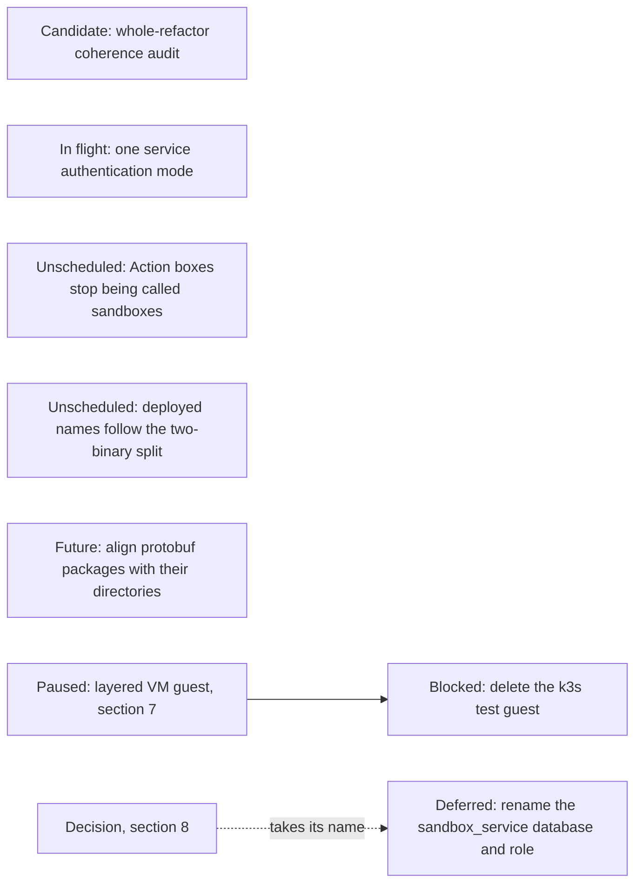

### Unblocked

Dispatchable now. "Unscheduled" is the operator's priority statement, not a gate.

- **`SAMPLER_STABLE_PROVIDER_PREFIX`**: a sampler rollout must not break the request prefix an
  existing conversation already sent. #15591 edited the `write_stdin` schema text inside the
  sampler's `exec` tool, and Anthropic then rejected every older Thread's signed thinking ("The
  `tools` list differs from the one this block was created with"), because the tool list and
  instructions are rendered from current code on every request and staging sets
  `prefix_mismatch_behavior: error`. Those Threads cannot continue. **Operator, 2026-11-14 UTC:**
  "older threads can stay broken"; the fix only stops future prompt changes from breaking Threads,
  with no repair or migration of existing ones.

  Provider rules, from current documentation (2026-11-14):

  - **Anthropic Messages.** A thinking block's signature binds the top-level `system`, the `tools`
    set (name-sorted, so reordering is safe) and every earlier message. Editing them is a 400 when
    enforced (accounts created on or after 2026-08-31, or any request setting
    `thinking.block_binding.prefix_mismatch_behavior`); `drop_block` drops that block and every later
    one. Append-only forms: a mid-conversation `role: "system"` message for instruction changes;
    `tool_addition`/`tool_removal` blocks in such a message (beta
    `mid-conversation-tool-changes-2026-07-01`, tools declared up front with `defer_loading`); and,
    under beta `inline-tools-2026-09-15`, a `tool_addition` carrying a full definition that replaces
    a same-named tool's definition from that point on, with `tools[]` left as first sent.
  - **OpenAI Responses** ([preserved reasoning](https://developers.openai.com/api/docs/guides/preserved-reasoning)).
    The prefix includes `tools`, `instructions`, `text.format` and earlier input items. A change is
    not rejected: reasoning items after it are silently dropped (reported in
    `input_transformations`), with no parameter to change that. Append-only forms: an
    `additional_tools` item to add tools, `tool_choice.allowed_tools` to restrict them, a
    `configuration_update` item for effort or output schema, and an appended developer message for
    instructions.

  Design: persist the rendered tools and instructions with each conversation as its frozen
  baseline. On each request, compare it with what current code renders, and express any difference
  through the provider's append-only form at the next turn boundary. A difference with no such form
  on that route waits for an explicit boundary (new Thread, compaction). Never edit the baseline;
  keep `drop_block` off. Test by rendering a stored conversation under a changed tool description
  and asserting the provider accepts the continuation and keeps its reasoning (empty
  `input_transformations` on both APIs). Covers the Responses and Anthropic Messages paths.

#### `PRIVILEGED_BACKEND_AUTH_DESIGN` — one service authentication mode

**Decided (operator, 2026-11-14: "One auth mode can fire off"), option 2; dispatched
2026-11-14.** Every first-party service-to-service call authenticates its caller by a service SVID
over mTLS, with verified server TLS on every hop. The `kubernetes_bearer` listener mode and
Agentplane's TokenReview code go; Kubernetes authentication stays only toward the Kubernetes API.
Operators keep app OIDC and MCP clients the edge's OAuth tokens. A component acting for an Identity
is proven by its own certificate plus the typed delegation envelope
([delegated authorization](../docs/delegated_authorization.md)); the actor's identity never becomes
the effective caller's grant. Service SVIDs use a SPIFFE path that resolvers never map to an agent
`Identity`. Services read certificate and trust-bundle files, so a caller needs no Kubernetes API to
authenticate; in the cluster, cert-manager issues them from the workload CA. This supersedes the
2026-11-10 decision to keep backend ServiceAccount tokens, option 1 (TokenReview plus pinned server
TLS) and option 3 (per-target modes).

Stages, each a separate set of PRs that is safe to roll and states its rollback:

1. Inventory every component → receiver/method path (token source, audience, admitted accounts,
   transport, direct or delegated), and reconcile [gRPC services](../docs/grpc_services.md) and
   [workload authentication](../docs/workload_authentication.md) with this decision.
2. Issue service SVIDs with client and server usage and mount them with the trust bundle, before any
   code relies on them.
3. Receivers also admit their component callers by exact service SPIFFE ID in the existing component
   allowlists, while bearers still work.
4. Callers present service SVIDs once their receivers' images are pinned; settings land in code
   before manifests set them.
5. Bearer admission, TokenReview, projected token audiences and the `tokenreviews` RBAC go after
   every caller's image is pinned; RBAC removals last.

**Roll gates:** certificates exist before code relies on them; receiver images admitting SVIDs are
pinned before callers switch; code accepting settings is pinned before manifests set them. No
fallback from a failed or absent certificate to a bearer. PRs #16333 (Policy Controller and sampler
server TLS) and #16334 (verified client TLS) are separate in-flight work to build on, not duplicate.
Stop after stage 3 and app-agent-token step (a) are open and green; later stages wait for operator
confirmation of image pins.

**Exit:** no Agentplane receiver admits a Kubernetes bearer; tests cover peer and actor
verification, rotation, caller denial and delegation without a bearer fallback.

State at 07:40 UTC: the path inventory is [service SVID authentication](service_svid_authentication.md);
service SVIDs are issued and mounted ([#16359](https://github.com/agentydragon/ducktape/pull/16359));
exact service SVID admission and certificate-backed delegation landed in
[#16350](https://github.com/agentydragon/ducktape/pull/16350); Policy and Egress Admin admit service
SVIDs ([#16355](https://github.com/agentydragon/ducktape/pull/16355)), and so does History
([#16369](https://github.com/agentydragon/ducktape/pull/16369)); Actions (#16354), the sampler
(#16357), LLM ingress (#16358), the Gateway (#16364) and the MCP edge (#16371) are in review.

#### Authentication: dead or stale today

Live callers checked on devel, 2026-11-10 (`grep` of `auth.<Rule>(` outside tests).

- **`agentplane-runner-ingress`** (`RUNNER_INGRESS_AUDIENCE`, `history_service/settings.py`): runners
  push by SVID, so its only sender is the central sampler's `history` projected token
  (`central_sampler_workload.py`). Rename it for the sampler, or fold it into History's own audience;
  coordinate the sampler's projection and History's listener audiences. No gate.
- **Stale doc sentences.** `docs/workload_authentication.md` § TokenReview and projected credentials
  says Sandbox Runtime templates "continue to project" the Kubernetes token (none since #15258; only
  command boxes do) and § Service authorization says authentication yields "only the verified Sandbox
  ServiceAccount" (an Identity subject resolves since the expand phase). `identity/auth/README.md`
  says a record naming an Identity "is refused until `Principal` has an Identity form" and "there is no
  identity reference" (`IdentityPrincipal`, `AnySubject` and the Identity delegation exist, and the
  same README describes them further down), and that the proxy's hop "still accepts" the
  `agentplane-egress` audience (the `forward` listener is `spiffe` alone). Fix in one docs PR.

#### `REFACTOR_COHERENCE_AUDIT` — the refactor reads as one design

**Candidate; later work under the stakeholder priorities (2026-10-30 PDT); no longer held on the
optional Dispatcher/Gateway merge.** Sweep devel for unused modules, functions, settings, proto
fields, tables and columns; one name per concept across code, settings, manifests, protos and docs
(Runner Gateway, History Service, ingress, control; Session for the raw stream, Thread for its
projection; no "hub", "follow" or "shadow" left); READMEs, `SPEC.md` files and `docs/` describing the
code as it is, without cutover narration; no compatibility branch, optional-with-fallback setting or
`CLEANUP` tombstone whose condition is met; the system diagram in `agentplane/docs/system_overview.md`
showing exactly the deployed services and the traffic between them in `cluster/cdk8s/agentplane`.
Each removal needs its own evidence and any real prerequisite, and is fixed in a PR of its own; this
node leaves with the last of them.

**Pre-cutover leftovers, released 2026-11-14 01:41 UTC ("dispatch 1, 2"), landed:** Central Sampler
migration 17 and its code cleanup ([#16323](https://github.com/agentydragon/ducktape/pull/16323),
[#16331](https://github.com/agentydragon/ducktape/pull/16331)), and the Dispatcher's pre-Identity rows
and reader fallbacks ([#16340](https://github.com/agentydragon/ducktape/pull/16340),
[#16341](https://github.com/agentydragon/ducktape/pull/16341)); each PR states its staging loss.
History's empty Sandbox UID is not a leftover: a central Session may have no Sandbox
([Sandbox-free central Sessions](#sandbox-free-central-sessions)).

#### `ACTION_BOX_RENAME` — Action boxes stop being called sandboxes

**Unscheduled; operator, 2026-10-11 PDT: a later TODO.** Rename what calls an Action Service box a
sandbox, so it no longer reads as a Session Sandbox: the `sandbox__*` Actions,
`action_service/sandbox/`, the `agentplane-sandbox` templates and labels, and
`cluster/cdk8s/agentplane/command_sandbox.py`. The `sandbox__*` tool names are what agents and
external Connections call, so renaming them is a wire change. Boxes and Sandboxes are to converge
into one object type
([`SANDBOX_BOX_CONVERGENCE`](task_freezer.md#sandbox_box_convergence--sandboxes-and-action-boxes-as-one-object-type)),
which would settle the name instead; check that before dispatch.

#### `RUNNER_GATEWAY_RENAME` — deployed names for the Sessions and Environments binaries

**Unscheduled; target changed 2026-11-14.** The two-binary direction
([section 17](#17-two-binaries-and-the-go-layout)) removes the Runner Gateway, so the 2026-10-31
"Environment Gateway" name is dropped. Source directories are decided (operator, 2026-11-14 05:49
UTC, card "session_dispatcher + environments"); deployed names stay until this migration: the
`runner-gateway` and `sandbox-controller` Deployments, Services, images, labels, settings and
projected-token paths, token audiences, SPIFFE identities and certificates, image automation and
Flux pins, docs and tests. It follows section 17's stage 3 moves.

### Blocked

Grouped by the node, PR or merge each waits for. Completed workload-Identity source lanes are
removed; remaining deployment observations and rollback windows stay here only when they still have
a specific stopping condition.

#### By gate

- **`STANDING_WORKLOAD_IDENTITY` (source complete; one observation pending):** the standing records
  and bindings name Identities. Preserve the standing Pods' ServiceAccounts as their Kubernetes and
  network-policy identities. The remaining check is the staging proxy decision log naming the
  `haku-ci` relay's Identity for the expected egress decision; this does not imply that rollout is
  blocked today.
- **The Action Service's rollout that stops writing `action_execution.heartbeat_at`** (2026-11-10;
  nothing reads it): drop the column in a new Action Service migration once no older replica runs, so
  none writes it mid-roll.
- **`RUNNER_STORE_SESSION_IDENTITY`:** `RUNNER_IDENTITY_LEGACY_CLEANUP` (section 13) retires the old
  per-Session-process assumptions, stale docs and protos after the private mapping rolls out.
- **`DELIVERY_DESTINATION_CONTRACT` (in progress):** the browser's legacy command-destination records
  (`LocalCommand` with `target` null or `sessionAddressed` false, `app/frontend/threads/local_commands.ts`)
  are retired once every retained record is Session-addressed; preserve unconfirmed saved input and
  its Sandbox UID fence, and never replay an uncertain command. Source: [app TODO](../app/TODO.md).
- **The Session-opening facade's rollback window:** the legacy Huma status fallback and wire-format
  workarounds in the browser's Session-opening path go once old app replicas, cached browser bundles
  and the supported rollback window are gone. Source: [generated HTTP facades § Open](grpc_http_facade.md#open).

#### Authentication: collapses with a named gate

What each piece serves today, and which behavior still needs a specific gate.
Every first-party listener is `[kubernetes_bearer, spiffe]` (Action Service and LLM ingress on
`agentplane-egress`; History on its own and the runner-ingress audiences; Notification and the Gateway
on theirs); the proxy's `forward` is `spiffe` alone and its admin, the Policy Service and the sampler
are bearer-only. All receiver bearer admission retires under `PRIVILEGED_BACKEND_AUTH_DESIGN`;
receivers gain exact component SVID admission before caller cutover and bearer removal.

- **EnvironmentService:** List, Watch, Get and WatchEnvironment use
  `ReviewedServiceAccountOrIdentity` and exact Identity self-read. `ResumeEnvironment`, suspend,
  delete and settings mutations still use `ReviewedServiceAccount`; direct resume is limited to the
  configured Pod-bound operator. Automatic Identity wake uses the current target
  `resumePolicy.allowOwnServiceAccount` and is not an environment-rule operation.
- **Central sampler:** its `llm`, `gateway` and `history` credentials are component actor proof.
  History's `SVIDOrAccounts` push rule remains for runners by SVID and the sampler by bearer; the
  remaining central code-mode tools-as-Actions implementation is tracked separately above.
- **Workload and component boundaries:** issued workload credentials name Identities, and retained
  ServiceAccount-subject records fail closed. Replace direct component TokenReview; keep component
  reader/management/writer/waker allowlists with service SVIDs, Kubernetes-account impersonation and historical
  actor/writer/sender attribution.
- **Audience naming:** `agentplane-egress` (`WORKLOAD_TOKEN_AUDIENCE`) still serves the sampler's
  `llm` token and Notification's `actions` token. Its rename stays frozen
  (`WORKLOAD_AUDIENCE_RENAME`); deletion follows the service SVID cutover instead of renaming it.

#### `K3S_TEST_GUEST_RETIRE` — delete the k3s test guest

**Blocked on `RUNNER_LAYERING_VM`.** The system tests' `_vm` targets boot a Bazel-built test guest
under `system_tests/vm/guest`, a second implementation of `agentplane/env/images/vm.nix`'s guest boot
contract (disks by serial, workspace format, harness and tool paths); the two share the static
runner/slice units and native supervision backend. Delete it once the production guest is Bazel-built
and boots in seconds under emulation, and point the k3s VM scenarios at that guest.

### Future

The gate is a decision not yet made or a track not started; nothing here is dispatchable.

#### `PROTO_PACKAGE_ALIGNMENT` — align protobuf packages with their directories

**Future; operator, 2026-11-12: revisit after the source moves.** Inventory Agentplane-owned
`.proto` package declarations against their filesystem locations, including the History read API
and the sampler's retained `agentplane.x.central_sampler` namespace. Decide a consistent naming
scheme and document deliberate exceptions; moving a file does not by itself require a wire rename.
A package rename changes fully qualified message and service names, including gRPC method paths and
`Any` type URLs, even if field numbers stay the same. Before each proposed migration, inventory
clients, persisted or queued payloads, descriptors, reflection, authorization rules and mixed-version
rollouts; define compatibility, data handling and rollback, with tests for old/new interoperability.
Dispatch reviewed migrations separately, rather than coupling them to package-directory moves.

#### Decisions and tracks

- **`CENTRAL_SESSION_CREATION_CONTRACT` ([#15436](https://github.com/agentydragon/ducktape/pull/15436),
  recommendation A):** `central_sampler_v1` is retired in the cutover that adds the `central_sampler`
  placement: `CentralSamplerV1Placement` in `proto/session.proto`,
  `runner_gateway/dispatcher/internal/placement/placement.go`'s `CentralSampler`,
  the `central_sampler_v1` cases in `app/testing/client.py` and
  `runner_gateway/dispatcher/testing_client.py`, `central_sampler/testing.py` and
  `system_tests/scenarios/central_sampler.py`; each V1 row becomes a `central_sampler` Session with
  one `executor` attachment. The plan file `central_session_contract.md` burns down with its three decisions.
- **`SESSION_IDENTITY_AUTHZ`:** `notification_service/internal/rpc/messages.go` still authorizes
  cross-Identity sends through sender-bound `session_inbox_access` Sandbox/tag targets. Inbox
  ownership and History workload reads already use the recorded Session Identity. The remaining
  target/group/lifetime decision and its consumer/grant migration are described above and follow
  `SESSION_ACCESS_GROUPING_DESIGN`.
- **`HISTORY_DATABASE_RENAME`** (below): deferred by the operator, and takes the name
  `HISTORY_SERVICE_RENAME` (section 8) decides.
- **The observation naming layer** (`Event.observation`, Runtime's observation handling, History's
  `ReadSessionObservations` and `ReadNativeFrames`, the debug UI): squash to "Event" if the operator
  agrees it is not a deliberate distinction. Source: [frontend TODO](../app/frontend/TODO.md#thread-view-ux).
- **One result shape for executors:** the MCP edge's per-executor result rendering
  (`mcp_edge/internal/mcpserver/results.go`) goes if the Sandbox executor answers as an MCP tool. Source:
  [Action Service TODO](../action_service/TODO.md#executors-that-answer-as-mcp-tools).
- **Frozen:** [`WORKLOAD_AUDIENCE_RENAME`](task_freezer.md#workload_audience_rename--rename-the-agentplane-egress-audience)
  (the `agentplane-egress` audience name; tokens retire under the service SVID decision) and
  [`HAKU_ACTION_NATIVE_CLIENT`](task_freezer.md#haku_action_native_client--migrate-the-existing-haku-action-client)
  (Haku UI's client off the retired Action HTTP facade) stay in the freezer with their triggers.
- **Plan files with a stated exit:** [`architecture_overview.md`](architecture_overview.md) is deleted
  when a direction is chosen and its parts land in owning docs; [`standard_idioms.md`](standard_idioms.md)
  burns down with section 16.

#### Authentication: waiting on a decision

- **Pod-bound checks per route** ([identity plan open question 1](identity_and_kubernetes_accounts.md#open-questions-and-tricky-bits)):
  `IsPodBound` gates privilege in Dispatcher (`dispatcher/api.go`), History reads
  (`history_service/internal/rpc/service.go`), EnvironmentService management and the lifecycle manager
  (`environments/management.go`, `lifecycle/manager.go`), and the resolver's `RequirePod` is step 7
  of SVID resolution. Once every workload is an Identity SVID with a per-incarnation credential, each
  route decides whether a Pod proof still adds anything; the checks that do not are deleted then.

#### `HISTORY_DATABASE_RENAME` — name the database for its owner

**Deferred by the operator; not dispatchable until selected.** The old Sandbox Service is gone, but
the `sandbox_service` database, role and `postgres-sandbox-service` Secret remain in use by the
History Service. This is a naming cleanup, not permission to recreate or drop the database. Rename
the database and role in place (`ALTER DATABASE`/`ALTER ROLE ... RENAME`) and have the CNPG
`Database` and managed role adopt the new names; recreating the database under a new name would copy
the log. Verify the History Service and Electric reconnect with no data movement. Update the
`history_service/internal/migrations/migrations.go` and `cluster/cdk8s/agentplane/history_service.py` docstrings.

## 16. Standard idioms over hand-rolled mechanisms

From the 2026-10-30 idiom audit; problems, targets and exits are in
[standard idioms](standard_idioms.md). Operator selection, 2026-10-30 PDT: all nodes below are
accepted; `SAMPLER_JOURNAL_DIET` awaits the operator's view.

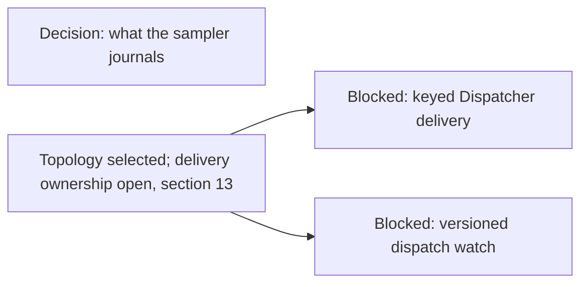

### `SAMPLER_JOURNAL_DIET` — what the sampler journals

**Decision; operator to weigh in.** Alternatives and the recommendation (journal kind plus a reference,
raw events once) are in the [plan](standard_idioms.md#sampler_journal_diet-decision).

### Blocked

`DISPATCHER_KEYED_DELIVERY` and `DISPATCHER_WATCH_VERSIONS` wait for delivery ownership in the
selected two-binary topology (`DISPATCHER_PERSISTENCE_MODEL_DESIGN`).

## 17. Two binaries and the Go layout

**Agreed direction (operator, 2026-11-14 05:29 UTC, card "Adopt it").** Two binaries replace
`runner-gateway` and `sandbox-controller`, and the Runner Gateway disappears:

- **Environments** (`agentplane/environments/`): the Sandbox Controller, EnvironmentService, the
  Runtime proxy and the Executor. It owns Sandboxes and every call into an Environment Runtime, and
  honors keep-alive holds.
- **Sessions** (`agentplane/session_dispatcher/`): the Dispatcher. It owns Session admission, the
  durable command queue and routing, to the central sampler or through Environments to hosted
  harnesses, and keeps automatic wake (05:19 UTC, card "Sessions binary wakes").

Directory names: 05:49 UTC, card "session_dispatcher + environments"; deployed names stay until
`RUNNER_GATEWAY_RENAME`. No call goes from Environments to Sessions: Sessions re-check the live
Identity (07:20 UTC, "okay, sounds good to me, sessions can re-check"), and explicit resume reserves
no wake budget (07:41 UTC, card "No budget for explicit resume"). The
[Go reorganization plan](https://agentydragon.github.io/ducktape/agentplane-organization/) holds the
evidence and line-level steps for every track below; its stages are ordered by certainty.

| Plan stage                         | DAG node                                                                                                                                                                                                                                                           |
| ---------------------------------- | ------------------------------------------------------------------------------------------------------------------------------------------------------------------------------------------------------------------------------------------------------------------ |
| 1. Leftovers and the Gateway Lease | Leftovers landed (`REFACTOR_COHERENCE_AUDIT`); Lease removal is [section 12](#12-the-runner-gateway-serves-the-runners-own-service)                                                                                                                                |
| 2. Layout under any service map    | `GO_LAYOUT_FIXES`                                                                                                                                                                                                                                                  |
| 3. The two-binary moves            | `ENVIRONMENTS_DIRECTORY`, `SANDBOX_IDENTITY_RECHECK`, `EXPLICIT_RESUME_BUDGET_REMOVAL`, `ENVIRONMENT_SERVICE_TO_ENVIRONMENTS`, `RUNTIME_PROXY_TO_ENVIRONMENTS`, `SESSIONS_BINARY_DIRECTORY`; `orchestration_v1` retirement is `SESSION_TOOL_SURFACE_CONSOLIDATION` |
| 4. Local extractions               | `GO_LOCAL_EXTRACTIONS`                                                                                                                                                                                                                                             |
| 5. Waiting on service decisions    | `NOTIFICATION_SERVICE_SPLIT`, `DISPATCHER_PERSISTENCE_MODEL_DESIGN`, `JOURNAL_REPRESENTATION_DESIGN`, `SERVICE_SETTINGS_RETHINK`                                                                                                                                   |
| 6. Deferred                        | `PRIVILEGED_BACKEND_AUTH_DESIGN` (moves no files), `PROTO_PACKAGE_ALIGNMENT`                                                                                                                                                                                       |

The stage 3 moves are not released; `SANDBOX_IDENTITY_RECHECK` is.

```mermaid
flowchart LR
    RUNNER_CONNECTION_LEASE_CLEANUP[Section 12: Gateway Lease removal]
    PRIVILEGED_BACKEND_AUTH_DESIGN[In flight: service SVIDs, section 15]
    GO_LAYOUT_FIXES[Candidate: stage 2 layout fixes]
    ENVIRONMENTS_DIRECTORY[Ready: Sandbox Controller moves to environments/]
    SANDBOX_IDENTITY_RECHECK[In review: Sessions re-check the live Identity]
    EXPLICIT_RESUME_BUDGET_REMOVAL[Decided: explicit resume reserves no wake budget]
    ENVIRONMENT_SERVICE_TO_ENVIRONMENTS[Agreed: EnvironmentService into Environments]
    RUNTIME_PROXY_TO_ENVIRONMENTS[Agreed: Runtime proxy and Executor into Environments]
    SESSIONS_BINARY_DIRECTORY[Held: the rest moves to session_dispatcher/]
    ENVIRONMENT_KEEP_ALIVE_HOLDS[Proposed design: keep-alive holds]
    GO_LOCAL_EXTRACTIONS[Unscheduled: stage 4 local extractions]
    RUNNER_GATEWAY_RENAME[Unscheduled: deployed names, section 15]
    ENVIRONMENTS_DIRECTORY --> ENVIRONMENT_SERVICE_TO_ENVIRONMENTS
    SANDBOX_IDENTITY_RECHECK --> ENVIRONMENT_SERVICE_TO_ENVIRONMENTS
    EXPLICIT_RESUME_BUDGET_REMOVAL --> ENVIRONMENT_SERVICE_TO_ENVIRONMENTS
    ENVIRONMENTS_DIRECTORY --> RUNTIME_PROXY_TO_ENVIRONMENTS
    RUNNER_CONNECTION_LEASE_CLEANUP --> RUNTIME_PROXY_TO_ENVIRONMENTS
    PRIVILEGED_BACKEND_AUTH_DESIGN --> RUNTIME_PROXY_TO_ENVIRONMENTS
    ENVIRONMENT_SERVICE_TO_ENVIRONMENTS --> SESSIONS_BINARY_DIRECTORY
    RUNTIME_PROXY_TO_ENVIRONMENTS --> SESSIONS_BINARY_DIRECTORY
    SESSIONS_BINARY_DIRECTORY --> RUNNER_GATEWAY_RENAME
    ENVIRONMENTS_DIRECTORY -. lands in .-> ENVIRONMENT_KEEP_ALIVE_HOLDS
    GO_LAYOUT_FIXES -. files move once .-> ENVIRONMENTS_DIRECTORY
```

### `GO_LAYOUT_FIXES` — stage 2 layout fixes

**Candidate; not released.** The Go plan tracks that hold whatever the service map becomes:
`env-execution-package-names`, `runner-era-names`, `sampler-json-contract`, `app-session-client-name`,
`egress-sidecar-runtime`, `llm-ingress-server-boundary` and `firecracker-host-guest`. Each is its own
small PR; `ENVIRONMENTS_DIRECTORY` absorbs `runner-era-names`' `runnercontrol` → `runtimecontrol`
rename so those files move once. **Exit:** each track's plan exit met on devel.

### `ENVIRONMENTS_DIRECTORY` — the Sandbox Controller becomes the Environments binary

**Ready; not released.** Move `sandbox_controller/` to `agentplane/environments/`, beside the
EnvironmentService API at `environments/v1`, before EnvironmentService and the Runtime proxy arrive so
their files land once. A pure move: the generated manifests must not change, so it needs no rollout.
Update every Bazel label (`devinfra/ci/image_targets.json`, `system_tests/k3s/defs.bzl`,
`cluster/cdk8s/agentplane/BUILD.bazel`) and doc reference in the same PR.

### `SANDBOX_IDENTITY_RECHECK` — Sessions re-check the live Identity instead of refusing a change

**In review, [#16373](https://github.com/agentydragon/ducktape/pull/16373); operator, 2026-11-14
07:20 UTC: "okay, sounds good to me, sessions can re-check".** Drop `dispatcher.Store.ChangeSandboxIdentity`
and its refusal while retained Sessions name another Identity: Session rows are never deleted, so the
refusal blocked every rebind once a Session had existed. EnvironmentService patches `spec.identity`
under optimistic locking; the Sandbox CRD already admits the change only before the first status
report or at `stopStage: Stopped`. Admission, placement and every delivery keep re-checking the live
Identity, so commands of Sessions recorded under the old Identity fail `execution_identity_changed`.
This removes the last call EnvironmentService would need into Sessions. **Exit:** a stopped Sandbox
with retained Sessions changes Identity, and its old Sessions' commands fail without being delivered.

### `EXPLICIT_RESUME_BUDGET_REMOVAL` — explicit resume reserves no wake budget

**Decided (operator, 2026-11-14 07:41 UTC, card "No budget for explicit resume").** Today every
explicit resume, including an Identity's `resume` grant since #16346, reserves the Dispatcher
database's wake budget. A resume acts only on a fully stopped Sandbox, so a Sandbox resumes at most
once per stop, and the grant scopes which Sandboxes an Identity may wake. Drop the reservation from
the explicit path in a behavior PR before EnvironmentService moves; automatic wake keeps its budget in
the Sessions binary. **Exit:** explicit resume admits without touching the Dispatcher database;
automatic wake's limit is unchanged.

### `ENVIRONMENT_SERVICE_TO_ENVIRONMENTS` — EnvironmentService moves into the Environments binary

**Agreed direction; not released.** Operator, 2026-11-14 01:10 UTC: "merging environment service
into sandbox controller sounds good to me". Blocked on `ENVIRONMENTS_DIRECTORY`,
`SANDBOX_IDENTITY_RECHECK` and `EXPLICIT_RESUME_BUDGET_REMOVAL`. Still to write: the every-replica
serving contract, since the Sandbox Controller is a leader-elected manager with no listener
(listener lifecycle, readiness that never waits for leadership, auth resolver, Service, certificate
identity and retargeted callers). Then move `runner_gateway/environments` with `lifecycle`,
`management` and `view` to `environments/internal/service`, and `environmentaccess` to
`environments/access` (the Sessions binary imports it for `bind_session`). The automatic half of
`lifecycle` stays with the Dispatcher. orchestration_v1's `fixture_test.go`, the only outside
importer, is retired with `orchestration_v1` or rewritten against a test server first. No database
moves. Image before config; update the [system overview](../docs/system_overview.md) in the same PR.
**Exit:** the Environments binary serves EnvironmentService on every replica, with its wire API and
per-method authorization unchanged.

### `RUNTIME_PROXY_TO_ENVIRONMENTS` — the Runtime proxy and Executor move into Environments

**Agreed direction; not released.** After the Gateway Lease removal (section 12) the proxy and
Executor keep no per-Sandbox state, and the Dispatcher already calls the proxy over the network, so
the move adds no hop. The proxy grants `CreateSession`, `SubmitInput`, `ChangeModel`,
`ChangeReasoningEffort` and `InterruptTurn` to the Sessions binary's service SVID instead of the
combined Gateway account; receivers before senders. **Exit:** Runtime calls reach Environments
through its Service, and nothing in `runner_gateway/` calls a Runtime.

### `SESSIONS_BINARY_DIRECTORY` — what remains becomes the Sessions binary

**Held so its files move once.** After EnvironmentService and the Runtime proxy leave, move the rest
of `runner_gateway/` (the Dispatcher, its migrations, the Sandbox inventory behind its catalog, the
command and its test support) to `agentplane/session_dispatcher/`, and put configuration parsing and
server composition in an internal app owner (`runner-gateway-app`). A pure move: the generated
manifests must not change.

### `ENVIRONMENT_KEEP_ALIVE_HOLDS` — keep a Sandbox awake until a time

**Proposed design; operator, 2026-11-14 05:18 UTC:** "I'm sure you can find a good solution. I think
something like "please keep this sandbox alive for me until time X"'would be probably reasonable."
Today only the Runtime extends awake time. Proposal (Go plan, keep-alive): one hold per Sandbox and
holder with an absolute expiry; while the latest unexpired hold is in the future the controller
starts no idle suspend and reports holders on the Sandbox's status. Holds never wake, a requested
stop wins, expiry only suspends, the controller re-evaluates on hold changes and at the expiry
without polling, and whoever may resume a Sandbox may hold it. **Exit:** a reviewed record shape and
authority, then the controller change.

### `GO_LOCAL_EXTRACTIONS` — stage 4 local extractions

**Unscheduled; each needs a local contract.** The Go plan tracks that split a component's
internals without changing service boundaries: the MCP edge's composition and Action client, the
Action RPC method gate, app browser routes and session store, CLI command families, five sampler
extractions (execution state, request preparation, content persistence, Executor boundary, resident
Session) plus its code host ownership, the Runtime's supervision backends and lifecycle coordinator,
and the Sandbox Controller's credential and VM child lifetimes. A smaller dependency surface is the
acceptance, not a file count. Whether the sampler keeps Codex's code-mode host is
`CODE_MODE_HOST_DESIGN`, not this node.
