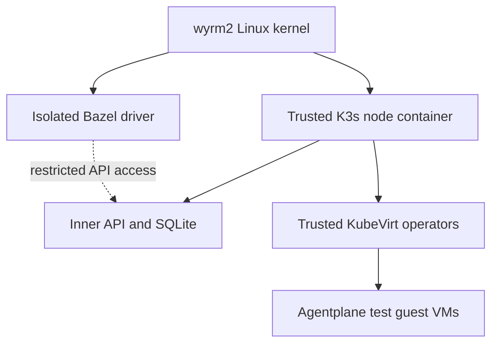

# Persistent KVM test cluster

Agentplane's shared test cluster is a dedicated single-node K3s cluster inside a trusted
privileged Pod on wyrm2. Its API, datastore, CRDs, admission and infrastructure operators
are separate from the outer cluster. K3s uses its default SQLite datastore. The node is
not a VM: its processes, inner container workloads and the outer node share a Linux
kernel. KubeVirt launches the actual Agentplane test guests through `/dev/kvm`.

The driver isolation and restricted API connection are integration work, not supplied by
the node chart. In particular, a namespace flag on an admin kubeconfig is not isolation.

## Node ownership and limits

Git and Flux own the node image, configuration, persistent volume and outer network
policy. Only infrastructure administrators may change them. No test may supply a node
command, access the outer API token, or mount the inner admin kubeconfig. The node has
no outer service-account token, host network, host PID/IPC namespace, host filesystem
mount or container-runtime socket. Its privileged status is an infrastructure trust
boundary: compromising the trusted node or an inner privileged operator can compromise
wyrm2. This design does not provide VM isolation for inner containers.

The entrypoint requires cgroup v2, finite CPU and memory limits on the current CRI
container cgroup, and a fresh cgroup containing only its own process. It creates private
mount and cgroup namespaces, verifies the same limits through the new mount, and moves
the K3s process into `control`. The kubelet uses `/workloads`. Both remain descendants
of the bounded outer container cgroup. Unexpected layout, absent controllers, existing
children or unbounded limits stop startup. Mount propagation becomes recursively shared
only after the mount tree has been made private from the outer host.
The aggregate process/thread limit is at most 8192, preserving any stricter outer
kubelet limit. It covers both the control plane and inner workloads.

K3s data, inner kubelet state, CNI state and logs use one dedicated fixed-size PVC.
Recreate rollout avoids two nodes using the same datastore. Flux preserves the PVC
when its Kustomization is deleted. Inner image pulls use the existing Zot registry cache;
outer egress permits only that cache and cluster DNS. The API is a ClusterIP service,
with ingress limited to the executor namespace. Authentication and authorization are
still required; network access does not grant Kubernetes permissions.

## Tenant access

Infrastructure owns the inner system namespaces and admission configuration. The fixed
tenant namespaces initially match the existing fixture. Baseline Pod Security applies
there, and admission constrains tenant service accounts' namespaced and cluster-scoped
writes, including the policy controller's ClusterRoleBinding operations. The fence
excludes only CREATE requests for Kubernetes TokenReview and SelfSubjectReview, plus
SubjectAccessReview, LocalSubjectAccessReview, SelfSubjectAccessReview and
SelfSubjectRulesReview. These review requests return authentication or authorization
status; they do not persist infrastructure objects, and RBAC must still authorize them.
Kubernetes exempts admission-policy configuration from these API-based rules: RBAC must
deny admission configuration and impersonation privileges. A cluster-admin credential is
therefore never a tenant credential. Separate VM and VMI policies deny host disks,
host/GPU/USB device passthrough, service-account disks and KubeVirt hook annotations.
Their tests use the real Kubernetes CEL engine and pinned KubeVirt OpenAPI schemas;
they do not run KubeVirt's webhook or launcher. Trusted infrastructure installation,
live denial checks and the test adapter remain required before connecting untrusted
tests.

The eventual Bazel driver gets an application identity and a separate Kubernetes
observer identity. The observer may read its Sandbox, VMI and Pod logs, without workload
writes, Secret access, exec/attach, token minting, impersonation or infrastructure writes.
`check_permissions` checks the supplied identity with SelfSubjectAccessReview and fails
on incomplete or unexpected decisions. Its finite matrix is diagnostic evidence; it
does not enumerate all possible grants or test admission.

Shared infrastructure has a pinned version. Tests that change infrastructure CRDs,
operators or admission need an isolated cluster lane. Per-run application deployment,
image delivery, cleanup and capacity leasing must be trusted infrastructure operations;
PR-provided controllers do not get cluster administration as a shortcut.

## Rollout acceptance

The initial Flux Kustomization is suspended. Source tests establish parser, synthesis,
authorization and admission behavior; they do not establish privileged runtime behavior.
Before activation, publish the exact node image and verify its cgroup and mount layout
on wyrm2. Before admitting untrusted tests, verify VM/VMI admission, denied API requests,
network egress and actual guest KVM acceleration. A passing `/dev/kvm` ioctl smoke test
does not prove the Agentplane VM scenarios pass.
