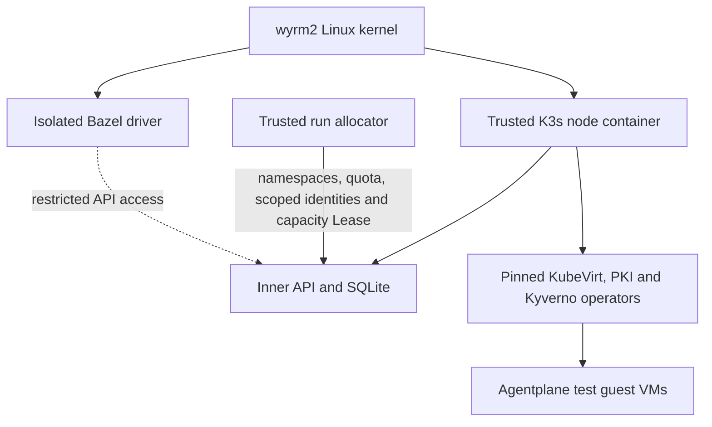

# Persistent KVM test cluster

> **Parked:** this is the prior persistent K3s-in-a-container proposal. The active test
> path uses the static Ubuntu KVM worker and a fresh disposable K3s fixture per action.
> This specification remains as a reference if the shared-cluster design is reconsidered.

Agentplane's shared test cluster is a dedicated single-node K3s cluster inside a trusted
privileged Pod on wyrm2. Its API, datastore, CRDs, admission and infrastructure operators
are separate from the outer cluster. K3s uses its default SQLite datastore. The node is
not a VM: its processes, inner container workloads and the outer node share a Linux
kernel. KubeVirt launches the actual Agentplane test guests through `/dev/kvm`.

The driver isolation and restricted API connection are integration work, not supplied by
the node chart. In particular, a namespace flag on an admin kubeconfig is not isolation.

## Node ownership and limits

Git and Flux own the node image, configuration, persistent volume and outer network
policy. Only infrastructure administrators may change them. No test may supply a node
command, access the outer API token, or mount the inner admin kubeconfig. The node has
no outer service-account token, host network, host PID/IPC namespace, host filesystem
mount or container-runtime socket. Its privileged status is an infrastructure trust
boundary: compromising the trusted node or an inner privileged operator can compromise
wyrm2. This design does not provide VM isolation for inner containers.

The entrypoint starts as PID 1, creates private mount and cgroup namespaces, and verifies
finite CPU and memory limits through the new cgroup mount. It creates `/workloads` for
the kubelet, then execs K3s. K3s itself evacuates its process to `/init` and delegates
controllers through its existing `EvacuateCgroup2` startup helper. Both remain descendants
of the bounded outer container cgroup. Missing or unbounded limits stop startup. Mount
propagation becomes recursively shared only after the mount tree has been made private
from the outer host.
The aggregate process/thread limit is at most 8192, preserving any stricter outer
kubelet limit. It covers both the control plane and inner workloads.

K3s data, inner kubelet state, CNI state and logs use one dedicated fixed-size PVC.
Recreate rollout avoids two nodes using the same datastore. Flux preserves the PVC
when its Kustomization is deleted. Inner image pulls use the existing Zot registry cache;
outer egress permits only that cache and cluster DNS. The API is a ClusterIP service,
with ingress limited to the executor namespace. Authentication and authorization are
still required; network access does not grant Kubernetes permissions.

## Inner infrastructure bootstrap

The node image packages the same pinned KubeVirt, Kyverno admission controller,
cert-manager and trust-manager releases used by the disposable K3s tests, plus the
Agentplane CRDs. It additionally enables Kyverno's cleanup controller for namespace TTLs.
The persistent KubeVirt configuration disables emulation: missing KVM
must fail rather than silently select software emulation. Operator manifests are image
files, outside the persistent data directory, so upgrades use the new image's bundle
without copying large releases into ConfigMaps or retaining old manifest files on the PVC.

The outer node container's fixed `postStart` hook applies the bundle to the inner API
using its inner admin kubeconfig. It waits for CRDs, controller availability and PKI
webhook admission before completing. Hook failure fails container startup; the log is
`/var/log/agentplane-infrastructure-bootstrap.log` on the node's bounded PVC. The hook
may run again after a restart, so application uses server-side apply with a dedicated
field manager and never deletes or recreates the existing infrastructure. Changes that
conflict with another manager fail instead of forcing ownership. This is startup
readiness; the existing readiness probe checks the API, not ongoing operator health.

Admission rules and the cleanup controller's namespace deletion grant come from the
separately generated security seed. The infrastructure bundle does not deploy the application, grant a test an admin
credential, or create a test driver. The outer Flux owner remains suspended pending live
runtime verification.

## Tenant access

Infrastructure owns the inner system namespaces and admission configuration. Each run
gets `ap-test-<uuid>`, `ap-test-<uuid>-credentials` and `ap-test-<uuid>-monitoring`.
The trusted allocator applies the tenant label and Baseline Pod Security. Admission
matches all ServiceAccount usernames with the reserved prefix, rejects malformed run
identities and constrains namespaced writes to that identity's three namespaces. It also
constrains cluster-scoped
writes, including the policy controller's ClusterRoleBinding operations. The fence
excludes only CREATE requests for Kubernetes TokenReview and SelfSubjectReview, plus
SubjectAccessReview, LocalSubjectAccessReview, SelfSubjectAccessReview and
SelfSubjectRulesReview. These review requests return authentication or authorization
status; they do not persist infrastructure objects, and RBAC must still authorize them.
Kubernetes exempts admission-policy configuration from these API-based rules: RBAC must
deny admission configuration and impersonation privileges. A cluster-admin credential is
therefore never a tenant credential. Separate VM and VMI policies deny host disks,
host/GPU/USB device passthrough, service-account disks and KubeVirt hook annotations.
Their tests use the real Kubernetes CEL engine and pinned KubeVirt OpenAPI schemas;
they do not run KubeVirt's webhook or launcher. Trusted infrastructure installation,
live denial checks and the test adapter remain required before connecting untrusted
tests.

The eventual Bazel driver gets an application identity and a separate Kubernetes
observer identity. The observer may read its Sandbox, VMI and Pod logs, without workload
writes, Secret access, exec/attach, token minting, impersonation or infrastructure writes.
`check_permissions` checks the supplied identity with SelfSubjectAccessReview and fails
on incomplete or unexpected decisions. Its finite matrix is diagnostic evidence; it
does not enumerate all possible grants or test admission.

Shared infrastructure has a pinned version. Tests that change infrastructure CRDs,
operators or admission need an isolated cluster lane. Per-run application deployment,
image delivery, cleanup and capacity leasing must be trusted infrastructure operations;
PR-provided controllers do not get cluster administration as a shortcut.

## Run allocation and cleanup

The trusted `lease_bin` CLI takes an explicit **inner** admin kubeconfig. It never runs
inside the untrusted test action. Allocation acquires the single Kubernetes capacity
Lease in `kube-system`, creates the three namespaces with object/storage quotas and
absolute `cleanup.kyverno.io/ttl` labels, then requests separate short-lived application
and observer tokens. The lifetime is bounded to 10–60 minutes; it is not renewed.
Quotas bound object counts and requested storage. Aggregate CPU and memory containment
still comes from the outer node container's cgroup.

The private handoff directory contains allocation metadata, an `agentplane`-audience
application token and an observer kubeconfig. The kubeconfig contains only the cluster
CA and observer token, never the administrator's client identity. The observer can get
its namespace's Sandbox and VMI objects and Pod logs, without the writes or sensitive
reads covered by `check_permissions`. The application ServiceAccount has no Kubernetes
Role; its application authorization is a separate deployment concern.

Cleanup requests deletion with each recorded namespace UID as a precondition. The CLI
waits for namespace deletion before releasing capacity, and never strips finalizers or
deletes cluster-scoped volumes. If a run or allocator crashes, Kyverno's TTL controller
requests namespace cleanup. A later allocation may reclaim an expired capacity Lease
only after all of its namespaces are absent; terminating namespaces continue to hold
capacity. Partial or ambiguous allocation failures are not automatically retried.

These are trusted setup primitives. The application deployment adapter, image delivery,
storage reclamation proof and credential transport into the Firecracker driver remain
integration work. Live TTL deletion and the actual VM runtime still need verification
before the suspended cluster is activated.

## Rollout acceptance

The initial Flux Kustomization is suspended. Source tests establish parser, synthesis,
authorization and admission behavior; they do not establish privileged runtime behavior.
Before activation, publish the exact node image and verify its cgroup and mount layout
on wyrm2. Before admitting untrusted tests, verify VM/VMI admission, denied API requests,
network egress and actual guest KVM acceleration. A passing `/dev/kvm` ioctl smoke test
does not prove the Agentplane VM scenarios pass.
