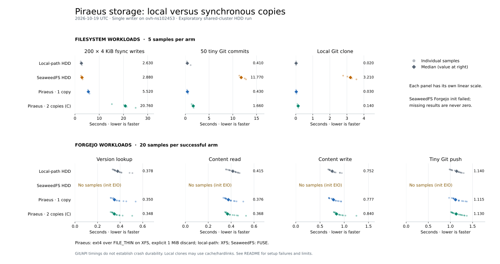

# Piraeus FILE_THIN HDD storage canary

**Status:** completed 2026-10-19. The disposable applications, database, PVCs,
LINSTOR resources, resource groups, and StorageClasses were removed. Cleanup evidence is
in [`results/cleanup-proof.txt`](results/cleanup-proof.txt).

This was an exploratory comparison of HDD storage paths using one active
writer on `ovh-ns102453`. It did not migrate production applications or test failure
handling. The two-copy Piraeus volume was synchronous DRBD protocol C on
`ovh-ns102453` and `ovh-ns103656`, mounted by only the app on the first node. It is an
RWO volume, not RWX, and this is not an HA or failover-tested result.

## Results



Dots show all recorded samples; diamonds and the values at right show medians.
Each panel has its own linear scale. The shaded SeaweedFS SSD row is a historical
reference from **2026-07-11**; the other rows are the fresh **2026-10-19 HDD** run,
including its SeaweedFS filesystem control. SeaweedFS Forgejo samples come from two
fresh-PVC retries later that morning, pooled into one row; the original
initialization failure is retained below. The direct filesystem cells were not rerun.

The historical row reads the preserved
[`direct-storage-ssd-control.csv`](../results/rook_ceph_forgejo_2026_07_11/direct-storage-ssd-control.csv)
and [`forgejo-e2e-ssd-control.csv`](../results/rook_ceph_forgejo_2026_07_11/forgejo-e2e-ssd-control.csv),
selecting only `seaweedfs-ssd`. It has five samples per filesystem operation and 20
per Forgejo operation. July used **two Forgejo replicas sharing RWX**, while October
used **one active replica**. Media, dates, and run conditions differ; the July row
provides historical context. See the [original investigation](../git_storage_latency_and_ha.md).

The tables below contain the October measurements.

The direct workload used five balanced, interleaved rounds per arm. Values below are
median seconds from [`direct-filesystem.csv`](results/direct-filesystem.csv); each cell
has five samples.

| Storage arm                                  | `dd conv=fsync` × 200 | 50 tiny Git commits | local `git clone` |
| -------------------------------------------- | --------------------: | ------------------: | ----------------: |
| local-path-ovh-hdd                           |                 2.630 |               0.410 |             0.020 |
| seaweedfs-ovh                                |                 2.880 |              11.770 |             3.210 |
| Piraeus FILE_THIN HDD, one copy              |                 5.520 |               0.430 |             0.030 |
| Piraeus FILE_THIN HDD, two protocol-C copies |                20.760 |               1.660 |             0.140 |

The end-to-end workload used a single disposable Forgejo instance and 20 samples per
operation per run. Values are median seconds from the raw CSVs. SeaweedFS pools both
successful retries in [`forgejo-seaweedfs-ovh.csv`](results/forgejo-seaweedfs-ovh.csv):
160 rows, or **40 samples per operation**, with an `attempt` column retaining run
identity. Medians use all pooled observations, rather than averaging run medians.
The other three cells come from the initial batch and have 20 samples per operation.

| Storage arm                                  | version | contents read | contents write | tiny `git push` |
| -------------------------------------------- | ------: | ------------: | -------------: | --------------: |
| local-path-ovh-hdd                           |   0.378 |         0.415 |          0.752 |           1.140 |
| Piraeus FILE_THIN HDD, one copy              |   0.350 |         0.376 |          0.777 |           1.115 |
| Piraeus FILE_THIN HDD, two protocol-C copies |   0.348 |         0.368 |          0.840 |           1.130 |
| seaweedfs-ovh, pooled fresh-PVC retries      |   0.389 |         0.461 |          2.376 |           1.615 |

In this run, the Piraeus one-copy Git metadata and the Forgejo app timings were close to
the local-path control. The two-copy arm raised the direct `dd conv=fsync` batch median
from 5.520 to 20.760 seconds and the 50-commit batch from 0.430 to 1.660 seconds. Its
Forgejo contents-write median was 0.840 seconds; the tiny push medians were close and
their sample ranges overlap. The `/api/v1/version` values (0.348–0.378 seconds) show the
app baseline was similar, and the small end-to-end differences do not establish a
causal ranking.

Both SeaweedFS HDD retries completed all 80 samples with successful statuses.
Contents-write medians were 2.290 and 2.448 seconds; tiny-push medians were 1.595
and 1.715 seconds. Each used a newly initialized database and cache on the same
database node, and ran later than the other cells. The second run also had higher
version/read baselines (0.407/0.494 versus 0.355/0.413 seconds), so the differences
between retries cannot be attributed solely to storage.

These are exploratory medians from separate measured passes, not a capacity test. Other cluster workloads
were not isolated, so shared load could contribute to the observed ranges. The direct
`dd` batch explicitly calls `fsync` once per 4 KiB file; report it as the wall time of
that fsync-calling workload, not as proof of equivalent crash or power-loss durability
across XFS, ext4, and FUSE. The Git commit and push workloads do not explicitly set Git's
`core.fsync` policy, and no crash test establishes their durability behavior. Git was
2.52.0 in the common Forgejo image. The local clone can use warm cache or Git's
local-clone optimizations, so it is not cold-read throughput; `/proc/uptime` also has
about 10 ms resolution, limiting interpretation of near-zero clone times.

## October setup and comparability

- The direct benchmark Job and every Forgejo app/client that ran were placed on
  `ovh-ns102453`. The local-path HDD control is same-host storage. The direct workload
  used the historical script's exact semantics:
  200 separate 4 KiB `dd conv=fsync` writes, 50 tiny Git commits, then a local clone.
  It used five balanced/interleaved rounds and retained the original `git clone` behavior.
- The observed direct-job filesystem types were local-path `xfs`, SeaweedFS
  `fuse.seaweedfs`, and Piraeus `ext4`. Piraeus used 1 GiB `Filesystem` PVCs on the
  existing `local-canary` `FILE_THIN` pools, backed by sparse files on the workers'
  existing XFS HDD path `/var/mnt/local-path-ovh-hdd/linstor-canary`. The comparison
  therefore includes both provider and filesystem differences.
- The one-copy Piraeus class declared `auto-diskful=1` and
  `auto-diskful-allow-cleanup=true`; it has no peer. The two-copy class declared
  placement count two and protocol C. Both fresh classes declared
  `auto-rs-discard-granularity=false` and `Disk/rs-discard-granularity=1048576`; the
  verifier captured active 1 MiB discard granularity before timing. The one-copy
  resource was on `ovh-ns102453`; the two-copy resource was UpToDate and Established on
  both prepared HDD workers before direct timing began and before each corresponding
  Piraeus Forgejo client job. Filtered placement and active-settings evidence is in
  `results/piraeus-file-thin-*`.
- An earlier default-4-KiB two-copy setup did not reach steady state: it remained at
  `SyncTarget` 3% for more than 160 seconds. Its timing had already started before the
  invalid state was caught, so all timings from that attempt were discarded and there
  are no accepted samples. The single fresh configured retry reached UpToDate at
  `2026-10-19T05:13:01Z`; its observed sync progression is recorded in
  `results/piraeus-initial-sync-timeline.tsv`. This run only establishes the behavior
  of the fresh declared 1 MiB configuration; it does not establish the cause of the
  earlier stall.
- The default `seaweedfs-ovh` class is media-blind. For this test PVC, the observed
  SeaweedFS volume IDs 1099–1104 were listed only on volume servers with `disk=hdd`
  (replica placement `001`). That is evidence about this PVC's observed chunks, not a
  guarantee made by the class. `results/seaweed-placement.txt` preserves the filtered
  placement output.
- Forgejo used chart 17.1.1 (OCI chart digest
  `sha256:a99352bc5167aba8b58f0de386e777e7fe742bdd573daf82f38986239ff52128`) and the
  same actual app image `15.0.8-rootless` / image ID in every cell. The chart's
  `appVersion` metadata says 15.0.3; the running container image is the recorded 15.0.8.
  The historical reference in the figure comes from the separate July deployment
  described in [`../git_storage_latency_and_ha.md`](../git_storage_latency_and_ha.md).
- PostgreSQL 18.1 ran as one disposable CNPG instance on `ovh-ns104952`, with a fixed
  5 GiB `local-path-ovh-ssd` volume; each Forgejo cell had a separate database. Valkey
  9.1.2 also stayed on that node with no PVC; `--save ""` and `--appendonly no`
  disabled snapshots and AOF. The first local-path cell started with fresh Valkey DB 0.
  SeaweedFS failed before its main benchmark; the
  harness then cleared only this disposable DB 0 before each successful later cell,
  after stopping Forgejo. Reset evidence and method are in
  `results/forgejo-valkey-resets.tsv`. Actual image IDs, versions, PVCs, and placements
  are in `results/runtime-environment.txt` and `results/forgejo-runtime.tsv`.
- The Forgejo chart mounts its variable storage claim at `/data`, so the end-to-end
  comparison varies all Forgejo data paths under `/data`, not only repositories. Each
  repo/data claim was 1 GiB. Database and Valkey placement stayed fixed. The app was one
  replica and each RWO claim had one writer; no production Forgejo users, repos, traffic,
  or secrets were used.
- The SeaweedFS Forgejo cell failed during chart init while closing
  `/data/gitea/conf/app.ini`: the FUSE upload path reported `DeadlineExceeded`, then
  `input/output error`. It produced no end-to-end samples. This records one failed
  setup on this PVC, not universal SeaweedFS incompatibility. See
  `results/seaweed-forgejo-setup-failure.txt` and
  `results/seaweed-csi-pvc-lines.txt`.

## SeaweedFS HDD retry

On 2026-10-19 at 06:25–06:28 UTC, a separate disposable namespace ran the same
Forgejo workload on a fresh 1 GiB `seaweedfs-ovh` PVC. Forgejo initialized with zero
restarts and produced 20 samples per operation: 60 status-200 rows and 20
status-201 rows. The app/client stayed on `ovh-ns102453`; the new PostgreSQL SSD PVC
and ephemeral Valkey stayed on `ovh-ns104952`. Actual Forgejo, PostgreSQL and Valkey
image IDs matched the initial run. The new collection's volumes 1105–1110 were
observed only on HDD servers before and after timing, with placement `001` (two
copies). The class itself remains media-blind.

The original failed app had mounted a PVC already used by the direct filesystem
job, then unstaged and restaged. This retry exercised the fresh PVC's first app
mount, so its success does not establish the cause of the earlier failure or
verify that remount scenario. The direct filesystem samples in the figure remain
from the original batch; only the SeaweedFS Forgejo cell was rerun. No shared
provider configuration changed. A transient API DNS failure interrupted Helm
before it created the app; the same untouched fixture ran after API recovery.

The [retry method](seaweedfs_retry/README.md),
[runtime evidence](results/seaweedfs-hdd-retry-1/runtime.txt), and
[placement evidence](results/seaweedfs-hdd-retry-1/media-check-after.txt)
record the separate attempt. Its
[cleanup proof](results/seaweedfs-hdd-retry-1/cleanup-proof.txt) records removal
of its namespace, two PVs and volume attachments through normal reclaim.

A second fresh-PVC retry ran at 06:38–06:41 UTC with the same image IDs, node
placement, fixture and workload. It again produced 20 samples per operation, all
successful (60 status-200 and 20 status-201 rows). Its collection was HDD-only
before and after timing, with placement `001`. During startup, Stakater Reloader
reacted to the chart-created configuration Secrets and replaced a Pending Pod
under the Deployment's `Recreate` strategy. The accepted Pod completed all init
containers with zero restarts and was the sole active Forgejo writer. Events show
only its successful PVC attachment; absence of an earlier attachment event does
not establish that the previous Pod never mounted the PVC. This remains a fresh
PVC trial rather than a controlled reproduction of the original remount failure.
See [runtime](results/seaweedfs-hdd-retry-2/runtime.txt),
[startup replacement](results/seaweedfs-hdd-retry-2/pod-replacement.txt),
[HDD placement](results/seaweedfs-hdd-retry-2/media-check-after.txt), and
[cleanup](results/seaweedfs-hdd-retry-2/cleanup-proof.txt) evidence. The two successful
retries share one dataset and plot row, with 40 samples per Forgejo operation.
The run-specific evidence and per-run medians above retain their provenance.

## Plot regeneration

The plot reads only the committed CSVs. From the repository root in the Nix devshell:

```sh
bb run //cluster/debug/piraeus_storage_bench:plot_results_bin -- \
  --results-dir "$PWD/cluster/debug/piraeus_storage_bench/results" \
  --historical-dir "$PWD/cluster/debug/results/rook_ceph_forgejo_2026_07_11" \
  --output "$PWD/cluster/debug/piraeus_storage_bench/results/overview.svg"
```

Add `--preview /tmp/piraeus-storage.png` to also render a PNG for inspection.
The SVG omits its generation timestamp and uses stable IDs for reproducible output.

## Harness

The fixtures and scripts are scoped to the dated disposable namespace and unique
benchmark StorageClasses/resource groups in this directory. To repeat the experiment,
first inspect the live cluster for name conflicts and available canary-pool headroom;
choose a new unique suffix for the namespace, classes, and groups rather than reusing
objects. The manual physical-allocation budget for the existing FILE_THIN directory was
20 GiB per node; it is not a quota.

From the repository Nix devshell:

```sh
direnv exec . cluster/debug/piraeus_storage_bench/apply-fixtures.sh
kubectl -n piraeus-storage-bench-20261019 wait \
  --for=condition=Ready cluster/piraeus-storage-bench-db --timeout=15m
kubectl -n piraeus-storage-bench-20261019 rollout status \
  deployment/piraeus-storage-bench-valkey --timeout=10m
direnv exec . cluster/debug/piraeus_storage_bench/run-direct.sh
direnv exec . cluster/debug/piraeus_storage_bench/run-forgejo-arm.sh \
  local-path-ovh-hdd bench_local_path repo-local-path
direnv exec . cluster/debug/piraeus_storage_bench/run-forgejo-arm.sh \
  seaweedfs-ovh bench_seaweedfs repo-seaweedfs
direnv exec . cluster/debug/piraeus_storage_bench/run-forgejo-arm.sh \
  piraeus-file-thin-one bench_file_thin_one repo-piraeus-one
direnv exec . cluster/debug/piraeus_storage_bench/run-forgejo-arm.sh \
  piraeus-file-thin-two-protocol-c bench_file_thin_two repo-piraeus-two
```

`verify-storage.sh` is the gate used before timing: it checks exact resource IDs,
expected nodes and pools, every disk UpToDate, Established peers for the two-copy arm,
one Primary writer on `ovh-ns102453`, active protocol C for the two-copy arm, and active
1 MiB discard granularity. The direct runner holds its start marker until two healthy
observations at least ten seconds apart. The Forgejo runner repeats that gate before
each Piraeus cell.

For teardown, stop the app and benchmark Jobs first and wait for their Pods and CSI
attachments to disappear. Delete the four PVCs through Kubernetes/CSI. The Piraeus
classes use `Retain`: read each current PV's CSI handle, confirm its DRBD devices are
closed and unused, then delete only those exact PVs and LINSTOR resource definitions.
Remove only the corresponding benchmark resource groups/classes and the disposable
namespace. Do not remove the existing `local-canary` pools or provider. This run's
exact identities and post-cleanup checks are in `results/cleanup-proof.txt`.
