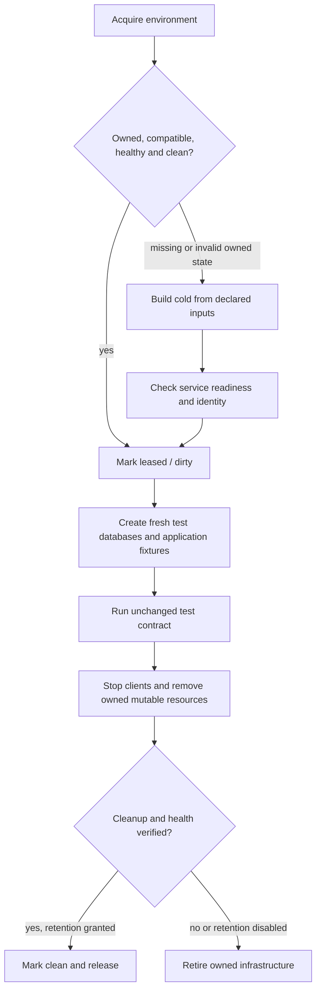

# Reusing integration-test infrastructure

Runner recycling is an optimization around a test's normal setup and teardown.
Tests must pass with a cold environment and with any compatible recycled
environment. Retain expensive infrastructure and immutable caches; allocate fresh
application state for each test at the scope its assertions require.

This document distinguishes current behavior from the proposed lifecycle for
additional reusable services. It does not enable a new pool, daemon, preparation
workflow, or snapshot policy.

Image-family implementation and cold/restored validation are tracked in the
[audit](../debug/2026_11_05_service_reuse_audit.md#implementation-validation).
Those changes cache images while preserving the existing service lifetimes;
the daemon lifecycle below remains a separate proposal. The audit also records
ordinary-CI reuse and a bounded registry-blob prototype; retaining a cache does
not require retaining its service process.

## Current configuration and the save-policy change

| Layer                                | Current behavior                                                                                                                | Owner                                                                                                                                        |
| ------------------------------------ | ------------------------------------------------------------------------------------------------------------------------------- | -------------------------------------------------------------------------------------------------------------------------------------------- |
| Outer Remote Bazel runner            | Hosted Firecracker, recycling enabled, `snapshot-read-policy=newest`, save policy unset                                         | [`.bbrc`](../../../.bbrc)                                                                                                                    |
| Ordinary RBE actions                 | Firecracker, recycling enabled, Docker started; no blanket remote-snapshot opt-in                                               | [RBE platform](../../../BUILD.bazel)                                                                                                         |
| Agentplane K3s tests                 | Infrastructure-derived family, explicit remote-snapshot permission and retention permission; fresh workloads                    | [Macro](../../../agentplane/system_tests/k3s/defs.bzl), [baseline helper](../../../agentplane/system_tests/k3s/baseline.py)                  |
| App browser/bridge tests             | Dedicated image families; servers and test data still follow fresh fixture lifetimes                                            | [BUILD](../../../agentplane/app/BUILD.bazel), [image-reuse evidence](../../../agentplane/app/debug/2026_11_01_thread_browser_image_reuse.md) |
| Shared Python/Go PostgreSQL fixtures | Digest-checked image loading, session migration templates and fresh database clones; containers stop when their action finishes | [Python](../../../util/testing/postgres_fixtures.py), [Go](../../../agentplane/testing/postgres/postgres.go)                                 |
| Self-hosted `kvm-vm` tests           | Docker action isolation inside a VM; recycling explicitly disabled                                                              | [Properties](../../../agentplane/system_tests/k3s/defs.bzl)                                                                                  |

BuildBuddy asked us to remove forced snapshot saves after excessive snapshot
generation. [#14120](https://github.com/agentydragon/ducktape/pull/14120) removed
`remote-snapshot-save-policy=always` from the outer runner;
[#14133](https://github.com/agentydragon/ducktape/pull/14133) removed it from K3s
actions. Keep both overrides unset. Neither change disabled recycling.

Upstream checked on 2026-11-05 at
[`d436b0d87bd124235481a3eda45470d94f6cf7f6`](https://github.com/buildbuddy-io/buildbuddy/commit/d436b0d87bd124235481a3eda45470d94f6cf7f6):

- Ordinary actions need `allow-remote-snapshots=true` to become eligible for
  remote snapshots. CI runner commands are automatically eligible. Eligibility
  and executor service flags are separate from `recycle-runner`.
- For an unset save policy, non-default runs save remotely only when no usable
  snapshot is available. Likely-default snapshots use an age check, whose
  upstream interval defaults to one hour. Branchless ordinary actions fall into
  that likely-default case. This is not a universal once-per-hour allowance.
- Concurrent cold/stale actions can all decide to write. Manifest lookup errors
  can also permit writes. The default decision is not an atomic publication
  lock or a hard organization-wide byte budget.
- Local-only ordinary actions restored from a snapshot do not keep saving later
  image imports into that snapshot. An unrelated generic action can therefore
  seed a baseline that repeatedly lacks a test's required images.

Sources: [eligibility](https://github.com/buildbuddy-io/buildbuddy/blob/d436b0d87bd124235481a3eda45470d94f6cf7f6/server/util/platform/platform.go#L917),
[save decisions](https://github.com/buildbuddy-io/buildbuddy/blob/d436b0d87bd124235481a3eda45470d94f6cf7f6/enterprise/server/remote_execution/containers/firecracker/firecracker.go#L1446),
[interval and executor flags](https://github.com/buildbuddy-io/buildbuddy/blob/d436b0d87bd124235481a3eda45470d94f6cf7f6/enterprise/server/remote_execution/snaputil/snaputil.go#L28),
[branch classification](https://github.com/buildbuddy-io/buildbuddy/blob/d436b0d87bd124235481a3eda45470d94f6cf7f6/enterprise/server/remote_execution/snaploader/snaploader.go#L1758).
The hosted revision and overrides still need provider confirmation. Public
[runner docs](https://www.buildbuddy.io/docs/remote-runner-introduction/#snapshot-save-policy)
describe a different default; do not infer deployed behavior from either source
alone.

## Three separate compatibility boundaries

1. **Runner/snapshot family:** group compatible retained infrastructure using a
   service-recipe version, pinned infrastructure images/binaries, and required
   configuration. Matching a recycling key alone is insufficient: effective
   platform properties, isolation, resource/VM configuration and cache namespace
   also affect matching. Different CPU/VM configurations can need distinct seeds.
2. **Retained service validity:** inspect the actual environment on every attach.
   Verify recipe/configuration fingerprints, owned process/container identity,
   readiness and clean state. A restored VM can contain a dead daemon. A file
   saying that initialization once succeeded is insufficient. Resume may leave
   connections or credentials stale; recreate action clients and check readiness.
3. **Per-action/test inputs:** migrations, application binaries/images, mock
   scripts, credentials, certificates, test data and frontend assets must come
   from the current Bazel action. Validate their digests and build fresh mutable
   fixtures. Avoid putting every application change into the infrastructure
   family: that creates needless cold families and snapshot writes.

For example, a PostgreSQL image/configuration update changes the service recipe.
An application migration changes the migrated-template fingerprint. A changed
test row changes only that test's fresh database. A template retained across
actions would need a content key covering migrations, extensions, role setup and
seed inputs; the current per-session templates already avoid rerunning migrations
for every case without introducing that extra persistence boundary.

Keep state needed after an action outside its workspace, runfiles, test output
directory and test temp directory. BuildBuddy cleans workspaces by default. Do
not enable `preserve-workspace` globally to make daemon retention work.

## Proposed lifecycle for additional retained services

Use the same setup, readiness, reset and cleanup operations for cold and reusable
execution. Keep BuildBuddy-specific permission and invalidation in an execution
adapter. Tests should consume ordinary endpoints/database URLs, with explicit
ownership of their mutable fixtures.

An unrecognized process, container, database or directory is not permission to
delete it. Stop and report an ownership conflict. Cold rebuilding may destroy
only the disposable resources the fixture owns.

The lease must cover preparation through cleanup. A crash leaves dirty state,
which the next attach rejects. Publish the clean marker atomically only after
connections, containers, replication slots, mounts, loop devices and temporary
credentials are cleaned at their required scopes. Bound health and teardown
operations so an unhealthy retained service does not wedge a test.

For PostgreSQL, fresh databases alone do not isolate cluster-global roles,
replication slots, settings or prepared transactions. Define and verify their
ownership/reset too. Preserve migration-from-empty and recovery tests that need
a cold server. Reuse does not justify removing assertions about startup,
supervision, shutdown or crash recovery.

For Props, keep the real registry proxy, authentication, image-definition
recording and per-test manifest deletion. Retaining registry blobs may be useful;
skipping the push/proxy path would remove coverage. Its backend, fake upstream
and agent state remain test fixtures. Digest-cached images are the first step;
live PostgreSQL/registry retention is a separate experiment.

The tested registry-blob prototype in
[#14548](https://github.com/agentydragon/ducktape/pull/14548) keeps one owned
filesystem volume and starts a fresh registry. Upload commit uses a rename, so
separate mounts for uploads and blobs fail. Reset manifests and unfinished
uploads before startup and after shutdown, under the same lease; keep only
content-addressed blobs and repository layer links reusable. Refuse storage
still attached to another container. A process crash releases a file lock without
proving that Docker resources are gone. The nonblocking `filelock` lease disables
soft-lock fallback to preserve native crash-release behavior. Keep retention off
locally by default.
One recipe in `props/testing/exec_properties.bzl` generates the runtime
configuration and BuildBuddy family; change that version for incompatible
storage/reset changes. Image repins and budget changes invalidate both. After
metadata cleanup at attach and release, discard the owned cache if its allocated
storage exceeds 2 GiB. This bounds that cache at those boundaries, not peak
action disk use or total VM storage. HTTP cleanup between test cases cannot
replace the offline reset: it only discovers tagged manifests, leaving untagged
manifests and abandoned uploads. Registry GC would remove the unreferenced blobs
being retained.

The prototype's measured Optimize runs reduced serial image pushes from
12.6–15.5 s to 0.8–1.0 s, with about 550 MiB of volume data before release.
That storage sample is not snapshot-upload bytes, and two worker-local pairs
do not establish fleet or PR-feedback savings. Keep the first enrollment scoped
to Optimize while measuring normal-CI reuse and storage cost; no PostgreSQL
daemon-retention inference follows from this result.

Testcontainers currently owns many containers through context exit and Ryuk.
Changing an execution property cannot override those lifetimes. Any retained
daemon needs explicit lifecycle ownership and process detachment, with logs and
state outside action-local paths. Keep ordinary test resources under their
existing cleanup owners; avoid globally disabling the reaper.

## Preparing and changing a family

The default workflow is lazy preparation by a normal test action. Its fixture
boots or attaches, verifies the baseline, runs the test, cleans mutable state,
then returns. BuildBuddy decides whether to save after action completion.
Application code does not need a separate "save snapshot now" operation.

When changing retained services:

1. Identify whether the change affects infrastructure compatibility, a migrated
   template, or only fresh workload inputs. Update the authoritative recipe and
   its pinned inputs. Bump the recipe version for service-layout/lifecycle changes
   that cannot safely attach to the previous layout; update every consumer in
   the same PR. Keep the full runtime compatibility check. A runtime rejection
   alone can repeatedly rebuild an old snapshot until its next permitted refresh;
   a new compatibility family avoids depending on that refresh for a layout change.
2. Validate a cold action under the new family and a second compatible action
   that actually reuses it. Add a different consumer when cross-target reuse is
   intended. Use `--nocache_test_results` for these explicit test probes so an
   action-cache hit cannot stand in for preparation or reuse. Keep normal caching
   for routine CI.
3. Verify current application inputs, fresh fixture identities, service health,
   cleanup and cold fallback. Include image/recipe mismatch, dirty state,
   dead/wedged daemon, partial preparation and process-identity mismatch tests.
4. Merge the compatible consumers together. Let the new family seed normally;
   old families can expire through the provider cache. Do not broadly invalidate
   old healthy snapshots or restore `always` to accelerate the rollout.

A dedicated preparation workflow is optional future work, justified only if
measured cold-start cost or concurrent seeding needs it. It should run a small
manual preparation/validation target using the same bootstrap and effective
properties as its consumers. Serialize deliberate warmups by family and bound
their cost. One seed does not cover every host/VM configuration or every local
executor. A cached preparation result does not warm anything.

Do not give the preparation action `always` while consumers leave it unset:
execution-property changes can select a different snapshot family. Nor should
every consumer force-save after a nominal preparation job. Upstream exposes an
executor-wide remote read-only flag, but the inspected action properties do not
provide a supported read-only consumer contract. `snapshot-key-override` can also
affect writes. A dedicated publisher/read-only-consumer architecture needs a
provider-supported write-control contract before implementation.

## Local execution and self-hosted executors

Local setup should call the same service recipes and cleanup paths with retention
off by default, using declared Bazel tools/runfiles and a fixture-owned temp root.
No local correctness path should need BuildBuddy APIs, a snapshot ID, a warm
daemon, or production credentials. An optional local reuse mode would require an
explicit root and ownership/lease contract, including crash recovery; it must not
reuse whichever PostgreSQL happens to answer on the developer's machine.

Current K3s retention is granted through a remote execution-property environment
override, keeping local execution on its normal start/stop path. Preserve that
separation when introducing generic service retention. This is fixture
portability guidance: repository policy currently runs Docker/browser tests on
RBE, so these notes do not claim those targets were validated on a local host or
change their execution policy.

Self-hosted OCI/Docker executors can retain paused containers on one executor.
Firecracker adds VM snapshotting and requires suitable host capabilities and
executor flags. These modes need their own lifecycle/eviction validation. Reuse
does not establish shared capacity with BuildBuddy's hosted pools, durable
storage, or one daemon serving all concurrent test actions.

## Acceptance evidence

Record cold/warm/rebuilt outcome and reason, recipe and runtime fingerprints,
service identity, fresh fixture identities, cleanup result and setup/action wall
time. Keep CPU, queue, input preparation, process time and snapshot-transfer cost
separate. Capture bounded diagnostics as undeclared outputs rather than leaking
endpoint credentials into logs.

A VM restore, an image-cache hit, a healthy retained daemon and a fresh database
are separate observations. Compare all intended cases/assertions, including
concurrent leases and cancellation. Retention is acceptable only when cold and
warm paths preserve the same contract and dirty state cannot escape cleanup.
`KEEP_TEST_DB` or equivalent debugging retention must make the environment
ineligible for clean reuse unless the retained data has its own explicit owner.

Save-intent fields in an ExecuteResponse do not establish successful publication
or uploaded bytes. Inspect restore lineage and service receipts for reuse, and
obtain completed snapshot-publication/transfer counters from the provider before
claiming the snapshot-spam problem is resolved. Roll back a reuse experiment by
removing its opt-in and returning to owned cold setup/teardown, keeping the save
policy unset.
