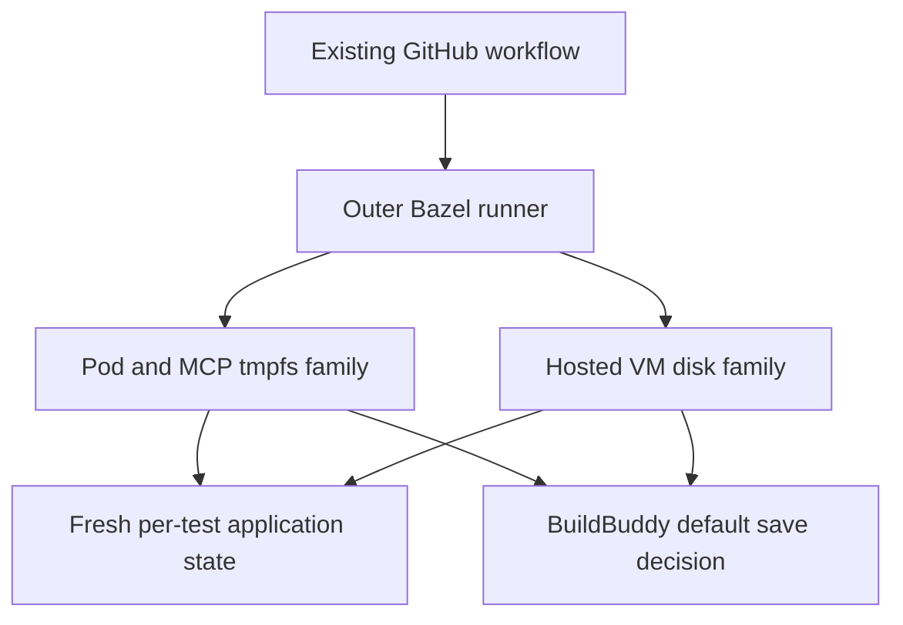

# CI snapshot reuse plan

**Draft for review. No trial or deployment is approved by this document.**

BuildBuddy reported excessive Firecracker snapshot generation and requested removal of `remote-snapshot-save-policy=always`. [#14120](https://github.com/agentydragon/ducktape/pull/14120) removed the outer-runner override; [#14133](https://github.com/agentydragon/ducktape/pull/14133) landed its removal from hosted k3s tests. Keep the current reuse architecture first, validate the default save policy, and defer a separate baseline publisher until evidence justifies one.

The first proposed approval is **two sequential full Pod-suite submissions in one isolated recycling family**, plus their normal outer runners, prerequisite/lint actions and read-only evidence collection. Existing lifecycle-error invalidation remains enabled within that experimental family. This excludes VM/KVM trials, deployments, manual cache invalidation, changes to existing CI families, external messages and implementation rollout. The earlier CI latency goal remains paused.

## BuildBuddy defaults checked

Checked 2026-11-03 against upstream commit [`e79378aab31f690ed0315e5f502e39b1db410e9a`](https://github.com/buildbuddy-io/buildbuddy/commit/e79378aab31f690ed0315e5f502e39b1db410e9a). The four relevant source files are byte-identical to the earlier `9b7bc4f` audit. **The hosted executor revision and service overrides remain unknown.**

| Setting                             | Inspected upstream behavior                                                                                                                                | Ducktape configuration / consequence                                                                                                                                                    |
| ----------------------------------- | ---------------------------------------------------------------------------------------------------------------------------------------------------------- | --------------------------------------------------------------------------------------------------------------------------------------------------------------------------------------- |
| Unset `remote-snapshot-save-policy` | Non-default refs use `none-available`: save only if no usable branch/fallback remote snapshot exists. Likely-default refs take the age-based path instead. | Both overrides are removed. Do not assume every PR branch saves once.                                                                                                                   |
| `min-time-between-snapshot-writes`  | Default is **one hour** for the likely-default path; `always` bypasses the check.                                                                          | Unset. This is not a universal once-per-hour quota across all keys or refs.                                                                                                             |
| Unset `snapshot-read-policy`        | **`local-first`**.                                                                                                                                         | Outer runner and k3s actions explicitly select **`newest`**. Keeping that override initially isolates the save-policy change.                                                           |
| `max-stale-fallback-snapshot-age`   | **24 hours**, for fallback snapshot selection.                                                                                                             | Unset. It is not a freshness guarantee for the branchless k3s family.                                                                                                                   |
| `allow-universal-snapshot`          | True; Git branch routing can add a universal fallback.                                                                                                     | No override. A task without `GIT_BRANCH` gets no Git fallback refs.                                                                                                                     |
| Recycling / remote eligibility      | Recycling is opt-in; ordinary actions need remote-snapshot permission. CI runner commands are automatically eligible.                                      | Root RBE platform supplies `recycle-runner=true`; k3s explicitly allows remote snapshots. A recycling key alone does not enable recycling.                                              |
| Executor service flags              | Local snapshot sharing defaults true; remote sharing, remote read-only mode and snapshot-write throttling default false.                                   | These are service flags, not Ducktape per-action properties. Historical hosted requests show the remote-save path enabled; upstream flag defaults do not identify hosted configuration. |

Source: [save decisions and interval handling](https://github.com/buildbuddy-io/buildbuddy/blob/e79378aab31f690ed0315e5f502e39b1db410e9a/enterprise/server/remote_execution/containers/firecracker/firecracker.go#L1439-L1541), [read default](https://github.com/buildbuddy-io/buildbuddy/blob/e79378aab31f690ed0315e5f502e39b1db410e9a/enterprise/server/remote_execution/containers/firecracker/firecracker.go#L4559-L4568), [intervals and service flags](https://github.com/buildbuddy-io/buildbuddy/blob/e79378aab31f690ed0315e5f502e39b1db410e9a/enterprise/server/remote_execution/snaputil/snaputil.go#L28-L69), [Git fallback routing](https://github.com/buildbuddy-io/buildbuddy/blob/e79378aab31f690ed0315e5f502e39b1db410e9a/enterprise/server/remote_execution/snaploader/snaploader.go#L165-L192), [likely-default classification](https://github.com/buildbuddy-io/buildbuddy/blob/e79378aab31f690ed0315e5f502e39b1db410e9a/enterprise/server/remote_execution/snaploader/snaploader.go#L1755-L1769).

The [public documentation](https://www.buildbuddy.io/docs/remote-runner-introduction/#snapshot-save-policy) calls `first-non-default-ref` the default, which conflicts with this source. Its recommended CI configuration is `none-available`, `local-first` and a 24-hour fallback age. Record this discrepancy and confirm hosted behavior; do not silently equate documentation, current source and deployed settings.

Branchless k3s actions are classified as likely-default in this source: a missing remote manifest can seed the family, followed by periodic refresh. A pin-derived new family therefore does not inherently require a custom publisher. The interval is best-effort: concurrent cold/stale actions can all decide to save, and a remote-manifest read error also permits saving. It is not an atomic rate limit.

There is no per-action read-only consumer property in the inspected parser. `snapshot-key-override` can also select a write key; it is not a read-only mechanism. A publisher/consumer redesign would first need a supported write-control contract from BuildBuddy.

## Preflight evidence

Source baseline: merged Ducktape commit `52421a86166798d31941a11f988a30759ce51485` from [PR #14133](https://github.com/agentydragon/ducktape/pull/14133). This refresh freezes the proposed trial input at that merge commit; the experiment remains separately gated by explicit approval. Any changed input requires renewed review.

| Check                                  | Result / boundary                                                                                                                                                                                                                                                                                                                                                                                      |
| -------------------------------------- | ------------------------------------------------------------------------------------------------------------------------------------------------------------------------------------------------------------------------------------------------------------------------------------------------------------------------------------------------------------------------------------------------------ |
| Post-change PR CI                      | All three required checks on #14133 final head `ea45f152f642fafb3a779c62edf53a8d043cff08` succeeded; the PR was squash-merged as `52421a86166798d31941a11f988a30759ce51485` at `2026-11-04T01:26:26Z`. This is merged-source CI evidence, not a trial result.                                                                                                                                          |
| Actual historical k3s Action + Command | [Hosted VM invocation](https://app.buildbuddy.io/invocation/f64ca131-d578-5607-931d-8e0d694d1f88) verified recycling, remote eligibility, `newest`, old `always` and no `GIT_*` environment names. This is old-policy evidence.                                                                                                                                                                        |
| Actual historical outer runner         | Followed recorded parent linkage to [RemoteBazelRun](https://app.buildbuddy.io/invocation/a48b0afd-6ffb-4c68-aeb8-d94fbf60c27b). Verified old `always`, `GIT_BRANCH=GIT_REPO_DEFAULT_BRANCH=devel`, 8 units and 100 GB disk request. Its cache namespace is `bb-snapshot` with BLAKE3; inner test inputs used empty-instance SHA256.                                                                   |
| Reuse identity and freshness           | Family key derives from retained infrastructure pins. Runtime fingerprint additionally fences helper code, CRDs, rendered releases, actual OCI indices and tmpfs/disk mode. Keep all checks.                                                                                                                                                                                                           |
| Fixture lifecycle                      | Apps, PostgreSQL, certificates and workspaces remain fresh. The clean marker follows cleanup and loop-device release. Existing lifecycle-error invalidation remains; it is not a refresh strategy.                                                                                                                                                                                                     |
| Source case inventory                  | AST inspection counts fourteen `SCENARIOS` entries at the merged source; preserve both harness paths, exclusive storage case and existing concurrency. No collection or test execution.                                                                                                                                                                                                                |
| Trial preparation                      | [Patch](trial.patch) passes `git apply --check` against the merged source without modifying the macro; all four [command blocks](commands.md) pass `bash -n`. These are preparation checks, not trial results.                                                                                                                                                                                         |
| Observation APIs                       | Existing execution lists, inline ExecuteResponse, exact execution lookup and advertised Action/Command CAS reads worked. Raw records remain private.                                                                                                                                                                                                                                                   |
| Completed snapshot metrics             | Tested execution reads expose save intent and lineage, not completed publication counts or snapshot wire bytes. Missing fields are unknown, not zero.                                                                                                                                                                                                                                                  |
| New-policy hosted behavior             | [Existing PR CI](https://app.buildbuddy.io/invocation/8a8caf0c-e3e8-54d4-a4f3-76a13f666912) provides Pod/MCP/VM Action and Command records with save policy unset, `newest`, recycling and remote permission. MCP reused k3s with complete cleanup and no remote-save intent. Pod rebuilt a restored baseline whose marked daemon had exited. These are selected observations, not the proposed trial. |
| First post-merge test results          | [Exact merge](https://app.buildbuddy.io/invocation/3b9e84f6-5173-52be-a86a-f3a308352fb5) and [a descendant](https://app.buildbuddy.io/invocation/fbe855f0-f21b-56e9-929e-e634fcff5b06) passed all 1,779 tests from the result cache. Neither supplies a fresh k3s action or a new warm/cold observation.                                                                                               |
| Provider revision, alert and budget    | Unknown; [question draft](provider-questions.md) prepared but not sent. These facts gate provider-load success claims and a custom cadence/architecture.                                                                                                                                                                                                                                               |

`savedLocalSnapshot` and `savedRemoteSnapshot` in cached ExecuteResponse are decisions made before post-completion work. They do not prove upload completion. Upstream post-completion reporting is feature-gated and stored separately. `snapshot_saved_bytes` counts uncompressed snapshot chunks, not actual network transfer; ordinary action-output upload bytes are not snapshot upload bytes. [Intent fields](https://github.com/buildbuddy-io/buildbuddy/blob/e79378aab31f690ed0315e5f502e39b1db410e9a/enterprise/server/remote_execution/containers/firecracker/firecracker.go#L3201-L3204), [post-completion reporting](https://github.com/buildbuddy-io/buildbuddy/blob/e79378aab31f690ed0315e5f502e39b1db410e9a/enterprise/server/remote_execution/executor/executor.go#L325-L345)

The inspected PR test commits `3322903165489aaa79e98d373027ac44665c2d5f` and `9615f8e1b25d5183fbcebcb795e88c25d07d1826` have byte-identical k3s macro, stack helper, Pod suite and `.bbrc` to the frozen merge. The restored Pod marker was clean and its fingerprint matched; the previous task's receipt was warm with complete cleanup, but its marked process had exited (absent or zombie) on the next attach. Why that daemon exited is unresolved. Keep the health fence and cold fallback; an executor snapshot restore alone does not establish warm infrastructure reuse.

The complete [existing latency report](https://github.com/agentydragon/ducktape/blob/d1524439bfc4152af66a813a6d6ce13be724ca9d/latency/index.html) was reviewed. Its latency and warm/cold populations predate this mitigation. Neither establishes a new-policy saving. Prior negative PostgreSQL persistence, larger CPU, broad sharding and guest-reuse experiments remain scoped negative results.

## Options and decision gates

Keep Bazel action-result caching, OCI image reuse and retained infrastructure. The app/bridge/browser image-derived recycling keys do not themselves opt those actions into remote uploads.

| Option                                    | Gate                                                                                                                                              |
| ----------------------------------------- | ------------------------------------------------------------------------------------------------------------------------------------------------- |
| Existing reuse + default save policy      | **First trial.** Verify cold seed, compatible warm reuse and a suppressed save decision on the hosted service.                                    |
| Explicit interval or `local-first`        | Separate later change, only for observed cadence/transfer costs and an agreed budget. Do not change reads and writes together in the first trial. |
| Versioned publisher + read-only consumers | Only if defaults cannot meet the provider budget and a supported consumer/write-control mechanism exists.                                         |
| New worker pools or boot services         | Separate cost, ownership, isolation and deployment proposal. KVM is not assumed available.                                                        |

## Proposed first approval

Start only after separate explicit owner approval of the experiment. Use merged source commit `52421a86166798d31941a11f988a30759ce51485`; a changed input requires renewed review. A live failure or pending enclosing check blocks new trial work; do not rerun or merge the mitigation as part of this plan.

Use [the reviewed commands](commands.md) and [temporary patch](trial.patch) in an experimental worktree. The patch changes only the recycling-family prefix and `test.retry=false`; it is not applied by this draft PR. Keep save policy unset, `newest`, all runtime fingerprints, resource estimates and test implementation unchanged.

Budget: at most **two sequential submitted full Pod tests**, target `//agentplane/system_tests/suites:test_pod`, normal `--config=ci`, remote cache enabled, `--nocache_test_results`, `--runs_per_test=1`, `--flaky_test_attempts=1`. Each retains 4 estimated compute units / 50 GB scratch request, plus normal 8-unit outer runner and dependency/lint work. This is neither a two-total-action guarantee nor a byte cap. Record unexpected physical retries and stop further submission. No simultaneous seeders, forced saves or manual invalidation.

1. **Seed:** require fourteen passing cases, fresh fixtures, complete cleanup and a clean persistence receipt. Capture effective request, fingerprint, identities, exact key/id and save intent. A new experimental family should be cold; explain any unexpected attachment. Stop on failure or unknown remote outcome.
2. **Consumer:** after reviewing the seed result, submit the identical suite once within the effective refresh interval. Require warm attachment with matching baseline fingerprint/identity, fresh fixture identities, complete cleanup and a false save-intent decision. Distinguish local attach from remote publication using task/snapshot lineage. An unobserved publication plus a cold consumer is inconclusive, not proof of policy failure.

Use existing persistence receipts, transitions, driver/process spans, logs and Action/Command/ExecuteResponse records. Keep setup, imports, cases, cleanup, action wall, CPU and queue clocks separate. If an observer disconnects, inspect the saved invocation ID; never replay an uncertain submission. Stop after the pair. Two runs do not establish CI mean/p90 or provider-load reduction.

## Follow-up, rollout and rollback

- Healthy warm reuse with a suppressed save decision supports keeping the architecture. Collect natural traffic read-only and obtain the provider paging signal/counters.
- A cold consumer requires separating publication availability from key/ref/resource mismatch, fingerprint mismatch, dirty state and health rejection. Preserve the fences; do not add `always` until a run happens to be warm.
- If helper-change rebuilds become material, specify baseline routing/versioning separately. Do not add every app/guest/source revision to the family key and multiply cold families. Preserve full runtime validation until equivalent fencing is proved.
- If concurrent writes still exceed the provider budget, require a supported throttle or explicit publication ownership. An interval alone cannot guarantee a hard cap.

A separately approved next trial would cover naturally aged reuse beyond the effective refresh interval, then the regular **non-KVM** VM family. Preserve all three fresh guests, native supervision/OOM assertions, complete journals/console poweroff evidence and loop-device release. Later rollout must retain OAuth sequence coverage and distinguish ordinary CI from manual/live exclusions.

Before a fleet claim, compare fixed source-labeled natural-traffic windows, with outer runs and inner families separate. Deduplicate physical execution IDs; retain retries, failures, cancellations, pending work and cold/warm/unknown receipts. Obtain completed snapshot-publication and provider byte counters, normalize by comparable workload volume, and report new-family churn separately. Keep required-check latency and retry waits; at least twenty green heads are needed for a reported all-gate mean/p90, with all other outcomes retained separately.

If reuse is unsafe, stop. The experimental family limits cache impact. A separately reviewed fallback can remove k3s executor-persistence opt-in and remote-snapshot eligibility so the helper starts/stops fresh infrastructure. Keep the save policy unset. **Rollback must not restore `always`, weaken validity/cleanup checks, skip coverage or broadly invalidate healthy families.** No numerical latency or snapshot-volume saving is claimed by this plan.
